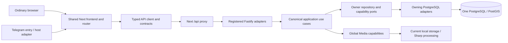

# Runtime architecture

Current source baseline: 10 October 2026. VibeQuest has one shared Next.js/React frontend, one Fastify API and one PostgreSQL/PostGIS authority. HOME, EXPLORE, central-heart SHARE, VIBE and PURSE retain their distinct presentation. Both entry routes and all four locales use the same router, shell, feature components, typed client and theme owner.

## Current composition and execution

`apps/api/src/main.ts` parses database/port configuration, creates the database adapters, supplies the Media root and allowed Web origins, listens on loopback and closes the pool on shutdown. `apps/api/src/app.ts` registers Places, Identity, Profile, Business, Media, Activities, Events, Social Graph and the public Profile projection. It injects authenticated actor resolvers and explicit owner capabilities. It also owns the current 60-second cleanup timer; this is an API-hosted worker, not a separately deployed service.

`packages/database/src/index.ts` creates one bounded PostgreSQL pool and the domain-specific adapters. Its readiness queries check schema availability, including all implemented owners. A shared adapter package does not confer permission to query another owner's business tables.

Representative paths:

- Explore → `readPlaces` → `GET /v1/places` → strict query validation → published-list use case/port → Places spatial repository → validated DTO → render.
- Account/Profile → typed Identity/Profile client → cookie session and Origin checks → Accounts/Profile use case → owned repository → persisted profile/photo relation; Media owns the uploaded bytes and delivery.
- Home Activity → typed create contract → authenticated completed-profile actor → Activities use case → Activity/attachment transaction → public read/card. Profile eligibility and Media attachment authority arrive through explicit capabilities.
- Official Event → the same boundary sequence with approved active Business-owner hosting; Events owns RSVP intentions, reviews and bookmarks independently of Activities.
- Orbit/Echo → typed Social Graph client → session actor → follow/unfollow/list use cases → Social repository; Identity availability and public basic Profile projections are injected, not foreign SQL.

The API client uses the shared Next `/api` rewrite; `API_ORIGIN` selects its server destination. No browser receives database credentials. Empty data and unavailable services remain distinct; no fixtures substitute for real product records.

## Current versus planned

Web accounts/sessions, Profile management/private images, Business applications/membership, published Places, image Media, Activities, Official Events and directed Social Graph are implemented. Detailed source boundaries are in [domain ownership](domain-ownership.md). Their historical verification is in the [checkpoint](../operations/reconstruction-progress.md); documentation inspection is not a new runtime certification.

Gossip/feeds, Drift/accepted matches/Pulls, SHARE moments/connections/Circles, conversations, native challenges, rich discovery, rewards, Purse/financial operations and additional Identity/Media capabilities remain unfinished. Future owners are allocated in the [unchanged master plan](../product/VIBEQUEST_MASTER_RECONSTRUCTION_PLAN.md); do not create empty packages or treat those allocations as finalized schemas.

Telegram currently supplies an entry and partial presentation adapter. Server launch verification/linking and genuine device acceptance remain pending R38 and related gates. There is no separate Telegram account/database/theme/product implementation. See [Identity and host](identity-host-contract.md), [Media](media-contract.md), [database](database-contract.md), [design system](design-system.md) and [technical requirements](../requirements/technical-requirements.md).

Railway is the intended hosting target, not an established deployment. The current loopback binds, local bytes and API-hosted cleanup require separately authorized production preparation. See [Railway requirements](../operations/railway-deployment-requirements.md).
