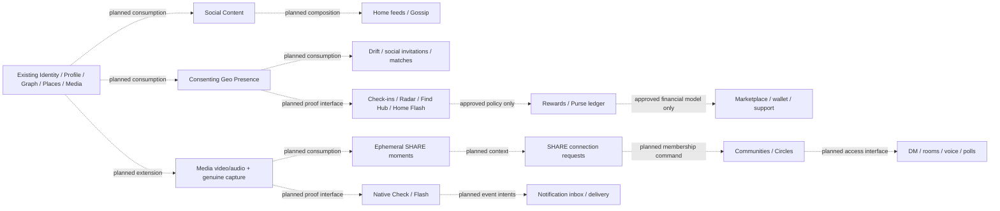
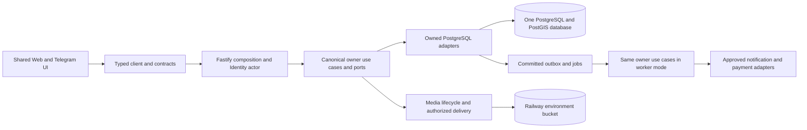
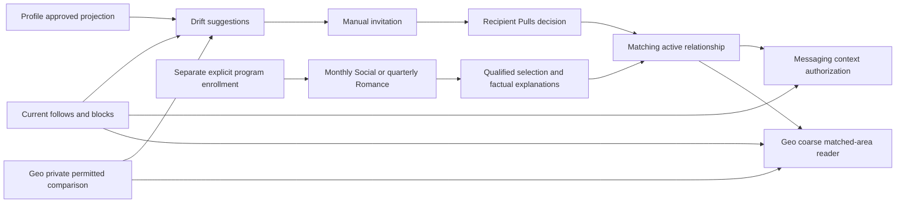
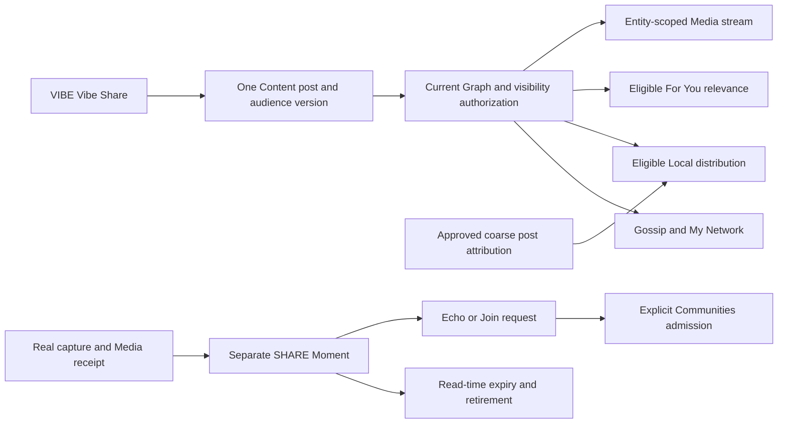
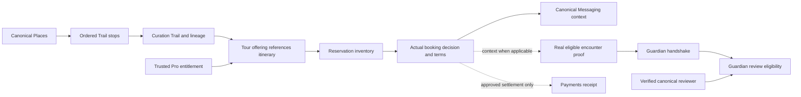
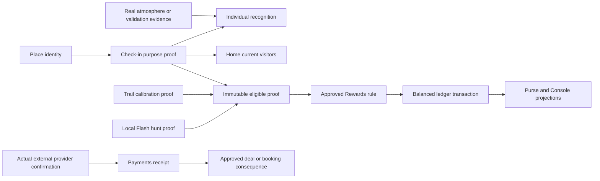

# VibeQuest master product reconstruction and execution plan

Prepared: 10 October 2026. **Active checkpoint: 28 October 2026; R02–R09 source implementation merged; R10 Home presentation slice merged, Drift/Local/For You readers still pending bounded D03 rules; D05 ordinary-location policy approved; B5 remains partial.** B1–B4 remain accepted for initial staging. Full reconstruction and production readiness remain incomplete. Historical checkpoints below are not the current task. This single file is the authoritative live master plan; supporting roadmaps and screen contracts supply evidence, not competing execution authority.

**Goal:** Restore the complete original VibeQuest product through genuine, persisted user journeys while retaining the existing clean foundation.

**Architecture:** One shared Web/Telegram frontend and router, typed contracts/client, one Fastify application and one PostgreSQL/PostGIS authority. Existing canonical owners remain authoritative; future independently meaningful capabilities use explicit interfaces rather than a generic Social/Share service.

**Stack:** Node 24, pnpm 11.1.1, TypeScript, Next/React/next-intl, Fastify, PostgreSQL/PostGIS, existing Sharp Media processing, Vitest and installed Chrome/Playwright. No dependency or provider upgrade is implied.

**Specification:** Original preparation packet `8b56829e-2067-472c-a87a-00589815f35d/Pasted text.txt`; complete architecture reconciliation packet `18e7ce62-a5f0-4c11-ba9e-c5f9d76fbce9/Pasted text.txt` and its legacy-extraction addendum. Only this document may change in the present documentation task. Sections 10–18 define the normative finished-system destination; historical checkpoints remain evidence of earlier work, not current implementation claims. Future executors must read the relevant authorized packet and current source again; this roadmap does not authorize coding, database changes, publication or deployment. Use the applicable execution skill when implementation is separately authorized.

<!-- prettier-ignore-start -->

## Active execution remarks — 19 October 2026

**Authority:** This checkpoint records the owner's acceptance of B4 for the current single-replica staging scope. It supersedes outdated next-task and Railway-status statements dated 10–12 October below. It does not remove or dilute the R01–R50 product requirements. Read live source and the latest GitHub/Railway state before each task.

### R02 source implementation — 19 October 2026

- **Source complete:** [implementation commit `2ad23e52e6034ae9a56fcad5cdb16019f0145513`](https://github.com/funmarket/VibeQuest/commit/2ad23e52e6034ae9a56fcad5cdb16019f0145513), based on foundation `fa75bfc205749b5530c5eb162d256526345cd389`. [PR #15](https://github.com/funmarket/VibeQuest/pull/15) is the canonical integration record for the final head, merge status and resulting foundation SHA; this documentation-only checkpoint follows the implementation commit in that same PR.
- **Behavior:** the existing Shell has one native sticky, compact header. Safe-area padding stays inside it. Brand/Home, Notifications, Account and a 44px Sun/Moon quick-theme action remain available during document scrolling. Quick theme flips the resolved light/dark theme through `@vq/ui/theme.setPreference`; Settings retains Light/Dark/System and the existing Telegram bridge. EN/FR/ES/AR action labels describe the resulting theme. Skip navigation has header clearance and a focusable main target; narrow branding fits without horizontal overflow.
- **R01 preserved:** unchanged `advanceNavigationScroll` and one document-scroll listener; downward hide, upward/top reveal, route reset, five destinations/central heart, keyboard reveal, reduced motion and bottom safe-area clearance remain. Context/location presentation remains a separate normal-flow strip with honest unset location. No GPS/city, R09 capability, duplicate scroll owner, drawer or challenge mechanics were introduced.
- **Verification:** pinned Node 24 / pnpm 11.1.1 / Prettier; formatting, lint, TypeScript and architecture checks passed; 68 unit tests passed on the unchanged rerun after one existing locale-catalog five-second timeout; production build passed. Fourteen installed-Chrome regressions passed: header scrolling across five destinations at 320/390 RTL/430/1280px, all four localized quick-theme labels/persistence/System behavior, hydration-message checks, safe-area/long-label geometry, skip focus, dialog independence/Notifications restoration, three representative existing R01 navbar cases, and the existing simulated host/blocked-storage cases. The new regression first failed against the baseline's missing quick control. Independent source review found no actionable findings.
- **Hosted checks:** [implementation-head CI](https://github.com/funmarket/VibeQuest/actions/runs/39312495181); [PR exact-head checks](https://github.com/funmarket/VibeQuest/pull/15/checks) also cover this checkpoint commit. Confirm successful final-head checks and mergeability before integration. GitHub reported no active branch protection/effective rules during inspection; no settings were changed, and the executor retains the PR plus green exact-head CI gate.
- **Deployment not verified:** Railway Web remains explicitly pinned to `31d5f99d84e277f23c60168dd5f3d12482d87ec3`, deployment `c7380aa8-7b75-40fb-aeac-4b84fa513413`. Local production rendering used real public staging reads; no canonical records were created. R02 source acceptance is not live staging acceptance. Do not change the Railway pin or independently deploy without separate authorization. Actual Telegram hardware/safe-area/device acceptance remains R50; browser host fixtures are simulated adapter evidence.
- **Historical next bounded implementation (19 October checkpoint):** R03, the original sliding Console and dialog interactions, in the existing `ProfileMenu`/Account/Profile/Business presentation. This was superseded by the verified R03 merge on 22 October 2026. B5's required positive live Event Media case still requires a legitimate approved Business host; the completed public smoke did not establish authenticated CRUD or full product parity. The R26/R27 native mechanics and all other R requirements remain outside R02.

### R03 source integration — 22 October 2026 (verified 24 October)

- **Merged implementation:** [PR #18 — R03 Sliding Console](https://github.com/funmarket/VibeQuest/pull/18) merged on 22 October 2026. Integration HEAD is [`77adca6e4d45f33730606aee72d59c51de4e0947`](https://github.com/funmarket/VibeQuest/commit/77adca6e4d45f33730606aee72d59c51de4e0947). [Exact merged-foundation CI run 39819327659](https://github.com/funmarket/VibeQuest/actions/runs/39819327659) finished successfully.
- **Scope verified from merged diff:** Right-edge native Console with `min(80vw, 340px)` presentation, X/backdrop/Escape and right-swipe dismissal (strict >80 CSS px drag or >300 px/s velocity), focus and document-scroll preservation, nested input safety, reduced motion and host Back/route-close wiring. Changes are confined to Console gesture/helper, `ProfileMenu`, `Shell`, Account CSS and focused unit/browser regressions; database, API and domain ownership are unchanged. Browser writing suites now require an explicitly local disposable `vq_test` database URL.
- **Verification boundary:** Codex reports successful local Node/pnpm checks, 43 Chrome regressions and real local Identity/Profile/Business cases. The merged-foundation GitHub Actions check is independently verified successful. The local browser and database runs are documented in the PR, not independently rerun in this documentation task; actual Railway deployment, real Telegram hardware, other browser engines, deployed interaction parity and owner parity acceptance remain unverified. B5 retains its existing scope/status.
- **Next position:** R04 Activities interaction parity is the existing dependency-ordered packet after R03; this record does not authorize starting it.

### R04 source integration — 24 October 2026

- **Merged implementation:** [PR #20 — R04 Activities interaction parity](https://github.com/funmarket/VibeQuest/pull/20) merged into `phase-0-foundation` at [`8535755b87f164241a544994f7936f757ed5aac7`](https://github.com/funmarket/VibeQuest/commit/8535755b87f164241a544994f7936f757ed5aac7), with both exact PR-head checks successful before merge (push run `40098678681`, PR run `40098689933`). Merged-foundation CI is separate and must not be inferred from exact PR-head checks.
- **R04 scope:** Existing Activities presentation, form, card, review, localized Explore navigation and host interactions received the bounded parity work; associated locale, unit/browser regression and Activities implementation documentation changed. Preserve the existing Activities domain, image limit, optimistic versions and durable behavior; no new schema/service or unrelated milestone was included.
- **Verification level:** Codex-reported 71 unit tests, 6 integration tests and 40 targeted browser cases passed. The broader browser run retained three documented stale Foundation assertions; those are not silently recast as R04 acceptance failures or claimed resolved. Those local runs were not independently repeated during the merge. PR-head CI was independently verified; deployment, live runtime, genuine Telegram hardware and owner parity acceptance remain unverified. B5 remains partial.
- **Next position:** R05 Official Events interaction parity is the already-defined dependency-ordered packet; this document does not authorize beginning it.

### R05 source integration — 24 October 2026

- **Merged implementation:** [PR #22 — R05 Official Events interaction parity](https://github.com/funmarket/VibeQuest/pull/22) merged into `phase-0-foundation` at [`38b51fcb392eb7ff52e09858720bc5a90f00ed85`](https://github.com/funmarket/VibeQuest/commit/38b51fcb392eb7ff52e09858720bc5a90f00ed85). Both exact PR-head GitHub Actions checks succeeded (push run `40112300248`, PR run `40112315650`). Merged-foundation CI is tracked independently and is not inferred from those checks.
- **Scope:** R05 completed bounded Events presentation parity: persisted ratings/Going state display, accessible stars, validation before media uploads, truthful action feedback, stale-edit reload, cancellation controls, shared-host haptics and localized Event-to-Explore handoff. The established reference category mapping remains music→Venues, art→Art, cafe/theatre→All with the raw category retained in the URL. Existing Business approval/owner authority, Event persistence, media authorization, RSVP, reviews and bookmarks remain canonical. The 15-file PR touched Events presentation, Explore navigation, four translations, focused tests and implementation evidence; no API, schema or dependency changes.
- **Verification boundary:** Codex reports pinned `pnpm check` success (including 72 unit tests and production build), 8/8 Events/Business integration tests, and focused real-local-API/database browser suites. The exact-head CI checks were independently verified. Physical-device haptics, actual external-map rendering, staging deployment/runtime acceptance and owner parity acceptance remain unverified. The previously recorded Next.js security advisory remains separate; no dependency upgrade was included. B5 status remains partial.
- **Next existing packet:** R06 — original Profile interests and self-profile journey. This documentation does not start R06.

### R06 source integration — 24 October 2026

- **Merged implementation:** [PR #24 — R06 original Profile interests and self-profile journey](https://github.com/funmarket/VibeQuest/pull/24) merged into `phase-0-foundation` at [`f3c99ba25e1603d5f29b3eb78eb786c294515d6c`](https://github.com/funmarket/VibeQuest/commit/f3c99ba25e1603d5f29b3eb78eb786c294515d6c). Exact PR-head checks succeeded: [push CI 40126488672](https://github.com/funmarket/VibeQuest/actions/runs/40126488672) and [PR CI 40126516154](https://github.com/funmarket/VibeQuest/actions/runs/40126516154). Merged-foundation CI is separately tracked and cannot be inferred from PR-head runs.
- **Scope:** The 20-file change implements the original self-profile editing journey, ten interest presets and custom interests, additional private Profile fields, 450 ms handle feedback, photo preview/update/remove and save/cancel/error flows. It extends Profile-owned contracts, API/client and persistence with additive migration `0014_profile_personal_fields.sql`, relevant translations, tests and implementation evidence. Existing eligibility remains unchanged; the approved four-field public projection remains unchanged pending D01; Cozy Diary data does not grant verification or privileges. Profile/Identity/Media ownership remains intact.
- **Verification boundary:** Codex reported 77 passing unit tests, 42 focused integration tests, targeted Profile/browser regressions and a passing production build; the exact-head GitHub CI runs are independently confirmed. Physical Telegram/device behavior, staging runtime, owner parity acceptance and the pre-existing Next.js security advisory remain outstanding. B5 remains partial.
- **Next existing packet:** R07 — persistent Social Content and Gossip. Its existing D02 audience/moderation policy dependency remains binding for writable release; this record does not resolve D02 or authorize starting R07.

### R07 source integration — 25 October 2026

- **Merged implementation:** [PR #27 — Persistent Gossip, audience authorization and moderation](https://github.com/funmarket/VibeQuest/pull/27), head `5d47da2b49f82f8affdb58171a495c03124f2b5c`, merged into `phase-0-foundation` at [`8c9cd1c5f913409a70779bc9ab419d52c4c9cdc0`](https://github.com/funmarket/VibeQuest/commit/8c9cd1c5f913409a70779bc9ab419d52c4c9cdc0). Both exact PR-head checks succeeded: [push CI 40229324241](https://github.com/funmarket/VibeQuest/actions/runs/40229324241) and [PR CI 40229327606](https://github.com/funmarket/VibeQuest/actions/runs/40229327606). Merged-foundation CI must be checked separately.
- **Scope:** 57 changed files deliver canonical persistent Social Content posts, chronological My Network Gossip, composer/image attachment and localized presentation, current Public/Followers-only audience and editable audience, Graph-owned following/mutual blocks, secure Media-owned restricted delivery, comments/tombstones/reactions, author edit/delete with 11-day post restoration, reporting/authorized moderation and 30-day pending/post-decision evidence clocks. Original Local Vibes distribution remains unavailable, without R09/R10 discovery. Identity adds only the dedicated `content.moderate` permission check; no account received a grant or moderator bootstrap. Separate implementation evidence: `docs/operations/content-implementation.md`.
- **Verification boundary:** GitHub exact-head CI checks were independently verified successful before merge; 83 unit, 52 integration and 12 Chrome tests, plus format/lint/types/architecture/build, are Codex-reported and were not independently rerun in this documentation step. The complete 57-file PR patch and relevant access/retention paths were inspected before merge; no blocking review or overlapping PR was found. Physical-device/Telegram acceptance, deployed staging runtime and moderator assignment remain unverified. The existing Next.js advisory remains unresolved; no dependency upgrade or deployment was authorized. B5 is still partial.
- **Next existing packet:** R08 — Home network feed and post actions, consuming R07 Social Content without duplicate post ownership. R08 implementation is not authorized by this documentation record.

### R08 source integration — 26 October 2026

- **Merged implementation:** [PR #29 — R08 Home Network Feed and Post Actions](https://github.com/funmarket/VibeQuest/pull/29), exact implementation head `5364e44c5e8c75346ef50ef1ef0eea405b715929`, merged into `phase-0-foundation` at [`bce50dde91432d6ec77e6dc98a2734f279618b06`](https://github.com/funmarket/VibeQuest/commit/bce50dde91432d6ec77e6dc98a2734f279618b06). Both exact-head GitHub checks passed: [push CI 40240149923](https://github.com/funmarket/VibeQuest/actions/runs/40240149923) and [PR CI 40240173413](https://github.com/funmarket/VibeQuest/actions/runs/40240173413). Merged-foundation CI is separately tracked.
- **Scope:** The 13-file change connects Home My Network to R07's canonical Social Content feed, real Profile authors and timestamps, restricted Media images, likes/comments/counts, cursor continuation, authorized deep-linked post views, clipboard success/denial, and original-compatible mobile Home post presentation. No new backend endpoint, database table, migration, Social owner or R09/R10 discovery reader was introduced. Local Vibes/For You remain honestly unavailable, and R47 tipping remains deferred. Implementation inventory: `docs/operations/home-network-implementation.md`.
- **Verification boundary:** Exact-head push and PR checks independently verified before merge. Codex reported nine focused unit tests, seven integration tests, seven installed-Chrome tests (including 48 width/locale/theme combinations), plus formatting, lint, types, architecture and build; these local tests were not independently rerun during merge or this documentation update. Complete 13-file diff and relevant Home/Content/Media interactions were reviewed before merge. Physical device/Telegram, Railway deployed staging, and the existing Next.js advisory remain outstanding. B5 is still partial.
- **Next existing packet:** R09 — consenting Geo Presence and readable area, under the approved D05 ordinary-location policy and subject to current-source/host-capability verification. This record does not authorize R09 implementation or deployment.

### R09 source integration — 26 October 2026

- **Merged implementation:** [PR #33 — R09 Consenting Geo Presence and Readable Area](https://github.com/funmarket/VibeQuest/pull/33), exact implementation head `34bf89deb62188bdd9249a9ef7264d60a8756939`, merged at [`6a517772935ae1d8b73316cd63786f3b4a1ecae8`](https://github.com/funmarket/VibeQuest/commit/6a517772935ae1d8b73316cd63786f3b4a1ecae8). Exact-head [push CI 40402198513](https://github.com/funmarket/VibeQuest/actions/runs/40402198513), [PR CI 40402249896](https://github.com/funmarket/VibeQuest/actions/runs/40402249896) and [merged-foundation CI 40406356626](https://github.com/funmarket/VibeQuest/actions/runs/40406356626) all succeeded.
- **Scope:** 52-file implementation adds canonical `packages/geo`, typed contracts/API client and authenticated Geo API; additive `0020_geo_presence.sql` for consent, latest position and coordinate-free session participation; approved D05 five-minute/100-meter fix validation and fifteen-minute expiry; logout, withdrawal, permission-loss and concurrent-session safeguards; private server-held nearby Places lookup; shared Shell/Home/Explore/Settings access and location presentation with EN/FR/ES/AR. Manual public browsing remains independent of GPS. Original reference evidence and parity inventory are documented in `docs/superpowers/plans/2026-10-26-r09-geo.md`; implementation inventory in `docs/operations/geo-implementation.md`.
- **Verification boundary:** Exact-head and merged-foundation GitHub CI independently verified successful. Codex reported 88 CI unit tests, 90 local PostgreSQL integration tests, 23 R09 installed-Chrome scenarios and 11 affected browser regressions, plus formatting/lint/types/architecture/build; these local suites were not independently rerun in this documentation update. Real GPS/Telegram hardware, owner-screenshot pixel parity, Railway runtime and hosted migration acceptance remain unverified. The existing Next.js security advisory remains unresolved; no provider or deployment change is implied. B5 remains partial. Accepted-match disclosure awaits R11; later venue proof, geofences and AI remain deferred.
- **Next existing packet:** R10 — Drift discovery and Local/For You readers, subject to current source, original reference and D03 eligibility/scoring/preference decisions. R10 is not implemented or authorized by this documentation record.

### R10 Home presentation slice — 28 October 2026 (source merged; R10 incomplete)

- **Integration:** [PR #36](https://github.com/funmarket/VibeQuest/pull/36), exact head `fe681cf11caf69acf113114671ca618eb475eae9`, merged as foundation `5e933fe0658c2898dd1461314de7935611a6967d` from `0d923f70c53401e7d2c56e36b15c3d3e55b88860`. The owner's R10 packet and subsequent clarification authorized this independently valid Home slice through merge and plan synchronization. This is not complete R10 discovery or authorization for R11/deployment.
- **Home behavior:** Check-ins → unchanged Flash → the single existing My Network / Local Vibes / For You presentation → Live Activities → Live Events; remaining sections keep their relative order. Flat balanced three-column tabs replace the scrolling boxed rail, with source-gold underline/dark text, readable light-theme gold, keyboard/RTL selection and no route change. Existing green/blue gathering owners retain real images/emoji fallback, details and actions; source-proven padding/thumbnail gaps, Event status/category/Going hierarchy, gold rating and circular expansion tray are restored without invented facts.
- **Ownership preserved:** My Network still consumes canonical Social Content; Activity/Event publishing/hosting, eligibility, RSVP, reviews, bookmarks, edit/cancel and Media permissions retain their original handlers. No API, domain, database/migration, dependency, provider or global-shell change. Ten implementation files changed; see [implementation evidence](../operations/home-presentation-implementation.md) and PR diff.
- **Original evidence:** supplied `vibequest.zip` (350 entries) and extracted Gemini app; four relevant Drift/Home feed/Activities/Events source files matched ZIP bytes. The 2026-10-28 page-by-page reference was inspected. The separate three-tab screenshot was unavailable; available source and explicit presentation requirements supported this slice. No pixel-exact original-runtime parity claim.
- **Local verification:** formatting, lint, TypeScript, architecture and production build passed; 16 focused Activities/Events/Content integration cases; 16 final Chrome visual cases covering 320/360/375/390/393/412/430/768/1280px, EN/FR/ES/AR, light/dark and RTL; six unique real browser journeys (Activities one, Events one, My Network four), including persistence, audience/block/Media regressions. Local unit run verified 86 unique non-hook cases after one unchanged Places timeout passed in isolation. The Event test closes its external Maps popup/restores parent focus before unchanged Explore assertions; product navigation handlers were not modified. Layout fixtures are distinct from real API-backed tests and device acceptance.
- **Hosted verification:** exact-head [push CI 40731204253](https://github.com/funmarket/VibeQuest/actions/runs/40731204253) and [PR CI 40731248829](https://github.com/funmarket/VibeQuest/actions/runs/40731248829) succeeded; full CI included all 88 unit tests, including both Windows-local hook fixtures. [Merged-foundation CI 40731608558](https://github.com/funmarket/VibeQuest/actions/runs/40731608558) succeeded at `5e933fe0658c2898dd1461314de7935611a6967d`. No unresolved GitHub review threads or overlapping PRs were present at the merge gate.
- **Approved philosophy retained:** quarterly complementary Romance/Polar automatic matches, monthly similarity/activity Social automatic matches, ongoing broader Drift suggestions without automatic relationships, and the separate invitation → Pulls → Accept/Ignore → Vibes path remain distinct. Ordinary discovery filters do not enroll users in automatic programs. Frequencies, complementarity/similarity, activation, labels and report existence are settled; do not reopen them or implement the scheduled programs under R10.
- **Next existing work / narrow blockers:** finish R10 Drift and Local/For You readers after ordinary filter compatibility, deterministic wavelength/ranking tie-breakers, numerical discovery/anti-abuse limits, coarse area/post attribution and manual/no-GPS behavior, For You relevance/no-interests fallback and permitted cross-user Geo comparisons are settled. The reference's seeded/fallback profiles and fixture feed arrays do not establish approved production policies. Missing readers remain planned/unimplemented, not newly proven defects. R11 remains deferred.
- **Acceptance limits:** no Railway deployment, hosted migration, physical-device/Telegram or exhaustive original-runtime visual acceptance. The existing pinned Next.js advisory remains unchanged. B5 stays partial; later release/device acceptance remains pending. This documentation record creates no new implementation/deployment authority.

### D03 owner decisions and original-reference reconciliation — 27 October 2026 (policy record, no implementation)

**Source status:** The owner supplied a Gemini read-only forensic report of the old application (27 October 2026). This is *reported historical source evidence*, not independent validation of the original runtime, architecture or deployment. The newer active Gemini ZIP has now been inspected for the specific mechanics recorded in the updated reference crosswalk below; source inspection does not establish deployed/runtime parity. Continue checking the specific current reference and later implementation evidence. Do not duplicate the legacy localStorage, fixture profiles, Supabase/Firestore splits, hardcoded fallback candidates or security assumptions in the canonical implementation. Current GitHub and this master plan retain implementation/decision authority. **R10 remains the next planned milestone; no R10/R11 code, deployment, provider choice or new milestone is authorized by this record.**

**Approved R10 discovery direction (D03-1–6):**

- **D03-1:** Drift eligibility/relevance uses the selected original wavelength together with relevant genuine Profile interests and descriptions. Preserve the twelve original wavelengths, selection/back/cards, and self-exclusion. No simulated candidates, unconditional keyword fallback or invented matches.
- **D03-2:** Preserve the original discovery preference choices **All / Friendship / Colleagues / Romance**, but make them genuinely affect authorized discovery. Profile owns preferences; the historical transient React filter must not become a second canonical store. Exact preference semantics and eligibility effects still require bounded definition before coding.
- **D03-3:** Use **deterministic, explainable relevance ordering without numerical compatibility percentages**; the historical separate Discover scoring formula is not an approved Drift ranking algorithm. Exact tie-breaking/weighting must be source/decision grounded.
- **D03-4:** **Global discovery**, with **optional coarse-area relevance only for properly opted-in users**; no GPS participation requirement, public exact location, block bypass or automatic cross-user disclosure. Geo owns consent/scoped location and Graph owns blocks.
- **D03-5:** Home **Local** selects authorized genuine Content using coarse Geo area; Home **For You** uses selected interests and transparent relevance. Preserve canonical Content audience/blocks. No static seeded posts, fake areas or second feed database. Browsing without GPS must remain usable; exact fallback behavior still needs definition.
- **D03-6:** Define **additional explicit product thresholds** for candidate enumeration, discovery request rates and repeated actions before implementation; do not let an agent fabricate numerical limits. Existing security conventions remain binding.

**Approved automatic matching direction (distinct from suggested discovery and the original invitation flow):**

- **Romance / Polar Match:** rare, **every three months**; explicitly opt-in; complementary behavior/individuality/energy/routines with compatible relationship goals and deal-breakers. A qualifying pair becomes an **automatically active Romance Match without mutual swipe/accept**, with communication immediately enabled, a distinct Romance label, a personalized evidence-grounded explanation delivered to both, and easy pass/disconnect. Do not assert inferred psychology as fact or reveal sensitive/private evidence.
- **Social Match:** **once per month**; distinct label **Social Match**; practical similarity using shared sports/activities, social-place interests and authorized coarse proximity when available. Automatically active with immediate communication and pass/disconnect, subject to appropriate consent/eligibility and a grounded explanation.
- **Suggested Matches:** ongoing, looser discovery recommendations, **not** automatic relationships; do not grant messaging or match-only Geo rights. A user may receive both automatic match types. No suitable consenting eligible candidate means no invented match; cadence denotes opportunities, not guaranteed matches.
- Preserve the original **Drift invitation → Pulls → Accept/Ignore → Vibes** pathway as a separate manual matching mechanism. One accepted invitation established a match in historical source evidence; mutual following never automatically matches. Native dual-camera VibeCheck and venue check-in are distinct capabilities. The historical **33-second social-request expiry** is not approved as a production rule.
- **Ownership:** one canonical Matching authority for active relationships/invitations/scheduled policies and reports; Profile owns declared preferences, Identity eligibility, Graph follows/blocks, Geo private location consent, Content authorized feed reads, Messaging communication authorization when implemented. Do not introduce a parallel romance/social match store or silently give R10 later R11/R17 work.
- **Still unresolved for safe implementation:** precise matching eligibility/consent and sufficient behavioral evidence; automatic-match scheduling semantics (calendar vs individual cooldown), unsuccessful-run retry, disconnect/re-match policies, explanation source/retention/privacy, exact discovery/anti-abuse thresholds; manual invitation expiry/duplicate/crossed/retraction rules; policy-based preference meanings, ranking/tie-breakers and no-GPS Local fallback. Resolve by owner decision and current-source preflight, not guessing. Reconcile new automatic-match scheduling/reporting within existing milestones and R17 Messaging dependency; **do not invent an extra R51** or prematurely implement it under R10.

### R32 Vibe Trail historical mechanics — reference evidence only (27 October 2026)

Gemini reports the original **Explore → Vibe Trail** was a **human-curated, multi-stop day-trip itinerary**, not AI-generated recommendations or a single-place bookmark list. Reported historical source files include `features/explore/hooks/useVibeTrails.ts`, `components/VibeTrailsSection.tsx`, `TrailDetailModal.tsx`, `CreateTrailModal.tsx`, `TrailRemixTree.tsx`, `services/trailCache.ts` and `types.ts`. The newer active app ZIP has been inspected for these source components; its live/runtime behavior is not independently verified. See the updated XREF-05 crosswalk, including Vibe Tours and Vibe Guardians.

**Preserve for R32 parity evaluation:** Explore carousel and Home gateway; original reported **2–10 ordered stops**; cover/category/name/curator attribution and adoption count; human-authored story, stop time-of-day, visit durations and insider tips; create studio with add/remove/reorder; map preview with numbered pins and honest schematic fallback; multi-waypoint **walking directions handoff**; save/offline viewing; **Adopt & Remix** cloning with original stop order and provenance; community remix lineage tree. Gemini also reports a radar recenter action and cultural-passport recognition. These are source-evidence candidates to verify against the forthcoming ZIP and reconcile with the existing R32 contract, **not already-approved new implementation scope or guaranteed working historical behavior**.

**Canonical implementation boundary when R32 is authorized:** Trails/curation owns authored itinerary, ordered stop links, adoption lineage and provenance; **Places** owns venue identity/coordinates; **Media** owns binaries; Identity/Profile own creator facts; **Geo** owns private device position; provider adapters own maps/directions; offline local cache is only a projection, never the authoritative record. Do **not** copy historical Firestore `vibe_trails`, Firebase rules, localStorage as backend truth, Google Maps dependency, arbitrary coordinates, staged seed data, or old component architecture. Existing R32 dependency/order and separate single-place Coordinates journey remain in force. Map/provider choice, offline guarantees, remix permissions/counters, licensing and actual runtime parity need later R32 reconciliation after ZIP inspection.


### Updated original-product reference crosswalk — 28 October 2026 (ZIP inspected; specification only)

**Evidence hierarchy:** The inspected original Gemini archive `vibequest (2).zip` (350 entries) is the newer historical product reference. It informs user-facing screen order, interactions, feature mechanics and feature-to-feature journeys. The owner's newer explicit decisions supersede legacy mechanics. This document and the **live** `phase-0-foundation` source govern reconstruction; neither the legacy React component tree nor its localStorage/Firestore/fixture data model is an implementation blueprint. Evidence labels below: **ZIP** = present in static source (not production/runtime-verified); **OWNER** = newer approved requirement (not asserted to exist in ZIP); **CURRENT** = presently implemented in the reconstruction; **FUTURE** = authorized milestone not yet built. Check current source again at implementation time.

**Backend-state discipline:** An unimplemented future owner/API/database operation is **PLANNED**, not a regression. UI shell ≠ working backend; source merge ≠ deployed runtime; seeded local data ≠ genuine product. Assess each feature independently at UI, backend, integrated and runtime-verified levels. Never make functional success claims from an attractive placeholder. Preserve R01–R09 integrations, the R10 Home presentation slice and the dependency-ordered milestone gates; do not restart them or import legacy state.

#### XREF-01 — One Vibe Share publication, three social views (OWNER + ZIP)

**Required end-user invariant:** A user who publishes a **message, photo, or message with photo via VIBE → Vibe Share/Gossip** creates **one canonical Social Content post**. That same post is available in **VIBE → Gossip**, **Home → My Network**, and **Home → Local Vibes** under the respective audience, block, and location-distribution rules. These are **three authorized projections of one post ID**, not three posts, three writes, or two separate backends. Author sees their own authorized post in Gossip and My Network. Local Vibes includes it in its correctly attributed coarse area; provide a legitimate area-selection/attribution journey without requiring continuous GPS, subject to D05 privacy. Do not silently drop an otherwise eligible share from Local. For You may recommend the same authorized post based on genuine relevance; it is not an unconditional fourth destination. A restricted-audience post must never be widened merely because it is geographically local.

**Verified ZIP wiring:** `src/components/chat/VibeCenterView.tsx` renders the **Vibe Share** affordance, Gossip composer and Gossip results; `src/features/chat/components/GossipInlineComposer.tsx` calls `socialFeedService.createPost` with text/photo/venue/emoji/actor fields; `src/services/socialFeedService.ts` writes a social-post array **and a second Home custom-post array** in browser storage, optionally pushes to Firestore and sends `vq-post-created`; `src/features/home/components/HomeFeedTabs.tsx` merges Home custom posts with seeded tab posts. **These duplicated stores, seed items, optimistic pseudo-sync and broad cross-tab mixing are historical implementation defects, not approved design.** ZIP Gossip filters by actor/follow/match and includes seed exceptions; do not copy those exemptions. The separate SHARE page's `ShareVibeModal.tsx` and `ShareGoodVibesScreen.tsx` must **not** be conflated with VIBE Gossip publication: inspect each entry point's publishing destination before unifying semantics.

**CURRENT source ownership:** R07 owns canonical Social Content posts, audience enforcement, comments, reactions, moderation and Media links; R08 renders My Network through that owner. `apps/api/src/modules/content/http.ts` registers `/v1/content/feed`; `apps/web/src/features/home/home-page.tsx` renders one My Network reader while Local/For You currently display an explicit empty state. There is no R10 Local backend reader yet. Therefore this is **an R10 distribution/reader requirement, not a claim that Local is broken after completion**.

**New implementation contract:** VIBE composer and Home post actions consume **the same existing Content publish/read contract**; extend only where current contracts genuinely lack required post metadata. A successful publish returns one durable post ID and owned Media attachments; all three views query Content-authorized projections and independently invalidate/reload on publication. Cross-view consistency is server-backed (not localStorage synchronization or arbitrary browser events). Graph supplies follow/block audiences; Profile supplies authors; Geo supplies consent/private observation only; an appropriately approved **coarse post area** is stored/derived by its canonical owner without exposing raw private location. Do not infer an author's position from a reader's coordinates, expose the author through a geolocation side channel or globally release followers-only content. Explicit tests: publish text/photo/combined → the **same ID** in Gossip, My Network and eligible Local area → reload/other signed-in viewer permissions → own/follow/blocked/restricted cases → area/no-GPS/manual-area → media security → edit/delete/moderation remove consistently. No new feed database, fake item, shadow Graph or duplicate Media store.

#### XREF-02 — HOME (ZIP product order + newer owner presentation)

**Current accepted Home sequence:** existing location/header and Vibe Check-ins → unchanged Flash Alert → fixed flat **My Network | Local Vibes | For You** three-tab feed → Live Activities → Live Events → remaining sections in their existing relative order. PR #36 implemented and merged the structural/presentation slice; this must not be reimplemented under R10. Preserve non-scrollable equal-width tabs, gold active underline, mobile/RTL/keyboard states and unchanged Flash banner. Current Activity/Event domain logic and underlying records remain authoritative; the newer Gemini Live Activities/Events card hierarchy is a **visual reference**, not permission to replace hosting, participation, RSVP, save, reviews or media code.

**ZIP original Home journeys not to lose later:** visible current vibe/check-ins, Flash-event hero/list/hunt/create, social tab feeds with author/media/like/comment/share, Live Activities and Business-hosted Live Events, daily streak/points, Vibe Trails and Curated Coordinates gateways, Local Gems, radar/compass, guide and Find Hub. Preserve original page-relative order wherever not superseded by the owner's new Home feed position. Plan crosswalk remains HOME-01–09 and the corresponding R24/R28–34/R37/R44/R47 owners; a Home card does not own the entity it displays.

#### XREF-03 — VIBE, Drift and matching (ZIP + D03 OWNER; R10 / R11 / R17)

VIBE contains Gossip, Drift, Vibes, Orbit, Echo and Pulls, plus the owner-approved distinct matching experiences. **R10 now**: wavelength selector with twelve original categories, back/reselection/count, genuine candidate cards, Profile navigation, Graph follow/block, and actual discovery preference application; global discovery without mandatory GPS, optional permitted coarse relevance; deterministic explainable results and truthful empty/loading/error cases. Use bounded server-side matching-discovery reads consuming Profile/Identity/Graph/Geo *ports*, not the Gemini `DriftView` seeded arrays, client-side scoring or arbitrary fallback matches. **R11 later**: directed invitation → recipient Pulls Accept/Ignore → accepted Vibes, idempotency/expiry and correct mutual state; do not auto-match from mutual follow. **R17 later**: real communication authorization and Messages. **Automatic matching program later**, separate from R10 suggestions and R11 manual invitations: quarterly opt-in productive-complementarity Romance/Polar Match with compatible declared values/deal-breakers, monthly opt-in sports/social-place similarity Social Match with appropriate proximity, both becoming active without secondary swipe, immediately communicable only when canonical Messaging is ready, rationale to both, disconnect/pass, no fabricated psychological evidence. Suggested Drift recommendations never silently establish a relationship. Keep one canonical Matching relationship owner, Profile-owned preferences, Graph-owned blocks/follows, Geo-owned location, Messaging-owned messages. Match-only Geo disclosure cannot be silently granted by showing Drift suggestions.

#### XREF-04 — EXPLORE and local Places (ZIP, later R28–R36)

Preserve location/manual area and search, categories, map/radar/heatmap/list, place cards/details, check-in and validation, reviews/favorites/directions, venue Gatherings, Flash secrets/hunts, neighborhood/town/city atmosphere, Vibe Trails/Vibe Tours and the Vibe Guardians directory in their source-relative Explore layout. The later ZIP places the **Trails carousel near the top and the Vibe Guardians section above nearby venue results**, while retaining category/radar and nearby discovery; preserve this newer ordering as the reference when that page's milestone is reached. Places owns canonical venue identity, place evidence/ratings and provider attribution; Geo owns private positions and consent; place engagement/contributions own check-in/validation lifecycle; venue Gatherings are not Official Events; Flash has its own lifecycle; rewards are ledger-owned, never client-invented. All mapping/route times/area heat need genuine permitted evidence. Do not conflate the R36 *Mayor/Guardian recognition* concept with **Vibe Guardians paid/free human guides**.

#### XREF-05 — VIBE TRAILS, VIBE TOURS and GUARDIAN HIRING (ZIP + newer OWNER; R32 related, dependency placement in section 14)

**Vibe Trails — ZIP:** Explore horizontal Trail cards, detail/story/category/creator/cover/count, **2–10 ordered stops**, time-of-day and duration, tips, map preview/numbered pins and walking directions handoff, create/reorder/delete/publish, save/adopt/remix, provenance lineage/remix tree, optional offline projection and Home entry. Genuine editorial/human-authored itinerary, **not** flat single-place bookmarks or AI hallucinated tours. Anyone eligible may create Trails, including ordinary users, Local Legends and Pros; keep correct canonical Places references. The originally observed Firestore `vibe_trails`/sample seeding/local cache is **not** reconstruction persistence.

**Vibe Tours — OWNER superseding older ZIP:** Explore Trails section has fixed **Vibe Trails | Vibe Tours** switcher; **only an authorized Pro Guardian** may mark a created Trail as a **Tour** (checkbox `Label this as a Tour`); enforce Pro entitlement **on the server**, including updates, not by hiding a checkbox. Tours have required title, long About/description, duration, flat per-tour price, meeting/pickup point, included items, languages; optional age suitability, accessibility, expectations, cancellation policy and calendar availability/start times. Detail shows complete terms, price and **Check dates / Reserve now** routes to real calendar/booking; no fabricated acceptance. Plain Trails remain distinct from bookable Tours, while Tours reuse ordered Trail/Place itinerary facts via the approved canonical interface. Pro profile shows **either hourly guidance price OR flat Tour pricing in the relevant context, never both as simultaneous charging methods**; Local Legends remain free. Verify precise rate presentation and booking terms when implementing, without guessing payments.

**Vibe Guardians — ZIP:** Explore directory tabs **Top Vibes | Pro Guardians | Local Legends | Suggested**; Guardian cards/profile, bio/areas/languages/specialties, badges, rates, selfie, optional linked Trails, reviews/handshake, chat, availability and reservations. Pro = paid guide; Local Legend = free community guide. Card shows no more than **five** linked Trails, with each row limited to Trail title and small green **Explore now** link (OWNER). Guardian creation/edit has **Show me in Hire suggestions on trails** checkbox, default checked where applicable, with opt-out removing them from public Trail Hire suggestions (OWNER). Trail detail can open **Hire a Guardian for this Trail**; only eligible, opted-in profiles appear. Local Legends and Pros may appear where appropriate; only Pros may create Tours. For Guardian reviews require **both a verified user and a real eligible handshake** (OWNER). ZIP's selfie expiry was **7 days**, but its browser stock-image camera fallback does not count as secure verification; preserve selfie presentation/expiry only through real approved Media/capture/Identity proof. ZIP's handshakes, auto-accepted reservations and canned chat replies are simulated; implement actual authorized handshakes, reservation transitions and Messaging later, never fake booking/payment.

**Canonical owner contracts:** Trail curation owns itinerary, ordered stop references, adoption/remix lineage and publication; Places owns Place identities; Media owns binary photos; Profile/Identity supply account facts and real verified status; a focused Guardian services owner owns guide enrollment/availability/visibility/pricing/entitlement assertions (only where not already owned), Trail Hire search and handshake eligibility; a coherent Tours/Reservations owner owns tour offerings, calendar inventory and booking lifecycle through Trail and Guardian ports; Messaging owns conversations (not Guardian UI/localStorage); any actual monetary settlement requires the existing approved financial/payment owner, not the Trail card or client. Do not create duplicate identity, itinerary, booking or wallet authorities. These later owner names are **responsibility boundaries**, not pre-existing package/table names or authorization to create them now. Section 14 reconciles this feature family with the **existing** ordered milestones and dependency closures; do not create an unapproved R51.

**Acceptance for the later authorized slice:** ordinary-user/Local-Legend/Pro create/edit access; Pro-only Tour flag update tamper tests; minimum/maximum ordered stop and provenance validation; accurate shared Places pointers and link retirement; optional hire visibility opt-out; five-card cap; review verification + handshake; local free/pro billing presentation; calendar availability, concurrent bookings, cancellation and reload; private info/media access; no stock selfie verification; genuine messages; guest detail and phone/RTL/Telegram/modal return. State missing capabilities as planned until their owner is implemented and independently tested.

#### XREF-06 — SHARE GOOD VIBES (separate page and context; later R12–R16/R24–27/R44)

Historical SHARE includes Quick Vibe, capture challenge overlays/dual-camera responses, Nearby/Communities/Create, ephemeral moments, Echo/Join requests, Circles/community context, mini feeds, mood compass and donation prompts. Preserve the distinct lifecycle for **temporary SHARE moments** versus persistent **VIBE → Vibe Share social posts**; an action must explicitly choose its canonical publication type and cannot silently double-post or broaden privacy. Native VibeCheck/Flash challenge clocks and evidence are separate from manually accepted Drift matches, ordinary venue check-ins and Home Flash events. Media owns actual capture, authorized delivery and cleanup; Identity owns actor; Moments owns expiration; Communities owns membership; Messaging owns chat; Notifications owns delivery; Rewards owns any approved point claims. ZIP's alerts/fixture people/rewards do not prove backend.

#### XREF-07 — PURSE, PROFILE, SETTINGS and ADMIN (reference only; later ordered milestones)

Purse/wallet, balance/history, offers and P2P/escrow-like UX in ZIP are product reference only until genuine ledger, financial model, provider/custody policy, Marketplace state and authorization exist. Do not make transfers, balances or bookings look final on client success alone. Profile supplies photo/handle/bio/interests/cultural passport/preferences/verification display; Profile is canonical for interests and owner-declared public facts, Identity for auth and entitlements, Media for uploads. Shared Console/shell/notifications, onboarding, Settings/privacy controls, themes, locales and host integration remain governed by their existing owners and planned R milestones; do not copy Gemini page-wide state and localStorage privilege upgrades. Admin invokes authorized domain commands; it never owns all domain databases or bypasses capability checks.

#### XREF-08 — Whole-app wiring and change discipline

**One published fact, many reader projections:** Post publication Content → authorized Gossip/My Network/Local/For You; Profile → authorized Drift candidate summary and writer identity; Graph → discovery eligibility/feed audience; Geo → explicitly scoped coarse discovery and place lookup; Trail itinerary → Explore/Home/Guardian listings; Tour/Reservation → availability/calendar/profile display; Messaging → participant-authorized communication; Notifications → approved event intents; Media → gated delivery across attached entities. Every read/write goes through the typed client → registered API → canonical application/domain ports → existing PostgreSQL/PostGIS authority. Create additive migrations **only when that later milestone is actually authorized and owns new durable records**, never pre-create entire Gemini data model. No duplicate stores, monolithic cross-feature service, unguarded browser state as source of truth, forged counts, fake success, seeded social users, third-party provider assumption, arbitrary privacy disclosure or unrelated redesign.

**Per-milestone verification:** Before implementation, check current foundation HEAD, current schema, existing owner/ports, needed new owner contract, actual frontend journey, localized/RTL/phone widths, backend and migrations present/missing, security/privacy integration and tests; label missing planned functionality correctly. Reconcile ZIP/owner changes without moving completed R milestones backward. A future acceptance gate must prove server persistence, reload, actors/audiences and dependency isolation; browser snapshots alone do not make a feature complete.

### Verified staging and repository

- Repository: `funmarket/VibeQuest`, integration branch `phase-0-foundation`.
- Pre-R02 foundation: `fa75bfc205749b5530c5eb162d256526345cd389`; R02 implementation and integration evidence are recorded above. Deployed application source remains `31d5f99d84e277f23c60168dd5f3d12482d87ec3`.
- [Foundation CI](https://github.com/funmarket/VibeQuest/actions/runs/38973941147) passed; no open PRs were reported at the last pre-update check.
- Railway project: `9cd5ae90-5544-49ab-b3ab-74dee8105af9`; staging environment: `7a75adec-2799-4ca3-971e-6e26de1b7796`, Amsterdam.
- Web deployment: `c7380aa8-7b75-40fb-aeac-4b84fa513413`, SUCCESS, one replica.
- API deployment: `cfc1c56d-0cd2-4838-a272-ffbe6b379fe0`, SUCCESS, one replica.
- PostGIS deployment: `2f55ebb0-c550-41a6-9ac2-41bca57c8659`, SUCCESS, one replica.
- Web URL: https://web-staging-5951.up.railway.app/en/home
- Web `/api/*` connects privately to Fastify at `api.railway.internal:4100`, then canonical PostGIS.
- MediaBucket resource: `17687718-9d86-41da-814f-87ccb8b4a79a`; actual bucket: `mediabucket-jujionqm6h4di`. PR #12 merged the existing Railway MediaStorage adapter.
- One shared Next.js Web/Telegram product, one Fastify API and one PostgreSQL/PostGIS authority remain the architecture. Genuine Telegram launch/session/device acceptance is pending.

### Current milestone status

- **A5:** Staging HTTPS Web, private API and PostGIS topology selected and deployed. Real Telegram acceptance remains pending.
- **A6:** PostgreSQL migrations, separated roles and Railway bucket storage selected and implemented for initial staging. Worker and restore hardening remain pending.
- **B1 Database:** COMPLETE. Existing thirteen migrations and checksums, readiness and roles verified.
- **B2 API:** COMPLETE. Private Fastify runtime, readiness, Origin/cookie/security checks verified.
- **B3 Web:** COMPLETE. HTTPS Next.js, real guest API reads, locale/RTL, navigation, responsive and protected-action checks verified.
- **B4 Media/worker:** **ACCEPTED BY OWNER FOR CURRENT SINGLE-REPLICA STAGING ON 19 OCTOBER 2026.** This is not a claim of multi-instance or production resilience.
- **B5 Functional and visual smoke:** **PARTIAL — IMPLEMENTATION WORK REQUIRED.** Public destination navigation, guest gates, real empty feeds/search, honest map-unavailable state and representative widths/locales/themes were checked. No approved Business host was available; authenticated lifecycle and positive live Event Media remain outstanding. R02 repairs the observed header gap in source; it does not claim a new staging deployment or full B5 acceptance.
- **R02:** **SOURCE IMPLEMENTATION COMPLETE**, with PR/integration and deployment evidence distinguished above; R01 is preserved.
- **R03:** **SOURCE IMPLEMENTED AND MERGED** via [PR #18](https://github.com/funmarket/VibeQuest/pull/18), foundation merge [`77adca6e4d45f33730606aee72d59c51de4e0947`](https://github.com/funmarket/VibeQuest/commit/77adca6e4d45f33730606aee72d59c51de4e0947). Merge-foundation [GitHub Actions run 39819327659](https://github.com/funmarket/VibeQuest/actions/runs/39819327659) succeeded. Browser and integration coverage described in PR #18 is Codex-reported; it is not independent physical-device, Railway deployment, or live staging acceptance. The existing R04 packet follows R03 in the approved dependency order, but is not initiated here.
- **B6 Release evidence:** PENDING. Document exact staging revision, schema, health, smoke and rollback/redeploy results.
- **R49:** MANDATORY production and distributed Media/Worker engineering. NOT STARTED under this checkpoint.
- **R50:** MANDATORY full-product, real-device/Telegram/provider and production acceptance. NOT STARTED under this checkpoint.

### B4 evidence remarks — do not repeat completed tests

**Codex-reported live staging verification:** Authorized test-account registration and login; PNG/JPEG/WebP image upload; Media intent/claim/ready states; real Railway bucket object writes; image and thumbnail WebP checksums; anonymous public and owner-only private delivery; invalid Origin and revoked-session rejection; invalid-image and duplicate-upload rejection; attached-object deletion protection; physical delete and post-delete 404; Profile photo attachment/replacement/retirement; Activity attachment/detachment/cancellation/retirement; ten-minute intent expiry; scheduled cleanup; and persistence of four variant checksums across one actual API restart. Independent Railway checks confirmed healthy Web, API and PostGIS deployments.

**Codex-reported isolated verification:** 34 integration tests and 21 storage/configuration unit tests passed. Positive Event image attachment/edit/detachment and scheduled retirement passed against an isolated database, including deletion of physical variants. Failure injection covered partial writes, failed reads/streams, delete failures, durable retries/backoff, lost acknowledgements and fresh-process cleanup. Isolated tests do not certify a live Railway provider outage or worker crash.

**Required B5 Events carryover:** Live Event hosting returned expected HTTP 403 for the ordinary staging account because an approved active Business owner is required. B5 must use a legitimately approved Business host to verify positive live Event image attachment, edit/detachment and scheduled retirement. Do not bypass authorization, create privileges by assumption or claim this case already passed live.

**Required R49 recovery and scalability:** Implement and verify distributed cleanup claiming/leases, multi-instance upload concurrency, appropriate Worker placement, crash recovery, abandoned `processing` recovery, operator recovery of jobs exhausted after eight attempts, provider failure resilience, load/scaling and database plus bucket backup/restore. The existing 60-second API-local cleanup timer is verified for one replica, not distributed safety. These are mandatory future engineering outcomes, not waived by B4 staging acceptance.

**Retained staging fixtures:** One authorized test account `764859df-60c2-4320-bafa-29a54d55d8f4`, blank Profile, cancelled Activity and six completed cleanup jobs remain documented. Last reconciliation found three active and two revoked session rows; active sessions expired around 2 November 2026. It found zero Media records, bucket objects, pending cleanup jobs or retirement requests. No supported delete-account or revoke-all workflow was identified. Do not directly delete Identity/audit rows or expose credentials.

### Execution instruction for the next agent

**Current next planned packet: R10 — Drift discovery and Local/For You readers**, following merged R09, subject to its D03 eligibility/scoring/preference decisions and current-source/original-reference preflight. No R10 implementation is initiated by this document. The preceding 19 October R02 checkpoint identified R03 as next before its merge. B5 remains partial and its live prerequisites are retained; do not restart another B4 reconciliation or repeat the entire public smoke. Inspect the current source and relevant authorization before the next task. Keep original mechanics and domain ownership intact. Integrate targeted verification into implementation and avoid repeated acceptance-only loops. After each accepted milestone update **this same plan**, recording source SHA, CI, deployment, tests, limitations and the next task. This checkpoint does not itself authorize R09 code, a staging deployment, services or Business privileges.

---

<!-- prettier-ignore-end -->

## 1. Authority, evidence and limits

Source keys used throughout this plan:

| Key | Absolute root / document                                                                                                      | Role                                                                           |
| --- | ----------------------------------------------------------------------------------------------------------------------------- | ------------------------------------------------------------------------------ |
| C   | `C:/Users/GrowB/Desktop/Vibequest`                                                                                            | Actual clean source, current owners and tests                                  |
| L   | `C:/Users/GrowB/Desktop/ViBeQues-Selection/vibequest last/src`                                                                | Primary product features, interactions, mechanics and feature presentation     |
| B   | `C:/Users/GrowB/Desktop/ViBeQues-Selection/vibequestbest/src`                                                                 | Compatible supplementary design only                                           |
| I-D | C `docs/product/references/product-truth-discovery.md`                                                                        | 101 historical stable acceptance records                                       |
| I-S | C `docs/product/references/product-truth-social.md`                                                                           | 54 historical stable acceptance records                                        |
| I-P | C `docs/product/references/product-truth-platform-purse.md`                                                                   | 60 historical stable acceptance records                                        |
| P   | `C:/Users/GrowB/.codex/visualizations/2026/10/09/01a1210b-9e77-7230-a2dd-ff607844acaa/vibequest-feature-parity-2026-10-10.md` | Fresh detailed page comparison, including nested actions and reference defects |

`C`, `L`, `B` plus a relative path resolve to the absolute source location above. The external report P supplies extra detail, but this plan embeds the essential coverage and packet criteria so execution does not depend on an unpublished local report. Read the 215 records for their source traces, not their stale completion claims. They are acceptance records, not 215 unique features or a percentage-complete metric.

**Historical plan-preparation evidence (before S00 publication):** current manifests, HTTP registration/composition, domain ports, migration files, current page entry points, source-backed parity differences and the latest checkpoint were inspected. The workspace is not a Git repository; `git status` reports that fact. There is no current commit SHA or Git-generated change history. No `.ua` or `.understand-anything` project graph was found. Understand's source/dependency method was used; a graph rebuild and diff overlay were omitted because this task authorizes only this document. Understand Diff's Git-based comparison is unavailable; the complete new-document change and before/after source hashes are the review evidence instead.

**Historical, not rerun here:** the Social checkpoint reports 43 unit tests, 50 genuine PostgreSQL integration cases, 13 applied migrations, real Chrome Activities/Events/Social flows and a later mobile header correction. Those results do not certify every original feature. This planning task does not rerun application tests, start services, execute legacy code or access the database. P's local connectivity attempts timed out; fresh browser acceptance is unknown.

**Target design:** Future owners and logical schemas in sections 10–18 are normative design allocations, not existing implementations. Their structures, interfaces, transaction boundaries and migration prerequisites are specified now. Later authorized packets implement and verify them; they do not reopen ownership or defer schema design. Policy parameters explicitly blocked in section 6 remain blocked. Do not create empty packages merely to match the plan.

### Resolved decisions that must not be reopened

- HOME → EXPLORE → heart labelled SHARE → VIBE → PURSE, in that order. The heart stays inside the navbar. Public discovery remains public.
- **Open-first Web access:** no launch login splash or fake guest identity. Anonymous people can open all public pages/cards/nested details; only account-required writes invoke one dismissible contextual sign-in/create-account flow that preserves safe route/modal/action context and never silently replays a mutation.
- English default; French, Arabic/RTL and Spanish from first release. One Light/Dark/System owner; no separate Telegram theme authority.
- Orbit = accounts the user follows; VIBE Echo = incoming followers. Mutual follows do not constitute accepted Vibes matches.
- Public basic Profile projection is ID/name/handle/bio; Profile photos remain private until explicitly authorized for publication. No email/session/GPS leakage.
- Activities require current completed-profile eligibility; official Event hosting uses approved active Business-owner authority. Ordinary membership does not grant hosting. Preserve these current rules.
- Native VibeCheck target is **33,000ms**, prompt maximum **60 characters**; native VibeFlash target is **60,000ms**. Five-minute photo freshness is a separate constraint. L confirms these timer values; the later full directive explicitly adopts them (`ad268cf1-8438-4163-b22b-a08cc3836875/Pasted text.txt`, timer section).
- Home Radar's historical venue scan uses a real 10km/max-20 source scope, but review-count sorting, business star ranking and fabricated recharge/rarity are not the approved target. R31 also defines nearby city/town atmosphere suggestions with separate evidence and coverage rules.
- Find Hub is consenting social proximity, not merely a Places link. Preserve its 150/200/250/500m radius choices, with 200m default.
- Intended GitHub repository `https://github.com/funmarket/VibeQuest` is **PUBLIC by the latest explicit decision**. `phase-0-foundation` is development/integration; `main` requires stable acceptance and separate promotion authorization. Repository existence/privacy and remote state have not been inspected in this task.
- No simulations, Firebase, Firestore or Supabase business persistence; no client-minted points, fake GPS, fake balances, canned partner replies or successful writes without persistence.
- **Place atmosphere, not business judgment:** HighVibes = lively, Vibing = comfortable/relaxed, LowVibes = quiet/peaceful (not a poor-quality rating). Authenticated reporters may contribute without GPS; recent validated proximity may increase confidence. Current Vibe uses genuinely recent reports over a few hours, and older moderated reports stay browseable as history. Insufficient activity means an explicit low-data state, not a fabricated label. Exact formulas/windows remain undecided.
- **Operator identity goal:** @CryptoTemplar is the designated Telegram contact for future administrator onboarding, never a role grant based on a handle. Verify signed stable numeric Telegram identity and explicit canonical Web linking first; separate auditable R42 bootstrap remains required.

### Approved adaptable visual contract — 11 October 2026

The owner's current page identity accents are **HOME #00CED1**, **EXPLORE #00FF00**, **SHARE Carmine #FF0040**, **VIBE Electric Purple #9D00FF** and **PURSE Metallic Gold #D4AF37**. All five are explicitly approved configurable design values, not permission to scatter literals through components. Keep one semantic design-token owner at `packages/ui/src/tokens.css`, with reusable component variants for theme, page identity, foreground, border, elevation, icon treatment and state. Avoid unrelated hardcoded presentation numbers; retain explicitly approved security rules, game timers and data invariants. Any later owner-approved design change must propagate through canonical tokens, not cross-page patch layers.

On genuinely colored button, active-tab and container surfaces, **use white/light high-contrast text**, not foreground text identical to the accent or dulled opacity. Darken or adjust an accent-backed surface when its original bright hue would fail contrast with white; neutral/light-mode surfaces may retain appropriately contrasting dark text. Require measured WCAG AA >=4.5:1 for ordinary text and >=3:1 for qualifying large text and relevant controls. Do not claim calculated token pairs prove actual rendered/composited contrast.

Target a clean futuristic, restrained **approximately 2.5D** look: refined elevation, subtle outlines/highlights, controlled shadows, legible spacing, deliberate page-specific accents and thin, elegant, consistent line icons. Reject heavy orange/brown outlined PURSE cards with same-color text, bulky wallet glyphs, excessive glow, random icon families and global grey flattening. The supplied photographic place-pin, cyan-radar and layered-map/detail images are design references only; they do not authorize fabricated people/data, new map providers, 3D infrastructure or old venue star rankings.

Typography must respect device/browser zoom and accessibility sizing; Settings needs one shared scalable-text preference including **Device Default** and user sizes, with readable rem-based layout, responsive reflow and Arabic RTL coverage. Do not invent final font family, exact sizes, spacing, contrast-safe accent surface shades or provider licensing without current rendered evidence and owner acceptance. All five destination identity colors are approved above; the icon-only packet does not authorize the wider typography or screen redesign.

### Reconciliation of outdated documents

`legacy-parity-inventory.md`, `mechanics-permissions.md` and some architecture documents still promote B over L, elevate the heart, reverse Orbit/Echo, prefer five-minute/three-minute challenge windows or call implemented Identity/Media “future.” These statements are superseded above. Do not apply their old decision IDs blindly. Current `app.ts`, domain ports and migrations prove more than the foundation-era diagrams. The historical Social register's standalone Local rail is not permission to add a seventh VIBE tab; retain local discovery through the original scoped flows. Its 20-filter/dual-camera claims are qualified: the active camera is `L/components/share/VibePhotoCapture.tsx`; the much larger `L/components/VibePhotoCapture.tsx` has additional source-present paths whose active reachability was not established. Do not promise all effects as runtime-proven original behavior.

### Web + Telegram dual-entry contract — 10 October 2026 addendum

Authority: `C:/Users/GrowB/.codex/attachments/3a153d35-5425-44fd-b9a5-1acdcb43b774/Pasted text.txt`. This reconciliation changes documentation only. It preserves R01–R50, the 215-record coverage and every resolved product decision; no implementation, publication, bot provisioning or deployment follows automatically.

**Two supported environments, one product.** Standard browsers and the genuine Telegram Mini App use the canonical Next.js/React routes, feature components, forms, typed API client, design system and navigation. Both deliver the same original pages and functions through the same Fastify API, PostgreSQL/PostGIS, canonical users and domain owners. A separately configured Telegram entry/deployment is permissible only when technically justified and reuses that product implementation. No copied Telegram screens/services/styles/navigation, Telegram-only business tables, duplicate profiles/wallets or synchronization between competing stores. Identity may own external-credential associations; these are not separate business accounts.

**Verified source baseline, not host acceptance.** `apps/web/src/app/(entry)/telegram/page.tsx` reexports the ordinary entry, which redirects through the canonical locale route. `apps/web/src/app/[locale]/layout.tsx`, `components/providers.tsx` and `next.config.ts` supply the shared layout, theme/provider composition and API proxy. `platform/host.tsx` currently provides browser fallback, safe-area/theme subscriptions, Back Button cleanup and optional light haptics. Initialization/readiness, viewport handling, launch/deep-link processing and server-verified Telegram Identity are not established by that partial adapter. Existing host unit fixtures are protocol evidence only, not a genuine Telegram launch.

**Host ownership.** Extend the existing typed host adapter for capability detection, initialization/readiness, viewport/stable viewport and safe-area changes, Back Button registration/removal, optional genuine haptics and launch/deep-link normalization. Clean up listeners, handlers and device tracks on exit/unmount/revocation. Preserve SSR and ordinary browser operation without Telegram globals; missing APIs produce honest unsupported states. Route host navigation through the shared router, including correct root/back/modal behavior; never create another navigation state owner. Host theme information is an input to the current Light/Dark/System policy, not another theme engine. Keep camera/microphone/location permission requests contextual and delegated to their existing device/feature adapters; do not assume Telegram grants them or exposes a substitute for browser permissions.

**Identity and backend authority.** Retain Web authentication. R38 verifies authentic raw Telegram launch credentials on the server with signature, freshness and explicit replay defenses before issuing/accepting authenticated authority. Client IDs, usernames and `initDataUnsafe` are never authentication. Both transports resolve a canonical VibeQuest actor only after valid creation/linking. Reject mismatched simultaneous credentials, expired/forged/replayed credentials and concurrent conflicting links; never silently merge unrelated accounts. Linking requires proof of the target Web account and Telegram identity, purpose-bound one-use server-controlled authorization and atomic uniqueness. Do not log launch credentials or place sessions/link secrets in ordinary URLs. Domain authorization, completed-profile eligibility, Business hosting, audiences and Media access are identical for both transports.

**Same mechanics.** Gossip, SHARE capture/ephemeral requests, Circles/conversations, VibeCheck/VibeFlash, discovery, Explore and Purse consume the same owning services and records. The canonical backend controls deadlines, matching, challenges, authorization and financial state. Presentation countdowns and host suspend/resume cannot restart a window, mint state or change outcomes; refresh authoritative state after resume. Unsupported hardware/provider capability is a documented limitation requiring an approved disposition, never simulated identity, shots, GPS, delivery or payment.

**Read-only architectural comparison.** HOOMA was inspected at `funmarket/HoomaUltimate` `phase-0-foundation` commit `13d2ada5f21b785eb24eb137e27d2b4bd68647d5`; its older local checkout was not treated as current. Its [Telegram wrapper manifest](https://github.com/funmarket/HoomaUltimate/blob/13d2ada5f21b785eb24eb137e27d2b4bd68647d5/apps/telegram/package.json) delegates to shared Web packaging; its [runtime adapter](https://github.com/funmarket/HoomaUltimate/blob/13d2ada5f21b785eb24eb137e27d2b4bd68647d5/apps/web/src/telegram/runtime.ts) illustrates readiness, viewport subscriptions and cleanup; its [authentication middleware](https://github.com/funmarket/HoomaUltimate/blob/13d2ada5f21b785eb24eb137e27d2b4bd68647d5/apps/api/src/modules/identity/http/auth.middleware.ts) rejects conflicting authenticated IDs. Its [auth validation](https://github.com/funmarket/HoomaUltimate/blob/13d2ada5f21b785eb24eb137e27d2b4bd68647d5/packages/auth/src/index.ts) verifies Telegram signatures/freshness, but the time-window link code alone does not prove one-use replay prevention. Adopt these separation principles, not its Vite/Express/Prisma implementation, link-code algorithm or deployment layout. No real HOOMA device acceptance is claimed.

## 2. Current baseline — preserve this work

| Capability     | Current source status at foundation60e7ec0                                                                  | Remaining boundary                                                                               |
| -------------- | ----------------------------------------------------------------------------------------------------------- | ------------------------------------------------------------------------------------------------ |
| Identity       | Real Web authentication/sessions/scoped privileges; packages/identity and API adapter                       | Telegram/Google verification/linking/recovery/erasure and explicit trusted privilege assignment  |
| Profile        | Name/bio/handle/interests/private contacts/CozyDiary/photo and R06 self-profile journey                     | D01 public grants/verification/completion changes; discovery preferences                         |
| Business       | Registration/review/membership/hosting facts                                                                | Full management, approved transfer/delegation and operator UI                                    |
| Places         | Published public reader/basic query/bounds/category/map-list presentation                                   | Rich detail/provider metadata/atmosphere/contributions/check-ins/curation                        |
| Activities     | Durable live/upcoming/form/card/details/reviews/saves/edit/cancel/public images and R04 presentation        | Delivered reminders and approved boosts/rewards                                                  |
| Events         | Durable Business-hosted events/RSVP/reviews/saves/images/edit/cancel and R05 presentation                   | Delivered reminders; no tickets/payment or attendance inferred                                   |
| Media          | Image lifecycle/variants/public-private-content scoped delivery, Railway adapter/reference protection/retry | Video/audio/capture provenance/new entity scopes and distributed worker                          |
| Graph/Content  | Current follows/blocks; Gossip/posts/comments/reactions/reports/moderation/restore and Home MyNetwork       | Drift/accepted relationships/Local-ForYou projections; no duplicate post or user store           |
| Geo            | D05 latest-only consent/session/position/expiry/logout/permission-loss behavior, R09 merged                 | Matched area disclosure waits for R11; physical proof/geofences separate                         |
| Shell/Home     | R01–03 navigation/header/Console, themes/locales/shared host; R10 Home fixed-tab presentation slice         | Actual Drift/Local/ForYou readers, real inbox/delivery and device parity                         |
| Other journeys | Shell/Partial/NotStarted as section 8                                                                       | Future contracts and schema are now specified in sections10–18, not implemented by this document |

The wired chain is `UI → @vq/api-client / @vq/contracts → registered Fastify adapter → authenticated actor → owner use case → repository port → owning PostgreSQL adapter → response/render`. `apps/api/src/main.ts`, `app.ts` and `packages/database/src/index.ts` register the actual implementations. For example, Activities receives Profile eligibility and Media attachment capabilities; Events receives Business hosting, Profile author and Media capabilities; Social receives Identity availability and public Profile projections. Preserve this composition rather than importing another owner's private repository.

### Existing database owners

| Owner                    | Existing canonical tables / migration evidence                                                         |
| ------------------------ | ------------------------------------------------------------------------------------------------------ |
| Places                   | places;0001                                                                                            |
| Identity                 | identity_users/password_accounts/sessions/attempt_limits/privileges (full names in12.2);0002/0008/0017 |
| Profile                  | profile_profiles/photos/photo_retirements;0003/0005/0006/0014                                          |
| Media                    | media_objects/cleanup_jobs;0004/0005/0007/0016                                                         |
| Business                 | business_organizations/memberships/reviews;0008                                                        |
| Activities               | activities_entries/attachments/saves/reviews/media_retirements;0009/0010                               |
| Events                   | events_entries/attachments/rsvps/reviews/media_retirements/saves;0011/0012                             |
| Social Graph             | social_follows/blocks;0013/0016                                                                        |
| Content                  | content_posts/comments/reactions/reports/media_retirements;0015–0019                                   |
| Geo                      | geo_preferences/positions/sessions;0020                                                                |
| Migration infrastructure | vq_schema_migrations; checksum/advisory-lock transaction runner                                        |

Current source contains twenty migration files, `0001_places.sql` through `0020_geo_presence.sql`; the original thirteen-migration staging record above is historical. Additions include Profile personal fields, Content, restricted Media, blocks/moderation and Geo; section 12 inventories the resulting schema. Applied Railway migration state was not queried during this documentation task. Preserve every existing migration exactly; future authorized changes are additive. One database adapter package uses two pools against the same database: a data pool and a relationship-lock pool (`packages/database/src/index.ts`), not two persistence authorities. An entity owner manages attachment links and retirement requests; only Media mutates bytes and manages delivery/storage/deletion retries.

## 3. Ownership and dependency map

Existing owners remain unchanged. The following overview is completed by the normative contracts and logical tables in sections 10–18. Future names there designate target responsibilities and are not asserted to exist today.

| Capability / canonical owner | Presentation owner                                     | Contract and owned durable state                                                                                          | Dependencies / authorization / jobs                                                                                                                                              |
| ---------------------------- | ------------------------------------------------------ | ------------------------------------------------------------------------------------------------------------------------- | -------------------------------------------------------------------------------------------------------------------------------------------------------------------------------- |
| Persistent Social Content    | VIBE Gossip/composer and Home feed components          | Publish/edit/delete/read posts, comments, reactions; post/attachment/comment/reaction families                            | Identity actor, Profile author, Graph audience; Media links; author edits, defined audience, moderation, cleanup; no matching or membership state                                |
| Matching/discovery           | Drift, Vibes and Home For You                          | Read eligible discovery candidates/preferences; social invitation accept/ignore; accepted matches and invitation families | Profile interests, consenting Geo/availability where used; actor/recipient consent and privacy; scoring requires D03; Pulls invites remain distinct from native photo challenges |
| Ephemeral Moments            | SHARE feed/composer                                    | Publish/edit/delete/read expiring moments and Media links                                                                 | Identity/Profile, capture/Media and optional Geo; approved TTL/audience, server expiry and cleanup; never automatically Gossip                                                   |
| SHARE Connection Requests    | Echo/Join forms and creator request panels             | Typed Echo Connection / Join Vibe request, approve/refuse/retract, optional proof link                                    | Moment/context eligibility, Profile, Media and Communities public membership command; no automatic follows/matches; D04                                                          |
| Communities                  | SHARE circles/directory, room settings                 | Communities/Circles, handles, memberships, invitations, roles, bans, settings, announcements                              | Identity; creator/CA powers approved server-side; private entry enforcement; Circle membership is not following; approved request conversion through explicit interface          |
| Messaging                    | Console inbox, DM, Paltalk and trade chat presentation | Conversation/message/attachment/read-state families; text/media/effect/poll commands                                      | Identity, recipient/member authorization, Communities access; Media scoped delivery; outbox when needed; no owning community roles or marketplace settlement                     |
| Presence                     | People/room online indicators                          | Opt-in session heartbeat/expiry and aggregate availability, not fabricated flags                                          | Identity, scoped audiences, TTL and retention decision; no physical-location assumption; may be implemented within a focused infrastructure capability rather than a new package |
| Geo Presence                 | Find Hub, nearby controls and check-in request context | Consent/location visibility/accuracy/expiry; geofence rules/alerts                                                        | Opt-in authenticated actor; approved D05 ordinary-location policy, later geofence decisions; editorial browse bounds remain distinct                                             |
| Place Contributions          | Suggest/report/validate/correction UI                  | Reviewable contributions/validation observations and decisions                                                            | Identity/Profile, Places published reader/approved-change command, Geo evidence when required; no direct canonical place update; moderation/audit                                |
| Place engagement / check-ins | Home current Vibe, Explore Check In                    | Check-in lifecycle and proof; bookmark/review capabilities remain Places-owned or explicit engagement sub-capability      | Places identity, consenting Geo evidence and optional rewards command; RSVP is not check-in; approved accuracy/radius policy                                                     |
| Place discovery / curation   | Radar, Trails, Coordinates, Gems                       | Provider-query DTOs/provenance; user-authored trail/curation/attachment families                                          | Places readers, provider adapter, Profile, Media; editorial vs user content distinct; no fake results or browser authority                                                       |
| Venue Gatherings             | Explore Gatherings                                     | Venue-linked casual gathering/participation families                                                                      | Places identity, authenticated host, Profile; distinct from official Events and Activities; no duplicate business-host rules                                                     |
| Home Flash Events            | Home/Explore alert/create/hunt                         | Local Flash listing/duration/interest/going/hunt lifecycle and attachments                                                | Identity, Places/Geo, Media, Notifications; claim asks Rewards only under approved policy; separate from native Flash                                                            |
| Native photo challenges      | Native Check/Flash banners/composer/reveal/history     | Typed native Check and Flash lifecycle/proof links                                                                        | Identity recipient, capture/Media, notification preference; separate state machines/locked deadlines, private audience, expiry worker; does not own accepted Vibes matches       |
| Notifications                | Bell/Console/preferences and alert overlays            | Preferences, inbox/read facts, delivery attempts/outbox/subscriptions                                                     | Domain-owned event intents, authorized audiences, real opt-in/device/provider delivery, dedupe/retry/expiry; no invented delivery rules                                          |
| Rewards/ledger               | Streak, points, recognition and Purse ledger           | Append-only earning/transfer/reversal ledger and idempotent claims                                                        | Approved earning/timezone/abuse rules, canonical proof sources; atomic server accounting, no client minting                                                                      |
| Marketplace                  | PURSE board/offers/deal history                        | Offers, deal lifecycle and any approved settlement association                                                            | Identity, Messaging, approved Rewards/payment capabilities; quantity/asset/custody policy gate; never debit unrelated balances                                                   |
| Payments/support             | Support donation and genuine external wallet actions   | Provider intent/receipt/reconciliation records if approved                                                                | Real configured provider/wallet, approved financial model; no success before acknowledgement; no arbitrary donation reward                                                       |
| Business/Admin orchestration | Console/Business/Admin views                           | Extend existing Business state; Admin delegates owner commands                                                            | Identity-scoped privileges, approved bootstrap/delegation, audit; no universal SQL or local self-admin                                                                           |
| Shared host/presentation     | Shell, theme/locale, permission UI                     | UI preferences and host capability state only                                                                             | Existing host/theme owner; context permission/revocation/track cleanup; no backend identity from client IDs                                                                      |

Both frontend environments enter this same ownership map: shared presentation → one typed client/contracts → the registered Fastify transport → canonical actor → existing owner ports/repositories → one PostgreSQL/PostGIS authority. Telegram launch verification belongs to Identity; host readiness, viewport, Back Button and theme hints belong to the existing presentation adapter. Neither adapter owns domain state, Media bytes, membership, challenge clocks or financial outcomes.

Target table families in section 12 already have one owner; register that namespace with the existing SQL ownership checker in its authorized implementation packet. Retain public reader ports such as `ActivityProfiles.read`, `EventHosts.hosting`, `ActivityMedia.canAttachPublic`, `SocialAccounts.availableUsers` and `SocialProfiles.publicMany`. Current names are verified in `packages/*/src/domain/ports.ts`. Do not pass naked pools or foreign repositories to new business owners.



This overview is the original planning view; some foundations (Content and Geo) now exist in source. Use sections 10 and 15 for explicitly current versus target wiring, never infer runtime deployment from arrows. R15 establishes Communities before R16's membership conversion, avoiding a request/membership dependency cycle. A notification outbox does not create a second canonical copy of entity state.

## 4. Page coverage and stable acceptance crosswalk

Every nested detail in P and the linked original component is an acceptance subcase of the relevant packet below. A packet may finish its bounded journey while the whole page remains Partial. Do not award page parity until every relevant packet and dependency passes. Historical supplementary-only concepts must be marked as such, not silently renamed original-primary features.

### Shared shell and account surfaces

| Feature ID | Original behavior / evidence                                                                                                                                                     | Current → packets / historical records                                                                                                                         |
| ---------- | -------------------------------------------------------------------------------------------------------------------------------------------------------------------------------- | -------------------------------------------------------------------------------------------------------------------------------------------------------------- |
| NAV-01     | Five equal destinations/active colors, contained labelled Share; L `components/layout/Shell.tsx`                                                                                 | Implemented presentation, R01/R48 regression; I-P PT-NAV-001/006                                                                                               |
| NAV-02     | Main scroll delta >20px down hides/up shows; top <10px always shows; tab changes reset visibility/scroll; 80px spring transition                                                 | Missing, R01; PT-NAV-005. Nested VIBE scrolling is not proved handled by legacy outer handler                                                                  |
| NAV-03     | Compact persistent header, brand Home, city Explore, Sun/Moon shortcut, page transition                                                                                          | Partial, R02/R09; PT-NAV-002/003                                                                                                                               |
| NAV-04     | Console right slide, 80%/340px maximum, drag right offset80/velocity300 close, X/backdrop/Escape/scroll                                                                          | Partial, R03; PT-NAV-004/007                                                                                                                                   |
| NAV-05     | DM/notification shortcuts and genuine unread facts; action haptics; dialogs focus/scroll                                                                                         | Shell/Missing, R17/R24/R48; PT-NAV-008/009, PT-NOT-001                                                                                                         |
| PRO-01     | Self-profile, photo, name/bio/handle, 450ms availability hint; ten interest presets/custom lowercase dedupe/min-three reference; location/contact protocol/X/Telegram/Cozy Diary | Partial, R06; L `components/profile/ProfileView.tsx`, `screens/ProfileScreen.tsx`; PT-ID-005–009                                                               |
| PRO-02     | Real Web login/logout retained; Google, recovery, linking, tier/security controls and permission panel                                                                           | Partial/Missing, R38–40/R43/R44–45; PT-ID-001–004/010–012, PT-SET-001–005, PT-PERM-001–004                                                                     |
| PRO-03     | Business registration/memberships/hosting retained; overview/gallery/hours/contact/management, operator approvals/metrics                                                        | Partial, R41–42; PT-BIZ-001–007, PT-ADM-001–004. Rich Business fields are supplementary/explicit full-directive requirements, not found in primary ProfileView |

### HOME

| Feature ID | Function and nested acceptance                                                                                                                                                                       | Source / current → packets / inventory                                                                                                                                                |
| ---------- | ---------------------------------------------------------------------------------------------------------------------------------------------------------------------------------------------------- | ------------------------------------------------------------------------------------------------------------------------------------------------------------------------------------- |
| HOME-01    | Current Vibe from own latest check-in; grouped/deduped friends/matches, horizontal visitors/rating/mood selection; city/banner                                                                       | L `VibeCheckInsScroll.tsx`, `useHomeCheckInFeed.ts`, `useHomeScrollBanner.ts`; Shell → R02/R30; HD-001/002, HS-001                                                                    |
| HOME-02    | Flash banner/list/create/detail; title/description/rules/duration/location/entry price/parking/transit/reward/comment/photos; interested/going exclusive, countdown, directions/hunt/proximity/claim | L `features/home/components/Home{ActiveAlertBanner,FlashListModal,CreateFlashModal,EventAlertModal}.tsx`, `useHomeFlashEvents.ts`; Shell → R33/R24–25/R44; HS-022–026                 |
| HOME-03    | Activity Live/Upcoming, Post/Schedule/profile completion/edit shortcut, title/text/location/emoji/date/media, compact/expanded details, ratings/reviews/maps, save/edit/cancel, boost/reminder       | L `LiveActivitiesPanel.tsx`, `DiscoveryAdderModal.tsx`; Implemented core → R04/R24–25/R44; HD-008, HS-002–006/018/019                                                                 |
| HOME-04    | Blue official Events, real Business hosting, live/upcoming forms, details/category/host/photo, reviews, RSVP/save/edit/cancel, maps/reminder                                                         | L `LiveEventsPanel.tsx`; Implemented core → R05/R24–25; HD-003–007, HS-007–010, BD-001–008 (some BD variants supplementary)                                                           |
| HOME-05    | Vibe Feed status / Check In; daily streak claim/day/reset and genuine points                                                                                                                         | L `screens/HomeScreen.tsx`, `DailyStreakQuest.tsx`, `useHomeStreak.ts`; Shell → R30/R44; HD-014                                                                                       |
| HOME-06    | Radar 10km/20, review sorting, distance/ratings/rarity, scan loading/error, selected result Google/community details/reviews, Compass discovery/claim                                                | L `DiscoveryRadarPanel.tsx`, `useHomeRadar.ts`, `PlaceDetailModal.tsx`, `CompassModal.tsx`; Shell → R28/R31/R44; HD-015–017, HS-013/017                                               |
| HOME-07    | Find Hub contacts/alerts, lock-on, consented location, rule name/current/custom coordinates/radius/toggle/delete, arrival/departure/time, mark read/clear                                            | L `FindHubModal.tsx`, `useFindHub.ts`; Missing → R09/R34; HS-027–032                                                                                                                  |
| HOME-08    | My Network/Local Vibes/For You; mood/image/author/age/verified facts, likes/counts, inline comments/Send, sharing/copy; visible tipping uncertain                                                    | L `HomeFeedTabs.tsx`, `useHomeFeedActions.ts`; tabs only → R07–10/R47; HD-009–013, HS-020/021                                                                                         |
| HOME-09    | Curated Coordinates expand/count/cards/story/calibrate once/Plot Explore; Local Gems images/story/rating/favorite/maps; full handbook and floating feed opener                                       | L `HomeCuratedCoordinates.tsx`, `screens/HomeScreen.tsx:389–486`, `CommunityHandbookModal.tsx`, `screens/HomeScreen.tsx`; Shell/Partial → R32/R37/R44; HD-018–023, HS-011/012/014–016 |

### EXPLORE

| Feature ID | Function and nested acceptance                                                                                                                                                         | Source / current → packets / inventory                                                                                                             |
| ---------- | -------------------------------------------------------------------------------------------------------------------------------------------------------------------------------------- | -------------------------------------------------------------------------------------------------------------------------------------------------- |
| EXP-01     | Readable location/change/refresh; search debounce >=3 chars/500ms, clear300ms; autocomplete >=2/select; category rail + secondary grid/counts; incoming Home location/category handoff | L `screens/ExploreScreen.tsx`, `useVenueSearch.ts`; basic/manual query → R28/R04–05/R09; ED-001–010/020                                            |
| EXP-02     | List/map selectable markers/fit/zoom, heatmap selected details/reload, rich photo/ratings/rarity/address/distance/match/visits/points/confidence cards                                 | L `VenueCard.tsx`, `VenueDetailSheet.tsx`, Explore; Partial → R28/R31/R36; ED-011–018                                                              |
| EXP-03     | Venue Info/Mayor/Gatherings, directions, reviews/favorites; gathering create title/text/time and participation; check-in/validation lock and three replies                             | L `VenueDetailSheet.tsx`, `ProximityValidator.tsx`; Missing → R28–30/R35–36; ED-019, ES-003–011                                                    |
| EXP-04     | Secrets/Spawn Flash/list/detail/countdown/hunt; sonar/charge, Guardian/ranks and suggested validation/dismiss                                                                          | L Explore, Flash modals, radar hooks; Shell → R29/R31/R33/R36; ES-001/002/010, ED-012–017/021/022. Synthetic legendary insert/rewards are rejected |
| EXP-05     | Trails profile eligibility/form name/address/story/category/tags/photos map/autocomplete pin; preview/remove/drag-drop; feed/search/photo carousel/creator/save/like/map/owner delete  | L `VibeTrailsSection.tsx`; Missing → R32; ES-012–016                                                                                               |
| EXP-06     | Owner-added Suggest Place / Report Issue / Ask for Recommendation                                                                                                                      | Current unavailable controls, not source-complete originals → R29; use explicit existing Contributions ownership requirement                       |

### SHARE, native challenges, VIBE and rooms

| Feature ID | Function and nested acceptance                                                                                                                                                                                                             | Source / current → packets / inventory                                                                                                                                    |
| ---------- | ------------------------------------------------------------------------------------------------------------------------------------------------------------------------------------------------------------------------------------------ | ------------------------------------------------------------------------------------------------------------------------------------------------------------------------- |
| SHR-01     | Live Shot capture, front/back/photo/video/timer/viewfinder/preview/retake/confirm/close, optional Skip; genuine permission handling/filter effects                                                                                         | L `components/share/VibePhotoCapture.tsx`, `features/share-good-vibes/components/ShareVibeModal.tsx`; Missing → R12–14; I-S SH-01–05/17, PT-PERM-002                      |
| SHR-02     | Text/photo/video/mood/location publish; note100, five-minute fresh-photo boundary; feed media/author/age/expiry/distance/match; own edit nonblank/delete; category repeat-toggle/clear and Nearby mutual selection                         | L `screens/ShareGoodVibesScreen.tsx`, `useLiveVibeFeed.ts`; Shell → R14; I-S SH-06–10                                                                                     |
| SHR-03     | Four compass categories × three original subcategories; Echo/Join note100, optional proof preview/remove, pending requests/creator approval/member display and Add to Circle/Community                                                     | L `VibeCirclesPanel.tsx`, `EchoConnectionModal.tsx`, `JoinVibeModal.tsx`, `VibeCircleMembersModal.tsx`, `data/vibeData.ts`; Missing → R15–16; SH-11                       |
| SHR-04     | All Local Communities/collapse/distance/tag filter, Connect/Leave then Enter; create auto-handle until edited, emoji, category/custom tag, description/address/GPS/privacy/member counts                                                   | L `CreateCommunityModal.tsx`, SHARE screen; Missing → R15; SH-12–15                                                                                                       |
| NTV-01     | Native Check recipient/prompt, incoming countdown/accept/refuse, real shot/retake/send, sender reveal/fire-cap-vibing reaction, expiry/history/deep links                                                                                  | L `native/vibeCheckService.ts`, response/banner/composer/reveal/history modules; Missing → R26/R13/R24–25; CH-01–06. Some original module entry consumers remain unproved |
| NTV-02     | Native Flash active banner/respond/skip, dual capability/retake/send, denied/expired history and future spontaneous delivery                                                                                                               | L `native/vibeFlashService.ts`, `vibeFlashScheduler.ts`, response modules; Missing → R27/R25; VF-01–04. Recurrence/dispatch policy remains undecided                      |
| VIB-01     | Six tabs/count badges, original banner/capsule, tab/thread transitions, remember selection; single capsule opens composer (its camera/chat circles are decoration)                                                                         | L `components/chat/VibeCenterView.tsx`, `components/explore/VibeHubTabs.tsx`; selection Partial → R07/R10–11/R17/R48; VB-01/02/04                                         |
| VIB-02     | Gossip own/followed/accepted-match chronological posts, mood/place/media/time/presence/unread, empty Discover; composer280/remaining warning30/emoji/custom40/media removal/busy/success                                                   | L `VibeComposer.tsx`, `VibeCenterView.tsx`; Shell → R07/R11/R12–13/R17/R19; VB-03/12                                                                                      |
| VIB-03     | Drift: Chill, Sweat, Lounge, Brain, Sunset, Mellow, Echo, Zen, Groove, Pixel, Quest, Wander; selected category/back/counts/eligible people, Follow/Following, Check/Sent feedback, chat/profile                                            | L `DriftView.tsx`; Shell → R06/R09–11/R17; VB-05/06/13; compatibility helpers' complete active UI is unverified                                                           |
| VIB-04     | Vibes accepted matches/card/time/actions; Pulls incoming social invitation prompt/age/Accept/Ignore/empty Go Drift                                                                                                                         | L `services/vibeCheckService.ts`, `VibeCenterView.tsx`; Shell → R11; VB-07/10/11; no conversion from mutual follows                                                       |
| VIB-05     | Orbit/Echo reads/follow-back/unfollow/mutual/pagination/public Profile; no fake online flags/public private photos                                                                                                                         | Current Implemented → preserve/R19 only when privacy approved; VB-08/09 older meanings overridden                                                                         |
| MSG-01     | Global inbox, DM ordered own/peer messages/Send+Enter/Back, attachments and image lightbox, genuine read/unread                                                                                                                            | L `VibeChatThread.tsx`, `features/profile/messages/MessageModal.tsx`; Missing → R17; DM-01/02                                                                             |
| ROOM-01    | Paltalk member/private/banned entry, header, stream/timestamps/auto-scroll, composer, mobile member rail/desktop sidebar/member status popup                                                                                               | L `PaltalkChatroom.tsx`, `features/chatroom`; Missing → R18–19; RM-01/02                                                                                                  |
| ROOM-02    | Voice record/stop/preview/discard/send, timer/waveform, soundboard select/play/replay and intentional effects                                                                                                                              | L `useVoiceControls.ts`, room soundboard; Missing → R21–22; RM-03–05, PT-PERM-003; denied-mic generated WAV is rejected                                                   |
| ROOM-03    | Announcement pin/clear; rename/emoji/category/address/description/privacy; invite search/member detection; owner CA promotion/revoke; ban confirm/eviction/unban; clear history confirmation; poll80/choices30/2–8/add-remove/vote/results | L `AdminModerationPanel.tsx`, `useChatModeration.ts`, room components; Missing → R20/R23; RM-06–12                                                                        |

### PURSE and cross-application workflows

| Feature ID | Function and nested acceptance                                                                                                                                      | Source / current → packets / inventory                                                                                                    |
| ---------- | ------------------------------------------------------------------------------------------------------------------------------------------------------------------- | ----------------------------------------------------------------------------------------------------------------------------------------- |
| PUR-01     | Wallet/P2P switching, genuine balance/points/streak class, signed ledger rows, Send recipient/amount validation, Receive real identifier/QR/copy reset2sec          | L `features/crypto/components/CryptoDashboard.tsx`; Shell → R44–45; PT-PUR-001–008/016/017. Random keys, balance1250 and fake QR rejected |
| PUR-02     | All/Buying/Selling board; buy/sell VQ/SOL/USDC offers, quantity/USD/meetup/payment method/trust; new form; deal context/safety, real chat, complete/archive/history | Same reference dashboard; Shell → R46/R17; PT-PUR-009–015. No source proof of actual escrow/fees/disputes; do not invent them             |
| PUR-03     | Support SOL/USDC asset presets/custom amount, busy/receipt/failure/close; feed-tip concept                                                                          | L `DonationModal.tsx`, `useHomeFeedActions.ts`; Missing → R47; PT-PUR-018, SH-16, HD-013; canned completion/reward rejected               |
| XAP-01     | Notification enable/default radius2km/0.5–10km step0.5/sound/browser permission, real alerts/close/10sec presentation/Explore detail link; no fake badge counts     | L `lib/pushNotifications.tsx`, Home/Explore FlashListModal; Shell → R24–25/R33; PT-NOT-001                                                |
| XAP-02     | Local Device AI opt-in/endpoint/test/busy/error/provider status; help/preferences; real permission re-entry                                                         | L `ProfileSidebar.tsx`, `useLocalDeviceAiSettings.ts`; Missing/Partial → R43; PT-SET-001–005/ PT-PERM-004                                 |
| XAP-03     | Shared Web/Telegram auth and actual host capability acceptance, responsive visual parity and distributed Media/Worker readiness                                     | Existing host Partial, backend Telegram Missing → R38/R48–50; PT-NAV-009, PT-PERM-001–003                                                 |

**Historical record disposition:** the ranges above cover all 101 discovery, 54 social and 60 platform/Purse records. Source-only simulators, B-only supplementary variants and provider hypotheses are not missing production features by default: HD-021/022 shortcut hints require active entry proof; BD-004/006–008 provider/visibility/fallback variants require scope decisions; ED-021/022 algorithm/benchmark demonstrators are not production acceptance; HS-008 role switching, HS-026/031 and ES-002 proximity cheats are excluded; SH-05/17 extra dual/effects and VB-04 Local are qualified; RM-05 intentional effects cannot substitute recorded voice; PT-ID-004/008/010 simulated identity/privilege/rewards and PT-PUR-006/010/014 fabricated reconnect/swap/reply are rejected. Preserve their legitimate concepts only in the owning packet. No original record is accepted simply because it appears in this table.

### Inventory range ledger

This ledger enumerates the inherited stable IDs, including rejected or qualified variants; the page tables above assign their legitimate journeys to packets. It prevents small historical records from disappearing without disposition.

| Register | Complete ID ranges                                                                                                         | Count |
| -------- | -------------------------------------------------------------------------------------------------------------------------- | ----- |
| I-D      | HD-001–023; ED-001–022; BD-001–008; HS-001–032; ES-001–016                                                                 | 101   |
| I-S      | SH-01–17; CH-01–06; VF-01–04; VB-01–13; DM-01–02; RM-01–12                                                                 | 54    |
| I-P      | PT-NAV-001–009; PT-ID-001–012; PT-SET-001–005; PT-PERM-001–004; PT-NOT-001; PT-BIZ-001–007; PT-ADM-001–004; PT-PUR-001–018 | 60    |

At packet execution, mark each applicable record and its named nested controls with current evidence. A supplementary-only, unreachable or rejected simulation record requires an explicit disposition, not a silently checked box. Newly recovered primary details use this plan's page feature IDs and packet subcases without renumbering the historical register.

## 5. Execution contract for every packet

There are **50 planned reconstruction packets, R01–R50**. They are ordered by prerequisites, not calendar promises. The source-preservation prerequisite S00 is a publication gate, not a reconstruction feature packet. Independent packets may proceed while a policy-dependent packet is blocked, but dependency closure and ownership review remain mandatory. Never combine several independent packet diffs into one uncontrolled task.

Each packet includes its first-party references from section 4 and owns all named nested controls there. Shared acceptance applies in addition to each packet's explicit tests:

- [ ] Recheck current checkpoint, owner ports and applicable instructions; fix only the packet's proven gap. Confirm final names/limits for new contracts; label unresolved mechanics rather than choose silently.
- [ ] Write a failing behavior test where appropriate, implement the complete UI/client/validation/session/use-case/repository journey and its additive migration only if needed. No new database abstraction/auth/Media owner.
- [ ] Prove actor/audience ownership, foreign actor/media rejection, unique/idempotent transitions, concurrency/rollback and persistence across API instances for durable mutations.
- [ ] Prove real UI loading/empty/error/denial/expiry/retry, form field limits, busy/duplicate-submit state, cancel/close/focus/scroll/return navigation, translated labels and RTL. Success appears only after authoritative acceptance.
- [ ] Review the complete diff and dependency/SQL ownership; run relevant unit/integration tests, `pnpm.cmd typecheck`, `lint`, `architecture`, `format:check`, `build` and appropriate actual Chrome journeys. Use guarded isolated test DB and scoped fixture cleanup only; preserve development/production data.
- [ ] Record implementation, actual runtime evidence, remaining provider/device limits and acceptance IDs. Update progress only under that future packet's documentation authority. A mock/provider fixture can test a protocol, but cannot certify a physical shot, location, Telegram launch, payment or notification delivery.

Future packets introduce contracts in existing `packages/contracts`, clients in `packages/api-client`, owned use cases/ports and same-root database adapters, routes in `apps/api/src/modules/<owner>` and registration in `app.ts`; presentation stays under its feature. These are target patterns, not new files to create now. New invariants require tests beside the existing `tests/unit` and `tests/integration` suites; meaningful browser journeys belong in `tests/browser`. Register new table namespaces with the existing architecture checker in the same authorized feature packet, without weakening it.

Review focus: failed upload followed by retry without orphan publication (R07/R14); tampered/private/foreign attachment access (R12/R17/R26); nested mobile scroll and modal focus (R01/R03/R48); expiry racing response/claim (R14/R26–27/R33/R44); concurrent role revocation while reading/sending (R18/R20/R41). Each owning packet must test these explicitly.

**Complete interaction-tree gate:** Every existing or newly reconstructed feature includes all create/edit/view/delete forms, nested sheets/dialogs, selection/date/location/media controls, eligibility, authorization, validation, busy/error/empty/success states, keyboard/focus, Escape/backdrop/Back, scroll, cancellation, return context and genuine Web/Telegram distinctions. This includes existing functional Activities and Official Events forms, RSVP/reviews/cancel, Profile/Business, and future Explore/SHARE/VIBE/PURSE flows. Do not replace working APIs to improve styling, declare a first modal to be full parity, or treat a screenshot as behavior proof.

### Dual-entry acceptance required in each relevant packet

Before executing a packet, record its **shared journey**, **host-specific integrations**, **unit/integration/browser cases**, **real Telegram-device cases**, and **Identity/authorization and ownership evidence**. A host-neutral repository change may explicitly record no host-specific API, but still requires the shared contract/actor consistency check; no packet can quietly assume a second business implementation.

- Shared acceptance: ordinary Web without Telegram globals; the same typed endpoint/owner and persisted record from both entry routes; equal permissions/eligibility/expiry and attachment access. Use actual authenticated actors for backend evidence, not browser-reported Telegram identities.
- Adapter acceptance: present/absent/partial APIs, readiness, viewport/orientation/safe areas, Back Button root/modal/history behavior, cleanup, host theme hints with explicit user preference, supported haptics and safe deep-link routing. Fixtures test these contracts but cannot certify host behavior.
- Device acceptance: actual Telegram launch and supported phones/clients, foreground/background/resume, permission denial/revocation and hardware/provider results wherever relevant. Record device/client/version, action, result and limitation. A Chrome viewport screenshot is Web evidence only.
- Capability differences: name the missing host capability and approved consequence. Preserve shared product semantics; do not silently remove a feature, simulate success or introduce host-only domain state.

Allocate adapter completion to the existing shell packets R01–R03 and visual acceptance R48; location/permission work to R09, capture to R13, microphone/voice to R21, delivery to R25 and authenticated launch/link/deep-link security to R38. R26–R27 and other deadline-driven packets verify shared backend outcomes on resume. R49 owns deployment preparation and R50 the integrated acceptance gate. These are subcases of existing packets; **no R51 or parallel Telegram reconstruction** is added.

### S00 — source preservation prerequisite, completed

**Publication checkpoint — 10 October 2026.** S00 source preservation completed on 10 October 2026: public [funmarket/VibeQuest](https://github.com/funmarket/VibeQuest), development branch `phase-0-foundation`, initial commit `1e95baab86b7252cdd68f3d747824271631072f6`, exactly 232 approved files and thirteen migrations. [GitHub Actions run 38052826906](https://github.com/funmarket/VibeQuest/actions/runs/38052826906) succeeded. No `main` branch was created. Publication is not production or Railway acceptance. R01–R50, their acceptance criteria, order and unresolved decision register are unchanged. No reconstruction or deployment packet follows automatically.

**Historical preparation requirements (fulfilled under separate S00 authority):**

Recheck actual GitHub repository state, public publication-content/secret review, reproducible installation/build/test/migration instructions, lockfile and all 13 migrations/assets. Exclude `.local`, generated Media, database dumps, browser profiles, build/test/dependency artifacts, credentials and original legacy source/ZIPs; do not depend on ignored fixtures. Resolve concrete publication blockers. Only then, under explicit publication authorization, preserve the clean baseline on `phase-0-foundation` in public `funmarket/VibeQuest`; do not promote unfinished work to `main`. This document does not approve or execute that operation. No existing audit verdict is substituted for a fresh public-content gate.

### R01 — directional bottom navigation

**Owner/targets:** shared Shell/global layout; C `apps/web/src/components/shell.tsx`, `styles/global.css`; L `components/layout/Shell.tsx:56–95`. **Needs:** S00 preserved baseline; current router/theme/host. **Outcome:** all five pages keep original nav selection and mobile geometry, hide on accumulated downward movement >20px, reveal upward >20px, always reveal below10px, restore on page change, smooth reference transition with reduced-motion handling. Bind actual page scroll surfaces, not modal scrolling; preserve safe-area/content clearance, contained labelled heart and keyboard reachability. No database/API change. **Gate:** extend `tests/browser/navbar.spec.ts` for down/up/jitter/top/route/nested-scroll/modal cases at320/390px, RTL and themes; no clipping/overlap. This is the recommended first packet.

### R02 — original persistent mobile header and page movement

**Current source status:** implemented and locally verified in PR #15; see the active checkpoint for exact implementation, CI/integration record and the explicit unverified-deployment boundary. The original requirements below remain the acceptance contract.

**Owner/targets:** Shell/Home banner, existing theme owner. **Needs:** R01. **Journey:** scroll long Home/Explore/VIBE content while compact header remains available; brand returns Home, quick theme action uses canonical preference, page transition preserves original hierarchy; Home GPS banner's own hide/show is distinct from nav. City label stays honestly unset until R09. Preserve 44px touch targets and corrected one-row header. **API/DB:** none. **Gate:** Chrome scroll/bounds tests across locales and phone/tablet/desktop; reduced motion, dialogs and long account text; retain theme-host unit tests.

### R03 — sliding Console and dialog interactions

**Owner:** shared Console presentation, current Account/Profile/Business controls. **Needs:** R02. **Journey:** profile tap → right-side drawer → existing real control → save/return; close via X/backdrop/Escape/right drag offset80 or velocity300, restore focus/scroll, constrain width80%/340px. Keep current auth/photo/Business behavior; expose pending inbox/notifications only as honest pending until R17/R24. Do not create fake counts/points/key badges. **API/DB:** none. **Gate:** `identity-menu.spec.ts` regression plus drawer gesture/focus/body-scroll/nested form/back/RTL tests; no duplicate theme or profile state.

### R04 — Activities interaction parity

**Owner:** existing Activities presentation/application only where needed. **Needs:** R01–03. **Journey:** post/schedule → real completion form/direct Edit Profile → current durable card → expand/review/save/edit/cancel → directions plus localized Explore search handoff. Restore action haptics via host adapter, category/emoji/details/validation; preserve four images and stale-version protection. **Contracts/DB:** retain current APIs/tables; add only typed navigation context, not copied Places state. Boost/reward and delivered reminder are explicitly deferred to R44/R24–25. **Gate:** existing Activities unit/integration/browser suites, incomplete-profile/foreign-image/failed-create negatives and exact map→Explore query; dark green tokens remain unchanged.

### R05 — Official Events interaction parity

**Owner:** Events presentation, Business hosting interface retained. **Needs:** R04. **Journey:** approved owner hosts/schedules → real blue card/details → RSVP/review/save/edit/cancel → directions/Explore name-category handoff; restore haptics and small original action states. No client role switching or Activity privilege leakage. **Contracts/DB:** current Events state retained; no tickets/seats/attendance claims; reminder delivery belongs later. **Gate:** existing Events and Business suites, unauthorized host/edit, lifecycle clock/cancellation, attachments/cleanup and handoff browser assertions.

### R06 — original Profile interests and self-profile journey

**Owner:** Profile; current private Media attachment remains. **Needs:** R03. **Journey:** Console → recognizable self-profile/Edit → ten original tag presets/custom lowercase deduplicated interests, location/contact protocol/X/Telegram/bio fields, handle availability feedback450ms, photo preview/update/remove, cancel/save/error/return. Preserve current eligibility until approved D01 changes it; Cozy Diary collects optional data without granting verification. Public projection remains approved four fields until D01. **Contracts/state:** extend Profile DTO/owned columns or tag relation with explicit visibility; expose existing handle-availability use case through strict API if needed. **Gate:** privacy/handle races/version tests, original preset controls, mode validation, cross-instance reload and upload regression.

### D02 approved Gossip policy — 25 October 2026

The product owner approved the following **R07-specific** Social Content rules after the read-only R07 preflight. This approval resolves the six named D02 Gossip policy families; it does **not** authorize application implementation, production release, or inferred Messaging/Ephemeral Moments rules.

1. **Audience:** Each Gossip post is **Public** (default) or **Followers-only**, chosen by its author. Guest access is limited to content they are authorized to read publicly.
2. **Interactions:** Any authenticated person authorized to view a post may comment/react. Public-post interactions are open to signed-in viewers; Followers-only interactions require authorized follower access. No points for likes.
3. **Blocking:** A block mutually prevents both people from viewing or interacting with each other's Gossip posts while active, and removes existing follows between the pair. No client-only bypass.
4. **Reporting/moderation:** An authenticated authorized viewer may report a post/comment. A report does not automatically hide content. Only an authorized moderator may hide or remove reported content following review; no self-granted moderation role is implied.
5. **Removal:** Users may delete their own posts/comments; post authors may remove comments on their posts; authorized moderators may remove violating content. Deleted comments with surviving replies retain a tombstone. Users may restore **their own deleted posts only** within 11 days; comment restoration is not granted.
6. **Retention:** User-deleted posts and recoverable attachments remain restorable for 11 days. After that, unreferenced ordinary content is permanently removed subject to the established retention rule. Moderation evidence is separately access-controlled for authorized moderators and automatically expires after **30 days**.

**Implementation boundaries retained:** Social Content owns posts/interactions; Social Graph owns relationships; Profile supplies the approved public projection; Identity actors and Media-owned access/retirement must remain authoritative. Followers-only attachments cannot be served via public URLs or incorrectly modeled as owner-only private Media. No R08 feed ownership, R11 accepted-match reader, R14 moment TTL, R17 Messaging, or R42 moderator bootstrap is approved by this record. Exact mechanics not specified by these decisions (including relationship-change reads, report storage/details and moderation-operator provisioning) must be derived only from existing approved evidence or identified as material open decisions; do not silently invent them.

### R07 — persistent Social Content and Gossip

**Owner:** Social Content, not Social Graph. **Needs:** R06, existing Identity/Graph/Media; D02 audience/moderation resolved for writable release. **Journey:** Vibe Share capsule → composer280/remaining warning30/emoji/custom40/text plus existing image → publish → chronological own/followed Gossip → author edit/delete and authorized comment/reaction; reload and guest denial where audience is protected. Store actual posts/links/reactions/comments; no points for likes. Accepted-match reader attaches only after R11. Video/capture/presence/DM decorations remain pending their packets, not claimed complete. **Gate:** feed authorization/cursor/tied times, spoof/private image/failed upload/rollback, edit/delete concurrency, moderated visibility and real Chrome publish→reload→render. Existing Graph/Profile/Media regressions.

### R08 — Home network feed and post actions

**Owner:** Home composition over Social Content. **Needs:** R07. **Journey:** My Network → genuine post card media/mood/name/time → like/comment composer/send → counts/reload → real share/copy success or failure. Reuse R07 endpoints; do not create another Home post table. Local/For You populations are completed by R09–10 and accepted matches by R11; empty tabs do not claim those subflows. Tip awaits R47. **Gate:** author/audience parity between Gossip/Home, count persistence, repeat toggles, blank comments, clipboard denial, deep-link return and mobile feed scrolling.

### R09 — consenting Geo Presence and readable area

**Owner:** Geo Presence plus host permission adapter; editorial browse-area state stays distinct. **Needs:** existing Identity/Places; approved D05 ordinary-location policy (section 6). Accepted-match disclosure depends on R11 and must remain unavailable until its canonical capability exists. **Journey:** choose area manually without GPS or opt in → actual permission/fix/status → city/nearby presentation → revoke/expire → no stale location claims. Expose consented coarse/scoped presence reader for nearby features, not raw public Profile GPS. **Contracts/state/jobs:** consent/location expiry families and explicit audience reader; worker expiry where needed. **Gate:** genuine device permission/denial/revoke/timeout/accuracy, manual browse works, actor/audience negatives and stale location expiry; future Find Hub must reuse this owner.

### R10 — Drift discovery and Local/For You readers

**Owner:** Matching discovery read capability; Drift/Home presentation. **Needs:** R06/R07–09; D03 eligibility/scoring/preference semantics. **Journey:** select one of12 original wavelengths → category/back/count/real candidates → Profile/follow via existing Graph; choose actual supported matching preference and show transparent relevance facts. Home Local/For You reads canonical Content with authorized Geo/discovery context. No random match percentages or synthetic people; Check/chat buttons connect when R11/R17 exists. **State/contracts:** Profile-owned preferences, bounded candidate query, no shadow graph. **Gate:** consent/exclusion/disabled-account/privacy, deterministic policy test, filter/back/reselection/empty/retry and cross-page shared reader. Full Drift acceptance waits for its invitations/chat actions.

### R11 — social invitations, Pulls and accepted Vibes matches

**Owner:** Matching invitation/match state. **Needs:** R10; D03 approved social invitation window, reciprocity and acceptance. **Journey:** real candidate → prompt/request → transient Sent feedback → recipient Pulls → Accept/Ignore → actual accepted Vibes match or rejected/expired history; parties see correct cards/time/action. No automatic match from mutual follow; native Check proof remains separate. **State/contracts:** directed invitation/version/deadline and accepted match families; typed match reader for R07; actor/recipient permissions. **Gate:** duplicate/crossed invitation, wrong recipient, expiry race, accept idempotency, unfollow independence, persistence and real two-account Chrome journey.

### R12 — Global Media video support

**Owner:** existing Media processing/storage; entity attachments stay entity-owned. **Needs:** current Media; D06 formats/duration/size/retention/visibility approved. **Journey:** supported real video upload → validated processing/ready variant → authorized feature attach/play → detach/cleanup; corrupt/oversize/unsupported input remains failed, never a fake thumbnail. **State/contracts/jobs:** extend existing Media type/metadata/processor port, not a parallel pipeline; transaction-safe reference protection. **Gate:** actual bytes/codec/duration tests, authorization, retry/crash/cleanup; all Profile/Activities/Events image regressions. Camera video duration in the larger catalog is not silently adopted without active-source/owner confirmation.

### R13 — genuine capture and preview adapter

**Owner:** shared device/Media presentation adapter. **Needs:** R12 for video, existing image pipeline; D06 authenticity/fallback/dual timing approved. **Journey:** user enters capture → real camera permission → photo/video mode and lens selection → viewfinder/record timer → preview/retake/confirm/optional skip → real upload → stop every track on exit/revoke. No denied-camera synthetic canvas/sensor result; filtering cannot become proof. Source-proven active effects first; unreachable large catalog needs explicit reachability/target decision. **API/state:** Media receipts/provenance through current owner, not browser-certified authenticity. **Gate:** physical supported phone/Web and real Telegram when available, denial/revoke/interrupted recording; real distinct dual frames or honest unsupported; mocked API tests do not satisfy hardware gate.

**Dual-entry addition:** One capture/preview implementation and existing Media pipeline serve Web and Telegram. The host/device adapter detects actual camera capabilities and permission constraints, preserves track cleanup on close/background/revocation, and returns honest denied/unsupported/upload-failed states. Verify real capture → Media receipt → authorized attachment in both environments, including lens changes, retake and interruption; dual capture requires actual distinct supported frames. Host-specific capture does not certify freshness or change backend challenge deadlines.

### R14 — ephemeral SHARE publishing/feed

**Owner:** Ephemeral Moments. **Needs:** R09/R13, D02/D04 audience/TTL/editability. **Journey:** Live Shot or optional capture → note100/mood/locality/real fresh image (<five-minute boundary as approved) → persist → actual expiring feed with media/name/age/distance → own edit/delete; love/kindness/help chips toggle/clear and mutually clear Nearby. Loading/retry and revoked-location states stay honest. **State/contracts/jobs:** moment/media-link families, server expiry and Media retirement; no Gossip insertion. **Gate:** publish/reload/two-instance retrieval, old/future/foreign proof, expiry/read race, edit/delete/audience negatives, selected filters/nearby behavior and failed-upload no publication.

### R15 — Communities/Circles directory and membership

**Owner:** Communities. **Needs:** R09 and Identity/Profile; D07 roles/private admission/ban/invite policy. **Journey:** All Local Communities/filter/collapse → actual details → Connect/Leave → eligible Enter; Create form auto-handle until manually edited, emoji/category/custom tag/description/address/privacy → server unique handle + atomic creator membership. Preserve original category vocabulary; no seeded membership/points. **State/contracts:** community/Circle/membership/settings families and public membership capability for R16; typed access reader for Messaging. **Gate:** create races/handle conflicts/private join/foreign mutation, accurate counts/leave and cross-instance reload, mobile directory and create form. Room entry launches R18 once implemented.

### R16 — SHARE Echo Connection / Join requests

**Owner:** SHARE Connection Requests, Communities owns resulting membership. **Needs:** R14–15; D04 request lifecycle and acceptance semantics. **Journey:** original four compass categories/three subcategories or moment Join → note100/optional captured image/preview/remove → pending creator request list → approve/refuse → authorized Add to Circle/Community via Communities command, correct member-note/proof presentation and optional community prefill. No follower edge or automatic Vibes match. **State/contracts/jobs:** typed request/context/proof links with ownership, optional expiry; private delivery extension must land before private proof is exposed. **Gate:** wrong creator/foreign media/repeated conversion/removed moment/denied member, counts and genuine creator→requester→membership reload journey.

### R17 — direct messages and global inbox

**Owner:** Messaging. **Needs:** Identity/Profile; R11/R15–16 for their entry contexts; D02/D07 DM audience/block/retention. **Journey:** Console/Gossip/Drift/Profile → actual inbox/thread → text/Send/Enter → persisted ordered messages/read state → back; image attachment/lightbox only through entity-scoped Media delivery. Contextual chat does not accept arbitrary target authorization. **State/contracts:** conversations/participants/messages/read cursors/links, authenticated send/read/ack/list; no canned reply. **Gate:** two real users/reload/unread/back, duplicate retry/order/cursor, revoked membership or blocked recipient, foreign attachment and restricted URL access. Public Media URL is not private chat access control.

### R18 — Paltalk room text and member entry

**Owner:** Messaging state, Communities access/roles. **Needs:** R15/R17. **Journey:** eligible community Enter → recognizable room/header/member rail/sidebar → ordered timestamps/autoscroll/own-peer text → leave/return; unauthenticated/private/banned visitors denied by API as well as UI. **State/contracts:** room conversation association and scoped message read/send via R17, no second chat store. **Gate:** room membership races, wrong room read/send, small/wide member layout, long stream pagination/autoscroll and reconnect without fake participants.

### R19 — genuine scoped online presence

**Owner:** narrow Presence capability, not Profile or Graph flags. **Needs:** R17–18; D05/D07 consent/audience/TTL. **Journey:** connected user becomes honestly Online/Idle → disconnect/expiry Offline → correct Gossip/DM/room status; no always-online seeds. **State/contracts/jobs:** authenticated heartbeat/expiry, audience-aware aggregate read, restart behavior. **Gate:** clock/TTL/tab-close/reconnect, revoked audience, concurrent sessions and crash; user-visible device test, no claim of continuous OS background presence.

### R20 — community/room management and moderation

**Owner:** Communities roles/settings/sanctions; Messaging applies scoped announcement/history commands. **Needs:** R18; D07 and approved destructive retention/audit. **Journey:** authorized creator/CA → edit name/emoji/category/address/description/private; invite search/member detect; owner promote/revoke CA; ban confirmation/evict/unban; pin/clear announcement; authorized clear-chat confirmation → truthful results. Never local self-grant. **State/contracts:** extend existing Communities families and owner-scoped audit; Messaging history operation honors Media cleanup. **Gate:** each role matrix/revocation race/ban read-send enforcement, invite duplicates, clear partial failure/retry, confirmations and reload; no irreversible bulk-delete policy invention.

### R21 — room recorded voice

**Owner:** Messaging attachment; existing Media audio extension. **Needs:** R18, D06 audio limits/formats/privacy/retention. **Journey:** Record → actual mic → stop/timer/genuine waveform → preview/discard/send → authorized audio message/playback; permission denial/interrupt never creates speech. **State/contracts/jobs:** Media audio processing/variants/reference protection plus Messaging association; no separate voice store. **Gate:** real phone/mic/browser/Telegram capability acceptance, real audio bytes, recording cleanup and upload/send failure, membership revocation, exact approved duration bound and all image/video regressions.

### R22 — Soundboard and replay effects

**Owner:** Messaging typed effects, licensed/approved Media catalog. **Needs:** R18. **Journey:** select original clap/laugh/wow/coffin dance/crickets/fart/scream/wiou effect → send effect message → members hear/replay at user-controlled volume; label deliberate synthesis accurately. Do not misrepresent synthesized audio as recorded voice or reuse uncleared assets. **State/contracts:** effect identifier messages/catalog, ordinary room permission/rate limits. **Gate:** persisted effect/replay, audio-disabled/unsupported fallback, member authorization and actual audible-device check; catalog licensing/target decision before asset import.

### R23 — interactive room polls

**Owner:** Messaging room interaction, Communities supplies publish privilege. **Needs:** R20. **Journey:** authorized publisher → question80/choices30/2–8/add/remove → publish → eligible user vote → accurate results/reload. **State/contracts:** poll/options/vote families, unique voter and atomic counts; change/close policy must be explicit. **Gate:** 1/9-option rejection, boundary text, duplicate/concurrent votes, wrong room/user/publisher, vote-after-close rules and live two-user UI.

### R24 — notification preferences and durable in-app inbox

**Owner:** Notifications. **Needs:** existing Identity; domain integrations only as they exist; D08 audiences/retention/preference semantics. **Journey:** Bell/Console → actual inbox/read/dismiss → contextual preference controls enabled/radius0.5–10km step0.5/default2/sound/browser-status; domain event → authorized durable alert → detail deep link or expired-history route. Use10sec transient alert dismissal without deleting durable unread facts. **State/contracts:** preferences/inbox/read facts and idempotent domain intent interface; no fake6badge. **Gate:** guest/foreign inbox, opt-out/radius/dedupe/read persistence, deep-link stale target, denied permission without blocked browsing and domain regression. Device permission UI does not mean delivery is implemented.

### R25 — actual provider notification delivery and reminders

**Owner:** Notifications delivery worker/provider adapters. **Needs:** R24; D08 provider/channel/trigger/retry/expiry and approved infrastructure scope. **Journey:** opted-in eligible domain event or approved Activity/Event reminder → durable intent → provider acknowledgement → actual device receives → tap correct active/expired target; cancel/revoke prevents stale sends. Reminder's original “15 minutes before” alert-only claim is not already a real service. **State/contracts/jobs:** transactional outbox/delivery attempts/subscription ownership, retry/dedupe; retain one entity authority. **Gate:** real provider/device and offline/retry/cancel/duplicate outcomes; controlled failures, no toast-as-delivery acceptance. Does not provision providers in this planning task.

**Dual-entry addition:** Web and Telegram delivery adapters consume the same domain intent, preference/audience and canonical target. Choose only genuinely supported, approved channels; do not assume Web push works in every Telegram WebView or provision a bot here. Verify actual receipt and deep-link tap in each claimed channel, including expired targets, revoked permission, duplicate delivery and unavailable host/provider. A Telegram bot/provider acknowledgement or in-app toast alone is not device receipt.

### R26 — native VibeCheck photo challenge

**Owner:** Native photo challenges. **Needs:** R13/R24; D06 proof/audience/refusal/reaction retention, not another timer vote. **Journey:** eligible recipient/prompt1–60 → server pending33,000ms → incoming banner → accept/capture/retake/send fresh proof or refuse → sender reveal/fire-cap-vibing reaction → confirmed/ghosted/terminal history; notifications via R25 when available. Wire original standalone composer/reveal/history consumers instead of assuming reachability. **State/contracts/jobs:** challenge/proof families, server actor/deadline/version/expiry; no Social Graph write. **Gate:** exact deadline and photo-age boundaries including future/tampered proof, wrong recipient/challenger, duplicate/race, private attachment access, expired deep link and genuine two-device capture acceptance.

### R27 — native VibeFlash lifecycle

**Owner:** Native photo challenges with a distinct Flash state machine. **Needs:** R13/R24; R25 for scheduled background delivery; D06/D08 recurrence/eligibility/start-clock. **Journey:** authorized trigger → active60,000ms banner → respond with approved real capture/retake/send or skip → responded/denied/expired and previous response/history. Scheduled spontaneous flow is independent of foreground lifecycle and cannot be accepted until actual delivery passes. **State/contracts/jobs:** Flash windows/proof/schedule/dedupe; not Home Flash Events. **Gate:** server expiry/races/unauthorized trigger, missing dual support/denied sensors, duplicate schedule/cancel/offline and actual device notification before claiming scheduled parity.

### R28 — rich canonical Places experience

**Owner:** Places; Explore presentation and provider adapter. **Needs:** existing Places; R09 for actual distance, D09 provider/allowed enrichment/classification. **Journey:** area/search/autocomplete/category rail+grid/counts → selectable list card/map marker → real Info/media/address/directions/favorite, **current Vibe Meter** and moderated **Vibe History** → return; Home typed location/category handoff works. Historical star/venue-rating presentation is source inventory only, not the new public Places target. Preserve debounce>=3/500ms and autocomplete>=2 where active original establishes them; cancel stale requests. **State/contracts:** extend public detail/search DTO and canonical place metadata, Media-owned binary/Places links; Contributions owns structured atmosphere reports/validated factual corrections, not Places-independent venue ratings. **Gate:** parameterized spatial/filter/search queries, provider provenance/failure, pagination/stale results, marker-detail parity, genuinely fresh/low-data atmosphere presentation and real configured map. No map-provider configuration is implied to exist.

### R29 — Places suggestions, reports and Waze-style validation

**Owner:** Place Contributions, approved canonical change remains Places-owned; Geo owns optional consented location evidence. **Needs:** R28/R09; D05 evidence/accuracy and D09 moderation/anti-abuse. **Journey:** Suggest Place/Report Issue/Ask Recommendation or contextual nearby Validate prompt → full Yes still accurate / Something changed / Not here / dismiss journey → authenticated durable report → review/status → only approved factual Places change. A separate atmosphere composer accepts **HighVibes / Vibing / LowVibes** via feelings-style picker or @highvibes/@vibing/@lowvibes in comment; normalize to one structured report field. Guests browse public current/historical reports; submitting invokes contextual login. Authenticated people can report without GPS; fresh, sufficiently trustworthy server-validated proximity may raise confidence. **State/contracts:** distinguish factual validation from subjective atmosphere, preserve moderated old reports after their few-hour current-meter influence expires; enforce duplicate/spam controls, privacy and explicit insufficient-evidence states. Exact recency/window/weight/retention thresholds remain decisions, not invented formulas. **Gate:** denied GPS without blocking eligible unverified reports, real evidence/confidence, duplicate/replay, moderation/deletion/history, freshness, actor/approval races, no fabricated reports and no unauthorized canonical mutation.

### R30 — genuine check-ins and Home Current Vibe

**Owner:** check-in capability; Home/Explore composition. **Needs:** R09/R28, D05 check-in proof/visibility/expiry; optional accepted matches R11. **Journey:** venue Check In or Home action → authorized location/proof validation **for check-in only** → durable check-in → own Current Vibe and grouped permitted friend/match visitors → visit/detail/expiry. Do not confuse user check-in mood, the Place Contributors' current atmosphere reports, or factual validation. A Vibe Meter report does **not** require GPS merely because check-in proof does. Not Event RSVP or client coordinate authority. **State/contracts/jobs:** check-in/proof lifecycle and scoped read, idempotency/expiry; rewards only R44. **Gate:** spoof/poor accuracy/denied consent/replay, expiry race, matching/group dedupe/exclude own, two-instance retrieval and physical proximity evidence where required.

### R31 — Home Radar / Explore discovery layers

**Owner:** Places discovery query and provider adapter; Home/Explore views compose the same R29 atmosphere read capability. **Needs:** R28/R29/R09; D09 provider/area provenance and any sonar policy. **Journey:** retain genuine local venue search (historical Home scope: 10km/max20; final sorting is not review count) with loading/error/empty and selectable details/map, **plus nearby neighborhood/town/city suggestions** based on fresh, privacy-respecting area-level atmosphere evidence. Explain why each area is recommended, respect current vibe preferences and coverage, avoid large-area popularity bias, fake heat or individual-location exposure. Vicinity Vibe Net visualizes genuine permitted place/area signals with accessible list, meaningful taps and honest low-data/permission states; no decorative simulated dots. **State/contracts:** consume one authoritative Places/Contributions derived atmosphere view and permitted Geo evidence; no second place catalogue or Vibe scoring. **Gate:** credible area boundaries/thresholds (still to decide), maps/provider authorization, genuine recent observations, sparse-data refusal, accurate selection/deep links, stale queries and denied location without fake results. No invented rewards, charge cycles or business-ranking formula.

### R32 — Trails and curated Coordinates

**Owner:** place curation/Trails capability, Media bytes remain shared. **Needs:** R06/R28; R12 only if later media contract includes video. **Journey:** public Trails list/search → authenticated eligible creator → choose an area/theme and multiple **ordered canonical Places** (optionally supported public Events/Activities) → add/remove/reorder stops, approximate day sequence, stop notes/story/tags/photos, preview map/directions → publish linked itinerary → public detail with creator, carousel, like/save, directions and owner edit/delete. Preserve original single-place Coordinates, calibration and nested form/preview/photo interactions as their own documented journeys; do not make a flat bookmark list masquerade as a day tour. Hours, closure, routing, times and provider data must be evidenced rather than fabricated. **State/contracts:** Trail/ordered stop records link existing Place identities, never copy a canonical venue owner; authored curation/favorites/calibration remain domain-owned. **Gate:** guest read/authenticated write, incomplete profile/foreign Media/wrong editor, order validation, unavailable routing, failed create cleanup, reopen/reload/share, locale/phone/Telegram modal return and retirement after delete.

### R33 — Home Flash Events / Explore Secrets

**Owner:** Home Flash Events capability. **Needs:** R09/R28/R24; D05/D10 hunt, eligibility/creation duration/entry/reward semantics. **Journey:** Create Flash all original fields/media → actual banner/list/Secrets/countdown/detail → interested/going exclusive people counts → Hunt directions/detect/check-in → eligible result; expiration closes active actions. Paid-entry text is not payment processing. **State/contracts/jobs:** Flash event/interest/going/attachments/hunt families, server lifecycle; approved reward via R44 only. **Gate:** ownership, mutually exclusive transitions, duration/expiry/concurrent hunts, real proximity vs no simulation bypass, failed upload, Home/Explore shared record/deep links and notification audience tests.

### R34 — Find Hub consenting proximity/geofences

**Owner:** Geo Presence/geofence capability, Home presentation. **Needs:** R09/R24; D05 consenting contacts/audience/retention/background guarantee. **Journey:** Contacts/Active Alerts → actual allowed person/status/distance → Lock On → create named boundary/current/custom position/radius150/200/250/500 → enable/disable/delete → real arrival/departure alert → mark read/clear logs. No Sim Move production path. **State/contracts/jobs:** Geo-owned rules/alert history; Graph/Matching supplies permitted relationship reader, Notifications delivery optional. **Gate:** revoked consent/follow/match/privacy, accuracy jitter/duplicate crossings/restart, log ownership, real movement device tests and clear foreground limitations.

### R35 — venue Gatherings

**Owner:** casual venue Gatherings. **Needs:** R28 and current Identity/Profile; D10 host/access/time/cancel rules. **Journey:** venue Gatherings tab → existing gathering details/people → create title/description/date-time → join/leave → counts/avatars and expired/cancelled state; return venue. **State/contracts:** venue gathering/participation families; no Business hosting or Activity state substitution. **Gate:** authenticated host, wrong edit/access, duplicate participation/time race, accurate counts/reload and public/private visibility rules if approved.

### R36 — Mayor / Guardian recognition and rankings

**Owner:** Place recognition read/application capability; Rewards remains ledger owner. **Needs:** R29–30 and D09 distinct recognition/term/anti-abuse policy. **Optional later integration:** reward awards after R44; individual recognition based on genuine contributions/check-ins is **not** a star score, negative business rating or business leaderboard, and cannot modify the current Vibe Meter. **Journey:** legacy Mayor/incumbent/candidate contribution facts → approved contest/recognition → Guardian participation/rank/detail only if separately authorized; no fabricated trust/match/visits. **State/contracts:** derived individual recognition/award-term records under an approved policy, never duplicated ledgers or venue-quality judgments. **Gate:** owner decision before enabling ranking, tie/term/concurrency, deleted/ineligible accounts, repeat-proof attacks and attribution. R36 may remain blocked independently of public Places reporting.

### R37 — Local Gems, full Guide and discovery entry points

**Owner:** Places/curation readers and editorial presentation. **Needs:** R28/R32; R30–31 for their real actions. **Journey:** Home Gem/Coordinate/Guide/floating-feed entry → original full public content/photos/story/current Vibe and history/favorite/directions/Explore plot and guide preferences → back. Older rating copy remains historical-source evidence, not a requirement to reinstate star scoring. Editorial assets cannot masquerade as recent user activity. Press F binding is implemented only if actual primary entry evidence/owner target confirms it; guide cannot promise unapproved rewards. **State/contracts:** existing reader/favorites and approved editorial content; no second Places database. **Gate:** every opener/close/back/action, full handbook coverage, nested scroll/key/accessibility, factual empty states and asset provenance.

### R38 — verified Telegram identity and secure linking

**Owner:** existing Identity. **Needs:** current Web sessions/host adapter; approved bot/credential access separately. **Journey:** ordinary Web opens public Home (not mandatory LoginConsole); attempting account-required actions shows the shared contextual sign-in/create-account flow without blocking public navigation. Genuine Telegram Mini App launch supplies raw initData → silent server-side signature/freshness verification → resolve an existing Telegram association or automatically create one canonical VibeQuest user on first verified launch → shared pages/profile/data. No Telegram login form, password, activation button or manual code for ordinary entry. Repeated launches resolve the same user. Invalid Telegram credentials never create an account. **State/contracts:** Identity-owned Telegram association, canonical actor/session resolution, purpose-bound linking and preserved draft/route context; no automatic mutation replay. **Gate:** guest read/private isolation/contextual login/back/return, first-launch creation, idempotency, concurrent launches, forged/replayed credentials, Web-account conflicts, secure linking, Web regressions and genuine host acceptance. No bot provisioning here.

**Dual-entry addition:** Keep one shared Next.js frontend, Fastify backend, Identity application boundary and PostgreSQL user authority. The existing host adapter supplies Telegram launch credentials to an Identity-owned authentication transport without granting frontend-reported identity authority. The API verifies the credentials and resolves one platform-neutral canonical actor for all domains. Existing Web password/session authentication remains unchanged in behavior.

**Automatic provisioning and conflicts:** For a verified Telegram ID already linked to a VibeQuest user, return that user without creating another. For an unassociated Telegram ID, atomically create one canonical user and its unique Telegram association. Do not search for or merge a Web account by matching email, username, phone, name or profile data. If a valid Web session is simultaneously present and resolves to a different user, reject automatic provisioning with an explicit account-link/conflict outcome and leave both identities unchanged. Account creation is not account merging. Concurrent launches and retries must never create multiple canonical users for the same Telegram ID.

**Explicit linking:** An existing Web user may connect an unassociated Telegram identity through a purpose-bound, short-lived, single-use server-controlled authorization proving control of both identities. Telegram users may add Web credentials to their existing canonical account. An identity already associated with a different canonical user must not be silently transferred, merged or deleted. Resolve established dual-account conflicts only through a separately approved account-consolidation policy; ordinary R38 linking must not discard either account's records.

**Session and contract reconciliation:** Preserve Identity as the only authentication authority and existing domain authorization boundaries. Reconcile the current email-required Account DTO and password-dependent session lookup so Telegram-first users without Web credentials are valid canonical actors. Keep reusable authenticated sessions distinct from one-use linking/exchange authorization. Verify credential freshness, replay protections, account disabling, transport conflicts and Web origin/CSRF handling. WebView expiry/resume must have an explicitly verified recovery path without adding ordinary manual Telegram login.

**Acceptance:** Prove automatic first launch, repeat launch, concurrent launch, Web-to-Telegram link, Telegram-to-Web credential attachment, wrong-account conflicts and non-merging behavior. Both transports must resolve identical canonical user IDs and authorized Profile/Activities/Events/Graph/Media data. Test forged/expired credentials, claim replay, concurrent claims, logout/revocation and real-device Web/Telegram continuity. Preserve public guest discovery in ordinary browsers. Normalize untrusted deep links through the shared router; bot provisioning and deployment remain separately authorized.

### R39 — Identity recovery and account security controls

**Owner:** Identity. **Needs:** approved real email/provider configuration and recovery policy. **Journey:** forgot/reset/resend and current-session password/security action → indistinguishable request acknowledgement → real verified delivery → one-use expiry-safe token → actual change/session consequences → sign in. Recovery is a current product requirement; not found in primary LoginModal, so do not mislabel all controls as primary parity. **State/contracts:** hashed recovery/verification token and delivery intents owned by Identity, Notifications/provider interface where appropriate. **Gate:** enumeration/replay/expired/wrong-account/rate limits, password handling/session invalidation and actual email receipt; never log credentials.

### R40 — Google sign-in and identity linking

**Owner:** Identity OAuth adapter. **Needs:** R39 security policy, approved provider credentials and linking rules. **Journey:** original Google control → genuine callback/state verification → same canonical account → session; existing-account link requires proof, no email-only takeover. **State/contracts:** external identity association/OAuth state, no second auth system. **Gate:** state/nonce/redirect/issuer/audience errors, email collision/link takeover/concurrent callbacks, cancelled provider, actual provider flow and Web/Telegram regression.

### R41 — full Business management

**Owner:** existing Business; Events/Media delegate capabilities. **Needs:** current membership; D07 privilege bootstrap/delegation and rich field visibility; R05. **Journey:** real Business overview → edit category/contact/address/hours/photos → member human lookup/invite/accept/directory/revoke/transfer only approved roles → owner Events view using existing Event operations. No synthetic statistics or membership-host privilege creep. **State/contracts:** extend Business-owned fields/attachment/membership transitions, Media retirement; Event reader interface. **Gate:** role matrix/last-owner rules/revocation races/foreign images/time ranges, reload and Event hosting authority regressions.

### R42 — protected Admin/operator console

**Owner:** orchestration over Identity/Business/Content/Contributions/Messaging, not universal repository. **Needs:** D07 explicit bootstrap/roles plus R38 verified Telegram canonical identity/linking, and implemented relevant moderation owners. **Designated operator contact:** @CryptoTemplar; a username alone is not verifiable actor authority or a privilege grant. **Journey:** prove signed numeric Telegram identity → associate or securely link the correct canonical Web user → separately approve and audit least-privilege operator bootstrap → authorized operator Business/scoped review → owning-domain decision/audit → truthful metrics/refresh/drilldown. No simulate-admin activation, self-granted roles, invented metrics or universal foreign SQL. **State/contracts:** scoped read projections/audit and owner command interfaces; preserve narrow current business.review privilege until a legitimate platform role exists. **Gate:** identity linking/conflicts, unauthorized Web/Telegram entry/API, auditable privilege assignment/revocation, bounded metrics/permitted fields and durable review decisions.

### R43 — complete preferences, permissions, help and optional Device AI

**Owner:** Profile preferences/shared device adapter; optional local AI settings presentation. **Needs:** R03/R09/R13/R21/R24 for capability status. **Journey:** Console → real settings/theme/language/permission status → contextual request or OS instructions/revoke → localized approved Guide/help; optional AI opt-in/endpoint/Test → genuine busy/success/error/provider status. Never expose unsafe credentials or call arbitrary private services without a defined endpoint/access policy. **State/contracts:** preference fields belong Profile when durable; theme/locale stay current owner; no new domain for each setting. **Gate:** RTL/locale save, denied/revoked/device unsupported, unmount/cancel, real configured AI endpoint or honest unavailable. Device AI can wait independently of core feature parity if provider policy is unresolved.

**Approved R43 font-preference addition (2026-10-11):** Settings must present a single user-configurable text-size control including Device Default; the shared UI typography scale consumes it. Persist only approved presentation preference in its current owner, avoiding duplicated theme/font state or fixed-pixel global body scaling. Test browser/device default, enlarged text, 200% resizing, focus, phone/tablet/wide reflow and all four locales including RTL. Current Settings implements theme/language but not this font preference.

### R44 — atomic rewards ledger, streak and approved earning

**Owner:** Rewards/ledger. **Needs:** D11 complete earning/timezone/reset/reversal/abuse rules; proof readers R29–30/R32–33 for applicable awards. **Journey:** genuine eligible user action → idempotent server claim → ledger transaction → correct balance/streak/history → reload; same repeated/concurrent claim cannot mint twice. Add independently approved Activities boost/Compass/calibration/recognition consequences without inventing old +5-day/+100-toggle formulas. **State/contracts:** append-only ledger/claim/streak families, atomic balance projection; no reward ownership in feed/Geo/Media/UI. **Gate:** clock/day-gap/DST/timezone, parallel claims/rollback/reversal/actor proof, cross-instance accounting conservation and actual claim→Purse/Console render. No earning operation executes before its policy exists.

### R45 — genuine PURSE wallet/ledger/Send/Receive

**Owner:** Rewards transfers for internal points; Payments/Identity wallet bindings only if approved D12. **Needs:** R44 and D12 asset/custody/transfer semantics. **Journey:** Wallet → actual balance/history → Send real recipient/amount → authorized atomic transfer/receipt → both users' ledgers; Receive valid identifier/QR/copy feedback/error, no decorative fake QR or random reconnect. Preserve asset units; an internal VQ identifier is not a Solana address. **State/contracts:** approved transfer idempotency and wallet binding/receipt; no client balance writes. **Gate:** recipient/self/disabled-account/insufficient balance/race/retry conservation, real QR roundtrip, clipboard error and cross-instance double-entry evidence; genuine network transaction required for any crypto-success claim.

### R46 — P2P marketplace and completed deals

**Owner:** Marketplace. **Needs:** R17 and D12 approved offer/deal/custody/trust model; R45 only where settlement actually uses wallet transfer. **Journey:** All/Buying/Selling → truthful VQ/SOL/USDC offer → create buy/sell quantity/USD/meetup/payment fields → Request Deal/context/safety → authorized actual chat → approved complete/cancel/archive/history. Do not compare SOL/USDC amounts to a VQ balance or invent escrow/fees/disputes. **State/contracts:** offer/deal transition families, Messaging context capability, settlement reference only under approved model. **Gate:** positive amount/unit precision/ownership, duplicate deals/concurrent completion, cancel/permission/trust provenance, no fake reply/completion and persisted offer→deal→history UI.

### R47 — real support payments / approved tipping

**Owner:** Payments/support; Rewards only if explicitly approved. **Needs:** D12 provider/payment/receipt policy; R08 entry for tipping where reachable target is confirmed. **Journey:** Support SOL/USDC presets/custom amount → genuine wallet/provider confirmation → pending/failed/acknowledged receipt → close/retry; never complete after a timer or mint donation points automatically. **State/contracts:** verified payment intent/receipt/reconciliation, actual unit/recipient, idempotent provider callback. **Gate:** real provider/network approval, cancellation/duplicate webhook/pending failure/reconciliation, actual receipt and no invented balance/tip success. Can be blocked independently of nonfinancial features.

### R48 — page-by-page visual and interaction parity acceptance

**Owner:** existing presentation/token/locale owners. **Needs:** all relevant page packets; may review individual completed journeys incrementally. **Journey:** each page, nested form/modal/detail/tab and return path matches original hierarchy/identity across320/390/768/1280px, dark/light/system and EN/FR/AR/ES. Preserve Activities `#031d10` panel / `#0d5330` border / `#10b981` accent / `#052917` card / `#04331a` expanded; blue Event identity, gold Vibe Feed, black/yellow Radar and SHARE/VIBE distinctions. No global grey substitution, overlapping CSS patch pile or out-of-border heart. **Gate:** actual Chrome screenshots/computed bounds/colors plus functional controls/focus/error states, RTL/nested scroll/safe areas/reduced motion; screenshot-only resemblance is insufficient.

**Dual-entry addition:** Retain the Web width/theme/locale matrix and add actual Telegram phone/client evidence for initialization, viewport/keyboard/orientation/safe areas, bottom-nav containment and directional hiding, modal/root Back Button, host theme hints, haptics and resume. Check the same shared components/labels/RTL and each feature's recognizable colors in both environments. Missing globals must leave ordinary Web usable. Record Web screenshots separately from real Telegram acceptance; do not infer host parity from Chrome simulation.

**Approved R48 visual contract addition (2026-10-11):** Inspect each of the five destinations and every reachable nested feature, including complete Activity/Event create/edit forms, details, RSVP/review/cancel confirmation and image interactions. Compare with original ZIP/215-record registers and supplied map references. Require computed rendered contrast, readable typography and icon alignment, restrained 2.5D components, full action/return paths, dark/light/system, zoom/reflow, phone/tablet/desktop, English/French/Spanish/Arabic RTL and genuine Telegram where appropriate. Preserve known green Activities and blue Events styling with light text on dark colored surfaces; do not substitute Places star ratings for the approved atmosphere labels. Current nav uses very small fixed labels and fixed positioning; actual scroll-direction visibility and whole-page visual parity remain unproved. Missing browser/provider access is **Unverified**, never Passed.

### R49 — distributed Media/Worker production preparation

**Owner:** existing Media plus execution infrastructure, entity retirement ownership retained. **Needs:** approved deployment topology/storage/provider requirements; feature attachment schemas stable. **Outcome:** restart/multi-instance byte availability, bounded upload/worker claims, durable retries/backoff, detached/expired private content access removal and cleanup; API-hosted local worker no longer presumed suitable for multi-host operation. New storage adapter/worker execution must use existing ports, not another Media authority. **Gate:** real shared/object-storage integration under later authorization, worker crash/retry/multiple instances, reference/deletion races, backups/restore/access policy/load and all image/video/audio/retirement regressions. No Railway provisioning in this task.

**Dual-entry addition:** Railway is the planned target for the shared Fastify API, PostgreSQL/PostGIS, canonical Next.js frontend, Telegram entry configuration and required workers/storage. Decide the smallest suitable topology from VibeQuest's actual SSR/proxy, credential, background-job and Media durability requirements. Same-origin entry or separately configured frontend origins may be considered without duplicating product code/backend/database. Specify allowed origins, cookie/session and WebView constraints, secret distribution, health/migrations/jobs, shared byte access, retries and backup/restore in the runbook; preserve existing Media/Identity owners and ports. Railway S3-compatible storage is selected and implemented for staging; section 13 fixes the target on that MediaStorage boundary. Distributed execution, recovery/load and restore evidence remain R49 work, with no Firebase/Firestore/Supabase backend or implied provision/deploy authority.

### R50 — genuine device/provider and release gate

**Owner:** integrated application acceptance, not a new domain. **Needs:** R01–49 relevant scopes and resolved decisions; no waivers hidden as acceptance. **Outcome:** full traceable page checklist accepted; reproducible install/migrations/tests/build/security/public-source checks; authentic Web and Telegram phone journeys, real camera/mic/proximity/notification/payment evidence where supported, denial/revocation/restart/backup/load expectations and deployment runbook. **Gate:** independently review every inherited acceptance record/disposition and every packet's evidence; owner approves remaining supplementary scope and stable promotion. GitHub preservation is not production readiness. `main` promotion, Railway provisioning and production rollout each require separate explicit authority; they are not automatically triggered by a green gate.

**Dual-entry addition:** Release evidence must cover genuine Web and Telegram journeys for the same canonical account and records across all restored pages, creation/link/conflict/replay protections, matching/communities/messages/capture, backend deadlines across resume, delivery taps and permitted financial actions. Mark each packet's shared, adapter and real-device gate accepted, blocked or explicitly approved unsupported; browser fixtures cannot satisfy real-host gates. Verify one backend/database/business owner per capability and the chosen Railway runbook without automatically deploying, promoting main or provisioning infrastructure.

## 6. Decision register — unresolved policy only

The timers, source priority, navigation, required locales/themes, Orbit/Echo meaning, public basic Profile and public repository policy are resolved in section1. Do not ask those again. The following issues block only their dependent operations. Production defects themselves are not options to approve.

| ID  | Consequential question / source conflict                                                                                         | Required owner decision                                                                                                                                           | Blocked packets / safe independent work                                                                           |
| --- | -------------------------------------------------------------------------------------------------------------------------------- | ----------------------------------------------------------------------------------------------------------------------------------------------------------------- | ----------------------------------------------------------------------------------------------------------------- |
| D01 | Original tags/photo/passkey/Cozy Diary criteria differ from current name+bio completion; rich public data vs current four fields | Additional fields' visibility, completion/eligibility changes, tier/verification meaning                                                                          | R06 visibility/eligibility changes; preserve current completion and private-photo rule meanwhile                  |
| D02 | Approved for R07 Gossip                                                                                                          | R07 audience, interactions, blocking, reports/removal, 11-day restore and 30-day evidence expiry                                                                  | R07 policy approved; R14/R17 and any unapproved delivery mechanics remain separately gated                        |
| D03 | Legacy percentages/preferences/social VibeCheck are local and native Check has different proof                                   | Candidate eligibility/scoring/transparency, social invitation window/accept/ignore/match semantics and anti-abuse                                                 | R10–11; follower Graph remains unchanged                                                                          |
| D04 | Echo/Join pending objects locally become Circle members; expiry/photo boundaries differ                                          | Moment TTL/edit/delete, required/optional proof, request expiry/admission/retract and Circle conversion                                                           | R14/R16; category/forms may be designed without fabricated membership                                             |
| D05 | Ordinary R09 location policy approved; later proof/geofence rules remain separate                                                | Approved D05-A–K below; later feature-specific accuracy/proof/geofence/background policies remain unresolved                                                      | R09 ready; R11 matched disclosure deferred; later R19/R29–30/R33–34 rules gated; manual browsing preserved        |
| D06 | Camera/video/audio/proof fallbacks, raw/filtered frames, unsupported dual hardware                                               | Allowed formats/duration/size, single/dual requirement, proof provenance/receipt/time boundary (including exact five-minute equality), private audience/retention | R12–14/R16–17/R21/R26–27; existing image flows remain unchanged                                                   |
| D07 | Legacy self-admin and loosely enforced CA/business powers                                                                        | Privilege bootstrap/delegation, community admission/roles/bans/invites/destructive clear, business ownership transfer; presence consent/TTL                       | R15/R19–20/R23/R41–42; current approved-owner hosting stays intact                                                |
| D08 | Browser events/toasts/scheduler epochs do not establish actual delivery                                                          | Channels/providers, opt-in/preferences, delivery audience/expiry/retry, Activity/Event reminder timing; native Flash eligibility/recurrence/start clock           | R24–25/R27 schedule; foreground canonical state does not require fabricated background delivery                   |
| D09 | Provider secrets/licensing, category mappings/rarity, recharge and Mayor formulas lack legitimate rules                          | Approved place providers/content provenance/rarity/heat/sonar policy; review/contribution reputation and Mayor/ranking rules                                      | R28 enrichment/R29 policy/R31/R36; published Places read continues                                                |
| D10 | Flash paid entry/reward/hunt and casual venue gathering participation have incomplete rules                                      | Flash creator/access/duration/hunt/claim and gathering host/access/lifecycle; no ticket or payment assumptions                                                    | R33/R35; official Events/Activities continue independently                                                        |
| D11 | Five streak days/click, varied boosts/calibration/donation awards and browser balances                                           | Currency meaning, timezone/day/reset/earning/boost/reversal/abuse and atomic transfer/claim policies                                                              | R44 and R36 reward consequences only; nonreward ranking and other journeys proceed under their own approved rules |
| D12 | Fake QR/keys/send/escrow variables, timed support success, mixed assets                                                          | Internal points vs crypto, custody/noncustody, units/precision/recipient, offer/deal completion/trust, actual payments/support/tips and reconciliation            | R45–47; real messaging and nonfinancial content continue                                                          |

**Resolved product direction (2026-10-10):** guest-first public browsing, contextual authentication only for protected actions, a single cross-transport canonical Identity, prospective @CryptoTemplar administrator subject to verified numeric Telegram ID and separately audited R42 bootstrap, three nonjudgmental atmosphere labels, opt-in proximity confidence (not a reporting requirement), a few-hour current-influence window with old public reports retained under moderation, genuine Vicinity Vibe Net, nearby city/town suggestions and ordered multi-stop Trails. D05 ordinary R09 consent, validity, expiry and disclosure policy is approved below; its later feature-specific thresholds and geofence/background policies remain unresolved. D07/D09 remain **open only for their unapproved numerical thresholds, abuse/retention/provider details, privilege mechanics and ranking/recognition mechanics**. Never treat these resolved choices as new D01–D12 questions; no product implementation is authorized by this documentation update.

Supplementary target choices also require explicit disposition before final parity acceptance: unreachable large effects/dual catalog, seven-language extras, Local tab placement, Device AI provider/security scope, third-party Events imports, M3 sandbox and copyrighted assets/quote attribution. These are not reasons to reopen original page names or silently expand source scope. Capture each as a subdecision on its packet; do not create an unbounded design project.

### D05 — approved ordinary-location policy (26 October 2026)

Owner approval: `8df81c05-0195-41f1-833a-0b266c007afd/Pasted text.txt`, sections 4–5. These decisions resolve the R09-specific D05 policy gate; they do not implement R09, authorize deployment or settle later feature-specific policies.

#### D05-A — Consent

Request location consent through the approved shared permission experience. Application-level consent persists until revoked; do not request the same application-level approval on every launch. Application consent and actual browser/OS/Telegram permission are distinct states, and platform requirements remain authoritative. Private acquisition consent never automatically authorizes social disclosure. No silent background tracking; preserve the shared permission owner without implementing camera or microphone behavior under R09.

#### D05-B — Ordinary reading accuracy and validity

For ordinary R09 user-location use, the maximum accepted GPS fix age is **5 minutes** and maximum accepted reported horizontal uncertainty is **100 meters**. Missing, invalid, future-dated or otherwise unreliable readings must not be silently accepted as valid. These are not universal thresholds: authoritative Places venue coordinates remain separate, and VibeCheck, VibeFlash, Live Vibe Shot and later location-verification workflows retain their own feature-specific proof requirements. GPS accuracy alone is not proof of venue attendance.

#### D05-C — Acquisition

Use foreground and on-demand refresh, never silent background GPS tracking. On application resume, refresh when application consent and actual platform permissions permit; do not repeat the application-consent dialog after approval. Failed, denied and unavailable requests have truthful states. Preserve browser/Telegram capability differences; persistent application consent does not guarantee permanent platform permission.

#### D05-D — Persistence and expiry

Store only the latest accepted personal position; no personal location-history timeline. Active Geo Presence expires **15 minutes after its last accepted observation**. Expired presence is unavailable to authorized readers even before physical cleanup executes. Read eligibility and physical cleanup are distinct; persistent consent never extends stale-coordinate validity. The 5-minute accepted-fix limit and 15-minute active-presence expiry are separate rules.

#### D05-E — Explicit withdrawal

Withdrawing all location consent stops acquisition, immediately disables Geo Presence, deletes active coordinates and prevents further disclosure; ordinary non-location browsing continues. Disabling only social sharing stops social disclosure without automatically revoking private location-discovery consent. Keep these independent settings separate.

#### D05-F — Logout

Stop acquisition for the signed-out session and immediately invalidate its active presence. Delete stored coordinates if no other authorized session requires them. Identity supplies authenticated actor/session facts; this approval does not define additional multi-device ownership rules.

#### D05-G — Suspension

Stop requesting new GPS readings while the application is suspended. Existing presence may remain valid until the approved 15-minute expiry unless another revocation condition applies. No silent background tracking.

#### D05-H — Resume

When application consent and actual platform permission remain valid, request fresh location without repeating application-level approval. Failed acquisition must not manufacture a successful update or extend an observation's timestamps.

#### D05-I — Platform permission loss

When OS/browser/Telegram location permission becomes unavailable, stop acquisition, immediately disable active Geo Presence, delete active coordinates and reflect the actual platform permission state. Keep the remembered application preference separate from the platform grant. Implement supported detection and revalidation paths truthfully; do not assume identical permission-change events or background capabilities across hosts.

#### D05-J — Visibility and accepted-match dependency

Exact personal GPS remains private by default. Accepted Vibes matches may automatically see **only a broad area or neighborhood**, and only when both users opted into social location sharing. Matching alone never authorizes precise disclosure. Blocking prevents further location access in both directions; either user's withdrawal of social sharing makes the matched-user projection unavailable. Private discovery permission does not enable social sharing; public Profile readers never expose exact coordinates.

Accepted matches belong to **R11**, not Social Graph mutual following. R09 records and enforces the Geo-owned policy but must not invent match state, substitute follows or implement R11; matched-user disclosure remains unavailable until the canonical accepted-match capability exists.

#### D05-K — Ownership and later features

Geo Presence owns personal coordinates, consent, observation validity, expiry, revocation and scoped projections. Identity owns authenticated actors/session lifecycle; host adapters supply browser/Telegram permission and acquisition capabilities through the existing shared permission boundary. Places retains authoritative venue identities, coordinates and discovery; Profile retains descriptive private location/contact fields. Social Graph owns follows/blocking; Matching owns accepted Vibes relationships. Home/Explore consume authorized capabilities and retain manual editorial browse-area state independently.

Keep one Geo owner, one permission authority and the existing Places authority. Approved numerical invariants belong to Geo Presence when R09 is implemented, not scattered unrelated UI/API policy literals. Use clean typed contracts without speculative infrastructure.

VibeCheck (R26), VibeFlash (R27), Live Vibe Shot, actual venue check-ins (R30), Find Hub/geofences (R34), advanced proximity discovery and future sensitive features retain separate proof, accuracy, freshness, venue-validation and explicit-disclosure requirements. D05 does not settle those thresholds, R11/D03 matching mechanics, R31 area/provider/scoring decisions or later background guarantees. Preserve the already approved Find Hub radius choices and existing challenge/photo timers; none becomes a universal R09 threshold. R09 may proceed independently within this policy, while R10 and later implementations remain separately authorized.

### Dual-entry technical decisions to close in the owning packets

These are bounded technical subdecisions, not new reconstruction packets. R38's product rule is resolved: first verified Telegram Mini App launch automatically provisions one canonical account if no Telegram association exists; repeat launches reuse it without manual login. A conflicting simultaneous Web identity blocks automatic provisioning, and unrelated existing accounts are never silently merged. R38 must still specify launch/exchange freshness limits, replay-defense storage/lifetime, authenticated session transport, link challenge parameters, explicit conflict UX, unlink/recovery and session consequences. Reusable authenticated sessions remain distinct from one-use launch/link exchanges. No default numeric limit or account-consolidation policy is invented here.

Section 13 specifies shared same-origin Next.js entry/private API, current Railway MediaStorage and durable worker execution. R49 verifies origin/cookie behavior on actual Telegram clients, worker capacity and storage recovery; a demonstrated host constraint requiring a topology change must be reconciled explicitly rather than silently creating another backend. Record the topology tradeoff and real-device constraints before configuration. R25's delivery channel and R13/R21/R09's device constraints remain within their existing D08/D06/D05 decisions. Bot credentials, hosting resources and providers need separate execution authority; this document authorizes none.

## 7. Architecture and production debt register

This section records plan-preparation limitations (before S00) separately from missing product journeys and future production prerequisites. The no-Git and publication-review entries are historical; the completed S00 checkpoint above supersedes their publication status. Do not turn it into an unsolicited architecture rewrite.

| Item                                          | Evidence / classification                                                                                                                     | Narrow response / timing                                                                                                                                  |
| --------------------------------------------- | --------------------------------------------------------------------------------------------------------------------------------------------- | --------------------------------------------------------------------------------------------------------------------------------------------------------- |
| Stale foundation docs                         | Verified older architecture/media/product contracts contradict implemented source and locked choices                                          | This plan provides reconciliation; later separately authorized documentation upkeep, not rewriting existing docs now                                      |
| No Git baseline / external parity artifact    | Verified no local repository; P is outside source tree                                                                                        | S00 public-content/reproducibility gate; this plan contains essential coverage and source references, so P is supplementary                               |
| Limited SQL ownership detection               | Verified `tooling/architecture/database-ownership.ts` matches named namespaces and selected SQL patterns; new namespaces require registration | Extend registration with each new owner and review all new SQL; tests are a guard, not proof of every dynamic query; no speculative universal abstraction |
| Local Media + per-API cleanup/upload capacity | Verified `local-storage.ts`, `createMedia` process-local upload count, `app.ts`60sec cleanup timer                                            | Locally implemented, distributed safety/load unknown; R49 before multi-instance production, preserve current pipeline                                     |
| Public/private binary model (historical)      | R07 added content-scoped delivery; future Messaging/Moments/challenge scopes still require owner authorization                                | Extend delivery through entity-scoped authorization in R16/R17/R26 as needed before those attachments; public links must not stand in for privacy         |
| Video/audio unavailable                       | Verified current image-only processor/DTO/variants                                                                                            | R12/R21 extensions within Global Media; not a second uploader                                                                                             |
| Social count cost / snapshot                  | Latest Social evidence describes degree scan; current reader supports it                                                                      | Load/consistency measurement before changing strategy; preserve correct graph; production debt, not invented feature failure                              |
| Railway API / development database            | `main.ts` binds `0.0.0.0` in production and loopback locally; prior database facts are development-only                                       | Future explicit deployment configuration/security review; not evidence production Railway already works                                                   |
| Identity/provider/device gaps                 | Source-proven Web auth, Telegram host hint does not authenticate; delivery/device runtime absent                                              | R38–40/R25/R50; no fake launch/auth/provider certification                                                                                                |
| Security/publication readiness                | Public repository increases exposure; no fresh credential/dependency review in this planning task                                             | S00 review real candidate contents and dependency scan, report exact findings before publication; no assumed current PASS                                 |

## 8. Progress tracker and evidence rules

Use exactly **Not Started / Shell / Partial / Implemented / Runtime Verified / Parity Accepted** for per-capability progress. Record policy blockers separately, not as fabricated progress. Implemented requires the whole bounded journey wired; Runtime Verified records actual environment/tests; Parity Accepted requires original nested behavior plus owner acceptance, not simply passing unit tests. Preserve separate concept/presentation/function/runtime flags from the old inventory where useful. No overall percentage is inferred.

| Packet(s) | Current status of requested outcome | Evidence / next gate                                                                                               |
| --------- | ----------------------------------- | ------------------------------------------------------------------------------------------------------------------ |
| S00       | Runtime Verified                    | Completed publication; commit and successful CI recorded in S00 checkpoint above                                   |
| R01–03    | Implemented                         | R01/R02 retained; R03 merged via PR #18 (`77adca6e4`); staging/device parity unverified                            |
| R04       | Implemented                         | Activities parity merged in PR #20 (`8535755b8`); deployment/device parity unverified                              |
| R05       | Implemented                         | Events parity merged in PR #22 (`38b51fcb3`); staging/device parity unverified                                     |
| R06       | Implemented                         | Profile journey merged in PR #24 (`f3c99ba25`); runtime/device parity unverified                                   |
| R07       | Source merged                       | PR #27 (`8c9cd1c5`): genuine Gossip/My Network Social Content; deployed staging and device acceptance unverified   |
| R08       | Source merged                       | PR #29 (`bce50dde9`): Home network feed/actions; deployed staging and device acceptance unverified                 |
| R09       | Source merged                       | Geo Presence and readable area integrated via PR #33; real-device/Railway acceptance remains pending               |
| R10       | Partial                             | PR #36 (`5e933fe06`): Home presentation merged; Drift/Local/For You pending D03; runtime/device unverified         |
| R11       | Shell                               | Invitations/Pulls/accepted Vibes deferred until R10 and their approved policy gates                                |
| R12–13    | Not Started                         | Existing image Media is Implemented; video/genuine capture not these completed capabilities                        |
| R14–16    | Shell                               | SHARE headings/chips/directory notices; no persisted corresponding journey                                         |
| R17–27    | Not Started                         | Messaging/community rooms/voice/polls/notifications/native challenge workflows unavailable; some headings retained |
| R28       | Partial                             | Public Places read/search/basic filters/view toggle; rich detail/search/map parity incomplete                      |
| R29–37    | Shell                               | Discovery headings/notices/short guide; associated durable journeys missing                                        |
| R38       | Partial                             | Shared Telegram entry/adapter; server authentication/linking absent                                                |
| R39–40    | Not Started                         | Recovery/Google are not current Web-login completion                                                               |
| R41       | Partial                             | Core Business registration/membership/hosting; advanced management missing                                         |
| R42–43    | Partial                             | Backend scoped Business review and theme/locale settings exist; full operator/device/preferences journeys missing  |
| R44–47    | Shell                               | Streak/Purse/support presentation; real ledger/financial workflows missing                                         |
| R48       | Partial                             | Theme/layout correction evidence exists; complete per-page functional/visual parity not accepted                   |
| R49–50    | Not Started                         | Distributed production and complete authentic device/provider acceptance unproved                                  |

Current completed owners are not downgraded because an enhancement packet is Partial. Historical runtime evidence remains historical; the tracker above is about the packet's requested parity outcome, not a retraction of earlier genuine tests.

At future packet completion, record: exact scope/feature IDs, changed files/migrations, current commit after S00, unit/integration/browser commands/results, real device/provider receipts where relevant, approved decisions used, pending subcases, and owner acceptance. A blocked subcase must not disappear from the tracker; an unavailable control must not be relabelled working. Reject acceptance that requires disabling auth, visibility, checks or current invariants.

## 9. Active pre-Railway foundation plan — current execution checkpoint (2026-10-11)

**Historical planning snapshot (11 October 2026, before workflow repair):** `funmarket/VibeQuest` `phase-0-foundation` was at `ff1bfd45a553b28dd02e2055f39f4174777099ac`; no open PRs; exact-head GitHub Actions `38100019644` SUCCESS for `pnpm check`. Foundation was unprotected; the verified milestone below supersedes that protection state. Railway project `9cd5ae90-5544-49ab-b3ab-74dee8105af9`, staging: zero services/deployments/storage resources when originally inspected. Railway was not reinspected or changed during workflow repair. Refresh source and infrastructure facts before their respective tasks; they **do not** establish deployed runtime or full UI parity. PRs #2, #3 and #4 have already merged; do not replay their work.

### Verified formatting and integration protection milestone — 11 October 2026

- **Existing documentation repair:** pinned Prettier corrected only the master plan's emphasis syntax without changing product decisions. Documentation commit `83280e7290f3d6fde78031b372c9f246ada01943` passed [exact-head CI 38160456663](https://github.com/funmarket/VibeQuest/actions/runs/38160456663).
- **Repository-owned push guard:** [PR #5](https://github.com/funmarket/VibeQuest/pull/5) merged at `7a2f9dda7aae2565b9b1eac148eb35e0b61def6d`. Its exact head `a2c953c1a3c3b6a2fe53e6b28a150822e84cf1f2` passed [PR CI 38161738200](https://github.com/funmarket/VibeQuest/actions/runs/38161738200); the actual merge passed [foundation CI 38161843678](https://github.com/funmarket/VibeQuest/actions/runs/38161843678). Eight focused files add the guard, explicit installer, LF checkout policy, regression tests and setup documentation; no dependency or product changes. Each fresh clone runs `pnpm hooks:install`. Local hooks remain bypassable and do not run for GitHub API writes.
- **Toolchain and genuine guard tests:** Node `v24.15.0`, pnpm `11.1.1`, Prettier `3.9.9`; frozen installation and unchanged lockfile. Full `pnpm check` passed locally and in Linux CI, including format, lint, typecheck, architecture, 45 unit tests and build. Disposable real Git fixtures prove a fresh checkout installs the hook, malformed committed Markdown cannot push, the same officially formatted case can push without unrelated changes, and unavailable pnpm fails closed. Windows and Linux runs passed; fixture directories were removed. Database/browser acceptance was not rerun for this tooling-only change.
- **Actual GitHub protection:** `phase-0-foundation` requires PRs, the live `source` check from GitHub Actions app `15368`, an up-to-date branch, resolved conversations and administrator enforcement. Force pushes and branch deletion are disabled; no bypass actors are configured. The minimum approving-review count is `0`; no independent reviewer-count policy was invented. Blocking reviews/conversations still require resolution. This is verified repository settings, not a claim that workflow YAML or local hooks creates protection.
- **Remote negative enforcement proof:** [disposable PR #6](https://github.com/funmarket/VibeQuest/pull/6), exact head `3efb1e787d0bfdbab83c85f5dd885037b4c3cde3`, failed the required `source` check on its sole malformed Markdown fixture in [PR CI 38162040257](https://github.com/funmarket/VibeQuest/actions/runs/38162040257). GitHub reported merge state `blocked`; enforced administrators had no configured bypass. No prohibited merge was attempted. The PR was closed without merging, its temporary branch deleted, and foundation remained unchanged.
- **Pre-Railway documentation integration:** ordinary merge reconciliation brought the protected foundation into the existing documentation branch without rebase or force push. [PR #7](https://github.com/funmarket/VibeQuest/pull/7) retained exactly the three approved documentation files and all 50 distinct R01–R50 definitions. Final documentation head `6f98bcfe92ea0a31b9b53a3cd6adacfa3728ee39` passed [PR CI 38162414210](https://github.com/funmarket/VibeQuest/actions/runs/38162414210), then merged through active protection at `9b566147fa7f3b1e743302ded34d61eaf62990f4`. That actual foundation commit passed [CI 38162522042](https://github.com/funmarket/VibeQuest/actions/runs/38162522042).

**Recorded foundation checkpoint:** `9b566147fa7f3b1e743302ded34d61eaf62990f4`, before this bounded documentation-only evidence record. The record reports already observed commits and CI, not its own future merge SHA. Verify its resulting PR/head/foundation CI normally; do not infer a newer commit is green from the preceding runs.

**Remaining work and next task:** A0 must still refresh public-source secret/dependency risks, current source/CI and deployment-trigger policy. R01 directional navigation and the remaining A1–A6/R01–R50 acceptance work remain unfinished; Railway runtime, real Telegram and full product/visual parity remain unverified. **A0 Pre-Railway preflight is next and is not authorized by this workflow-repair packet.** No application, database, dependency upgrade, deployment or Railway mutation occurred in this milestone.

**One authoritative checkpoint:** This section governs the next dependency-ordered **small foundation** tasks before and during Railway. R01–R50 remain the full reconstruction requirements; the 215 historical evidence records and accepted domain/game mechanics are preserved. This plan grants **no** code, GitHub merge, Railway, DB or provider mutation by itself. Source/CI, genuine runtime, rendered UX and owner acceptance are separate proof levels.

### Gate A — resolve and implement the approved minimum foundation before provisioning

- **A0 — Live-source and security preflight (workflow enforcement verified; broader preflight pending).** Recheck branch HEAD, PR/overlap, formatter and exact-head CI; inspect public-source secrets/dependency risks and deployment trigger policy. Required PR/check protection is active as recorded above; refresh its actual settings before any later integration or automatic Railway-connected deployment. Owner: integration/security. Gate: fresh source-specific evidence, reviewed deployment rule, no assumed production security pass.
- **A1 — R01 shared directional navigation (not started).** Preserve the five destinations and central Share heart. Actual Shell scroll owner hides the bottom bar on sustained downward scroll, reveals on upward movement/near top and resets on route changes. Exclude nested modal/form scrolling; preserve keyboard reachability, host safe areas and no content overlap. Owner: existing Shell. Targets: `apps/web/src/components/shell.tsx`, `apps/web/src/styles/global.css`, `tests/browser/navbar.spec.ts`. Gate: down/up/jitter, modal, locale/RTL, reduced-motion and phone/desktop real browser regressions; no arbitrary z-index or second scroll owner.
- **A2 — Shared visual tokens and contrast (icon implementation on working branch; wider visual acceptance pending).** Canonical identities are HOME `#00CED1`, EXPLORE `#00FF00`, SHARE Carmine `#FF0040`, VIBE Electric Purple `#9D00FF` and PURSE Metallic Gold `#D4AF37`. The bounded icon packet on `codex/global-icon-standard` introduces these tokens and `packages/ui/src/icons.css`, without another icon library or presentation wrapper. Geometry-only Home/Wallet variants in `apps/web/src/components/icon-glyphs.tsx` use the installed Lucide factory/children API to match the supplied roof/chimney and clasp details. All 51 inventoried application consumer sites consume metadata/action/navigation/feature/illustration roles at 16/20/24/32/44px. SVG strokes use rounded joins/caps and non-scaling child strokes; weights are 1.75/2/2.25/2.5px by role, with navigation at 2px. Color inherits from the semantic parent by default; an explicit identity tone consumes the same page-scoped canonical color; one decorative filled Share hero heart is explicitly exempted. All five navbar glyphs are equal 24px and Purse uses the approved Wallet. Contrast-safe ink/surface variants retain exact identity tokens; Activities green, Events blue and meaningful status colors remain intact. [The supporting icon inventory](icon-inventory.md) records each baseline occurrence and retained domain/third-party imagery. Local verification: `pnpm check` passed (format, lint, typecheck, architecture, 45 unit tests and production build). The genuine Chrome 25-case broad matrix passed for English/Arabic at 390/393/412/430/820/1280px in both themes plus system/root-font scaling. After the final geometry and identity-tone refinements, six focused icon cases passed (English/Arabic, both themes at 390px, system/scaling and reference/dialog details); eight existing 390px navbar cases passed across English/French/Arabic/Spanish in both themes. These are local presentation results, not authenticated backend, native Telegram, deployment or full reconstruction acceptance. Final exact-head CI and owner visual acceptance remain integration gates. The owner supplied the Global Icon Design Standard screenshot during execution. Ordinary Chrome screenshots and computed presentation are compared with it, separately from final owner acceptance. The API at `127.0.0.1:4100` is unavailable; authenticated/data-dependent and live MapLibre-provider acceptance remain unverified. The root-font scaling check is not proof of native browser/OS zoom or completion of A3 typography. This is working-branch implementation, not accepted integration on foundation. No merge, deployment, database change, provider change or wider screen redesign is authorized by this packet.
- **A3 — Shared typography and Settings contract (approved direction, not implemented).** Respect browser/device font sizing, add **Device Default** and user text-scale choice through one existing Settings/shared UI owner, use scalable units and avoid clipping at 200% zoom. Targets to inspect/extend: `profile-menu.tsx`, `packages/ui` typography policy and localized labels; do not introduce second theme/locale owner. Gate: persisted preference and device fallback, readable labels/cards/forms/nav, RTL, accessible input sizes, narrow/wide reflow, no forced small fixed root font.
- **A4 — Existing UI form/modal preservation and visual preflight (audit/targeted tests, not full feature implementation).** Inventory actual Home/Explore/Share/Vibe/Purse flows and all nested dialogs/forms; specifically protect functioning Activity/Event eligibility, hosting, scheduling, image upload/remove, retries, reviews, RSVP, edit/cancel, Profile/Business and navigation. Verify entry/action/close/return, validation, no overlapping fixed navigation, appropriate touch/focus behavior and non-deceptive unavailable states. Evidence: `features/activities`, `features/events`, `features/profile`, `features/explore`, `tests/browser/{activities,events,foundation,theme-tokens,identity-menu}.spec.ts`. Gate: source trace plus relevant real rendered tests where available; no claim all missing R packets are implemented.
- **A5 — Decide staging topology and startup/security contract (decision pending).** Inspect `apps/api/src/{main,environment,app}.ts`, `apps/web/next.config.ts` and package scripts. Choose the smallest owner-approved Web/API origin and service arrangement, `API_ORIGIN`, HTTPS cookie/Origin policy, runtime secrets, dynamic port, migration order, health/readiness and rollback. Source already binds Fastify to `0.0.0.0` under production and uses a configurable Web rewrite; source preparation is **not** deployed verification. Gate: one reviewed source-grounded topology with no invented service count or duplicate Telegram application.
- **A6 — Decide database, Media and worker staging contracts (decisions pending).** Use current checksum-protected PostgreSQL migration runner, one PostGIS business authority, separated runtime/migration privileges and isolated tests. Current Media bytes use `createLocalMediaStorage` and cleanup starts from an API-instance interval; for genuine uploaded-content staging, approve durable shared storage plus retry/claim/worker execution appropriate to chosen scale, without a second Media owner. Redis is **conditional**, transient only, not an assumed required system of record. Gate: selected storage/runtime behavior, evidence-based failure cases, secrets/backup/restore roles and no migration/provider improvisation.

**Gate A release rule:** A0–A6 are individually reviewable packets, not authorization to implement all together. The owner-selected **UI foundation** is part of the pre-Railway work; completion of _every_ R01–R50 feature is not required merely to create staging resources. Before infrastructure provisioning, record which Gate A requirements are satisfied, which are approved conditional and which remain blockers. A provider or architectural choice marked pending must be approved, not guessed.

### Gate B — first functional Railway staging acceptance (B1–B4 accepted; B5 next)

- **B1 Database:** create the explicitly authorized PostgreSQL/PostGIS staging resource and least-privilege roles; apply unchanged migrations using the approved migration identity; verify all required schema/readiness checks, connection limits and isolated testing.
- **B2 API:** deploy the existing Fastify runtime with correct secret/Origin/host/port contract; prove actual `/health/live`, `/health/ready`, failed-dependency behavior, startup/shutdown and logs.
- **B3 Web:** deploy the existing Next.js application, test actual HTTPS Web-to-API-to-PostGIS operations, public/guest read access, current Web login/session/origin rejection, safe sign-out and denied actions.
- **B4 Media/worker:** if real upload features are accepted into the initial staging scope, prove shared bytes after restart/multi-instance where applicable, public/private delivery, failure/retry and cleanup, without local-instance-only success claims. Any narrower staging scope requires explicit owner disposition; never silently disable accepted features.
- **B5 Functional and visual smoke:** verify Activities/Events create/edit/RSVP/reviews/media, Profile and Places read/search/map (show honest map-unavailable state until style/provider approved); test 390px and wider Web layouts, navigation, nested forms, contrast and accessibility. A browser mock is not a real Telegram device acceptance.
- **B6 Release evidence:** record exact deployed SHA, URL/environment, migrated schema, health, smoke results, pending provider/device limitations and rollback/redeploy path. No staging success claim from green GitHub CI alone.

### Gate C — after initial staging, before full reconstruction parity or production

R06–R47 keep their original owners/dependencies for fuller Profile, Social/Share/Vibe, Places Vibe Meter/validated contributions, Vicinity/City Radar, ordered multi-stop Trails, host-verified Telegram Identity/operator, notification/capture, financial controls and other genuine feature journeys. R48 requires complete page/form/modal visual and runtime acceptance; R49 distributed resilience and R50 production/device/provider acceptance remain separate. Move a capability into Gate B only when explicitly part of the agreed first-staging scope.

### Exact next packet and update discipline

**HISTORICAL NEXT (superseded 19 October 2026): A0 preflight, followed by bounded R01 directional navbar as the first owner-selected UI implementation packet.** A2–A4 are separate visual/interaction packets that reuse the same component/token owners; A5–A6 infrastructure contract decisions may be inspected independently without editing R01. Each packet must inspect live source first, preserve game mechanics and existing working flows, verify full expected diff, formatter/checks and relevant browser/integration evidence, then update **this same live master plan** with final commit/CI/merge, deployed/runtime proof if any, actual status, remaining work and the next ready task. No parallel authoritative master plan.

### Historical documentation verification for original 10 October plan preparation (not the active checkpoint)

- Authorized change: only `C:/Users/GrowB/Desktop/Vibequest/docs/product/VIBEQUEST_MASTER_RECONSTRUCTION_PLAN.md`.
- This is a new file; its full contents are the complete documentation diff. There is no Git-generated diff because no Git repository exists.
- Before/after SHA-256 comparison covered 491 maintained source/document/config/asset files, then 492 including this new plan: only this document was added; no existing maintained file changed or was deleted. Dependency/build/runtime caches are excluded. Formatting check passed; all 50 packet definitions are unique and present; the decision register contains 12 policy records. Cited code filenames were checked against current/reference inventories. No source tests, migrations, browser flows, provider calls or application operations are claimed run by this documentation task.
- Final checks found no forward required packet dependency, all 50 unique packet definitions, and actual inventory counts of 101 + 54 + 60 = 215. The complete new-document contents were reviewed against the attached specification; no Git diff or fresh application runtime result is claimed.
- **Next step is not authorized.** Finish this document and report its coverage, preserved owners, packet count, unresolved decisions, first recommended packet and exact changed file. Do not start R01, S00, GitHub or Railway.

## Approved local UI reconciliation — 12 October 2026

The owner approved the five-page design proposal and explicitly requested applying it to the running local app. The current implementation is in `.local/w1`, on `codex/global-icon-standard`, HEAD `8779bf9d3eb0926fbda6b2978e7b295fb9127c70`, with uncommitted presentation changes. Fresh read-only GitHub inspection confirmed foundation `243bc28086223b14de6375f29167713add1968d5`, PR #9 merged, no open PRs, and successful baseline CI run `38186631862`. No new commit, PR, push, merge, external deployment or Railway operation was performed.

**Applied:** canonical feature color tokens independent from the five approved navigation identities; neutral utility icons/buttons and headings; distinct Gossip/Drift/Vibes/Pulls glyphs and six VIBE tab colors; preserved gold Vibe Share capsule; neutral Purse balance and controls; Explore feature accents; reference SHARE brush heading, rose camera/purple bolt/amber clock tiles, lime broadcast capsule, category/feed/community presentation; Home check-in capsules and charcoal/purple Flash card with white Hunt action. The approved directional navbar correction remains in the shared shell. Superseded SHARE geometry and page-wide icon/accent coupling were removed rather than retained as CSS overrides. Home and SHARE presentation styles live with their feature components; palette values and SVG geometry remain with the existing shared UI owners. Caveat is served locally with its SIL Open Font license; Arabic uses a readable script-compatible font fallback.

All new labels are translated into English, French, Arabic and Spanish. Unavailable functions retain honest notices. No camera capture, timer, reward, membership, posting, wallet or persistence was fabricated. Activities, Events, Places, Profile, Identity, Media and Social Graph application/API/database ownership and execution code were not changed.

**Verified locally:** final production build including TypeScript, whole-project lint/format checks and architecture enforcement; 66 real browser page/layout observations covering all five destinations, four locales, both themes at 390px, plus 320/430/820/1280px responsive checks and translated Home/SHARE at 320px. No document horizontal overflow or untranslated new keys was observed. SHARE's bundled font and 16px/1.75-stroke badges were measured; dark/light Home and SHARE and dark VIBE screenshots were inspected. Six VIBE tab identities, availability dialogs/focus return, system theme selection, and final downward-hide/upward-reveal navigation were checked. Screenshot evidence is ignored local output under `.local/w1/.local/design-reconciliation/evidence/`; the bounded command ledger is beside it. Fresh-context source review found no concrete important defects.

**Verification limits:** the genuine API at port 4100 is offline, so browser records show actual service errors; successful authenticated/backend flows and database integration were not rerun or claimed. The sequential unit run passed 46/47 tests: the push-hook fixture failed under host pnpm 11.25.0 instead of pinned 11.1.1. A verification-only pinned-manager attempt also passed 46/47, but the same hook fixture timed out; no suppression or product dependency changes were made. Updated browser test selectors/assertions were typechecked; the historical Playwright suites were not executed in this packet. New CI and genuine Telegram acceptance remain unverified.

**Runtime:** the final built local application is served at `http://127.0.0.1:3112`. The older primary checkout was preserved, including its pre-existing `apps/web/next-env.d.ts` modification. This is local visual implementation, not production or external deployment acceptance. The full product reconstruction remains incomplete. Further publication/deployment or feature implementation requires its own authorization.

## Mobile-first foundation repair — 12 October 2026 (local implementation; publication held)

**Product contract:** preserve the same original VibeQuest pages, feature identity, content and mechanics. The clean reconstruction improves implementation ownership and correctness; it is not authorization to invent a replacement product. Phone structure, content fit and touch interaction precede tablet/desktop expansion. No new backend capabilities or product flows were added by this repair.

**Starting state:** authoritative running checkout `.local/w1`, branch `codex/global-icon-standard`, local HEAD `8779bf9d3eb0926fbda6b2978e7b295fb9127c70`. Read-only GitHub refresh confirmed foundation `243bc28086223b14de6375f29167713add1968d5`, no open PR overlap. The previous approved visual reconciliation was already uncommitted in this same checkout and is preserved. The older primary checkout and its pre-existing `apps/web/next-env.d.ts` change remain untouched.

**Reproduced defects and owners:** at actual 360px English, SHARE tiles measured 88.41px wide with title offsets 52px/81.69px. At 360px French, Home actions measured 71.78px/54.29px high. Activity/Event tabs and actions measured 35–36px high. The expanded Chrome checks also detected Spanish navigation labels exceeding their controls at 320/360/375px: content-sized central Share crowded its neighbors. These defects were traced to narrow fixed grid composition, bottom-aligned varying text blocks, undersized controls and unequal navigation allocation, not to domain or database architecture.

**Corrected layout owners:**

- `apps/web/src/styles/global.css`: phone-first single-column page composition; shared phone gutters and bottom clearance; responsive expansion at 680/1024px; one navigation geometry owner with five equal columns, preserved icons/colors/heart and existing authorized directional scrolling; 44px control dimensions; readable Search/bounds inputs; consolidated duplicate navigation rules. Header stays compact on phones. No page-specific navigation padding patches.
- `features/share/share.css`: full-width narrow-phone feature rows with stable icon/text columns and 14px readable title/hint text; three-column presentation only at wider sizes; content-driven mood-button grid. Original feature names, colors, copy and notice handlers remain.
- `features/home/home.css` and `home-page.tsx`: description and action group compose vertically; intrinsic-width buttons wrap as a group instead of narrowing translated labels; explicit label spans keep icon/text measurement and alignment coherent; check-in capsules reflow based on available content space. No label translations changed by this repair.
- Existing Activities/Events CSS owners: phone density is the base; tabs/actions provide 44px touch height; form fields provide 16px text and 44px height. Domain lifecycle, eligibility, Media attachments and permissions are unchanged.
- Existing Identity CSS owner: menu headings/mode rows can reflow, summaries and inputs have usable dimensions; removed its redundant Shell guest-label geometry so Shell owns that geometry alone.
- Existing Social CSS owner: 44px controls and 16px input; replaced its important-rule color override with the narrow owning selector.
- `playwright.mobile.config.ts` and `tests/browser/mobile-layout.spec.ts`: real installed Chrome, isolated browser contexts, 80 width/locale/theme cases plus four short-phone interaction cases. Tests inspect actual CSS viewport, document overflow, two-dimensional control targets, clipping, Home label line counts/equal heights, SHARE alignment and navigation clearance. No backend or Telegram response substitution.

**Preserved scope:** Home/Explore/Share/Vibe/Purse order and titles, approved feature tokens, shared SVG geometry, gold Vibe Share capsule, Activity green/Event blue, light/dark/system, four languages/RTL, existing handlers and honest unavailable states. No package manifests, lockfile, API contracts, business domains, database adapters/migrations, storage providers or infrastructure were changed. Remaining original-product reconstruction is still governed by the existing R01–R50 acceptance inventory; this presentation repair does not claim missing features are implemented.

**Source/interaction inventory:** the five routes, Home feature cards, Activity/Event preview tabs, Explore search/filter/map-list/contribution/bounds controls, SHARE feature/mood/community notices, all six VIBE tabs/capsule notices, Purse wallet/P2P/send/receive, shared account/preferences/login/register/notification dialogs were inspected. Profile/Business and authenticated Activity/Event forms/cards were traced to their actual component/CSS owners; successful populated browser rendering remains unverified with the API offline. Existing forms were not replaced with fixtures.

**Verification so far:** fresh before screenshots saved; original failures reproduced in real browser and in failing geometry assertions; official pinned pnpm 11.1.1 `pnpm check` passed all 47 unit tests, format, lint, typecheck, architecture and production build before the final navigation correction. Final Chrome verification passed all 84 cases: 80 combinations covering all five destinations at 320/360/375/390/393/412/430/768/1024/1280px, English/French/Spanish/Arabic RTL and dark/light, plus four 320×480px dialog/account-form/subnavigation cases. These are 400 default-route renders plus targeted interactions, not successful backend-flow acceptance. Final source-check refresh is recorded below. Fresh-context source review found no Important/Critical regressions; its suggested target-width/clipping checks and 16px Search input were addressed. Reviewed 30 changed/new text files for credential patterns: no matches; generated screenshots/runtime logs/test outputs remain ignored local evidence. `git diff --check` passed.

**Actual limits and publication gate:** API `127.0.0.1:4100` is offline; no authenticated/persisted operation, database mutation or fake successful response was used. Physical iOS/Android keyboards, hardware/Telegram safe areas and genuine Telegram acceptance are unverified. In-app-browser zoom key commands did not change actual scale; native 200% zoom is not claimed. Draft publication is held until the required verification gate can be honestly satisfied; no commit/push/PR/merge/deployment has occurred in this repair. Evidence and execution ledger are ignored local files under `.local/w1/.local/mobile-foundation/`. There is no second authoritative reconstruction plan.

**Final measured correction:** at 360px, SHARE rows measure 281.24px wide and 76px high with 14px padding and consistent title offsets. French Home controls at 360px are 277.24px wide and 44px high; at320px both are 236.97px wide and 44px high with single-line labels. Five Spanish navigation controls at320px have equal allocated widths and 44px heights with no clipping. Genuine document scrolling still hides/reveals the shared bar; system theme follows the actual dark OS preference. No fabricated API/SDK data was used. Before/after Home/SHARE and light SHARE screenshots were saved and inspected locally.

### Historical mobile-foundation closing evidence — 12 October 2026

The following three paragraphs belong to the preceding local mobile-foundation packet. They are not current documentation-task results or publication restrictions.

**Publication decision:** required native 200% zoom and populated authenticated form/card proof cannot be established in the present runtime. Keep this packet local and reviewable; do not claim full mobile acceptance or publish the draft before that gate is satisfied. No commit, push, PR, hosted CI, merge, deployment or infrastructure/database operation was performed. Next bounded work is completing these missing presentation proofs using a genuine permitted backend/device/browser environment, preserving this implementation and existing product mechanics.

**Final source gates:** final formatter check passed; final lint, TypeScript and architecture checks passed; final production build passed. The final unit refresh passed 47/47 tests in 12 files, including the genuine push-hook fixtures with pinned pnpm 11.1.1. The final Chrome suite exited successfully with 84/84 cases in 7.5 minutes. Full diff and ignored evidence boundary were inspected; no domain/API/database/manifests/lockfile changes were present. Local HEAD/branch remain unchanged. No new hosted CI result exists because nothing was pushed.

**Evidence links:** [Home before](../../.local/mobile-foundation/evidence/home-before.jpg), [Home after](../../.local/mobile-foundation/evidence/home-after.jpg), [SHARE before](../../.local/mobile-foundation/evidence/share-before.jpg), [SHARE after](../../.local/mobile-foundation/evidence/share-after.jpg). These links target ignored local evidence; published source must not pretend that those screenshots are included.

## 10. Finished-system contract and refreshed evidence — 28 October 2026

**Normative destination, not a completion claim.** Sections 10–18 complete the architecture beneath the preserved page inventory and R01–R50. They supersede older sentences deferring ordinary owner/schema/interface design, not approved product policy or historical acceptance evidence. New logical entities and interfaces marked **TARGET** are specified designs, not implemented APIs/tables. Existing SQL/contracts remain authoritative for existing records. Implementation, migrations, infrastructure and deployment require their own execution authorization.

**Mandatory legacy translation rule:** Before implementing any feature, function, backend operation or significant user journey, reopen the original Gemini ZIP and inspect its entry point, complete call chain, state transitions, reads/writes, callbacks/events, consumers, error and cleanup paths. Compare current owner decisions, GitHub schema and ports. Extract intended behavior; separate UI, authorization, persistence, Media, notifications and business rules into canonical owners. Never transplant monoliths, provider-specific models, browser authority, simulated outcomes or incompatible identity representations. A cleaner-looking Gemini directory tree fails acceptance. Preserve approved behavior; preserve none of its architectural defects.

### 10.1 Provenance and limits

| Evidence                     | Verified observation                                                                                                                                                                     | Boundary                                                                                                                                                                                                         |
| ---------------------------- | ---------------------------------------------------------------------------------------------------------------------------------------------------------------------------------------- | ---------------------------------------------------------------------------------------------------------------------------------------------------------------------------------------------------------------- |
| Reconstruction               | Fresh isolated clone of `funmarket/VibeQuest`, `phase-0-foundation`, foundation `60e7ec0cc09cda409ade6649121ba045fd1942cb` (PR #38); no open PR at preflight                             | Source baseline, not deployed parity                                                                                                                                                                             |
| Gemini snapshot G            | `C:/Users/GrowB/Downloads/vibequest.zip`; SHA-256 `59427b564f8a0a8e6166562e7d87c2012e8862af2260c71175cc4ca75ea45ef9`; matching extracted source `C:/Users/GrowB/Downloads/vibequest`     | Packet's `(2).zip` is a historical filename. Use fingerprint, not arbitrary archive name                                                                                                                         |
| Original dependency evidence | 350 ZIP entries; 219 parsed code/config modules; 446 resolved internal imports; 691 resolved cross-module relationships; approximately 43,600 source lines                               | Static analysis, including disconnected branches; not browser/device acceptance. No persisted Understand graph asserted                                                                                          |
| Current source               | `apps/api/src/main.ts`, `app.ts`; `packages/database/src/index.ts`; owner ports, contracts/client and twenty migrations through `0020_geo_presence.sql`                                  | One Web/Telegram product, one Fastify API, one PostgreSQL/PostGIS database, two bounded connection pools; not two authorities                                                                                    |
| Railway read-only            | Project `9cd5ae90-5544-49ab-b3ab-74dee8105af9`, staging `7a75adec-2799-4ca3-971e-6e26de1b7796`; Web/API/PostGIS each one replica in `ams`, no staged patch                               | Inventory/configuration only; no writes, database migration query or storage probe                                                                                                                               |
| Media/configuration          | Live MediaBucket `17687718-9d86-41da-814f-87ccb8b4a79a`; API has `MEDIA_STORAGE` and `MEDIA_BUCKET_*` names; source `apps/api/src/modules/media/infrastructure/storage-configuration.ts` | Credentials/values were not retrieved. API configuration remains pinned to `31d5f99d84e277f23c60168dd5f3d12482d87ec3`, deployment `cfc1c56d-0cd2-4838-a272-ffbe6b379fe0`; this task does not deploy newer source |
| Product authority            | D01–D12 with approved D02/D03/D05 clarifications and XREF-01–08                                                                                                                          | Owner policy outranks Gemini shortcuts; unresolved policy blocks only its dependent activation                                                                                                                   |

G paths below are relative to its `src/`; C paths are repository-relative. Evidence classes: **SV** source verified, **I** inferred consequence, **RU** runtime unverified, **O** owner-defined/superseded. Counts aid coverage, not percentage completion. Historical local reports are evidence only; the fresh GitHub clone is current source authority.

**Integration settings refreshed during this task:** GitHub reports `phase-0-foundation` currently unprotected (branch-protection endpoint404/disabled). This differs from the explicitly historical11October protection checkpoint. No settings changed. The owner-authorized workflow still requires a PR, independent review and successful exact-head push/PR checks before merge; historical protection is not claimed current.

### 10.2 Current versus target wiring

Identity/Profile, Graph/Content, Geo, Activities/Events/Business and image Media are implemented source owners. Profile personal fields/interests are already present (R06); Content includes current-audience delivery, reports and blocks (R07–08); Geo D05 is present (R09). Home presentation is merged but Drift/Local/For You readers remain incomplete. Photo/video/audio capture, Moments, invitations/relationships, Communities/Messaging/Notifications and financial owners are not made implemented by this design. Preserve section 8's status distinctions. Identity permission is exactly **`content.moderate`**, separate from `business.review`, with no automatic grants. Media already supports **public/private/content**, not merely a binary model.

### 10.3 Canonical final ownership matrix

E = existing owner; T = target responsibility. New packages are introduced only in their authorized packet. Every repository stays under the existing database adapter root. Domains consume narrow ports, never foreign SQL/private repositories. UI tabs do not define domains.

| Owner                                | Canonical facts / TARGET commands and reads                                                                                                 | Prerequisite ports → consumers                                                                            | Authority / transaction / introduction                                                                              |
| ------------------------------------ | ------------------------------------------------------------------------------------------------------------------------------------------- | --------------------------------------------------------------------------------------------------------- | ------------------------------------------------------------------------------------------------------------------- |
| Identity E                           | Account, credentials, sessions, provider links, privileges, verification assertions; authenticate/link/recover/revoke/disable/erase-request | Provider verifiers → all actor-bound owners                                                               | UUID actor; no handle/email authority; audited privileged changes. R38–40/R42                                       |
| Profile E                            | Declared public/private facts, interests, discovery preferences, cultural-passport declarations; edit/publicMany/discoveryProjection        | Identity availability, Media → Matching/Content/Guardian display                                          | Versioned author edit; four-field public projection retained until D01. R06 preserved; R10/R43 extend               |
| Social Graph E                       | Follows, blocks, relationship scope; follow/unfollow/block/unblock                                                                          | Identity/Profile → Content/Matching/Geo/Messaging                                                         | Block removes both follows; current pair exclusion lock spans dependent operations. R07 preserved                   |
| Content E                            | Persistent posts/audience/comments/reactions/cases; publish/edit/delete/restore/report/moderate/read feeds                                  | Identity/Profile/Graph/Media, approved Geo attribution, later Matching reader → Gossip/Home               | One post ID and transaction; distribution never overrides audience. R07–08 preserved/R10                            |
| Geo E                                | Consent/latest position/session participation; coarse comparison, purpose proofs, geofences                                                 | Identity lifecycle/current Graph/Matching → Places/Check-ins/Discovery/Find Hub                           | Exact coordinates private; latest only, no history. R09 preserved/R29–34                                            |
| Places E                             | Place identity, geometry, publication, provider references/metadata; search/detail/applyApprovedCorrection                                  | Provider adapters, Contributions → all place-linked consumers                                             | Places alone changes canonical place facts; R28                                                                     |
| Contributions T                      | Factual corrections/validations; separate subjective atmosphere/history/current-meter projection                                            | Places/Identity/optional Geo → Radar/recognition                                                          | GPS optional for atmosphere; moderated facts and low-data states; R29                                               |
| Check-ins T                          | Visit/proof/lifecycle and scoped current visitors                                                                                           | Geo/Places/Graph/Matching → Home/Recognition/Rewards                                                      | Not RSVP, validation or atmosphere report; own proof/expiry transaction; R30                                        |
| Curation T                           | Trails/ordered stops/remix lineage/saves; Coordinates/Gems/Guide/editorial publication                                                      | Places/Activities/Events/Profile/Media → Home/Explore/Guardians/Tours                                     | Author/editor rights; real place references, no copies; R32/R37                                                     |
| Guardian Services T                  | Service profile/enrollment/visibility/pricing context/hire opt-in/handshake/review                                                          | Identity entitlement+verified assertion/Profile/Media/Curation/Reservations/Messaging                     | Legends free; no self-granted Pro. Service Guardian distinct from R36 recognition; R32 sub-slices                   |
| Reservations T                       | Tour offering/terms/calendar inventory and bookings/cancellation; hourly guidance terms separately                                          | Curation itinerary/Guardian eligibility/Messaging/approved Payments → calendars/profiles                  | Inventory lock and booking transaction; no autoaccept timer; R32 after R17                                          |
| Matching T                           | Discovery/invitations/accepted relationship/program enrollment/runs/explanations                                                            | Profile/Identity/current Graph/permitted Geo → Content/Geo/Messaging                                      | Suggestions never relations; one pair authority, distinct manual/monthly/quarterly programs; R10–11/R17 integration |
| Moments T                            | Temporary SHARE publication/audience/expiry/links                                                                                           | Media/capture/Profile/Graph/approved Geo → SHARE/Requests                                                 | Never silently Gossip; read-time expiry before cleanup; R14                                                         |
| SHARE Requests T                     | Echo/Join context/proof/decision/retract/conversion receipt                                                                                 | Moments/Communities membership command/Media → requester/creator panels                                   | Creator decision; idempotent explicit conversion, no follows/matches; R16                                           |
| Communities T                        | Directory/handles/privacy/membership/invites/roles/bans/settings/announcements                                                              | Identity/Profile/Media → Messaging access, Requests conversion                                            | Sole admission/CA authority, atomic creator membership; R15/R20                                                     |
| Messaging T                          | Conversations/messages/attachments/read cursors/effects/polls                                                                               | Identity/Graph/current Matching/Communities/Reservations/Marketplace/Media → all thread UIs/Notifications | Reauthorize context each read/send; room access never becomes copied membership authority; R17–23                   |
| Presence T                           | Coordinate-free online heartbeats/expiry by session+scope                                                                                   | Identity and current context access → room/people indicators                                              | Separate consent/TTL from Geo; R19                                                                                  |
| Photo Challenges T                   | Native Check/Flash instances/submissions/reactions/deadlines                                                                                | Identity/Graph/capture/Media/Notifications → banners/reveal/history                                       | Check33,000ms/Flash60,000ms; not invitations, Home Flash or check-ins; R26–27                                       |
| Local Flash T                        | Home/Explore Flash event/interest-or-going/hunt proof                                                                                       | Places/Geo/Media/Notifications → Home/Explore/Rewards eligibility                                         | One event ID, server deadline and claim lifecycle; R33                                                              |
| Gatherings T                         | Casual venue gathering/participation                                                                                                        | Places/Identity/Profile → venue tabs/Notifications                                                        | Not Activities/Events/community/bookings; R35                                                                       |
| Recognition T                        | Individual contribution/check-in awards/terms/rank projections                                                                              | Contributions/Check-ins → profiles/Places; optional Rewards                                               | No business-quality leaderboard or Pro entitlement; R36                                                             |
| Notifications T                      | Preferences/inbox/subscriptions/reminders/delivery attempts                                                                                 | Authorized owner intents/current access/provider adapters → Bell/Console/device                           | Delivery does not own source fact; dedupe/retry/redaction; R24–25                                                   |
| Rewards T                            | Approved claims/streak/rules and append-only balanced ledger                                                                                | Authoritative owner proofs → Console/Purse/recognition                                                    | Only server-approved rules mint/reverse; no other owner balances; R44–45                                            |
| Payments T                           | Wallet proof/provider intents/receipts/reconciliation                                                                                       | Identity/real provider → Reservations/Marketplace/support                                                 | D12 model gated; receipt, not timer/client result, establishes settlement; R45/R47                                  |
| Marketplace T                        | Offers/deals/agreed terms/status/settlement association                                                                                     | Messaging/approved Payments or Rewards → Purse                                                            | No inferred escrow/fees/disputes/asset conversion; R46                                                              |
| Business E                           | Organization/membership/review/hosting/gallery/hours                                                                                        | Identity/Profile/Media → Events hosting                                                                   | Existing approval rules retained; R41 does not broaden permissions                                                  |
| Shared UI/host E                     | Navigation/dialog stack/tokens/theme/locale/text scale/capability adapters                                                                  | Typed client → pages                                                                                      | One shared Web/Telegram presentation; no domain stores; R01–03/R43/R48                                              |
| Execution infrastructure T extension | Owner outbox dispatch/inbox dedupe/job leases/audit/migration runner                                                                        | Owner use cases/Railway DB+bucket                                                                         | Executes commands, never decides business state; R24 foundation/R49 hardening                                       |

## 11. Product journeys and legacy translation catalogue

### 11.1 Common interaction and layout contract

Every row below inherits: real loading/empty/error/retry/denied/expired/unsupported states; server-confirmed persisted success; one validation owner; busy/duplicate-submit protection; cancel/Back/X/backdrop/Escape, focus/scroll and return context; contextual authentication without automatic mutation replay; EN/FR/ES/AR+RTL, Light/Dark/System, text scaling/reduced motion. Apply this to every nested edit/detail/preview/review/confirmation/calendar. Missing dependencies mean honest unavailable actions, never simulation.

HOME order is Check-ins → Flash Alert → fixed flat **My Network | Local Vibes | For You** tabs → Activities → Events → streak/Trails/Coordinates/Gems/Radar/Guide/Find Hub. EXPLORE retains newer top Trails/Tours carousel and Guardian directory above nearby results, categories/search/maps and complete venue sheets. SHARE retains Quick Vibe/capture, temporary feed and Circles. VIBE retains Gossip/Drift/Vibes/Orbit/Echo/Pulls and Vibe Share composer. PURSE retains Wallet/P2P. Console exposes Profile/Business/Settings/inbox/notifications/scoped Admin. All are owner projections, not persistence boundaries.

T01–T48 below identify significant function families, including callbacks hidden inside monoliths. They augment section 4 and all 215 stable records; they do not replace nested acceptance. TARGET commands/entities refer to sections 10, 12 and 13. Source behavior is static evidence (SV/RU); newer requirements marked O supersede shortcuts. Never copy an original function wholesale.

### 11.2 Startup, Home and Explore translation

| ID; G file/symbol and trigger/call chain                                                                                         | Original state/read/write/dependencies/side effects and defects                                                             | Clean behavior, operations/owner/entities/interfaces and consumers                                                                                                       | Acceptance / lifecycle / failure / milestone                                                                                     |
| -------------------------------------------------------------------------------------------------------------------------------- | --------------------------------------------------------------------------------------------------------------------------- | ------------------------------------------------------------------------------------------------------------------------------------------------------------------------ | -------------------------------------------------------------------------------------------------------------------------------- |
| T01 `main.tsx` → `App` → `AppProviders` → `app/routes/ScreenRouter`; `Shell`                                                     | Providers Auth/Geo/Solana/theme, local activeTab/search/category; login/Geo gates and fake guest                            | Shared router/dialog/host/theme only; public routes without login/GPS. Identity actor, typed navigation IDs, no guest row                                                | NAV-01–05; route/reset/back/context/absent host, R01–03/R38/R48                                                                  |
| T02 `lib/auth.tsx`, `lib/vqApi.ts` login/register/updateProfile                                                                  | Supabase/Firebase/local IDs, mock token/create-success; many consumers mutate profile points                                | Identity authenticates/registers; Profile edits declarations; Rewards proof commands. `identity_users` only identity root                                                | Expired/wrong actor, handle race, no fake persistence or local role/wallet writes; R38–45                                        |
| T03 `HomeScreen`, `useHomeScrollBanner`, section children                                                                        | Monolith joins Auth/Geo/Graph/matches/feeds/check-ins/streak; random activity ticker                                        | Home selection/query presentation over Activities/Events/Content/Check-ins/LocalFlash/Curation readers, no Home-owned facts                                              | HOME-01–09/order/flat tabs, cancel stale reads/empty/error; preserve R04/05/08/10 slice                                          |
| T04 `useHomeCheckInFeed` → `venueCheckInStore` → `VibeCheckInsScroll`                                                            | Local store polling, follow/match grouping, mood/visitors feed Home/gamification                                            | Check-ins current read and canonical Place ID; Graph/Matching authorize visitors, Profile names; `checkins_entries` produces Home/Recognition/Rewards facts              | Own/peer dedupe/expiry/block, real cloud success visible Home, R30                                                               |
| T05 `LiveActivitiesPanel`, `DiscoveryAdderModal`, `useHomeActivityFeed`                                                          | Form/date/media/reviews/save/edit/cancel mixed with seed/upcoming stores and profile gate                                   | Existing Activities operations/tables; reusable form/card/review and typed Explore handoff; reminder and boost separate Notifications/Rewards                            | R04 preserved, failure/foreign media/stale edit; remindersR24–25/boostR44                                                        |
| T06 `LiveEventsPanel`, `useHomePersistence.toggleRsvp/saveEventsList/saveRatingsAndReviews`                                      | Local events/RSVP/favorites/reviews; browser Business toggle                                                                | Existing Events + Business hosting; canonical RSVP/save/review/attachment ID shared Home/Business                                                                        | R05 authority/version/media/RSVP reload; no tickets or fake role                                                                 |
| T07 `DailyStreakQuest`, `useHomeStreak.handleClaimStreak`; Home calibration                                                      | Browser calendar/claim flags and +5days/+20 points; unrelated profile mutation                                              | Rewards approved calendar/proof→atomic claim+ledger+streak; Curation owns calibration fact; Home/Console/Purse same ledger                                               | Day/DST/gap/parallel/reversal; unresolved award policy disabled, R32/R37/R44                                                     |
| T08 `HomeFeedTabs`, `useHomeFeedActions`, `useHomePersistence.syncPosts`                                                         | Supabase plus `vq_custom_posts`, local likes/comments; clipboard and independent cache                                      | Content same post ID across Gossip/MyNetwork/eligibleLocal/ForYou. Geo-approved area attribution separate from Graph audience. Existing Content endpoints retained       | Cross-view edit/delete/audience/counts, cursor ties/clipboard fail; R07–10/R47 only approved tip                                 |
| T09 `useHomeRadar` → Google Places; `DiscoveryRadarPanel`/`PlaceDetailModal`                                                     | 10km/max20/cache→Explore; fake fallback/rewards. Panels source-present, mounted caller not established                      | Places provider + Contributions atmosphere reader; shared real Place details, no business star ranking/stock results                                                     | RU original panel; real provider/empty/error/coverage; R28/R31                                                                   |
| T10 `CompassModal`, `HomeCuratedCoordinates`, `CommunityHandbookModal`; Home Gems/Guide handlers                                 | Fixed gems, local claim locks/points, favorite/directions/Plot                                                              | Curation editorial Coordinates/Gems/Guide and save/calibration, Places link, Rewards approved proof; reusable detail/map handoff                                         | Full handbook/open/close/Plot/favorite, provenance/one claim; R32/R37/R44                                                        |
| T11 `FindHubModal` → `useFindHub`/`findHubService`                                                                               | Unmounted source, fake contacts/fallback city, local rules/logs/haptics/Sim Move                                            | Geo geofences with current consent/relationship reader; Notifications intents. Retain Contacts/Lock On/rule radii150/200/250/500(default200)/log controls                | Real crossing/jitter/restart/revoke, no silent background tracking or simulation; R34/D05                                        |
| T12 `ExploreScreen`, `useVenueSearch`, `useExploreRadar`, `VenueCard`, `VenueDetailSheet`                                        | Search500ms/3chars, autocomplete/categories/map/list, Overpass; fabricated zero-result venues/ratings/visitors              | Places detail/search/provenance; Geo private nearby/manual browsing; Contributions atmosphere/history. UI stores selected ID, not cloned place authority                 | EXP-01–04, all Info/favorite/directions/Mayor/Gatherings tabs; real empty/low-data/stale request; R28–31/R35–36                  |
| T13 `ExploreHeatmap`, radar PING/charge, `trailVenueAdapter`                                                                     | Synthetic heat/legendary/rewards; invented distance/rating/count                                                            | Places/Contributions genuine permitted area aggregate; Curation Place refs; accessible list, no recharge award or synthetic metrics                                      | Provenance/sparse-data refusal/bounded query, R31/D09                                                                            |
| T14 `ExploreScreen.handleVerifyVenue`, `ProximityValidator`, `checkInRepository`                                                 | Local verify flag/points; incompatible props; cloud-success/local-failure check-in divergence; manual teleport              | Contributions factual validation separate from subjective atmosphere and Check-ins proof. Geo supplies evidence; Places applies reviewed correction; one fact feeds Home | Yes/changed/not-here/dismiss; no-GPS atmosphere allowed, physical check-in proof separately gated; R29–30                        |
| T15 `useHomeFlashEvents.handleCreateFlashEvent/handleToggleRsvp/handleClaimFlashReward`; Explore callbacks; `vibeGatheringStore` | Both screens overwrite `vq_flash_events`, seed resurrection/countdown; local interest/going/hunt/rewards; gatherings seeded | LocalFlash single create/edit/expire/interest-or-going/hunt record; Gatherings separate join/leave. Geo proof/Rewards only via ports                                     | Full fields incl rules/parking/transit/photos/creator comment; concurrent hunt/expiry/claim; no payment from entry text; R33/R35 |

### 11.3 VIBE, SHARE, capture and communication translation

| ID; G file/symbol/call chain                                                                                                                   | Original state/dependencies/side effects/defects                                                                                          | Clean reconstruction and consumers                                                                                                                                                                       | Acceptance / lifecycle / failure / milestone                                                                              |
| ---------------------------------------------------------------------------------------------------------------------------------------------- | ----------------------------------------------------------------------------------------------------------------------------------------- | -------------------------------------------------------------------------------------------------------------------------------------------------------------------------------------------------------- | ------------------------------------------------------------------------------------------------------------------------- |
| T16 `VibeScreen` → `VibeCenterView` → `GossipInlineComposer` / Vibe Share→`VibeComposer`→`socialFeedService` or `vqApi.create(social_posts)`   | Two mounted publishers, local `vq_social_posts`/Home copy, optional unawaited Firestore/events                                            | One Content publish command/ID; text280/location40/emoji/image/audience; reusable composer/card. Authored locationLabel not proof; Media authorized association                                          | D02 full edit/delete/11day restore/moderate/comment/react and8reason reporting, no automatic hiding; R07/08 preserved/R10 |
| T17 Orbit/Echo→`useSocialGraph`/`socialGraphStore`                                                                                             | Seed profiles/follows/polling and separate Profile source                                                                                 | Existing Graph follow/unfollow/block and public Profile; Orbit outgoing/Echo incoming, mutual flag not match                                                                                             | Current follow/block, no private photo/online leak; R07/R19                                                               |
| T18 `DriftView`, wavelength/filter helpers                                                                                                     | Twelve wavelengths/keywords plus seed candidates; helper scorer partly unused                                                             | Matching bounded discovery over authorized Profile interests/descriptions/Graph/Identity/permittedGeo; Profile preference. Four discovery filters never program enrollment                               | Back/reselect/count/filter/cursor/tied rank/block/empty; no fake percentages; exactD03 policy gated, R10                  |
| T19 `hooks/useVibeCheck`→`services/vibeCheckService.getRequests/sendRequest/acceptRequest/ignoreRequest`→`vibePostRepository`; Pulls/Vibes     | Manual invitation named Check, local/SDK pending33s not consistently enforced; accepted without camera; confirmed event no listener       | Matching send/accept/ignore/expire→one canonical accepted relationship. Messaging/Geo/Content consume typed status; no camera or follow mutation                                                         | Wrong recipient/duplicate/crossed/expiry race/idempotent mutual Vibes; manual deadline D03, never borrow native33s; R11   |
| T20 `advancedMatchingEngine.computePolarComplementarity`, Social scorer; `handleAcceptPolar/PassPolar/ConnectSocial/DismissSocial`, WhyMatched | Local90/30day heuristics, invented style defaults/clamped percentages, weak opt-in, producer/consumer field mismatch                      | Matching enrollment/run/selection/relationship/explanation. Quarterly complementary Romance, monthly similar-activity Social autoactive without second acceptance; evidence-grounded explanation to both | No fabricated traits, safety/pass/disconnect/consent/policy version/retry; R11 extension+R17, exact thresholds gated      |
| T21 `ShareGoodVibesScreen.handleVibePublishSubmit`→`useLiveVibeFeed.handlePublishVibe`; edit/delete                                            | Local24h moments/seeds/random activity; social_posts bridge/multiple copies, client freshness/rewards                                     | Moments temporary publish/audience/expiry/links, never automatic Gossip. Geo/Profile authorized feed; mood/Nearby controls presentation                                                                  | Note100, proof old/future/foreign/expiry/edit/delete/reload/failed media; R14/D04/D06                                     |
| T22 `ShareVibeModal:127`→`components/share/VibePhotoCapture.handleSaveAndExit`; `useShareCamera`                                               | **Large studio reachable**; second acquisition; same URI front/rear; confirm timestamp not shutter; canvas/stock fallback                 | One capture adapter/session/track owner, genuine lens/photo/video/timer/filter/preview/retake; Media receipt/provenance, not client authenticity assertion                                               | Distinct dual frames or unsupported, revoke/background cleanup; effects catalogue licensing qualified; R12–13/D06         |
| T23 `VibeCirclesPanel`, `useCommunities`, `communityService.list/create/join/leave`                                                            | Seed directory, generic writes; leave no-op; Enter sets activeChatroomCommunity but no rendered room                                      | Communities unique handle+creator membership transaction/join/admit/leave; original directory/category controls. Messaging real room only R18                                                            | Private/banned/role/create race/count/real leave/reload; R15/R18/R20                                                      |
| T24 `EchoConnectionModal`, `JoinVibeModal`, `handleEchoPublishSubmit/handleJoinVibeSubmit/handleConvertCircleToCommunity`                      | Membership before validation, fake96/100%match, claimed notifications; Add-to-Circle opens create form                                    | SHARE Requests submit/decide/retract and explicit idempotent Communities conversion; Media private proof. No Graph/match side effect                                                                     | Note100/proof preview/remove/creator decision/removed context/repeated conversion; R16/D04, real alertsR24                |
| T25 `VibeChatThread.handleSend`; `features/profile/messages/MessageModal.handleSendReply/handleSendThreadMessage`                              | Different chat_messages/direct_messages/local stores; seeded contacts, no history in inline thread, canned replies; dropped target handle | One Messaging conversation/message/sequence/read-cursor API shared embedded/global/Guardian/trade; context access ports, Media; Notifications typed conversation ID                                      | Two real actors/reload/unread/order/retry/block/revoked context/private attachment; R17                                   |
| T26 Paltalk/chatroom, `useVoiceControls`, `useChatModeration`, sound/poll utilities                                                            | Room concepts partly disconnected; missing formatter import, client roles/mic fallback; utility existence not playback proof              | Communities access/roles→Messaging room; Presence online; Media real voice; typed licensed effects/polls/votes                                                                                           | RM-01–12 real Enter/member sidebar/voice preview-discard/effect-volume-replay/poll80/choice30/2–8/vote; R18–23            |
| T27 `native/vibeCheckService.fireVibeCheck/respondToVibeCheck/reactToVibeCheck/markExpiredVibeChecks/fetchMyVibeChecks/subscribeToVibeChecks`  | Native33s/max60prompt, hardcoded actor/cache location/stock proof/swallowed SDK; invalid timestamp-ID expiry                              | Photo Challenges Check instance/response/reaction, server33,000ms, private Media/capture proof; Notifications→banner/reveal/history                                                                      | Accept/refuse/capture/retake/send/fire-cap-vibing/expiry/foreign proof and two-device evidence; R26                       |
| T28 `native/vibeFlashService.openVibeFlashWindow/respondToVibeFlash/denyVibeFlash/markExpiredVibeFlashes`; `features/native-vibes`             | Browser60s plus disconnected React Native scheduling/capture, partial scheduler/stock photos                                              | Distinct Photo Challenges Flash state/schedule/recipient proof, server60,000ms, deliveryR25                                                                                                              | Respond/skip/deny/history/duplicate schedule/offline/resume; disconnected RN not mounted Web app; R27                     |

### 11.4 Trails, services, accounts and Purse translation

| ID; G source/symbol/trigger                                                                                                                          | Original mechanics/state/dependencies/defects                                                                          | Clean responsibility/entities/contracts and consumers                                                                                                                                   | Acceptance / failure / milestone                                                                                |
| ---------------------------------------------------------------------------------------------------------------------------------------------------- | ---------------------------------------------------------------------------------------------------------------------- | --------------------------------------------------------------------------------------------------------------------------------------------------------------------------------------- | --------------------------------------------------------------------------------------------------------------- |
| T29 `useVibeTrails.fetchTrails/createTrail/toggleSaveTrail`; `CreateTrailModal.handleAddStop/RemoveStop/MoveStop/updateStop/handleSubmit`            | Firestore seeds/failure examples, ordered stops/media; parent count and child creation separate; stale selected object | Curation versioned Trail/stops/saves/reactions/lineage; Places identities/Profile eligibility/Media. Atomic remix+lineage, counts derived                                               | 2–10 stops/add/reorder/remove/time/story/tips/map/preview/save/adopt/remix/edit/delete; R32                     |
| T30 `TrailDetailModal.handleToggleOfflineCache/getFullDayRouteUrl/getStopDirectionsUrl`, `TrailRemixTree`, `trailCache`; `vq:hireGuardian/openTrail` | Local full JSON not true fallback list; fuzzy title→fabricated route; browser event cycle                              | Disposable versioned public-only offline projection, typed TrailId navigation→Guardian search→Messaging/Reservation; no title identity or private cache authority                       | Cache freshness/deletion/parent lineage/route unavailable/return context; R32/R49                               |
| T31 `VibeGuardiansSection.refreshList/getVisibleGuardians/handleRenewSimulatedSelfie`; `vibeGuardianStorage.loadGuardians/updateOrRegisterGuardian`  | Local directory/seed guide/selfassertedPro/7day selfie/stock fallback/renew without capture                            | Guardian Services enrollment/hire opt-in/profile/areas/languages; Identity trusted entitlement+verification, Media restricted selfie/real renewal. Legends free, max5 linked Trail rows | Hire checkbox opt-out, five-card cap, genuine expiry/no selfgrant; R32 services slices                          |
| T32 Guardian chat, `requestTourReservation/recordHandshake/hasUserHandshake/addReviewToGuardian`                                                     | Canned reply; timer autoaccepts booking+handshake; local forged hires/reviews                                          | Reservations actual inventory/booking; Messaging real conversation; Guardian Services real eligible handshake and verified-user review; no booking→handshake shortcut                   | Concurrent slot/cancel/retry/actual peer/verified reviewer AND handshake/no selfreview; R17→R32                 |
| T33 XREF-05 Tour decision (O), Trail create/detail/calendar                                                                                          | New requirement, not source-proof of Tour backend                                                                      | Curation itinerary + Reservations Tour offering/flat price/terms/calendar; Guardian Pro server gate create/update                                                                       | Fixed Trails                                                                                                    | Tours; title/About/duration/price/meeting/included/languages; dates/reserve, optional age/accessibility/expectations/cancellation; no simultaneous hourly+Tour charge; R32 |
| T34 `ProfileView.handleToggleTag/handleAddCustomTag/handleSubmit`, `ProfileScreen`, `ProfileSidebar`                                                 | Handle450ms, interests/contact/bio/photo/CozyDiary, multiple stores/password payload; local upgrade/points/wallet      | Existing Profile versioned declaration edit/Media photo; Identity password separate; cultural declaration not verification; Matching authorized Profile projection                      | R06 retained, handle race/photo replace/privacy; no checkbox privileges/rewards; R38–44                         |
| T35 `useProfileSettings`, theme/i18n/permissions; `useLocalDeviceAiSettings`→`detectAvailableProvider`                                               | Local prefs/seven partly hardcoded locales; generation function no caller, server AI paths no backend                  | Shared theme/host/locale; Profile durable prefs/text-scale; contextual device permissions. Optional AI adapter explicit endpoint/privacy/abort/test; output not authority               | Four required locales/RTL/DeviceDefault/200%zoom/denied/unsupported; no mandatory AI; R43/R48                   |
| T36 `CryptoDashboard.handleSendTokens`, Receive/ledger; `ledgerRepository`                                                                           | Fake balance/key/QR/history; sender-only debit; mounted Solana provider no signed transfer                             | Rewards balanced points transfer; Payments wallet proof/network intent only approved assets. One real balance/identifier/QR/receipt                                                     | Unit/precision/insufficient funds/retry/conservation/real chain proof, R44–45                                   |
| T37 `CryptoDashboard.handleCreateOffer/handleInitiateTrade/handleSendEscrowMessage/handleReleaseEscrow`                                              | Local offers/trust/canned chat/completion, no settlement                                                               | Marketplace immutable agreed terms/deal lifecycle; Messaging context, approved Payments/Rewards receipt only                                                                            | Buy/sell VQ/SOL/USDC/USD/meetup/method, concurrent reserve/complete/cancel/archive; no invented escrow; R46/D12 |
| T38 `DonationModal`/`useDonationFlow`/donation service; feed tip/`dispatchTip`                                                                       | Generic create/timer success/points; no real transfer, unused RPC fallback can report completed                        | Payments support/tip intent+receipt+reconciliation; optional Content target reference, Rewards only approved earning rule                                                               | Pending/cancel/providerfail/duplicate webhook/genuine receipt; R47                                              |
| T39 `pushNotifications`, `notificationService.getNotifications/markAsRead`, `useAppNotifications`                                                    | Local seed inbox/toast/NotificationAPI/settings; lost target, fallback coords; no actual server delivery               | Notifications inbox/prefs/subscriptions/intents/delivery; owner reauthorizes recipient/target, typed deep link                                                                          | Read/dismiss/unread/radius0.5–10step0.5default2, transient10s distinct durable row, revoked target; R24–25      |
| T40 `AdminConsole.handleManualRefresh/handleSimulateAdminActivation`, adminRepository                                                                | Client selfadmin/fallback counts/timeline                                                                              | Identity scoped capabilities+audit; Admin bounded projections/owner commands, never universal repository                                                                                | Real privilege/review/no fake metrics; signed Telegram identity not handle grant; R41–42                        |
| T41 `lib/geolocation`, LocationProvider/browser/Capacitor/native wrappers                                                                            | Raw/rounded/manual/fallback coords and local lastknown no TTL                                                          | Geo D05 latest-only/session retirement; shared foreground adapter; separate Places/manual browse/purpose proof                                                                          | R09 retained, permissionloss deletes, concurrent-session logout, manual not proof; R29–34                       |
| T42 `lib/vqApi.ts` generic CRUD/Supabase/Firebase; SQL/rules bundle                                                                                  | Arbitrary tables/incomplete provisioning/duplicate trail rules; fabricated IDs on failure                              | Explicit owner command/query APIs, strict contracts/session/origin and one PostgreSQL migration authority/Railway Media                                                                 | Failed persistence never success, rollback/reload/actor tests; no imported obsolete provider dependencies       |
| T43 `ErrorBoundary`, haptics, storage/events/audio helpers                                                                                           | Reload fallback/duplicate host wrappers; runtime event/store cycles despite no literal import cycle                    | Shared errors/host haptics, typed UI navigation vs committed domain intents; local prefs/cache not authority                                                                            | Abort/listener/track cleanup, preserved draft/retry no duplicate write, R48                                     |
| T44 Cultural passport/`BadgesShelf`/profile decorations                                                                                              | Selfreported flags/seed badges/unbacked counts                                                                         | Profile declarations separate Identity verification assertions, Guardian entitlement and Recognition awards with real proof/expiry                                                      | D01/R36/R38–43; no verification from stock selfie/CozyDiary/icon                                                |
| T45 Business Console registration/manage/Event consumers                                                                                             | Limited primary UI plus supplementary management; local accountType not authority                                      | Existing Business registration/review/invite/accept; organization hours/gallery/contact and approved transfer; Events hosting port unchanged                                            | Role/lastowner/inviteexpiry/version/foreignMedia, R41/R05                                                       |
| T46 `AdminModerationPanel`, room announcement/invite/CA/ban/history clear                                                                            | Client moderation/rules without complete connected room                                                                | Communities settings/roles/ban/invite; Messaging redaction/history boundary consumes current permission; no mirrored role store                                                         | Demotion/ban immediate next-read denial, confirmations/lastowner, R20                                           |
| T47 Provider/recovery/Telegram controls (O+partialG)                                                                                                 | OAuth button/anonymous/local password not clean recovery/link proof                                                    | Identity unique provider subjects/hashed one-use exchanges/shared UUID/conflict rather than merge                                                                                       | R38–40 forged/replay/state/nonce/expiry/providerfail/no email-only takeover                                     |
| T48 Device/release/restore journeys (O)                                                                                                              | Old browser/RN/seed paths do not establish release                                                                     | Existing Railway topology+owner jobs, genuine device/provider tests and restore, UI parity with owner gates                                                                             | R48–50 actual Web/Telegram/camera/mic/location/delivery/settlement as claimed, no automatic main promotion      |

**Function preservation rule:** Modal toggles, stop ordering, date selection, copy-link and form resets remain presentation functions and named acceptance subcases, not separate business tables. Calculations receive authorized inputs; client distance is never proof. Browser events become typed navigation for UI context or committed outbox facts for business side effects. Counts are projections of canonical state. Every newly recovered reachable function must be attached to a translation row before implementation; disconnected concepts remain explicitly planned, not silently discarded or falsely working.

## 12. Complete logical PostgreSQL/PostGIS destination

### 12.1 Schema notation and universal integrity rules

This is the logical schema contract, not executable SQL or permission to migrate. **E** means source-existing at foundation60e7ec0; **T** means target/additive design. Existing 0001–0020 are immutable. Exact applied database state is not asserted. New migration filenames/numbers are allocated only when the owning implementation is authorized; changeset keys in section 14 define the dependency order now.

Notation: `u` UUID, `t` text, `i` integer, `b` boolean, `ts` timestamptz, `j` JSONB, `n` numeric(38,0), `g` geometry(Point,4326). `?` nullable; all other fields required. `U` = `identity_users(id)`, `M` = `media_objects(id)`, `P` = `places(id)`; `→` is a real FK unless explicitly labelled detached evidence/external reference. Composite `PK(...)`, `UNIQUE(...)` and indexes are shown. For **new aggregate rows** only, `A` expands to `id u PK, created_at ts, updated_at ts, version i>0`; these columns are required even when abbreviated. Join rows have their stated composite PK and `created_at ts`; they do not inherit an unused aggregate version. States use closed text checks with legal transitions enforced by the owning command under lock. Nullable timestamps must match the lifecycle state. Ordered pagination uses `(created_at,id)` or explicit sequence, never offset-dependent identity.

All new actor fields `user_id/actor_id/author_id/owner_id/requester_id/recipient_id/reviewer_id/moderator_id` are UUID FKs→U unless a row explicitly says detached audit. All Media associations FK→M with delete restriction; their parent FK cascades only associations, never bytes. Every FK gets a lookup index unless covered by the PK's leading columns. Unique normalized handles/keys use normalized lowercase semantics. All new amounts are integral smallest units with asset ID; floating-point money/points forbidden. Every time range checks end>start; lat/lon bounds are enforced; PostGIS geometries carry SRID4326 and appropriate GiST indexes. New declared text limits are contract-version parameters where product policy is not approved, not unlimited input. API/body bounds and parameterized SQL remain mandatory.

**New write mechanics:** expected aggregate version; row lock/CAS; idempotency receipt unique(actor,operation,key) plus request digest detects payload reuse. Owner mutation, owned links, receipt and event intent commit together. Cross-domain transactions use explicit owner ports in a composition-owned unit of work where the same database invariant requires atomicity; no domain receives a foreign pool. Otherwise durable command/outbox+consumer dedupe with intermediate pending state, not false synchronous success. Unique/partial indexes back application checks. No table maintains a second mutable user/profile/balance/membership/itinerary authority.

### 12.2 Existing source schema — all 35 application tables

Source: `packages/database/migrations/0001_places.sql`–`0020_geo_presence.sql`. Column names below are actual, not target renamings. Existing SQL checks remain authoritative; this compact catalogue includes all fields and principal indexes. Privacy/retention/transactions are assigned in12.5/13. Existing snapshots such as Activity author text are historical display facts, not a new Profile owner.

| Owner / migration    | E table; fields / keys                                                                                                                                                                                                                      | Integrity and indexes                                                                                                                                                                                                                        |
| -------------------- | ------------------------------------------------------------------------------------------------------------------------------------------------------------------------------------------------------------------------------------------- | -------------------------------------------------------------------------------------------------------------------------------------------------------------------------------------------------------------------------------------------- |
| Places0001           | `places`: id u PK; name/category t; location g; publication_status t; created_at/updated_at ts                                                                                                                                              | name1–200/category1–60; draft/published/archived; bounded coords; updated≥created; published-locationGiST, timestamp trigger                                                                                                                 |
| Identity0002         | `identity_users`: id u PK; created_at ts; disabled_at ts?                                                                                                                                                                                   | Sole account identity root                                                                                                                                                                                                                   |
| Identity0002         | `identity_password_accounts`: user_id u PK→U; email t UNIQUE; password_hash t; email_verified_at ts?; password_changed_at ts                                                                                                                | Lowercase email3–254/hash80–512; user cascade                                                                                                                                                                                                |
| Identity0002         | `identity_sessions`: id u PK; user_id→U; token_hash t UNIQUE; created_at/expires_at ts; revoked_at ts?                                                                                                                                      | 64hex hash; user/unrevoked-expiry indexes; user cascade                                                                                                                                                                                      |
| Identity0002         | `identity_attempt_limits`: key_hash t PK; attempts i; resets_at ts                                                                                                                                                                          | 64hex, attempts>0; expiry index                                                                                                                                                                                                              |
| Profile0003/0014     | `profile_profiles`: user_id PK→U; name/bio t; handle t? UNIQUE; favorite_vibe t; version i; updated_at ts; interests t[]; location/contact_method/contact_email/phone_number/x_handle/telegram_handle t; cozy_diary b                       | name≤80/bio≤1000/handle3–30lowercase/favorite1–32/version>0; contact_method telegram/x/email; user cascade; contracts normalize/dedupe interests                                                                                             |
| Media0004/0016       | `media_objects`: id u PK; owner_id→U; visibility/status t; width/height i?; source_sha256 t?; stored_bytes bigint?; created_at/expires_at/updated_at ts                                                                                     | public/private/content; pending/processing/ready/failed/deleted; ready requires positive dimensions/bytes/digest; owner-created/cleanup indexes; pending10min                                                                                |
| Profile0005          | `profile_photos`: user_id PK→profile_profiles; media_id→M; created_at ts                                                                                                                                                                    | Profile cascade, Media restrict; media index                                                                                                                                                                                                 |
| Media0005/0007       | `media_cleanup_jobs`: object_id u PK; owner_id u; created_at ts; completed_at ts?; attempts i; next_attempt_at ts                                                                                                                           | Deliberately detached retry IDs, not FKs; attempts≥0/due index; trigger before Media delete                                                                                                                                                  |
| Profile0006          | `profile_photo_retirements`: media_id u PK; user_id u; created_at/next_attempt_at ts; attempts i                                                                                                                                            | Detached durable work, attempts≥0/due index                                                                                                                                                                                                  |
| Identity0008/0017    | `identity_privileges`: user_id→U; privilege t; granted_at ts; PK(user_id,privilege)                                                                                                                                                         | Only business.review/content.moderate; no grants implied                                                                                                                                                                                     |
| Business0008         | `business_organizations`: id u PK; owner_id→U; name/description/status t; created_at ts                                                                                                                                                     | name2–120/description≤1000; pending/approved/rejected; owner index                                                                                                                                                                           |
| Business0008         | `business_memberships`: organization_id→business_organizations; user_id→U; role/status t; created_at ts; PK(organization_id,user_id)                                                                                                        | owner/member; invited/active; owner active; one owner/org; user index                                                                                                                                                                        |
| Business0008         | `business_reviews`: organization_id PK→business_organizations; reviewer_id→U; decision t; reviewed_at ts                                                                                                                                    | approved/rejected; organization cascade                                                                                                                                                                                                      |
| Activities0009       | `activities_entries`: id u PK; owner_id→U; author/title/description/location/emoji t; starts_at/cancelled_at ts?; version i; created_at/updated_at ts                                                                                       | author1–80/title1–160/description≤2000/location1–200; approved9emoji/version>0; activefeed/owner indexes                                                                                                                                     |
| Activities0009       | `activities_attachments`: activity_id→activities_entries; media_id→M; position i; PK(activity_id,media_id)                                                                                                                                  | position0–3 UNIQUE(activity_id,position); media index                                                                                                                                                                                        |
| Activities0009       | `activities_saves`: activity_id→activities_entries; user_id→U; created_at ts; compositePK                                                                                                                                                   | Both cascade                                                                                                                                                                                                                                 |
| Activities0009       | `activities_reviews`: id u PK; activity_id→activities_entries; user_id→U; author/text t; rating i; created_at ts                                                                                                                            | author1–80/rating1–5/text1–1000; chronological entry index                                                                                                                                                                                   |
| Activities0010       | `activities_media_retirements`: media_id u PK; user_id u; attempts i; next_attempt_at ts                                                                                                                                                    | Detached retry work, attempts≥0/due index                                                                                                                                                                                                    |
| Events0011           | `events_entries`: id u PK; owner_id→U; business_id→business_organizations; host_name/title/description/location/tag t; starts_at/cancelled_at ts?; version i; created_at/updated_at ts                                                      | host2–120/title1–160/description≤2000/location1–200; music/art/cafe/theatre; version>0; feed/owner/business indexes                                                                                                                          |
| Events0011           | `events_attachments`: event_id→events_entries; media_id→M; position i; compositePK                                                                                                                                                          | position0–3 UNIQUE(event_id,position); media index                                                                                                                                                                                           |
| Events0011           | `events_rsvps`: event_id→events_entries; user_id→U; created_at ts; compositePK                                                                                                                                                              | RSVP intention, not attendance                                                                                                                                                                                                               |
| Events0011           | `events_reviews`: id u PK; event_id→events_entries; user_id→U; author/text t; rating i; created_at ts                                                                                                                                       | author1–80/rating1–5/text1–1000; chronological index                                                                                                                                                                                         |
| Events0011           | `events_media_retirements`: media_id u PK; user_id u; attempts i; next_attempt_at ts                                                                                                                                                        | Detached retry work, attempts≥0/due index                                                                                                                                                                                                    |
| Events0012           | `events_saves`: event_id→events_entries; user_id→U; created_at ts; compositePK                                                                                                                                                              | user chronological index                                                                                                                                                                                                                     |
| Social0013           | `social_follows`: follower_id/followed_id→U; created_at ts; compositePK                                                                                                                                                                     | No self; both ordered directions indexed; block removes both                                                                                                                                                                                 |
| Social0016           | `social_blocks`: blocker_id/blocked_id→U; created_at ts; compositePK                                                                                                                                                                        | No self; reverse index; mutually denies access                                                                                                                                                                                               |
| Content0015/16/18/19 | `content_posts`: id u PK; author_id→U; text/location_label/audience t; version i; deleted_at ts?; created_at/updated_at ts; media_id→M?; emoji t; hidden_at ts?                                                                             | PUBLIC/FOLLOWERS_ONLY; JS-length text≤280, nonblank OR media; location≤40; version>0;12emoji; author/expiry/media indexes                                                                                                                    |
| Content0016          | `content_media_retirements`: media_id u PK; user_id u; attempts i; next_attempt_at ts                                                                                                                                                       | Detached retry work; post delete/media replacement queues; attempts≥0                                                                                                                                                                        |
| Content0016/19       | `content_comments`: id u PK; post_id→content_posts; author_id→U; parent_id→content_comments?; text t?; deleted_at ts?; created_at ts; hidden_at ts?                                                                                         | JS-length1–1000; text null iff deleted timestamp; chronological/parent indexes; same-post parent enforced by use case                                                                                                                        |
| Content0016          | `content_reactions`: post_id→content_posts; user_id→U; created_at ts; compositePK                                                                                                                                                           | One current like per actor/post; no points                                                                                                                                                                                                   |
| Content0019          | `content_reports`: id u PK; reporter_id→U?; post_id u; target_type t; target_id u; reason/details t?; evidence j?; status t; version i; submitted_at/pending_until ts; decided_at ts?; moderator_id→U?; decision t?; evidence_expires_at ts | Detached target IDs preserve restricted evidence after target deletion;8reason IDs; details≤1000; pending/decided/expired; decision hide/remove; timestamp/state checks; unique pending reporter-target, due/history indexes; actor SET NULL |
| Geo0020              | `geo_preferences`: user_id PK→U; decided/location_consent/social_sharing b; version i                                                                                                                                                       | version≥0; sharing implies consent                                                                                                                                                                                                           |
| Geo0020              | `geo_positions`: user_id PK→geo_preferences; latitude/longitude/accuracy double precision; observed_at/accepted_at/expires_at ts                                                                                                            | Coordinate bounds; accuracy0–100; expiry>accepted; expiry index; latest only                                                                                                                                                                 |
| Geo0020              | `geo_sessions`: session_key t PK; user_id→geo_preferences; expires_at ts                                                                                                                                                                    | 64hex digest/no raw token/no coordinates; user index                                                                                                                                                                                         |

Migration infrastructure additionally owns `vq_schema_migrations(name t PK, sha256 t, applied_at ts)`; `migration-runner.ts` uses sorted files, advisory lock861001, transactional application and checksum enforcement. This is not a product table. Do not rewrite existing column types/checks from the shorthand above.

### 12.3 Target schema — identity, social, communication and Media

All rows T/additive unless marked extension. Aggregate `A`, FK/index/transaction/retention conventions in12.1/12.5 apply to **every** row. No generic polymorphic business FK is permitted: rows with several context choices use nullable concrete FKs plus exactly-one check, or a typed owner assertion/detached audit reference explicitly stated. JSONB is only versioned provider evidence, authored structured terms, policy parameters or event payload—not a shadow profile/store.

| Owner / target table                          | Required fields beyond A; optional fields `?`; PK/FKs/uniqueness/checks/indexes                                                                                                                                                                | State, transaction, consumers / changeset                                                                                                                               |
| --------------------------------------------- | ---------------------------------------------------------------------------------------------------------------------------------------------------------------------------------------------------------------------------------------------- | ----------------------------------------------------------------------------------------------------------------------------------------------------------------------- |
| Identity `identity_provider_links`            | user_id→U, provider t, subject t, verified_at ts; UNIQUE(provider,subject); user index                                                                                                                                                         | Stable numeric Telegram subject or verified Google sub, never handle; atomic provision/link; I38/I40                                                                    |
| Identity `identity_auth_challenges`           | user_id→U?, purpose t, secret_hash t UNIQUE, provider t?, state_digest t?, expires_at ts, consumed_at ts?; due index                                                                                                                           | Purpose login-exchange/link/recovery/oauth-state/verification, strict payload schema per purpose; one-use consume+account action atomically; I38–40                     |
| Identity `identity_verification_cases`        | user_id→U, scope t, status t, expires_at ts?, decided_at ts?, decided_by→U?, method t, policy_version t                                                                                                                                        | pending/verified/rejected/expired; trusted issuer only; approved verified-user assertion for Guardian reviews; I38/I42                                                  |
| Identity `identity_verification_media`        | case_id→identity_verification_cases, media_id→M; PK(case_id,media_id)                                                                                                                                                                          | Restricted proof; case-owned retirement, no public Profile photo; I38/I42                                                                                               |
| Identity `identity_privilege_audit`           | target_id→U?, actor_id→U?, privilege/action t, occurred_at ts, request_id u; detached retained actor digests only if approved                                                                                                                  | Append-only grant/revoke record; no bootstrap or assignment policy invented; I42                                                                                        |
| Identity `identity_erasure_requests`          | user_id→U, status t, requested_at ts, approved_at ts?, completed_at ts?, policy_version t                                                                                                                                                      | requested/authorized/running/blocked/completed; disable/session revoke first; owner acknowledgements; I39                                                               |
| Profile `profile_preferences`                 | user_id PK→U, version i, discovery_filter t, text_scale t, updated_at ts                                                                                                                                                                       | Sole durable preferences; four filter meanings D03 gated; theme/locale existing owner not duplicated; S10/S43                                                           |
| Profile `profile_publication_grants`          | user_id→U, field t, audience t, version i; PK(user_id,field)                                                                                                                                                                                   | Explicit field visibility D01; no release until approved; interest array stays canonical, no second interest table; S10/S43                                             |
| Profile `profile_passport_entries`            | user_id→U, kind t, source_owner/source_id t, occurred_at ts, public_grant b; UNIQUE(user_id,kind,source_owner,source_id)                                                                                                                       | Derived proof/declaration with provenance; no verification entitlement; S36/S43                                                                                         |
| Matching `matching_invitations`               | sender_id/recipient_id→U, prompt t, status t, expires_at ts, decided_at ts?, relationship_id→matching_relationships?; active directed-pair partialUNIQUE                                                                                       | pending/accepted/ignored/cancelled/expired; no self; recipient decision; pair lock handles crossed requests; M11                                                        |
| Matching `matching_relationships`             | user_low/user_high→U, origin t, status t, activated_at ts, disconnected_at ts?, source_invitation_id→matching_invitations?, selection_id→matching_selections?                                                                                  | low<high, UNIQUE active pair; MANUAL/ROMANCE/SOCIAL origin; exactly-one origin evidence; deferred FK creation breaks DDL cycle; M11                                     |
| Matching `matching_enrollments`               | user_id→U, program t, enabled b, consent_version t, enrolled_at ts, withdrawn_at ts?; UNIQUE(user_id,program)                                                                                                                                  | ROMANCE/SOCIAL explicit opt-in, independent discovery filter; M11-program                                                                                               |
| Matching `matching_runs`                      | program/period_key/policy_version t, status t, starts_at/ends_at ts; UNIQUE(program,period_key)                                                                                                                                                | planned/running/completed/failed; monthly/quarterly period semantics policy-gated; M11-program                                                                          |
| Matching `matching_selections`                | run_id→matching_runs, user_low/user_high→U, evidence j, eligible_at ts, status t; UNIQUE(run_id,user_low,user_high)                                                                                                                            | Qualified pair only; activation and explanation persisted atomically after Messaging ready; M11-program                                                                 |
| Matching `matching_explanations`              | selection_id→matching_selections, viewer_id→U, facts j, policy_version t; UNIQUE(selection_id,viewer_id)                                                                                                                                       | Each party receives permitted fact-based rationale; no raw private behavior leak; M11-program                                                                           |
| Matching `matching_passes`                    | user_id→U, relationship_id→matching_relationships?, selection_id→matching_selections?, occurred_at ts, policy_version t; exactly-onecontext                                                                                                    | Pass/disconnect terminal receipt; cooldown parameters D03, no invented rematch schedule; M11-program                                                                    |
| Content extension `content_post_areas`        | post_id PK→content_posts, area_id→geo_areas, attribution_method/policy_version t, attributed_at ts, author_consent_version t                                                                                                                   | No exact location or label-as-proof; Local eligible only authorized current post + legitimate area; C10                                                                 |
| Geo `geo_areas`                               | id u PK, provider/external_key/name/kind t, boundary geometry(MultiPolygon,4326), source_version t; UNIQUE(provider,external_key); GiSTboundary                                                                                                | Public coarse geography, not personal history; provider/coarseness D03; C10/P31                                                                                         |
| Geo `geo_proof_receipts`                      | user_id→U, purpose t, subject_owner/subject_id t, accepted_at/expires_at ts, policy_version t, verdict t, consent_version i                                                                                                                    | Purpose-scoped receipt only; no coordinate history. Exact fix examined transiently; identity/proximity authenticity limitations explicit; G29                           |
| Moments `moments_entries`                     | author_id→U, text/mood/audience t, area_id→geo_areas?, expires_at ts, deleted_at ts?, capture_receipt_id→media_capture_receipts?                                                                                                               | active/deleted/expired by timestamps; note≤100; TTL/audience D04; owner expiry+links; E14                                                                               |
| Moments `moments_attachments`                 | moment_id→moments_entries, media_id→M, position i≥0; PK(moment_id,media_id), UNIQUE(moment_id,position)                                                                                                                                        | Media authorization uses current Moment state, no public bypass; E14                                                                                                    |
| SHARE Requests `share_requests`               | requester_id/recipient_id→U, moment_id→moments_entries?, category/subcategory t?, note t≤100, status t, expires_at ts?, decided_at ts?                                                                                                         | Moment OR category context check; pending/approved/refused/retracted/expired, conversion separately recorded; E16                                                       |
| SHARE Requests `share_request_media`          | request_id→share_requests, media_id→M; PK(request_id,media_id)                                                                                                                                                                                 | Optional proof restricted to current permitted participants; E16                                                                                                        |
| SHARE Requests `share_membership_conversions` | request_id→share_requests, community_id→communities_entries, operation_id u UNIQUE, status t, acknowledged_at ts?; UNIQUE(request_id,community_id)                                                                                             | pending→acknowledged/failed; Communities command idempotent, request approval alone not membership; E16                                                                 |
| Communities `communities_entries`             | owner_id→U, handle t UNIQUE, title/emoji/category/description/address/privacy/status t, area_id→geo_areas?                                                                                                                                     | active/archived; normalized handle; create+owner membership one transaction; C15                                                                                        |
| Communities `communities_memberships`         | community_id→communities_entries, user_id→U, role/status t, joined_at ts?, version i; PK(community_id,user_id)                                                                                                                                 | invited/active/left; owner/approvedCA/member role policy D07; current authority, last-owner invariant; C15/C20                                                          |
| Communities `communities_invitations`         | community_id→communities_entries, inviter_id/recipient_id→U, status t, expires_at ts, decided_at ts?                                                                                                                                           | pending/accepted/refused/revoked/expired; unique active recipient+community; C20                                                                                        |
| Communities `communities_bans`                | community_id→communities_entries, user_id→U, moderator_id→U, reason t, revoked_at ts?; unique active community+user                                                                                                                            | Ban atomically invalidates admission, not duplicate Messaging role; C20                                                                                                 |
| Communities `communities_announcements`       | community_id PK→communities_entries, author_id→U, text t, version i, updated_at ts                                                                                                                                                             | Current pin/clear via approved role; room renders same fact; C20                                                                                                        |
| Messaging `messaging_conversations`           | kind/status t, next_sequence bigint, community_id→communities_entries?, relationship_id→matching_relationships?, deal_id→marketplace_deals?                                                                                                    | DIRECT/ROOM/MATCH/TRADE concrete context constraints; SERVICE uses messaging_service_contexts; UNIQUE nonnull context; no orphan authority; D17                         |
| Messaging `messaging_participants`            | conversation_id→messaging_conversations, user_id→U, joined_at ts, left_at ts?; compositePK                                                                                                                                                     | DM participant list, not community membership copy; room access always Communities; D17                                                                                 |
| Messaging `messaging_messages`                | conversation_id→messaging_conversations, sender_id→U?, sequence bigint, client_nonce u, kind/status t, text t?, effect_id→messaging_effect_catalog?, created_at ts, redacted_at ts?; id u PK                                                   | UNIQUE(conversation_id,sequence), UNIQUE(conversation_id,sender_id,client_nonce); locked sequence; tombstone/redaction; D17/D22                                         |
| Messaging `messaging_attachments`             | message_id→messaging_messages, media_id→M, position i; compositePK/UNIQUEposition                                                                                                                                                              | Restricted by current conversation context; D17/D21                                                                                                                     |
| Messaging `messaging_read_cursors`            | conversation_id→messaging_conversations, user_id→U, through_sequence bigint≥0, updated_at ts; compositePK                                                                                                                                      | Monotonic cursor bounded by authorized delivered history; no fake unread; D17                                                                                           |
| Messaging `messaging_effect_catalog`          | id t PK, label_key/license/source t, media_id→M?, synthesis_spec j?, enabled b; exactly-oneaudioSource                                                                                                                                         | Licensed effect, not recorded voice; immutable versions; D22                                                                                                            |
| Messaging `messaging_polls`                   | message_id UNIQUE→messaging_messages, question t≤80, status t, closes_at ts?, creator_id→U                                                                                                                                                     | Poll publish authority from Communities; close/change/multi-choice policy D07; D23                                                                                      |
| Messaging `messaging_poll_options`            | poll_id→messaging_polls, position i, label t≤30; id u PK; UNIQUE(poll_id,position), UNIQUE(id,poll_id)                                                                                                                                         | 2–8 options enforced transactionally; D23                                                                                                                               |
| Messaging `messaging_poll_votes`              | poll_id→messaging_polls, option_id→messaging_poll_options, user_id→U, created_at ts; PK(poll_id,user_id,option_id)                                                                                                                             | Composite FK(option_id,poll_id)→option+poll; chosen single/multi rule adds matching unique/check before activation; D23                                                 |
| Presence `presence_sessions`                  | session_key t, user_id→U, conversation_id→messaging_conversations, last_seen_at/expires_at ts, consent_version i; PK(session_key,conversation_id)                                                                                              | Coordinate-free, hash only; current scope authority and due index; no GeoTTL reuse; D19                                                                                 |
| Media extension `media_variants`              | object_id→M, variant/version t, mime/key/digest t, bytes bigint>0, width/height i?, duration_ms i?, codec t?; PK(object_id,variant,version); UNIQUEkey                                                                                         | One Media pipeline image/video/audio; actual object metadata, not claimed input; B12/B21                                                                                |
| Media `media_processing_jobs`                 | object_id→M, processor_version t, status t, attempts i, next_attempt_at ts, lease_owner t?, lease_until ts?, error_code t?; UNIQUE(object_id,processor_version)                                                                                | Durable claim/retry/crash recovery, no publish before ready; B12/B49                                                                                                    |
| Media `media_capture_receipts`                | owner_id→U, purpose t, subject_owner t, subject_id u, operation_id u, consumed_at ts?, consumed_by_owner t?, consumed_by_id u?, nonce_hash t UNIQUE, issued_at/expires_at ts, completed_at ts?, status t, attestation_level t, device_claim j? | Server-issued subject+operation binding and single-use consumption atomically with owner submission; never proves physical authenticity by browser timestamp alone; B13 |
| Media `media_capture_frames`                  | receipt_id→media_capture_receipts, media_id→M, camera_role t, sequence i; PK(receipt_id,sequence); UNIQUE(receipt_id,media_id)                                                                                                                 | Distinct genuine frame constraints where dual required; no same URI fake proof; B13                                                                                     |

Context foreign keys to later tables are added in a later additive integration changeset after both tables exist. Early Messaging does not require future Reservations/Marketplace tables or empty packages: introduce DIRECT/ROOM/MATCH first, SERVICE/TRADE context columns+FKs in their owner packet. This is a DDL dependency, not a new relationship authority.

### 12.4 Target schema — discovery, services, notifications and accounting

The12.1 common columns, types, indexes, receipt/version and association rules apply to every T row below. Domain-specific concrete FK targets replace ambiguous historical string IDs. Derived rankings/cache results are rebuildable projections, not new mutable authorities.

| Owner / target table                                         | Required/optional fields and integrity                                                                                                                                                                                                                                                                                   | Lifecycle / consumers / changeset                                                                                                                                       |
| ------------------------------------------------------------ | ------------------------------------------------------------------------------------------------------------------------------------------------------------------------------------------------------------------------------------------------------------------------------------------------------------------------ | ----------------------------------------------------------------------------------------------------------------------------------------------------------------------- |
| Places `places_external_ids`                                 | place_id→P, provider/external_id/source_version t, fetched_at ts; PK(provider,external_id)                                                                                                                                                                                                                               | Reconcile real provider identity to one Place; no fabricated fallback; P28                                                                                              |
| Places `places_details`                                      | place_id PK→P, address/description t, website t?, hours j?, provenance j, version i, updated_at ts                                                                                                                                                                                                                       | Published licensed metadata, no personal GPS; P28                                                                                                                       |
| Places `places_media_links`                                  | place_id→P, media_id→M, position i, provenance t; compositePK/UNIQUEposition                                                                                                                                                                                                                                             | Places publication controls media, provider URLs handled as attributed external references rather than forged uploads; P28                                              |
| Places `places_saves`                                        | place_id→P, user_id→U, created_at ts; compositePK                                                                                                                                                                                                                                                                        | Author-only favorite list, not calibration/check-in; P28                                                                                                                |
| Contributions `contributions_cases`                          | submitter_id→U, place_id→P?, kind/status t, proposed_name/category/address t?, proposed_location g?, description t, decided_by→U?, decided_at ts?, policy_version t                                                                                                                                                      | suggestion/correction/issue/recommendation; pending/approved/rejected/withdrawn; approved change sent to Places command; P29                                            |
| Contributions `contributions_validations`                    | case_id→contributions_cases?, place_id→P, user_id→U, verdict t, proof_id→geo_proof_receipts?, observed_at ts                                                                                                                                                                                                             | yes/changed/not_here, not atmosphere; dedupe by approved evidence window, policy-gated; P29                                                                             |
| Contributions `contributions_atmosphere`                     | place_id→P, user_id→U, label t, text t?, proof_id→geo_proof_receipts?, observed_at ts, hidden_at ts?, policy_version t                                                                                                                                                                                                   | HighVibes/Vibing/LowVibes, normalize picker/hashtag once; GPS optional; moderated history; P29                                                                          |
| Contributions `contributions_reviews`                        | case_id→contributions_cases?, atmosphere_id→contributions_atmosphere?, reviewer_id→U, decision/reason t, decided_at ts; exactly-onetarget                                                                                                                                                                                | Scoped moderation; no automatic report hiding. Place corrections and atmosphere projection separate; P29                                                                |
| Contributions `contributions_meter_projection`               | place_id PK→P, label t?, observation_count i≥0, computed_at/valid_until ts, policy_version t                                                                                                                                                                                                                             | Null label means insufficient evidence; reconstructible weighted current view, no rating/quality authority; P29/P31                                                     |
| Check-ins `checkins_entries`                                 | user_id→U, place_id→P, proof_id→geo_proof_receipts, mood/audience/status t, started_at/expires_at ts, ended_at ts?                                                                                                                                                                                                       | active/ended/revoked/expired; unique proof/user claim; no simultaneous-limit invented; approved current audience, Home reader; P30                                      |
| Curation `curation_trails`                                   | author_id→U, title/story/category t, tags t[], duration_minutes i?, time_of_day/status t, published_at/deleted_at ts?                                                                                                                                                                                                    | draft/published/withdrawn/deleted; approximate duration labelled authored unless provider supported; P32                                                                |
| Curation `curation_stops`                                    | trail_id→curation_trails, ordinal i, place_id→P?, activity_id→activities_entries?, event_id→events_entries?, note/tips t, planned_offset_minutes i?; id u PK                                                                                                                                                             | Exactly-one typed stop target, UNIQUE(trail_id,ordinal); 2–10 ordered stops on publish; real availability validation for optional events/activities; P32                |
| Curation `curation_lineage`                                  | child_id PK→curation_trails, parent_id→curation_trails, actor_id→U, kind t, created_at ts                                                                                                                                                                                                                                | adopt/remix; child≠parent; transaction validates ancestor chain/acyclicity under trail locks; no copied parent counters; P32                                            |
| Curation `curation_trail_saves` / `curation_trail_reactions` | Each: trail_id→curation_trails, user_id→U, created_at ts; compositePK                                                                                                                                                                                                                                                    | Separate save/like facts, idempotent toggle; P32                                                                                                                        |
| Curation `curation_media_links`                              | trail_id→curation_trails, stop_id→curation_stops?, media_id→M, position i; PK(trail_id,media_id), UNIQUE(trail_id,position)                                                                                                                                                                                              | Optional stop must belong same Trail; reusable photo carousel/cover, no byte copy; P32                                                                                  |
| Curation `curation_collections`                              | editor_id→U, kind/title/body/status t, area_id→geo_areas?, published_at ts?                                                                                                                                                                                                                                              | coordinates/gems/guide; editorial not recent social signal; P32/P37                                                                                                     |
| Curation `curation_collection_items`                         | collection_id→curation_collections, place_id→P?, trail_id→curation_trails?, position i, title/story t; id u PK                                                                                                                                                                                                           | Exactly-one linked target, UNIQUE(collection_id,position); single-place Coordinates preserved; P32/P37                                                                  |
| Curation `curation_progress`                                 | user_id→U, collection_item_id→curation_collection_items, action t, proof_id→geo_proof_receipts?, completed_at ts; PK(user_id,collection_item_id,action)                                                                                                                                                                  | Guide step/calibration/save fact, no reward amount; Rewards consumes approved proof; P32/P37                                                                            |
| Guardian Services `guardian_profiles`                        | user_id PK→U, kind/status t, bio t, languages/specialties t[], hire_visible b, hourly_amount n?, asset_id→payments_assets?, version i, updated_at ts                                                                                                                                                                     | PRO/LOCAL_LEGEND; application/active/suspended/withdrawn; Legends hourly amount null/zero display free; Pro entitlement separate trusted assertion; P32-services        |
| Guardian Services `guardian_areas`                           | guardian_id→guardian_profiles, area_id→geo_areas; compositePK                                                                                                                                                                                                                                                            | Declared service areas, not actual GPS; P32-services                                                                                                                    |
| Guardian Services `guardian_trails`                          | guardian_id→guardian_profiles, trail_id→curation_trails, position i; compositePK/UNIQUEposition                                                                                                                                                                                                                          | Approved public linkage; reader limit≤5 rows per card (storage may retain further authored links); P32-services                                                         |
| Guardian Services `guardian_selfies`                         | guardian_id PK→guardian_profiles, media_id→M, capture_receipt_id→media_capture_receipts, captured_at/expires_at ts, status t                                                                                                                                                                                             | Genuine selfie; reference seven-day presentation, current expired/renew state; trusted identity verification not inferred from selfie; P32-services                     |
| Guardian Services `guardian_entitlements`                    | user_id→U, capability t, verification_case_id→identity_verification_cases?, granted_by→U, granted_at ts, revoked_at ts?; unique active(user_id,capability)                                                                                                                                                               | Dedicated verified Pro-service entitlement, no auto grant or Business-review substitution. Issuance policy dependency D01/D07; P32-services                             |
| Reservations `reservations_tours`                            | trail_id UNIQUE→curation_trails, itinerary_revision_id→curation_revisions, guardian_id→guardian_profiles, title/about t, duration_minutes i>0, flat_amount n≥0, asset_id→payments_assets, meeting_point g, meeting_label t, included_items/languages t[], age/accessibility/expectations/cancellation_terms t?, status t | Pro server gate create/update; offering references versioned itinerary, no copied tour_stops; terms immutable per booking snapshot; P32-tours                           |
| Reservations `reservations_slots`                            | tour_id→reservations_tours?, guardian_id→guardian_profiles, service_kind t, starts_at/ends_at ts, capacity i>0, status t                                                                                                                                                                                                 | TOUR references offering; HOURLY guidance separate; exclusion/locking prevents overlapping committed inventory per approved capacity rules; P32-tours                   |
| Reservations `reservations_bookings`                         | requester_id→U, slot_id→reservations_slots, party_size i>0, status t, terms_snapshot j, itinerary_revision_id→curation_revisions? (required for TOUR), offering_version i?, expires_at ts?, decided_at/completed_at/cancelled_at ts?                                                                                     | requested/accepted/rejected/cancelled/completed/expired; rowlock inventory+booking; hold/accept/payment/cancel terms policy-gated, never timer acceptance; P32-tours    |
| Reservations `reservations_settlements`                      | booking_id→reservations_bookings, payment_intent_id→payments_intents; compositePK                                                                                                                                                                                                                                        | Receipt reference only, no reservation wallet; optional actual settlement activation after approved financial model; P32-finance                                        |
| Guardian Services `guardian_handshakes`                      | guardian_id→guardian_profiles, visitor_id→U, booking_id→reservations_bookings?, status t, proof_kind t, proof_reference t, verified_at ts?, expires_at ts?                                                                                                                                                               | No self; actual eligible encounter with actor confirmation/proof per approved policy, not request submission; unique eligible encounter key; P32-services               |
| Guardian Services `guardian_reviews`                         | handshake_id→guardian_handshakes, reviewer_id→U, rating i1–5, text t, verified_case_id→identity_verification_cases, created_at ts; id u PK; UNIQUE(handshake_id,reviewer_id)                                                                                                                                             | Verified reviewer AND real eligible handshake; owner cannot review own service; eligible criterion/proof standard policy-gated; P32-services                            |
| Local Flash `flash_entries`                                  | host_id→U, place_id→P?, location g?, title/description/rules t, starts_at/expires_at ts, entry_type t, advertised_price/entry_text/creator_comment/parking/transit/reward_description t?, status t                                                                                                                       | One real location context required; draft/active/cancelled/expired; advertised price/comment are authored terms, not payment or chat comments; spatial/due indexes; P33 |
| Local Flash `flash_participants`                             | flash_id→flash_entries, user_id→U, intention t, created_at ts; compositePK                                                                                                                                                                                                                                               | interested OR going exclusive; no fictional people; P33                                                                                                                 |
| Local Flash `flash_hunts`                                    | flash_id→flash_entries, user_id→U, proof_id→geo_proof_receipts?, status t, claimed_at ts?; UNIQUE(flash_id,user_id)                                                                                                                                                                                                      | started/proven/claimed/expired; authorized hunt result not automatically reward; P33                                                                                    |
| Local Flash `flash_media_links`                              | flash_id→flash_entries, media_id→M, position i; compositePK/UNIQUEposition                                                                                                                                                                                                                                               | Owner attachment/retirement; P33                                                                                                                                        |
| Gatherings `gatherings_entries`                              | host_id→U, place_id→P, title/description/status t, starts_at/ends_at ts, capacity i?                                                                                                                                                                                                                                     | active/cancelled/completed; if capacity provided >0; no invented default; P35                                                                                           |
| Gatherings `gatherings_participants`                         | gathering_id→gatherings_entries, user_id→U, status t, joined_at ts; compositePK                                                                                                                                                                                                                                          | joined/left, locked capacity+membership; P35                                                                                                                            |
| Geo `geo_geofences`                                          | owner_id→U, subject_id→U, name t, center g, radius_m i, enabled b, version i                                                                                                                                                                                                                                             | radius IN150/200/250/500, default200; current subject consent and relationship guard; P34                                                                               |
| Geo `geo_fence_states`                                       | fence_id PK→geo_geofences, state t, last_observation_id t?, changed_at ts, version i                                                                                                                                                                                                                                     | unknown/inside/outside; receipt ID not stored coordinate history; reset upon revoke; P34                                                                                |
| Geo `geo_fence_transitions`                                  | fence_id→geo_geofences, transition_key t UNIQUE, kind t, occurred_at ts, expires_at ts, read_at ts?                                                                                                                                                                                                                      | arrival/departure alert fact, no raw GPS; due/read indexes; retention D05; P34                                                                                          |
| Recognition `recognition_periods`                            | kind/period_key/policy_version/status t, starts_at/ends_at ts; UNIQUE(kind,period_key)                                                                                                                                                                                                                                   | Policy-defined Mayor/recognition term, not Pro status; P36                                                                                                              |
| Recognition `recognition_awards`                             | period_id→recognition_periods, user_id→U, place_id→P?, rank i>0, evidence j; UNIQUE(period_id,user_id,place_id)                                                                                                                                                                                                          | Rebuildable ranking evidence references authorized contribution/check-in IDs, no invented visits; P36                                                                   |
| Notifications `notification_preferences`                     | user_id PK→U, enabled/sound b, radius_m i, channels t[], locale t, version i, updated_at ts                                                                                                                                                                                                                              | Radius500–10000 step500 default2000; preference not device permission; N24                                                                                              |
| Notifications `notification_inbox`                           | recipient_id→U, source_event_id u, type t, target_type/target_id t, created_at/expires_at ts, read_at/dismissed_at ts?; id u PK; UNIQUE(recipient_id,source_event_id,type)                                                                                                                                               | Minimized typed target IDs, current authorization; transient toast not inbox retention; N24                                                                             |
| Notifications `notification_subscriptions`                   | user_id→U, channel/provider t, endpoint_ciphertext t, endpoint_digest t UNIQUE, enabled b, verified_at ts?, revoked_at ts?                                                                                                                                                                                               | Secret endpoints encrypted server-side, no exposed token; N25                                                                                                           |
| Notifications `notification_reminders`                       | user_id→U, kind t, activity_id→activities_entries?, event_id→events_entries?, source_version i, due_at ts, status t; exactly-onetarget, unique target+user+kind                                                                                                                                                          | scheduled/cancelled/dispatched/expired; recheck cancellation/version/access at dispatch; N25                                                                            |
| Notifications `notification_deliveries`                      | inbox_id→notification_inbox, subscription_id→notification_subscriptions, status t, attempts i, next_attempt_at ts, provider_receipt t?, expires_at ts; UNIQUE(inbox_id,subscription_id)                                                                                                                                  | pending/sending/acknowledged/failed/expired; acknowledgement≠device receipt; N25                                                                                        |
| Notifications `notification_attempts`                        | delivery_id→notification_deliveries, attempt i, started_at/ended_at ts?, outcome/error_code t?, receipt t?; PK(delivery_id,attempt)                                                                                                                                                                                      | Redacted finite retries and current eligibility; N25                                                                                                                    |
| Photo Challenges `challenge_checks`                          | sender_id/recipient_id→U, prompt t1–60, status t, opened_at/deadline_at ts, decided_at ts?, version i                                                                                                                                                                                                                    | Server deadline=opened+33000ms; pending/responded/refused/expired; receiver proof/responses separately; H26                                                             |
| Photo Challenges `challenge_flashes`                         | user_id→U, trigger_id t UNIQUE, status t, opened_at/deadline_at ts, schedule_policy t?                                                                                                                                                                                                                                   | Server deadline=opened+60000ms; active/responded/denied/expired; H27                                                                                                    |
| Photo Challenges `challenge_submissions`                     | check_id→challenge_checks?, flash_id→challenge_flashes?, actor_id→U, capture_receipt_id UNIQUE→media_capture_receipts, submitted_at ts; id u PK                                                                                                                                                                          | Exactly-onecontext, unique response/context; deadline+actor+receipt transaction; H26/H27                                                                                |
| Photo Challenges `challenge_media_links`                     | submission_id→challenge_submissions, media_id→M, camera_role t; compositePK                                                                                                                                                                                                                                              | Private purpose-bound evidence, no public URI; H26/H27                                                                                                                  |
| Photo Challenges `challenge_reactions`                       | check_id→challenge_checks, actor_id→U, reaction t, created_at ts; compositePK                                                                                                                                                                                                                                            | fire/cap/vibing, eligibility/privacy policy D06; H26                                                                                                                    |
| Photo Challenges `challenge_schedules`                       | user_id→U, program/policy_version t, next_due_at ts, enabled b, last_trigger_key t?                                                                                                                                                                                                                                      | D08 approved recurrence/eligibility, deduped server trigger, no client clock authority; H27                                                                             |
| Business extension `business_details`                        | organization_id PK→business_organizations, category/contact/address t, hours j, version i, updated_at ts                                                                                                                                                                                                                 | Validate hours/timezone/visibility, retain owner/hosting rules; I41                                                                                                     |
| Business extension `business_media_links`                    | organization_id→business_organizations, media_id→M, position i; compositePK/UNIQUEposition                                                                                                                                                                                                                               | Business link authorization/retirement; I41                                                                                                                             |
| Rewards `rewards_assets`                                     | id t PK, unit_name t, precision i, transferable b, policy_version t                                                                                                                                                                                                                                                      | Approved points unit only, never implicit crypto equivalence; L44                                                                                                       |
| Rewards `rewards_accounts`                                   | user_id→U?, system_account t?, asset_id→rewards_assets; id u PK; exactly-oneaccountOwner; UNIQUE owner+asset                                                                                                                                                                                                             | Ledger account, not independent user.balance; L44                                                                                                                       |
| Rewards `rewards_transactions`                               | id u PK, kind/policy_version t, operation_key t UNIQUE, reversal_of→rewards_transactions?, committed_at ts                                                                                                                                                                                                               | Append-only earning/transfer/reversal journal; L44/L45                                                                                                                  |
| Rewards `rewards_entries`                                    | transaction_id→rewards_transactions, account_id→rewards_accounts, amount n, created_at ts; PK(transaction_id,account_id)                                                                                                                                                                                                 | Nonzero signed units; sum=0 per asset deferred constraint/owner transaction, locked balance prevents overdraft; L44                                                     |
| Rewards `rewards_claims`                                     | beneficiary_id→U, proof_owner/proof_id/rule_version t, transaction_id UNIQUE→rewards_transactions; UNIQUE(beneficiary_id,proof_owner,proof_id,rule_version)                                                                                                                                                              | Owner-verified immutable proof, no client mint; L44                                                                                                                     |
| Rewards `rewards_streak_days`                                | user_id→U, local_day date, timezone/rule_version t, transaction_id→rewards_transactions?; PK(user_id,local_day,rule_version)                                                                                                                                                                                             | Approved calendar/reset policy, atomic day claim+ledger; L44                                                                                                            |
| Payments `payments_assets`                                   | id t PK, network/symbol t, precision i, contract_address t?, enabled b, policy_version t                                                                                                                                                                                                                                 | Real supported asset identity, not SOL/USDC amount in VQ balance; F45/F47; metadata prerequisite for quoted Tour terms                                                  |
| Payments `payments_wallets`                                  | user_id→U, network/address t, verified_at ts, proof_digest t, revoked_at ts?; unique active(network,address)                                                                                                                                                                                                             | Ownership proof, not random generated display key or stored private key; F45                                                                                            |
| Payments `payments_intents`                                  | payer_id→U, payee_id→U?, destination t, asset_id→payments_assets, amount n>0, purpose/status t, operation_key t UNIQUE, expires_at ts                                                                                                                                                                                    | created/pending/confirmed/failed/cancelled; approved provider/custody/finality only; F47                                                                                |
| Payments `payments_receipts`                                 | intent_id→payments_intents, provider/network/external_id/status t, amount n, asset_id→payments_assets, received_at ts, verified_payload_digest t; id u PK; UNIQUE(provider,network,external_id)                                                                                                                          | Independently verified receipt; immutable correction/reversal reference, no synthetic audit hash; F47                                                                   |
| Payments `payments_reconciliations`                          | intent_id→payments_intents, attempt i, next_attempt_at ts, status/error_code t?; PK(intent_id,attempt)                                                                                                                                                                                                                   | Retry/pending provider recovery, not second balance; F47                                                                                                                |
| Marketplace `marketplace_offers`                             | owner_id→U, side/status t, asset_id→payments_assets, quantity n>0, quote_asset_id→payments_assets, quote_amount n>0, meetup/payment_method t, remaining_quantity n≥0                                                                                                                                                     | buy/sell; open/closed/cancelled, remaining≤quantity; locked availability; F46                                                                                           |
| Marketplace `marketplace_deals`                              | offer_id→marketplace_offers, requester_id→U, quantity n>0, agreed_terms j, status t, completed_at/cancelled_at ts?                                                                                                                                                                                                       | requested/accepted/cancelled/completed; final completion rule D12, no escrow inferred; F46                                                                              |
| Marketplace `marketplace_transitions`                        | deal_id→marketplace_deals, actor_id→U?, from_state/to_state t, occurred_at ts, operation_key t UNIQUE; id u PK                                                                                                                                                                                                           | Auditable transition only, no client release bypass; F46                                                                                                                |
| Marketplace `marketplace_settlements`                        | deal_id→marketplace_deals, payment_receipt_id→payments_receipts?, rewards_transaction_id→rewards_transactions?; id u PK; exactly-onesettlement                                                                                                                                                                           | Optional approved settlement link, no cross-owner balance mutation; F46                                                                                                 |

### 12.5 Common operational entities, privacy and retention

| T operational entity / owner                            | Fields/constraints                                                                                                                                                                  | Purpose / retention / transaction                                                                                                                                       |
| ------------------------------------------------------- | ----------------------------------------------------------------------------------------------------------------------------------------------------------------------------------- | ----------------------------------------------------------------------------------------------------------------------------------------------------------------------- |
| `operation_receipts` / infrastructure, owner-namespaced | actor_id u, owner/operation/key/request_digest t; PK(actor_id,owner,operation,key); result_ref t, created_at/expires_at ts                                                          | Command retry result, not business copy. Same transaction as owner mutation; expiry cannot permit duplicate irreversible effect—permanent business unique proof remains |
| `domain_outbox` / producing owner via infrastructure    | event_id u PK, owner/aggregate_type/aggregate_id/event_type t, aggregate_version i, occurred_at ts, payload_version i, payload j, dispatched_at ts?, next_attempt_at ts, attempts i | Committed fact intent atomically with mutation; due index; minimized payload; acknowledge/dedupe before compaction                                                      |
| `domain_inbox` / consuming owner via infrastructure     | consumer/event_id t/u compositePK, received_at ts, outcome_ref t                                                                                                                    | At-least-once consumer dedupe; retained until redelivery/replay window closed, not an alternative entity authority                                                      |
| `job_leases` / execution                                | owner/job_key t compositePK, due_at ts, lease_holder t?, lease_until ts?, attempts i, status/error_code t, updated_at ts                                                            | CAS lease, retry and visible terminal failure; owner deadline checks remain authoritative; R24/R49                                                                      |
| `operator_audit_events` / Identity-scoped orchestration | id u PK, actor_id u?, target_owner/target_id/action t, request_id u, outcome t, occurred_at ts, detail_digest t                                                                     | Minimized append-only audit; no passwords/tokens/raw GPS/evidence blobs; approved retention before live collection                                                      |
| `identity_erasure_steps` / Identity orchestration       | request_id→identity_erasure_requests, owner t, status t, acknowledged_at ts?, failure_code t?; PK(request_id,owner)                                                                 | Per-owner revoke/anonymize/retire acknowledgement; resume safely after partial failure                                                                                  |

Privacy classes and retention apply by owner to **each** table in12.2–12.4; more restrictive entity policy wins. No unspecified retention means indefinite collection is approved.

| Class / table families                                                                               | Readers / lifecycle, erasure and Media consequences                                                                                                                                                                                                                                                                                                                               |
| ---------------------------------------------------------------------------------------------------- | --------------------------------------------------------------------------------------------------------------------------------------------------------------------------------------------------------------------------------------------------------------------------------------------------------------------------------------------------------------------------------- |
| Authentication: Identity credentials/session/challenges/provider/privilege                           | Identity only; public projection excludes them. Existing sessions14days, hashed tokens; one-use challenges expire/consume. Security/audit/provider retention parameters must be approved before new collection. Disable/revoke immediately; account erasure orchestrates references, never raw credential cascades as a product workflow                                          |
| Profile/private preferences/verification, Guardian selfie/entitlement                                | Author or expressly scoped trusted reviewer; public field grants explicit. CozyDiary/interest/location text not verification or live GPS. Expired proof unavailable before cleanup; verification retention D01/D06 gated; owner detaches and requests Media retirement                                                                                                            |
| Graph/Matching/Presence/Geo/requests/private Messaging/challenges                                    | Participants/current authorized audience only; exact GPS private latest-only D05 (15min active expiry, no history), session participation coordinate-free. Presence/DM/match/proof retention requires policy; inactive permissions immediately deny reads. No private payload in outbox/provider toast/cache                                                                      |
| Content/public authored Curation/Places/Contributions/Activities/Events/Communities/Flash/Gatherings | Published reader projections only; blocking/privacy/hidden/deleted/expiry evaluated before return. Public source metadata not private reviewer evidence. Parent deletion removes links then retires unreferenced Media; no new generalized restore rights. Existing Content author restore11days only; other retention/restore D04/D07/D09/D10 must be approved before activation |
| Moderation `content_reports`                                                                         | Only content.moderate evidence readers. Pending30days from submission then expired+evidence erased/no hide. Decision before deadline starts30days evidence retention; then erase evidence/reason/details. Text+metadata only, no separate image snapshots. Duplicate active idempotent; closed resubmission not invented                                                          |
| Bookings/handshakes/reviews/financial journals/receipts                                              | Parties or scoped operator, public review projection separately authorized. Keep immutable agreed terms/receipt references; lawful retention/cancel/refund policy required before live collection. Do not cascade settled journals or preserve personal data indefinitely by default                                                                                              |
| Media/attachment/retirement/jobs/outbox/dedupe/audit                                                 | Media alone reads/writes/deletes bytes; owner links enforce audience; pending intent10min currently. Retry work deliberately survives parent deletion. Job metadata minimizes actor data; operational retention, retry/replay and terminal recovery specified per policy/version before production; no secret-bearing logs                                                        |

For every policy-gated family, the complete structure above is settled; activation is blocked on its named retention/access parameter, not deferred architecture. New private tables must not collect evidence while their expiry/deletion semantics remain unapproved.

### 12.6 Immutable itinerary, service inquiry and proof-integrity refinements

These refinements are part of the target logical schema, not future design work. They make the immutable itinerary and pre-booking communication guarantees above implementable without copying another owner's authority.

| TARGET entity / owner                    | Fields, constraints and lifecycle                                                                                                                                                                      | Integration / migration dependency                                                                                                                                                                                                                   |
| ---------------------------------------- | ------------------------------------------------------------------------------------------------------------------------------------------------------------------------------------------------------ | ---------------------------------------------------------------------------------------------------------------------------------------------------------------------------------------------------------------------------------------------------- |
| `curation_revisions` / Curation          | id u PK, trail_id→curation_trails, revision i>0, author_id→U, title/story/category t, tags t[], duration_minutes i?, time_of_day t, published_at ts; UNIQUE(trail_id,revision)                         | Immutable published authored itinerary revision, not an independent Trail. Add `curation_trails.published_revision_id→curation_revisions?` after both exist; P32                                                                                     |
| `curation_revision_stops` / Curation     | revision_id→curation_revisions, ordinal i, place_id→P?, activity_id→activities_entries?, event_id→events_entries?, note/tips t, planned_offset_minutes i?; PK(revision_id,ordinal), exactly-one target | Immutable ordered2–10 published stops; mutable `curation_stops` are draft working state only. Publication copies authored draft into same-owner immutable revision atomically, with Place/Event/Activity reference checks; no second itinerary owner |
| `messaging_service_contexts` / Messaging | conversation_id PK→messaging_conversations, guardian_id→guardian_profiles, requester_id→U, booking_id→reservations_bookings?; UNIQUE(guardian_id,requester_id), current context eligibility            | SERVICE inquiry exists before booking. Add concrete FK after Guardian schema exists (P32 integration); optional booking attaches later, never fake booking prerequisite                                                                              |

`reservations_tours` additionally requires `itinerary_revision_id→curation_revisions`; `reservations_bookings` additionally requires the agreed `itinerary_revision_id→curation_revisions` for TOUR bookings (null only for HOURLY guidance), plus offering/version and terms snapshot. A composite FK or owner unit-of-work check ensures revision belongs to that offering's Trail. Repointing a Tour to a new revision is an explicit versioned offering update, not an automatic consequence of editing a Trail. Existing bookings retain their original revision; source Trail withdrawal/deletion cannot cascade referenced agreed revisions. Cancellation/unavailable Place/Event status is shown truthfully; immutable authored stops are not a promise a venue remains open. Curation remains sole itinerary owner; Reservations stores its revision reference and commercial terms only. Retention follows lawful booking history policy; detach referenced revisions only after authorized retention completion.

SERVICE conversations use `messaging_service_contexts` as their required context, not a required booking_id on `messaging_conversations`. Add the service-context table/FKs in P32 after both owners exist; initial D17 is unchanged. `Guardian.canOpenInquiry(actor,guardian,trailId?)` validates a genuine eligible guide/current visible Hire context where applicable and approved communication policy; Identity/Graph safety and participant checks remain mandatory. The resulting requester+Guardian conversation serves Trail Hire, directory Chat and later booking entry points. A reservation is optional context enrichment, not authorization invented by the UI. No canned reply, invented reservation or arbitrary peer chat fallback is permitted. If policy/guide eligibility is unavailable, deny that inquiry explicitly; do not create misleading success.

The owner-local immutable revision tables and service-context table inherit12.1 types/index/FK/idempotency/privacy/retention rules. Acceptance adds Trail edit/reorder/delete after booking with unchanged agreed itinerary, and authenticated Hire→real inquiry→optional subsequent booking using the same conversation with wrong-actor/current-block denial.

Capture receipt subject fields are a server-issued typed binding: `(subject_owner,subject_id,purpose,operation_id)` is fixed before acquisition/upload. For native proof the subject is the actual Check or Flash instance, not a client-selected arbitrary UUID; for prepublication capture it is a server-issued capture-operation identity, explicitly assigned to one eventual publication operation. Receipt completion only binds ready frame IDs owned by that actor and purpose. On response/publication, the owning use case asks Media to validate and atomically consume the receipt against the same actor/subject/operation while inserting its submission/association. `consumed_at`, `consumed_by_owner/id` and unique capture_receipt_id on challenge_submissions prevent a valid receipt being replayed into another challenge or both Check and Flash. Lost acknowledgements return the same operation result, not a fresh proof. Receipt/frame IDs cannot be reassigned after completion; dual-required proof validates distinct role/frame IDs and available byte/provenance evidence under D06, never the same URI twice. Media does not infer challenge eligibility; the challenge owner issues the authorized target assertion. Retention detaches consumed proof only after its owner permits retirement. Acceptance covers cross-target, cross-kind, concurrent reuse, changed nonce/frames and delayed completion; browser timestamps alone still do not establish authenticity.

Notification language has one durable owner: `notification_preferences.locale`. Profile preferences do not store a second notification locale; UI locale is an input hint until the user chooses Notifications language, and reads project that canonical preference. Poll options explicitly expose UNIQUE(id,poll_id) for the vote composite FK. Reminders include required `kind t` in their uniqueness key; allowed reminder kinds/timing come from approved D08, not an invented scheduling rule.

## 13. Contracts, state machines and complete integration wiring

### 13.1 Target API and domain interface conventions

Existing contracts/client/routes are reused without breaking their established shapes. New TARGET operations below are strict typed DTOs in `packages/contracts`, client functions in `packages/api-client`, owner application ports and Fastify adapters under `apps/api/src/modules/<owner>`, composed in `app.ts`. They are not generic CRUD by table name. Authenticated actor/session comes from Identity, never a body `userId`. Public readers receive nullable actor; writes require session and valid Origin/CSRF boundary. UUIDs are stable; display handles are not FK inputs. Response errors use bounded machine codes mapped to localized UI, not provider/SQL detail. Cursor responses are `{items,nextCursor}` with stable time+ID/sequence ties; new pages enforce policy-approved finite limits and rate budgets before enabling enumeration.

TARGET write envelope is `{input,expectedVersion?,operationId}`; aggregate creates do not require an invented prior version. Response is authoritative `{entity/version|receipt,status}`; async processing returns pending, never ready. Repeat same operation+digest returns same outcome; different payload under same key conflicts. Reads/commands reauthorize before returning retry receipts containing protected data. Stale version returns conflict with safe reload; missing and inaccessible private targets do not disclose protected existence. No automatic client replay after login, provider redirect or expired deadline.

| TARGET API family (logical verbs; existing routes retained)                                                     | Input → result and owning port                                                                                                                             | Cross-owner producer/consumer and failure contract                                                                                                                                             |
| --------------------------------------------------------------------------------------------------------------- | ---------------------------------------------------------------------------------------------------------------------------------------------------------- | ---------------------------------------------------------------------------------------------------------------------------------------------------------------------------------------------- |
| Content publish/edit/audience/restore/report/readNetwork/readLocal/readForYou                                   | Existing Gossip DTO+version; query cursor+approved area/relevance policy → same authorized PostView IDs; `Content.canReadAttachment(postId,mediaId,actor)` | Graph current scope, Profile publicMany, Geo area assertion. Do not add another publisher/feed table; absent Local policy yields unavailable, not empty-success                                |
| Profile readDiscoveryPreferences/setPreferences/readEligibleCandidates                                          | Current actor prefs + filter/version; bounded query → approved candidate summaries/interest facts, no private contacts/photos                              | Profile owns preference and grants; Matching requests projection, never copies entire Profile. D01/D03 gates fields/semantics                                                                  |
| Matching discover/sendInvitation/decideInvitation/readPulls/readRelationships/disconnect/enroll/readExplanation | wavelength/filter/cursor or recipient+prompt/version; policy-versioned factual rationale/relationship DTO                                                  | Identity availability, Graph exclusion, Profile projection, scoped Geo; invitation Sent only persisted. Messaging/Geo consume `isActiveBetween` under current lock                             |
| Moments publish/edit/delete/readFeed; Requests submit/decide/retract/convert                                    | note≤100/mood/audience/Media receipts/coarse context; request target/category+optional proof → canonical Moment/Request/Conversion                         | Context expires/withdraws→deny; Communities conversion explicit idempotent command; no Content or Graph side effect                                                                            |
| Communities create/readDirectory/join/leave/invite/decide/role/ban/update/pin                                   | Form title/handle/emoji/category/customtag/description/address/privacy +version → current community/membership                                             | `Communities.withAccess(actor,community,action,work)` supplies room authority; owner create+membership atomic; no noop leave                                                                   |
| Messaging openContext/listInbox/readMessages/send/ackRead/redact/publishPoll/vote                               | Typed context IDs, client nonce/text/Media/effect/poll → conversation+monotonic sequence/read receipt                                                      | Current Identity/Graph/Matching/Community/service/deal policy; `Media.canAttachScoped` and current delivery authorization. Missing contextual authority denies rather than arbitrary peer chat |
| Presence optIn/heartbeat/withdraw/readScope                                                                     | Identity session+conversation scope → aggregate available status/expiry only                                                                               | Communities/Messaging authorized audience; no public last-seen/GPS; expiry read-time and worker                                                                                                |
| Notifications preferences/readInbox/ack/dismiss/subscribe/revoke; internal acceptIntent/schedule/cancel         | Versioned prefs, typed source event+recipient+target → inbox/delivery/reminder receipts                                                                    | Producer owns eligibility fact; consumer rechecks current preference/audience/version; outbox or provider failure never rolls back a real business fact                                        |
| Media intent/upload/status/readScoped/retire; Capture issue/complete                                            | Existing image DTO retained; target kind/purpose/variant/capture nonce → validated Media receipt/processing state                                          | No client object keys/credentials; owning entity association checks ready/type/owner/current scope; stream authorization below                                                                 |
| PhotoChallenges openCheck/respond/refuse/react/history; openFlash/respond/deny/schedule                         | Recipient/prompt≤60, genuine capture receipt, expectedVersion → Check or Flash state/deadline                                                              | Identity actor, current safety, Media proof; response cutoff and upload completion checked server-side. Notification tap never extends timer                                                   |
| Places search/detail/favorite; Contributions suggest/reportAtmosphere/validate/review                           | Manual query/bounds/category or private Geo lookup; actual report label/text/optional proof → PlaceView/Case/Atmosphere projection                         | Provider provenance/quota/failure explicit; Places.applyApprovedCorrection accepts reviewed case receipt, never direct foreign table update                                                    |
| Checkins start/end/readCurrent; Geo proof/areaComparison/geofence commands                                      | Place+purpose-scoped receipt/audience or consented rule → visit/proof/authorized coarse result                                                             | Manual/cached browse point cannot authorize physical proof; D05 match-only area disclosure stays restricted                                                                                    |
| Curation create/edit/publish/adopt/remix/save/react/readLineage/collectionProgress                              | Ordered2–10 typed stops/story/category/tags/time/tips/Media+version → one Trail/lineage/collection record                                                  | Places and optional Event/Activity current published pointers; no provider-place fabrication; concurrent parent mutation resolved under owner lock                                             |
| Guardian register/update/searchHire/renewSelfie/confirmHandshake/review                                         | Guide declaration/visibility/languages/areas/Media; encounter reference+proof → current service profile/handshake/review                                   | `Identity.isVerified` and `Guardian.canOfferPro` current assertions, no UI Pro checkbox authority. Search consumes Trail port and limits card links5                                           |
| Reservations publishTour/updateTerms/listSlots/request/decide/cancel/complete                                   | Eligible Trail/version, flat quoted amount+asset/meeting/inclusions/terms, slot+party+operation → booking state/terms receipt                              | Pro check create AND update; Curation itinerary/Guardian capacity lock; Messaging context; Payment receipt only under approved model. A reservation request is not accepted or a handshake     |
| LocalFlash create/read/participate/hunt; Gatherings create/join/leave                                           | Original Flash fields/absolute expiry/Media/location; venue gathering time/host → real event/participation                                                 | Geo proof per purpose, Notifications current audience, Rewards eligible proof only; no shared mutable arrays/auto-seeds                                                                        |
| Recognition compute/read; Rewards evaluateClaim/transfer/reverse/readBalance                                    | Approved immutable proof/policy/beneficiary, or recipient+asset+units → claim/journal receipt                                                              | Proof owner attests real event; Rewards alone posts entries; no point awards in UI/Media/Geo/Content                                                                                           |
| Payments connectWallet/createIntent/verifyReceipt/reconcile; Marketplace offer/request/decide/complete          | Asset-safe integral units+approved recipient/terms/network proof → pending/confirmed receipt/deal                                                          | Real provider verifier, unique external receipt, Messaging trade context; no fake hash/escrow or arbitrary balance decrement                                                                   |
| Identity exchangeTelegram/link/recover/oauth/verification/erase; Business/Operator commands                     | Verified external subject or hashed purpose token/scoped action → canonical actor/session/decision receipt                                                 | No email/handle-based linking; current permissions audited; Admin delegates owner commands only, no general table editor                                                                       |

### 13.2 Identity, Profile, verification and account lifecycle

Current Web sessions are14days, token digests in PostgreSQL, HttpOnly `vq.session` cookie with SameSite=Lax and configured Secure/origin checks. Current attempt limits remain current code rules, not newly chosen universal discovery limits. Telegram host metadata is not authentication. TARGET R38 verifies raw signed launch data, freshness and replay; unique(provider,subject) makes first-user+association+session atomic under concurrency. Repeated launch resolves same UUID. A different simultaneous Web actor produces explicit conflict, not duplicate provisioning or automatic merging. Linking requires current control of both identities with purpose-bound one-use challenge; Google `sub`/issuer validation is distinct from untrusted email/username equality. Recovery is enumeration-safe, expiring/hashed/one-use; session consequences follow approved security policy. Bot credentials/providers are not provisioned by this plan.

Profile owns interests and declared goals/values/deal-breakers, not Identity. Add TARGET `profile_matching_declarations(user_id PK→U, relationship_goals t[], core_values t[], deal_breakers j, energy/routine/planning/social_style t?, consent_version t, version i, updated_at ts)` under S10/M11-program; private, normalized versioned vocabulary and approved per-field disclosure. Unknown traits remain unknown, never default to invented personality. Longitudinal Matching evidence is derived only from separately permitted owner events via TARGET `matching_behavior_facts(id u PK,user_id→U,source_owner/source_event_id t,feature t,value j,observed_at/expires_at ts,consent_version/policy_version t,UNIQUE(source_owner,source_event_id,user_id,feature))`. This is a consented minimized feature fact, not copied messages, personal GPS history, diagnosis or unapproved surveillance. Allowed evidence taxonomy/retention D03 blocks collection until approved. Profile declaration and actual observed feature are distinguishable in explanations.

Verification cases assert scope/method/issuer/expiry; public badges disclose only approved status, not evidence. Business hosting, Pro Guardian, Social moderator and operator scopes remain separate. CozyDiary, selfie freshness, a Telegram handle or a recognition award grants none of them. Existing `content.moderate` and `business.review` have no automatic grants; future Pro/verification issuance needs an explicitly approved trusted-actor workflow. Ordinary accounts remain denied until then.

Erasure design: request→Identity reauthenticate/authorize→disable account/revoke sessions and provider challenges→Geo immediate withdrawal→owner erasure steps (Graph unlink/block consequences; remove authorized publications; end participation; redact private content per policy; detach links/retire Media; cancel eligible future reservations/delivery)→audit acknowledgements→complete. Media physical deletion and external payment retention can be pending/blocked independently; report that state. Existing `ON DELETE` clauses are referential safeguards, not approval to destroy settled financial records or evidence. Lawful retention, shared-message treatment and account recovery during erasure remain explicit D01/D07/D12 decisions before live erasure activation. No indefinite new evidence collection by default.

### 13.3 Media destination: one lifecycle and bucket boundary

Current `MediaStorage.write/read/remove`, Sharp image processor and Railway S3-compatible adapter remain the only binary authority. Hosted/prod explicitly selects `MEDIA_STORAGE=railway`; HTTPS base endpoint, bucket/region/access key/secret and path-style setting stay server-side. Browser/Telegram receives no bucket credentials or privileged reusable bucket URL. Existing image upload max8MiB, pending expiry10min and process-local concurrency2 are current facts, not universal future audio/video limits. Existing variants are WebP image+thumbnail at `media/<uuid>/<variant>.webp`.

TARGET Media adds explicit `kind=image|video|audio`, validated original MIME/sniffed content, bytes/dimensions/duration/codec and immutable processor-versioned variant metadata (12.3). Image behavior stays compatible. Video R12 and audio R21 use processor adapters and approved finite codec/MIME/duration/size policies D06; no new uploader per feature. Choose implementation libraries only in the authorized packet after capability/security validation, not by copying Gemini dependencies. Unsupported/corrupt/oversize/decoder-timeout input fails without publishing. Strip unneeded EXIF/GPS; sanitized display derivatives never substitute capture authenticity evidence. Source bytes, raw/filtered frames and retention must have approved purpose policy; no unbounded originals archive.

Lifecycle: authenticated intent→purpose/owner/type limits→pending→atomic claim→processing→validate actual bytes→write all required variants→record ready/digests→owner attaches by FK/current authorization→deliver→detach/retire→mark unavailable→durable delete retries→deleted. Any partial byte write is compensated/retried; a SQL transaction cannot atomically commit an S3 write. Owner attachment create and retirement request have explicit transaction boundaries; Media refuses deletion while any canonical link exists. No shared mutable refcount replaces FK/reference checks. New owner links register with the existing attachment guard/retirement architecture in the same packet. Replacement commits new link before retiring old; failed attach leaves recoverable unreferenced upload for bounded cleanup. Ownership transfer is denied by default; publication/association does not change upload owner or grant edit rights to other viewers.

| Surface                              | Entity association and delivery policy                                                                                            | Replacement / expiry / cleanup                                                                                  |
| ------------------------------------ | --------------------------------------------------------------------------------------------------------------------------------- | --------------------------------------------------------------------------------------------------------------- |
| Profile                              | Existing private `profile_photos`; public photo only explicit D01 grant                                                           | Profile version transaction/retirement queue                                                                    |
| Gossip                               | Existing Content scope even PUBLIC post; `canReadAttachment(postId,mediaId,actor)` rechecks current audience/Graph/hidden/deleted | Audience change revokes future unauthorized requests;11day restore protects links; retirement after owner purge |
| Activities/Events                    | Existing public-ready associations, max4positions and current owner/hosting checks                                                | Existing retirement queues and reference guard                                                                  |
| Places/Trail/Tour/Community/Business | Owner publication+association checks, approved public assets only; Tour references Trail Media or its own explicit offering link  | No byte copies; parent withdrawal invalidates scoped publication and queues authorized retirement               |
| Moments                              | Current Moment audience and unexpired timestamp required                                                                          | Read-time expiry immediately denies; worker detaches and retires                                                |
| Messages/voice/proof/SHARE requests  | Current conversation/request participants/context access, not uploader-only or public URL                                         | Membership/block/revoke deny next read; retention/redaction policy drives detachment                            |
| Native Check/Flash                   | Purpose receipt+current challenge participant/reveal state+approved expiry                                                        | Expired proof unavailable by policy; owner cleanup retires links                                                |
| Guardian selfie/verification         | Restricted owner/trusted scoped verifier, no stock or public proof exposure                                                       | Real renewal replaces, expiry denials precede cleanup; verification and public Profile image separate           |

TARGET add concrete `reservations_tour_media(tour_id→reservations_tours,media_id→M,position i,PK(tour_id,media_id),UNIQUE(tour_id,position))` and `communities_media(community_id→communities_entries,media_id→M,position i,compositePK,UNIQUEposition)` in their owner changesets only if that surface publishes separately authored assets. Both follow12.1/12.5 and owner retirement; reuse existing Trail images by reference without duplicate associations where no separate offering image exists. New owners use a consistent owned `<owner>_media_retirements(media_id u PK,user_id u,attempts i≥0,next_attempt_at ts,created_at ts)` detached work pattern; Media's cleanup job remains byte-deletion authority.

Restricted delivery is API-authorized streaming (including each video/audio range request), `private,no-store`, no CDN/public key bypass. Current public image max-age60 is not reused for mutable private scopes. Authorization checks current relationship/audience/version at request time; no previously issued delivery token may bypass it. If later signed tokens are necessary, they identify purpose/entity/version and require current authorization at redemption—no direct reusable S3 URL for mutable audiences. Files already downloaded cannot be recalled. Long-lived playback/realtime sessions must reauthorize on reconnect/range/subscription renewal and revoke active subscriptions when the context changes; public cache cannot serve formerly private-scoped bytes.

R49 extends processing/cleanup with PostgreSQL leases/CAS, finite retry/backoff/observable exhausted jobs, processing timeout recovery, multiple worker safety, per-environment capacity and bucket+DB backup/restore manifest checks. API-local60sec timers are current single-replica evidence only. Same owner use cases run in worker mode, not a second business server. Staging/prod configuration and object namespaces/credentials must be environment-isolated; current staging bucket is reused, no feature-specific buckets. A production bucket is an infrastructure authorization, not created by this plan.

### 13.4 Critical state machines and transaction ownership

| Journey                           | Legal state / atomic invariant                                                                                                                                                                                    | Producers → consumers; failure/cleanup                                                                                                                                                                                                                                   |
| --------------------------------- | ----------------------------------------------------------------------------------------------------------------------------------------------------------------------------------------------------------------- | ------------------------------------------------------------------------------------------------------------------------------------------------------------------------------------------------------------------------------------------------------------------------ |
| One post/many feeds               | Content publishes once; current audience/Graph/hidden/deleted/expiry filter **before** distribution. Edit/audience/version/link transition one owner transaction                                                  | Vibe Share→Gossip/MyNetwork/eligibleLocal/ForYou same ID/counts. Local area attribution separate from current user presence; author withdrawal/audience changes cannot broaden access. Cache key includes authorization version or no protected cache                    |
| Manual Matching                   | invitation pending→accepted/ignored/cancelled/expired; recipient accepts before approved deadline. Pair lock+unique active pair and accept+relationship receipt one transaction                                   | Pulls→Vibes→Messaging/Geo accepted-reader. Crossed request safely conflicts/returns existing relation; no autoaccept or extra required swipe; no33s native reuse                                                                                                         |
| Automatic Matching                | explicit enrollment→period run→eligible selection→active ROMANCE/SOCIAL relationship+two explanations. Withdrawal/block/recheck under pair lock before activation                                                 | Quarterly complementarity vs monthly shared-activity similarity; no suggestions enrollment. Messaging context must be ready before activation; selection not falsely active while communication unavailable. Pass/disconnect ends future authority; rematch/cooldown D03 |
| SHARE request conversion          | pending→approved/refused/retracted/expired; approved→conversion pending→membership acknowledged                                                                                                                   | Request owner→Communities idempotent admission. Retry after lost acknowledgement does not duplicate membership; no success until acknowledged; removed context denies further action                                                                                     |
| Community room                    | active membership/current ban/role reader authorizes every join/read/send/moderation action; membership and last-owner changes atomic                                                                             | Communities→Messaging/Presence/Media. Demotion/ban revokes subsequent operations, active subscriptions evicted; never independent room role store                                                                                                                        |
| Trail/Tour/service                | Trail draft→published/withdrawn/deleted; remix child+acyclic parent link atomic. Offering draft→published/withdrawn with currentPro assertion                                                                     | Curation→Reservations. Published offering references itinerary version; booking terms snapshot preserved even if later Trail changes. No second stop model                                                                                                               |
| Booking/handshake/review          | requested→accepted/rejected/cancelled/expired; accepted→completed/cancelled under approved terms. Inventory locked with booking, current Pro rechecked. Handshake pending→verified/rejected separate from booking | Reservations→real Messaging; authentic eligible encounter→Guardian handshake; verified reviewer+eligible handshake→one review. Hold/payment/refund/cancel/no-show rules D12/D07, no simulation                                                                           |
| Native photo Check/Flash          | Server opened/deadline immutable33s/60s; response actor+capture receipt+ready attachment+deadline checked in one transaction against expiry                                                                       | Capture/Media→Challenge→reveal/history/Notifications. Upload finishing after deadline cannot create timely response; preview timer does not extend; proof-retention D06                                                                                                  |
| Location/proof                    | D05 latest accepted position only, expiry independent consent; logout/withdraw/permissionloss invalidates immediately                                                                                             | Geo→private discovery or purpose-bound proof. Manual area not physical evidence; Drift suggestion not accepted match; no raw coords in Matching/messages/rewards/outbox                                                                                                  |
| Contributions/Check-in/atmosphere | Authenticated atmosphere report optionalGPS; factual validation separate; physical check-in proof separate; approved correction applied only Places command                                                       | One fact→Home/recognition/approvedRewards. Current-meter expiration removes influence, not automatically historical report. Sparse data explicit; no business star ranking                                                                                               |
| Flash/Gathering                   | Flash absolute deadline, exclusive interest/going and one proof claim; gathering membership/capacity rowlocked                                                                                                    | Same Flash ID Home/Explore; expiry closes actions even worker offline. Neither creates Official Event or nativeFlash                                                                                                                                                     |
| Rewards/accounting                | Claim proof+rule+beneficiary unique; transaction entries sum0 per asset. Transfer locks affected accounts in sorted order; sufficient balance+both entries+receipt commit together                                | Earlier proof owner→Rewards→Purse/Console. Lost response retry same receipt, never client balance subtraction; reversal new journal not edit                                                                                                                             |
| External settlement               | Intent created→pending→confirmed/failed/cancelled by approved provider verifier; unique provider receipt and reconciliation transaction                                                                           | Payments receipt→authorized booking/deal/support effect via dedupe. Pending provider is not completed; deal state and financial state remain distinct; no hidden escrow                                                                                                  |

### 13.5 Events, notifications, jobs and dependency-cycle resolution

Event envelope TARGET: `{eventId,owner,aggregateType,aggregateId,aggregateVersion,eventType,occurredAt,actorId?,payloadVersion,payload}`. Payload contains minimal IDs/status, not credential/GPS/message bodies. Source entity mutation+outbox commit atomically once outbox is introduced. Delivery is at least once; consumer inbox dedupe and business unique keys provide idempotent effects. No exactly-once network claim. Before R24, earlier owners retain canonical proof/transition records and truthfully unavailable notification controls; their primary transactions do not require an unavailable Notifications owner. R24 introduces outbox integration, not reimplementation of earlier business entities.

| Producing owner / committed facts                                            | Consumers / authorized effects                                                        | Background work and failure handling                                                                                                     |
| ---------------------------------------------------------------------------- | ------------------------------------------------------------------------------------- | ---------------------------------------------------------------------------------------------------------------------------------------- |
| Identity sessionRevoked/accountDisabled/erasureRequested                     | Geo/Presence/Notifications/all current access readers                                 | Revoke immediately at reads; durable owner erasure acknowledgements and retries; no raw tokens                                           |
| Graph blocked/followRemoved; Content audienceChanged/hidden/deleted/restored | Content/Media/Matching/Geo/Messaging current authorization; reader cache invalidation | Never rely solely on event latency for denial; revoke on synchronous current-state check                                                 |
| Content published/commented/reported/moderated                               | Authorized feed/inbox intents; moderation case readers                                | Existing pending30day/postdecision30day evidence purge and11day author-delete purge; report never autohides                              |
| Matching invitationSent/decided/activated/disconnected                       | Pulls/Vibes, authorized Messaging/Geo; both-party explanation/inbox                   | Expire pending by approved deadline; period runs monthly/quarterly; withdrawal/block recheck before activation                           |
| Moment published/expired; Request decided/converted                          | SHARE/creator/member panels, approved inbox                                           | Read-time expiry first; detach/retire jobs, idempotent Communities conversion retry                                                      |
| Community roleChanged/banned/memberLeft; Message accepted/read               | Current room/Presence/Media access, inbox unread/delivery                             | Evict subscriptions, content redaction/retention jobs, monotonic read cursor; no canned reply                                            |
| Activity/Event updated/cancelled; Booking changed                            | Reminder scheduler/authorized recipients/context UI                                   | Cancel stale reminders/version guards; no reminder from obsolete start time                                                              |
| Trail published/remixed/withdrawn; Guardian eligibility/selfieExpired        | Home/Explore/Guardian/Tour readers                                                    | Invalidate versioned public cache, withdraw invalid service offering; expiry on read before job                                          |
| Check-in proven/ended; contribution reviewed; Flash hunt proven              | Home/Recognition; Rewards only approved rule                                          | Proof expiration, atmospheric projection refresh, no automatic minting beforeR44                                                         |
| Challenge opened/responded/expired                                           | Current participant notification/reveal/history                                       | Deadline scheduler+read guard, capture orphan cleanup; delivery does not start/extend unapproved clock                                   |
| Ledger committed; provider receiptVerified; deal changed                     | Canonical Purse and authorized booking/marketplace/support adapters                   | Reconciliation retries/compensating journal, dedupe webhook; ambiguous provider state stays pending                                      |
| Media ready/failed/detached/deleteFailed                                     | Owning entity command/recovery UI, execution worker                                   | Expire abandoned intents/recover processing/lease cleanup/retry exhausted-job operator path; no attachment publication from failed bytes |

Cycle resolutions are binding: **UI event loops** become typed navigation, not owner imports. **Community↔Messaging** resolves through Community access port; Messaging never calls back to mutate membership. **Trail↔Guardian↔Tour** resolves Curation itinerary reader→service eligibility→Reservation orchestration; no duplicate stops. **Matching↔Geo** uses composition-supplied scoped readers with no mutual repository imports; Geo accepted-area reader depends on Matching relation, Matching private comparison cannot invoke accepted-area disclosure to bootstrap itself. **Proof↔Rewards** resolves immutable proof→later ledger, not reward-dependent proof creation. **Entity↔Media** resolves owner association plus Media authorization callback/retirement request; Media never owns business audience. **Provider↔database** resolves pending intents/reconciliation, never falsely atomic external effects. Migration FK order follows these boundaries and later integration changesets.

## 14. R01–R50 deliverable, dependency and paper migration reconciliation

The existing sequence and completed work remain. Table keys are **paper changesets**, not applied migrations or reserved numbers. `—` means no planned durable schema change for that scope; existing owner tables still apply. Every row inherits strict contracts, current authorization, real persisted/reload/concurrency/negative tests, complete interaction-tree and dual-entry gates in sections5/11/17. Success in CI is source verification, never device/runtime/owner parity by itself. Each changeset adds owner adapter, contract/client, registered transport and UI together when authorized; no empty package or stub implementation.

| Packet / deliverable and owner                                                        | Prerequisites and policy gates                                                                                              | Paper changeset / API / Media integration                                                                                                                         | Focused acceptance → subsequent consumers                                                                                     |
| ------------------------------------------------------------------------------------- | --------------------------------------------------------------------------------------------------------------------------- | ----------------------------------------------------------------------------------------------------------------------------------------------------------------- | ----------------------------------------------------------------------------------------------------------------------------- |
| R01 five-destination directional nav / UI                                             | S00/router/host                                                                                                             | —; shared scroll owner                                                                                                                                            | NAV-01/02, down/up/top/modal/keyboard/RTL → all pages; source preserved                                                       |
| R02 persistent header / UI                                                            | R01                                                                                                                         | —; theme.setPreference/host                                                                                                                                       | NAV-03, scroll/zoom/safearea/quicktheme → all pages; merged                                                                   |
| R03 sliding Console / UI                                                              | R02                                                                                                                         | —; existing Profile/Business controls                                                                                                                             | NAV-04 focus/drag/Escape/return → inbox/settings; merged                                                                      |
| R04 Activities parity / Activities                                                    | R03/existing Profile+Media                                                                                                  | — existing APIs/attachments; typed Explore handoff                                                                                                                | T05 complete form/card/review/save/edit/cancel → reminders/Rewards; merged                                                    |
| R05 Events parity / Events                                                            | R04/Business hosting                                                                                                        | — existing Event APIs/attachments                                                                                                                                 | T06 host/RSVP/review/media/staleversion → Business/reminders; merged                                                          |
| R06 Profile journey / Profile                                                         | R03/Identity/Media                                                                                                          | Existing0014, no rewrite                                                                                                                                          | T34 full private interests/photo/contact/handle → Drift/eligibility; merged                                                   |
| R07 persistent Gossip / Content+Graph                                                 | R06/D02                                                                                                                     | Existing0015–19, no rewrite                                                                                                                                       | T16–17 audience/block/report/retention/restore/media → R08/R10; merged                                                        |
| R08 Home network / Content projection                                                 | R07                                                                                                                         | — reuse Content/Media endpoints                                                                                                                                   | T08 same ID/actions/counts/deeplink → R10/tips; merged                                                                        |
| R09 Geo presence / Geo                                                                | Identity/Places/D05                                                                                                         | Existing0020, no rewrite                                                                                                                                          | T41 consent/freshness/latest/expiry/multisession/logout → proof/discovery; merged                                             |
| R10 Drift/Local/ForYou / Matching read+Content+Profile+Geo                            | R06–09/D03/D01 projection; Home presentation already merged                                                                 | S10 Profile prefs/grants; C10 area+attribution; discover/feed reads, no relation; existing scopedMedia                                                            | T08/T18 deterministic explanations/filters/current audience/noGPS/manual area → R11/R31; Partial                              |
| R11 invitations/Pulls/Vibes / Matching                                                | R10, narrow D03 manual lifecycle                                                                                            | M11 invitations/relations/receipt/pair-lock, accepted-reader to Geo/Content                                                                                       | T19 recipient/duplicate/crossed/expire/mutual follow≠match → R17; Shell                                                       |
| R12 video / Media                                                                     | Current image lifecycle/D06                                                                                                 | B12 kind/variants/processing-job extension, same bucket/storage                                                                                                   | T22 genuine bytes/codec/size/crash/retry/old image regressions → R13/R14/R17                                                  |
| R13 capture / shared adapter+Media                                                    | R12video/currentimage/D06                                                                                                   | B13 receipt/frames; one device session, same upload owner                                                                                                         | T22 real distinct frames/denied/revoke/background/retake → Moments/challenges/selfie                                          |
| R14 SHARE Moments / Moments                                                           | R09/R13/D04/D06                                                                                                             | E14 entries/links/retirements, current-scope delivery                                                                                                             | T21 note/mood/feed/edit/delete/expiry/freshness → R16/Notifications                                                           |
| R15 Communities / Communities                                                         | Identity/Profile/R09/D07                                                                                                    | C15 entries/membership/media/handle, create/join/leave                                                                                                            | T23 genuine directory/private admission/counts/leave → R16/R18                                                                |
| R16 Echo/Join / Requests                                                              | R14–15/D04                                                                                                                  | E16 request/proof/conversion receipt; scopedMedia                                                                                                                 | T24 creator decision/retract/foreign proof/idempotent membership → R17/R24                                                    |
| R17 DMs/inbox / Messaging                                                             | Identity/Graph; R11/R15 contexts/D02DM/D07                                                                                  | D17 conversations/participants/messages/links/cursors; initial context FKs only                                                                                   | T25 actual two-user send/history/read/unread/privateMedia → rooms/service/trade                                               |
| R18 Paltalk text / Messaging+Community access                                         | R15/R17                                                                                                                     | D18 ROOM context+unique community FK, no member clone                                                                                                             | T26 real Enter/header/sidebar/order/autoscroll/ban → R19–23                                                                   |
| R19 online presence / Presence                                                        | R18/Identity/D07consentTTL                                                                                                  | D19 scoped session heartbeats/expiry                                                                                                                              | Real online/offline/revoke/expiry noGPS/no random flags → room indicators                                                     |
| R20 management/moderation / Communities+Messaging                                     | R18/D07roles/destruction                                                                                                    | C20 invite/ban/announcement/role transitions; message redaction boundary                                                                                          | T46 CA/lastowner/ban/eviction/invite/clear → polls/voice access                                                               |
| R21 recorded voice / Media+Messaging                                                  | R18/D06audio                                                                                                                | B21 audio variant/processor plus existing messaging link                                                                                                          | Real mic/stop/preview/discard/send/play/revoke → all voice contexts                                                           |
| R22 Soundboard / Messaging                                                            | R18/licensed catalogue                                                                                                      | D22 effect catalogue/message kind, Media or deliberate synthesis                                                                                                  | T26 select/send/replay/volume/disabled/assetlicense → room parity                                                             |
| R23 polls / Messaging                                                                 | R20/D07votechange/close                                                                                                     | D23 poll/options/votes and publish privilege                                                                                                                      | 80/30/2–8/concurrency/current members/closed poll → room parity                                                               |
| R24 durable inbox/preferences / Notifications                                         | Identity/D08; consume existing owners                                                                                       | N24 outbox/inbox/dedupe/operation receipts+prefs+inbox+job primitives                                                                                             | T39 real badge/read/dismiss/audience/deeplink; business commit survives alertfail → R25                                       |
| R25 real delivery/reminders / Notifications                                           | R24/D08approvedprovider                                                                                                     | N25 subscriptions/delivery/attempt/reminder; version cancellation                                                                                                 | Actual device receipt/tap, duplicate/retry/revoke/expired target → R26/27/33                                                  |
| R26 photo Check / Photo Challenges                                                    | R13/R24/D06proof; R25 for background claim                                                                                  | H26 Check/submission/reaction/media, server33s                                                                                                                    | T27 prompt≤60/deadline/futureproof/refuse/reveal/history → R50                                                                |
| R27 photo Flash / Photo Challenges                                                    | R13/R24/R25schedule/D06/D08                                                                                                 | H27 Flash/schedule trigger uniqueness, server60s                                                                                                                  | T28 respond/deny/expire/resume/actual delivery → R50                                                                          |
| R28 Places detail / Places                                                            | ExistingPlaces/R09/D09provider                                                                                              | P28 details/externalIDs/media/saves/search/GiST                                                                                                                   | T12 category/map/card/favorite/directions/provenance → R29–37                                                                 |
| R29 contributions/atmosphere / Contributions+Places                                   | R28/D05purpose/D09                                                                                                          | G29 receipt without coords; P29 cases/validation/atmosphere/review/projection                                                                                     | T14 noGPSreport/factualcorrect/review/lowdata/history/duplicate → R30/31/36                                                   |
| R30 check-ins / Check-ins                                                             | R09/R28/D05proof; optionalR11matchreader                                                                                    | P30 visit/proof/current reader; outbox proof intent                                                                                                               | T04/T14 real proximity/expiry/grouping/cloud-success/revoke → Home/Recognition/Rewards                                        |
| R31 Radar/Vicinity / Places+Contributions                                             | R28–30/R09/D03area/D09                                                                                                      | P31 approved area/provider projection indexes, no place clone                                                                                                     | T09/T13 real scan/area atmosphere/lowcoverage/privacy → Home/Explore                                                          |
| R32 Trails/Coordinates and service family / Curation, Guardian Services, Reservations | R06/R28; R17servicechat/R13selfie; trusted entitlement/verified-user reader/D01/D07/D12 needed for dependent service slices | P32 Trail/stop/lineage/save/react/media/collections; P32-services Guardian/handshake/review; P32-tours offering/slots/booking; price-asset metadata only as below | T29–33 all stop/remix/offline/hire/five-links/ProTour/date/concurrency/review; no new R51 → Home/Explore/Rewards              |
| R33 Home Flash / Local Flash                                                          | R09/R28/R24/D10proof/lifecycle                                                                                              | P33 event/participation/hunt/media/retirements                                                                                                                    | T15 Home/Explore sameID/absoluteexpiry/exclusive RSVP/claim → Notifications/Rewards                                           |
| R34 Find Hub / Geo                                                                    | R09/R24/currentrelationship/D05geofence                                                                                     | P34 fences/state/transition, no location history                                                                                                                  | T11 consent/radii/crossings/revoke/actual movement → Notifications                                                            |
| R35 Gatherings / Gatherings                                                           | R28/Identity/Profile/D10                                                                                                    | P35 gathering/participants/capacity                                                                                                                               | T15 venue create/join/leave/cancel/count/race → Place detail                                                                  |
| R36 recognition / Recognition                                                         | R29–30/D09ranking; optionalR44award                                                                                         | S36 periods/awards/passportprojection, no Pro flag                                                                                                                | T44 verified evidence/ties/terms/deletedactors → Profile/Place/Rewards                                                        |
| R37 Gems/Guide / Curation                                                             | R28/R32; R30–31 actual actions                                                                                              | P37 collections/items/progress, same Place/Trail IDs                                                                                                              | T10 full handbook/story/maps/calibration/provenance → Home/Rewards                                                            |
| R38 Telegram / Identity                                                               | Shared host/existingWeb/botcredentials under separate authority                                                             | I38 providerlinks/authchallenges; account DTO/session lookup admit passwordless user; verificationcase primitives                                                 | T47 first/repeat/concurrent/forged/conflict/link/Webregression/realhost → service trustedactor/operator                       |
| R39 security/recovery / Identity                                                      | Approvedprovider/recoverypolicy                                                                                             | I39 hashed challenge/security events/erasure request+steps                                                                                                        | Actual recovery receipt/replay/enumeration/revoke; gated erasurepolicy → R40                                                  |
| R40 Google / Identity                                                                 | R39/approvedOAuthcredentials                                                                                                | I40 shared providerlinks/challenges, state/nonce/issuer                                                                                                           | Actual provider/cancel/conflict/linktakeover/concurrency → same UUID                                                          |
| R41 Business / Business                                                               | Existingmembership/R05/D07roles                                                                                             | I41 details/media/invite transition extensions                                                                                                                    | T45 completeoverview/hours/gallery/member/review/lastowner → Events                                                           |
| R42 operator / Identity+owner orchestration                                           | R38verifiedTelegram/D07auditedgrant/relevantowners                                                                          | I42 privilegeaudit/verification/owner-scoped queries, no universalSQL                                                                                             | T40 signed numeric operator identity, grant/revoke/read privacy/audit → moderation                                            |
| R43 preferences/help/AI / Profile+UI                                                  | R03/R09/R13/R21/R24 capability status                                                                                       | S43 prefs/publicationgrants/passport as approved, no second theme owner                                                                                           | T35 permission/reentry/textscale/RTL/optionalAI actualendpoint → R48                                                          |
| R44 Rewards/streak / Rewards                                                          | D11 and actual earlier proof owners                                                                                         | L44 assets/accounts/journal/entries/claims/streak; proof integration                                                                                              | T07 actor/day/proof/retry/parallel/conservation/reversal → Purse/recognition                                                  |
| R45 wallet/Send/Receive / Rewards+Payments                                            | R44/D12asset/custody                                                                                                        | L45 transfer API; F45 wallet/assetmetadata if approved                                                                                                            | T36 bothactors/units/QR/copy/providerproof, no randomkey → R46                                                                |
| R46 P2P / Marketplace                                                                 | R17/D12settlementmodel; R45 only usedsettlement                                                                             | F46 offer/deal/transitions/settlement links; tradechatFK                                                                                                          | T37 realoffer→deal→chat→approvedcompletion/history/races → R47/R50                                                            |
| R47 support/tip / Payments                                                            | D12approvedprovider/network/R08tipentry                                                                                     | F47 intents/receipts/reconciliation + approvedcontextlinks                                                                                                        | T38 realack/pending/cancel/duplicatewebhook/noautopoints → R50                                                                |
| R48 parity / shared UI owners                                                         | Every relevantpageowner complete, incremental cases allowed                                                                 | — existing tokens/locale/components                                                                                                                               | All section4/T01–48 nested controls, 320/390/768/1280+themes/RTL/actualhost → releaseevidence                                 |
| R49 distributed execution / Media+infrastructure                                      | Stableowners/approvedtopology                                                                                               | B49 leases/processingrecovery/terminaloperatorpath/backupmanifest; no competingstorage                                                                            | Multiinstance/crash/retry/providerfail/load/DB+bucketrestore → R50                                                            |
| R50 integrated release / existing owners                                              | All relevantR01–49/gates closed                                                                                             | —; signed evidence/runbook                                                                                                                                        | Authentic Web/Telegram/camera/mic/GPS/delivery/settlement/security/restore; owner parity acceptance, no automatic deploy/main |

**Delayed closure without sequence corruption:** R11 manual core precedes R17. Its already-approved monthly/quarterly programs use M11-program tables/contracts from12/13, but activate only in the R11↔R17 integration sub-slice after real communication and eligibility policies are available. R32 itinerary core does not wait for provider Identity; its service/verification-dependent subcases remain explicitly incomplete until trusted verification/Pro issuance capability is implemented in the existing Identity/operator milestones. Do not create an R51, silently move their ownership, fabricate approval or call all R11/R32 complete early. These are dependency closures of existing requirements, not authorization to implement later packets now.

**Paper migration DAG:** preserve0001–0020 → S10/C10 → M11; existingMedia→B12→B13→E14; C15→E16; M11+C15→D17→D18→D19/C20→B21/D22/D23; N24→N25→H26/H27 with B13; existingPlaces→P28→G29/P29→P30→P31/P32→P33/P34/P35/P36/P37; I38→I39→I40/I41→I42→S43; source proofs→L44→L45/F45→F46/F47; relevantfeatureclosure→R48/B49→R50. Add owner association/reference guards before exposing attached Media. D17 adds service/trade FKs only after P32/F46 tables exist. M11 circular invitation/relationship evidence FK is added after both tables. Profile/Matching evidence schema exists on paper now; no unapproved behavioral collection.

Tours require asset metadata before price publication. The approved-currency reference catalogue (`payments_assets`) may be introduced as a P32 prerequisite schema without implementing wallets/settlement early; if currency or commercial terms are unapproved, Tour/paid booking activation stays gated. Settlement links wait for F47 and corresponding policy. Likewise scoped Guardian identity assertions can be composed as deny-by-default until genuine issuance exists; unavailable authority is a reported dependency, not stubbed success. No new universal privilege is inferred.

Migration execution in future packets: additive schema/constraints → owner adapters/contract backwards compatibility → bounded backfill if existing data requires it → validate constraints/indexes → new readers/commands → current-client tests → later authorized deploy. Transactional migrations preserve checksums. Large online indexes/backfills need explicit operational runbook appropriate to actual data; do not assume a blank Railway database. Each packet tests existing schema upgrade and rollback/forward-recovery constraints on an isolated database; no production migration occurs in this documentation task.

## 15. Focused dependency and lifecycle diagrams

These are **TARGET** diagrams. Existing foundation nodes do not make planned arrows implemented. They express permitted direction and transaction ownership; infrastructure wiring belongs in composition, not cross-domain imports.









```mermaid
sequenceDiagram
  participant Actor
  participant Owner
  participant SQL as PostgreSQL
  participant Jobs as Outbox worker
  participant Consumer
  Actor->>Owner: command and operationId and version
  Owner->>SQL: lock and current authorization
  Owner->>SQL: entity plus links plus receipt plus event
  SQL-->>Owner: committed result
  Owner-->>Actor: persisted state or pending outcome
  Jobs->>SQL: lease due event
  Jobs->>Consumer: eventId and minimal typed context
  Consumer->>Consumer: current access and dedupe
  Consumer-->>Jobs: acknowledgement or retryable failure
  Jobs->>SQL: acknowledge or retry with observability
```



## 16. Narrow unresolved-policy register and activation boundaries

The architecture is specified; the following missing product parameters are **not** permission to improvise. This refines section6, not a second decision authority. Approved D02 reporting reasons, duplicate behavior, clocks, dedicated moderator permission and current Graph/Media authorization are settled. Approved D03 hybrid philosophy, automatic activation, quarterly/monthly cadence, distinct labels and reports are settled. Approved D05 ordinary15min/5min/100m/latest-only/withdrawal/matched-coarse rules are settled. Do not ask those again.

| Existing decision key     | Exact remaining parameter                                                                                                                                                                               | Specified structure that can be implemented independently / guarded activation                                                                                                                                       |
| ------------------------- | ------------------------------------------------------------------------------------------------------------------------------------------------------------------------------------------------------- | -------------------------------------------------------------------------------------------------------------------------------------------------------------------------------------------------------------------- |
| D01                       | Additional public Profile fields/photo grants; changed completion/tier/verified-person criteria; trusted Pro issuance                                                                                   | Profile grants/declarations and Identity verification cases defined. Existing four-field projection/private photo/completion unchanged. No new discovery field exposed or service authority granted without decision |
| D03 discovery             | Exact actor/candidate/reciprocity semantics for All/Friendship/Colleagues/Romance; opt-in eligibility; wavelength interest/description weighting/ties; numeric query/action/abuse limits                | Bounded typed discovery pipeline and Profile preference/grants specified. No fabricated matching score or borrowed financial/login rate limits; affected reader not enabled until policy version defined             |
| D03 distribution/Geo      | Coarse area boundaries/provider; trustworthy post-area attribution; guests/noGPS/manual-area Local behavior; ForYou interest relevance/order/nointerest fallback; allowed cross-user private comparison | `geo_areas` and Content attribution/authorized feed contracts defined; manual authored label never physical proof. Current R10 presentation/MyNetwork remains valid; no invented local publication or Geo disclosure |
| D03 automatic/manual      | Manual invitation deadline/crossed-request product outcome; scheduled eligibility thresholds/calendar/timezone/cooldown/pass/rematch; permitted longitudinal evidence/retention/report disclosure       | One Matching relationship owner, enrollment/run/evidence/explanation schemas fixed; automatic activation only after Messaging ready and policy. No behavioral collection or extra mutual acceptance invented         |
| D04                       | Moment TTL/audience/edit boundaries; request proof/expiry/admission/retract/conversion consequences                                                                                                     | Moments/Requests/Communities structures and conversion receipts fixed; no pending evidence collected indefinitely                                                                                                    |
| D06                       | Video/audio formats/size/duration; raw/filtered/single/dual capture standard; authoritative authenticity/freshness equality and private proof retention                                                 | One Media kind/variant/processor/receipt/scoped delivery design; existing image behavior unchanged; unsupported hardware/attestation honestly unavailable                                                            |
| D07                       | Community roles/private admission/ban/clear/votechange rules; online consentTTL; trusted scope assignment/verification/handshake proof standard; Business last-owner transfer                           | Canonical role/access/verification/handshake structures fixed; no self-admin, automatic grant or fake completed encounter; ordinary accounts denied moderator/Pro/operator operations                                |
| D08                       | Approved channel/provider/recipient/delivery retention/retry windows; reminder leadtime; Flash trigger recurrence/start eligibility                                                                     | Durable inbox/outbox/delivery/subscription/reminder/schedule structures fixed; no toast or provider ACK mislabeled device receipt                                                                                    |
| D05/D09                   | Feature-specific check-in/hunt/geofence proof thresholds/hysteresis/background guarantee; providers/licensing; atmosphere window/weight/low-data/abuse/history retention; recognition terms/ties        | Purpose receipts/noGPSatmosphere and genuine projection fixed; no personal GPS history, fake heat or star-based business judgment; physical evidence limits remain explicit                                          |
| D10                       | Flash creator/audience/duration/entry/hunt/reward rules; Gatherings host/access/capacity/time/cancel                                                                                                    | Distinct event/participation/proof structures fixed; no inferred paid ticketing, seed people or client claim                                                                                                         |
| D11                       | Earning/currency/boost/streaktimezone/reset/reversal/abuse values                                                                                                                                       | Balanced append-only journal and proof-idempotent claim fixed; earlier facts persist without awarding points                                                                                                         |
| D12                       | Asset/currency/custody/provider/finality/units; booking price/cancel/hold/refund/payment terms; deal completion/trust; support/tips/retention                                                           | Normalized price/asset/intent/receipt/deal/booking structures fixed; no fees/escrow/dispute/custody inferred. Paid activation waits, free unrelated journeys proceed                                                 |
| Cross-cutting D01/D07/D12 | Account erasure/shared messages/settled records/legal audit retention; optional AI endpoint/privacy; supplementary locale/effects/assets/thirdparty import target                                       | Erasure orchestration/minimized audit/adapter design fixed; no destructive deletion or indefinite collection before policy. Optional/supplementary scope not silently required or discarded                          |

Resolve outstanding questions together when the owning implementation is actually blocked; cite existing decisions/source and present only the narrow missing choices/consequences. Engineering choices already fixed here—owner, schema, keys, transactions, adapters, authorization boundary and cleanup path—are not another product questionnaire.

## 17. Acceptance coverage and architectural compatibility proof

### 17.1 Coverage matrix

All 215 stable records remain in section4, including rejected/qualified simulations. Every legitimate nested behavior must carry its stable record or T-row subcase to an actual test/evidence record. A row is not accepted because it appears in this document. `Source complete`, `CI passed`, `merged`, `deployed`, `live verified`, `device verified` and `Parity Accepted` remain distinct.

| Surface / significant functions                              | Original acceptance ranges and newer controls                                  | Target owners / prerequisites                                                   | Required end-to-end proof                                                                                                                                                                            |
| ------------------------------------------------------------ | ------------------------------------------------------------------------------ | ------------------------------------------------------------------------------- | ---------------------------------------------------------------------------------------------------------------------------------------------------------------------------------------------------- |
| Shared navigation/Console/context (T01–03/T43)               | PT-NAV-001–009, NAV-01–05                                                      | UI/Identity/Profile/host; R01–03/R38/R43/R48                                    | Five destinations, directionalnav/stickyheader/drawer/dialog focus/scroll/Back, guest noGPS/no login splash, real canonical actor after auth                                                         |
| Home current/Activities/Events/streak (T04–07)               | HD-001–008/014, HS-001–010/018–019, BD-001–008                                 | Check-ins/Activities/Events/Business/Rewards/Notifications                      | Persisted eligible create→reload→details/review/save/RSVP/edit/cancel, genuine visitors/proof/calendar award; no role bypass                                                                         |
| Home social and VIBE Gossip (T08/T16–17)                     | HD-009–013, HS-020–021, VB-01–04/08–09                                         | Content/Graph/Profile/Media/R10attribution                                      | One ID across views, both audience transitions, unfollow/block/media request denial, moderation/restore/report deadlines and tombstones                                                              |
| Home discovery/guide/FindHub (T09–11)                        | HD-015–023, HS-011–017/027–032                                                 | Places/Contributions/Curation/Geo/Notifications                                 | Actual provider scan/no fake fallback, complete handbook/Plot, authentic authorized movement and expiry, no unsupported background claim                                                             |
| Explore place/map/flash/gatherings (T12–15/T41)              | ED-001–022, ES-001–011, HS-022–026                                             | Places/Contributions/Check-ins/Geo/LocalFlash/Gatherings/Recognition            | Query/marker/detail parity, genuine atmosphere/history/low-data, GPS optional reporting vs check-in proof, shared Flash ID and expiry                                                                |
| Drift/manual/automatic matching (T18–20)                     | VB-05–07/10–13, XREF-03, D03                                                   | Profile/Graph/Matching/Geo/Messaging                                            | Real candidates/explanations, no autoenrollment from filters, invitation→Pulls→Vibes, monthly/quarterly opt-in/no second acceptance/correct label+report/pass                                        |
| SHARE/capture/requests/community (T21–24)                    | SH-01–17, XREF-06                                                              | Media/Moments/Requests/Communities/Geo                                          | Real camera→readybytes→Moment; no Gossip bridge; expiry/current audience; pendingrequest→authorizeddecision→genuine membership; actual leave/Enter                                                   |
| Messaging/room/presence/effects/polls (T25–26/T46)           | DM-01–02, RM-01–12                                                             | Messaging/Communities/Presence/Media/Notifications                              | Two actual actors send/read/unread/reload, allentrypoints sameconversation; ban/demotion/read/delivery revocation, real voice, licensed effects and atomic vote                                      |
| Native Check/Flash (T27–28)                                  | CH-01–06, VF-01–04, NTV-01–02                                                  | PhotoChallenges/Media/capture/Notifications                                     | Exact33s/60s server boundary and separate5minfreshness, real proof/reveal/history, expiry races and actual delivery/resume                                                                           |
| Trail/Tour/Guardian (T29–33)                                 | ES-012–016, EXP-05, XREF-05                                                    | Curation/Places/Guardian/Reservations/Identity/Media/Messaging/approvedPayments | 2–10 canonical stops/lineage/acyclicremix/offlineprojection; Pro-onlyTour create/update tamper; freeLegend/flatTour/hourly distinction; Hireoptout/max5links; actualbooking/handshake+verifiedreview |
| Profile/Identity/Settings/Business/Admin (T34–35/T40/T44–47) | PT-ID-001–012, PT-SET-001–005, PT-PERM-001–004, PT-BIZ-001–007, PT-ADM-001–004 | Existing owners/Identity providers/Guardian verification/Operator scopes        | Private field projection, handle/photo races, Google/Telegramlink/conflict/security/recovery, real capabilities/audit, complete ownerrole controls, zoom/RTL/permissions                             |
| Purse/market/support (T36–38)                                | PT-PUR-001–018, SH-16/HD-013 qualified                                         | Rewards/Payments/Marketplace/Messaging                                          | Unit-safe two-sided ledger, real QR/recipient/networkreceipt, no fake wallet/escrow/reply/payment; approved completeddeal and retry/conservation                                                     |
| Notifications/optionalAI/release (T35/T39/T48)               | PT-NOT-001, PT-PERM-004, XAP-01–03                                             | Notifications/host/optionalAI/Media-worker/all owners                           | Typed target actually opens correct entity; preferences/revoke/actualdevice receipt; real endpoint or unavailable; genuine phone/provider/restore/load evidence                                      |

Historical ranges remain **HD023+ED022+BD008+HS032+ES016=101**, **SH17+CH06+VF04+VB13+DM02+RM12=54**, **PT-NAV09+ID12+SET05+PERM04+NOT01+BIZ07+ADM04+PUR18=60**. They are acceptance records, not unique feature counts. Qualified source-only simulators remain rejected or explicitly targeted as described in section4. Newer XREF Tour/Hire/Guardian/feed requirements attach to T08/T16/T29–33 and their packets rather than overwriting legacy IDs.

### 17.2 Required architecture and failure checks for each future packet

1. **Owner closure:** every durable field/transition has exactly one owner, concrete typed interface and repository namespace. Producers and all consumers mapped; no foreign SQL, copied users, separate frontend backend or profile/role/membership/balance authority.
2. **Persistence closure:** additive migration/PK/FK/check/unique/index/version, strict contract and current actor→HTTP→usecase→repository→DB→response→render path exist together. Test rollback, concurrency, duplicate nonce/idempotency payload mismatch, tied cursors and reload across two API instances where durable semantics require it.
3. **Security closure:** author/recipient/role/public-reader matrix; disabled actors, mutual blocks, changed follows/audience/membership/entitlement; foreign/private Media; stale token/cache/range request; no serialized private source evidence in public Profile/notification/provider payload.
4. **Lifecycle closure:** every terminal/expired/withdrawn/deleted state denies reads/actions even before worker; orphan Media, replaced links, deadline races, retries/lost ACK, crash/lease recovery and retention purge tested. Do not invent generalized restore or reopen rights.
5. **Journey closure:** all nested controls/forms/field limits/load/empty/error/cancel/confirmation/return context, physical capability differences, mobile/RTL/zoom/keyboard/safe areas and haptics through shared adapter. Styling never replaces working owner APIs.
6. **Policy closure:** only approved parameters activate; unresolved dependency remains visible and scoped. No fabricated data/fallback/proof/personality/reward/booking/payment or simulated success to fill an unavailable owner.
7. **Evidence closure:** record exact head, diff, tests/CI, schema upgrade evidence and acceptance IDs; actual deployment/device/provider where authorized. Source patterns/mocks/viewport fixtures are not physical proof. No release/main/deploy from a docs merge.

## 18. Documentation reconciliation record and Critical Interdependencies

This revision is an architectural specification, not application implementation. Only this authoritative master-plan file changes. Historical checkpoints/215 stable records/R01–R50 and approved policies remain; superseded one-pool/thirteen-current-migrations/binary-Media/deferred-schema statements are reconciled against actual source. Future schema/interface names are TARGET; policy-gated activation remains explicit. Full original runtime, Railway migration application, real devices, provider licenses/credentials and unresolved product policy are not certified by document checks.

Documentation integration gate: inspect complete diff against foundation60e7ec0; confirm only this path; pinned Markdown formatting and whitespace checks; verify all50 packet definitions,35 existing application tables,48 translation families,215 inherited records and targeted cross-feature closures; independent Superpowers review of ownership/schema/migration/privacy/coverage; correct in-scope findings; refresh foundation/overlap/reviews; verify exact PR head and both push/PR CI; merge only under this packet's authorization; verify resulting foundation and post-merge CI. PR/head/merge/CI URLs belong in the final integration report after they actually exist, not fabricated as prospective evidence in the plan. No application test rerun is claimed for Markdown editing alone; hosted normal source checks are recorded separately.

### Critical Interdependencies

- **Identity→Profile→every actor-bound owner:** UUID identity and explicit field/verification projections prevent the old handle/Firebase/Supabase/local-user split. Changing grants or actor resolution affects every mutation and private read; it requires cross-transport account/link/conflict regressions.
- **Graph+Content+Media:** current follow/block/audience/moderation governs feed, comments/reactions and every attachment request. A cache or reusable public image URL would break audience revocation across all views.
- **One Content post→Gossip/Home projections:** distribution is not visibility. Duplicate publisher/store/counters would diverge edits, deletion, moderation and privacy; Local attribution cannot come from arbitrary label/manual GPS claims.
- **Geo→discovery/proof/FindHub:** manual browsing, private latest position, coarse matched disclosure and physical proof are separate. Suggestion/follow is not accepted match, and stale/withdrawn coordinates cannot power downstream access or rewards.
- **Matching→Messaging→Notifications:** active relations have a single owner; automated programs require genuine communication readiness and fact-grounded reports. Delivery/open rechecks authority and exact entity ID; no chat seeds or lost target handles.
- **Communities→room access→Messaging/Presence/Media:** membership/ban/role is current authority, not a copied snapshot. Echo/Join approval is not admission until Communities acknowledges; revoked membership must affect all delivery surfaces.
- **Trail→Tour→Reservation→handshake/review:** itinerary, service entitlement, quoted terms, inventory, actual encounter and verified review are different facts. Editing one in isolation can corrupt booking terms or fabricate review eligibility. Guardians paid/free services never inherit R36 recognition powers.
- **Media→all attachment owners:** one processor/storage/delivery/retirement lifecycle; purpose/association determines access, not raw URL. Source authenticity and display effects differ; deletion retries and FK checks prevent orphan leaks/data loss.
- **Domain proof→Rewards→Purse/Payments/Marketplace:** proof, earning, internal balanced accounting, external settlement and deal state are distinct boundaries. Client balance or provider timeout cannot establish completed value transfer.
- **Outbox/jobs→every lifecycle:** business commit survives delivery failure; current read authorization/expiry never waits for eventual jobs. Lease recovery, idempotency, retention and DB+bucket restore are necessary before distributed production acceptance.
