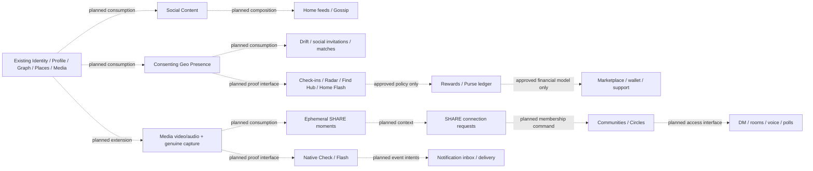

# VibeQuest master product reconstruction and execution plan

Prepared: 10 October 2026. **Active checkpoint: 24 October 2026; R02–R04 source implementation merged, R05 next in approved sequence; B5 remains partial.** B1–B4 remain accepted for initial staging. Full reconstruction and production readiness remain incomplete. Historical checkpoints below are not the current task. This single file is the authoritative live master plan; supporting roadmaps and screen contracts supply evidence, not competing execution authority.

**Goal:** Restore the complete original VibeQuest product through genuine, persisted user journeys while retaining the existing clean foundation.

**Architecture:** One shared Web/Telegram frontend and router, typed contracts/client, one Fastify application and one PostgreSQL/PostGIS authority. Existing canonical owners remain authoritative; future independently meaningful capabilities use explicit interfaces rather than a generic Social/Share service.

**Stack:** Node 24, pnpm 11.1.1, TypeScript, Next/React/next-intl, Fastify, PostgreSQL/PostGIS, existing Sharp Media processing, Vitest and installed Chrome/Playwright. No dependency or provider upgrade is implied.

**Specification:** `C:/Users/GrowB/.codex/attachments/8b56829e-2067-472c-a87a-00589815f35d/Pasted text.txt`. Only this document may change in the present task. Future executors must read the relevant authorized packet and current source again; this roadmap does not authorize coding, database changes, publication or deployment. Use the applicable execution skill when implementation is separately authorized.

<!-- prettier-ignore-start -->

## Active execution remarks — 19 October 2026

**Authority:** This checkpoint records the owner's acceptance of B4 for the current single-replica staging scope. It supersedes outdated next-task and Railway-status statements dated 10–12 October below. It does not remove or dilute the R01–R50 product requirements. Read live source and the latest GitHub/Railway state before each task.

### R02 source implementation — 19 October 2026

- **Source complete:** [implementation commit `2ad23e52e6034ae9a56fcad5cdb16019f0145513`](https://github.com/funmarket/VibeQuest/commit/2ad23e52e6034ae9a56fcad5cdb16019f0145513), based on foundation `fa75bfc205749b5530c5eb162d256526345cd389`. [PR #15](https://github.com/funmarket/VibeQuest/pull/15) is the canonical integration record for the final head, merge status and resulting foundation SHA; this documentation-only checkpoint follows the implementation commit in that same PR.
- **Behavior:** the existing Shell has one native sticky, compact header. Safe-area padding stays inside it. Brand/Home, Notifications, Account and a 44px Sun/Moon quick-theme action remain available during document scrolling. Quick theme flips the resolved light/dark theme through `@vq/ui/theme.setPreference`; Settings retains Light/Dark/System and the existing Telegram bridge. EN/FR/ES/AR action labels describe the resulting theme. Skip navigation has header clearance and a focusable main target; narrow branding fits without horizontal overflow.
- **R01 preserved:** unchanged `advanceNavigationScroll` and one document-scroll listener; downward hide, upward/top reveal, route reset, five destinations/central heart, keyboard reveal, reduced motion and bottom safe-area clearance remain. Context/location presentation remains a separate normal-flow strip with honest unset location. No GPS/city, R09 capability, duplicate scroll owner, drawer or challenge mechanics were introduced.
- **Verification:** pinned Node 24 / pnpm 11.1.1 / Prettier; formatting, lint, TypeScript and architecture checks passed; 68 unit tests passed on the unchanged rerun after one existing locale-catalog five-second timeout; production build passed. Fourteen installed-Chrome regressions passed: header scrolling across five destinations at 320/390 RTL/430/1280px, all four localized quick-theme labels/persistence/System behavior, hydration-message checks, safe-area/long-label geometry, skip focus, dialog independence/Notifications restoration, three representative existing R01 navbar cases, and the existing simulated host/blocked-storage cases. The new regression first failed against the baseline's missing quick control. Independent source review found no actionable findings.
- **Hosted checks:** [implementation-head CI](https://github.com/funmarket/VibeQuest/actions/runs/39312495181); [PR exact-head checks](https://github.com/funmarket/VibeQuest/pull/15/checks) also cover this checkpoint commit. Confirm successful final-head checks and mergeability before integration. GitHub reported no active branch protection/effective rules during inspection; no settings were changed, and the executor retains the PR plus green exact-head CI gate.
- **Deployment not verified:** Railway Web remains explicitly pinned to `31d5f99d84e277f23c60168dd5f3d12482d87ec3`, deployment `c7380aa8-7b75-40fb-aeac-4b84fa513413`. Local production rendering used real public staging reads; no canonical records were created. R02 source acceptance is not live staging acceptance. Do not change the Railway pin or independently deploy without separate authorization. Actual Telegram hardware/safe-area/device acceptance remains R50; browser host fixtures are simulated adapter evidence.
- **Historical next bounded implementation (19 October checkpoint):** R03, the original sliding Console and dialog interactions, in the existing `ProfileMenu`/Account/Profile/Business presentation. This was superseded by the verified R03 merge on 22 October 2026. B5's required positive live Event Media case still requires a legitimate approved Business host; the completed public smoke did not establish authenticated CRUD or full product parity. The R26/R27 native mechanics and all other R requirements remain outside R02.

### R03 source integration — 22 October 2026 (verified 24 October)

- **Merged implementation:** [PR #18 — R03 Sliding Console](https://github.com/funmarket/VibeQuest/pull/18) merged on 22 October 2026. Integration HEAD is [`77adca6e4d45f33730606aee72d59c51de4e0947`](https://github.com/funmarket/VibeQuest/commit/77adca6e4d45f33730606aee72d59c51de4e0947). [Exact merged-foundation CI run 39819327659](https://github.com/funmarket/VibeQuest/actions/runs/39819327659) finished successfully.
- **Scope verified from merged diff:** Right-edge native Console with `min(80vw, 340px)` presentation, X/backdrop/Escape and right-swipe dismissal (strict >80 CSS px drag or >300 px/s velocity), focus and document-scroll preservation, nested input safety, reduced motion and host Back/route-close wiring. Changes are confined to Console gesture/helper, `ProfileMenu`, `Shell`, Account CSS and focused unit/browser regressions; database, API and domain ownership are unchanged. Browser writing suites now require an explicitly local disposable `vq_test` database URL.
- **Verification boundary:** Codex reports successful local Node/pnpm checks, 43 Chrome regressions and real local Identity/Profile/Business cases. The merged-foundation GitHub Actions check is independently verified successful. The local browser and database runs are documented in the PR, not independently rerun in this documentation task; actual Railway deployment, real Telegram hardware, other browser engines, deployed interaction parity and owner parity acceptance remain unverified. B5 retains its existing scope/status.
- **Next position:** R04 Activities interaction parity is the existing dependency-ordered packet after R03; this record does not authorize starting it.

### R04 source integration — 24 October 2026

- **Merged implementation:** [PR #20 — R04 Activities interaction parity](https://github.com/funmarket/VibeQuest/pull/20) merged into `phase-0-foundation` at [`8535755b87f164241a544994f7936f757ed5aac7`](https://github.com/funmarket/VibeQuest/commit/8535755b87f164241a544994f7936f757ed5aac7), with both exact PR-head checks successful before merge (push run `40098678681`, PR run `40098689933`). Merged-foundation CI is separate and must not be inferred from exact PR-head checks.
- **R04 scope:** Existing Activities presentation, form, card, review, localized Explore navigation and host interactions received the bounded parity work; associated locale, unit/browser regression and Activities implementation documentation changed. Preserve the existing Activities domain, image limit, optimistic versions and durable behavior; no new schema/service or unrelated milestone was included.
- **Verification level:** Codex-reported 71 unit tests, 6 integration tests and 40 targeted browser cases passed. The broader browser run retained three documented stale Foundation assertions; those are not silently recast as R04 acceptance failures or claimed resolved. Those local runs were not independently repeated during the merge. PR-head CI was independently verified; deployment, live runtime, genuine Telegram hardware and owner parity acceptance remain unverified. B5 remains partial.
- **Next position:** R05 Official Events interaction parity is the already-defined dependency-ordered packet; this document does not authorize beginning it.

### Verified staging and repository

- Repository: `funmarket/VibeQuest`, integration branch `phase-0-foundation`.
- Pre-R02 foundation: `fa75bfc205749b5530c5eb162d256526345cd389`; R02 implementation and integration evidence are recorded above. Deployed application source remains `31d5f99d84e277f23c60168dd5f3d12482d87ec3`.
- [Foundation CI](https://github.com/funmarket/VibeQuest/actions/runs/38973941147) passed; no open PRs were reported at the last pre-update check.
- Railway project: `9cd5ae90-5544-49ab-b3ab-74dee8105af9`; staging environment: `7a75adec-2799-4ca3-971e-6e26de1b7796`, Amsterdam.
- Web deployment: `c7380aa8-7b75-40fb-aeac-4b84fa513413`, SUCCESS, one replica.
- API deployment: `cfc1c56d-0cd2-4838-a272-ffbe6b379fe0`, SUCCESS, one replica.
- PostGIS deployment: `2f55ebb0-c550-41a6-9ac2-41bca57c8659`, SUCCESS, one replica.
- Web URL: https://web-staging-5951.up.railway.app/en/home
- Web `/api/*` connects privately to Fastify at `api.railway.internal:4100`, then canonical PostGIS.
- MediaBucket resource: `17687718-9d86-41da-814f-87ccb8b4a79a`; actual bucket: `mediabucket-jujionqm6h4di`. PR #12 merged the existing Railway MediaStorage adapter.
- One shared Next.js Web/Telegram product, one Fastify API and one PostgreSQL/PostGIS authority remain the architecture. Genuine Telegram launch/session/device acceptance is pending.

### Current milestone status

- **A5:** Staging HTTPS Web, private API and PostGIS topology selected and deployed. Real Telegram acceptance remains pending.
- **A6:** PostgreSQL migrations, separated roles and Railway bucket storage selected and implemented for initial staging. Worker and restore hardening remain pending.
- **B1 Database:** COMPLETE. Existing thirteen migrations and checksums, readiness and roles verified.
- **B2 API:** COMPLETE. Private Fastify runtime, readiness, Origin/cookie/security checks verified.
- **B3 Web:** COMPLETE. HTTPS Next.js, real guest API reads, locale/RTL, navigation, responsive and protected-action checks verified.
- **B4 Media/worker:** **ACCEPTED BY OWNER FOR CURRENT SINGLE-REPLICA STAGING ON 19 OCTOBER 2026.** This is not a claim of multi-instance or production resilience.
- **B5 Functional and visual smoke:** **PARTIAL — IMPLEMENTATION WORK REQUIRED.** Public destination navigation, guest gates, real empty feeds/search, honest map-unavailable state and representative widths/locales/themes were checked. No approved Business host was available; authenticated lifecycle and positive live Event Media remain outstanding. R02 repairs the observed header gap in source; it does not claim a new staging deployment or full B5 acceptance.
- **R02:** **SOURCE IMPLEMENTATION COMPLETE**, with PR/integration and deployment evidence distinguished above; R01 is preserved.
- **R03:** **SOURCE IMPLEMENTED AND MERGED** via [PR #18](https://github.com/funmarket/VibeQuest/pull/18), foundation merge [`77adca6e4d45f33730606aee72d59c51de4e0947`](https://github.com/funmarket/VibeQuest/commit/77adca6e4d45f33730606aee72d59c51de4e0947). Merge-foundation [GitHub Actions run 39819327659](https://github.com/funmarket/VibeQuest/actions/runs/39819327659) succeeded. Browser and integration coverage described in PR #18 is Codex-reported; it is not independent physical-device, Railway deployment, or live staging acceptance. The existing R04 packet follows R03 in the approved dependency order, but is not initiated here.
- **B6 Release evidence:** PENDING. Document exact staging revision, schema, health, smoke and rollback/redeploy results.
- **R49:** MANDATORY production and distributed Media/Worker engineering. NOT STARTED under this checkpoint.
- **R50:** MANDATORY full-product, real-device/Telegram/provider and production acceptance. NOT STARTED under this checkpoint.

### B4 evidence remarks — do not repeat completed tests

**Codex-reported live staging verification:** Authorized test-account registration and login; PNG/JPEG/WebP image upload; Media intent/claim/ready states; real Railway bucket object writes; image and thumbnail WebP checksums; anonymous public and owner-only private delivery; invalid Origin and revoked-session rejection; invalid-image and duplicate-upload rejection; attached-object deletion protection; physical delete and post-delete 404; Profile photo attachment/replacement/retirement; Activity attachment/detachment/cancellation/retirement; ten-minute intent expiry; scheduled cleanup; and persistence of four variant checksums across one actual API restart. Independent Railway checks confirmed healthy Web, API and PostGIS deployments.

**Codex-reported isolated verification:** 34 integration tests and 21 storage/configuration unit tests passed. Positive Event image attachment/edit/detachment and scheduled retirement passed against an isolated database, including deletion of physical variants. Failure injection covered partial writes, failed reads/streams, delete failures, durable retries/backoff, lost acknowledgements and fresh-process cleanup. Isolated tests do not certify a live Railway provider outage or worker crash.

**Required B5 Events carryover:** Live Event hosting returned expected HTTP 403 for the ordinary staging account because an approved active Business owner is required. B5 must use a legitimately approved Business host to verify positive live Event image attachment, edit/detachment and scheduled retirement. Do not bypass authorization, create privileges by assumption or claim this case already passed live.

**Required R49 recovery and scalability:** Implement and verify distributed cleanup claiming/leases, multi-instance upload concurrency, appropriate Worker placement, crash recovery, abandoned `processing` recovery, operator recovery of jobs exhausted after eight attempts, provider failure resilience, load/scaling and database plus bucket backup/restore. The existing 60-second API-local cleanup timer is verified for one replica, not distributed safety. These are mandatory future engineering outcomes, not waived by B4 staging acceptance.

**Retained staging fixtures:** One authorized test account `764859df-60c2-4320-bafa-29a54d55d8f4`, blank Profile, cancelled Activity and six completed cleanup jobs remain documented. Last reconciliation found three active and two revoked session rows; active sessions expired around 2 November 2026. It found zero Media records, bucket objects, pending cleanup jobs or retirement requests. No supported delete-account or revoke-all workflow was identified. Do not directly delete Identity/audit rows or expose credentials.

### Execution instruction for the next agent

**Current next planned bounded implementation: R05 — Official Events interaction parity**, after merged R04; no implementation is initiated by this document. The preceding 19 October R02 checkpoint identified R03 as next before its merge. B5 remains partial and its live prerequisites are retained; do not restart another B4 reconciliation or repeat the entire public smoke. Inspect the current source and relevant authorization before the next task. Keep original mechanics and domain ownership intact. Integrate targeted verification into implementation and avoid repeated acceptance-only loops. After each accepted milestone update **this same plan**, recording source SHA, CI, deployment, tests, limitations and the next task. This checkpoint does not itself authorize R05 code, a staging deployment, services or Business privileges.

---

<!-- prettier-ignore-end -->

## 1. Authority, evidence and limits

Source keys used throughout this plan:

| Key | Absolute root / document                                                                                                      | Role                                                                           |
| --- | ----------------------------------------------------------------------------------------------------------------------------- | ------------------------------------------------------------------------------ |
| C   | `C:/Users/GrowB/Desktop/Vibequest`                                                                                            | Actual clean source, current owners and tests                                  |
| L   | `C:/Users/GrowB/Desktop/ViBeQues-Selection/vibequest last/src`                                                                | Primary product features, interactions, mechanics and feature presentation     |
| B   | `C:/Users/GrowB/Desktop/ViBeQues-Selection/vibequestbest/src`                                                                 | Compatible supplementary design only                                           |
| I-D | C `docs/product/references/product-truth-discovery.md`                                                                        | 101 historical stable acceptance records                                       |
| I-S | C `docs/product/references/product-truth-social.md`                                                                           | 54 historical stable acceptance records                                        |
| I-P | C `docs/product/references/product-truth-platform-purse.md`                                                                   | 60 historical stable acceptance records                                        |
| P   | `C:/Users/GrowB/.codex/visualizations/2026/10/09/01a1210b-9e77-7230-a2dd-ff607844acaa/vibequest-feature-parity-2026-10-10.md` | Fresh detailed page comparison, including nested actions and reference defects |

`C`, `L`, `B` plus a relative path resolve to the absolute source location above. The external report P supplies extra detail, but this plan embeds the essential coverage and packet criteria so execution does not depend on an unpublished local report. Read the 215 records for their source traces, not their stale completion claims. They are acceptance records, not 215 unique features or a percentage-complete metric.

**Historical plan-preparation evidence (before S00 publication):** current manifests, HTTP registration/composition, domain ports, migration files, current page entry points, source-backed parity differences and the latest checkpoint were inspected. The workspace is not a Git repository; `git status` reports that fact. There is no current commit SHA or Git-generated change history. No `.ua` or `.understand-anything` project graph was found. Understand's source/dependency method was used; a graph rebuild and diff overlay were omitted because this task authorizes only this document. Understand Diff's Git-based comparison is unavailable; the complete new-document change and before/after source hashes are the review evidence instead.

**Historical, not rerun here:** the Social checkpoint reports 43 unit tests, 50 genuine PostgreSQL integration cases, 13 applied migrations, real Chrome Activities/Events/Social flows and a later mobile header correction. Those results do not certify every original feature. This planning task does not rerun application tests, start services, execute legacy code or access the database. P's local connectivity attempts timed out; fresh browser acceptance is unknown.

**Proposed:** future owners, table families and API operations below are planning allocations, not existing implementations or finalized schemas. Freeze their minimal contracts in their authorized packet; retain this ownership and semantic separation. Do not create empty packages merely to match the table.

### Resolved decisions that must not be reopened

- HOME → EXPLORE → heart labelled SHARE → VIBE → PURSE, in that order. The heart stays inside the navbar. Public discovery remains public.
- **Open-first Web access:** no launch login splash or fake guest identity. Anonymous people can open all public pages/cards/nested details; only account-required writes invoke one dismissible contextual sign-in/create-account flow that preserves safe route/modal/action context and never silently replays a mutation.
- English default; French, Arabic/RTL and Spanish from first release. One Light/Dark/System owner; no separate Telegram theme authority.
- Orbit = accounts the user follows; VIBE Echo = incoming followers. Mutual follows do not constitute accepted Vibes matches.
- Public basic Profile projection is ID/name/handle/bio; Profile photos remain private until explicitly authorized for publication. No email/session/GPS leakage.
- Activities require current completed-profile eligibility; official Event hosting uses approved active Business-owner authority. Ordinary membership does not grant hosting. Preserve these current rules.
- Native VibeCheck target is **33,000ms**, prompt maximum **60 characters**; native VibeFlash target is **60,000ms**. Five-minute photo freshness is a separate constraint. L confirms these timer values; the later full directive explicitly adopts them (`ad268cf1-8438-4163-b22b-a08cc3836875/Pasted text.txt`, timer section).
- Home Radar's historical venue scan uses a real 10km/max-20 source scope, but review-count sorting, business star ranking and fabricated recharge/rarity are not the approved target. R31 also defines nearby city/town atmosphere suggestions with separate evidence and coverage rules.
- Find Hub is consenting social proximity, not merely a Places link. Preserve its 150/200/250/500m radius choices, with 200m default.
- Intended GitHub repository `https://github.com/funmarket/VibeQuest` is **PUBLIC by the latest explicit decision**. `phase-0-foundation` is development/integration; `main` requires stable acceptance and separate promotion authorization. Repository existence/privacy and remote state have not been inspected in this task.
- No simulations, Firebase, Firestore or Supabase business persistence; no client-minted points, fake GPS, fake balances, canned partner replies or successful writes without persistence.
- **Place atmosphere, not business judgment:** HighVibes = lively, Vibing = comfortable/relaxed, LowVibes = quiet/peaceful (not a poor-quality rating). Authenticated reporters may contribute without GPS; recent validated proximity may increase confidence. Current Vibe uses genuinely recent reports over a few hours, and older moderated reports stay browseable as history. Insufficient activity means an explicit low-data state, not a fabricated label. Exact formulas/windows remain undecided.
- **Operator identity goal:** @CryptoTemplar is the designated Telegram contact for future administrator onboarding, never a role grant based on a handle. Verify signed stable numeric Telegram identity and explicit canonical Web linking first; separate auditable R42 bootstrap remains required.

### Approved adaptable visual contract — 11 October 2026

The owner's current page identity accents are **HOME #00CED1**, **EXPLORE #00FF00**, **SHARE Carmine #FF0040**, **VIBE Electric Purple #9D00FF** and **PURSE Metallic Gold #D4AF37**. All five are explicitly approved configurable design values, not permission to scatter literals through components. Keep one semantic design-token owner at `packages/ui/src/tokens.css`, with reusable component variants for theme, page identity, foreground, border, elevation, icon treatment and state. Avoid unrelated hardcoded presentation numbers; retain explicitly approved security rules, game timers and data invariants. Any later owner-approved design change must propagate through canonical tokens, not cross-page patch layers.

On genuinely colored button, active-tab and container surfaces, **use white/light high-contrast text**, not foreground text identical to the accent or dulled opacity. Darken or adjust an accent-backed surface when its original bright hue would fail contrast with white; neutral/light-mode surfaces may retain appropriately contrasting dark text. Require measured WCAG AA >=4.5:1 for ordinary text and >=3:1 for qualifying large text and relevant controls. Do not claim calculated token pairs prove actual rendered/composited contrast.

Target a clean futuristic, restrained **approximately 2.5D** look: refined elevation, subtle outlines/highlights, controlled shadows, legible spacing, deliberate page-specific accents and thin, elegant, consistent line icons. Reject heavy orange/brown outlined PURSE cards with same-color text, bulky wallet glyphs, excessive glow, random icon families and global grey flattening. The supplied photographic place-pin, cyan-radar and layered-map/detail images are design references only; they do not authorize fabricated people/data, new map providers, 3D infrastructure or old venue star rankings.

Typography must respect device/browser zoom and accessibility sizing; Settings needs one shared scalable-text preference including **Device Default** and user sizes, with readable rem-based layout, responsive reflow and Arabic RTL coverage. Do not invent final font family, exact sizes, spacing, contrast-safe accent surface shades or provider licensing without current rendered evidence and owner acceptance. All five destination identity colors are approved above; the icon-only packet does not authorize the wider typography or screen redesign.

### Reconciliation of outdated documents

`legacy-parity-inventory.md`, `mechanics-permissions.md` and some architecture documents still promote B over L, elevate the heart, reverse Orbit/Echo, prefer five-minute/three-minute challenge windows or call implemented Identity/Media “future.” These statements are superseded above. Do not apply their old decision IDs blindly. Current `app.ts`, domain ports and migrations prove more than the foundation-era diagrams. The historical Social register's standalone Local rail is not permission to add a seventh VIBE tab; retain local discovery through the original scoped flows. Its 20-filter/dual-camera claims are qualified: the active camera is `L/components/share/VibePhotoCapture.tsx`; the much larger `L/components/VibePhotoCapture.tsx` has additional source-present paths whose active reachability was not established. Do not promise all effects as runtime-proven original behavior.

### Web + Telegram dual-entry contract — 10 October 2026 addendum

Authority: `C:/Users/GrowB/.codex/attachments/3a153d35-5425-44fd-b9a5-1acdcb43b774/Pasted text.txt`. This reconciliation changes documentation only. It preserves R01–R50, the 215-record coverage and every resolved product decision; no implementation, publication, bot provisioning or deployment follows automatically.

**Two supported environments, one product.** Standard browsers and the genuine Telegram Mini App use the canonical Next.js/React routes, feature components, forms, typed API client, design system and navigation. Both deliver the same original pages and functions through the same Fastify API, PostgreSQL/PostGIS, canonical users and domain owners. A separately configured Telegram entry/deployment is permissible only when technically justified and reuses that product implementation. No copied Telegram screens/services/styles/navigation, Telegram-only business tables, duplicate profiles/wallets or synchronization between competing stores. Identity may own external-credential associations; these are not separate business accounts.

**Verified source baseline, not host acceptance.** `apps/web/src/app/(entry)/telegram/page.tsx` reexports the ordinary entry, which redirects through the canonical locale route. `apps/web/src/app/[locale]/layout.tsx`, `components/providers.tsx` and `next.config.ts` supply the shared layout, theme/provider composition and API proxy. `platform/host.tsx` currently provides browser fallback, safe-area/theme subscriptions, Back Button cleanup and optional light haptics. Initialization/readiness, viewport handling, launch/deep-link processing and server-verified Telegram Identity are not established by that partial adapter. Existing host unit fixtures are protocol evidence only, not a genuine Telegram launch.

**Host ownership.** Extend the existing typed host adapter for capability detection, initialization/readiness, viewport/stable viewport and safe-area changes, Back Button registration/removal, optional genuine haptics and launch/deep-link normalization. Clean up listeners, handlers and device tracks on exit/unmount/revocation. Preserve SSR and ordinary browser operation without Telegram globals; missing APIs produce honest unsupported states. Route host navigation through the shared router, including correct root/back/modal behavior; never create another navigation state owner. Host theme information is an input to the current Light/Dark/System policy, not another theme engine. Keep camera/microphone/location permission requests contextual and delegated to their existing device/feature adapters; do not assume Telegram grants them or exposes a substitute for browser permissions.

**Identity and backend authority.** Retain Web authentication. R38 verifies authentic raw Telegram launch credentials on the server with signature, freshness and explicit replay defenses before issuing/accepting authenticated authority. Client IDs, usernames and `initDataUnsafe` are never authentication. Both transports resolve a canonical VibeQuest actor only after valid creation/linking. Reject mismatched simultaneous credentials, expired/forged/replayed credentials and concurrent conflicting links; never silently merge unrelated accounts. Linking requires proof of the target Web account and Telegram identity, purpose-bound one-use server-controlled authorization and atomic uniqueness. Do not log launch credentials or place sessions/link secrets in ordinary URLs. Domain authorization, completed-profile eligibility, Business hosting, audiences and Media access are identical for both transports.

**Same mechanics.** Gossip, SHARE capture/ephemeral requests, Circles/conversations, VibeCheck/VibeFlash, discovery, Explore and Purse consume the same owning services and records. The canonical backend controls deadlines, matching, challenges, authorization and financial state. Presentation countdowns and host suspend/resume cannot restart a window, mint state or change outcomes; refresh authoritative state after resume. Unsupported hardware/provider capability is a documented limitation requiring an approved disposition, never simulated identity, shots, GPS, delivery or payment.

**Read-only architectural comparison.** HOOMA was inspected at `funmarket/HoomaUltimate` `phase-0-foundation` commit `13d2ada5f21b785eb24eb137e27d2b4bd68647d5`; its older local checkout was not treated as current. Its [Telegram wrapper manifest](https://github.com/funmarket/HoomaUltimate/blob/13d2ada5f21b785eb24eb137e27d2b4bd68647d5/apps/telegram/package.json) delegates to shared Web packaging; its [runtime adapter](https://github.com/funmarket/HoomaUltimate/blob/13d2ada5f21b785eb24eb137e27d2b4bd68647d5/apps/web/src/telegram/runtime.ts) illustrates readiness, viewport subscriptions and cleanup; its [authentication middleware](https://github.com/funmarket/HoomaUltimate/blob/13d2ada5f21b785eb24eb137e27d2b4bd68647d5/apps/api/src/modules/identity/http/auth.middleware.ts) rejects conflicting authenticated IDs. Its [auth validation](https://github.com/funmarket/HoomaUltimate/blob/13d2ada5f21b785eb24eb137e27d2b4bd68647d5/packages/auth/src/index.ts) verifies Telegram signatures/freshness, but the time-window link code alone does not prove one-use replay prevention. Adopt these separation principles, not its Vite/Express/Prisma implementation, link-code algorithm or deployment layout. No real HOOMA device acceptance is claimed.

## 2. Current baseline — preserve this work

| Capability             | Current status and actual evidence                                                                                                                                                      | Remaining boundary                                                                                                      |
| ---------------------- | --------------------------------------------------------------------------------------------------------------------------------------------------------------------------------------- | ----------------------------------------------------------------------------------------------------------------------- |
| Web Identity/sessions  | Implemented: `packages/identity/src/application/accounts.ts`, API Identity HTTP, `features/identity/account-form.tsx`                                                                   | Telegram verification/linking, recovery, Google; no new auth owner                                                      |
| Profile                | Implemented editing/name/bio/handle/favorite-vibe and real private photo upload/replace/remove; `packages/profile`, `features/profile`                                                  | Interests/contact/location, self-profile composition, pre-submit handle feedback; public photo policy remains unchanged |
| Business               | Implemented registration/review capability/invite/accept and hosting facts; `packages/business`, API Business HTTP                                                                      | Operator UI, advanced management and delegation/bootstrap policy                                                        |
| Places                 | Implemented public published reader: `modules/places/application/list-published-places.ts`, database Places repository, typed `readPlaces`, Explore                                     | Rich details/search/marker selection, contributions, check-ins, discoveries and curation                                |
| Activities             | Implemented Live/Upcoming, eligible posting/scheduling, owned public images, expand/details, reviews/saves, owner edit/cancel, directions; `packages/activities`, `features/activities` | Small profile shortcut, Explore handoff, haptics; rewards/reminders require defined real semantics                      |
| Official Events        | Implemented equivalent public discovery, approved Business hosting, uploads, RSVP intention, reviews/bookmarks/edit/cancel; `packages/events`, `features/events`                        | Small handoff/feedback gaps; reminders and any ticket/payment rules separate                                            |
| Global Media           | Implemented image intent/upload/processing/variants/public-private delivery/reference protection and durable cleanup retries; `packages/media`, API Media infrastructure                | Video/audio/capture provenance, entity-scoped restricted delivery and distributed operation                             |
| Social Graph           | Implemented real following/followers, mutual flags/counts/pagination and safe Profile lookup; `packages/social`, `features/social`                                                      | Not Gossip, Drift, accepted matches, Pulls, SHARE connections or Circles                                                |
| Shell/themes/locales   | Implemented five routes, contained Share heart, compact header correction, transparent scrollbar tracks, four languages/RTL and shared theme/host adapter                               | Directional auto-hide, persistent header, drawer gestures, quick theme action, real messages/notifications/city         |
| Other page composition | Shell/Partial: Home discovery, Explore enrichment, Share, Gossip/Drift/Vibes/Pulls and Purse                                                                                            | Retained headings and unavailable notices are not restored functions                                                    |

The wired chain is `UI → @vq/api-client / @vq/contracts → registered Fastify adapter → authenticated actor → owner use case → repository port → owning PostgreSQL adapter → response/render`. `apps/api/src/main.ts`, `app.ts` and `packages/database/src/index.ts` register the actual implementations. For example, Activities receives Profile eligibility and Media attachment capabilities; Events receives Business hosting, Profile author and Media capabilities; Social receives Identity availability and public Profile projections. Preserve this composition rather than importing another owner's private repository.

### Existing database owners

| Owner                    | Canonical tables / migration evidence                                                                                               |
| ------------------------ | ----------------------------------------------------------------------------------------------------------------------------------- |
| Places                   | `places`; 0001                                                                                                                      |
| Identity                 | `identity_users`, `identity_password_accounts`, `identity_sessions`, `identity_attempt_limits`, `identity_privileges`; 0002/0008    |
| Profile                  | `profile_profiles`, `profile_photos`, `profile_photo_retirements`; 0003/0005/0006                                                   |
| Media                    | `media_objects`, `media_cleanup_jobs`; 0004/0005/0007                                                                               |
| Business                 | `business_organizations`, `business_memberships`, `business_reviews`; 0008                                                          |
| Activities               | `activities_entries`, `activities_attachments`, `activities_saves`, `activities_reviews`, `activities_media_retirements`; 0009/0010 |
| Official Events          | `events_entries`, `events_attachments`, `events_rsvps`, `events_reviews`, `events_media_retirements`, `events_saves`; 0011/0012     |
| Social Graph             | `social_follows`; 0013                                                                                                              |
| Migration infrastructure | `vq_schema_migrations`; `migration-runner.ts` transaction/advisory lock/checksum enforcement                                        |

All thirteen migration files exist from `0001_places.sql` through `0013_social_follows.sql`. Applied database state is historical here, not freshly queried. Preserve applied files exactly; new authorized state requires additive migrations. One pool/database adapter package is retained. An entity owner manages attachment links and retirement requests; only Media mutates bytes and manages delivery/storage/deletion retries.

## 3. Ownership and dependency map

Existing owners above remain unchanged. Future responsibility allocations are proposed; the exact package/table names below are not asserted to exist.

| Capability / canonical owner | Presentation owner                                     | Contract and owned durable state                                                                                          | Dependencies / authorization / jobs                                                                                                                                              |
| ---------------------------- | ------------------------------------------------------ | ------------------------------------------------------------------------------------------------------------------------- | -------------------------------------------------------------------------------------------------------------------------------------------------------------------------------- |
| Persistent Social Content    | VIBE Gossip/composer and Home feed components          | Publish/edit/delete/read posts, comments, reactions; post/attachment/comment/reaction families                            | Identity actor, Profile author, Graph audience; Media links; author edits, defined audience, moderation, cleanup; no matching or membership state                                |
| Matching/discovery           | Drift, Vibes and Home For You                          | Read eligible discovery candidates/preferences; social invitation accept/ignore; accepted matches and invitation families | Profile interests, consenting Geo/availability where used; actor/recipient consent and privacy; scoring requires D03; Pulls invites remain distinct from native photo challenges |
| Ephemeral Moments            | SHARE feed/composer                                    | Publish/edit/delete/read expiring moments and Media links                                                                 | Identity/Profile, capture/Media and optional Geo; approved TTL/audience, server expiry and cleanup; never automatically Gossip                                                   |
| SHARE Connection Requests    | Echo/Join forms and creator request panels             | Typed Echo Connection / Join Vibe request, approve/refuse/retract, optional proof link                                    | Moment/context eligibility, Profile, Media and Communities public membership command; no automatic follows/matches; D04                                                          |
| Communities                  | SHARE circles/directory, room settings                 | Communities/Circles, handles, memberships, invitations, roles, bans, settings, announcements                              | Identity; creator/CA powers approved server-side; private entry enforcement; Circle membership is not following; approved request conversion through explicit interface          |
| Messaging                    | Console inbox, DM, Paltalk and trade chat presentation | Conversation/message/attachment/read-state families; text/media/effect/poll commands                                      | Identity, recipient/member authorization, Communities access; Media scoped delivery; outbox when needed; no owning community roles or marketplace settlement                     |
| Presence                     | People/room online indicators                          | Opt-in session heartbeat/expiry and aggregate availability, not fabricated flags                                          | Identity, scoped audiences, TTL and retention decision; no physical-location assumption; may be implemented within a focused infrastructure capability rather than a new package |
| Geo Presence                 | Find Hub, nearby controls and check-in request context | Consent/location visibility/accuracy/expiry; geofence rules/alerts                                                        | Opt-in authenticated actor, foreground/device limitations, blocking/retention decision; does not replace editorial browse bounds                                                 |
| Place Contributions          | Suggest/report/validate/correction UI                  | Reviewable contributions/validation observations and decisions                                                            | Identity/Profile, Places published reader/approved-change command, Geo evidence when required; no direct canonical place update; moderation/audit                                |
| Place engagement / check-ins | Home current Vibe, Explore Check In                    | Check-in lifecycle and proof; bookmark/review capabilities remain Places-owned or explicit engagement sub-capability      | Places identity, consenting Geo evidence and optional rewards command; RSVP is not check-in; approved accuracy/radius policy                                                     |
| Place discovery / curation   | Radar, Trails, Coordinates, Gems                       | Provider-query DTOs/provenance; user-authored trail/curation/attachment families                                          | Places readers, provider adapter, Profile, Media; editorial vs user content distinct; no fake results or browser authority                                                       |
| Venue Gatherings             | Explore Gatherings                                     | Venue-linked casual gathering/participation families                                                                      | Places identity, authenticated host, Profile; distinct from official Events and Activities; no duplicate business-host rules                                                     |
| Home Flash Events            | Home/Explore alert/create/hunt                         | Local Flash listing/duration/interest/going/hunt lifecycle and attachments                                                | Identity, Places/Geo, Media, Notifications; claim asks Rewards only under approved policy; separate from native Flash                                                            |
| Native photo challenges      | Native Check/Flash banners/composer/reveal/history     | Typed native Check and Flash lifecycle/proof links                                                                        | Identity recipient, capture/Media, notification preference; separate state machines/locked deadlines, private audience, expiry worker; does not own accepted Vibes matches       |
| Notifications                | Bell/Console/preferences and alert overlays            | Preferences, inbox/read facts, delivery attempts/outbox/subscriptions                                                     | Domain-owned event intents, authorized audiences, real opt-in/device/provider delivery, dedupe/retry/expiry; no invented delivery rules                                          |
| Rewards/ledger               | Streak, points, recognition and Purse ledger           | Append-only earning/transfer/reversal ledger and idempotent claims                                                        | Approved earning/timezone/abuse rules, canonical proof sources; atomic server accounting, no client minting                                                                      |
| Marketplace                  | PURSE board/offers/deal history                        | Offers, deal lifecycle and any approved settlement association                                                            | Identity, Messaging, approved Rewards/payment capabilities; quantity/asset/custody policy gate; never debit unrelated balances                                                   |
| Payments/support             | Support donation and genuine external wallet actions   | Provider intent/receipt/reconciliation records if approved                                                                | Real configured provider/wallet, approved financial model; no success before acknowledgement; no arbitrary donation reward                                                       |
| Business/Admin orchestration | Console/Business/Admin views                           | Extend existing Business state; Admin delegates owner commands                                                            | Identity-scoped privileges, approved bootstrap/delegation, audit; no universal SQL or local self-admin                                                                           |
| Shared host/presentation     | Shell, theme/locale, permission UI                     | UI preferences and host capability state only                                                                             | Existing host/theme owner; context permission/revocation/track cleanup; no backend identity from client IDs                                                                      |

Both frontend environments enter this same ownership map: shared presentation → one typed client/contracts → the registered Fastify transport → canonical actor → existing owner ports/repositories → one PostgreSQL/PostGIS authority. Telegram launch verification belongs to Identity; host readiness, viewport, Back Button and theme hints belong to the existing presentation adapter. Neither adapter owns domain state, Media bytes, membership, challenge clocks or financial outcomes.

Proposed table families must be assigned to one repository namespace before their first migration. Retain public reader ports such as `ActivityProfiles.read`, `EventHosts.hosting`, `ActivityMedia.canAttachPublic`, `SocialAccounts.availableUsers` and `SocialProfiles.publicMany`. Current names are verified in `packages/*/src/domain/ports.ts`. Do not pass naked pools or foreign repositories to new business owners.

All dashed edges are planned; the diagram is not current runtime wiring. R15 establishes Communities before R16's membership conversion, avoiding a request/membership dependency cycle. A notification outbox does not create a second canonical copy of entity state.

## 4. Page coverage and stable acceptance crosswalk

Every nested detail in P and the linked original component is an acceptance subcase of the relevant packet below. A packet may finish its bounded journey while the whole page remains Partial. Do not award page parity until every relevant packet and dependency passes. Historical supplementary-only concepts must be marked as such, not silently renamed original-primary features.

### Shared shell and account surfaces

| Feature ID | Original behavior / evidence                                                                                                                                                     | Current → packets / historical records                                                                                                                         |
| ---------- | -------------------------------------------------------------------------------------------------------------------------------------------------------------------------------- | -------------------------------------------------------------------------------------------------------------------------------------------------------------- |
| NAV-01     | Five equal destinations/active colors, contained labelled Share; L `components/layout/Shell.tsx`                                                                                 | Implemented presentation, R01/R48 regression; I-P PT-NAV-001/006                                                                                               |
| NAV-02     | Main scroll delta >20px down hides/up shows; top <10px always shows; tab changes reset visibility/scroll; 80px spring transition                                                 | Missing, R01; PT-NAV-005. Nested VIBE scrolling is not proved handled by legacy outer handler                                                                  |
| NAV-03     | Compact persistent header, brand Home, city Explore, Sun/Moon shortcut, page transition                                                                                          | Partial, R02/R09; PT-NAV-002/003                                                                                                                               |
| NAV-04     | Console right slide, 80%/340px maximum, drag right offset80/velocity300 close, X/backdrop/Escape/scroll                                                                          | Partial, R03; PT-NAV-004/007                                                                                                                                   |
| NAV-05     | DM/notification shortcuts and genuine unread facts; action haptics; dialogs focus/scroll                                                                                         | Shell/Missing, R17/R24/R48; PT-NAV-008/009, PT-NOT-001                                                                                                         |
| PRO-01     | Self-profile, photo, name/bio/handle, 450ms availability hint; ten interest presets/custom lowercase dedupe/min-three reference; location/contact protocol/X/Telegram/Cozy Diary | Partial, R06; L `components/profile/ProfileView.tsx`, `screens/ProfileScreen.tsx`; PT-ID-005–009                                                               |
| PRO-02     | Real Web login/logout retained; Google, recovery, linking, tier/security controls and permission panel                                                                           | Partial/Missing, R38–40/R43/R44–45; PT-ID-001–004/010–012, PT-SET-001–005, PT-PERM-001–004                                                                     |
| PRO-03     | Business registration/memberships/hosting retained; overview/gallery/hours/contact/management, operator approvals/metrics                                                        | Partial, R41–42; PT-BIZ-001–007, PT-ADM-001–004. Rich Business fields are supplementary/explicit full-directive requirements, not found in primary ProfileView |

### HOME

| Feature ID | Function and nested acceptance                                                                                                                                                                       | Source / current → packets / inventory                                                                                                                                                |
| ---------- | ---------------------------------------------------------------------------------------------------------------------------------------------------------------------------------------------------- | ------------------------------------------------------------------------------------------------------------------------------------------------------------------------------------- |
| HOME-01    | Current Vibe from own latest check-in; grouped/deduped friends/matches, horizontal visitors/rating/mood selection; city/banner                                                                       | L `VibeCheckInsScroll.tsx`, `useHomeCheckInFeed.ts`, `useHomeScrollBanner.ts`; Shell → R02/R30; HD-001/002, HS-001                                                                    |
| HOME-02    | Flash banner/list/create/detail; title/description/rules/duration/location/entry price/parking/transit/reward/comment/photos; interested/going exclusive, countdown, directions/hunt/proximity/claim | L `features/home/components/Home{ActiveAlertBanner,FlashListModal,CreateFlashModal,EventAlertModal}.tsx`, `useHomeFlashEvents.ts`; Shell → R33/R24–25/R44; HS-022–026                 |
| HOME-03    | Activity Live/Upcoming, Post/Schedule/profile completion/edit shortcut, title/text/location/emoji/date/media, compact/expanded details, ratings/reviews/maps, save/edit/cancel, boost/reminder       | L `LiveActivitiesPanel.tsx`, `DiscoveryAdderModal.tsx`; Implemented core → R04/R24–25/R44; HD-008, HS-002–006/018/019                                                                 |
| HOME-04    | Blue official Events, real Business hosting, live/upcoming forms, details/category/host/photo, reviews, RSVP/save/edit/cancel, maps/reminder                                                         | L `LiveEventsPanel.tsx`; Implemented core → R05/R24–25; HD-003–007, HS-007–010, BD-001–008 (some BD variants supplementary)                                                           |
| HOME-05    | Vibe Feed status / Check In; daily streak claim/day/reset and genuine points                                                                                                                         | L `screens/HomeScreen.tsx`, `DailyStreakQuest.tsx`, `useHomeStreak.ts`; Shell → R30/R44; HD-014                                                                                       |
| HOME-06    | Radar 10km/20, review sorting, distance/ratings/rarity, scan loading/error, selected result Google/community details/reviews, Compass discovery/claim                                                | L `DiscoveryRadarPanel.tsx`, `useHomeRadar.ts`, `PlaceDetailModal.tsx`, `CompassModal.tsx`; Shell → R28/R31/R44; HD-015–017, HS-013/017                                               |
| HOME-07    | Find Hub contacts/alerts, lock-on, consented location, rule name/current/custom coordinates/radius/toggle/delete, arrival/departure/time, mark read/clear                                            | L `FindHubModal.tsx`, `useFindHub.ts`; Missing → R09/R34; HS-027–032                                                                                                                  |
| HOME-08    | My Network/Local Vibes/For You; mood/image/author/age/verified facts, likes/counts, inline comments/Send, sharing/copy; visible tipping uncertain                                                    | L `HomeFeedTabs.tsx`, `useHomeFeedActions.ts`; tabs only → R07–10/R47; HD-009–013, HS-020/021                                                                                         |
| HOME-09    | Curated Coordinates expand/count/cards/story/calibrate once/Plot Explore; Local Gems images/story/rating/favorite/maps; full handbook and floating feed opener                                       | L `HomeCuratedCoordinates.tsx`, `screens/HomeScreen.tsx:389–486`, `CommunityHandbookModal.tsx`, `screens/HomeScreen.tsx`; Shell/Partial → R32/R37/R44; HD-018–023, HS-011/012/014–016 |

### EXPLORE

| Feature ID | Function and nested acceptance                                                                                                                                                         | Source / current → packets / inventory                                                                                                             |
| ---------- | -------------------------------------------------------------------------------------------------------------------------------------------------------------------------------------- | -------------------------------------------------------------------------------------------------------------------------------------------------- |
| EXP-01     | Readable location/change/refresh; search debounce >=3 chars/500ms, clear300ms; autocomplete >=2/select; category rail + secondary grid/counts; incoming Home location/category handoff | L `screens/ExploreScreen.tsx`, `useVenueSearch.ts`; basic/manual query → R28/R04–05/R09; ED-001–010/020                                            |
| EXP-02     | List/map selectable markers/fit/zoom, heatmap selected details/reload, rich photo/ratings/rarity/address/distance/match/visits/points/confidence cards                                 | L `VenueCard.tsx`, `VenueDetailSheet.tsx`, Explore; Partial → R28/R31/R36; ED-011–018                                                              |
| EXP-03     | Venue Info/Mayor/Gatherings, directions, reviews/favorites; gathering create title/text/time and participation; check-in/validation lock and three replies                             | L `VenueDetailSheet.tsx`, `ProximityValidator.tsx`; Missing → R28–30/R35–36; ED-019, ES-003–011                                                    |
| EXP-04     | Secrets/Spawn Flash/list/detail/countdown/hunt; sonar/charge, Guardian/ranks and suggested validation/dismiss                                                                          | L Explore, Flash modals, radar hooks; Shell → R29/R31/R33/R36; ES-001/002/010, ED-012–017/021/022. Synthetic legendary insert/rewards are rejected |
| EXP-05     | Trails profile eligibility/form name/address/story/category/tags/photos map/autocomplete pin; preview/remove/drag-drop; feed/search/photo carousel/creator/save/like/map/owner delete  | L `VibeTrailsSection.tsx`; Missing → R32; ES-012–016                                                                                               |
| EXP-06     | Owner-added Suggest Place / Report Issue / Ask for Recommendation                                                                                                                      | Current unavailable controls, not source-complete originals → R29; use explicit existing Contributions ownership requirement                       |

### SHARE, native challenges, VIBE and rooms

| Feature ID | Function and nested acceptance                                                                                                                                                                                                             | Source / current → packets / inventory                                                                                                                                    |
| ---------- | ------------------------------------------------------------------------------------------------------------------------------------------------------------------------------------------------------------------------------------------ | ------------------------------------------------------------------------------------------------------------------------------------------------------------------------- |
| SHR-01     | Live Shot capture, front/back/photo/video/timer/viewfinder/preview/retake/confirm/close, optional Skip; genuine permission handling/filter effects                                                                                         | L `components/share/VibePhotoCapture.tsx`, `features/share-good-vibes/components/ShareVibeModal.tsx`; Missing → R12–14; I-S SH-01–05/17, PT-PERM-002                      |
| SHR-02     | Text/photo/video/mood/location publish; note100, five-minute fresh-photo boundary; feed media/author/age/expiry/distance/match; own edit nonblank/delete; category repeat-toggle/clear and Nearby mutual selection                         | L `screens/ShareGoodVibesScreen.tsx`, `useLiveVibeFeed.ts`; Shell → R14; I-S SH-06–10                                                                                     |
| SHR-03     | Four compass categories × three original subcategories; Echo/Join note100, optional proof preview/remove, pending requests/creator approval/member display and Add to Circle/Community                                                     | L `VibeCirclesPanel.tsx`, `EchoConnectionModal.tsx`, `JoinVibeModal.tsx`, `VibeCircleMembersModal.tsx`, `data/vibeData.ts`; Missing → R15–16; SH-11                       |
| SHR-04     | All Local Communities/collapse/distance/tag filter, Connect/Leave then Enter; create auto-handle until edited, emoji, category/custom tag, description/address/GPS/privacy/member counts                                                   | L `CreateCommunityModal.tsx`, SHARE screen; Missing → R15; SH-12–15                                                                                                       |
| NTV-01     | Native Check recipient/prompt, incoming countdown/accept/refuse, real shot/retake/send, sender reveal/fire-cap-vibing reaction, expiry/history/deep links                                                                                  | L `native/vibeCheckService.ts`, response/banner/composer/reveal/history modules; Missing → R26/R13/R24–25; CH-01–06. Some original module entry consumers remain unproved |
| NTV-02     | Native Flash active banner/respond/skip, dual capability/retake/send, denied/expired history and future spontaneous delivery                                                                                                               | L `native/vibeFlashService.ts`, `vibeFlashScheduler.ts`, response modules; Missing → R27/R25; VF-01–04. Recurrence/dispatch policy remains undecided                      |
| VIB-01     | Six tabs/count badges, original banner/capsule, tab/thread transitions, remember selection; single capsule opens composer (its camera/chat circles are decoration)                                                                         | L `components/chat/VibeCenterView.tsx`, `components/explore/VibeHubTabs.tsx`; selection Partial → R07/R10–11/R17/R48; VB-01/02/04                                         |
| VIB-02     | Gossip own/followed/accepted-match chronological posts, mood/place/media/time/presence/unread, empty Discover; composer280/remaining warning30/emoji/custom40/media removal/busy/success                                                   | L `VibeComposer.tsx`, `VibeCenterView.tsx`; Shell → R07/R11/R12–13/R17/R19; VB-03/12                                                                                      |
| VIB-03     | Drift: Chill, Sweat, Lounge, Brain, Sunset, Mellow, Echo, Zen, Groove, Pixel, Quest, Wander; selected category/back/counts/eligible people, Follow/Following, Check/Sent feedback, chat/profile                                            | L `DriftView.tsx`; Shell → R06/R09–11/R17; VB-05/06/13; compatibility helpers' complete active UI is unverified                                                           |
| VIB-04     | Vibes accepted matches/card/time/actions; Pulls incoming social invitation prompt/age/Accept/Ignore/empty Go Drift                                                                                                                         | L `services/vibeCheckService.ts`, `VibeCenterView.tsx`; Shell → R11; VB-07/10/11; no conversion from mutual follows                                                       |
| VIB-05     | Orbit/Echo reads/follow-back/unfollow/mutual/pagination/public Profile; no fake online flags/public private photos                                                                                                                         | Current Implemented → preserve/R19 only when privacy approved; VB-08/09 older meanings overridden                                                                         |
| MSG-01     | Global inbox, DM ordered own/peer messages/Send+Enter/Back, attachments and image lightbox, genuine read/unread                                                                                                                            | L `VibeChatThread.tsx`, `features/profile/messages/MessageModal.tsx`; Missing → R17; DM-01/02                                                                             |
| ROOM-01    | Paltalk member/private/banned entry, header, stream/timestamps/auto-scroll, composer, mobile member rail/desktop sidebar/member status popup                                                                                               | L `PaltalkChatroom.tsx`, `features/chatroom`; Missing → R18–19; RM-01/02                                                                                                  |
| ROOM-02    | Voice record/stop/preview/discard/send, timer/waveform, soundboard select/play/replay and intentional effects                                                                                                                              | L `useVoiceControls.ts`, room soundboard; Missing → R21–22; RM-03–05, PT-PERM-003; denied-mic generated WAV is rejected                                                   |
| ROOM-03    | Announcement pin/clear; rename/emoji/category/address/description/privacy; invite search/member detection; owner CA promotion/revoke; ban confirm/eviction/unban; clear history confirmation; poll80/choices30/2–8/add-remove/vote/results | L `AdminModerationPanel.tsx`, `useChatModeration.ts`, room components; Missing → R20/R23; RM-06–12                                                                        |

### PURSE and cross-application workflows

| Feature ID | Function and nested acceptance                                                                                                                                      | Source / current → packets / inventory                                                                                                    |
| ---------- | ------------------------------------------------------------------------------------------------------------------------------------------------------------------- | ----------------------------------------------------------------------------------------------------------------------------------------- |
| PUR-01     | Wallet/P2P switching, genuine balance/points/streak class, signed ledger rows, Send recipient/amount validation, Receive real identifier/QR/copy reset2sec          | L `features/crypto/components/CryptoDashboard.tsx`; Shell → R44–45; PT-PUR-001–008/016/017. Random keys, balance1250 and fake QR rejected |
| PUR-02     | All/Buying/Selling board; buy/sell VQ/SOL/USDC offers, quantity/USD/meetup/payment method/trust; new form; deal context/safety, real chat, complete/archive/history | Same reference dashboard; Shell → R46/R17; PT-PUR-009–015. No source proof of actual escrow/fees/disputes; do not invent them             |
| PUR-03     | Support SOL/USDC asset presets/custom amount, busy/receipt/failure/close; feed-tip concept                                                                          | L `DonationModal.tsx`, `useHomeFeedActions.ts`; Missing → R47; PT-PUR-018, SH-16, HD-013; canned completion/reward rejected               |
| XAP-01     | Notification enable/default radius2km/0.5–10km step0.5/sound/browser permission, real alerts/close/10sec presentation/Explore detail link; no fake badge counts     | L `lib/pushNotifications.tsx`, Home/Explore FlashListModal; Shell → R24–25/R33; PT-NOT-001                                                |
| XAP-02     | Local Device AI opt-in/endpoint/test/busy/error/provider status; help/preferences; real permission re-entry                                                         | L `ProfileSidebar.tsx`, `useLocalDeviceAiSettings.ts`; Missing/Partial → R43; PT-SET-001–005/ PT-PERM-004                                 |
| XAP-03     | Shared Web/Telegram auth and actual host capability acceptance, responsive visual parity and distributed Media/Worker readiness                                     | Existing host Partial, backend Telegram Missing → R38/R48–50; PT-NAV-009, PT-PERM-001–003                                                 |

**Historical record disposition:** the ranges above cover all 101 discovery, 54 social and 60 platform/Purse records. Source-only simulators, B-only supplementary variants and provider hypotheses are not missing production features by default: HD-021/022 shortcut hints require active entry proof; BD-004/006–008 provider/visibility/fallback variants require scope decisions; ED-021/022 algorithm/benchmark demonstrators are not production acceptance; HS-008 role switching, HS-026/031 and ES-002 proximity cheats are excluded; SH-05/17 extra dual/effects and VB-04 Local are qualified; RM-05 intentional effects cannot substitute recorded voice; PT-ID-004/008/010 simulated identity/privilege/rewards and PT-PUR-006/010/014 fabricated reconnect/swap/reply are rejected. Preserve their legitimate concepts only in the owning packet. No original record is accepted simply because it appears in this table.

### Inventory range ledger

This ledger enumerates the inherited stable IDs, including rejected or qualified variants; the page tables above assign their legitimate journeys to packets. It prevents small historical records from disappearing without disposition.

| Register | Complete ID ranges                                                                                                         | Count |
| -------- | -------------------------------------------------------------------------------------------------------------------------- | ----- |
| I-D      | HD-001–023; ED-001–022; BD-001–008; HS-001–032; ES-001–016                                                                 | 101   |
| I-S      | SH-01–17; CH-01–06; VF-01–04; VB-01–13; DM-01–02; RM-01–12                                                                 | 54    |
| I-P      | PT-NAV-001–009; PT-ID-001–012; PT-SET-001–005; PT-PERM-001–004; PT-NOT-001; PT-BIZ-001–007; PT-ADM-001–004; PT-PUR-001–018 | 60    |

At packet execution, mark each applicable record and its named nested controls with current evidence. A supplementary-only, unreachable or rejected simulation record requires an explicit disposition, not a silently checked box. Newly recovered primary details use this plan's page feature IDs and packet subcases without renumbering the historical register.

## 5. Execution contract for every packet

There are **50 planned reconstruction packets, R01–R50**. They are ordered by prerequisites, not calendar promises. The source-preservation prerequisite S00 is a publication gate, not a reconstruction feature packet. Independent packets may proceed while a policy-dependent packet is blocked, but dependency closure and ownership review remain mandatory. Never combine several independent packet diffs into one uncontrolled task.

Each packet includes its first-party references from section 4 and owns all named nested controls there. Shared acceptance applies in addition to each packet's explicit tests:

- [ ] Recheck current checkpoint, owner ports and applicable instructions; fix only the packet's proven gap. Confirm final names/limits for new contracts; label unresolved mechanics rather than choose silently.
- [ ] Write a failing behavior test where appropriate, implement the complete UI/client/validation/session/use-case/repository journey and its additive migration only if needed. No new database abstraction/auth/Media owner.
- [ ] Prove actor/audience ownership, foreign actor/media rejection, unique/idempotent transitions, concurrency/rollback and persistence across API instances for durable mutations.
- [ ] Prove real UI loading/empty/error/denial/expiry/retry, form field limits, busy/duplicate-submit state, cancel/close/focus/scroll/return navigation, translated labels and RTL. Success appears only after authoritative acceptance.
- [ ] Review the complete diff and dependency/SQL ownership; run relevant unit/integration tests, `pnpm.cmd typecheck`, `lint`, `architecture`, `format:check`, `build` and appropriate actual Chrome journeys. Use guarded isolated test DB and scoped fixture cleanup only; preserve development/production data.
- [ ] Record implementation, actual runtime evidence, remaining provider/device limits and acceptance IDs. Update progress only under that future packet's documentation authority. A mock/provider fixture can test a protocol, but cannot certify a physical shot, location, Telegram launch, payment or notification delivery.

Future packets introduce contracts in existing `packages/contracts`, clients in `packages/api-client`, owned use cases/ports and same-root database adapters, routes in `apps/api/src/modules/<owner>` and registration in `app.ts`; presentation stays under its feature. These are target patterns, not new files to create now. New invariants require tests beside the existing `tests/unit` and `tests/integration` suites; meaningful browser journeys belong in `tests/browser`. Register new table namespaces with the existing architecture checker in the same authorized feature packet, without weakening it.

Review focus: failed upload followed by retry without orphan publication (R07/R14); tampered/private/foreign attachment access (R12/R17/R26); nested mobile scroll and modal focus (R01/R03/R48); expiry racing response/claim (R14/R26–27/R33/R44); concurrent role revocation while reading/sending (R18/R20/R41). Each owning packet must test these explicitly.

**Complete interaction-tree gate:** Every existing or newly reconstructed feature includes all create/edit/view/delete forms, nested sheets/dialogs, selection/date/location/media controls, eligibility, authorization, validation, busy/error/empty/success states, keyboard/focus, Escape/backdrop/Back, scroll, cancellation, return context and genuine Web/Telegram distinctions. This includes existing functional Activities and Official Events forms, RSVP/reviews/cancel, Profile/Business, and future Explore/SHARE/VIBE/PURSE flows. Do not replace working APIs to improve styling, declare a first modal to be full parity, or treat a screenshot as behavior proof.

### Dual-entry acceptance required in each relevant packet

Before executing a packet, record its **shared journey**, **host-specific integrations**, **unit/integration/browser cases**, **real Telegram-device cases**, and **Identity/authorization and ownership evidence**. A host-neutral repository change may explicitly record no host-specific API, but still requires the shared contract/actor consistency check; no packet can quietly assume a second business implementation.

- Shared acceptance: ordinary Web without Telegram globals; the same typed endpoint/owner and persisted record from both entry routes; equal permissions/eligibility/expiry and attachment access. Use actual authenticated actors for backend evidence, not browser-reported Telegram identities.
- Adapter acceptance: present/absent/partial APIs, readiness, viewport/orientation/safe areas, Back Button root/modal/history behavior, cleanup, host theme hints with explicit user preference, supported haptics and safe deep-link routing. Fixtures test these contracts but cannot certify host behavior.
- Device acceptance: actual Telegram launch and supported phones/clients, foreground/background/resume, permission denial/revocation and hardware/provider results wherever relevant. Record device/client/version, action, result and limitation. A Chrome viewport screenshot is Web evidence only.
- Capability differences: name the missing host capability and approved consequence. Preserve shared product semantics; do not silently remove a feature, simulate success or introduce host-only domain state.

Allocate adapter completion to the existing shell packets R01–R03 and visual acceptance R48; location/permission work to R09, capture to R13, microphone/voice to R21, delivery to R25 and authenticated launch/link/deep-link security to R38. R26–R27 and other deadline-driven packets verify shared backend outcomes on resume. R49 owns deployment preparation and R50 the integrated acceptance gate. These are subcases of existing packets; **no R51 or parallel Telegram reconstruction** is added.

### S00 — source preservation prerequisite, completed

**Publication checkpoint — 10 October 2026.** S00 source preservation completed on 10 October 2026: public [funmarket/VibeQuest](https://github.com/funmarket/VibeQuest), development branch `phase-0-foundation`, initial commit `1e95baab86b7252cdd68f3d747824271631072f6`, exactly 232 approved files and thirteen migrations. [GitHub Actions run 38052826906](https://github.com/funmarket/VibeQuest/actions/runs/38052826906) succeeded. No `main` branch was created. Publication is not production or Railway acceptance. R01–R50, their acceptance criteria, order and unresolved decision register are unchanged. No reconstruction or deployment packet follows automatically.

**Historical preparation requirements (fulfilled under separate S00 authority):**

Recheck actual GitHub repository state, public publication-content/secret review, reproducible installation/build/test/migration instructions, lockfile and all 13 migrations/assets. Exclude `.local`, generated Media, database dumps, browser profiles, build/test/dependency artifacts, credentials and original legacy source/ZIPs; do not depend on ignored fixtures. Resolve concrete publication blockers. Only then, under explicit publication authorization, preserve the clean baseline on `phase-0-foundation` in public `funmarket/VibeQuest`; do not promote unfinished work to `main`. This document does not approve or execute that operation. No existing audit verdict is substituted for a fresh public-content gate.

### R01 — directional bottom navigation

**Owner/targets:** shared Shell/global layout; C `apps/web/src/components/shell.tsx`, `styles/global.css`; L `components/layout/Shell.tsx:56–95`. **Needs:** S00 preserved baseline; current router/theme/host. **Outcome:** all five pages keep original nav selection and mobile geometry, hide on accumulated downward movement >20px, reveal upward >20px, always reveal below10px, restore on page change, smooth reference transition with reduced-motion handling. Bind actual page scroll surfaces, not modal scrolling; preserve safe-area/content clearance, contained labelled heart and keyboard reachability. No database/API change. **Gate:** extend `tests/browser/navbar.spec.ts` for down/up/jitter/top/route/nested-scroll/modal cases at320/390px, RTL and themes; no clipping/overlap. This is the recommended first packet.

### R02 — original persistent mobile header and page movement

**Current source status:** implemented and locally verified in PR #15; see the active checkpoint for exact implementation, CI/integration record and the explicit unverified-deployment boundary. The original requirements below remain the acceptance contract.

**Owner/targets:** Shell/Home banner, existing theme owner. **Needs:** R01. **Journey:** scroll long Home/Explore/VIBE content while compact header remains available; brand returns Home, quick theme action uses canonical preference, page transition preserves original hierarchy; Home GPS banner's own hide/show is distinct from nav. City label stays honestly unset until R09. Preserve 44px touch targets and corrected one-row header. **API/DB:** none. **Gate:** Chrome scroll/bounds tests across locales and phone/tablet/desktop; reduced motion, dialogs and long account text; retain theme-host unit tests.

### R03 — sliding Console and dialog interactions

**Owner:** shared Console presentation, current Account/Profile/Business controls. **Needs:** R02. **Journey:** profile tap → right-side drawer → existing real control → save/return; close via X/backdrop/Escape/right drag offset80 or velocity300, restore focus/scroll, constrain width80%/340px. Keep current auth/photo/Business behavior; expose pending inbox/notifications only as honest pending until R17/R24. Do not create fake counts/points/key badges. **API/DB:** none. **Gate:** `identity-menu.spec.ts` regression plus drawer gesture/focus/body-scroll/nested form/back/RTL tests; no duplicate theme or profile state.

### R04 — Activities interaction parity

**Owner:** existing Activities presentation/application only where needed. **Needs:** R01–03. **Journey:** post/schedule → real completion form/direct Edit Profile → current durable card → expand/review/save/edit/cancel → directions plus localized Explore search handoff. Restore action haptics via host adapter, category/emoji/details/validation; preserve four images and stale-version protection. **Contracts/DB:** retain current APIs/tables; add only typed navigation context, not copied Places state. Boost/reward and delivered reminder are explicitly deferred to R44/R24–25. **Gate:** existing Activities unit/integration/browser suites, incomplete-profile/foreign-image/failed-create negatives and exact map→Explore query; dark green tokens remain unchanged.

### R05 — Official Events interaction parity

**Owner:** Events presentation, Business hosting interface retained. **Needs:** R04. **Journey:** approved owner hosts/schedules → real blue card/details → RSVP/review/save/edit/cancel → directions/Explore name-category handoff; restore haptics and small original action states. No client role switching or Activity privilege leakage. **Contracts/DB:** current Events state retained; no tickets/seats/attendance claims; reminder delivery belongs later. **Gate:** existing Events and Business suites, unauthorized host/edit, lifecycle clock/cancellation, attachments/cleanup and handoff browser assertions.

### R06 — original Profile interests and self-profile journey

**Owner:** Profile; current private Media attachment remains. **Needs:** R03. **Journey:** Console → recognizable self-profile/Edit → ten original tag presets/custom lowercase deduplicated interests, location/contact protocol/X/Telegram/bio fields, handle availability feedback450ms, photo preview/update/remove, cancel/save/error/return. Preserve current eligibility until approved D01 changes it; Cozy Diary collects optional data without granting verification. Public projection remains approved four fields until D01. **Contracts/state:** extend Profile DTO/owned columns or tag relation with explicit visibility; expose existing handle-availability use case through strict API if needed. **Gate:** privacy/handle races/version tests, original preset controls, mode validation, cross-instance reload and upload regression.

### R07 — persistent Social Content and Gossip

**Owner:** Social Content, not Social Graph. **Needs:** R06, existing Identity/Graph/Media; D02 audience/moderation resolved for writable release. **Journey:** Vibe Share capsule → composer280/remaining warning30/emoji/custom40/text plus existing image → publish → chronological own/followed Gossip → author edit/delete and authorized comment/reaction; reload and guest denial where audience is protected. Store actual posts/links/reactions/comments; no points for likes. Accepted-match reader attaches only after R11. Video/capture/presence/DM decorations remain pending their packets, not claimed complete. **Gate:** feed authorization/cursor/tied times, spoof/private image/failed upload/rollback, edit/delete concurrency, moderated visibility and real Chrome publish→reload→render. Existing Graph/Profile/Media regressions.

### R08 — Home network feed and post actions

**Owner:** Home composition over Social Content. **Needs:** R07. **Journey:** My Network → genuine post card media/mood/name/time → like/comment composer/send → counts/reload → real share/copy success or failure. Reuse R07 endpoints; do not create another Home post table. Local/For You populations are completed by R09–10 and accepted matches by R11; empty tabs do not claim those subflows. Tip awaits R47. **Gate:** author/audience parity between Gossip/Home, count persistence, repeat toggles, blank comments, clipboard denial, deep-link return and mobile feed scrolling.

### R09 — consenting Geo Presence and readable area

**Owner:** Geo Presence plus host permission adapter; editorial browse-area state stays distinct. **Needs:** existing Identity/Places; D05 consent/visibility/retention/accuracy resolved. **Journey:** choose area manually without GPS or opt in → actual permission/fix/status → city/nearby presentation → revoke/expire → no stale location claims. Expose consented coarse/scoped presence reader for nearby features, not raw public Profile GPS. **Contracts/state/jobs:** consent/location expiry families and explicit audience reader; worker expiry where needed. **Gate:** genuine device permission/denial/revoke/timeout/accuracy, manual browse works, actor/audience negatives and stale location expiry; future Find Hub must reuse this owner.

### R10 — Drift discovery and Local/For You readers

**Owner:** Matching discovery read capability; Drift/Home presentation. **Needs:** R06/R07–09; D03 eligibility/scoring/preference semantics. **Journey:** select one of12 original wavelengths → category/back/count/real candidates → Profile/follow via existing Graph; choose actual supported matching preference and show transparent relevance facts. Home Local/For You reads canonical Content with authorized Geo/discovery context. No random match percentages or synthetic people; Check/chat buttons connect when R11/R17 exists. **State/contracts:** Profile-owned preferences, bounded candidate query, no shadow graph. **Gate:** consent/exclusion/disabled-account/privacy, deterministic policy test, filter/back/reselection/empty/retry and cross-page shared reader. Full Drift acceptance waits for its invitations/chat actions.

### R11 — social invitations, Pulls and accepted Vibes matches

**Owner:** Matching invitation/match state. **Needs:** R10; D03 approved social invitation window, reciprocity and acceptance. **Journey:** real candidate → prompt/request → transient Sent feedback → recipient Pulls → Accept/Ignore → actual accepted Vibes match or rejected/expired history; parties see correct cards/time/action. No automatic match from mutual follow; native Check proof remains separate. **State/contracts:** directed invitation/version/deadline and accepted match families; typed match reader for R07; actor/recipient permissions. **Gate:** duplicate/crossed invitation, wrong recipient, expiry race, accept idempotency, unfollow independence, persistence and real two-account Chrome journey.

### R12 — Global Media video support

**Owner:** existing Media processing/storage; entity attachments stay entity-owned. **Needs:** current Media; D06 formats/duration/size/retention/visibility approved. **Journey:** supported real video upload → validated processing/ready variant → authorized feature attach/play → detach/cleanup; corrupt/oversize/unsupported input remains failed, never a fake thumbnail. **State/contracts/jobs:** extend existing Media type/metadata/processor port, not a parallel pipeline; transaction-safe reference protection. **Gate:** actual bytes/codec/duration tests, authorization, retry/crash/cleanup; all Profile/Activities/Events image regressions. Camera video duration in the larger catalog is not silently adopted without active-source/owner confirmation.

### R13 — genuine capture and preview adapter

**Owner:** shared device/Media presentation adapter. **Needs:** R12 for video, existing image pipeline; D06 authenticity/fallback/dual timing approved. **Journey:** user enters capture → real camera permission → photo/video mode and lens selection → viewfinder/record timer → preview/retake/confirm/optional skip → real upload → stop every track on exit/revoke. No denied-camera synthetic canvas/sensor result; filtering cannot become proof. Source-proven active effects first; unreachable large catalog needs explicit reachability/target decision. **API/state:** Media receipts/provenance through current owner, not browser-certified authenticity. **Gate:** physical supported phone/Web and real Telegram when available, denial/revoke/interrupted recording; real distinct dual frames or honest unsupported; mocked API tests do not satisfy hardware gate.

**Dual-entry addition:** One capture/preview implementation and existing Media pipeline serve Web and Telegram. The host/device adapter detects actual camera capabilities and permission constraints, preserves track cleanup on close/background/revocation, and returns honest denied/unsupported/upload-failed states. Verify real capture → Media receipt → authorized attachment in both environments, including lens changes, retake and interruption; dual capture requires actual distinct supported frames. Host-specific capture does not certify freshness or change backend challenge deadlines.

### R14 — ephemeral SHARE publishing/feed

**Owner:** Ephemeral Moments. **Needs:** R09/R13, D02/D04 audience/TTL/editability. **Journey:** Live Shot or optional capture → note100/mood/locality/real fresh image (<five-minute boundary as approved) → persist → actual expiring feed with media/name/age/distance → own edit/delete; love/kindness/help chips toggle/clear and mutually clear Nearby. Loading/retry and revoked-location states stay honest. **State/contracts/jobs:** moment/media-link families, server expiry and Media retirement; no Gossip insertion. **Gate:** publish/reload/two-instance retrieval, old/future/foreign proof, expiry/read race, edit/delete/audience negatives, selected filters/nearby behavior and failed-upload no publication.

### R15 — Communities/Circles directory and membership

**Owner:** Communities. **Needs:** R09 and Identity/Profile; D07 roles/private admission/ban/invite policy. **Journey:** All Local Communities/filter/collapse → actual details → Connect/Leave → eligible Enter; Create form auto-handle until manually edited, emoji/category/custom tag/description/address/privacy → server unique handle + atomic creator membership. Preserve original category vocabulary; no seeded membership/points. **State/contracts:** community/Circle/membership/settings families and public membership capability for R16; typed access reader for Messaging. **Gate:** create races/handle conflicts/private join/foreign mutation, accurate counts/leave and cross-instance reload, mobile directory and create form. Room entry launches R18 once implemented.

### R16 — SHARE Echo Connection / Join requests

**Owner:** SHARE Connection Requests, Communities owns resulting membership. **Needs:** R14–15; D04 request lifecycle and acceptance semantics. **Journey:** original four compass categories/three subcategories or moment Join → note100/optional captured image/preview/remove → pending creator request list → approve/refuse → authorized Add to Circle/Community via Communities command, correct member-note/proof presentation and optional community prefill. No follower edge or automatic Vibes match. **State/contracts/jobs:** typed request/context/proof links with ownership, optional expiry; private delivery extension must land before private proof is exposed. **Gate:** wrong creator/foreign media/repeated conversion/removed moment/denied member, counts and genuine creator→requester→membership reload journey.

### R17 — direct messages and global inbox

**Owner:** Messaging. **Needs:** Identity/Profile; R11/R15–16 for their entry contexts; D02/D07 DM audience/block/retention. **Journey:** Console/Gossip/Drift/Profile → actual inbox/thread → text/Send/Enter → persisted ordered messages/read state → back; image attachment/lightbox only through entity-scoped Media delivery. Contextual chat does not accept arbitrary target authorization. **State/contracts:** conversations/participants/messages/read cursors/links, authenticated send/read/ack/list; no canned reply. **Gate:** two real users/reload/unread/back, duplicate retry/order/cursor, revoked membership or blocked recipient, foreign attachment and restricted URL access. Public Media URL is not private chat access control.

### R18 — Paltalk room text and member entry

**Owner:** Messaging state, Communities access/roles. **Needs:** R15/R17. **Journey:** eligible community Enter → recognizable room/header/member rail/sidebar → ordered timestamps/autoscroll/own-peer text → leave/return; unauthenticated/private/banned visitors denied by API as well as UI. **State/contracts:** room conversation association and scoped message read/send via R17, no second chat store. **Gate:** room membership races, wrong room read/send, small/wide member layout, long stream pagination/autoscroll and reconnect without fake participants.

### R19 — genuine scoped online presence

**Owner:** narrow Presence capability, not Profile or Graph flags. **Needs:** R17–18; D05/D07 consent/audience/TTL. **Journey:** connected user becomes honestly Online/Idle → disconnect/expiry Offline → correct Gossip/DM/room status; no always-online seeds. **State/contracts/jobs:** authenticated heartbeat/expiry, audience-aware aggregate read, restart behavior. **Gate:** clock/TTL/tab-close/reconnect, revoked audience, concurrent sessions and crash; user-visible device test, no claim of continuous OS background presence.

### R20 — community/room management and moderation

**Owner:** Communities roles/settings/sanctions; Messaging applies scoped announcement/history commands. **Needs:** R18; D07 and approved destructive retention/audit. **Journey:** authorized creator/CA → edit name/emoji/category/address/description/private; invite search/member detect; owner promote/revoke CA; ban confirmation/evict/unban; pin/clear announcement; authorized clear-chat confirmation → truthful results. Never local self-grant. **State/contracts:** extend existing Communities families and owner-scoped audit; Messaging history operation honors Media cleanup. **Gate:** each role matrix/revocation race/ban read-send enforcement, invite duplicates, clear partial failure/retry, confirmations and reload; no irreversible bulk-delete policy invention.

### R21 — room recorded voice

**Owner:** Messaging attachment; existing Media audio extension. **Needs:** R18, D06 audio limits/formats/privacy/retention. **Journey:** Record → actual mic → stop/timer/genuine waveform → preview/discard/send → authorized audio message/playback; permission denial/interrupt never creates speech. **State/contracts/jobs:** Media audio processing/variants/reference protection plus Messaging association; no separate voice store. **Gate:** real phone/mic/browser/Telegram capability acceptance, real audio bytes, recording cleanup and upload/send failure, membership revocation, exact approved duration bound and all image/video regressions.

### R22 — Soundboard and replay effects

**Owner:** Messaging typed effects, licensed/approved Media catalog. **Needs:** R18. **Journey:** select original clap/laugh/wow/coffin dance/crickets/fart/scream/wiou effect → send effect message → members hear/replay at user-controlled volume; label deliberate synthesis accurately. Do not misrepresent synthesized audio as recorded voice or reuse uncleared assets. **State/contracts:** effect identifier messages/catalog, ordinary room permission/rate limits. **Gate:** persisted effect/replay, audio-disabled/unsupported fallback, member authorization and actual audible-device check; catalog licensing/target decision before asset import.

### R23 — interactive room polls

**Owner:** Messaging room interaction, Communities supplies publish privilege. **Needs:** R20. **Journey:** authorized publisher → question80/choices30/2–8/add/remove → publish → eligible user vote → accurate results/reload. **State/contracts:** poll/options/vote families, unique voter and atomic counts; change/close policy must be explicit. **Gate:** 1/9-option rejection, boundary text, duplicate/concurrent votes, wrong room/user/publisher, vote-after-close rules and live two-user UI.

### R24 — notification preferences and durable in-app inbox

**Owner:** Notifications. **Needs:** existing Identity; domain integrations only as they exist; D08 audiences/retention/preference semantics. **Journey:** Bell/Console → actual inbox/read/dismiss → contextual preference controls enabled/radius0.5–10km step0.5/default2/sound/browser-status; domain event → authorized durable alert → detail deep link or expired-history route. Use10sec transient alert dismissal without deleting durable unread facts. **State/contracts:** preferences/inbox/read facts and idempotent domain intent interface; no fake6badge. **Gate:** guest/foreign inbox, opt-out/radius/dedupe/read persistence, deep-link stale target, denied permission without blocked browsing and domain regression. Device permission UI does not mean delivery is implemented.

### R25 — actual provider notification delivery and reminders

**Owner:** Notifications delivery worker/provider adapters. **Needs:** R24; D08 provider/channel/trigger/retry/expiry and approved infrastructure scope. **Journey:** opted-in eligible domain event or approved Activity/Event reminder → durable intent → provider acknowledgement → actual device receives → tap correct active/expired target; cancel/revoke prevents stale sends. Reminder's original “15 minutes before” alert-only claim is not already a real service. **State/contracts/jobs:** transactional outbox/delivery attempts/subscription ownership, retry/dedupe; retain one entity authority. **Gate:** real provider/device and offline/retry/cancel/duplicate outcomes; controlled failures, no toast-as-delivery acceptance. Does not provision providers in this planning task.

**Dual-entry addition:** Web and Telegram delivery adapters consume the same domain intent, preference/audience and canonical target. Choose only genuinely supported, approved channels; do not assume Web push works in every Telegram WebView or provision a bot here. Verify actual receipt and deep-link tap in each claimed channel, including expired targets, revoked permission, duplicate delivery and unavailable host/provider. A Telegram bot/provider acknowledgement or in-app toast alone is not device receipt.

### R26 — native VibeCheck photo challenge

**Owner:** Native photo challenges. **Needs:** R13/R24; D06 proof/audience/refusal/reaction retention, not another timer vote. **Journey:** eligible recipient/prompt1–60 → server pending33,000ms → incoming banner → accept/capture/retake/send fresh proof or refuse → sender reveal/fire-cap-vibing reaction → confirmed/ghosted/terminal history; notifications via R25 when available. Wire original standalone composer/reveal/history consumers instead of assuming reachability. **State/contracts/jobs:** challenge/proof families, server actor/deadline/version/expiry; no Social Graph write. **Gate:** exact deadline and photo-age boundaries including future/tampered proof, wrong recipient/challenger, duplicate/race, private attachment access, expired deep link and genuine two-device capture acceptance.

### R27 — native VibeFlash lifecycle

**Owner:** Native photo challenges with a distinct Flash state machine. **Needs:** R13/R24; R25 for scheduled background delivery; D06/D08 recurrence/eligibility/start-clock. **Journey:** authorized trigger → active60,000ms banner → respond with approved real capture/retake/send or skip → responded/denied/expired and previous response/history. Scheduled spontaneous flow is independent of foreground lifecycle and cannot be accepted until actual delivery passes. **State/contracts/jobs:** Flash windows/proof/schedule/dedupe; not Home Flash Events. **Gate:** server expiry/races/unauthorized trigger, missing dual support/denied sensors, duplicate schedule/cancel/offline and actual device notification before claiming scheduled parity.

### R28 — rich canonical Places experience

**Owner:** Places; Explore presentation and provider adapter. **Needs:** existing Places; R09 for actual distance, D09 provider/allowed enrichment/classification. **Journey:** area/search/autocomplete/category rail+grid/counts → selectable list card/map marker → real Info/media/address/directions/favorite, **current Vibe Meter** and moderated **Vibe History** → return; Home typed location/category handoff works. Historical star/venue-rating presentation is source inventory only, not the new public Places target. Preserve debounce>=3/500ms and autocomplete>=2 where active original establishes them; cancel stale requests. **State/contracts:** extend public detail/search DTO and canonical place metadata, Media-owned binary/Places links; Contributions owns structured atmosphere reports/validated factual corrections, not Places-independent venue ratings. **Gate:** parameterized spatial/filter/search queries, provider provenance/failure, pagination/stale results, marker-detail parity, genuinely fresh/low-data atmosphere presentation and real configured map. No map-provider configuration is implied to exist.

### R29 — Places suggestions, reports and Waze-style validation

**Owner:** Place Contributions, approved canonical change remains Places-owned; Geo owns optional consented location evidence. **Needs:** R28/R09; D05 evidence/accuracy and D09 moderation/anti-abuse. **Journey:** Suggest Place/Report Issue/Ask Recommendation or contextual nearby Validate prompt → full Yes still accurate / Something changed / Not here / dismiss journey → authenticated durable report → review/status → only approved factual Places change. A separate atmosphere composer accepts **HighVibes / Vibing / LowVibes** via feelings-style picker or @highvibes/@vibing/@lowvibes in comment; normalize to one structured report field. Guests browse public current/historical reports; submitting invokes contextual login. Authenticated people can report without GPS; fresh, sufficiently trustworthy server-validated proximity may raise confidence. **State/contracts:** distinguish factual validation from subjective atmosphere, preserve moderated old reports after their few-hour current-meter influence expires; enforce duplicate/spam controls, privacy and explicit insufficient-evidence states. Exact recency/window/weight/retention thresholds remain decisions, not invented formulas. **Gate:** denied GPS without blocking eligible unverified reports, real evidence/confidence, duplicate/replay, moderation/deletion/history, freshness, actor/approval races, no fabricated reports and no unauthorized canonical mutation.

### R30 — genuine check-ins and Home Current Vibe

**Owner:** check-in capability; Home/Explore composition. **Needs:** R09/R28, D05 check-in proof/visibility/expiry; optional accepted matches R11. **Journey:** venue Check In or Home action → authorized location/proof validation **for check-in only** → durable check-in → own Current Vibe and grouped permitted friend/match visitors → visit/detail/expiry. Do not confuse user check-in mood, the Place Contributors' current atmosphere reports, or factual validation. A Vibe Meter report does **not** require GPS merely because check-in proof does. Not Event RSVP or client coordinate authority. **State/contracts/jobs:** check-in/proof lifecycle and scoped read, idempotency/expiry; rewards only R44. **Gate:** spoof/poor accuracy/denied consent/replay, expiry race, matching/group dedupe/exclude own, two-instance retrieval and physical proximity evidence where required.

### R31 — Home Radar / Explore discovery layers

**Owner:** Places discovery query and provider adapter; Home/Explore views compose the same R29 atmosphere read capability. **Needs:** R28/R29/R09; D09 provider/area provenance and any sonar policy. **Journey:** retain genuine local venue search (historical Home scope: 10km/max20; final sorting is not review count) with loading/error/empty and selectable details/map, **plus nearby neighborhood/town/city suggestions** based on fresh, privacy-respecting area-level atmosphere evidence. Explain why each area is recommended, respect current vibe preferences and coverage, avoid large-area popularity bias, fake heat or individual-location exposure. Vicinity Vibe Net visualizes genuine permitted place/area signals with accessible list, meaningful taps and honest low-data/permission states; no decorative simulated dots. **State/contracts:** consume one authoritative Places/Contributions derived atmosphere view and permitted Geo evidence; no second place catalogue or Vibe scoring. **Gate:** credible area boundaries/thresholds (still to decide), maps/provider authorization, genuine recent observations, sparse-data refusal, accurate selection/deep links, stale queries and denied location without fake results. No invented rewards, charge cycles or business-ranking formula.

### R32 — Trails and curated Coordinates

**Owner:** place curation/Trails capability, Media bytes remain shared. **Needs:** R06/R28; R12 only if later media contract includes video. **Journey:** public Trails list/search → authenticated eligible creator → choose an area/theme and multiple **ordered canonical Places** (optionally supported public Events/Activities) → add/remove/reorder stops, approximate day sequence, stop notes/story/tags/photos, preview map/directions → publish linked itinerary → public detail with creator, carousel, like/save, directions and owner edit/delete. Preserve original single-place Coordinates, calibration and nested form/preview/photo interactions as their own documented journeys; do not make a flat bookmark list masquerade as a day tour. Hours, closure, routing, times and provider data must be evidenced rather than fabricated. **State/contracts:** Trail/ordered stop records link existing Place identities, never copy a canonical venue owner; authored curation/favorites/calibration remain domain-owned. **Gate:** guest read/authenticated write, incomplete profile/foreign Media/wrong editor, order validation, unavailable routing, failed create cleanup, reopen/reload/share, locale/phone/Telegram modal return and retirement after delete.

### R33 — Home Flash Events / Explore Secrets

**Owner:** Home Flash Events capability. **Needs:** R09/R28/R24; D05/D10 hunt, eligibility/creation duration/entry/reward semantics. **Journey:** Create Flash all original fields/media → actual banner/list/Secrets/countdown/detail → interested/going exclusive people counts → Hunt directions/detect/check-in → eligible result; expiration closes active actions. Paid-entry text is not payment processing. **State/contracts/jobs:** Flash event/interest/going/attachments/hunt families, server lifecycle; approved reward via R44 only. **Gate:** ownership, mutually exclusive transitions, duration/expiry/concurrent hunts, real proximity vs no simulation bypass, failed upload, Home/Explore shared record/deep links and notification audience tests.

### R34 — Find Hub consenting proximity/geofences

**Owner:** Geo Presence/geofence capability, Home presentation. **Needs:** R09/R24; D05 consenting contacts/audience/retention/background guarantee. **Journey:** Contacts/Active Alerts → actual allowed person/status/distance → Lock On → create named boundary/current/custom position/radius150/200/250/500 → enable/disable/delete → real arrival/departure alert → mark read/clear logs. No Sim Move production path. **State/contracts/jobs:** Geo-owned rules/alert history; Graph/Matching supplies permitted relationship reader, Notifications delivery optional. **Gate:** revoked consent/follow/match/privacy, accuracy jitter/duplicate crossings/restart, log ownership, real movement device tests and clear foreground limitations.

### R35 — venue Gatherings

**Owner:** casual venue Gatherings. **Needs:** R28 and current Identity/Profile; D10 host/access/time/cancel rules. **Journey:** venue Gatherings tab → existing gathering details/people → create title/description/date-time → join/leave → counts/avatars and expired/cancelled state; return venue. **State/contracts:** venue gathering/participation families; no Business hosting or Activity state substitution. **Gate:** authenticated host, wrong edit/access, duplicate participation/time race, accurate counts/reload and public/private visibility rules if approved.

### R36 — Mayor / Guardian recognition and rankings

**Owner:** Place recognition read/application capability; Rewards remains ledger owner. **Needs:** R29–30 and D09 distinct recognition/term/anti-abuse policy. **Optional later integration:** reward awards after R44; individual recognition based on genuine contributions/check-ins is **not** a star score, negative business rating or business leaderboard, and cannot modify the current Vibe Meter. **Journey:** legacy Mayor/incumbent/candidate contribution facts → approved contest/recognition → Guardian participation/rank/detail only if separately authorized; no fabricated trust/match/visits. **State/contracts:** derived individual recognition/award-term records under an approved policy, never duplicated ledgers or venue-quality judgments. **Gate:** owner decision before enabling ranking, tie/term/concurrency, deleted/ineligible accounts, repeat-proof attacks and attribution. R36 may remain blocked independently of public Places reporting.

### R37 — Local Gems, full Guide and discovery entry points

**Owner:** Places/curation readers and editorial presentation. **Needs:** R28/R32; R30–31 for their real actions. **Journey:** Home Gem/Coordinate/Guide/floating-feed entry → original full public content/photos/story/current Vibe and history/favorite/directions/Explore plot and guide preferences → back. Older rating copy remains historical-source evidence, not a requirement to reinstate star scoring. Editorial assets cannot masquerade as recent user activity. Press F binding is implemented only if actual primary entry evidence/owner target confirms it; guide cannot promise unapproved rewards. **State/contracts:** existing reader/favorites and approved editorial content; no second Places database. **Gate:** every opener/close/back/action, full handbook coverage, nested scroll/key/accessibility, factual empty states and asset provenance.

### R38 — verified Telegram identity and secure linking

**Owner:** existing Identity. **Needs:** current Web sessions/host adapter; approved bot/credential access separately. **Journey:** ordinary Web opens public Home (not mandatory LoginConsole); attempting account-required actions shows the shared contextual sign-in/create-account flow without blocking public navigation. Genuine Telegram Mini App launch supplies raw initData → silent server-side signature/freshness verification → resolve an existing Telegram association or automatically create one canonical VibeQuest user on first verified launch → shared pages/profile/data. No Telegram login form, password, activation button or manual code for ordinary entry. Repeated launches resolve the same user. Invalid Telegram credentials never create an account. **State/contracts:** Identity-owned Telegram association, canonical actor/session resolution, purpose-bound linking and preserved draft/route context; no automatic mutation replay. **Gate:** guest read/private isolation/contextual login/back/return, first-launch creation, idempotency, concurrent launches, forged/replayed credentials, Web-account conflicts, secure linking, Web regressions and genuine host acceptance. No bot provisioning here.

**Dual-entry addition:** Keep one shared Next.js frontend, Fastify backend, Identity application boundary and PostgreSQL user authority. The existing host adapter supplies Telegram launch credentials to an Identity-owned authentication transport without granting frontend-reported identity authority. The API verifies the credentials and resolves one platform-neutral canonical actor for all domains. Existing Web password/session authentication remains unchanged in behavior.

**Automatic provisioning and conflicts:** For a verified Telegram ID already linked to a VibeQuest user, return that user without creating another. For an unassociated Telegram ID, atomically create one canonical user and its unique Telegram association. Do not search for or merge a Web account by matching email, username, phone, name or profile data. If a valid Web session is simultaneously present and resolves to a different user, reject automatic provisioning with an explicit account-link/conflict outcome and leave both identities unchanged. Account creation is not account merging. Concurrent launches and retries must never create multiple canonical users for the same Telegram ID.

**Explicit linking:** An existing Web user may connect an unassociated Telegram identity through a purpose-bound, short-lived, single-use server-controlled authorization proving control of both identities. Telegram users may add Web credentials to their existing canonical account. An identity already associated with a different canonical user must not be silently transferred, merged or deleted. Resolve established dual-account conflicts only through a separately approved account-consolidation policy; ordinary R38 linking must not discard either account's records.

**Session and contract reconciliation:** Preserve Identity as the only authentication authority and existing domain authorization boundaries. Reconcile the current email-required Account DTO and password-dependent session lookup so Telegram-first users without Web credentials are valid canonical actors. Keep reusable authenticated sessions distinct from one-use linking/exchange authorization. Verify credential freshness, replay protections, account disabling, transport conflicts and Web origin/CSRF handling. WebView expiry/resume must have an explicitly verified recovery path without adding ordinary manual Telegram login.

**Acceptance:** Prove automatic first launch, repeat launch, concurrent launch, Web-to-Telegram link, Telegram-to-Web credential attachment, wrong-account conflicts and non-merging behavior. Both transports must resolve identical canonical user IDs and authorized Profile/Activities/Events/Graph/Media data. Test forged/expired credentials, claim replay, concurrent claims, logout/revocation and real-device Web/Telegram continuity. Preserve public guest discovery in ordinary browsers. Normalize untrusted deep links through the shared router; bot provisioning and deployment remain separately authorized.

### R39 — Identity recovery and account security controls

**Owner:** Identity. **Needs:** approved real email/provider configuration and recovery policy. **Journey:** forgot/reset/resend and current-session password/security action → indistinguishable request acknowledgement → real verified delivery → one-use expiry-safe token → actual change/session consequences → sign in. Recovery is a current product requirement; not found in primary LoginModal, so do not mislabel all controls as primary parity. **State/contracts:** hashed recovery/verification token and delivery intents owned by Identity, Notifications/provider interface where appropriate. **Gate:** enumeration/replay/expired/wrong-account/rate limits, password handling/session invalidation and actual email receipt; never log credentials.

### R40 — Google sign-in and identity linking

**Owner:** Identity OAuth adapter. **Needs:** R39 security policy, approved provider credentials and linking rules. **Journey:** original Google control → genuine callback/state verification → same canonical account → session; existing-account link requires proof, no email-only takeover. **State/contracts:** external identity association/OAuth state, no second auth system. **Gate:** state/nonce/redirect/issuer/audience errors, email collision/link takeover/concurrent callbacks, cancelled provider, actual provider flow and Web/Telegram regression.

### R41 — full Business management

**Owner:** existing Business; Events/Media delegate capabilities. **Needs:** current membership; D07 privilege bootstrap/delegation and rich field visibility; R05. **Journey:** real Business overview → edit category/contact/address/hours/photos → member human lookup/invite/accept/directory/revoke/transfer only approved roles → owner Events view using existing Event operations. No synthetic statistics or membership-host privilege creep. **State/contracts:** extend Business-owned fields/attachment/membership transitions, Media retirement; Event reader interface. **Gate:** role matrix/last-owner rules/revocation races/foreign images/time ranges, reload and Event hosting authority regressions.

### R42 — protected Admin/operator console

**Owner:** orchestration over Identity/Business/Content/Contributions/Messaging, not universal repository. **Needs:** D07 explicit bootstrap/roles plus R38 verified Telegram canonical identity/linking, and implemented relevant moderation owners. **Designated operator contact:** @CryptoTemplar; a username alone is not verifiable actor authority or a privilege grant. **Journey:** prove signed numeric Telegram identity → associate or securely link the correct canonical Web user → separately approve and audit least-privilege operator bootstrap → authorized operator Business/scoped review → owning-domain decision/audit → truthful metrics/refresh/drilldown. No simulate-admin activation, self-granted roles, invented metrics or universal foreign SQL. **State/contracts:** scoped read projections/audit and owner command interfaces; preserve narrow current business.review privilege until a legitimate platform role exists. **Gate:** identity linking/conflicts, unauthorized Web/Telegram entry/API, auditable privilege assignment/revocation, bounded metrics/permitted fields and durable review decisions.

### R43 — complete preferences, permissions, help and optional Device AI

**Owner:** Profile preferences/shared device adapter; optional local AI settings presentation. **Needs:** R03/R09/R13/R21/R24 for capability status. **Journey:** Console → real settings/theme/language/permission status → contextual request or OS instructions/revoke → localized approved Guide/help; optional AI opt-in/endpoint/Test → genuine busy/success/error/provider status. Never expose unsafe credentials or call arbitrary private services without a defined endpoint/access policy. **State/contracts:** preference fields belong Profile when durable; theme/locale stay current owner; no new domain for each setting. **Gate:** RTL/locale save, denied/revoked/device unsupported, unmount/cancel, real configured AI endpoint or honest unavailable. Device AI can wait independently of core feature parity if provider policy is unresolved.

**Approved R43 font-preference addition (2026-10-11):** Settings must present a single user-configurable text-size control including Device Default; the shared UI typography scale consumes it. Persist only approved presentation preference in its current owner, avoiding duplicated theme/font state or fixed-pixel global body scaling. Test browser/device default, enlarged text, 200% resizing, focus, phone/tablet/wide reflow and all four locales including RTL. Current Settings implements theme/language but not this font preference.

### R44 — atomic rewards ledger, streak and approved earning

**Owner:** Rewards/ledger. **Needs:** D11 complete earning/timezone/reset/reversal/abuse rules; proof readers R29–30/R32–33 for applicable awards. **Journey:** genuine eligible user action → idempotent server claim → ledger transaction → correct balance/streak/history → reload; same repeated/concurrent claim cannot mint twice. Add independently approved Activities boost/Compass/calibration/recognition consequences without inventing old +5-day/+100-toggle formulas. **State/contracts:** append-only ledger/claim/streak families, atomic balance projection; no reward ownership in feed/Geo/Media/UI. **Gate:** clock/day-gap/DST/timezone, parallel claims/rollback/reversal/actor proof, cross-instance accounting conservation and actual claim→Purse/Console render. No earning operation executes before its policy exists.

### R45 — genuine PURSE wallet/ledger/Send/Receive

**Owner:** Rewards transfers for internal points; Payments/Identity wallet bindings only if approved D12. **Needs:** R44 and D12 asset/custody/transfer semantics. **Journey:** Wallet → actual balance/history → Send real recipient/amount → authorized atomic transfer/receipt → both users' ledgers; Receive valid identifier/QR/copy feedback/error, no decorative fake QR or random reconnect. Preserve asset units; an internal VQ identifier is not a Solana address. **State/contracts:** approved transfer idempotency and wallet binding/receipt; no client balance writes. **Gate:** recipient/self/disabled-account/insufficient balance/race/retry conservation, real QR roundtrip, clipboard error and cross-instance double-entry evidence; genuine network transaction required for any crypto-success claim.

### R46 — P2P marketplace and completed deals

**Owner:** Marketplace. **Needs:** R17 and D12 approved offer/deal/custody/trust model; R45 only where settlement actually uses wallet transfer. **Journey:** All/Buying/Selling → truthful VQ/SOL/USDC offer → create buy/sell quantity/USD/meetup/payment fields → Request Deal/context/safety → authorized actual chat → approved complete/cancel/archive/history. Do not compare SOL/USDC amounts to a VQ balance or invent escrow/fees/disputes. **State/contracts:** offer/deal transition families, Messaging context capability, settlement reference only under approved model. **Gate:** positive amount/unit precision/ownership, duplicate deals/concurrent completion, cancel/permission/trust provenance, no fake reply/completion and persisted offer→deal→history UI.

### R47 — real support payments / approved tipping

**Owner:** Payments/support; Rewards only if explicitly approved. **Needs:** D12 provider/payment/receipt policy; R08 entry for tipping where reachable target is confirmed. **Journey:** Support SOL/USDC presets/custom amount → genuine wallet/provider confirmation → pending/failed/acknowledged receipt → close/retry; never complete after a timer or mint donation points automatically. **State/contracts:** verified payment intent/receipt/reconciliation, actual unit/recipient, idempotent provider callback. **Gate:** real provider/network approval, cancellation/duplicate webhook/pending failure/reconciliation, actual receipt and no invented balance/tip success. Can be blocked independently of nonfinancial features.

### R48 — page-by-page visual and interaction parity acceptance

**Owner:** existing presentation/token/locale owners. **Needs:** all relevant page packets; may review individual completed journeys incrementally. **Journey:** each page, nested form/modal/detail/tab and return path matches original hierarchy/identity across320/390/768/1280px, dark/light/system and EN/FR/AR/ES. Preserve Activities `#031d10` panel / `#0d5330` border / `#10b981` accent / `#052917` card / `#04331a` expanded; blue Event identity, gold Vibe Feed, black/yellow Radar and SHARE/VIBE distinctions. No global grey substitution, overlapping CSS patch pile or out-of-border heart. **Gate:** actual Chrome screenshots/computed bounds/colors plus functional controls/focus/error states, RTL/nested scroll/safe areas/reduced motion; screenshot-only resemblance is insufficient.

**Dual-entry addition:** Retain the Web width/theme/locale matrix and add actual Telegram phone/client evidence for initialization, viewport/keyboard/orientation/safe areas, bottom-nav containment and directional hiding, modal/root Back Button, host theme hints, haptics and resume. Check the same shared components/labels/RTL and each feature's recognizable colors in both environments. Missing globals must leave ordinary Web usable. Record Web screenshots separately from real Telegram acceptance; do not infer host parity from Chrome simulation.

**Approved R48 visual contract addition (2026-10-11):** Inspect each of the five destinations and every reachable nested feature, including complete Activity/Event create/edit forms, details, RSVP/review/cancel confirmation and image interactions. Compare with original ZIP/215-record registers and supplied map references. Require computed rendered contrast, readable typography and icon alignment, restrained 2.5D components, full action/return paths, dark/light/system, zoom/reflow, phone/tablet/desktop, English/French/Spanish/Arabic RTL and genuine Telegram where appropriate. Preserve known green Activities and blue Events styling with light text on dark colored surfaces; do not substitute Places star ratings for the approved atmosphere labels. Current nav uses very small fixed labels and fixed positioning; actual scroll-direction visibility and whole-page visual parity remain unproved. Missing browser/provider access is **Unverified**, never Passed.

### R49 — distributed Media/Worker production preparation

**Owner:** existing Media plus execution infrastructure, entity retirement ownership retained. **Needs:** approved deployment topology/storage/provider requirements; feature attachment schemas stable. **Outcome:** restart/multi-instance byte availability, bounded upload/worker claims, durable retries/backoff, detached/expired private content access removal and cleanup; API-hosted local worker no longer presumed suitable for multi-host operation. New storage adapter/worker execution must use existing ports, not another Media authority. **Gate:** real shared/object-storage integration under later authorization, worker crash/retry/multiple instances, reference/deletion races, backups/restore/access policy/load and all image/video/audio/retirement regressions. No Railway provisioning in this task.

**Dual-entry addition:** Railway is the planned target for the shared Fastify API, PostgreSQL/PostGIS, canonical Next.js frontend, Telegram entry configuration and required workers/storage. Decide the smallest suitable topology from VibeQuest's actual SSR/proxy, credential, background-job and Media durability requirements. Same-origin entry or separately configured frontend origins may be considered without duplicating product code/backend/database. Specify allowed origins, cookie/session and WebView constraints, secret distribution, health/migrations/jobs, shared byte access, retries and backup/restore in the runbook; preserve existing Media/Identity owners and ports. Storage/provider selection remains open, with no Firebase/Firestore/Supabase backend and no implied provision/deploy authority.

### R50 — genuine device/provider and release gate

**Owner:** integrated application acceptance, not a new domain. **Needs:** R01–49 relevant scopes and resolved decisions; no waivers hidden as acceptance. **Outcome:** full traceable page checklist accepted; reproducible install/migrations/tests/build/security/public-source checks; authentic Web and Telegram phone journeys, real camera/mic/proximity/notification/payment evidence where supported, denial/revocation/restart/backup/load expectations and deployment runbook. **Gate:** independently review every inherited acceptance record/disposition and every packet's evidence; owner approves remaining supplementary scope and stable promotion. GitHub preservation is not production readiness. `main` promotion, Railway provisioning and production rollout each require separate explicit authority; they are not automatically triggered by a green gate.

**Dual-entry addition:** Release evidence must cover genuine Web and Telegram journeys for the same canonical account and records across all restored pages, creation/link/conflict/replay protections, matching/communities/messages/capture, backend deadlines across resume, delivery taps and permitted financial actions. Mark each packet's shared, adapter and real-device gate accepted, blocked or explicitly approved unsupported; browser fixtures cannot satisfy real-host gates. Verify one backend/database/business owner per capability and the chosen Railway runbook without automatically deploying, promoting main or provisioning infrastructure.

## 6. Decision register — unresolved policy only

The timers, source priority, navigation, required locales/themes, Orbit/Echo meaning, public basic Profile and public repository policy are resolved in section1. Do not ask those again. The following issues block only their dependent operations. Production defects themselves are not options to approve.

| ID  | Consequential question / source conflict                                                                                         | Required owner decision                                                                                                                                           | Blocked packets / safe independent work                                                                           |
| --- | -------------------------------------------------------------------------------------------------------------------------------- | ----------------------------------------------------------------------------------------------------------------------------------------------------------------- | ----------------------------------------------------------------------------------------------------------------- |
| D01 | Original tags/photo/passkey/Cozy Diary criteria differ from current name+bio completion; rich public data vs current four fields | Additional fields' visibility, completion/eligibility changes, tier/verification meaning                                                                          | R06 visibility/eligibility changes; preserve current completion and private-photo rule meanwhile                  |
| D02 | Legacy persistence lacks trustworthy content audience/moderation/blocking/retention                                              | Who can read/comment/message, blocking/report/removal and attachment retention; ephemeral audience/TTL                                                            | R07/R14/R17 writable scopes; presentation and existing public readers remain independent                          |
| D03 | Legacy percentages/preferences/social VibeCheck are local and native Check has different proof                                   | Candidate eligibility/scoring/transparency, social invitation window/accept/ignore/match semantics and anti-abuse                                                 | R10–11; follower Graph remains unchanged                                                                          |
| D04 | Echo/Join pending objects locally become Circle members; expiry/photo boundaries differ                                          | Moment TTL/edit/delete, required/optional proof, request expiry/admission/retract and Circle conversion                                                           | R14/R16; category/forms may be designed without fabricated membership                                             |
| D05 | Fake coordinates, implicit watches, hunt50m/venue200m/photo150m are not one universal radius                                     | Context opt-in, audience/block/retention, accuracy tolerance and separate check-in/hunt/validation thresholds; geofence/background guarantees                     | R09/R19/R29–30/R33–34; editorial bounds/Places browsing remain usable                                             |
| D06 | Camera/video/audio/proof fallbacks, raw/filtered frames, unsupported dual hardware                                               | Allowed formats/duration/size, single/dual requirement, proof provenance/receipt/time boundary (including exact five-minute equality), private audience/retention | R12–14/R16–17/R21/R26–27; existing image flows remain unchanged                                                   |
| D07 | Legacy self-admin and loosely enforced CA/business powers                                                                        | Privilege bootstrap/delegation, community admission/roles/bans/invites/destructive clear, business ownership transfer; presence consent/TTL                       | R15/R19–20/R23/R41–42; current approved-owner hosting stays intact                                                |
| D08 | Browser events/toasts/scheduler epochs do not establish actual delivery                                                          | Channels/providers, opt-in/preferences, delivery audience/expiry/retry, Activity/Event reminder timing; native Flash eligibility/recurrence/start clock           | R24–25/R27 schedule; foreground canonical state does not require fabricated background delivery                   |
| D09 | Provider secrets/licensing, category mappings/rarity, recharge and Mayor formulas lack legitimate rules                          | Approved place providers/content provenance/rarity/heat/sonar policy; review/contribution reputation and Mayor/ranking rules                                      | R28 enrichment/R29 policy/R31/R36; published Places read continues                                                |
| D10 | Flash paid entry/reward/hunt and casual venue gathering participation have incomplete rules                                      | Flash creator/access/duration/hunt/claim and gathering host/access/lifecycle; no ticket or payment assumptions                                                    | R33/R35; official Events/Activities continue independently                                                        |
| D11 | Five streak days/click, varied boosts/calibration/donation awards and browser balances                                           | Currency meaning, timezone/day/reset/earning/boost/reversal/abuse and atomic transfer/claim policies                                                              | R44 and R36 reward consequences only; nonreward ranking and other journeys proceed under their own approved rules |
| D12 | Fake QR/keys/send/escrow variables, timed support success, mixed assets                                                          | Internal points vs crypto, custody/noncustody, units/precision/recipient, offer/deal completion/trust, actual payments/support/tips and reconciliation            | R45–47; real messaging and nonfinancial content continue                                                          |

**Resolved product direction (2026-10-10):** guest-first public browsing, contextual authentication only for protected actions, a single cross-transport canonical Identity, prospective @CryptoTemplar administrator subject to verified numeric Telegram ID and separately audited R42 bootstrap, three nonjudgmental atmosphere labels, opt-in proximity confidence (not a reporting requirement), a few-hour current-influence window with old public reports retained under moderation, genuine Vicinity Vibe Net, nearby city/town suggestions and ordered multi-stop Trails. D05/D07/D09 remain **open only for their unapproved numerical thresholds, abuse/retention/provider details, privilege mechanics and ranking/recognition mechanics**. Never treat these resolved choices as new D01–D12 questions; no product implementation is authorized by this documentation update.

Supplementary target choices also require explicit disposition before final parity acceptance: unreachable large effects/dual catalog, seven-language extras, Local tab placement, Device AI provider/security scope, third-party Events imports, M3 sandbox and copyrighted assets/quote attribution. These are not reasons to reopen original page names or silently expand source scope. Capture each as a subdecision on its packet; do not create an unbounded design project.

### Dual-entry technical decisions to close in the owning packets

These are bounded technical subdecisions, not new reconstruction packets. R38's product rule is resolved: first verified Telegram Mini App launch automatically provisions one canonical account if no Telegram association exists; repeat launches reuse it without manual login. A conflicting simultaneous Web identity blocks automatic provisioning, and unrelated existing accounts are never silently merged. R38 must still specify launch/exchange freshness limits, replay-defense storage/lifetime, authenticated session transport, link challenge parameters, explicit conflict UX, unlink/recovery and session consequences. Reusable authenticated sessions remain distinct from one-use launch/link exchanges. No default numeric limit or account-consolidation policy is invented here.

R49 must decide shared entry versus separately configured origins, API proxy/CORS/origin controls, cookie/session behavior on actual Telegram clients, worker placement and distributed Media storage/provider requirements. Record the topology tradeoff and real-device constraints before configuration. R25's delivery channel and R13/R21/R09's device constraints remain within their existing D08/D06/D05 decisions. Bot credentials, hosting resources and providers need separate execution authority; this document authorizes none.

## 7. Architecture and production debt register

This section records plan-preparation limitations (before S00) separately from missing product journeys and future production prerequisites. The no-Git and publication-review entries are historical; the completed S00 checkpoint above supersedes their publication status. Do not turn it into an unsolicited architecture rewrite.

| Item                                          | Evidence / classification                                                                                                                     | Narrow response / timing                                                                                                                                  |
| --------------------------------------------- | --------------------------------------------------------------------------------------------------------------------------------------------- | --------------------------------------------------------------------------------------------------------------------------------------------------------- |
| Stale foundation docs                         | Verified older architecture/media/product contracts contradict implemented source and locked choices                                          | This plan provides reconciliation; later separately authorized documentation upkeep, not rewriting existing docs now                                      |
| No Git baseline / external parity artifact    | Verified no local repository; P is outside source tree                                                                                        | S00 public-content/reproducibility gate; this plan contains essential coverage and source references, so P is supplementary                               |
| Limited SQL ownership detection               | Verified `tooling/architecture/database-ownership.ts` matches named namespaces and selected SQL patterns; new namespaces require registration | Extend registration with each new owner and review all new SQL; tests are a guard, not proof of every dynamic query; no speculative universal abstraction |
| Local Media + per-API cleanup/upload capacity | Verified `local-storage.ts`, `createMedia` process-local upload count, `app.ts`60sec cleanup timer                                            | Locally implemented, distributed safety/load unknown; R49 before multi-instance production, preserve current pipeline                                     |
| Public/private binary model                   | Verified Media contracts/application allow public or owner-private, not arbitrary conversation audiences                                      | Extend delivery through entity-scoped authorization in R16/R17/R26 as needed before those attachments; public links must not stand in for privacy         |
| Video/audio unavailable                       | Verified current image-only processor/DTO/variants                                                                                            | R12/R21 extensions within Global Media; not a second uploader                                                                                             |
| Social count cost / snapshot                  | Latest Social evidence describes degree scan; current reader supports it                                                                      | Load/consistency measurement before changing strategy; preserve correct graph; production debt, not invented feature failure                              |
| Railway API / development database            | `main.ts` binds `0.0.0.0` in production and loopback locally; prior database facts are development-only                                       | Future explicit deployment configuration/security review; not evidence production Railway already works                                                   |
| Identity/provider/device gaps                 | Source-proven Web auth, Telegram host hint does not authenticate; delivery/device runtime absent                                              | R38–40/R25/R50; no fake launch/auth/provider certification                                                                                                |
| Security/publication readiness                | Public repository increases exposure; no fresh credential/dependency review in this planning task                                             | S00 review real candidate contents and dependency scan, report exact findings before publication; no assumed current PASS                                 |

## 8. Progress tracker and evidence rules

Use exactly **Not Started / Shell / Partial / Implemented / Runtime Verified / Parity Accepted** for per-capability progress. Record policy blockers separately, not as fabricated progress. Implemented requires the whole bounded journey wired; Runtime Verified records actual environment/tests; Parity Accepted requires original nested behavior plus owner acceptance, not simply passing unit tests. Preserve separate concept/presentation/function/runtime flags from the old inventory where useful. No overall percentage is inferred.

| Packet(s) | Current status of requested outcome | Evidence / next gate                                                                                               |
| --------- | ----------------------------------- | ------------------------------------------------------------------------------------------------------------------ |
| S00       | Runtime Verified                    | Completed publication; commit and successful CI recorded in S00 checkpoint above                                   |
| R01–03    | Implemented                         | R01/R02 retained; R03 merged via PR #18 (`77adca6e4`); staging/device parity unverified                            |
| R04       | Implemented                         | Activities parity merged in PR #20 (`8535755b8`); deployment/device parity unverified                               |
| R05       | Partial                             | Existing Events core implemented; R05 parity packet remains next                                                    |
| R06       | Partial                             | Real Profile fields/photos; missing interests/contact/self-screen/availability UI                                  |
| R07–11    | Shell                               | Gossip/Home feed/Drift/Vibes/Pulls presentation; Graph independently Implemented, not these flows                  |
| R12–13    | Not Started                         | Existing image Media is Implemented; video/genuine capture not these completed capabilities                        |
| R14–16    | Shell                               | SHARE headings/chips/directory notices; no persisted corresponding journey                                         |
| R17–27    | Not Started                         | Messaging/community rooms/voice/polls/notifications/native challenge workflows unavailable; some headings retained |
| R28       | Partial                             | Public Places read/search/basic filters/view toggle; rich detail/search/map parity incomplete                      |
| R29–37    | Shell                               | Discovery headings/notices/short guide; associated durable journeys missing                                        |
| R38       | Partial                             | Shared Telegram entry/adapter; server authentication/linking absent                                                |
| R39–40    | Not Started                         | Recovery/Google are not current Web-login completion                                                               |
| R41       | Partial                             | Core Business registration/membership/hosting; advanced management missing                                         |
| R42–43    | Partial                             | Backend scoped Business review and theme/locale settings exist; full operator/device/preferences journeys missing  |
| R44–47    | Shell                               | Streak/Purse/support presentation; real ledger/financial workflows missing                                         |
| R48       | Partial                             | Theme/layout correction evidence exists; complete per-page functional/visual parity not accepted                   |
| R49–50    | Not Started                         | Distributed production and complete authentic device/provider acceptance unproved                                  |

Current completed owners are not downgraded because an enhancement packet is Partial. Historical runtime evidence remains historical; the tracker above is about the packet's requested parity outcome, not a retraction of earlier genuine tests.

At future packet completion, record: exact scope/feature IDs, changed files/migrations, current commit after S00, unit/integration/browser commands/results, real device/provider receipts where relevant, approved decisions used, pending subcases, and owner acceptance. A blocked subcase must not disappear from the tracker; an unavailable control must not be relabelled working. Reject acceptance that requires disabling auth, visibility, checks or current invariants.

## 9. Active pre-Railway foundation plan — current execution checkpoint (2026-10-11)

**Historical planning snapshot (11 October 2026, before workflow repair):** `funmarket/VibeQuest` `phase-0-foundation` was at `ff1bfd45a553b28dd02e2055f39f4174777099ac`; no open PRs; exact-head GitHub Actions `38100019644` SUCCESS for `pnpm check`. Foundation was unprotected; the verified milestone below supersedes that protection state. Railway project `9cd5ae90-5544-49ab-b3ab-74dee8105af9`, staging: zero services/deployments/storage resources when originally inspected. Railway was not reinspected or changed during workflow repair. Refresh source and infrastructure facts before their respective tasks; they **do not** establish deployed runtime or full UI parity. PRs #2, #3 and #4 have already merged; do not replay their work.

### Verified formatting and integration protection milestone — 11 October 2026

- **Existing documentation repair:** pinned Prettier corrected only the master plan's emphasis syntax without changing product decisions. Documentation commit `83280e7290f3d6fde78031b372c9f246ada01943` passed [exact-head CI 38160456663](https://github.com/funmarket/VibeQuest/actions/runs/38160456663).
- **Repository-owned push guard:** [PR #5](https://github.com/funmarket/VibeQuest/pull/5) merged at `7a2f9dda7aae2565b9b1eac148eb35e0b61def6d`. Its exact head `a2c953c1a3c3b6a2fe53e6b28a150822e84cf1f2` passed [PR CI 38161738200](https://github.com/funmarket/VibeQuest/actions/runs/38161738200); the actual merge passed [foundation CI 38161843678](https://github.com/funmarket/VibeQuest/actions/runs/38161843678). Eight focused files add the guard, explicit installer, LF checkout policy, regression tests and setup documentation; no dependency or product changes. Each fresh clone runs `pnpm hooks:install`. Local hooks remain bypassable and do not run for GitHub API writes.
- **Toolchain and genuine guard tests:** Node `v24.15.0`, pnpm `11.1.1`, Prettier `3.9.9`; frozen installation and unchanged lockfile. Full `pnpm check` passed locally and in Linux CI, including format, lint, typecheck, architecture, 45 unit tests and build. Disposable real Git fixtures prove a fresh checkout installs the hook, malformed committed Markdown cannot push, the same officially formatted case can push without unrelated changes, and unavailable pnpm fails closed. Windows and Linux runs passed; fixture directories were removed. Database/browser acceptance was not rerun for this tooling-only change.
- **Actual GitHub protection:** `phase-0-foundation` requires PRs, the live `source` check from GitHub Actions app `15368`, an up-to-date branch, resolved conversations and administrator enforcement. Force pushes and branch deletion are disabled; no bypass actors are configured. The minimum approving-review count is `0`; no independent reviewer-count policy was invented. Blocking reviews/conversations still require resolution. This is verified repository settings, not a claim that workflow YAML or local hooks creates protection.
- **Remote negative enforcement proof:** [disposable PR #6](https://github.com/funmarket/VibeQuest/pull/6), exact head `3efb1e787d0bfdbab83c85f5dd885037b4c3cde3`, failed the required `source` check on its sole malformed Markdown fixture in [PR CI 38162040257](https://github.com/funmarket/VibeQuest/actions/runs/38162040257). GitHub reported merge state `blocked`; enforced administrators had no configured bypass. No prohibited merge was attempted. The PR was closed without merging, its temporary branch deleted, and foundation remained unchanged.
- **Pre-Railway documentation integration:** ordinary merge reconciliation brought the protected foundation into the existing documentation branch without rebase or force push. [PR #7](https://github.com/funmarket/VibeQuest/pull/7) retained exactly the three approved documentation files and all 50 distinct R01–R50 definitions. Final documentation head `6f98bcfe92ea0a31b9b53a3cd6adacfa3728ee39` passed [PR CI 38162414210](https://github.com/funmarket/VibeQuest/actions/runs/38162414210), then merged through active protection at `9b566147fa7f3b1e743302ded34d61eaf62990f4`. That actual foundation commit passed [CI 38162522042](https://github.com/funmarket/VibeQuest/actions/runs/38162522042).

**Recorded foundation checkpoint:** `9b566147fa7f3b1e743302ded34d61eaf62990f4`, before this bounded documentation-only evidence record. The record reports already observed commits and CI, not its own future merge SHA. Verify its resulting PR/head/foundation CI normally; do not infer a newer commit is green from the preceding runs.

**Remaining work and next task:** A0 must still refresh public-source secret/dependency risks, current source/CI and deployment-trigger policy. R01 directional navigation and the remaining A1–A6/R01–R50 acceptance work remain unfinished; Railway runtime, real Telegram and full product/visual parity remain unverified. **A0 Pre-Railway preflight is next and is not authorized by this workflow-repair packet.** No application, database, dependency upgrade, deployment or Railway mutation occurred in this milestone.

**One authoritative checkpoint:** This section governs the next dependency-ordered **small foundation** tasks before and during Railway. R01–R50 remain the full reconstruction requirements; the 215 historical evidence records and accepted domain/game mechanics are preserved. This plan grants **no** code, GitHub merge, Railway, DB or provider mutation by itself. Source/CI, genuine runtime, rendered UX and owner acceptance are separate proof levels.

### Gate A — resolve and implement the approved minimum foundation before provisioning

- **A0 — Live-source and security preflight (workflow enforcement verified; broader preflight pending).** Recheck branch HEAD, PR/overlap, formatter and exact-head CI; inspect public-source secrets/dependency risks and deployment trigger policy. Required PR/check protection is active as recorded above; refresh its actual settings before any later integration or automatic Railway-connected deployment. Owner: integration/security. Gate: fresh source-specific evidence, reviewed deployment rule, no assumed production security pass.
- **A1 — R01 shared directional navigation (not started).** Preserve the five destinations and central Share heart. Actual Shell scroll owner hides the bottom bar on sustained downward scroll, reveals on upward movement/near top and resets on route changes. Exclude nested modal/form scrolling; preserve keyboard reachability, host safe areas and no content overlap. Owner: existing Shell. Targets: `apps/web/src/components/shell.tsx`, `apps/web/src/styles/global.css`, `tests/browser/navbar.spec.ts`. Gate: down/up/jitter, modal, locale/RTL, reduced-motion and phone/desktop real browser regressions; no arbitrary z-index or second scroll owner.
- **A2 — Shared visual tokens and contrast (icon implementation on working branch; wider visual acceptance pending).** Canonical identities are HOME `#00CED1`, EXPLORE `#00FF00`, SHARE Carmine `#FF0040`, VIBE Electric Purple `#9D00FF` and PURSE Metallic Gold `#D4AF37`. The bounded icon packet on `codex/global-icon-standard` introduces these tokens and `packages/ui/src/icons.css`, without another icon library or presentation wrapper. Geometry-only Home/Wallet variants in `apps/web/src/components/icon-glyphs.tsx` use the installed Lucide factory/children API to match the supplied roof/chimney and clasp details. All 51 inventoried application consumer sites consume metadata/action/navigation/feature/illustration roles at 16/20/24/32/44px. SVG strokes use rounded joins/caps and non-scaling child strokes; weights are 1.75/2/2.25/2.5px by role, with navigation at 2px. Color inherits from the semantic parent by default; an explicit identity tone consumes the same page-scoped canonical color; one decorative filled Share hero heart is explicitly exempted. All five navbar glyphs are equal 24px and Purse uses the approved Wallet. Contrast-safe ink/surface variants retain exact identity tokens; Activities green, Events blue and meaningful status colors remain intact. [The supporting icon inventory](icon-inventory.md) records each baseline occurrence and retained domain/third-party imagery. Local verification: `pnpm check` passed (format, lint, typecheck, architecture, 45 unit tests and production build). The genuine Chrome 25-case broad matrix passed for English/Arabic at 390/393/412/430/820/1280px in both themes plus system/root-font scaling. After the final geometry and identity-tone refinements, six focused icon cases passed (English/Arabic, both themes at 390px, system/scaling and reference/dialog details); eight existing 390px navbar cases passed across English/French/Arabic/Spanish in both themes. These are local presentation results, not authenticated backend, native Telegram, deployment or full reconstruction acceptance. Final exact-head CI and owner visual acceptance remain integration gates. The owner supplied the Global Icon Design Standard screenshot during execution. Ordinary Chrome screenshots and computed presentation are compared with it, separately from final owner acceptance. The API at `127.0.0.1:4100` is unavailable; authenticated/data-dependent and live MapLibre-provider acceptance remain unverified. The root-font scaling check is not proof of native browser/OS zoom or completion of A3 typography. This is working-branch implementation, not accepted integration on foundation. No merge, deployment, database change, provider change or wider screen redesign is authorized by this packet.
- **A3 — Shared typography and Settings contract (approved direction, not implemented).** Respect browser/device font sizing, add **Device Default** and user text-scale choice through one existing Settings/shared UI owner, use scalable units and avoid clipping at 200% zoom. Targets to inspect/extend: `profile-menu.tsx`, `packages/ui` typography policy and localized labels; do not introduce second theme/locale owner. Gate: persisted preference and device fallback, readable labels/cards/forms/nav, RTL, accessible input sizes, narrow/wide reflow, no forced small fixed root font.
- **A4 — Existing UI form/modal preservation and visual preflight (audit/targeted tests, not full feature implementation).** Inventory actual Home/Explore/Share/Vibe/Purse flows and all nested dialogs/forms; specifically protect functioning Activity/Event eligibility, hosting, scheduling, image upload/remove, retries, reviews, RSVP, edit/cancel, Profile/Business and navigation. Verify entry/action/close/return, validation, no overlapping fixed navigation, appropriate touch/focus behavior and non-deceptive unavailable states. Evidence: `features/activities`, `features/events`, `features/profile`, `features/explore`, `tests/browser/{activities,events,foundation,theme-tokens,identity-menu}.spec.ts`. Gate: source trace plus relevant real rendered tests where available; no claim all missing R packets are implemented.
- **A5 — Decide staging topology and startup/security contract (decision pending).** Inspect `apps/api/src/{main,environment,app}.ts`, `apps/web/next.config.ts` and package scripts. Choose the smallest owner-approved Web/API origin and service arrangement, `API_ORIGIN`, HTTPS cookie/Origin policy, runtime secrets, dynamic port, migration order, health/readiness and rollback. Source already binds Fastify to `0.0.0.0` under production and uses a configurable Web rewrite; source preparation is **not** deployed verification. Gate: one reviewed source-grounded topology with no invented service count or duplicate Telegram application.
- **A6 — Decide database, Media and worker staging contracts (decisions pending).** Use current checksum-protected PostgreSQL migration runner, one PostGIS business authority, separated runtime/migration privileges and isolated tests. Current Media bytes use `createLocalMediaStorage` and cleanup starts from an API-instance interval; for genuine uploaded-content staging, approve durable shared storage plus retry/claim/worker execution appropriate to chosen scale, without a second Media owner. Redis is **conditional**, transient only, not an assumed required system of record. Gate: selected storage/runtime behavior, evidence-based failure cases, secrets/backup/restore roles and no migration/provider improvisation.

**Gate A release rule:** A0–A6 are individually reviewable packets, not authorization to implement all together. The owner-selected **UI foundation** is part of the pre-Railway work; completion of _every_ R01–R50 feature is not required merely to create staging resources. Before infrastructure provisioning, record which Gate A requirements are satisfied, which are approved conditional and which remain blockers. A provider or architectural choice marked pending must be approved, not guessed.

### Gate B — first functional Railway staging acceptance (B1–B4 accepted; B5 next)

- **B1 Database:** create the explicitly authorized PostgreSQL/PostGIS staging resource and least-privilege roles; apply unchanged migrations using the approved migration identity; verify all required schema/readiness checks, connection limits and isolated testing.
- **B2 API:** deploy the existing Fastify runtime with correct secret/Origin/host/port contract; prove actual `/health/live`, `/health/ready`, failed-dependency behavior, startup/shutdown and logs.
- **B3 Web:** deploy the existing Next.js application, test actual HTTPS Web-to-API-to-PostGIS operations, public/guest read access, current Web login/session/origin rejection, safe sign-out and denied actions.
- **B4 Media/worker:** if real upload features are accepted into the initial staging scope, prove shared bytes after restart/multi-instance where applicable, public/private delivery, failure/retry and cleanup, without local-instance-only success claims. Any narrower staging scope requires explicit owner disposition; never silently disable accepted features.
- **B5 Functional and visual smoke:** verify Activities/Events create/edit/RSVP/reviews/media, Profile and Places read/search/map (show honest map-unavailable state until style/provider approved); test 390px and wider Web layouts, navigation, nested forms, contrast and accessibility. A browser mock is not a real Telegram device acceptance.
- **B6 Release evidence:** record exact deployed SHA, URL/environment, migrated schema, health, smoke results, pending provider/device limitations and rollback/redeploy path. No staging success claim from green GitHub CI alone.

### Gate C — after initial staging, before full reconstruction parity or production

R06–R47 keep their original owners/dependencies for fuller Profile, Social/Share/Vibe, Places Vibe Meter/validated contributions, Vicinity/City Radar, ordered multi-stop Trails, host-verified Telegram Identity/operator, notification/capture, financial controls and other genuine feature journeys. R48 requires complete page/form/modal visual and runtime acceptance; R49 distributed resilience and R50 production/device/provider acceptance remain separate. Move a capability into Gate B only when explicitly part of the agreed first-staging scope.

### Exact next packet and update discipline

**HISTORICAL NEXT (superseded 19 October 2026): A0 preflight, followed by bounded R01 directional navbar as the first owner-selected UI implementation packet.** A2–A4 are separate visual/interaction packets that reuse the same component/token owners; A5–A6 infrastructure contract decisions may be inspected independently without editing R01. Each packet must inspect live source first, preserve game mechanics and existing working flows, verify full expected diff, formatter/checks and relevant browser/integration evidence, then update **this same live master plan** with final commit/CI/merge, deployed/runtime proof if any, actual status, remaining work and the next ready task. No parallel authoritative master plan.

### Historical documentation verification for original 10 October plan preparation (not the active checkpoint)

- Authorized change: only `C:/Users/GrowB/Desktop/Vibequest/docs/product/VIBEQUEST_MASTER_RECONSTRUCTION_PLAN.md`.
- This is a new file; its full contents are the complete documentation diff. There is no Git-generated diff because no Git repository exists.
- Before/after SHA-256 comparison covered 491 maintained source/document/config/asset files, then 492 including this new plan: only this document was added; no existing maintained file changed or was deleted. Dependency/build/runtime caches are excluded. Formatting check passed; all 50 packet definitions are unique and present; the decision register contains 12 policy records. Cited code filenames were checked against current/reference inventories. No source tests, migrations, browser flows, provider calls or application operations are claimed run by this documentation task.
- Final checks found no forward required packet dependency, all 50 unique packet definitions, and actual inventory counts of 101 + 54 + 60 = 215. The complete new-document contents were reviewed against the attached specification; no Git diff or fresh application runtime result is claimed.
- **Next step is not authorized.** Finish this document and report its coverage, preserved owners, packet count, unresolved decisions, first recommended packet and exact changed file. Do not start R01, S00, GitHub or Railway.

## Approved local UI reconciliation — 12 October 2026

The owner approved the five-page design proposal and explicitly requested applying it to the running local app. The current implementation is in `.local/w1`, on `codex/global-icon-standard`, HEAD `8779bf9d3eb0926fbda6b2978e7b295fb9127c70`, with uncommitted presentation changes. Fresh read-only GitHub inspection confirmed foundation `243bc28086223b14de6375f29167713add1968d5`, PR #9 merged, no open PRs, and successful baseline CI run `38186631862`. No new commit, PR, push, merge, external deployment or Railway operation was performed.

**Applied:** canonical feature color tokens independent from the five approved navigation identities; neutral utility icons/buttons and headings; distinct Gossip/Drift/Vibes/Pulls glyphs and six VIBE tab colors; preserved gold Vibe Share capsule; neutral Purse balance and controls; Explore feature accents; reference SHARE brush heading, rose camera/purple bolt/amber clock tiles, lime broadcast capsule, category/feed/community presentation; Home check-in capsules and charcoal/purple Flash card with white Hunt action. The approved directional navbar correction remains in the shared shell. Superseded SHARE geometry and page-wide icon/accent coupling were removed rather than retained as CSS overrides. Home and SHARE presentation styles live with their feature components; palette values and SVG geometry remain with the existing shared UI owners. Caveat is served locally with its SIL Open Font license; Arabic uses a readable script-compatible font fallback.

All new labels are translated into English, French, Arabic and Spanish. Unavailable functions retain honest notices. No camera capture, timer, reward, membership, posting, wallet or persistence was fabricated. Activities, Events, Places, Profile, Identity, Media and Social Graph application/API/database ownership and execution code were not changed.

**Verified locally:** final production build including TypeScript, whole-project lint/format checks and architecture enforcement; 66 real browser page/layout observations covering all five destinations, four locales, both themes at 390px, plus 320/430/820/1280px responsive checks and translated Home/SHARE at 320px. No document horizontal overflow or untranslated new keys was observed. SHARE's bundled font and 16px/1.75-stroke badges were measured; dark/light Home and SHARE and dark VIBE screenshots were inspected. Six VIBE tab identities, availability dialogs/focus return, system theme selection, and final downward-hide/upward-reveal navigation were checked. Screenshot evidence is ignored local output under `.local/w1/.local/design-reconciliation/evidence/`; the bounded command ledger is beside it. Fresh-context source review found no concrete important defects.

**Verification limits:** the genuine API at port 4100 is offline, so browser records show actual service errors; successful authenticated/backend flows and database integration were not rerun or claimed. The sequential unit run passed 46/47 tests: the push-hook fixture failed under host pnpm 11.25.0 instead of pinned 11.1.1. A verification-only pinned-manager attempt also passed 46/47, but the same hook fixture timed out; no suppression or product dependency changes were made. Updated browser test selectors/assertions were typechecked; the historical Playwright suites were not executed in this packet. New CI and genuine Telegram acceptance remain unverified.

**Runtime:** the final built local application is served at `http://127.0.0.1:3112`. The older primary checkout was preserved, including its pre-existing `apps/web/next-env.d.ts` modification. This is local visual implementation, not production or external deployment acceptance. The full product reconstruction remains incomplete. Further publication/deployment or feature implementation requires its own authorization.

## Mobile-first foundation repair — 12 October 2026 (local implementation; publication held)

**Product contract:** preserve the same original VibeQuest pages, feature identity, content and mechanics. The clean reconstruction improves implementation ownership and correctness; it is not authorization to invent a replacement product. Phone structure, content fit and touch interaction precede tablet/desktop expansion. No new backend capabilities or product flows were added by this repair.

**Starting state:** authoritative running checkout `.local/w1`, branch `codex/global-icon-standard`, local HEAD `8779bf9d3eb0926fbda6b2978e7b295fb9127c70`. Read-only GitHub refresh confirmed foundation `243bc28086223b14de6375f29167713add1968d5`, no open PR overlap. The previous approved visual reconciliation was already uncommitted in this same checkout and is preserved. The older primary checkout and its pre-existing `apps/web/next-env.d.ts` change remain untouched.

**Reproduced defects and owners:** at actual 360px English, SHARE tiles measured 88.41px wide with title offsets 52px/81.69px. At 360px French, Home actions measured 71.78px/54.29px high. Activity/Event tabs and actions measured 35–36px high. The expanded Chrome checks also detected Spanish navigation labels exceeding their controls at 320/360/375px: content-sized central Share crowded its neighbors. These defects were traced to narrow fixed grid composition, bottom-aligned varying text blocks, undersized controls and unequal navigation allocation, not to domain or database architecture.

**Corrected layout owners:**

- `apps/web/src/styles/global.css`: phone-first single-column page composition; shared phone gutters and bottom clearance; responsive expansion at 680/1024px; one navigation geometry owner with five equal columns, preserved icons/colors/heart and existing authorized directional scrolling; 44px control dimensions; readable Search/bounds inputs; consolidated duplicate navigation rules. Header stays compact on phones. No page-specific navigation padding patches.
- `features/share/share.css`: full-width narrow-phone feature rows with stable icon/text columns and 14px readable title/hint text; three-column presentation only at wider sizes; content-driven mood-button grid. Original feature names, colors, copy and notice handlers remain.
- `features/home/home.css` and `home-page.tsx`: description and action group compose vertically; intrinsic-width buttons wrap as a group instead of narrowing translated labels; explicit label spans keep icon/text measurement and alignment coherent; check-in capsules reflow based on available content space. No label translations changed by this repair.
- Existing Activities/Events CSS owners: phone density is the base; tabs/actions provide 44px touch height; form fields provide 16px text and 44px height. Domain lifecycle, eligibility, Media attachments and permissions are unchanged.
- Existing Identity CSS owner: menu headings/mode rows can reflow, summaries and inputs have usable dimensions; removed its redundant Shell guest-label geometry so Shell owns that geometry alone.
- Existing Social CSS owner: 44px controls and 16px input; replaced its important-rule color override with the narrow owning selector.
- `playwright.mobile.config.ts` and `tests/browser/mobile-layout.spec.ts`: real installed Chrome, isolated browser contexts, 80 width/locale/theme cases plus four short-phone interaction cases. Tests inspect actual CSS viewport, document overflow, two-dimensional control targets, clipping, Home label line counts/equal heights, SHARE alignment and navigation clearance. No backend or Telegram response substitution.

**Preserved scope:** Home/Explore/Share/Vibe/Purse order and titles, approved feature tokens, shared SVG geometry, gold Vibe Share capsule, Activity green/Event blue, light/dark/system, four languages/RTL, existing handlers and honest unavailable states. No package manifests, lockfile, API contracts, business domains, database adapters/migrations, storage providers or infrastructure were changed. Remaining original-product reconstruction is still governed by the existing R01–R50 acceptance inventory; this presentation repair does not claim missing features are implemented.

**Source/interaction inventory:** the five routes, Home feature cards, Activity/Event preview tabs, Explore search/filter/map-list/contribution/bounds controls, SHARE feature/mood/community notices, all six VIBE tabs/capsule notices, Purse wallet/P2P/send/receive, shared account/preferences/login/register/notification dialogs were inspected. Profile/Business and authenticated Activity/Event forms/cards were traced to their actual component/CSS owners; successful populated browser rendering remains unverified with the API offline. Existing forms were not replaced with fixtures.

**Verification so far:** fresh before screenshots saved; original failures reproduced in real browser and in failing geometry assertions; official pinned pnpm 11.1.1 `pnpm check` passed all 47 unit tests, format, lint, typecheck, architecture and production build before the final navigation correction. Final Chrome verification passed all 84 cases: 80 combinations covering all five destinations at 320/360/375/390/393/412/430/768/1024/1280px, English/French/Spanish/Arabic RTL and dark/light, plus four 320×480px dialog/account-form/subnavigation cases. These are 400 default-route renders plus targeted interactions, not successful backend-flow acceptance. Final source-check refresh is recorded below. Fresh-context source review found no Important/Critical regressions; its suggested target-width/clipping checks and 16px Search input were addressed. Reviewed 30 changed/new text files for credential patterns: no matches; generated screenshots/runtime logs/test outputs remain ignored local evidence. `git diff --check` passed.

**Actual limits and publication gate:** API `127.0.0.1:4100` is offline; no authenticated/persisted operation, database mutation or fake successful response was used. Physical iOS/Android keyboards, hardware/Telegram safe areas and genuine Telegram acceptance are unverified. In-app-browser zoom key commands did not change actual scale; native 200% zoom is not claimed. Draft publication is held until the required verification gate can be honestly satisfied; no commit/push/PR/merge/deployment has occurred in this repair. Evidence and execution ledger are ignored local files under `.local/w1/.local/mobile-foundation/`. There is no second authoritative reconstruction plan.

**Final measured correction:** at 360px, SHARE rows measure 281.24px wide and 76px high with 14px padding and consistent title offsets. French Home controls at 360px are 277.24px wide and 44px high; at320px both are 236.97px wide and 44px high with single-line labels. Five Spanish navigation controls at320px have equal allocated widths and 44px heights with no clipping. Genuine document scrolling still hides/reveals the shared bar; system theme follows the actual dark OS preference. No fabricated API/SDK data was used. Before/after Home/SHARE and light SHARE screenshots were saved and inspected locally.

**Publication decision:** required native 200% zoom and populated authenticated form/card proof cannot be established in the present runtime. Keep this packet local and reviewable; do not claim full mobile acceptance or publish the draft before that gate is satisfied. No commit, push, PR, hosted CI, merge, deployment or infrastructure/database operation was performed. Next bounded work is completing these missing presentation proofs using a genuine permitted backend/device/browser environment, preserving this implementation and existing product mechanics.

**Final source gates:** final formatter check passed; final lint, TypeScript and architecture checks passed; final production build passed. The final unit refresh passed 47/47 tests in 12 files, including the genuine push-hook fixtures with pinned pnpm 11.1.1. The final Chrome suite exited successfully with 84/84 cases in 7.5 minutes. Full diff and ignored evidence boundary were inspected; no domain/API/database/manifests/lockfile changes were present. Local HEAD/branch remain unchanged. No new hosted CI result exists because nothing was pushed.

**Evidence links:** [Home before](../../.local/mobile-foundation/evidence/home-before.jpg), [Home after](../../.local/mobile-foundation/evidence/home-after.jpg), [SHARE before](../../.local/mobile-foundation/evidence/share-before.jpg), [SHARE after](../../.local/mobile-foundation/evidence/share-after.jpg). These links target ignored local evidence; published source must not pretend that those screenshots are included.
