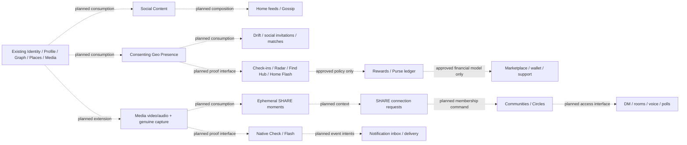
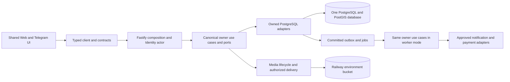
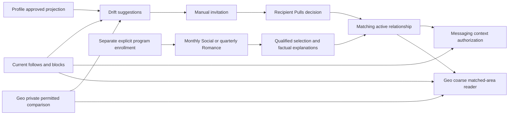
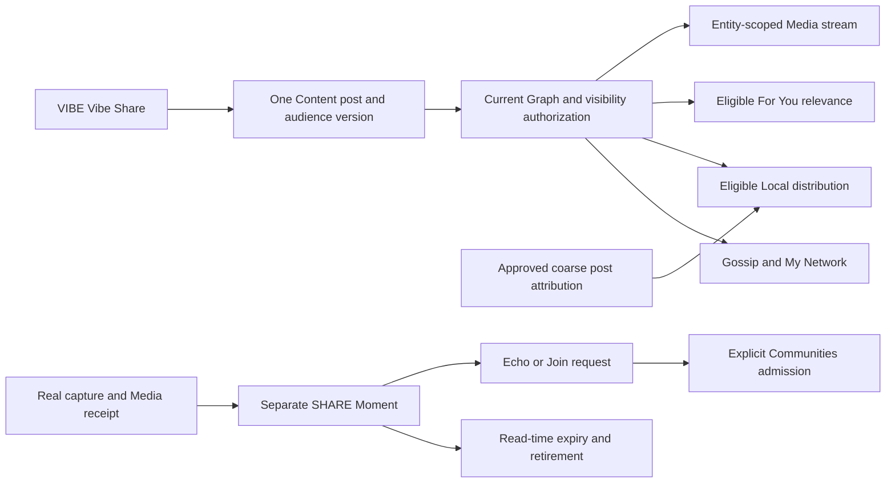
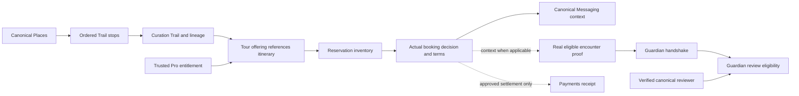
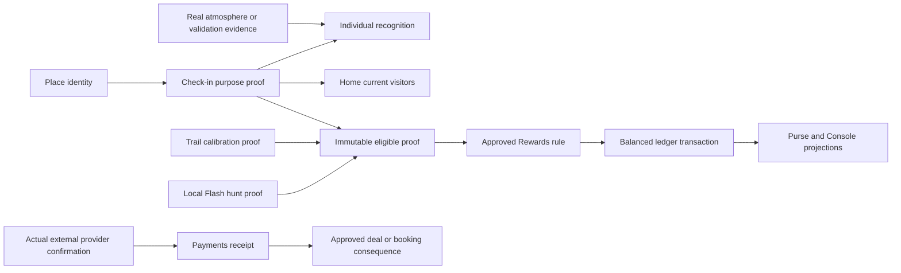

# VibeQuest master product reconstruction and execution plan

Prepared: 10 October 2026. **Active checkpoint: 28 October 2026; R02–R09 source implementation merged; R10 Home presentation slice merged, Drift/Local/For You readers still pending bounded D03 rules; D05 ordinary-location policy approved; B5 remains partial.** B1–B4 remain accepted for initial staging. Full reconstruction and production readiness remain incomplete. Historical checkpoints below are not the current task. This single file is the authoritative live master plan; supporting roadmaps and screen contracts supply evidence, not competing execution authority.

**Goal:** Restore the complete original VibeQuest product through genuine, persisted user journeys while retaining the existing clean foundation.

**Architecture:** One shared Web/Telegram frontend and router, typed contracts/client, one Fastify application and one PostgreSQL/PostGIS authority. Existing canonical owners remain authoritative; future independently meaningful capabilities use explicit interfaces rather than a generic Social/Share service.

**Stack:** Node 24, pnpm 11.1.1, TypeScript, Next/React/next-intl, Fastify, PostgreSQL/PostGIS, existing Sharp Media processing, Vitest and installed Chrome/Playwright. No dependency or provider upgrade is implied.

**Specification:** Original preparation packet `8b56829e-2067-472c-a87a-00589815f35d/Pasted text.txt`; complete architecture reconciliation packet `18e7ce62-a5f0-4c11-ba9e-c5f9d76fbce9/Pasted text.txt` and its legacy-extraction addendum; final migration/source/policy reconciliation packet `d0e359b9-5fa7-430c-9aba-079dcd82f4bf/Pasted text.txt` and the owner-approved execution plan. Only this document may change in the present documentation task. Sections 10–18 define the normative finished-system destination; historical checkpoints remain evidence of earlier work, not current implementation claims. Future executors must read the relevant authorized packet and current source again; this roadmap does not authorize coding, database changes, publication or deployment. Use the applicable execution skill when implementation is separately authorized.

<!-- prettier-ignore-start -->

## Active execution remarks — 19 October 2026

**Authority:** This checkpoint records the owner's acceptance of B4 for the current single-replica staging scope. It supersedes outdated next-task and Railway-status statements dated 10–12 October below. It does not remove or dilute the R01–R50 product requirements. Read live source and the latest GitHub/Railway state before each task.

### R02 source implementation — 19 October 2026

- **Source complete:** [implementation commit `2ad23e52e6034ae9a56fcad5cdb16019f0145513`](https://github.com/funmarket/VibeQuest/commit/2ad23e52e6034ae9a56fcad5cdb16019f0145513), based on foundation `fa75bfc205749b5530c5eb162d256526345cd389`. [PR #15](https://github.com/funmarket/VibeQuest/pull/15) is the canonical integration record for the final head, merge status and resulting foundation SHA; this documentation-only checkpoint follows the implementation commit in that same PR.
- **Behavior:** the existing Shell has one native sticky, compact header. Safe-area padding stays inside it. Brand/Home, Notifications, Account and a 44px Sun/Moon quick-theme action remain available during document scrolling. Quick theme flips the resolved light/dark theme through `@vq/ui/theme.setPreference`; Settings retains Light/Dark/System and the existing Telegram bridge. EN/FR/ES/AR action labels describe the resulting theme. Skip navigation has header clearance and a focusable main target; narrow branding fits without horizontal overflow.
- **R01 preserved:** unchanged `advanceNavigationScroll` and one document-scroll listener; downward hide, upward/top reveal, route reset, five destinations/central heart, keyboard reveal, reduced motion and bottom safe-area clearance remain. Context/location presentation remains a separate normal-flow strip with honest unset location. No GPS/city, R09 capability, duplicate scroll owner, drawer or challenge mechanics were introduced.
- **Verification:** pinned Node 24 / pnpm 11.1.1 / Prettier; formatting, lint, TypeScript and architecture checks passed; 68 unit tests passed on the unchanged rerun after one existing locale-catalog five-second timeout; production build passed. Fourteen installed-Chrome regressions passed: header scrolling across five destinations at 320/390 RTL/430/1280px, all four localized quick-theme labels/persistence/System behavior, hydration-message checks, safe-area/long-label geometry, skip focus, dialog independence/Notifications restoration, three representative existing R01 navbar cases, and the existing simulated host/blocked-storage cases. The new regression first failed against the baseline's missing quick control. Independent source review found no actionable findings.
- **Hosted checks:** [implementation-head CI](https://github.com/funmarket/VibeQuest/actions/runs/39312495181); [PR exact-head checks](https://github.com/funmarket/VibeQuest/pull/15/checks) also cover this checkpoint commit. Confirm successful final-head checks and mergeability before integration. GitHub reported no active branch protection/effective rules during inspection; no settings were changed, and the executor retains the PR plus green exact-head CI gate.
- **Deployment not verified:** Railway Web remains explicitly pinned to `31d5f99d84e277f23c60168dd5f3d12482d87ec3`, deployment `c7380aa8-7b75-40fb-aeac-4b84fa513413`. Local production rendering used real public staging reads; no canonical records were created. R02 source acceptance is not live staging acceptance. Do not change the Railway pin or independently deploy without separate authorization. Actual Telegram hardware/safe-area/device acceptance remains R50; browser host fixtures are simulated adapter evidence.
- **Historical next bounded implementation (19 October checkpoint):** R03, the original sliding Console and dialog interactions, in the existing `ProfileMenu`/Account/Profile/Business presentation. This was superseded by the verified R03 merge on 22 October 2026. B5's required positive live Event Media case still requires a legitimate approved Business host; the completed public smoke did not establish authenticated CRUD or full product parity. The R26/R27 native mechanics and all other R requirements remain outside R02.

### R03 source integration — 22 October 2026 (verified 24 October)

- **Merged implementation:** [PR #18 — R03 Sliding Console](https://github.com/funmarket/VibeQuest/pull/18) merged on 22 October 2026. Integration HEAD is [`77adca6e4d45f33730606aee72d59c51de4e0947`](https://github.com/funmarket/VibeQuest/commit/77adca6e4d45f33730606aee72d59c51de4e0947). [Exact merged-foundation CI run 39819327659](https://github.com/funmarket/VibeQuest/actions/runs/39819327659) finished successfully.
- **Scope verified from merged diff:** Right-edge native Console with `min(80vw, 340px)` presentation, X/backdrop/Escape and right-swipe dismissal (strict >80 CSS px drag or >300 px/s velocity), focus and document-scroll preservation, nested input safety, reduced motion and host Back/route-close wiring. Changes are confined to Console gesture/helper, `ProfileMenu`, `Shell`, Account CSS and focused unit/browser regressions; database, API and domain ownership are unchanged. Browser writing suites now require an explicitly local disposable `vq_test` database URL.
- **Verification boundary:** Codex reports successful local Node/pnpm checks, 43 Chrome regressions and real local Identity/Profile/Business cases. The merged-foundation GitHub Actions check is independently verified successful. The local browser and database runs are documented in the PR, not independently rerun in this documentation task; actual Railway deployment, real Telegram hardware, other browser engines, deployed interaction parity and owner parity acceptance remain unverified. B5 retains its existing scope/status.
- **Next position:** R04 Activities interaction parity is the existing dependency-ordered packet after R03; this record does not authorize starting it.

### R04 source integration — 24 October 2026

- **Merged implementation:** [PR #20 — R04 Activities interaction parity](https://github.com/funmarket/VibeQuest/pull/20) merged into `phase-0-foundation` at [`8535755b87f164241a544994f7936f757ed5aac7`](https://github.com/funmarket/VibeQuest/commit/8535755b87f164241a544994f7936f757ed5aac7), with both exact PR-head checks successful before merge (push run `40098678681`, PR run `40098689933`). Merged-foundation CI is separate and must not be inferred from exact PR-head checks.
- **R04 scope:** Existing Activities presentation, form, card, review, localized Explore navigation and host interactions received the bounded parity work; associated locale, unit/browser regression and Activities implementation documentation changed. Preserve the existing Activities domain, image limit, optimistic versions and durable behavior; no new schema/service or unrelated milestone was included.
- **Verification level:** Codex-reported 71 unit tests, 6 integration tests and 40 targeted browser cases passed. The broader browser run retained three documented stale Foundation assertions; those are not silently recast as R04 acceptance failures or claimed resolved. Those local runs were not independently repeated during the merge. PR-head CI was independently verified; deployment, live runtime, genuine Telegram hardware and owner parity acceptance remain unverified. B5 remains partial.
- **Next position:** R05 Official Events interaction parity is the already-defined dependency-ordered packet; this document does not authorize beginning it.

### R05 source integration — 24 October 2026

- **Merged implementation:** [PR #22 — R05 Official Events interaction parity](https://github.com/funmarket/VibeQuest/pull/22) merged into `phase-0-foundation` at [`38b51fcb392eb7ff52e09858720bc5a90f00ed85`](https://github.com/funmarket/VibeQuest/commit/38b51fcb392eb7ff52e09858720bc5a90f00ed85). Both exact PR-head GitHub Actions checks succeeded (push run `40112300248`, PR run `40112315650`). Merged-foundation CI is tracked independently and is not inferred from those checks.
- **Scope:** R05 completed bounded Events presentation parity: persisted ratings/Going state display, accessible stars, validation before media uploads, truthful action feedback, stale-edit reload, cancellation controls, shared-host haptics and localized Event-to-Explore handoff. The established reference category mapping remains music→Venues, art→Art, cafe/theatre→All with the raw category retained in the URL. Existing Business approval/owner authority, Event persistence, media authorization, RSVP, reviews and bookmarks remain canonical. The 15-file PR touched Events presentation, Explore navigation, four translations, focused tests and implementation evidence; no API, schema or dependency changes.
- **Verification boundary:** Codex reports pinned `pnpm check` success (including 72 unit tests and production build), 8/8 Events/Business integration tests, and focused real-local-API/database browser suites. The exact-head CI checks were independently verified. Physical-device haptics, actual external-map rendering, staging deployment/runtime acceptance and owner parity acceptance remain unverified. The previously recorded Next.js security advisory remains separate; no dependency upgrade was included. B5 status remains partial.
- **Next existing packet:** R06 — original Profile interests and self-profile journey. This documentation does not start R06.

### R06 source integration — 24 October 2026

- **Merged implementation:** [PR #24 — R06 original Profile interests and self-profile journey](https://github.com/funmarket/VibeQuest/pull/24) merged into `phase-0-foundation` at [`f3c99ba25e1603d5f29b3eb78eb786c294515d6c`](https://github.com/funmarket/VibeQuest/commit/f3c99ba25e1603d5f29b3eb78eb786c294515d6c). Exact PR-head checks succeeded: [push CI 40126488672](https://github.com/funmarket/VibeQuest/actions/runs/40126488672) and [PR CI 40126516154](https://github.com/funmarket/VibeQuest/actions/runs/40126516154). Merged-foundation CI is separately tracked and cannot be inferred from PR-head runs.
- **Scope:** The 20-file change implements the original self-profile editing journey, ten interest presets and custom interests, additional private Profile fields, 450 ms handle feedback, photo preview/update/remove and save/cancel/error flows. It extends Profile-owned contracts, API/client and persistence with additive migration `0014_profile_personal_fields.sql`, relevant translations, tests and implementation evidence. Existing eligibility remains unchanged; the approved four-field public projection remains unchanged pending D01; Cozy Diary data does not grant verification or privileges. Profile/Identity/Media ownership remains intact.
- **Verification boundary:** Codex reported 77 passing unit tests, 42 focused integration tests, targeted Profile/browser regressions and a passing production build; the exact-head GitHub CI runs are independently confirmed. Physical Telegram/device behavior, staging runtime, owner parity acceptance and the pre-existing Next.js security advisory remain outstanding. B5 remains partial.
- **Next existing packet:** R07 — persistent Social Content and Gossip. Its existing D02 audience/moderation policy dependency remains binding for writable release; this record does not resolve D02 or authorize starting R07.

### R07 source integration — 25 October 2026

- **Merged implementation:** [PR #27 — Persistent Gossip, audience authorization and moderation](https://github.com/funmarket/VibeQuest/pull/27), head `5d47da2b49f82f8affdb58171a495c03124f2b5c`, merged into `phase-0-foundation` at [`8c9cd1c5f913409a70779bc9ab419d52c4c9cdc0`](https://github.com/funmarket/VibeQuest/commit/8c9cd1c5f913409a70779bc9ab419d52c4c9cdc0). Both exact PR-head checks succeeded: [push CI 40229324241](https://github.com/funmarket/VibeQuest/actions/runs/40229324241) and [PR CI 40229327606](https://github.com/funmarket/VibeQuest/actions/runs/40229327606). Merged-foundation CI must be checked separately.
- **Scope:** 57 changed files deliver canonical persistent Social Content posts, chronological My Network Gossip, composer/image attachment and localized presentation, current Public/Followers-only audience and editable audience, Graph-owned following/mutual blocks, secure Media-owned restricted delivery, comments/tombstones/reactions, author edit/delete with 11-day post restoration, reporting/authorized moderation and 30-day pending/post-decision evidence clocks. Original Local Vibes distribution remains unavailable, without R09/R10 discovery. Identity adds only the dedicated `content.moderate` permission check; no account received a grant or moderator bootstrap. Separate implementation evidence: `docs/operations/content-implementation.md`.
- **Verification boundary:** GitHub exact-head CI checks were independently verified successful before merge; 83 unit, 52 integration and 12 Chrome tests, plus format/lint/types/architecture/build, are Codex-reported and were not independently rerun in this documentation step. The complete 57-file PR patch and relevant access/retention paths were inspected before merge; no blocking review or overlapping PR was found. Physical-device/Telegram acceptance, deployed staging runtime and moderator assignment remain unverified. The existing Next.js advisory remains unresolved; no dependency upgrade or deployment was authorized. B5 is still partial.
- **Next existing packet:** R08 — Home network feed and post actions, consuming R07 Social Content without duplicate post ownership. R08 implementation is not authorized by this documentation record.

### R08 source integration — 26 October 2026

- **Merged implementation:** [PR #29 — R08 Home Network Feed and Post Actions](https://github.com/funmarket/VibeQuest/pull/29), exact implementation head `5364e44c5e8c75346ef50ef1ef0eea405b715929`, merged into `phase-0-foundation` at [`bce50dde91432d6ec77e6dc98a2734f279618b06`](https://github.com/funmarket/VibeQuest/commit/bce50dde91432d6ec77e6dc98a2734f279618b06). Both exact-head GitHub checks passed: [push CI 40240149923](https://github.com/funmarket/VibeQuest/actions/runs/40240149923) and [PR CI 40240173413](https://github.com/funmarket/VibeQuest/actions/runs/40240173413). Merged-foundation CI is separately tracked.
- **Scope:** The 13-file change connects Home My Network to R07's canonical Social Content feed, real Profile authors and timestamps, restricted Media images, likes/comments/counts, cursor continuation, authorized deep-linked post views, clipboard success/denial, and original-compatible mobile Home post presentation. No new backend endpoint, database table, migration, Social owner or R09/R10 discovery reader was introduced. Local Vibes/For You remain honestly unavailable, and R47 tipping remains deferred. Implementation inventory: `docs/operations/home-network-implementation.md`.
- **Verification boundary:** Exact-head push and PR checks independently verified before merge. Codex reported nine focused unit tests, seven integration tests, seven installed-Chrome tests (including 48 width/locale/theme combinations), plus formatting, lint, types, architecture and build; these local tests were not independently rerun during merge or this documentation update. Complete 13-file diff and relevant Home/Content/Media interactions were reviewed before merge. Physical device/Telegram, Railway deployed staging, and the existing Next.js advisory remain outstanding. B5 is still partial.
- **Next existing packet:** R09 — consenting Geo Presence and readable area, under the approved D05 ordinary-location policy and subject to current-source/host-capability verification. This record does not authorize R09 implementation or deployment.

### R09 source integration — 26 October 2026

- **Merged implementation:** [PR #33 — R09 Consenting Geo Presence and Readable Area](https://github.com/funmarket/VibeQuest/pull/33), exact implementation head `34bf89deb62188bdd9249a9ef7264d60a8756939`, merged at [`6a517772935ae1d8b73316cd63786f3b4a1ecae8`](https://github.com/funmarket/VibeQuest/commit/6a517772935ae1d8b73316cd63786f3b4a1ecae8). Exact-head [push CI 40402198513](https://github.com/funmarket/VibeQuest/actions/runs/40402198513), [PR CI 40402249896](https://github.com/funmarket/VibeQuest/actions/runs/40402249896) and [merged-foundation CI 40406356626](https://github.com/funmarket/VibeQuest/actions/runs/40406356626) all succeeded.
- **Scope:** 52-file implementation adds canonical `packages/geo`, typed contracts/API client and authenticated Geo API; additive `0020_geo_presence.sql` for consent, latest position and coordinate-free session participation; approved D05 five-minute/100-meter fix validation and fifteen-minute expiry; logout, withdrawal, permission-loss and concurrent-session safeguards; private server-held nearby Places lookup; shared Shell/Home/Explore/Settings access and location presentation with EN/FR/ES/AR. Manual public browsing remains independent of GPS. Original reference evidence and parity inventory are documented in `docs/superpowers/plans/2026-10-26-r09-geo.md`; implementation inventory in `docs/operations/geo-implementation.md`.
- **Verification boundary:** Exact-head and merged-foundation GitHub CI independently verified successful. Codex reported 88 CI unit tests, 90 local PostgreSQL integration tests, 23 R09 installed-Chrome scenarios and 11 affected browser regressions, plus formatting/lint/types/architecture/build; these local suites were not independently rerun in this documentation update. Real GPS/Telegram hardware, owner-screenshot pixel parity, Railway runtime and hosted migration acceptance remain unverified. The existing Next.js security advisory remains unresolved; no provider or deployment change is implied. B5 remains partial. Accepted-match disclosure awaits R11; later venue proof, geofences and AI remain deferred.
- **Next existing packet:** R10 — Drift discovery and Local/For You readers, subject to current source, original reference and D03 eligibility/scoring/preference decisions. R10 is not implemented or authorized by this documentation record.

### R10 Home presentation slice — 28 October 2026 (source merged; R10 incomplete)

- **Integration:** [PR #36](https://github.com/funmarket/VibeQuest/pull/36), exact head `fe681cf11caf69acf113114671ca618eb475eae9`, merged as foundation `5e933fe0658c2898dd1461314de7935611a6967d` from `0d923f70c53401e7d2c56e36b15c3d3e55b88860`. The owner's R10 packet and subsequent clarification authorized this independently valid Home slice through merge and plan synchronization. This is not complete R10 discovery or authorization for R11/deployment.
- **Home behavior:** Check-ins → unchanged Flash → the single existing My Network / Local Vibes / For You presentation → Live Activities → Live Events; remaining sections keep their relative order. Flat balanced three-column tabs replace the scrolling boxed rail, with source-gold underline/dark text, readable light-theme gold, keyboard/RTL selection and no route change. Existing green/blue gathering owners retain real images/emoji fallback, details and actions; source-proven padding/thumbnail gaps, Event status/category/Going hierarchy, gold rating and circular expansion tray are restored without invented facts.
- **Ownership preserved:** My Network still consumes canonical Social Content; Activity/Event publishing/hosting, eligibility, RSVP, reviews, bookmarks, edit/cancel and Media permissions retain their original handlers. No API, domain, database/migration, dependency, provider or global-shell change. Ten implementation files changed; see [implementation evidence](../operations/home-presentation-implementation.md) and PR diff.
- **Original evidence:** supplied `vibequest.zip` (350 entries) and extracted Gemini app; four relevant Drift/Home feed/Activities/Events source files matched ZIP bytes. The 2026-10-28 page-by-page reference was inspected. The separate three-tab screenshot was unavailable; available source and explicit presentation requirements supported this slice. No pixel-exact original-runtime parity claim.
- **Local verification:** formatting, lint, TypeScript, architecture and production build passed; 16 focused Activities/Events/Content integration cases; 16 final Chrome visual cases covering 320/360/375/390/393/412/430/768/1280px, EN/FR/ES/AR, light/dark and RTL; six unique real browser journeys (Activities one, Events one, My Network four), including persistence, audience/block/Media regressions. Local unit run verified 86 unique non-hook cases after one unchanged Places timeout passed in isolation. The Event test closes its external Maps popup/restores parent focus before unchanged Explore assertions; product navigation handlers were not modified. Layout fixtures are distinct from real API-backed tests and device acceptance.
- **Hosted verification:** exact-head [push CI 40731204253](https://github.com/funmarket/VibeQuest/actions/runs/40731204253) and [PR CI 40731248829](https://github.com/funmarket/VibeQuest/actions/runs/40731248829) succeeded; full CI included all 88 unit tests, including both Windows-local hook fixtures. [Merged-foundation CI 40731608558](https://github.com/funmarket/VibeQuest/actions/runs/40731608558) succeeded at `5e933fe0658c2898dd1461314de7935611a6967d`. No unresolved GitHub review threads or overlapping PRs were present at the merge gate.
- **Approved philosophy retained:** quarterly complementary Romance/Polar automatic matches, monthly similarity/activity Social automatic matches, ongoing broader Drift suggestions without automatic relationships, and the separate invitation → Pulls → Accept/Ignore → Vibes path remain distinct. Ordinary discovery filters do not enroll users in automatic programs. Frequencies, complementarity/similarity, activation, labels and report existence are settled; do not reopen them or implement the scheduled programs under R10.
- **Next existing work / narrow blockers:** finish R10 Drift and Local/For You readers after ordinary filter compatibility, deterministic wavelength/ranking tie-breakers, numerical discovery/anti-abuse limits, coarse area/post attribution and manual/no-GPS behavior, For You relevance/no-interests fallback and permitted cross-user Geo comparisons are settled. The reference's seeded/fallback profiles and fixture feed arrays do not establish approved production policies. Missing readers remain planned/unimplemented, not newly proven defects. R11 remains deferred.
- **Acceptance limits:** no Railway deployment, hosted migration, physical-device/Telegram or exhaustive original-runtime visual acceptance. The existing pinned Next.js advisory remains unchanged. B5 stays partial; later release/device acceptance remains pending. This documentation record creates no new implementation/deployment authority.

### D03 owner decisions and original-reference reconciliation — 27 October 2026 (policy record, no implementation)

**Source status:** The owner supplied a Gemini read-only forensic report of the old application (27 October 2026). This is *reported historical source evidence*, not independent validation of the original runtime, architecture or deployment. The newer active Gemini ZIP has now been inspected for the specific mechanics recorded in the updated reference crosswalk below; source inspection does not establish deployed/runtime parity. Continue checking the specific current reference and later implementation evidence. Do not duplicate the legacy localStorage, fixture profiles, Supabase/Firestore splits, hardcoded fallback candidates or security assumptions in the canonical implementation. Current GitHub and this master plan retain implementation/decision authority. **R10 remains the next planned milestone; no R10/R11 code, deployment, provider choice or new milestone is authorized by this record.**

**Approved R10 discovery direction (D03-1–6):**

- **D03-1:** Drift eligibility/relevance uses the selected original wavelength together with relevant genuine Profile interests and descriptions. Preserve the twelve original wavelengths, selection/back/cards, and self-exclusion. No simulated candidates, unconditional keyword fallback or invented matches.
- **D03-2:** Preserve the original discovery preference choices **All / Friendship / Colleagues / Romance**, but make them genuinely affect authorized discovery. Profile owns preferences; the historical transient React filter must not become a second canonical store. Exact preference semantics and eligibility effects still require bounded definition before coding.
- **D03-3:** Use **deterministic, explainable relevance ordering without numerical compatibility percentages**; the historical separate Discover scoring formula is not an approved Drift ranking algorithm. Exact tie-breaking/weighting must be source/decision grounded.
- **D03-4:** **Global discovery**, with **optional coarse-area relevance only for properly opted-in users**; no GPS participation requirement, public exact location, block bypass or automatic cross-user disclosure. Geo owns consent/scoped location and Graph owns blocks.
- **D03-5:** Home **Local** selects authorized genuine Content using coarse Geo area; Home **For You** uses selected interests and transparent relevance. Preserve canonical Content audience/blocks. No static seeded posts, fake areas or second feed database. Browsing without GPS must remain usable; exact fallback behavior still needs definition.
- **D03-6:** Define **additional explicit product thresholds** for candidate enumeration, discovery request rates and repeated actions before implementation; do not let an agent fabricate numerical limits. Existing security conventions remain binding.

**Approved automatic matching direction (distinct from suggested discovery and the original invitation flow):**

- **Romance / Polar Match:** rare, **every three months**; explicitly opt-in; complementary behavior/individuality/energy/routines with compatible relationship goals and deal-breakers. A qualifying pair becomes an **automatically active Romance Match without mutual swipe/accept**, with communication immediately enabled, a distinct Romance label, a personalized evidence-grounded explanation delivered to both, and easy pass/disconnect. Do not assert inferred psychology as fact or reveal sensitive/private evidence.
- **Social Match:** **once per month**; distinct label **Social Match**; practical similarity using shared sports/activities, social-place interests and authorized coarse proximity when available. Automatically active with immediate communication and pass/disconnect, subject to appropriate consent/eligibility and a grounded explanation.
- **Suggested Matches:** ongoing, looser discovery recommendations, **not** automatic relationships; do not grant messaging or match-only Geo rights. A user may receive both automatic match types. No suitable consenting eligible candidate means no invented match; cadence denotes opportunities, not guaranteed matches.
- Preserve the original **Drift invitation → Pulls → Accept/Ignore → Vibes** pathway as a separate manual matching mechanism. One accepted invitation established a match in historical source evidence; mutual following never automatically matches. Native dual-camera VibeCheck and venue check-in are distinct capabilities. The historical **33-second social-request expiry** is not approved as a production rule.
- **Ownership:** one canonical Matching authority for active relationships/invitations/scheduled policies and reports; Profile owns declared preferences, Identity eligibility, Graph follows/blocks, Geo private location consent, Content authorized feed reads, Messaging communication authorization when implemented. Do not introduce a parallel romance/social match store or silently give R10 later R11/R17 work.
- **Still unresolved for safe implementation:** precise matching eligibility/consent and sufficient behavioral evidence; automatic-match scheduling semantics (calendar vs individual cooldown), unsuccessful-run retry, disconnect/re-match policies, explanation source/retention/privacy, exact discovery/anti-abuse thresholds; manual invitation expiry/duplicate/crossed/retraction rules; policy-based preference meanings, ranking/tie-breakers and no-GPS Local fallback. Resolve by owner decision and current-source preflight, not guessing. Reconcile new automatic-match scheduling/reporting within existing milestones and R17 Messaging dependency; **do not invent an extra R51** or prematurely implement it under R10.

### R32 Vibe Trail historical mechanics — reference evidence only (27 October 2026)

Gemini reports the original **Explore → Vibe Trail** was a **human-curated, multi-stop day-trip itinerary**, not AI-generated recommendations or a single-place bookmark list. Reported historical source files include `features/explore/hooks/useVibeTrails.ts`, `components/VibeTrailsSection.tsx`, `TrailDetailModal.tsx`, `CreateTrailModal.tsx`, `TrailRemixTree.tsx`, `services/trailCache.ts` and `types.ts`. The newer active app ZIP has been inspected for these source components; its live/runtime behavior is not independently verified. See the updated XREF-05 crosswalk, including Vibe Tours and Vibe Guardians.

**Preserve for R32 parity evaluation:** Explore carousel and Home gateway; original reported **2–10 ordered stops**; cover/category/name/curator attribution and adoption count; human-authored story, stop time-of-day, visit durations and insider tips; create studio with add/remove/reorder; map preview with numbered pins and honest schematic fallback; multi-waypoint **walking directions handoff**; save/offline viewing; **Adopt & Remix** cloning with original stop order and provenance; community remix lineage tree. Gemini also reports a radar recenter action and cultural-passport recognition. These are source-evidence candidates to verify against the forthcoming ZIP and reconcile with the existing R32 contract, **not already-approved new implementation scope or guaranteed working historical behavior**.

**Canonical implementation boundary when R32 is authorized:** Trails/curation owns authored itinerary, ordered stop links, adoption lineage and provenance; **Places** owns venue identity/coordinates; **Media** owns binaries; Identity/Profile own creator facts; **Geo** owns private device position; provider adapters own maps/directions; offline local cache is only a projection, never the authoritative record. Do **not** copy historical Firestore `vibe_trails`, Firebase rules, localStorage as backend truth, Google Maps dependency, arbitrary coordinates, staged seed data, or old component architecture. Existing R32 dependency/order and separate single-place Coordinates journey remain in force. Map/provider choice, offline guarantees, remix permissions/counters, licensing and actual runtime parity need later R32 reconciliation after ZIP inspection.


### Updated original-product reference crosswalk — 28 October 2026 (ZIP inspected; specification only)

**Evidence hierarchy:** The inspected original Gemini archive `vibequest (2).zip` (350 entries) is the newer historical product reference. It informs user-facing screen order, interactions, feature mechanics and feature-to-feature journeys. The owner's newer explicit decisions supersede legacy mechanics. This document and the **live** `phase-0-foundation` source govern reconstruction; neither the legacy React component tree nor its localStorage/Firestore/fixture data model is an implementation blueprint. Evidence labels below: **ZIP** = present in static source (not production/runtime-verified); **OWNER** = newer approved requirement (not asserted to exist in ZIP); **CURRENT** = presently implemented in the reconstruction; **FUTURE** = authorized milestone not yet built. Check current source again at implementation time.

**Backend-state discipline:** An unimplemented future owner/API/database operation is **PLANNED**, not a regression. UI shell ≠ working backend; source merge ≠ deployed runtime; seeded local data ≠ genuine product. Assess each feature independently at UI, backend, integrated and runtime-verified levels. Never make functional success claims from an attractive placeholder. Preserve R01–R09 integrations, the R10 Home presentation slice and the dependency-ordered milestone gates; do not restart them or import legacy state.

#### XREF-01 — One Vibe Share publication, three social views (OWNER + ZIP)

**Required end-user invariant:** A user who publishes a **message, photo, or message with photo via VIBE → Vibe Share/Gossip** creates **one canonical Social Content post**. That same post is available in **VIBE → Gossip**, **Home → My Network**, and **Home → Local Vibes** under the respective audience, block, and location-distribution rules. These are **three authorized projections of one post ID**, not three posts, three writes, or two separate backends. Author sees their own authorized post in Gossip and My Network. Local Vibes includes it in its correctly attributed coarse area; provide a legitimate area-selection/attribution journey without requiring continuous GPS, subject to D05 privacy. Do not silently drop an otherwise eligible share from Local. For You may recommend the same authorized post based on genuine relevance; it is not an unconditional fourth destination. A restricted-audience post must never be widened merely because it is geographically local.

**Verified ZIP wiring:** `src/components/chat/VibeCenterView.tsx` renders the **Vibe Share** affordance, Gossip composer and Gossip results; `src/features/chat/components/GossipInlineComposer.tsx` calls `socialFeedService.createPost` with text/photo/venue/emoji/actor fields; `src/services/socialFeedService.ts` writes a social-post array **and a second Home custom-post array** in browser storage, optionally pushes to Firestore and sends `vq-post-created`; `src/features/home/components/HomeFeedTabs.tsx` merges Home custom posts with seeded tab posts. **These duplicated stores, seed items, optimistic pseudo-sync and broad cross-tab mixing are historical implementation defects, not approved design.** ZIP Gossip filters by actor/follow/match and includes seed exceptions; do not copy those exemptions. The separate SHARE page's `ShareVibeModal.tsx` and `ShareGoodVibesScreen.tsx` must **not** be conflated with VIBE Gossip publication: inspect each entry point's publishing destination before unifying semantics.

**CURRENT source ownership:** R07 owns canonical Social Content posts, audience enforcement, comments, reactions, moderation and Media links; R08 renders My Network through that owner. `apps/api/src/modules/content/http.ts` registers `/v1/content/feed`; `apps/web/src/features/home/home-page.tsx` renders one My Network reader while Local/For You currently display an explicit empty state. There is no R10 Local backend reader yet. Therefore this is **an R10 distribution/reader requirement, not a claim that Local is broken after completion**.

**New implementation contract:** VIBE composer and Home post actions consume **the same existing Content publish/read contract**; extend only where current contracts genuinely lack required post metadata. A successful publish returns one durable post ID and owned Media attachments; all three views query Content-authorized projections and independently invalidate/reload on publication. Cross-view consistency is server-backed (not localStorage synchronization or arbitrary browser events). Graph supplies follow/block audiences; Profile supplies authors; Geo supplies consent/private observation only; an appropriately approved **coarse post area** is stored/derived by its canonical owner without exposing raw private location. Do not infer an author's position from a reader's coordinates, expose the author through a geolocation side channel or globally release followers-only content. Explicit tests: publish text/photo/combined → the **same ID** in Gossip, My Network and eligible Local area → reload/other signed-in viewer permissions → own/follow/blocked/restricted cases → area/no-GPS/manual-area → media security → edit/delete/moderation remove consistently. No new feed database, fake item, shadow Graph or duplicate Media store.

#### XREF-02 — HOME (ZIP product order + newer owner presentation)

**Current accepted Home sequence:** existing location/header and Vibe Check-ins → unchanged Flash Alert → fixed flat **My Network | Local Vibes | For You** three-tab feed → Live Activities → Live Events → remaining sections in their existing relative order. PR #36 implemented and merged the structural/presentation slice; this must not be reimplemented under R10. Preserve non-scrollable equal-width tabs, gold active underline, mobile/RTL/keyboard states and unchanged Flash banner. Current Activity/Event domain logic and underlying records remain authoritative; the newer Gemini Live Activities/Events card hierarchy is a **visual reference**, not permission to replace hosting, participation, RSVP, save, reviews or media code.

**ZIP original Home journeys not to lose later:** visible current vibe/check-ins, Flash-event hero/list/hunt/create, social tab feeds with author/media/like/comment/share, Live Activities and Business-hosted Live Events, daily streak/points, Vibe Trails and Curated Coordinates gateways, Local Gems, radar/compass, guide and Find Hub. Preserve original page-relative order wherever not superseded by the owner's new Home feed position. Plan crosswalk remains HOME-01–09 and the corresponding R24/R28–34/R37/R44/R47 owners; a Home card does not own the entity it displays.

#### XREF-03 — VIBE, Drift and matching (ZIP + D03 OWNER; R10 / R11 / R17)

VIBE contains Gossip, Drift, Vibes, Orbit, Echo and Pulls, plus the owner-approved distinct matching experiences. **R10 now**: wavelength selector with twelve original categories, back/reselection/count, genuine candidate cards, Profile navigation, Graph follow/block, and actual discovery preference application; global discovery without mandatory GPS, optional permitted coarse relevance; deterministic explainable results and truthful empty/loading/error cases. Use bounded server-side matching-discovery reads consuming Profile/Identity/Graph/Geo *ports*, not the Gemini `DriftView` seeded arrays, client-side scoring or arbitrary fallback matches. **R11 later**: directed invitation → recipient Pulls Accept/Ignore → accepted Vibes, idempotency/expiry and correct mutual state; do not auto-match from mutual follow. **R17 later**: real communication authorization and Messages. **Automatic matching program later**, separate from R10 suggestions and R11 manual invitations: quarterly opt-in productive-complementarity Romance/Polar Match with compatible declared values/deal-breakers, monthly opt-in sports/social-place similarity Social Match with appropriate proximity, both becoming active without secondary swipe, immediately communicable only when canonical Messaging is ready, rationale to both, disconnect/pass, no fabricated psychological evidence. Suggested Drift recommendations never silently establish a relationship. Keep one canonical Matching relationship owner, Profile-owned preferences, Graph-owned blocks/follows, Geo-owned location, Messaging-owned messages. Match-only Geo disclosure cannot be silently granted by showing Drift suggestions.

#### XREF-04 — EXPLORE and local Places (ZIP, later R28–R36)

Preserve location/manual area and search, categories, map/radar/heatmap/list, place cards/details, check-in and validation, reviews/favorites/directions, venue Gatherings, Flash secrets/hunts, neighborhood/town/city atmosphere, Vibe Trails/Vibe Tours and the Vibe Guardians directory in their source-relative Explore layout. The later ZIP places the **Trails carousel near the top and the Vibe Guardians section above nearby venue results**, while retaining category/radar and nearby discovery; preserve this newer ordering as the reference when that page's milestone is reached. Places owns canonical venue identity, place evidence/ratings and provider attribution; Geo owns private positions and consent; place engagement/contributions own check-in/validation lifecycle; venue Gatherings are not Official Events; Flash has its own lifecycle; rewards are ledger-owned, never client-invented. All mapping/route times/area heat need genuine permitted evidence. Do not conflate the R36 *Mayor/Guardian recognition* concept with **Vibe Guardians paid/free human guides**.

#### XREF-05 — VIBE TRAILS, VIBE TOURS and GUARDIAN HIRING (ZIP + newer OWNER; R32 related, dependency placement in section 14)

**Vibe Trails — ZIP:** Explore horizontal Trail cards, detail/story/category/creator/cover/count, **2–10 ordered stops**, time-of-day and duration, tips, map preview/numbered pins and walking directions handoff, create/reorder/delete/publish, save/adopt/remix, provenance lineage/remix tree, optional offline projection and Home entry. Genuine editorial/human-authored itinerary, **not** flat single-place bookmarks or AI hallucinated tours. Anyone eligible may create Trails, including ordinary users, Local Legends and Pros; keep correct canonical Places references. The originally observed Firestore `vibe_trails`/sample seeding/local cache is **not** reconstruction persistence.

**Vibe Tours — OWNER superseding older ZIP:** Explore Trails section has fixed **Vibe Trails | Vibe Tours** switcher; **only an authorized Pro Guardian** may mark a created Trail as a **Tour** (checkbox `Label this as a Tour`); enforce Pro entitlement **on the server**, including updates, not by hiding a checkbox. Tours have required title, long About/description, duration, flat per-tour price, meeting/pickup point, included items, languages; optional age suitability, accessibility, expectations, cancellation policy and calendar availability/start times. Detail shows complete terms, price and **Check dates / Reserve now** routes to real calendar/booking; no fabricated acceptance. Plain Trails remain distinct from bookable Tours, while Tours reuse ordered Trail/Place itinerary facts via the approved canonical interface. Pro profile shows **either hourly guidance price OR flat Tour pricing in the relevant context, never both as simultaneous charging methods**; Local Legends remain free. Verify precise rate presentation and booking terms when implementing, without guessing payments.

**Vibe Guardians — ZIP:** Explore directory tabs **Top Vibes | Pro Guardians | Local Legends | Suggested**; Guardian cards/profile, bio/areas/languages/specialties, badges, rates, selfie, optional linked Trails, reviews/handshake, chat, availability and reservations. Pro = paid guide; Local Legend = free community guide. Card shows no more than **five** linked Trails, with each row limited to Trail title and small green **Explore now** link (OWNER). Guardian creation/edit has **Show me in Hire suggestions on trails** checkbox, default checked where applicable, with opt-out removing them from public Trail Hire suggestions (OWNER). Trail detail can open **Hire a Guardian for this Trail**; only eligible, opted-in profiles appear. Local Legends and Pros may appear where appropriate; only Pros may create Tours. For Guardian reviews require **both a verified user and a real eligible handshake** (OWNER). ZIP's selfie expiry was **7 days**, but its browser stock-image camera fallback does not count as secure verification; preserve selfie presentation/expiry only through real approved Media/capture/Identity proof. ZIP's handshakes, auto-accepted reservations and canned chat replies are simulated; implement actual authorized handshakes, reservation transitions and Messaging later, never fake booking/payment.

**Canonical owner contracts:** Trail curation owns itinerary, ordered stop references, adoption/remix lineage and publication; Places owns Place identities; Media owns binary photos; Profile/Identity supply account facts and real verified status; a focused Guardian services owner owns guide enrollment/availability/visibility/pricing/entitlement assertions (only where not already owned), Trail Hire search and handshake eligibility; a coherent Tours/Reservations owner owns tour offerings, calendar inventory and booking lifecycle through Trail and Guardian ports; Messaging owns conversations (not Guardian UI/localStorage); any actual monetary settlement requires the existing approved financial/payment owner, not the Trail card or client. Do not create duplicate identity, itinerary, booking or wallet authorities. These later owner names are **responsibility boundaries**, not pre-existing package/table names or authorization to create them now. Section 14 reconciles this feature family with the **existing** ordered milestones and dependency closures; do not create an unapproved R51.

**Acceptance for the later authorized slice:** ordinary-user/Local-Legend/Pro create/edit access; Pro-only Tour flag update tamper tests; minimum/maximum ordered stop and provenance validation; accurate shared Places pointers and link retirement; optional hire visibility opt-out; five-card cap; review verification + handshake; local free/pro billing presentation; calendar availability, concurrent bookings, cancellation and reload; private info/media access; no stock selfie verification; genuine messages; guest detail and phone/RTL/Telegram/modal return. State missing capabilities as planned until their owner is implemented and independently tested.

#### XREF-06 — SHARE GOOD VIBES (separate page and context; later R12–R16/R24–27/R44)

Historical SHARE includes Quick Vibe, capture challenge overlays/dual-camera responses, Nearby/Communities/Create, ephemeral moments, Echo/Join requests, Circles/community context, mini feeds, mood compass and donation prompts. Preserve the distinct lifecycle for **temporary SHARE moments** versus persistent **VIBE → Vibe Share social posts**; an action must explicitly choose its canonical publication type and cannot silently double-post or broaden privacy. Native VibeCheck/Flash challenge clocks and evidence are separate from manually accepted Drift matches, ordinary venue check-ins and Home Flash events. Media owns actual capture, authorized delivery and cleanup; Identity owns actor; Moments owns expiration; Communities owns membership; Messaging owns chat; Notifications owns delivery; Rewards owns any approved point claims. ZIP's alerts/fixture people/rewards do not prove backend.

#### XREF-07 — PURSE, PROFILE, SETTINGS and ADMIN (reference only; later ordered milestones)

Purse/wallet, balance/history, offers and P2P/escrow-like UX in ZIP are product reference only until genuine ledger, financial model, provider/custody policy, Marketplace state and authorization exist. Do not make transfers, balances or bookings look final on client success alone. Profile supplies photo/handle/bio/interests/cultural passport/preferences/verification display; Profile is canonical for interests and owner-declared public facts, Identity for auth and entitlements, Media for uploads. Shared Console/shell/notifications, onboarding, Settings/privacy controls, themes, locales and host integration remain governed by their existing owners and planned R milestones; do not copy Gemini page-wide state and localStorage privilege upgrades. Admin invokes authorized domain commands; it never owns all domain databases or bypasses capability checks.

#### XREF-08 — Whole-app wiring and change discipline

**One published fact, many reader projections:** Post publication Content → authorized Gossip/My Network/Local/For You; Profile → authorized Drift candidate summary and writer identity; Graph → discovery eligibility/feed audience; Geo → explicitly scoped coarse discovery and place lookup; Trail itinerary → Explore/Home/Guardian listings; Tour/Reservation → availability/calendar/profile display; Messaging → participant-authorized communication; Notifications → approved event intents; Media → gated delivery across attached entities. Every read/write goes through the typed client → registered API → canonical application/domain ports → existing PostgreSQL/PostGIS authority. Create additive migrations **only when that later milestone is actually authorized and owns new durable records**, never pre-create entire Gemini data model. No duplicate stores, monolithic cross-feature service, unguarded browser state as source of truth, forged counts, fake success, seeded social users, third-party provider assumption, arbitrary privacy disclosure or unrelated redesign.

**Per-milestone verification:** Before implementation, check current foundation HEAD, current schema, existing owner/ports, needed new owner contract, actual frontend journey, localized/RTL/phone widths, backend and migrations present/missing, security/privacy integration and tests; label missing planned functionality correctly. Reconcile ZIP/owner changes without moving completed R milestones backward. A future acceptance gate must prove server persistence, reload, actors/audiences and dependency isolation; browser snapshots alone do not make a feature complete.

### Verified staging and repository

- Repository: `funmarket/VibeQuest`, integration branch `phase-0-foundation`.
- Pre-R02 foundation: `fa75bfc205749b5530c5eb162d256526345cd389`; R02 implementation and integration evidence are recorded above. Deployed application source remains `31d5f99d84e277f23c60168dd5f3d12482d87ec3`.
- [Foundation CI](https://github.com/funmarket/VibeQuest/actions/runs/38973941147) passed; no open PRs were reported at the last pre-update check.
- Railway project: `9cd5ae90-5544-49ab-b3ab-74dee8105af9`; staging environment: `7a75adec-2799-4ca3-971e-6e26de1b7796`, Amsterdam.
- Web deployment: `c7380aa8-7b75-40fb-aeac-4b84fa513413`, SUCCESS, one replica.
- API deployment: `cfc1c56d-0cd2-4838-a272-ffbe6b379fe0`, SUCCESS, one replica.
- PostGIS deployment: `2f55ebb0-c550-41a6-9ac2-41bca57c8659`, SUCCESS, one replica.
- Web URL: https://web-staging-5951.up.railway.app/en/home
- Web `/api/*` connects privately to Fastify at `api.railway.internal:4100`, then canonical PostGIS.
- MediaBucket resource: `17687718-9d86-41da-814f-87ccb8b4a79a`; actual bucket: `mediabucket-jujionqm6h4di`. PR #12 merged the existing Railway MediaStorage adapter.
- One shared Next.js Web/Telegram product, one Fastify API and one PostgreSQL/PostGIS authority remain the architecture. Genuine Telegram launch/session/device acceptance is pending.

### Current milestone status

- **A5:** Staging HTTPS Web, private API and PostGIS topology selected and deployed. Real Telegram acceptance remains pending.
- **A6:** PostgreSQL migrations, separated roles and Railway bucket storage selected and implemented for initial staging. Worker and restore hardening remain pending.
- **B1 Database:** COMPLETE. Existing thirteen migrations and checksums, readiness and roles verified.
- **B2 API:** COMPLETE. Private Fastify runtime, readiness, Origin/cookie/security checks verified.
- **B3 Web:** COMPLETE. HTTPS Next.js, real guest API reads, locale/RTL, navigation, responsive and protected-action checks verified.
- **B4 Media/worker:** **ACCEPTED BY OWNER FOR CURRENT SINGLE-REPLICA STAGING ON 19 OCTOBER 2026.** This is not a claim of multi-instance or production resilience.
- **B5 Functional and visual smoke:** **PARTIAL — IMPLEMENTATION WORK REQUIRED.** Public destination navigation, guest gates, real empty feeds/search, honest map-unavailable state and representative widths/locales/themes were checked. No approved Business host was available; authenticated lifecycle and positive live Event Media remain outstanding. R02 repairs the observed header gap in source; it does not claim a new staging deployment or full B5 acceptance.
- **R02:** **SOURCE IMPLEMENTATION COMPLETE**, with PR/integration and deployment evidence distinguished above; R01 is preserved.
- **R03:** **SOURCE IMPLEMENTED AND MERGED** via [PR #18](https://github.com/funmarket/VibeQuest/pull/18), foundation merge [`77adca6e4d45f33730606aee72d59c51de4e0947`](https://github.com/funmarket/VibeQuest/commit/77adca6e4d45f33730606aee72d59c51de4e0947). Merge-foundation [GitHub Actions run 39819327659](https://github.com/funmarket/VibeQuest/actions/runs/39819327659) succeeded. Browser and integration coverage described in PR #18 is Codex-reported; it is not independent physical-device, Railway deployment, or live staging acceptance. The existing R04 packet follows R03 in the approved dependency order, but is not initiated here.
- **B6 Release evidence:** PENDING. Document exact staging revision, schema, health, smoke and rollback/redeploy results.
- **R49:** MANDATORY production and distributed Media/Worker engineering. NOT STARTED under this checkpoint.
- **R50:** MANDATORY full-product, real-device/Telegram/provider and production acceptance. NOT STARTED under this checkpoint.

### B4 evidence remarks — do not repeat completed tests

**Codex-reported live staging verification:** Authorized test-account registration and login; PNG/JPEG/WebP image upload; Media intent/claim/ready states; real Railway bucket object writes; image and thumbnail WebP checksums; anonymous public and owner-only private delivery; invalid Origin and revoked-session rejection; invalid-image and duplicate-upload rejection; attached-object deletion protection; physical delete and post-delete 404; Profile photo attachment/replacement/retirement; Activity attachment/detachment/cancellation/retirement; ten-minute intent expiry; scheduled cleanup; and persistence of four variant checksums across one actual API restart. Independent Railway checks confirmed healthy Web, API and PostGIS deployments.

**Codex-reported isolated verification:** 34 integration tests and 21 storage/configuration unit tests passed. Positive Event image attachment/edit/detachment and scheduled retirement passed against an isolated database, including deletion of physical variants. Failure injection covered partial writes, failed reads/streams, delete failures, durable retries/backoff, lost acknowledgements and fresh-process cleanup. Isolated tests do not certify a live Railway provider outage or worker crash.

**Required B5 Events carryover:** Live Event hosting returned expected HTTP 403 for the ordinary staging account because an approved active Business owner is required. B5 must use a legitimately approved Business host to verify positive live Event image attachment, edit/detachment and scheduled retirement. Do not bypass authorization, create privileges by assumption or claim this case already passed live.

**Required R49 recovery and scalability:** Implement and verify distributed cleanup claiming/leases, multi-instance upload concurrency, appropriate Worker placement, crash recovery, abandoned `processing` recovery, operator recovery of jobs exhausted after eight attempts, provider failure resilience, load/scaling and database plus bucket backup/restore. The existing 60-second API-local cleanup timer is verified for one replica, not distributed safety. These are mandatory future engineering outcomes, not waived by B4 staging acceptance.

**Retained staging fixtures:** One authorized test account `764859df-60c2-4320-bafa-29a54d55d8f4`, blank Profile, cancelled Activity and six completed cleanup jobs remain documented. Last reconciliation found three active and two revoked session rows; active sessions expired around 2 November 2026. It found zero Media records, bucket objects, pending cleanup jobs or retirement requests. No supported delete-account or revoke-all workflow was identified. Do not directly delete Identity/audit rows or expose credentials.

### Execution instruction for the next agent

**Current next planned packet: R10 — Drift discovery and Local/For You readers**, following merged R09, subject to its D03 eligibility/scoring/preference decisions and current-source/original-reference preflight. No R10 implementation is initiated by this document. The preceding 19 October R02 checkpoint identified R03 as next before its merge. B5 remains partial and its live prerequisites are retained; do not restart another B4 reconciliation or repeat the entire public smoke. Inspect the current source and relevant authorization before the next task. Keep original mechanics and domain ownership intact. Integrate targeted verification into implementation and avoid repeated acceptance-only loops. After each accepted milestone update **this same plan**, recording source SHA, CI, deployment, tests, limitations and the next task. This checkpoint does not itself authorize R09 code, a staging deployment, services or Business privileges.

---

<!-- prettier-ignore-end -->

## 1. Authority, evidence and limits

Source keys used throughout this plan:

<!-- prettier-ignore -->
| Key | Absolute root / document                                                                                                      | Role                                                                           |
| --- | ----------------------------------------------------------------------------------------------------------------------------- | ------------------------------------------------------------------------------ |
| C   | `C:/Users/GrowB/Desktop/Vibequest`                                                                                            | Actual clean source, current owners and tests                                  |
| L   | `C:/Users/GrowB/Desktop/ViBeQues-Selection/vibequest last/src`                                                                | Primary product features, interactions, mechanics and feature presentation     |
| B   | `C:/Users/GrowB/Desktop/ViBeQues-Selection/vibequestbest/src`                                                                 | Compatible supplementary design only                                           |
| I-D | C `docs/product/references/product-truth-discovery.md`                                                                        | 101 historical stable acceptance records                                       |
| I-S | C `docs/product/references/product-truth-social.md`                                                                           | 54 historical stable acceptance records                                        |
| I-P | C `docs/product/references/product-truth-platform-purse.md`                                                                   | 60 historical stable acceptance records                                        |
| P   | `C:/Users/GrowB/.codex/visualizations/2026/10/09/01a1210b-9e77-7230-a2dd-ff607844acaa/vibequest-feature-parity-2026-10-10.md` | Fresh detailed page comparison, including nested actions and reference defects |

`C`, `L`, `B` plus a relative path resolve to the absolute source location above. The external report P supplies extra detail, but this plan embeds the essential coverage and packet criteria so execution does not depend on an unpublished local report. Read the 215 records for their source traces, not their stale completion claims. They are acceptance records, not 215 unique features or a percentage-complete metric.

**Historical plan-preparation evidence (before S00 publication):** current manifests, HTTP registration/composition, domain ports, migration files, current page entry points, source-backed parity differences and the latest checkpoint were inspected. The workspace is not a Git repository; `git status` reports that fact. There is no current commit SHA or Git-generated change history. No `.ua` or `.understand-anything` project graph was found. Understand's source/dependency method was used; a graph rebuild and diff overlay were omitted because this task authorizes only this document. Understand Diff's Git-based comparison is unavailable; the complete new-document change and before/after source hashes are the review evidence instead.

**Historical, not rerun here:** the Social checkpoint reports 43 unit tests, 50 genuine PostgreSQL integration cases, 13 applied migrations, real Chrome Activities/Events/Social flows and a later mobile header correction. Those results do not certify every original feature. This planning task does not rerun application tests, start services, execute legacy code or access the database. P's local connectivity attempts timed out; fresh browser acceptance is unknown.

**Target design:** Future owners and logical schemas in sections 10–18 are normative design allocations, not existing implementations. Their structures, interfaces, transaction boundaries and migration prerequisites are specified now. Later authorized packets implement and verify them; they do not reopen ownership or defer schema design. Policy parameters explicitly blocked in section 6 remain blocked. Do not create empty packages merely to match the plan.

### Resolved decisions that must not be reopened

- HOME → EXPLORE → heart labelled SHARE → VIBE → PURSE, in that order. The heart stays inside the navbar. Public discovery remains public.
- **Open-first Web access:** no launch login splash or fake guest identity. Anonymous people can open all public pages/cards/nested details; only account-required writes invoke one dismissible contextual sign-in/create-account flow that preserves safe route/modal/action context and never silently replays a mutation.
- English default; French, Arabic/RTL and Spanish from first release. One Light/Dark/System owner; no separate Telegram theme authority.
- Orbit = accounts the user follows; VIBE Echo = incoming followers. Mutual follows do not constitute accepted Vibes matches.
- Public basic Profile projection is ID/name/handle/bio; Profile photos remain private until explicitly authorized for publication. No email/session/GPS leakage.
- Activities require current completed-profile eligibility; official Event hosting uses approved active Business-owner authority. Ordinary membership does not grant hosting. Preserve these current rules.
- Native VibeCheck target is **33,000ms**, prompt maximum **60 characters**; native VibeFlash target is **60,000ms**. Five-minute photo freshness is a separate constraint. L confirms these timer values; the later full directive explicitly adopts them (`ad268cf1-8438-4163-b22b-a08cc3836875/Pasted text.txt`, timer section).
- Home Radar's historical venue scan uses a real 10km/max-20 source scope, but review-count sorting, business star ranking and fabricated recharge/rarity are not the approved target. R31 also defines nearby city/town atmosphere suggestions with separate evidence and coverage rules.
- Find Hub is consenting social proximity, not merely a Places link. Preserve its 150/200/250/500m radius choices, with 200m default.
- Intended GitHub repository `https://github.com/funmarket/VibeQuest` is **PUBLIC by the latest explicit decision**. `phase-0-foundation` is development/integration; `main` requires stable acceptance and separate promotion authorization. Repository existence/privacy and remote state have not been inspected in this task.
- No simulations, Firebase, Firestore or Supabase business persistence; no client-minted points, fake GPS, fake balances, canned partner replies or successful writes without persistence.
- **Place atmosphere, not business judgment:** HighVibes = lively, Vibing = comfortable/relaxed, LowVibes = quiet/peaceful (not a poor-quality rating). Authenticated reporters may contribute without GPS; recent validated proximity may increase confidence. Current Vibe uses genuinely recent reports over a few hours, and older moderated reports stay browseable as history. Insufficient activity means an explicit low-data state, not a fabricated label. Exact formulas/windows remain undecided.
- **Operator identity goal:** @CryptoTemplar is the designated Telegram contact for future administrator onboarding, never a role grant based on a handle. Verify signed stable numeric Telegram identity and explicit canonical Web linking first; separate auditable R42 bootstrap remains required.

### Approved adaptable visual contract — 11 October 2026

The owner's current page identity accents are **HOME #00CED1**, **EXPLORE #00FF00**, **SHARE Carmine #FF0040**, **VIBE Electric Purple #9D00FF** and **PURSE Metallic Gold #D4AF37**. All five are explicitly approved configurable design values, not permission to scatter literals through components. Keep one semantic design-token owner at `packages/ui/src/tokens.css`, with reusable component variants for theme, page identity, foreground, border, elevation, icon treatment and state. Avoid unrelated hardcoded presentation numbers; retain explicitly approved security rules, game timers and data invariants. Any later owner-approved design change must propagate through canonical tokens, not cross-page patch layers.

On genuinely colored button, active-tab and container surfaces, **use white/light high-contrast text**, not foreground text identical to the accent or dulled opacity. Darken or adjust an accent-backed surface when its original bright hue would fail contrast with white; neutral/light-mode surfaces may retain appropriately contrasting dark text. Require measured WCAG AA >=4.5:1 for ordinary text and >=3:1 for qualifying large text and relevant controls. Do not claim calculated token pairs prove actual rendered/composited contrast.

Target a clean futuristic, restrained **approximately 2.5D** look: refined elevation, subtle outlines/highlights, controlled shadows, legible spacing, deliberate page-specific accents and thin, elegant, consistent line icons. Reject heavy orange/brown outlined PURSE cards with same-color text, bulky wallet glyphs, excessive glow, random icon families and global grey flattening. The supplied photographic place-pin, cyan-radar and layered-map/detail images are design references only; they do not authorize fabricated people/data, new map providers, 3D infrastructure or old venue star rankings.

Typography must respect device/browser zoom and accessibility sizing; Settings needs one shared scalable-text preference including **Device Default** and user sizes, with readable rem-based layout, responsive reflow and Arabic RTL coverage. Do not invent final font family, exact sizes, spacing, contrast-safe accent surface shades or provider licensing without current rendered evidence and owner acceptance. All five destination identity colors are approved above; the icon-only packet does not authorize the wider typography or screen redesign.

### Reconciliation of outdated documents

`legacy-parity-inventory.md`, `mechanics-permissions.md` and some architecture documents still promote B over L, elevate the heart, reverse Orbit/Echo, prefer five-minute/three-minute challenge windows or call implemented Identity/Media “future.” These statements are superseded above. Do not apply their old decision IDs blindly. Current `app.ts`, domain ports and migrations prove more than the foundation-era diagrams. The historical Social register's standalone Local rail is not permission to add a seventh VIBE tab; retain local discovery through the original scoped flows. Its 20-filter/dual-camera claims are qualified: the active camera is `L/components/share/VibePhotoCapture.tsx`; the much larger `L/components/VibePhotoCapture.tsx` has additional source-present paths whose active reachability was not established. Do not promise all effects as runtime-proven original behavior.

### Web + Telegram dual-entry contract — 10 October 2026 addendum

Authority: `C:/Users/GrowB/.codex/attachments/3a153d35-5425-44fd-b9a5-1acdcb43b774/Pasted text.txt`. This reconciliation changes documentation only. It preserves R01–R50, the 215-record coverage and every resolved product decision; no implementation, publication, bot provisioning or deployment follows automatically.

**Two supported environments, one product.** Standard browsers and the genuine Telegram Mini App use the canonical Next.js/React routes, feature components, forms, typed API client, design system and navigation. Both deliver the same original pages and functions through the same Fastify API, PostgreSQL/PostGIS, canonical users and domain owners. A separately configured Telegram entry/deployment is permissible only when technically justified and reuses that product implementation. No copied Telegram screens/services/styles/navigation, Telegram-only business tables, duplicate profiles/wallets or synchronization between competing stores. Identity may own external-credential associations; these are not separate business accounts.

**Verified source baseline, not host acceptance.** `apps/web/src/app/(entry)/telegram/page.tsx` reexports the ordinary entry, which redirects through the canonical locale route. `apps/web/src/app/[locale]/layout.tsx`, `components/providers.tsx` and `next.config.ts` supply the shared layout, theme/provider composition and API proxy. `platform/host.tsx` currently provides browser fallback, safe-area/theme subscriptions, Back Button cleanup and optional light haptics. Initialization/readiness, viewport handling, launch/deep-link processing and server-verified Telegram Identity are not established by that partial adapter. Existing host unit fixtures are protocol evidence only, not a genuine Telegram launch.

**Host ownership.** Extend the existing typed host adapter for capability detection, initialization/readiness, viewport/stable viewport and safe-area changes, Back Button registration/removal, optional genuine haptics and launch/deep-link normalization. Clean up listeners, handlers and device tracks on exit/unmount/revocation. Preserve SSR and ordinary browser operation without Telegram globals; missing APIs produce honest unsupported states. Route host navigation through the shared router, including correct root/back/modal behavior; never create another navigation state owner. Host theme information is an input to the current Light/Dark/System policy, not another theme engine. Keep camera/microphone/location permission requests contextual and delegated to their existing device/feature adapters; do not assume Telegram grants them or exposes a substitute for browser permissions.

**Identity and backend authority.** Retain Web authentication. R38 verifies authentic raw Telegram launch credentials on the server with signature, freshness and explicit replay defenses before issuing/accepting authenticated authority. Client IDs, usernames and `initDataUnsafe` are never authentication. Both transports resolve a canonical VibeQuest actor only after valid creation/linking. Reject mismatched simultaneous credentials, expired/forged/replayed credentials and concurrent conflicting links; never silently merge unrelated accounts. Linking requires proof of the target Web account and Telegram identity, purpose-bound one-use server-controlled authorization and atomic uniqueness. Do not log launch credentials or place sessions/link secrets in ordinary URLs. Domain authorization, completed-profile eligibility, Business hosting, audiences and Media access are identical for both transports.

**Same mechanics.** Gossip, SHARE capture/ephemeral requests, Circles/conversations, VibeCheck/VibeFlash, discovery, Explore and Purse consume the same owning services and records. The canonical backend controls deadlines, matching, challenges, authorization and financial state. Presentation countdowns and host suspend/resume cannot restart a window, mint state or change outcomes; refresh authoritative state after resume. Unsupported hardware/provider capability is a documented limitation requiring an approved disposition, never simulated identity, shots, GPS, delivery or payment.

**Read-only architectural comparison.** HOOMA was inspected at `funmarket/HoomaUltimate` `phase-0-foundation` commit `13d2ada5f21b785eb24eb137e27d2b4bd68647d5`; its older local checkout was not treated as current. Its [Telegram wrapper manifest](https://github.com/funmarket/HoomaUltimate/blob/13d2ada5f21b785eb24eb137e27d2b4bd68647d5/apps/telegram/package.json) delegates to shared Web packaging; its [runtime adapter](https://github.com/funmarket/HoomaUltimate/blob/13d2ada5f21b785eb24eb137e27d2b4bd68647d5/apps/web/src/telegram/runtime.ts) illustrates readiness, viewport subscriptions and cleanup; its [authentication middleware](https://github.com/funmarket/HoomaUltimate/blob/13d2ada5f21b785eb24eb137e27d2b4bd68647d5/apps/api/src/modules/identity/http/auth.middleware.ts) rejects conflicting authenticated IDs. Its [auth validation](https://github.com/funmarket/HoomaUltimate/blob/13d2ada5f21b785eb24eb137e27d2b4bd68647d5/packages/auth/src/index.ts) verifies Telegram signatures/freshness, but the time-window link code alone does not prove one-use replay prevention. Adopt these separation principles, not its Vite/Express/Prisma implementation, link-code algorithm or deployment layout. No real HOOMA device acceptance is claimed.

## 2. Current baseline — preserve this work

<!-- prettier-ignore -->
| Capability     | Current source status at foundation60e7ec0                                                                  | Remaining boundary                                                                               |
| -------------- | ----------------------------------------------------------------------------------------------------------- | ------------------------------------------------------------------------------------------------ |
| Identity       | Real Web authentication/sessions/scoped privileges; packages/identity and API adapter                       | Telegram/Google verification/linking/recovery/erasure and explicit trusted privilege assignment  |
| Profile        | Name/bio/handle/interests/private contacts/CozyDiary/photo and R06 self-profile journey                     | D01 public grants/verification/completion changes; discovery preferences                         |
| Business       | Registration/review/membership/hosting facts                                                                | Full management, approved transfer/delegation and operator UI                                    |
| Places         | Published public reader/basic query/bounds/category/map-list presentation                                   | Rich detail/provider metadata/atmosphere/contributions/check-ins/curation                        |
| Activities     | Durable live/upcoming/form/card/details/reviews/saves/edit/cancel/public images and R04 presentation        | Delivered reminders and approved boosts/rewards                                                  |
| Events         | Durable Business-hosted events/RSVP/reviews/saves/images/edit/cancel and R05 presentation                   | Delivered reminders; no tickets/payment or attendance inferred                                   |
| Media          | Image lifecycle/variants/public-private-content scoped delivery, Railway adapter/reference protection/retry | Video/audio/capture provenance/new entity scopes and distributed worker                          |
| Graph/Content  | Current follows/blocks; Gossip/posts/comments/reactions/reports/moderation/restore and Home MyNetwork       | Drift/accepted relationships/Local-ForYou projections; no duplicate post or user store           |
| Geo            | D05 latest-only consent/session/position/expiry/logout/permission-loss behavior, R09 merged                 | Matched area disclosure waits for R11; physical proof/geofences separate                         |
| Shell/Home     | R01–03 navigation/header/Console, themes/locales/shared host; R10 Home fixed-tab presentation slice         | Actual Drift/Local/ForYou readers, real inbox/delivery and device parity                         |
| Other journeys | Shell/Partial/NotStarted as section 8                                                                       | Future contracts and schema are now specified in sections10–18, not implemented by this document |

The wired chain is `UI → @vq/api-client / @vq/contracts → registered Fastify adapter → authenticated actor → owner use case → repository port → owning PostgreSQL adapter → response/render`. `apps/api/src/main.ts`, `app.ts` and `packages/database/src/index.ts` register the actual implementations. For example, Activities receives Profile eligibility and Media attachment capabilities; Events receives Business hosting, Profile author and Media capabilities; Social receives Identity availability and public Profile projections. Preserve this composition rather than importing another owner's private repository.

### Existing database owners

<!-- prettier-ignore -->
| Owner                    | Existing canonical tables / migration evidence                                                         |
| ------------------------ | ------------------------------------------------------------------------------------------------------ |
| Places                   | places;0001                                                                                            |
| Identity                 | identity_users/password_accounts/sessions/attempt_limits/privileges (full names in12.2);0002/0008/0017 |
| Profile                  | profile_profiles/photos/photo_retirements;0003/0005/0006/0014                                          |
| Media                    | media_objects/cleanup_jobs;0004/0005/0007/0016                                                         |
| Business                 | business_organizations/memberships/reviews;0008                                                        |
| Activities               | activities_entries/attachments/saves/reviews/media_retirements;0009/0010                               |
| Events                   | events_entries/attachments/rsvps/reviews/media_retirements/saves;0011/0012                             |
| Social Graph             | social_follows/blocks;0013/0016                                                                        |
| Content                  | content_posts/comments/reactions/reports/media_retirements;0015–0019                                   |
| Geo                      | geo_preferences/positions/sessions;0020                                                                |
| Migration infrastructure | vq_schema_migrations; checksum/advisory-lock transaction runner                                        |

Current source contains twenty migration files, `0001_places.sql` through `0020_geo_presence.sql`; the original thirteen-migration staging record above is historical. Additions include Profile personal fields, Content, restricted Media, blocks/moderation and Geo; section 12 inventories the resulting schema. Applied Railway migration state was not queried during this documentation task. Preserve every existing migration exactly; future authorized changes are additive. One database adapter package uses two pools against the same database: a data pool and a relationship-lock pool (`packages/database/src/index.ts`), not two persistence authorities. An entity owner manages attachment links and retirement requests; only Media mutates bytes and manages delivery/storage/deletion retries.

## 3. Ownership and dependency map

Existing owners remain unchanged. The following overview is completed by the normative contracts and logical tables in sections 10–18. Future names there designate target responsibilities and are not asserted to exist today.

<!-- prettier-ignore -->
| Capability / canonical owner | Presentation owner                                     | Contract and owned durable state                                                                                          | Dependencies / authorization / jobs                                                                                                                                              |
| ---------------------------- | ------------------------------------------------------ | ------------------------------------------------------------------------------------------------------------------------- | -------------------------------------------------------------------------------------------------------------------------------------------------------------------------------- |
| Persistent Social Content    | VIBE Gossip/composer and Home feed components          | Publish/edit/delete/read posts, comments, reactions; post/attachment/comment/reaction families                            | Identity actor, Profile author, Graph audience; Media links; author edits, defined audience, moderation, cleanup; no matching or membership state                                |
| Matching/discovery           | Drift, Vibes and Home For You                          | Read eligible discovery candidates/preferences; social invitation accept/ignore; accepted matches and invitation families | Profile interests, consenting Geo/availability where used; actor/recipient consent and privacy; scoring requires D03; Pulls invites remain distinct from native photo challenges |
| Ephemeral Moments            | SHARE feed/composer                                    | Publish/edit/delete/read expiring moments and Media links                                                                 | Identity/Profile, capture/Media and optional Geo; approved TTL/audience, server expiry and cleanup; never automatically Gossip                                                   |
| SHARE Connection Requests    | Echo/Join forms and creator request panels             | Typed Echo Connection / Join Vibe request, approve/refuse/retract, optional proof link                                    | Moment/context eligibility, Profile, Media and Communities public membership command; no automatic follows/matches; D04                                                          |
| Communities                  | SHARE circles/directory, room settings                 | Communities/Circles, handles, memberships, invitations, roles, bans, settings, announcements                              | Identity; creator/CA powers approved server-side; private entry enforcement; Circle membership is not following; approved request conversion through explicit interface          |
| Messaging                    | Console inbox, DM, Paltalk and trade chat presentation | Conversation/message/attachment/read-state families; text/media/effect/poll commands                                      | Identity, recipient/member authorization, Communities access; Media scoped delivery; outbox when needed; no owning community roles or marketplace settlement                     |
| Presence                     | People/room online indicators                          | Opt-in session heartbeat/expiry and aggregate availability, not fabricated flags                                          | Identity, scoped audiences, TTL and retention decision; no physical-location assumption; may be implemented within a focused infrastructure capability rather than a new package |
| Geo Presence                 | Find Hub, nearby controls and check-in request context | Consent/location visibility/accuracy/expiry; geofence rules/alerts                                                        | Opt-in authenticated actor; approved D05 ordinary-location policy, later geofence decisions; editorial browse bounds remain distinct                                             |
| Place Contributions          | Suggest/report/validate/correction UI                  | Reviewable contributions/validation observations and decisions                                                            | Identity/Profile, Places published reader/approved-change command, Geo evidence when required; no direct canonical place update; moderation/audit                                |
| Place engagement / check-ins | Home current Vibe, Explore Check In                    | Check-in lifecycle and proof; bookmark/review capabilities remain Places-owned or explicit engagement sub-capability      | Places identity, consenting Geo evidence and optional rewards command; RSVP is not check-in; approved accuracy/radius policy                                                     |
| Place discovery / curation   | Radar, Trails, Coordinates, Gems                       | Provider-query DTOs/provenance; user-authored trail/curation/attachment families                                          | Places readers, provider adapter, Profile, Media; editorial vs user content distinct; no fake results or browser authority                                                       |
| Venue Gatherings             | Explore Gatherings                                     | Venue-linked casual gathering/participation families                                                                      | Places identity, authenticated host, Profile; distinct from official Events and Activities; no duplicate business-host rules                                                     |
| Home Flash Events            | Home/Explore alert/create/hunt                         | Local Flash listing/duration/interest/going/hunt lifecycle and attachments                                                | Identity, Places/Geo, Media, Notifications; claim asks Rewards only under approved policy; separate from native Flash                                                            |
| Native photo challenges      | Native Check/Flash banners/composer/reveal/history     | Typed native Check and Flash lifecycle/proof links                                                                        | Identity recipient, capture/Media, notification preference; separate state machines/locked deadlines, private audience, expiry worker; does not own accepted Vibes matches       |
| Notifications                | Bell/Console/preferences and alert overlays            | Preferences, inbox/read facts, delivery attempts/outbox/subscriptions                                                     | Domain-owned event intents, authorized audiences, real opt-in/device/provider delivery, dedupe/retry/expiry; no invented delivery rules                                          |
| Rewards/ledger               | Streak, points, recognition and Purse ledger           | Append-only earning/transfer/reversal ledger and idempotent claims                                                        | Approved earning/timezone/abuse rules, canonical proof sources; atomic server accounting, no client minting                                                                      |
| Marketplace                  | PURSE board/offers/deal history                        | Offers, deal lifecycle and any approved settlement association                                                            | Identity, Messaging, approved Rewards/payment capabilities; quantity/asset/custody policy gate; never debit unrelated balances                                                   |
| Payments/support             | Support donation and genuine external wallet actions   | Provider intent/receipt/reconciliation records if approved                                                                | Real configured provider/wallet, approved financial model; no success before acknowledgement; no arbitrary donation reward                                                       |
| Business/Admin orchestration | Console/Business/Admin views                           | Extend existing Business state; Admin delegates owner commands                                                            | Identity-scoped privileges, approved bootstrap/delegation, audit; no universal SQL or local self-admin                                                                           |
| Shared host/presentation     | Shell, theme/locale, permission UI                     | UI preferences and host capability state only                                                                             | Existing host/theme owner; context permission/revocation/track cleanup; no backend identity from client IDs                                                                      |

Both frontend environments enter this same ownership map: shared presentation → one typed client/contracts → the registered Fastify transport → canonical actor → existing owner ports/repositories → one PostgreSQL/PostGIS authority. Telegram launch verification belongs to Identity; host readiness, viewport, Back Button and theme hints belong to the existing presentation adapter. Neither adapter owns domain state, Media bytes, membership, challenge clocks or financial outcomes.

Target table families in section 12 already have one owner; register that namespace with the existing SQL ownership checker in its authorized implementation packet. Retain public reader ports such as `ActivityProfiles.read`, `EventHosts.hosting`, `ActivityMedia.canAttachPublic`, `SocialAccounts.availableUsers` and `SocialProfiles.publicMany`. Current names are verified in `packages/*/src/domain/ports.ts`. Do not pass naked pools or foreign repositories to new business owners.



This overview is the original planning view; some foundations (Content and Geo) now exist in source. Use sections 10 and 15 for explicitly current versus target wiring, never infer runtime deployment from arrows. R15 establishes Communities before R16's membership conversion, avoiding a request/membership dependency cycle. A notification outbox does not create a second canonical copy of entity state.

## 4. Page coverage and stable acceptance crosswalk

Every nested detail in P and the linked original component is an acceptance subcase of the relevant packet below. A packet may finish its bounded journey while the whole page remains Partial. Do not award page parity until every relevant packet and dependency passes. Historical supplementary-only concepts must be marked as such, not silently renamed original-primary features.

### Shared shell and account surfaces

<!-- prettier-ignore -->
| Feature ID | Original behavior / evidence                                                                                                                                                     | Current → packets / historical records                                                                                                                         |
| ---------- | -------------------------------------------------------------------------------------------------------------------------------------------------------------------------------- | -------------------------------------------------------------------------------------------------------------------------------------------------------------- |
| NAV-01     | Five equal destinations/active colors, contained labelled Share; L `components/layout/Shell.tsx`                                                                                 | Implemented presentation, R01/R48 regression; I-P PT-NAV-001/006                                                                                               |
| NAV-02     | Main scroll delta >20px down hides/up shows; top <10px always shows; tab changes reset visibility/scroll; 80px spring transition                                                 | Missing, R01; PT-NAV-005. Nested VIBE scrolling is not proved handled by legacy outer handler                                                                  |
| NAV-03     | Compact persistent header, brand Home, city Explore, Sun/Moon shortcut, page transition                                                                                          | Partial, R02/R09; PT-NAV-002/003                                                                                                                               |
| NAV-04     | Console right slide, 80%/340px maximum, drag right offset80/velocity300 close, X/backdrop/Escape/scroll                                                                          | Partial, R03; PT-NAV-004/007                                                                                                                                   |
| NAV-05     | DM/notification shortcuts and genuine unread facts; action haptics; dialogs focus/scroll                                                                                         | Shell/Missing, R17/R24/R48; PT-NAV-008/009, PT-NOT-001                                                                                                         |
| PRO-01     | Self-profile, photo, name/bio/handle, 450ms availability hint; ten interest presets/custom lowercase dedupe/min-three reference; location/contact protocol/X/Telegram/Cozy Diary | Partial, R06; L `components/profile/ProfileView.tsx`, `screens/ProfileScreen.tsx`; PT-ID-005–009                                                               |
| PRO-02     | Real Web login/logout retained; Google, recovery, linking, tier/security controls and permission panel                                                                           | Partial/Missing, R38–40/R43/R44–45; PT-ID-001–004/010–012, PT-SET-001–005, PT-PERM-001–004                                                                     |
| PRO-03     | Business registration/memberships/hosting retained; overview/gallery/hours/contact/management, operator approvals/metrics                                                        | Partial, R41–42; PT-BIZ-001–007, PT-ADM-001–004. Rich Business fields are supplementary/explicit full-directive requirements, not found in primary ProfileView |

### HOME

<!-- prettier-ignore -->
| Feature ID | Function and nested acceptance                                                                                                                                                                       | Source / current → packets / inventory                                                                                                                                                |
| ---------- | ---------------------------------------------------------------------------------------------------------------------------------------------------------------------------------------------------- | ------------------------------------------------------------------------------------------------------------------------------------------------------------------------------------- |
| HOME-01    | Current Vibe from own latest check-in; grouped/deduped friends/matches, horizontal visitors/rating/mood selection; city/banner                                                                       | L `VibeCheckInsScroll.tsx`, `useHomeCheckInFeed.ts`, `useHomeScrollBanner.ts`; Shell → R02/R30; HD-001/002, HS-001                                                                    |
| HOME-02    | Flash banner/list/create/detail; title/description/rules/duration/location/entry price/parking/transit/reward/comment/photos; interested/going exclusive, countdown, directions/hunt/proximity/claim | L `features/home/components/Home{ActiveAlertBanner,FlashListModal,CreateFlashModal,EventAlertModal}.tsx`, `useHomeFlashEvents.ts`; Shell → R33/R24–25/R44; HS-022–026                 |
| HOME-03    | Activity Live/Upcoming, Post/Schedule/profile completion/edit shortcut, title/text/location/emoji/date/media, compact/expanded details, ratings/reviews/maps, save/edit/cancel, boost/reminder       | L `LiveActivitiesPanel.tsx`, `DiscoveryAdderModal.tsx`; Implemented core → R04/R24–25/R44; HD-008, HS-002–006/018/019                                                                 |
| HOME-04    | Blue official Events, real Business hosting, live/upcoming forms, details/category/host/photo, reviews, RSVP/save/edit/cancel, maps/reminder                                                         | L `LiveEventsPanel.tsx`; Implemented core → R05/R24–25; HD-003–007, HS-007–010, BD-001–008 (some BD variants supplementary)                                                           |
| HOME-05    | Vibe Feed status / Check In; daily streak claim/day/reset and genuine points                                                                                                                         | L `screens/HomeScreen.tsx`, `DailyStreakQuest.tsx`, `useHomeStreak.ts`; Shell → R30/R44; HD-014                                                                                       |
| HOME-06    | Radar 10km/20, review sorting, distance/ratings/rarity, scan loading/error, selected result Google/community details/reviews, Compass discovery/claim                                                | L `DiscoveryRadarPanel.tsx`, `useHomeRadar.ts`, `PlaceDetailModal.tsx`, `CompassModal.tsx`; Shell → R28/R31/R44; HD-015–017, HS-013/017                                               |
| HOME-07    | Find Hub contacts/alerts, lock-on, consented location, rule name/current/custom coordinates/radius/toggle/delete, arrival/departure/time, mark read/clear                                            | L `FindHubModal.tsx`, `useFindHub.ts`; Missing → R09/R34; HS-027–032                                                                                                                  |
| HOME-08    | My Network/Local Vibes/For You; mood/image/author/age/verified facts, likes/counts, inline comments/Send, sharing/copy; visible tipping uncertain                                                    | L `HomeFeedTabs.tsx`, `useHomeFeedActions.ts`; tabs only → R07–10/R47; HD-009–013, HS-020/021                                                                                         |
| HOME-09    | Curated Coordinates expand/count/cards/story/calibrate once/Plot Explore; Local Gems images/story/rating/favorite/maps; full handbook and floating feed opener                                       | L `HomeCuratedCoordinates.tsx`, `screens/HomeScreen.tsx:389–486`, `CommunityHandbookModal.tsx`, `screens/HomeScreen.tsx`; Shell/Partial → R32/R37/R44; HD-018–023, HS-011/012/014–016 |

### EXPLORE

<!-- prettier-ignore -->
| Feature ID | Function and nested acceptance                                                                                                                                                         | Source / current → packets / inventory                                                                                                             |
| ---------- | -------------------------------------------------------------------------------------------------------------------------------------------------------------------------------------- | -------------------------------------------------------------------------------------------------------------------------------------------------- |
| EXP-01     | Readable location/change/refresh; search debounce >=3 chars/500ms, clear300ms; autocomplete >=2/select; category rail + secondary grid/counts; incoming Home location/category handoff | L `screens/ExploreScreen.tsx`, `useVenueSearch.ts`; basic/manual query → R28/R04–05/R09; ED-001–010/020                                            |
| EXP-02     | List/map selectable markers/fit/zoom, heatmap selected details/reload, rich photo/ratings/rarity/address/distance/match/visits/points/confidence cards                                 | L `VenueCard.tsx`, `VenueDetailSheet.tsx`, Explore; Partial → R28/R31/R36; ED-011–018                                                              |
| EXP-03     | Venue Info/Mayor/Gatherings, directions, reviews/favorites; gathering create title/text/time and participation; check-in/validation lock and three replies                             | L `VenueDetailSheet.tsx`, `ProximityValidator.tsx`; Missing → R28–30/R35–36; ED-019, ES-003–011                                                    |
| EXP-04     | Secrets/Spawn Flash/list/detail/countdown/hunt; sonar/charge, Guardian/ranks and suggested validation/dismiss                                                                          | L Explore, Flash modals, radar hooks; Shell → R29/R31/R33/R36; ES-001/002/010, ED-012–017/021/022. Synthetic legendary insert/rewards are rejected |
| EXP-05     | Trails profile eligibility/form name/address/story/category/tags/photos map/autocomplete pin; preview/remove/drag-drop; feed/search/photo carousel/creator/save/like/map/owner delete  | L `VibeTrailsSection.tsx`; Missing → R32; ES-012–016                                                                                               |
| EXP-06     | Owner-added Suggest Place / Report Issue / Ask for Recommendation                                                                                                                      | Current unavailable controls, not source-complete originals → R29; use explicit existing Contributions ownership requirement                       |

### SHARE, native challenges, VIBE and rooms

<!-- prettier-ignore -->
| Feature ID | Function and nested acceptance                                                                                                                                                                                                             | Source / current → packets / inventory                                                                                                                                    |
| ---------- | ------------------------------------------------------------------------------------------------------------------------------------------------------------------------------------------------------------------------------------------ | ------------------------------------------------------------------------------------------------------------------------------------------------------------------------- |
| SHR-01     | Live Shot capture, front/back/photo/video/timer/viewfinder/preview/retake/confirm/close, optional Skip; genuine permission handling/filter effects                                                                                         | L `components/share/VibePhotoCapture.tsx`, `features/share-good-vibes/components/ShareVibeModal.tsx`; Missing → R12–14; I-S SH-01–05/17, PT-PERM-002                      |
| SHR-02     | Text/photo/video/mood/location publish; note100, five-minute fresh-photo boundary; feed media/author/age/expiry/distance/match; own edit nonblank/delete; category repeat-toggle/clear and Nearby mutual selection                         | L `screens/ShareGoodVibesScreen.tsx`, `useLiveVibeFeed.ts`; Shell → R14; I-S SH-06–10                                                                                     |
| SHR-03     | Four compass categories × three original subcategories; Echo/Join note100, optional proof preview/remove, pending requests/creator approval/member display and Add to Circle/Community                                                     | L `VibeCirclesPanel.tsx`, `EchoConnectionModal.tsx`, `JoinVibeModal.tsx`, `VibeCircleMembersModal.tsx`, `data/vibeData.ts`; Missing → R15–16; SH-11                       |
| SHR-04     | All Local Communities/collapse/distance/tag filter, Connect/Leave then Enter; create auto-handle until edited, emoji, category/custom tag, description/address/GPS/privacy/member counts                                                   | L `CreateCommunityModal.tsx`, SHARE screen; Missing → R15; SH-12–15                                                                                                       |
| NTV-01     | Native Check recipient/prompt, incoming countdown/accept/refuse, real shot/retake/send, sender reveal/fire-cap-vibing reaction, expiry/history/deep links                                                                                  | L `native/vibeCheckService.ts`, response/banner/composer/reveal/history modules; Missing → R26/R13/R24–25; CH-01–06. Some original module entry consumers remain unproved |
| NTV-02     | Native Flash active banner/respond/skip, dual capability/retake/send, denied/expired history and future spontaneous delivery                                                                                                               | L `native/vibeFlashService.ts`, `vibeFlashScheduler.ts`, response modules; Missing → R27/R25; VF-01–04. Recurrence/dispatch policy remains undecided                      |
| VIB-01     | Six tabs/count badges, original banner/capsule, tab/thread transitions, remember selection; single capsule opens composer (its camera/chat circles are decoration)                                                                         | L `components/chat/VibeCenterView.tsx`, `components/explore/VibeHubTabs.tsx`; selection Partial → R07/R10–11/R17/R48; VB-01/02/04                                         |
| VIB-02     | Gossip own/followed/accepted-match chronological posts, mood/place/media/time/presence/unread, empty Discover; composer280/remaining warning30/emoji/custom40/media removal/busy/success                                                   | L `VibeComposer.tsx`, `VibeCenterView.tsx`; Shell → R07/R11/R12–13/R17/R19; VB-03/12                                                                                      |
| VIB-03     | Drift: Chill, Sweat, Lounge, Brain, Sunset, Mellow, Echo, Zen, Groove, Pixel, Quest, Wander; selected category/back/counts/eligible people, Follow/Following, Check/Sent feedback, chat/profile                                            | L `DriftView.tsx`; Shell → R06/R09–11/R17; VB-05/06/13; compatibility helpers' complete active UI is unverified                                                           |
| VIB-04     | Vibes accepted matches/card/time/actions; Pulls incoming social invitation prompt/age/Accept/Ignore/empty Go Drift                                                                                                                         | L `services/vibeCheckService.ts`, `VibeCenterView.tsx`; Shell → R11; VB-07/10/11; no conversion from mutual follows                                                       |
| VIB-05     | Orbit/Echo reads/follow-back/unfollow/mutual/pagination/public Profile; no fake online flags/public private photos                                                                                                                         | Current Implemented → preserve/R19 only when privacy approved; VB-08/09 older meanings overridden                                                                         |
| MSG-01     | Global inbox, DM ordered own/peer messages/Send+Enter/Back, attachments and image lightbox, genuine read/unread                                                                                                                            | L `VibeChatThread.tsx`, `features/profile/messages/MessageModal.tsx`; Missing → R17; DM-01/02                                                                             |
| ROOM-01    | Paltalk member/private/banned entry, header, stream/timestamps/auto-scroll, composer, mobile member rail/desktop sidebar/member status popup                                                                                               | L `PaltalkChatroom.tsx`, `features/chatroom`; Missing → R18–19; RM-01/02                                                                                                  |
| ROOM-02    | Voice record/stop/preview/discard/send, timer/waveform, soundboard select/play/replay and intentional effects                                                                                                                              | L `useVoiceControls.ts`, room soundboard; Missing → R21–22; RM-03–05, PT-PERM-003; denied-mic generated WAV is rejected                                                   |
| ROOM-03    | Announcement pin/clear; rename/emoji/category/address/description/privacy; invite search/member detection; owner CA promotion/revoke; ban confirm/eviction/unban; clear history confirmation; poll80/choices30/2–8/add-remove/vote/results | L `AdminModerationPanel.tsx`, `useChatModeration.ts`, room components; Missing → R20/R23; RM-06–12                                                                        |

### PURSE and cross-application workflows

<!-- prettier-ignore -->
| Feature ID | Function and nested acceptance                                                                                                                                      | Source / current → packets / inventory                                                                                                    |
| ---------- | ------------------------------------------------------------------------------------------------------------------------------------------------------------------- | ----------------------------------------------------------------------------------------------------------------------------------------- |
| PUR-01     | Wallet/P2P switching, genuine balance/points/streak class, signed ledger rows, Send recipient/amount validation, Receive real identifier/QR/copy reset2sec          | L `features/crypto/components/CryptoDashboard.tsx`; Shell → R44–45; PT-PUR-001–008/016/017. Random keys, balance1250 and fake QR rejected |
| PUR-02     | All/Buying/Selling board; buy/sell VQ/SOL/USDC offers, quantity/USD/meetup/payment method/trust; new form; deal context/safety, real chat, complete/archive/history | Same reference dashboard; Shell → R46/R17; PT-PUR-009–015. No source proof of actual escrow/fees/disputes; do not invent them             |
| PUR-03     | Support SOL/USDC asset presets/custom amount, busy/receipt/failure/close; feed-tip concept                                                                          | L `DonationModal.tsx`, `useHomeFeedActions.ts`; Missing → R47; PT-PUR-018, SH-16, HD-013; canned completion/reward rejected               |
| XAP-01     | Notification enable/default radius2km/0.5–10km step0.5/sound/browser permission, real alerts/close/10sec presentation/Explore detail link; no fake badge counts     | L `lib/pushNotifications.tsx`, Home/Explore FlashListModal; Shell → R24–25/R33; PT-NOT-001                                                |
| XAP-02     | Local Device AI opt-in/endpoint/test/busy/error/provider status; help/preferences; real permission re-entry                                                         | L `ProfileSidebar.tsx`, `useLocalDeviceAiSettings.ts`; Missing/Partial → R43; PT-SET-001–005/ PT-PERM-004                                 |
| XAP-03     | Shared Web/Telegram auth and actual host capability acceptance, responsive visual parity and distributed Media/Worker readiness                                     | Existing host Partial, backend Telegram Missing → R38/R48–50; PT-NAV-009, PT-PERM-001–003                                                 |

**Historical record disposition:** the ranges above cover all 101 discovery, 54 social and 60 platform/Purse records. Source-only simulators, B-only supplementary variants and provider hypotheses are not missing production features by default: HD-021/022 shortcut hints require active entry proof; BD-004/006–008 provider/visibility/fallback variants require scope decisions; ED-021/022 algorithm/benchmark demonstrators are not production acceptance; HS-008 role switching, HS-026/031 and ES-002 proximity cheats are excluded; SH-05/17 extra dual/effects and VB-04 Local are qualified; RM-05 intentional effects cannot substitute recorded voice; PT-ID-004/008/010 simulated identity/privilege/rewards and PT-PUR-006/010/014 fabricated reconnect/swap/reply are rejected. Preserve their legitimate concepts only in the owning packet. No original record is accepted simply because it appears in this table.

### Inventory range ledger

This ledger enumerates the inherited stable IDs, including rejected or qualified variants; the page tables above assign their legitimate journeys to packets. It prevents small historical records from disappearing without disposition.

<!-- prettier-ignore -->
| Register | Complete ID ranges                                                                                                         | Count |
| -------- | -------------------------------------------------------------------------------------------------------------------------- | ----- |
| I-D      | HD-001–023; ED-001–022; BD-001–008; HS-001–032; ES-001–016                                                                 | 101   |
| I-S      | SH-01–17; CH-01–06; VF-01–04; VB-01–13; DM-01–02; RM-01–12                                                                 | 54    |
| I-P      | PT-NAV-001–009; PT-ID-001–012; PT-SET-001–005; PT-PERM-001–004; PT-NOT-001; PT-BIZ-001–007; PT-ADM-001–004; PT-PUR-001–018 | 60    |

At packet execution, mark each applicable record and its named nested controls with current evidence. A supplementary-only, unreachable or rejected simulation record requires an explicit disposition, not a silently checked box. Newly recovered primary details use this plan's page feature IDs and packet subcases without renumbering the historical register.

## 5. Execution contract for every packet

There are **50 planned reconstruction packets, R01–R50**. They are ordered by prerequisites, not calendar promises. The source-preservation prerequisite S00 is a publication gate, not a reconstruction feature packet. Independent packets may proceed while a policy-dependent packet is blocked, but dependency closure and ownership review remain mandatory. Never combine several independent packet diffs into one uncontrolled task.

Each packet includes its first-party references from section 4 and owns all named nested controls there. Shared acceptance applies in addition to each packet's explicit tests:

- [ ] Recheck current checkpoint, owner ports and applicable instructions; fix only the packet's proven gap. Confirm final names/limits for new contracts; label unresolved mechanics rather than choose silently.
- [ ] Write a failing behavior test where appropriate, implement the complete UI/client/validation/session/use-case/repository journey and its additive migration only if needed. No new database abstraction/auth/Media owner.
- [ ] Prove actor/audience ownership, foreign actor/media rejection, unique/idempotent transitions, concurrency/rollback and persistence across API instances for durable mutations.
- [ ] Prove real UI loading/empty/error/denial/expiry/retry, form field limits, busy/duplicate-submit state, cancel/close/focus/scroll/return navigation, translated labels and RTL. Success appears only after authoritative acceptance.
- [ ] Review the complete diff and dependency/SQL ownership; run relevant unit/integration tests, `pnpm.cmd typecheck`, `lint`, `architecture`, `format:check`, `build` and appropriate actual Chrome journeys. Use guarded isolated test DB and scoped fixture cleanup only; preserve development/production data.
- [ ] Record implementation, actual runtime evidence, remaining provider/device limits and acceptance IDs. Update progress only under that future packet's documentation authority. A mock/provider fixture can test a protocol, but cannot certify a physical shot, location, Telegram launch, payment or notification delivery.

Future packets introduce contracts in existing `packages/contracts`, clients in `packages/api-client`, owned use cases/ports and same-root database adapters, routes in `apps/api/src/modules/<owner>` and registration in `app.ts`; presentation stays under its feature. These are target patterns, not new files to create now. New invariants require tests beside the existing `tests/unit` and `tests/integration` suites; meaningful browser journeys belong in `tests/browser`. Register new table namespaces with the existing architecture checker in the same authorized feature packet, without weakening it.

Review focus: failed upload followed by retry without orphan publication (R07/R14); tampered/private/foreign attachment access (R12/R17/R26); nested mobile scroll and modal focus (R01/R03/R48); expiry racing response/claim (R14/R26–27/R33/R44); concurrent role revocation while reading/sending (R18/R20/R41). Each owning packet must test these explicitly.

**Complete interaction-tree gate:** Every existing or newly reconstructed feature includes all create/edit/view/delete forms, nested sheets/dialogs, selection/date/location/media controls, eligibility, authorization, validation, busy/error/empty/success states, keyboard/focus, Escape/backdrop/Back, scroll, cancellation, return context and genuine Web/Telegram distinctions. This includes existing functional Activities and Official Events forms, RSVP/reviews/cancel, Profile/Business, and future Explore/SHARE/VIBE/PURSE flows. Do not replace working APIs to improve styling, declare a first modal to be full parity, or treat a screenshot as behavior proof.

### Dual-entry acceptance required in each relevant packet

Before executing a packet, record its **shared journey**, **host-specific integrations**, **unit/integration/browser cases**, **real Telegram-device cases**, and **Identity/authorization and ownership evidence**. A host-neutral repository change may explicitly record no host-specific API, but still requires the shared contract/actor consistency check; no packet can quietly assume a second business implementation.

- Shared acceptance: ordinary Web without Telegram globals; the same typed endpoint/owner and persisted record from both entry routes; equal permissions/eligibility/expiry and attachment access. Use actual authenticated actors for backend evidence, not browser-reported Telegram identities.
- Adapter acceptance: present/absent/partial APIs, readiness, viewport/orientation/safe areas, Back Button root/modal/history behavior, cleanup, host theme hints with explicit user preference, supported haptics and safe deep-link routing. Fixtures test these contracts but cannot certify host behavior.
- Device acceptance: actual Telegram launch and supported phones/clients, foreground/background/resume, permission denial/revocation and hardware/provider results wherever relevant. Record device/client/version, action, result and limitation. A Chrome viewport screenshot is Web evidence only.
- Capability differences: name the missing host capability and approved consequence. Preserve shared product semantics; do not silently remove a feature, simulate success or introduce host-only domain state.

Allocate adapter completion to the existing shell packets R01–R03 and visual acceptance R48; location/permission work to R09, capture to R13, microphone/voice to R21, delivery to R25 and authenticated launch/link/deep-link security to R38. R26–R27 and other deadline-driven packets verify shared backend outcomes on resume. R49 owns deployment preparation and R50 the integrated acceptance gate. These are subcases of existing packets; **no R51 or parallel Telegram reconstruction** is added.

### S00 — source preservation prerequisite, completed

**Publication checkpoint — 10 October 2026.** S00 source preservation completed on 10 October 2026: public [funmarket/VibeQuest](https://github.com/funmarket/VibeQuest), development branch `phase-0-foundation`, initial commit `1e95baab86b7252cdd68f3d747824271631072f6`, exactly 232 approved files and thirteen migrations. [GitHub Actions run 38052826906](https://github.com/funmarket/VibeQuest/actions/runs/38052826906) succeeded. No `main` branch was created. Publication is not production or Railway acceptance. R01–R50, their acceptance criteria, order and unresolved decision register are unchanged. No reconstruction or deployment packet follows automatically.

**Historical preparation requirements (fulfilled under separate S00 authority):**

Recheck actual GitHub repository state, public publication-content/secret review, reproducible installation/build/test/migration instructions, lockfile and all 13 migrations/assets. Exclude `.local`, generated Media, database dumps, browser profiles, build/test/dependency artifacts, credentials and original legacy source/ZIPs; do not depend on ignored fixtures. Resolve concrete publication blockers. Only then, under explicit publication authorization, preserve the clean baseline on `phase-0-foundation` in public `funmarket/VibeQuest`; do not promote unfinished work to `main`. This document does not approve or execute that operation. No existing audit verdict is substituted for a fresh public-content gate.

### R01 — directional bottom navigation

**Owner/targets:** shared Shell/global layout; C `apps/web/src/components/shell.tsx`, `styles/global.css`; L `components/layout/Shell.tsx:56–95`. **Needs:** S00 preserved baseline; current router/theme/host. **Outcome:** all five pages keep original nav selection and mobile geometry, hide on accumulated downward movement >20px, reveal upward >20px, always reveal below10px, restore on page change, smooth reference transition with reduced-motion handling. Bind actual page scroll surfaces, not modal scrolling; preserve safe-area/content clearance, contained labelled heart and keyboard reachability. No database/API change. **Gate:** extend `tests/browser/navbar.spec.ts` for down/up/jitter/top/route/nested-scroll/modal cases at320/390px, RTL and themes; no clipping/overlap. This is the recommended first packet.

### R02 — original persistent mobile header and page movement

**Current source status:** implemented and locally verified in PR #15; see the active checkpoint for exact implementation, CI/integration record and the explicit unverified-deployment boundary. The original requirements below remain the acceptance contract.

**Owner/targets:** Shell/Home banner, existing theme owner. **Needs:** R01. **Journey:** scroll long Home/Explore/VIBE content while compact header remains available; brand returns Home, quick theme action uses canonical preference, page transition preserves original hierarchy; Home GPS banner's own hide/show is distinct from nav. City label stays honestly unset until R09. Preserve 44px touch targets and corrected one-row header. **API/DB:** none. **Gate:** Chrome scroll/bounds tests across locales and phone/tablet/desktop; reduced motion, dialogs and long account text; retain theme-host unit tests.

### R03 — sliding Console and dialog interactions

**Owner:** shared Console presentation, current Account/Profile/Business controls. **Needs:** R02. **Journey:** profile tap → right-side drawer → existing real control → save/return; close via X/backdrop/Escape/right drag offset80 or velocity300, restore focus/scroll, constrain width80%/340px. Keep current auth/photo/Business behavior; expose pending inbox/notifications only as honest pending until R17/R24. Do not create fake counts/points/key badges. **API/DB:** none. **Gate:** `identity-menu.spec.ts` regression plus drawer gesture/focus/body-scroll/nested form/back/RTL tests; no duplicate theme or profile state.

### R04 — Activities interaction parity

**Owner:** existing Activities presentation/application only where needed. **Needs:** R01–03. **Journey:** post/schedule → real completion form/direct Edit Profile → current durable card → expand/review/save/edit/cancel → directions plus localized Explore search handoff. Restore action haptics via host adapter, category/emoji/details/validation; preserve four images and stale-version protection. **Contracts/DB:** retain current APIs/tables; add only typed navigation context, not copied Places state. Boost/reward and delivered reminder are explicitly deferred to R44/R24–25. **Gate:** existing Activities unit/integration/browser suites, incomplete-profile/foreign-image/failed-create negatives and exact map→Explore query; dark green tokens remain unchanged.

### R05 — Official Events interaction parity

**Owner:** Events presentation, Business hosting interface retained. **Needs:** R04. **Journey:** approved owner hosts/schedules → real blue card/details → RSVP/review/save/edit/cancel → directions/Explore name-category handoff; restore haptics and small original action states. No client role switching or Activity privilege leakage. **Contracts/DB:** current Events state retained; no tickets/seats/attendance claims; reminder delivery belongs later. **Gate:** existing Events and Business suites, unauthorized host/edit, lifecycle clock/cancellation, attachments/cleanup and handoff browser assertions.

### R06 — original Profile interests and self-profile journey

**Owner:** Profile; current private Media attachment remains. **Needs:** R03. **Journey:** Console → recognizable self-profile/Edit → ten original tag presets/custom lowercase deduplicated interests, location/contact protocol/X/Telegram/bio fields, handle availability feedback450ms, photo preview/update/remove, cancel/save/error/return. Preserve current eligibility until approved D01 changes it; Cozy Diary collects optional data without granting verification. Public projection remains approved four fields until D01. **Contracts/state:** extend Profile DTO/owned columns or tag relation with explicit visibility; expose existing handle-availability use case through strict API if needed. **Gate:** privacy/handle races/version tests, original preset controls, mode validation, cross-instance reload and upload regression.

### D02 approved Gossip policy — 25 October 2026

The product owner approved the following **R07-specific** Social Content rules after the read-only R07 preflight. This approval resolves the six named D02 Gossip policy families; it does **not** authorize application implementation, production release, or inferred Messaging/Ephemeral Moments rules.

1. **Audience:** Each Gossip post is **Public** (default) or **Followers-only**, chosen by its author. Guest access is limited to content they are authorized to read publicly.
2. **Interactions:** Any authenticated person authorized to view a post may comment/react. Public-post interactions are open to signed-in viewers; Followers-only interactions require authorized follower access. No points for likes.
3. **Blocking:** A block mutually prevents both people from viewing or interacting with each other's Gossip posts while active, and removes existing follows between the pair. No client-only bypass.
4. **Reporting/moderation:** An authenticated authorized viewer may report a post/comment. A report does not automatically hide content. Only an authorized moderator may hide or remove reported content following review; no self-granted moderation role is implied.
5. **Removal:** Users may delete their own posts/comments; post authors may remove comments on their posts; authorized moderators may remove violating content. Deleted comments with surviving replies retain a tombstone. Users may restore **their own deleted posts only** within 11 days; comment restoration is not granted.
6. **Retention:** User-deleted posts and recoverable attachments remain restorable for 11 days. After that, unreferenced ordinary content is permanently removed subject to the established retention rule. Moderation evidence is separately access-controlled for authorized moderators and automatically expires after **30 days**.

**Implementation boundaries retained:** Social Content owns posts/interactions; Social Graph owns relationships; Profile supplies the approved public projection; Identity actors and Media-owned access/retirement must remain authoritative. Followers-only attachments cannot be served via public URLs or incorrectly modeled as owner-only private Media. No R08 feed ownership, R11 accepted-match reader, R14 moment TTL, R17 Messaging, or R42 moderator bootstrap is approved by this record. Exact mechanics not specified by these decisions (including relationship-change reads, report storage/details and moderation-operator provisioning) must be derived only from existing approved evidence or identified as material open decisions; do not silently invent them.

### R07 — persistent Social Content and Gossip

**Owner:** Social Content, not Social Graph. **Needs:** R06, existing Identity/Graph/Media; D02 audience/moderation resolved for writable release. **Journey:** Vibe Share capsule → composer280/remaining warning30/emoji/custom40/text plus existing image → publish → chronological own/followed Gossip → author edit/delete and authorized comment/reaction; reload and guest denial where audience is protected. Store actual posts/links/reactions/comments; no points for likes. Accepted-match reader attaches only after R11. Video/capture/presence/DM decorations remain pending their packets, not claimed complete. **Gate:** feed authorization/cursor/tied times, spoof/private image/failed upload/rollback, edit/delete concurrency, moderated visibility and real Chrome publish→reload→render. Existing Graph/Profile/Media regressions.

### R08 — Home network feed and post actions

**Owner:** Home composition over Social Content. **Needs:** R07. **Journey:** My Network → genuine post card media/mood/name/time → like/comment composer/send → counts/reload → real share/copy success or failure. Reuse R07 endpoints; do not create another Home post table. Local/For You populations are completed by R09–10 and accepted matches by R11; empty tabs do not claim those subflows. Tip awaits R47. **Gate:** author/audience parity between Gossip/Home, count persistence, repeat toggles, blank comments, clipboard denial, deep-link return and mobile feed scrolling.

### R09 — consenting Geo Presence and readable area

**Owner:** Geo Presence plus host permission adapter; editorial browse-area state stays distinct. **Needs:** existing Identity/Places; approved D05 ordinary-location policy (section 6). Accepted-match disclosure depends on R11 and must remain unavailable until its canonical capability exists. **Journey:** choose area manually without GPS or opt in → actual permission/fix/status → city/nearby presentation → revoke/expire → no stale location claims. Expose consented coarse/scoped presence reader for nearby features, not raw public Profile GPS. **Contracts/state/jobs:** consent/location expiry families and explicit audience reader; worker expiry where needed. **Gate:** genuine device permission/denial/revoke/timeout/accuracy, manual browse works, actor/audience negatives and stale location expiry; future Find Hub must reuse this owner.

### R10 — Drift discovery and Local/For You readers

**Owner:** Matching discovery read capability; Drift/Home presentation. **Needs:** R06/R07–09; D03 eligibility/scoring/preference semantics. **Journey:** select one of12 original wavelengths → category/back/count/real candidates → Profile/follow via existing Graph; choose actual supported matching preference and show transparent relevance facts. Home Local/For You reads canonical Content with authorized Geo/discovery context. No random match percentages or synthetic people; Check/chat buttons connect when R11/R17 exists. **State/contracts:** Profile-owned preferences, bounded candidate query, no shadow graph. **Gate:** consent/exclusion/disabled-account/privacy, deterministic policy test, filter/back/reselection/empty/retry and cross-page shared reader. Full Drift acceptance waits for its invitations/chat actions.

### R11 — social invitations, Pulls and accepted Vibes matches

**Owner:** Matching invitation/match state. **Needs:** R10; D03 approved social invitation window, reciprocity and acceptance. **Journey:** real candidate → prompt/request → transient Sent feedback → recipient Pulls → Accept/Ignore → actual accepted Vibes match or rejected/expired history; parties see correct cards/time/action. No automatic match from mutual follow; native Check proof remains separate. **State/contracts:** directed invitation/version/deadline and accepted match families; typed match reader for R07; actor/recipient permissions. **Gate:** duplicate/crossed invitation, wrong recipient, expiry race, accept idempotency, unfollow independence, persistence and real two-account Chrome journey.

### R12 — Global Media video support

**Owner:** existing Media processing/storage; entity attachments stay entity-owned. **Needs:** current Media; D06 formats/duration/size/retention/visibility approved. **Journey:** supported real video upload → validated processing/ready variant → authorized feature attach/play → detach/cleanup; corrupt/oversize/unsupported input remains failed, never a fake thumbnail. **State/contracts/jobs:** extend existing Media type/metadata/processor port, not a parallel pipeline; transaction-safe reference protection. **Gate:** actual bytes/codec/duration tests, authorization, retry/crash/cleanup; all Profile/Activities/Events image regressions. Camera video duration in the larger catalog is not silently adopted without active-source/owner confirmation.

### R13 — genuine capture and preview adapter

**Owner:** shared device/Media presentation adapter. **Needs:** R12 for video, existing image pipeline; D06 authenticity/fallback/dual timing approved. **Journey:** user enters capture → real camera permission → photo/video mode and lens selection → viewfinder/record timer → preview/retake/confirm/optional skip → real upload → stop every track on exit/revoke. No denied-camera synthetic canvas/sensor result; filtering cannot become proof. Source-proven active effects first; unreachable large catalog needs explicit reachability/target decision. **API/state:** Media receipts/provenance through current owner, not browser-certified authenticity. **Gate:** physical supported phone/Web and real Telegram when available, denial/revoke/interrupted recording; real distinct dual frames or honest unsupported; mocked API tests do not satisfy hardware gate.

**Dual-entry addition:** One capture/preview implementation and existing Media pipeline serve Web and Telegram. The host/device adapter detects actual camera capabilities and permission constraints, preserves track cleanup on close/background/revocation, and returns honest denied/unsupported/upload-failed states. Verify real capture → Media receipt → authorized attachment in both environments, including lens changes, retake and interruption; dual capture requires actual distinct supported frames. Host-specific capture does not certify freshness or change backend challenge deadlines.

### R14 — ephemeral SHARE publishing/feed

**Owner:** Ephemeral Moments. **Needs:** R09/R13, D02/D04 audience/TTL/editability. **Journey:** Live Shot or optional capture → note100/mood/locality/real fresh image (<five-minute boundary as approved) → persist → actual expiring feed with media/name/age/distance → own edit/delete; love/kindness/help chips toggle/clear and mutually clear Nearby. Loading/retry and revoked-location states stay honest. **State/contracts/jobs:** moment/media-link families, server expiry and Media retirement; no Gossip insertion. **Gate:** publish/reload/two-instance retrieval, old/future/foreign proof, expiry/read race, edit/delete/audience negatives, selected filters/nearby behavior and failed-upload no publication.

### R15 — Communities/Circles directory and membership

**Owner:** Communities. **Needs:** R09 and Identity/Profile; D07 roles/private admission/ban/invite policy. **Journey:** All Local Communities/filter/collapse → actual details → Connect/Leave → eligible Enter; Create form auto-handle until manually edited, emoji/category/custom tag/description/address/privacy → server unique handle + atomic creator membership. Preserve original category vocabulary; no seeded membership/points. **State/contracts:** community/Circle/membership/settings families and public membership capability for R16; typed access reader for Messaging. **Gate:** create races/handle conflicts/private join/foreign mutation, accurate counts/leave and cross-instance reload, mobile directory and create form. Room entry launches R18 once implemented.

### R16 — SHARE Echo Connection / Join requests

**Owner:** SHARE Connection Requests, Communities owns resulting membership. **Needs:** R14–15; D04 request lifecycle and acceptance semantics. **Journey:** original four compass categories/three subcategories or moment Join → note100/optional captured image/preview/remove → pending creator request list → approve/refuse → authorized Add to Circle/Community via Communities command, correct member-note/proof presentation and optional community prefill. No follower edge or automatic Vibes match. **State/contracts/jobs:** typed request/context/proof links with ownership, optional expiry; private delivery extension must land before private proof is exposed. **Gate:** wrong creator/foreign media/repeated conversion/removed moment/denied member, counts and genuine creator→requester→membership reload journey.

### R17 — direct messages and global inbox

**Owner:** Messaging. **Needs:** Identity/Profile; R11/R15–16 for their entry contexts; D02/D07 DM audience/block/retention. **Journey:** Console/Gossip/Drift/Profile → actual inbox/thread → text/Send/Enter → persisted ordered messages/read state → back; image attachment/lightbox only through entity-scoped Media delivery. Contextual chat does not accept arbitrary target authorization. **State/contracts:** conversations/participants/messages/read cursors/links, authenticated send/read/ack/list; no canned reply. **Gate:** two real users/reload/unread/back, duplicate retry/order/cursor, revoked membership or blocked recipient, foreign attachment and restricted URL access. Public Media URL is not private chat access control.

### R18 — Paltalk room text and member entry

**Owner:** Messaging state, Communities access/roles. **Needs:** R15/R17. **Journey:** eligible community Enter → recognizable room/header/member rail/sidebar → ordered timestamps/autoscroll/own-peer text → leave/return; unauthenticated/private/banned visitors denied by API as well as UI. **State/contracts:** room conversation association and scoped message read/send via R17, no second chat store. **Gate:** room membership races, wrong room read/send, small/wide member layout, long stream pagination/autoscroll and reconnect without fake participants.

### R19 — genuine scoped online presence

**Owner:** narrow Presence capability, not Profile or Graph flags. **Needs:** R17–18; D05/D07 consent/audience/TTL. **Journey:** connected user becomes honestly Online/Idle → disconnect/expiry Offline → correct Gossip/DM/room status; no always-online seeds. **State/contracts/jobs:** authenticated heartbeat/expiry, audience-aware aggregate read, restart behavior. **Gate:** clock/TTL/tab-close/reconnect, revoked audience, concurrent sessions and crash; user-visible device test, no claim of continuous OS background presence.

### R20 — community/room management and moderation

**Owner:** Communities roles/settings/sanctions; Messaging applies scoped announcement/history commands. **Needs:** R18; D07 and approved destructive retention/audit. **Journey:** authorized creator/CA → edit name/emoji/category/address/description/private; invite search/member detect; owner promote/revoke CA; ban confirmation/evict/unban; pin/clear announcement; authorized clear-chat confirmation → truthful results. Never local self-grant. **State/contracts:** extend existing Communities families and owner-scoped audit; Messaging history operation honors Media cleanup. **Gate:** each role matrix/revocation race/ban read-send enforcement, invite duplicates, clear partial failure/retry, confirmations and reload; no irreversible bulk-delete policy invention.

### R21 — room recorded voice

**Owner:** Messaging attachment; existing Media audio extension. **Needs:** R18, D06 audio limits/formats/privacy/retention. **Journey:** Record → actual mic → stop/timer/genuine waveform → preview/discard/send → authorized audio message/playback; permission denial/interrupt never creates speech. **State/contracts/jobs:** Media audio processing/variants/reference protection plus Messaging association; no separate voice store. **Gate:** real phone/mic/browser/Telegram capability acceptance, real audio bytes, recording cleanup and upload/send failure, membership revocation, exact approved duration bound and all image/video regressions.

### R22 — Soundboard and replay effects

**Owner:** Messaging typed effects, licensed/approved Media catalog. **Needs:** R18. **Journey:** select original clap/laugh/wow/coffin dance/crickets/fart/scream/wiou effect → send effect message → members hear/replay at user-controlled volume; label deliberate synthesis accurately. Do not misrepresent synthesized audio as recorded voice or reuse uncleared assets. **State/contracts:** effect identifier messages/catalog, ordinary room permission/rate limits. **Gate:** persisted effect/replay, audio-disabled/unsupported fallback, member authorization and actual audible-device check; catalog licensing/target decision before asset import.

### R23 — interactive room polls

**Owner:** Messaging room interaction, Communities supplies publish privilege. **Needs:** R20. **Journey:** authorized publisher → question80/choices30/2–8/add/remove → publish → eligible user vote → accurate results/reload. **State/contracts:** poll/options/vote families, unique voter and atomic counts; change/close policy must be explicit. **Gate:** 1/9-option rejection, boundary text, duplicate/concurrent votes, wrong room/user/publisher, vote-after-close rules and live two-user UI.

### R24 — notification preferences and durable in-app inbox

**Owner:** Notifications. **Needs:** existing Identity; domain integrations only as they exist; D08 audiences/retention/preference semantics. **Journey:** Bell/Console → actual inbox/read/dismiss → contextual preference controls enabled/radius0.5–10km step0.5/default2/sound/browser-status; domain event → authorized durable alert → detail deep link or expired-history route. Use10sec transient alert dismissal without deleting durable unread facts. **State/contracts:** preferences/inbox/read facts and idempotent domain intent interface; no fake6badge. **Gate:** guest/foreign inbox, opt-out/radius/dedupe/read persistence, deep-link stale target, denied permission without blocked browsing and domain regression. Device permission UI does not mean delivery is implemented.

### R25 — actual provider notification delivery and reminders

**Owner:** Notifications delivery worker/provider adapters. **Needs:** R24; D08 provider/channel/trigger/retry/expiry and approved infrastructure scope. **Journey:** opted-in eligible domain event or approved Activity/Event reminder → durable intent → provider acknowledgement → actual device receives → tap correct active/expired target; cancel/revoke prevents stale sends. Reminder's original “15 minutes before” alert-only claim is not already a real service. **State/contracts/jobs:** transactional outbox/delivery attempts/subscription ownership, retry/dedupe; retain one entity authority. **Gate:** real provider/device and offline/retry/cancel/duplicate outcomes; controlled failures, no toast-as-delivery acceptance. Does not provision providers in this planning task.

**Dual-entry addition:** Web and Telegram delivery adapters consume the same domain intent, preference/audience and canonical target. Choose only genuinely supported, approved channels; do not assume Web push works in every Telegram WebView or provision a bot here. Verify actual receipt and deep-link tap in each claimed channel, including expired targets, revoked permission, duplicate delivery and unavailable host/provider. A Telegram bot/provider acknowledgement or in-app toast alone is not device receipt.

### R26 — native VibeCheck photo challenge

**Owner:** Native photo challenges. **Needs:** R13/R24; D06 proof/audience/refusal/reaction retention, not another timer vote. **Journey:** eligible recipient/prompt1–60 → server pending33,000ms → incoming banner → accept/capture/retake/send fresh proof or refuse → sender reveal/fire-cap-vibing reaction → confirmed/ghosted/terminal history; notifications via R25 when available. Wire original standalone composer/reveal/history consumers instead of assuming reachability. **State/contracts/jobs:** challenge/proof families, server actor/deadline/version/expiry; no Social Graph write. **Gate:** exact deadline and photo-age boundaries including future/tampered proof, wrong recipient/challenger, duplicate/race, private attachment access, expired deep link and genuine two-device capture acceptance.

### R27 — native VibeFlash lifecycle

**Owner:** Native photo challenges with a distinct Flash state machine. **Needs:** R13/R24; R25 for scheduled background delivery; D06/D08 recurrence/eligibility/start-clock. **Journey:** authorized trigger → active60,000ms banner → respond with approved real capture/retake/send or skip → responded/denied/expired and previous response/history. Scheduled spontaneous flow is independent of foreground lifecycle and cannot be accepted until actual delivery passes. **State/contracts/jobs:** Flash windows/proof/schedule/dedupe; not Home Flash Events. **Gate:** server expiry/races/unauthorized trigger, missing dual support/denied sensors, duplicate schedule/cancel/offline and actual device notification before claiming scheduled parity.

### R28 — rich canonical Places experience

**Owner:** Places; Explore presentation and provider adapter. **Needs:** existing Places; R09 for actual distance, D09 provider/allowed enrichment/classification. **Journey:** area/search/autocomplete/category rail+grid/counts → selectable list card/map marker → real Info/media/address/directions/favorite, **current Vibe Meter** and moderated **Vibe History** → return; Home typed location/category handoff works. Historical star/venue-rating presentation is source inventory only, not the new public Places target. Preserve debounce>=3/500ms and autocomplete>=2 where active original establishes them; cancel stale requests. **State/contracts:** extend public detail/search DTO and canonical place metadata, Media-owned binary/Places links; Contributions owns structured atmosphere reports/validated factual corrections, not Places-independent venue ratings. **Gate:** parameterized spatial/filter/search queries, provider provenance/failure, pagination/stale results, marker-detail parity, genuinely fresh/low-data atmosphere presentation and real configured map. No map-provider configuration is implied to exist.

### R29 — Places suggestions, reports and Waze-style validation

**Owner:** Place Contributions, approved canonical change remains Places-owned; Geo owns optional consented location evidence. **Needs:** R28/R09; D05 evidence/accuracy and D09 moderation/anti-abuse. **Journey:** Suggest Place/Report Issue/Ask Recommendation or contextual nearby Validate prompt → full Yes still accurate / Something changed / Not here / dismiss journey → authenticated durable report → review/status → only approved factual Places change. A separate atmosphere composer accepts **HighVibes / Vibing / LowVibes** via feelings-style picker or @highvibes/@vibing/@lowvibes in comment; normalize to one structured report field. Guests browse public current/historical reports; submitting invokes contextual login. Authenticated people can report without GPS; fresh, sufficiently trustworthy server-validated proximity may raise confidence. **State/contracts:** distinguish factual validation from subjective atmosphere, preserve moderated old reports after their few-hour current-meter influence expires; enforce duplicate/spam controls, privacy and explicit insufficient-evidence states. Exact recency/window/weight/retention thresholds remain decisions, not invented formulas. **Gate:** denied GPS without blocking eligible unverified reports, real evidence/confidence, duplicate/replay, moderation/deletion/history, freshness, actor/approval races, no fabricated reports and no unauthorized canonical mutation.

### R30 — genuine check-ins and Home Current Vibe

**Owner:** check-in capability; Home/Explore composition. **Needs:** R09/R28, D05 check-in proof/visibility/expiry; optional accepted matches R11. **Journey:** venue Check In or Home action → authorized location/proof validation **for check-in only** → durable check-in → own Current Vibe and grouped permitted friend/match visitors → visit/detail/expiry. Do not confuse user check-in mood, the Place Contributors' current atmosphere reports, or factual validation. A Vibe Meter report does **not** require GPS merely because check-in proof does. Not Event RSVP or client coordinate authority. **State/contracts/jobs:** check-in/proof lifecycle and scoped read, idempotency/expiry; rewards only R44. **Gate:** spoof/poor accuracy/denied consent/replay, expiry race, matching/group dedupe/exclude own, two-instance retrieval and physical proximity evidence where required.

### R31 — Home Radar / Explore discovery layers

**Owner:** Places discovery query and provider adapter; Home/Explore views compose the same R29 atmosphere read capability. **Needs:** R28/R29/R09; D09 provider/area provenance and any sonar policy. **Journey:** retain genuine local venue search (historical Home scope: 10km/max20; final sorting is not review count) with loading/error/empty and selectable details/map, **plus nearby neighborhood/town/city suggestions** based on fresh, privacy-respecting area-level atmosphere evidence. Explain why each area is recommended, respect current vibe preferences and coverage, avoid large-area popularity bias, fake heat or individual-location exposure. Vicinity Vibe Net visualizes genuine permitted place/area signals with accessible list, meaningful taps and honest low-data/permission states; no decorative simulated dots. **State/contracts:** consume one authoritative Places/Contributions derived atmosphere view and permitted Geo evidence; no second place catalogue or Vibe scoring. **Gate:** credible area boundaries/thresholds (still to decide), maps/provider authorization, genuine recent observations, sparse-data refusal, accurate selection/deep links, stale queries and denied location without fake results. No invented rewards, charge cycles or business-ranking formula.

### R32 — Trails and curated Coordinates

**Owner:** place curation/Trails capability, Media bytes remain shared. **Needs:** R06/R28; R12 only if later media contract includes video. **Journey:** public Trails list/search → authenticated eligible creator → choose an area/theme and multiple **ordered canonical Places** (optionally supported public Events/Activities) → add/remove/reorder stops, approximate day sequence, stop notes/story/tags/photos, preview map/directions → publish linked itinerary → public detail with creator, carousel, like/save, directions and owner edit/delete. Preserve original single-place Coordinates, calibration and nested form/preview/photo interactions as their own documented journeys; do not make a flat bookmark list masquerade as a day tour. Hours, closure, routing, times and provider data must be evidenced rather than fabricated. **State/contracts:** Trail/ordered stop records link existing Place identities, never copy a canonical venue owner; authored curation/favorites/calibration remain domain-owned. **Gate:** guest read/authenticated write, incomplete profile/foreign Media/wrong editor, order validation, unavailable routing, failed create cleanup, reopen/reload/share, locale/phone/Telegram modal return and retirement after delete.

### R33 — Home Flash Events / Explore Secrets

**Owner:** Home Flash Events capability. **Needs:** R09/R28/R24; D05/D10 hunt, eligibility/creation duration/entry/reward semantics. **Journey:** Create Flash all original fields/media → actual banner/list/Secrets/countdown/detail → interested/going exclusive people counts → Hunt directions/detect/check-in → eligible result; expiration closes active actions. Paid-entry text is not payment processing. **State/contracts/jobs:** Flash event/interest/going/attachments/hunt families, server lifecycle; approved reward via R44 only. **Gate:** ownership, mutually exclusive transitions, duration/expiry/concurrent hunts, real proximity vs no simulation bypass, failed upload, Home/Explore shared record/deep links and notification audience tests.

### R34 — Find Hub consenting proximity/geofences

**Owner:** Geo Presence/geofence capability, Home presentation. **Needs:** R09/R24; D05 consenting contacts/audience/retention/background guarantee. **Journey:** Contacts/Active Alerts → actual allowed person/status/distance → Lock On → create named boundary/current/custom position/radius150/200/250/500 → enable/disable/delete → real arrival/departure alert → mark read/clear logs. No Sim Move production path. **State/contracts/jobs:** Geo-owned rules/alert history; Graph/Matching supplies permitted relationship reader, Notifications delivery optional. **Gate:** revoked consent/follow/match/privacy, accuracy jitter/duplicate crossings/restart, log ownership, real movement device tests and clear foreground limitations.

### R35 — venue Gatherings

**Owner:** casual venue Gatherings. **Needs:** R28 and current Identity/Profile; D10 host/access/time/cancel rules. **Journey:** venue Gatherings tab → existing gathering details/people → create title/description/date-time → join/leave → counts/avatars and expired/cancelled state; return venue. **State/contracts:** venue gathering/participation families; no Business hosting or Activity state substitution. **Gate:** authenticated host, wrong edit/access, duplicate participation/time race, accurate counts/reload and public/private visibility rules if approved.

### R36 — Mayor / Guardian recognition and rankings

**Owner:** Place recognition read/application capability; Rewards remains ledger owner. **Needs:** R29–30 and D09 distinct recognition/term/anti-abuse policy. **Optional later integration:** reward awards after R44; individual recognition based on genuine contributions/check-ins is **not** a star score, negative business rating or business leaderboard, and cannot modify the current Vibe Meter. **Journey:** legacy Mayor/incumbent/candidate contribution facts → approved contest/recognition → Guardian participation/rank/detail only if separately authorized; no fabricated trust/match/visits. **State/contracts:** derived individual recognition/award-term records under an approved policy, never duplicated ledgers or venue-quality judgments. **Gate:** owner decision before enabling ranking, tie/term/concurrency, deleted/ineligible accounts, repeat-proof attacks and attribution. R36 may remain blocked independently of public Places reporting.

### R37 — Local Gems, full Guide and discovery entry points

**Owner:** Places/curation readers and editorial presentation. **Needs:** R28/R32; R30–31 for their real actions. **Journey:** Home Gem/Coordinate/Guide/floating-feed entry → original full public content/photos/story/current Vibe and history/favorite/directions/Explore plot and guide preferences → back. Older rating copy remains historical-source evidence, not a requirement to reinstate star scoring. Editorial assets cannot masquerade as recent user activity. Press F binding is implemented only if actual primary entry evidence/owner target confirms it; guide cannot promise unapproved rewards. **State/contracts:** existing reader/favorites and approved editorial content; no second Places database. **Gate:** every opener/close/back/action, full handbook coverage, nested scroll/key/accessibility, factual empty states and asset provenance.

### R38 — verified Telegram identity and secure linking

**Owner:** existing Identity. **Needs:** current Web sessions/host adapter; approved bot/credential access separately. **Journey:** ordinary Web opens public Home (not mandatory LoginConsole); attempting account-required actions shows the shared contextual sign-in/create-account flow without blocking public navigation. Genuine Telegram Mini App launch supplies raw initData → silent server-side signature/freshness verification → resolve an existing Telegram association or automatically create one canonical VibeQuest user on first verified launch → shared pages/profile/data. No Telegram login form, password, activation button or manual code for ordinary entry. Repeated launches resolve the same user. Invalid Telegram credentials never create an account. **State/contracts:** Identity-owned Telegram association, canonical actor/session resolution, purpose-bound linking and preserved draft/route context; no automatic mutation replay. **Gate:** guest read/private isolation/contextual login/back/return, first-launch creation, idempotency, concurrent launches, forged/replayed credentials, Web-account conflicts, secure linking, Web regressions and genuine host acceptance. No bot provisioning here.

**Dual-entry addition:** Keep one shared Next.js frontend, Fastify backend, Identity application boundary and PostgreSQL user authority. The existing host adapter supplies Telegram launch credentials to an Identity-owned authentication transport without granting frontend-reported identity authority. The API verifies the credentials and resolves one platform-neutral canonical actor for all domains. Existing Web password/session authentication remains unchanged in behavior.

**Automatic provisioning and conflicts:** For a verified Telegram ID already linked to a VibeQuest user, return that user without creating another. For an unassociated Telegram ID, atomically create one canonical user and its unique Telegram association. Do not search for or merge a Web account by matching email, username, phone, name or profile data. If a valid Web session is simultaneously present and resolves to a different user, reject automatic provisioning with an explicit account-link/conflict outcome and leave both identities unchanged. Account creation is not account merging. Concurrent launches and retries must never create multiple canonical users for the same Telegram ID.

**Explicit linking:** An existing Web user may connect an unassociated Telegram identity through a purpose-bound, short-lived, single-use server-controlled authorization proving control of both identities. Telegram users may add Web credentials to their existing canonical account. An identity already associated with a different canonical user must not be silently transferred, merged or deleted. Resolve established dual-account conflicts only through a separately approved account-consolidation policy; ordinary R38 linking must not discard either account's records.

**Session and contract reconciliation:** Preserve Identity as the only authentication authority and existing domain authorization boundaries. Reconcile the current email-required Account DTO and password-dependent session lookup so Telegram-first users without Web credentials are valid canonical actors. Keep reusable authenticated sessions distinct from one-use linking/exchange authorization. Verify credential freshness, replay protections, account disabling, transport conflicts and Web origin/CSRF handling. WebView expiry/resume must have an explicitly verified recovery path without adding ordinary manual Telegram login.

**Acceptance:** Prove automatic first launch, repeat launch, concurrent launch, Web-to-Telegram link, Telegram-to-Web credential attachment, wrong-account conflicts and non-merging behavior. Both transports must resolve identical canonical user IDs and authorized Profile/Activities/Events/Graph/Media data. Test forged/expired credentials, claim replay, concurrent claims, logout/revocation and real-device Web/Telegram continuity. Preserve public guest discovery in ordinary browsers. Normalize untrusted deep links through the shared router; bot provisioning and deployment remain separately authorized.

### R39 — Identity recovery and account security controls

**Owner:** Identity. **Needs:** approved real email/provider configuration and recovery policy. **Journey:** forgot/reset/resend and current-session password/security action → indistinguishable request acknowledgement → real verified delivery → one-use expiry-safe token → actual change/session consequences → sign in. Recovery is a current product requirement; not found in primary LoginModal, so do not mislabel all controls as primary parity. **State/contracts:** hashed recovery/verification token and delivery intents owned by Identity, Notifications/provider interface where appropriate. **Gate:** enumeration/replay/expired/wrong-account/rate limits, password handling/session invalidation and actual email receipt; never log credentials.

### R40 — Google sign-in and identity linking

**Owner:** Identity OAuth adapter. **Needs:** R39 security policy, approved provider credentials and linking rules. **Journey:** original Google control → genuine callback/state verification → same canonical account → session; existing-account link requires proof, no email-only takeover. **State/contracts:** external identity association/OAuth state, no second auth system. **Gate:** state/nonce/redirect/issuer/audience errors, email collision/link takeover/concurrent callbacks, cancelled provider, actual provider flow and Web/Telegram regression.

### R41 — full Business management

**Owner:** existing Business; Events/Media delegate capabilities. **Needs:** current membership; D07 privilege bootstrap/delegation and rich field visibility; R05. **Journey:** real Business overview → edit category/contact/address/hours/photos → member human lookup/invite/accept/directory/revoke/transfer only approved roles → owner Events view using existing Event operations. No synthetic statistics or membership-host privilege creep. **State/contracts:** extend Business-owned fields/attachment/membership transitions, Media retirement; Event reader interface. **Gate:** role matrix/last-owner rules/revocation races/foreign images/time ranges, reload and Event hosting authority regressions.

### R42 — protected Admin/operator console

**Owner:** orchestration over Identity/Business/Content/Contributions/Messaging, not universal repository. **Needs:** D07 explicit bootstrap/roles plus R38 verified Telegram canonical identity/linking, and implemented relevant moderation owners. **Designated operator contact:** @CryptoTemplar; a username alone is not verifiable actor authority or a privilege grant. **Journey:** prove signed numeric Telegram identity → associate or securely link the correct canonical Web user → separately approve and audit least-privilege operator bootstrap → authorized operator Business/scoped review → owning-domain decision/audit → truthful metrics/refresh/drilldown. No simulate-admin activation, self-granted roles, invented metrics or universal foreign SQL. **State/contracts:** scoped read projections/audit and owner command interfaces; preserve narrow current business.review privilege until a legitimate platform role exists. **Gate:** identity linking/conflicts, unauthorized Web/Telegram entry/API, auditable privilege assignment/revocation, bounded metrics/permitted fields and durable review decisions.

### R43 — complete preferences, permissions, help and optional Device AI

**Owner:** Profile preferences/shared device adapter; optional local AI settings presentation. **Needs:** R03/R09/R13/R21/R24 for capability status. **Journey:** Console → real settings/theme/language/permission status → contextual request or OS instructions/revoke → localized approved Guide/help; optional AI opt-in/endpoint/Test → genuine busy/success/error/provider status. Never expose unsafe credentials or call arbitrary private services without a defined endpoint/access policy. **State/contracts:** preference fields belong Profile when durable; theme/locale stay current owner; no new domain for each setting. **Gate:** RTL/locale save, denied/revoked/device unsupported, unmount/cancel, real configured AI endpoint or honest unavailable. Device AI can wait independently of core feature parity if provider policy is unresolved.

**Approved R43 font-preference addition (2026-10-11):** Settings must present a single user-configurable text-size control including Device Default; the shared UI typography scale consumes it. Persist only approved presentation preference in its current owner, avoiding duplicated theme/font state or fixed-pixel global body scaling. Test browser/device default, enlarged text, 200% resizing, focus, phone/tablet/wide reflow and all four locales including RTL. Current Settings implements theme/language but not this font preference.

### R44 — atomic rewards ledger, streak and approved earning

**Owner:** Rewards/ledger. **Needs:** D11 complete earning/timezone/reset/reversal/abuse rules; proof readers R29–30/R32–33 for applicable awards. **Journey:** genuine eligible user action → idempotent server claim → ledger transaction → correct balance/streak/history → reload; same repeated/concurrent claim cannot mint twice. Add independently approved Activities boost/Compass/calibration/recognition consequences without inventing old +5-day/+100-toggle formulas. **State/contracts:** append-only ledger/claim/streak families, atomic balance projection; no reward ownership in feed/Geo/Media/UI. **Gate:** clock/day-gap/DST/timezone, parallel claims/rollback/reversal/actor proof, cross-instance accounting conservation and actual claim→Purse/Console render. No earning operation executes before its policy exists.

### R45 — genuine PURSE wallet/ledger/Send/Receive

**Owner:** Rewards transfers for internal points; Payments/Identity wallet bindings only if approved D12. **Needs:** R44 and D12 asset/custody/transfer semantics. **Journey:** Wallet → actual balance/history → Send real recipient/amount → authorized atomic transfer/receipt → both users' ledgers; Receive valid identifier/QR/copy feedback/error, no decorative fake QR or random reconnect. Preserve asset units; an internal VQ identifier is not a Solana address. **State/contracts:** approved transfer idempotency and wallet binding/receipt; no client balance writes. **Gate:** recipient/self/disabled-account/insufficient balance/race/retry conservation, real QR roundtrip, clipboard error and cross-instance double-entry evidence; genuine network transaction required for any crypto-success claim.

### R46 — P2P marketplace and completed deals

**Owner:** Marketplace. **Needs:** R17 and D12 approved offer/deal/custody/trust model; R45 only where settlement actually uses wallet transfer. **Journey:** All/Buying/Selling → truthful VQ/SOL/USDC offer → create buy/sell quantity/USD/meetup/payment fields → Request Deal/context/safety → authorized actual chat → approved complete/cancel/archive/history. Do not compare SOL/USDC amounts to a VQ balance or invent escrow/fees/disputes. **State/contracts:** offer/deal transition families, Messaging context capability, settlement reference only under approved model. **Gate:** positive amount/unit precision/ownership, duplicate deals/concurrent completion, cancel/permission/trust provenance, no fake reply/completion and persisted offer→deal→history UI.

### R47 — real support payments / approved tipping

**Owner:** Payments/support; Rewards only if explicitly approved. **Needs:** D12 provider/payment/receipt policy; R08 entry for tipping where reachable target is confirmed. **Journey:** Support SOL/USDC presets/custom amount → genuine wallet/provider confirmation → pending/failed/acknowledged receipt → close/retry; never complete after a timer or mint donation points automatically. **State/contracts:** verified payment intent/receipt/reconciliation, actual unit/recipient, idempotent provider callback. **Gate:** real provider/network approval, cancellation/duplicate webhook/pending failure/reconciliation, actual receipt and no invented balance/tip success. Can be blocked independently of nonfinancial features.

### R48 — page-by-page visual and interaction parity acceptance

**Owner:** existing presentation/token/locale owners. **Needs:** all relevant page packets; may review individual completed journeys incrementally. **Journey:** each page, nested form/modal/detail/tab and return path matches original hierarchy/identity across320/390/768/1280px, dark/light/system and EN/FR/AR/ES. Preserve Activities `#031d10` panel / `#0d5330` border / `#10b981` accent / `#052917` card / `#04331a` expanded; blue Event identity, gold Vibe Feed, black/yellow Radar and SHARE/VIBE distinctions. No global grey substitution, overlapping CSS patch pile or out-of-border heart. **Gate:** actual Chrome screenshots/computed bounds/colors plus functional controls/focus/error states, RTL/nested scroll/safe areas/reduced motion; screenshot-only resemblance is insufficient.

**Dual-entry addition:** Retain the Web width/theme/locale matrix and add actual Telegram phone/client evidence for initialization, viewport/keyboard/orientation/safe areas, bottom-nav containment and directional hiding, modal/root Back Button, host theme hints, haptics and resume. Check the same shared components/labels/RTL and each feature's recognizable colors in both environments. Missing globals must leave ordinary Web usable. Record Web screenshots separately from real Telegram acceptance; do not infer host parity from Chrome simulation.

**Approved R48 visual contract addition (2026-10-11):** Inspect each of the five destinations and every reachable nested feature, including complete Activity/Event create/edit forms, details, RSVP/review/cancel confirmation and image interactions. Compare with original ZIP/215-record registers and supplied map references. Require computed rendered contrast, readable typography and icon alignment, restrained 2.5D components, full action/return paths, dark/light/system, zoom/reflow, phone/tablet/desktop, English/French/Spanish/Arabic RTL and genuine Telegram where appropriate. Preserve known green Activities and blue Events styling with light text on dark colored surfaces; do not substitute Places star ratings for the approved atmosphere labels. Current nav uses very small fixed labels and fixed positioning; actual scroll-direction visibility and whole-page visual parity remain unproved. Missing browser/provider access is **Unverified**, never Passed.

### R49 — distributed Media/Worker production preparation

**Owner:** existing Media plus execution infrastructure, entity retirement ownership retained. **Needs:** approved deployment topology/storage/provider requirements; feature attachment schemas stable. **Outcome:** restart/multi-instance byte availability, bounded upload/worker claims, durable retries/backoff, detached/expired private content access removal and cleanup; API-hosted local worker no longer presumed suitable for multi-host operation. New storage adapter/worker execution must use existing ports, not another Media authority. **Gate:** real shared/object-storage integration under later authorization, worker crash/retry/multiple instances, reference/deletion races, backups/restore/access policy/load and all image/video/audio/retirement regressions. No Railway provisioning in this task.

**Dual-entry addition:** Railway is the planned target for the shared Fastify API, PostgreSQL/PostGIS, canonical Next.js frontend, Telegram entry configuration and required workers/storage. Decide the smallest suitable topology from VibeQuest's actual SSR/proxy, credential, background-job and Media durability requirements. Same-origin entry or separately configured frontend origins may be considered without duplicating product code/backend/database. Specify allowed origins, cookie/session and WebView constraints, secret distribution, health/migrations/jobs, shared byte access, retries and backup/restore in the runbook; preserve existing Media/Identity owners and ports. Railway S3-compatible storage is selected and implemented for staging; section 13 fixes the target on that MediaStorage boundary. Distributed execution, recovery/load and restore evidence remain R49 work, with no Firebase/Firestore/Supabase backend or implied provision/deploy authority.

### R50 — genuine device/provider and release gate

**Owner:** integrated application acceptance, not a new domain. **Needs:** R01–49 relevant scopes and resolved decisions; no waivers hidden as acceptance. **Outcome:** full traceable page checklist accepted; reproducible install/migrations/tests/build/security/public-source checks; authentic Web and Telegram phone journeys, real camera/mic/proximity/notification/payment evidence where supported, denial/revocation/restart/backup/load expectations and deployment runbook. **Gate:** independently review every inherited acceptance record/disposition and every packet's evidence; owner approves remaining supplementary scope and stable promotion. GitHub preservation is not production readiness. `main` promotion, Railway provisioning and production rollout each require separate explicit authority; they are not automatically triggered by a green gate.

**Dual-entry addition:** Release evidence must cover genuine Web and Telegram journeys for the same canonical account and records across all restored pages, creation/link/conflict/replay protections, matching/communities/messages/capture, backend deadlines across resume, delivery taps and permitted financial actions. Mark each packet's shared, adapter and real-device gate accepted, blocked or explicitly approved unsupported; browser fixtures cannot satisfy real-host gates. Verify one backend/database/business owner per capability and the chosen Railway runbook without automatically deploying, promoting main or provisioning infrastructure.

## 6. Decision register — unresolved policy only

The timers, source priority, navigation, required locales/themes, Orbit/Echo meaning, public basic Profile and public repository policy are resolved in section1. Do not ask those again. The following issues block only their dependent operations. Production defects themselves are not options to approve.

<!-- prettier-ignore -->
| ID  | Consequential question / source conflict                                                                                         | Required owner decision                                                                                                                                           | Blocked packets / safe independent work                                                                           |
| --- | -------------------------------------------------------------------------------------------------------------------------------- | ----------------------------------------------------------------------------------------------------------------------------------------------------------------- | ----------------------------------------------------------------------------------------------------------------- |
| D01 | Original tags/photo/passkey/Cozy Diary criteria differ from current name+bio completion; rich public data vs current four fields | Additional fields' visibility, completion/eligibility changes, tier/verification meaning                                                                          | R06 visibility/eligibility changes; preserve current completion and private-photo rule meanwhile                  |
| D02 | Approved for R07 Gossip                                                                                                          | R07 audience, interactions, blocking, reports/removal, 11-day restore and 30-day evidence expiry                                                                  | R07 policy approved; R14/R17 and any unapproved delivery mechanics remain separately gated                        |
| D03 | Legacy percentages/preferences/social VibeCheck are local and native Check has different proof                                   | Candidate eligibility/scoring/transparency, social invitation window/accept/ignore/match semantics and anti-abuse                                                 | R10–11; follower Graph remains unchanged                                                                          |
| D04 | Echo/Join pending objects locally become Circle members; expiry/photo boundaries differ                                          | Moment TTL/edit/delete, required/optional proof, request expiry/admission/retract and Circle conversion                                                           | R14/R16; category/forms may be designed without fabricated membership                                             |
| D05 | Ordinary R09 location policy approved; later proof/geofence rules remain separate                                                | Approved D05-A–K below; later feature-specific accuracy/proof/geofence/background policies remain unresolved                                                      | R09 ready; R11 matched disclosure deferred; later R19/R29–30/R33–34 rules gated; manual browsing preserved        |
| D06 | Camera/video/audio/proof fallbacks, raw/filtered frames, unsupported dual hardware                                               | Allowed formats/duration/size, single/dual requirement, proof provenance/receipt/time boundary (including exact five-minute equality), private audience/retention | R12–14/R16–17/R21/R26–27; existing image flows remain unchanged                                                   |
| D07 | Legacy self-admin and loosely enforced CA/business powers                                                                        | Privilege bootstrap/delegation, community admission/roles/bans/invites/destructive clear, business ownership transfer; presence consent/TTL                       | R15/R19–20/R23/R41–42; current approved-owner hosting stays intact                                                |
| D08 | Browser events/toasts/scheduler epochs do not establish actual delivery                                                          | Channels/providers, opt-in/preferences, delivery audience/expiry/retry, Activity/Event reminder timing; native Flash eligibility/recurrence/start clock           | R24–25/R27 schedule; foreground canonical state does not require fabricated background delivery                   |
| D09 | Provider secrets/licensing, category mappings/rarity, recharge and Mayor formulas lack legitimate rules                          | Approved place providers/content provenance/rarity/heat/sonar policy; review/contribution reputation and Mayor/ranking rules                                      | R28 enrichment/R29 policy/R31/R36; published Places read continues                                                |
| D10 | Flash paid entry/reward/hunt and casual venue gathering participation have incomplete rules                                      | Flash creator/access/duration/hunt/claim and gathering host/access/lifecycle; no ticket or payment assumptions                                                    | R33/R35; official Events/Activities continue independently                                                        |
| D11 | Five streak days/click, varied boosts/calibration/donation awards and browser balances                                           | Currency meaning, timezone/day/reset/earning/boost/reversal/abuse and atomic transfer/claim policies                                                              | R44 and R36 reward consequences only; nonreward ranking and other journeys proceed under their own approved rules |
| D12 | Fake QR/keys/send/escrow variables, timed support success, mixed assets                                                          | Internal points vs crypto, custody/noncustody, units/precision/recipient, offer/deal completion/trust, actual payments/support/tips and reconciliation            | R45–47; real messaging and nonfinancial content continue                                                          |

**Resolved product direction (2026-10-10):** guest-first public browsing, contextual authentication only for protected actions, a single cross-transport canonical Identity, prospective @CryptoTemplar administrator subject to verified numeric Telegram ID and separately audited R42 bootstrap, three nonjudgmental atmosphere labels, opt-in proximity confidence (not a reporting requirement), a few-hour current-influence window with old public reports retained under moderation, genuine Vicinity Vibe Net, nearby city/town suggestions and ordered multi-stop Trails. D05 ordinary R09 consent, validity, expiry and disclosure policy is approved below; its later feature-specific thresholds and geofence/background policies remain unresolved. D07/D09 remain **open only for their unapproved numerical thresholds, abuse/retention/provider details, privilege mechanics and ranking/recognition mechanics**. Never treat these resolved choices as new D01–D12 questions; no product implementation is authorized by this documentation update.

Supplementary target choices also require explicit disposition before final parity acceptance: unreachable large effects/dual catalog, seven-language extras, Local tab placement, Device AI provider/security scope, third-party Events imports, M3 sandbox and copyrighted assets/quote attribution. These are not reasons to reopen original page names or silently expand source scope. Capture each as a subdecision on its packet; do not create an unbounded design project.

### D05 — approved ordinary-location policy (26 October 2026)

Owner approval: `8df81c05-0195-41f1-833a-0b266c007afd/Pasted text.txt`, sections 4–5. These decisions resolve the R09-specific D05 policy gate; they do not implement R09, authorize deployment or settle later feature-specific policies.

#### D05-A — Consent

Request location consent through the approved shared permission experience. Application-level consent persists until revoked; do not request the same application-level approval on every launch. Application consent and actual browser/OS/Telegram permission are distinct states, and platform requirements remain authoritative. Private acquisition consent never automatically authorizes social disclosure. No silent background tracking; preserve the shared permission owner without implementing camera or microphone behavior under R09.

#### D05-B — Ordinary reading accuracy and validity

For ordinary R09 user-location use, the maximum accepted GPS fix age is **5 minutes** and maximum accepted reported horizontal uncertainty is **100 meters**. Missing, invalid, future-dated or otherwise unreliable readings must not be silently accepted as valid. These are not universal thresholds: authoritative Places venue coordinates remain separate, and VibeCheck, VibeFlash, Live Vibe Shot and later location-verification workflows retain their own feature-specific proof requirements. GPS accuracy alone is not proof of venue attendance.

#### D05-C — Acquisition

Use foreground and on-demand refresh, never silent background GPS tracking. On application resume, refresh when application consent and actual platform permissions permit; do not repeat the application-consent dialog after approval. Failed, denied and unavailable requests have truthful states. Preserve browser/Telegram capability differences; persistent application consent does not guarantee permanent platform permission.

#### D05-D — Persistence and expiry

Store only the latest accepted personal position; no personal location-history timeline. Active Geo Presence expires **15 minutes after its last accepted observation**. Expired presence is unavailable to authorized readers even before physical cleanup executes. Read eligibility and physical cleanup are distinct; persistent consent never extends stale-coordinate validity. The 5-minute accepted-fix limit and 15-minute active-presence expiry are separate rules.

#### D05-E — Explicit withdrawal

Withdrawing all location consent stops acquisition, immediately disables Geo Presence, deletes active coordinates and prevents further disclosure; ordinary non-location browsing continues. Disabling only social sharing stops social disclosure without automatically revoking private location-discovery consent. Keep these independent settings separate.

#### D05-F — Logout

Stop acquisition for the signed-out session and immediately invalidate its active presence. Delete stored coordinates if no other authorized session requires them. Identity supplies authenticated actor/session facts; this approval does not define additional multi-device ownership rules.

#### D05-G — Suspension

Stop requesting new GPS readings while the application is suspended. Existing presence may remain valid until the approved 15-minute expiry unless another revocation condition applies. No silent background tracking.

#### D05-H — Resume

When application consent and actual platform permission remain valid, request fresh location without repeating application-level approval. Failed acquisition must not manufacture a successful update or extend an observation's timestamps.

#### D05-I — Platform permission loss

When OS/browser/Telegram location permission becomes unavailable, stop acquisition, immediately disable active Geo Presence, delete active coordinates and reflect the actual platform permission state. Keep the remembered application preference separate from the platform grant. Implement supported detection and revalidation paths truthfully; do not assume identical permission-change events or background capabilities across hosts.

#### D05-J — Visibility and accepted-match dependency

Exact personal GPS remains private by default. Accepted Vibes matches may automatically see **only a broad area or neighborhood**, and only when both users opted into social location sharing. Matching alone never authorizes precise disclosure. Blocking prevents further location access in both directions; either user's withdrawal of social sharing makes the matched-user projection unavailable. Private discovery permission does not enable social sharing; public Profile readers never expose exact coordinates.

Accepted matches belong to **R11**, not Social Graph mutual following. R09 records and enforces the Geo-owned policy but must not invent match state, substitute follows or implement R11; matched-user disclosure remains unavailable until the canonical accepted-match capability exists.

#### D05-K — Ownership and later features

Geo Presence owns personal coordinates, consent, observation validity, expiry, revocation and scoped projections. Identity owns authenticated actors/session lifecycle; host adapters supply browser/Telegram permission and acquisition capabilities through the existing shared permission boundary. Places retains authoritative venue identities, coordinates and discovery; Profile retains descriptive private location/contact fields. Social Graph owns follows/blocking; Matching owns accepted Vibes relationships. Home/Explore consume authorized capabilities and retain manual editorial browse-area state independently.

Keep one Geo owner, one permission authority and the existing Places authority. Approved numerical invariants belong to Geo Presence when R09 is implemented, not scattered unrelated UI/API policy literals. Use clean typed contracts without speculative infrastructure.

VibeCheck (R26), VibeFlash (R27), Live Vibe Shot, actual venue check-ins (R30), Find Hub/geofences (R34), advanced proximity discovery and future sensitive features retain separate proof, accuracy, freshness, venue-validation and explicit-disclosure requirements. D05 does not settle those thresholds, R11/D03 matching mechanics, R31 area/provider/scoring decisions or later background guarantees. Preserve the already approved Find Hub radius choices and existing challenge/photo timers; none becomes a universal R09 threshold. R09 may proceed independently within this policy, while R10 and later implementations remain separately authorized.

### Dual-entry technical decisions to close in the owning packets

These are bounded technical subdecisions, not new reconstruction packets. R38's product rule is resolved: first verified Telegram Mini App launch automatically provisions one canonical account if no Telegram association exists; repeat launches reuse it without manual login. A conflicting simultaneous Web identity blocks automatic provisioning, and unrelated existing accounts are never silently merged. R38 must still specify launch/exchange freshness limits, replay-defense storage/lifetime, authenticated session transport, link challenge parameters, explicit conflict UX, unlink/recovery and session consequences. Reusable authenticated sessions remain distinct from one-use launch/link exchanges. No default numeric limit or account-consolidation policy is invented here.

Section 13 specifies shared same-origin Next.js entry/private API, current Railway MediaStorage and durable worker execution. R49 verifies origin/cookie behavior on actual Telegram clients, worker capacity and storage recovery; a demonstrated host constraint requiring a topology change must be reconciled explicitly rather than silently creating another backend. Record the topology tradeoff and real-device constraints before configuration. R25's delivery channel and R13/R21/R09's device constraints remain within their existing D08/D06/D05 decisions. Bot credentials, hosting resources and providers need separate execution authority; this document authorizes none.

## 7. Architecture and production debt register

This section records plan-preparation limitations (before S00) separately from missing product journeys and future production prerequisites. The no-Git and publication-review entries are historical; the completed S00 checkpoint above supersedes their publication status. Do not turn it into an unsolicited architecture rewrite.

<!-- prettier-ignore -->
| Item                                          | Evidence / classification                                                                                                                     | Narrow response / timing                                                                                                                                  |
| --------------------------------------------- | --------------------------------------------------------------------------------------------------------------------------------------------- | --------------------------------------------------------------------------------------------------------------------------------------------------------- |
| Stale foundation docs                         | Verified older architecture/media/product contracts contradict implemented source and locked choices                                          | This plan provides reconciliation; later separately authorized documentation upkeep, not rewriting existing docs now                                      |
| No Git baseline / external parity artifact    | Verified no local repository; P is outside source tree                                                                                        | S00 public-content/reproducibility gate; this plan contains essential coverage and source references, so P is supplementary                               |
| Limited SQL ownership detection               | Verified `tooling/architecture/database-ownership.ts` matches named namespaces and selected SQL patterns; new namespaces require registration | Extend registration with each new owner and review all new SQL; tests are a guard, not proof of every dynamic query; no speculative universal abstraction |
| Local Media + per-API cleanup/upload capacity | Verified `local-storage.ts`, `createMedia` process-local upload count, `app.ts`60sec cleanup timer                                            | Locally implemented, distributed safety/load unknown; R49 before multi-instance production, preserve current pipeline                                     |
| Public/private binary model (historical)      | R07 added content-scoped delivery; future Messaging/Moments/challenge scopes still require owner authorization                                | Extend delivery through entity-scoped authorization in R16/R17/R26 as needed before those attachments; public links must not stand in for privacy         |
| Video/audio unavailable                       | Verified current image-only processor/DTO/variants                                                                                            | R12/R21 extensions within Global Media; not a second uploader                                                                                             |
| Social count cost / snapshot                  | Latest Social evidence describes degree scan; current reader supports it                                                                      | Load/consistency measurement before changing strategy; preserve correct graph; production debt, not invented feature failure                              |
| Railway API / development database            | `main.ts` binds `0.0.0.0` in production and loopback locally; prior database facts are development-only                                       | Future explicit deployment configuration/security review; not evidence production Railway already works                                                   |
| Identity/provider/device gaps                 | Source-proven Web auth, Telegram host hint does not authenticate; delivery/device runtime absent                                              | R38–40/R25/R50; no fake launch/auth/provider certification                                                                                                |
| Security/publication readiness                | Public repository increases exposure; no fresh credential/dependency review in this planning task                                             | S00 review real candidate contents and dependency scan, report exact findings before publication; no assumed current PASS                                 |

## 8. Progress tracker and evidence rules

Use exactly **Not Started / Shell / Partial / Implemented / Runtime Verified / Parity Accepted** for per-capability progress. Record policy blockers separately, not as fabricated progress. Implemented requires the whole bounded journey wired; Runtime Verified records actual environment/tests; Parity Accepted requires original nested behavior plus owner acceptance, not simply passing unit tests. Preserve separate concept/presentation/function/runtime flags from the old inventory where useful. No overall percentage is inferred.

<!-- prettier-ignore -->
| Packet(s) | Current status of requested outcome | Evidence / next gate                                                                                               |
| --------- | ----------------------------------- | ------------------------------------------------------------------------------------------------------------------ |
| S00       | Runtime Verified                    | Completed publication; commit and successful CI recorded in S00 checkpoint above                                   |
| R01–03    | Implemented                         | R01/R02 retained; R03 merged via PR #18 (`77adca6e4`); staging/device parity unverified                            |
| R04       | Implemented                         | Activities parity merged in PR #20 (`8535755b8`); deployment/device parity unverified                              |
| R05       | Implemented                         | Events parity merged in PR #22 (`38b51fcb3`); staging/device parity unverified                                     |
| R06       | Implemented                         | Profile journey merged in PR #24 (`f3c99ba25`); runtime/device parity unverified                                   |
| R07       | Source merged                       | PR #27 (`8c9cd1c5`): genuine Gossip/My Network Social Content; deployed staging and device acceptance unverified   |
| R08       | Source merged                       | PR #29 (`bce50dde9`): Home network feed/actions; deployed staging and device acceptance unverified                 |
| R09       | Source merged                       | Geo Presence and readable area integrated via PR #33; real-device/Railway acceptance remains pending               |
| R10       | Partial                             | PR #36 (`5e933fe06`): Home presentation merged; Drift/Local/For You pending D03; runtime/device unverified         |
| R11       | Shell                               | Invitations/Pulls/accepted Vibes deferred until R10 and their approved policy gates                                |
| R12–13    | Not Started                         | Existing image Media is Implemented; video/genuine capture not these completed capabilities                        |
| R14–16    | Shell                               | SHARE headings/chips/directory notices; no persisted corresponding journey                                         |
| R17–27    | Not Started                         | Messaging/community rooms/voice/polls/notifications/native challenge workflows unavailable; some headings retained |
| R28       | Partial                             | Public Places read/search/basic filters/view toggle; rich detail/search/map parity incomplete                      |
| R29–37    | Shell                               | Discovery headings/notices/short guide; associated durable journeys missing                                        |
| R38       | Partial                             | Shared Telegram entry/adapter; server authentication/linking absent                                                |
| R39–40    | Not Started                         | Recovery/Google are not current Web-login completion                                                               |
| R41       | Partial                             | Core Business registration/membership/hosting; advanced management missing                                         |
| R42–43    | Partial                             | Backend scoped Business review and theme/locale settings exist; full operator/device/preferences journeys missing  |
| R44–47    | Shell                               | Streak/Purse/support presentation; real ledger/financial workflows missing                                         |
| R48       | Partial                             | Theme/layout correction evidence exists; complete per-page functional/visual parity not accepted                   |
| R49–50    | Not Started                         | Distributed production and complete authentic device/provider acceptance unproved                                  |

Current completed owners are not downgraded because an enhancement packet is Partial. Historical runtime evidence remains historical; the tracker above is about the packet's requested parity outcome, not a retraction of earlier genuine tests.

At future packet completion, record: exact scope/feature IDs, changed files/migrations, current commit after S00, unit/integration/browser commands/results, real device/provider receipts where relevant, approved decisions used, pending subcases, and owner acceptance. A blocked subcase must not disappear from the tracker; an unavailable control must not be relabelled working. Reject acceptance that requires disabling auth, visibility, checks or current invariants.

## 9. Active pre-Railway foundation plan — current execution checkpoint (2026-10-11)

**Historical planning snapshot (11 October 2026, before workflow repair):** `funmarket/VibeQuest` `phase-0-foundation` was at `ff1bfd45a553b28dd02e2055f39f4174777099ac`; no open PRs; exact-head GitHub Actions `38100019644` SUCCESS for `pnpm check`. Foundation was unprotected; the verified milestone below supersedes that protection state. Railway project `9cd5ae90-5544-49ab-b3ab-74dee8105af9`, staging: zero services/deployments/storage resources when originally inspected. Railway was not reinspected or changed during workflow repair. Refresh source and infrastructure facts before their respective tasks; they **do not** establish deployed runtime or full UI parity. PRs #2, #3 and #4 have already merged; do not replay their work.

### Verified formatting and integration protection milestone — 11 October 2026

- **Existing documentation repair:** pinned Prettier corrected only the master plan's emphasis syntax without changing product decisions. Documentation commit `83280e7290f3d6fde78031b372c9f246ada01943` passed [exact-head CI 38160456663](https://github.com/funmarket/VibeQuest/actions/runs/38160456663).
- **Repository-owned push guard:** [PR #5](https://github.com/funmarket/VibeQuest/pull/5) merged at `7a2f9dda7aae2565b9b1eac148eb35e0b61def6d`. Its exact head `a2c953c1a3c3b6a2fe53e6b28a150822e84cf1f2` passed [PR CI 38161738200](https://github.com/funmarket/VibeQuest/actions/runs/38161738200); the actual merge passed [foundation CI 38161843678](https://github.com/funmarket/VibeQuest/actions/runs/38161843678). Eight focused files add the guard, explicit installer, LF checkout policy, regression tests and setup documentation; no dependency or product changes. Each fresh clone runs `pnpm hooks:install`. Local hooks remain bypassable and do not run for GitHub API writes.
- **Toolchain and genuine guard tests:** Node `v24.15.0`, pnpm `11.1.1`, Prettier `3.9.9`; frozen installation and unchanged lockfile. Full `pnpm check` passed locally and in Linux CI, including format, lint, typecheck, architecture, 45 unit tests and build. Disposable real Git fixtures prove a fresh checkout installs the hook, malformed committed Markdown cannot push, the same officially formatted case can push without unrelated changes, and unavailable pnpm fails closed. Windows and Linux runs passed; fixture directories were removed. Database/browser acceptance was not rerun for this tooling-only change.
- **Actual GitHub protection:** `phase-0-foundation` requires PRs, the live `source` check from GitHub Actions app `15368`, an up-to-date branch, resolved conversations and administrator enforcement. Force pushes and branch deletion are disabled; no bypass actors are configured. The minimum approving-review count is `0`; no independent reviewer-count policy was invented. Blocking reviews/conversations still require resolution. This is verified repository settings, not a claim that workflow YAML or local hooks creates protection.
- **Remote negative enforcement proof:** [disposable PR #6](https://github.com/funmarket/VibeQuest/pull/6), exact head `3efb1e787d0bfdbab83c85f5dd885037b4c3cde3`, failed the required `source` check on its sole malformed Markdown fixture in [PR CI 38162040257](https://github.com/funmarket/VibeQuest/actions/runs/38162040257). GitHub reported merge state `blocked`; enforced administrators had no configured bypass. No prohibited merge was attempted. The PR was closed without merging, its temporary branch deleted, and foundation remained unchanged.
- **Pre-Railway documentation integration:** ordinary merge reconciliation brought the protected foundation into the existing documentation branch without rebase or force push. [PR #7](https://github.com/funmarket/VibeQuest/pull/7) retained exactly the three approved documentation files and all 50 distinct R01–R50 definitions. Final documentation head `6f98bcfe92ea0a31b9b53a3cd6adacfa3728ee39` passed [PR CI 38162414210](https://github.com/funmarket/VibeQuest/actions/runs/38162414210), then merged through active protection at `9b566147fa7f3b1e743302ded34d61eaf62990f4`. That actual foundation commit passed [CI 38162522042](https://github.com/funmarket/VibeQuest/actions/runs/38162522042).

**Recorded foundation checkpoint:** `9b566147fa7f3b1e743302ded34d61eaf62990f4`, before this bounded documentation-only evidence record. The record reports already observed commits and CI, not its own future merge SHA. Verify its resulting PR/head/foundation CI normally; do not infer a newer commit is green from the preceding runs.

**Remaining work and next task:** A0 must still refresh public-source secret/dependency risks, current source/CI and deployment-trigger policy. R01 directional navigation and the remaining A1–A6/R01–R50 acceptance work remain unfinished; Railway runtime, real Telegram and full product/visual parity remain unverified. **A0 Pre-Railway preflight is next and is not authorized by this workflow-repair packet.** No application, database, dependency upgrade, deployment or Railway mutation occurred in this milestone.

**One authoritative checkpoint:** This section governs the next dependency-ordered **small foundation** tasks before and during Railway. R01–R50 remain the full reconstruction requirements; the 215 historical evidence records and accepted domain/game mechanics are preserved. This plan grants **no** code, GitHub merge, Railway, DB or provider mutation by itself. Source/CI, genuine runtime, rendered UX and owner acceptance are separate proof levels.

### Gate A — resolve and implement the approved minimum foundation before provisioning

- **A0 — Live-source and security preflight (workflow enforcement verified; broader preflight pending).** Recheck branch HEAD, PR/overlap, formatter and exact-head CI; inspect public-source secrets/dependency risks and deployment trigger policy. Required PR/check protection is active as recorded above; refresh its actual settings before any later integration or automatic Railway-connected deployment. Owner: integration/security. Gate: fresh source-specific evidence, reviewed deployment rule, no assumed production security pass.
- **A1 — R01 shared directional navigation (not started).** Preserve the five destinations and central Share heart. Actual Shell scroll owner hides the bottom bar on sustained downward scroll, reveals on upward movement/near top and resets on route changes. Exclude nested modal/form scrolling; preserve keyboard reachability, host safe areas and no content overlap. Owner: existing Shell. Targets: `apps/web/src/components/shell.tsx`, `apps/web/src/styles/global.css`, `tests/browser/navbar.spec.ts`. Gate: down/up/jitter, modal, locale/RTL, reduced-motion and phone/desktop real browser regressions; no arbitrary z-index or second scroll owner.
- **A2 — Shared visual tokens and contrast (icon implementation on working branch; wider visual acceptance pending).** Canonical identities are HOME `#00CED1`, EXPLORE `#00FF00`, SHARE Carmine `#FF0040`, VIBE Electric Purple `#9D00FF` and PURSE Metallic Gold `#D4AF37`. The bounded icon packet on `codex/global-icon-standard` introduces these tokens and `packages/ui/src/icons.css`, without another icon library or presentation wrapper. Geometry-only Home/Wallet variants in `apps/web/src/components/icon-glyphs.tsx` use the installed Lucide factory/children API to match the supplied roof/chimney and clasp details. All 51 inventoried application consumer sites consume metadata/action/navigation/feature/illustration roles at 16/20/24/32/44px. SVG strokes use rounded joins/caps and non-scaling child strokes; weights are 1.75/2/2.25/2.5px by role, with navigation at 2px. Color inherits from the semantic parent by default; an explicit identity tone consumes the same page-scoped canonical color; one decorative filled Share hero heart is explicitly exempted. All five navbar glyphs are equal 24px and Purse uses the approved Wallet. Contrast-safe ink/surface variants retain exact identity tokens; Activities green, Events blue and meaningful status colors remain intact. [The supporting icon inventory](icon-inventory.md) records each baseline occurrence and retained domain/third-party imagery. Local verification: `pnpm check` passed (format, lint, typecheck, architecture, 45 unit tests and production build). The genuine Chrome 25-case broad matrix passed for English/Arabic at 390/393/412/430/820/1280px in both themes plus system/root-font scaling. After the final geometry and identity-tone refinements, six focused icon cases passed (English/Arabic, both themes at 390px, system/scaling and reference/dialog details); eight existing 390px navbar cases passed across English/French/Arabic/Spanish in both themes. These are local presentation results, not authenticated backend, native Telegram, deployment or full reconstruction acceptance. Final exact-head CI and owner visual acceptance remain integration gates. The owner supplied the Global Icon Design Standard screenshot during execution. Ordinary Chrome screenshots and computed presentation are compared with it, separately from final owner acceptance. The API at `127.0.0.1:4100` is unavailable; authenticated/data-dependent and live MapLibre-provider acceptance remain unverified. The root-font scaling check is not proof of native browser/OS zoom or completion of A3 typography. This is working-branch implementation, not accepted integration on foundation. No merge, deployment, database change, provider change or wider screen redesign is authorized by this packet.
- **A3 — Shared typography and Settings contract (approved direction, not implemented).** Respect browser/device font sizing, add **Device Default** and user text-scale choice through one existing Settings/shared UI owner, use scalable units and avoid clipping at 200% zoom. Targets to inspect/extend: `profile-menu.tsx`, `packages/ui` typography policy and localized labels; do not introduce second theme/locale owner. Gate: persisted preference and device fallback, readable labels/cards/forms/nav, RTL, accessible input sizes, narrow/wide reflow, no forced small fixed root font.
- **A4 — Existing UI form/modal preservation and visual preflight (audit/targeted tests, not full feature implementation).** Inventory actual Home/Explore/Share/Vibe/Purse flows and all nested dialogs/forms; specifically protect functioning Activity/Event eligibility, hosting, scheduling, image upload/remove, retries, reviews, RSVP, edit/cancel, Profile/Business and navigation. Verify entry/action/close/return, validation, no overlapping fixed navigation, appropriate touch/focus behavior and non-deceptive unavailable states. Evidence: `features/activities`, `features/events`, `features/profile`, `features/explore`, `tests/browser/{activities,events,foundation,theme-tokens,identity-menu}.spec.ts`. Gate: source trace plus relevant real rendered tests where available; no claim all missing R packets are implemented.
- **A5 — Decide staging topology and startup/security contract (decision pending).** Inspect `apps/api/src/{main,environment,app}.ts`, `apps/web/next.config.ts` and package scripts. Choose the smallest owner-approved Web/API origin and service arrangement, `API_ORIGIN`, HTTPS cookie/Origin policy, runtime secrets, dynamic port, migration order, health/readiness and rollback. Source already binds Fastify to `0.0.0.0` under production and uses a configurable Web rewrite; source preparation is **not** deployed verification. Gate: one reviewed source-grounded topology with no invented service count or duplicate Telegram application.
- **A6 — Decide database, Media and worker staging contracts (decisions pending).** Use current checksum-protected PostgreSQL migration runner, one PostGIS business authority, separated runtime/migration privileges and isolated tests. Current Media bytes use `createLocalMediaStorage` and cleanup starts from an API-instance interval; for genuine uploaded-content staging, approve durable shared storage plus retry/claim/worker execution appropriate to chosen scale, without a second Media owner. Redis is **conditional**, transient only, not an assumed required system of record. Gate: selected storage/runtime behavior, evidence-based failure cases, secrets/backup/restore roles and no migration/provider improvisation.

**Gate A release rule:** A0–A6 are individually reviewable packets, not authorization to implement all together. The owner-selected **UI foundation** is part of the pre-Railway work; completion of _every_ R01–R50 feature is not required merely to create staging resources. Before infrastructure provisioning, record which Gate A requirements are satisfied, which are approved conditional and which remain blockers. A provider or architectural choice marked pending must be approved, not guessed.

### Gate B — first functional Railway staging acceptance (B1–B4 accepted; B5 next)

- **B1 Database:** create the explicitly authorized PostgreSQL/PostGIS staging resource and least-privilege roles; apply unchanged migrations using the approved migration identity; verify all required schema/readiness checks, connection limits and isolated testing.
- **B2 API:** deploy the existing Fastify runtime with correct secret/Origin/host/port contract; prove actual `/health/live`, `/health/ready`, failed-dependency behavior, startup/shutdown and logs.
- **B3 Web:** deploy the existing Next.js application, test actual HTTPS Web-to-API-to-PostGIS operations, public/guest read access, current Web login/session/origin rejection, safe sign-out and denied actions.
- **B4 Media/worker:** if real upload features are accepted into the initial staging scope, prove shared bytes after restart/multi-instance where applicable, public/private delivery, failure/retry and cleanup, without local-instance-only success claims. Any narrower staging scope requires explicit owner disposition; never silently disable accepted features.
- **B5 Functional and visual smoke:** verify Activities/Events create/edit/RSVP/reviews/media, Profile and Places read/search/map (show honest map-unavailable state until style/provider approved); test 390px and wider Web layouts, navigation, nested forms, contrast and accessibility. A browser mock is not a real Telegram device acceptance.
- **B6 Release evidence:** record exact deployed SHA, URL/environment, migrated schema, health, smoke results, pending provider/device limitations and rollback/redeploy path. No staging success claim from green GitHub CI alone.

### Gate C — after initial staging, before full reconstruction parity or production

R06–R47 keep their original owners/dependencies for fuller Profile, Social/Share/Vibe, Places Vibe Meter/validated contributions, Vicinity/City Radar, ordered multi-stop Trails, host-verified Telegram Identity/operator, notification/capture, financial controls and other genuine feature journeys. R48 requires complete page/form/modal visual and runtime acceptance; R49 distributed resilience and R50 production/device/provider acceptance remain separate. Move a capability into Gate B only when explicitly part of the agreed first-staging scope.

### Exact next packet and update discipline

**HISTORICAL NEXT (superseded 19 October 2026): A0 preflight, followed by bounded R01 directional navbar as the first owner-selected UI implementation packet.** A2–A4 are separate visual/interaction packets that reuse the same component/token owners; A5–A6 infrastructure contract decisions may be inspected independently without editing R01. Each packet must inspect live source first, preserve game mechanics and existing working flows, verify full expected diff, formatter/checks and relevant browser/integration evidence, then update **this same live master plan** with final commit/CI/merge, deployed/runtime proof if any, actual status, remaining work and the next ready task. No parallel authoritative master plan.

### Historical documentation verification for original 10 October plan preparation (not the active checkpoint)

- Authorized change: only `C:/Users/GrowB/Desktop/Vibequest/docs/product/VIBEQUEST_MASTER_RECONSTRUCTION_PLAN.md`.
- This is a new file; its full contents are the complete documentation diff. There is no Git-generated diff because no Git repository exists.
- Before/after SHA-256 comparison covered 491 maintained source/document/config/asset files, then 492 including this new plan: only this document was added; no existing maintained file changed or was deleted. Dependency/build/runtime caches are excluded. Formatting check passed; all 50 packet definitions are unique and present; the decision register contains 12 policy records. Cited code filenames were checked against current/reference inventories. No source tests, migrations, browser flows, provider calls or application operations are claimed run by this documentation task.
- Final checks found no forward required packet dependency, all 50 unique packet definitions, and actual inventory counts of 101 + 54 + 60 = 215. The complete new-document contents were reviewed against the attached specification; no Git diff or fresh application runtime result is claimed.
- **Next step is not authorized.** Finish this document and report its coverage, preserved owners, packet count, unresolved decisions, first recommended packet and exact changed file. Do not start R01, S00, GitHub or Railway.

## Approved local UI reconciliation — 12 October 2026

The owner approved the five-page design proposal and explicitly requested applying it to the running local app. The current implementation is in `.local/w1`, on `codex/global-icon-standard`, HEAD `8779bf9d3eb0926fbda6b2978e7b295fb9127c70`, with uncommitted presentation changes. Fresh read-only GitHub inspection confirmed foundation `243bc28086223b14de6375f29167713add1968d5`, PR #9 merged, no open PRs, and successful baseline CI run `38186631862`. No new commit, PR, push, merge, external deployment or Railway operation was performed.

**Applied:** canonical feature color tokens independent from the five approved navigation identities; neutral utility icons/buttons and headings; distinct Gossip/Drift/Vibes/Pulls glyphs and six VIBE tab colors; preserved gold Vibe Share capsule; neutral Purse balance and controls; Explore feature accents; reference SHARE brush heading, rose camera/purple bolt/amber clock tiles, lime broadcast capsule, category/feed/community presentation; Home check-in capsules and charcoal/purple Flash card with white Hunt action. The approved directional navbar correction remains in the shared shell. Superseded SHARE geometry and page-wide icon/accent coupling were removed rather than retained as CSS overrides. Home and SHARE presentation styles live with their feature components; palette values and SVG geometry remain with the existing shared UI owners. Caveat is served locally with its SIL Open Font license; Arabic uses a readable script-compatible font fallback.

All new labels are translated into English, French, Arabic and Spanish. Unavailable functions retain honest notices. No camera capture, timer, reward, membership, posting, wallet or persistence was fabricated. Activities, Events, Places, Profile, Identity, Media and Social Graph application/API/database ownership and execution code were not changed.

**Verified locally:** final production build including TypeScript, whole-project lint/format checks and architecture enforcement; 66 real browser page/layout observations covering all five destinations, four locales, both themes at 390px, plus 320/430/820/1280px responsive checks and translated Home/SHARE at 320px. No document horizontal overflow or untranslated new keys was observed. SHARE's bundled font and 16px/1.75-stroke badges were measured; dark/light Home and SHARE and dark VIBE screenshots were inspected. Six VIBE tab identities, availability dialogs/focus return, system theme selection, and final downward-hide/upward-reveal navigation were checked. Screenshot evidence is ignored local output under `.local/w1/.local/design-reconciliation/evidence/`; the bounded command ledger is beside it. Fresh-context source review found no concrete important defects.

**Verification limits:** the genuine API at port 4100 is offline, so browser records show actual service errors; successful authenticated/backend flows and database integration were not rerun or claimed. The sequential unit run passed 46/47 tests: the push-hook fixture failed under host pnpm 11.25.0 instead of pinned 11.1.1. A verification-only pinned-manager attempt also passed 46/47, but the same hook fixture timed out; no suppression or product dependency changes were made. Updated browser test selectors/assertions were typechecked; the historical Playwright suites were not executed in this packet. New CI and genuine Telegram acceptance remain unverified.

**Runtime:** the final built local application is served at `http://127.0.0.1:3112`. The older primary checkout was preserved, including its pre-existing `apps/web/next-env.d.ts` modification. This is local visual implementation, not production or external deployment acceptance. The full product reconstruction remains incomplete. Further publication/deployment or feature implementation requires its own authorization.

## Mobile-first foundation repair — 12 October 2026 (local implementation; publication held)

**Product contract:** preserve the same original VibeQuest pages, feature identity, content and mechanics. The clean reconstruction improves implementation ownership and correctness; it is not authorization to invent a replacement product. Phone structure, content fit and touch interaction precede tablet/desktop expansion. No new backend capabilities or product flows were added by this repair.

**Starting state:** authoritative running checkout `.local/w1`, branch `codex/global-icon-standard`, local HEAD `8779bf9d3eb0926fbda6b2978e7b295fb9127c70`. Read-only GitHub refresh confirmed foundation `243bc28086223b14de6375f29167713add1968d5`, no open PR overlap. The previous approved visual reconciliation was already uncommitted in this same checkout and is preserved. The older primary checkout and its pre-existing `apps/web/next-env.d.ts` change remain untouched.

**Reproduced defects and owners:** at actual 360px English, SHARE tiles measured 88.41px wide with title offsets 52px/81.69px. At 360px French, Home actions measured 71.78px/54.29px high. Activity/Event tabs and actions measured 35–36px high. The expanded Chrome checks also detected Spanish navigation labels exceeding their controls at 320/360/375px: content-sized central Share crowded its neighbors. These defects were traced to narrow fixed grid composition, bottom-aligned varying text blocks, undersized controls and unequal navigation allocation, not to domain or database architecture.

**Corrected layout owners:**

- `apps/web/src/styles/global.css`: phone-first single-column page composition; shared phone gutters and bottom clearance; responsive expansion at 680/1024px; one navigation geometry owner with five equal columns, preserved icons/colors/heart and existing authorized directional scrolling; 44px control dimensions; readable Search/bounds inputs; consolidated duplicate navigation rules. Header stays compact on phones. No page-specific navigation padding patches.
- `features/share/share.css`: full-width narrow-phone feature rows with stable icon/text columns and 14px readable title/hint text; three-column presentation only at wider sizes; content-driven mood-button grid. Original feature names, colors, copy and notice handlers remain.
- `features/home/home.css` and `home-page.tsx`: description and action group compose vertically; intrinsic-width buttons wrap as a group instead of narrowing translated labels; explicit label spans keep icon/text measurement and alignment coherent; check-in capsules reflow based on available content space. No label translations changed by this repair.
- Existing Activities/Events CSS owners: phone density is the base; tabs/actions provide 44px touch height; form fields provide 16px text and 44px height. Domain lifecycle, eligibility, Media attachments and permissions are unchanged.
- Existing Identity CSS owner: menu headings/mode rows can reflow, summaries and inputs have usable dimensions; removed its redundant Shell guest-label geometry so Shell owns that geometry alone.
- Existing Social CSS owner: 44px controls and 16px input; replaced its important-rule color override with the narrow owning selector.
- `playwright.mobile.config.ts` and `tests/browser/mobile-layout.spec.ts`: real installed Chrome, isolated browser contexts, 80 width/locale/theme cases plus four short-phone interaction cases. Tests inspect actual CSS viewport, document overflow, two-dimensional control targets, clipping, Home label line counts/equal heights, SHARE alignment and navigation clearance. No backend or Telegram response substitution.

**Preserved scope:** Home/Explore/Share/Vibe/Purse order and titles, approved feature tokens, shared SVG geometry, gold Vibe Share capsule, Activity green/Event blue, light/dark/system, four languages/RTL, existing handlers and honest unavailable states. No package manifests, lockfile, API contracts, business domains, database adapters/migrations, storage providers or infrastructure were changed. Remaining original-product reconstruction is still governed by the existing R01–R50 acceptance inventory; this presentation repair does not claim missing features are implemented.

**Source/interaction inventory:** the five routes, Home feature cards, Activity/Event preview tabs, Explore search/filter/map-list/contribution/bounds controls, SHARE feature/mood/community notices, all six VIBE tabs/capsule notices, Purse wallet/P2P/send/receive, shared account/preferences/login/register/notification dialogs were inspected. Profile/Business and authenticated Activity/Event forms/cards were traced to their actual component/CSS owners; successful populated browser rendering remains unverified with the API offline. Existing forms were not replaced with fixtures.

**Verification so far:** fresh before screenshots saved; original failures reproduced in real browser and in failing geometry assertions; official pinned pnpm 11.1.1 `pnpm check` passed all 47 unit tests, format, lint, typecheck, architecture and production build before the final navigation correction. Final Chrome verification passed all 84 cases: 80 combinations covering all five destinations at 320/360/375/390/393/412/430/768/1024/1280px, English/French/Spanish/Arabic RTL and dark/light, plus four 320×480px dialog/account-form/subnavigation cases. These are 400 default-route renders plus targeted interactions, not successful backend-flow acceptance. Final source-check refresh is recorded below. Fresh-context source review found no Important/Critical regressions; its suggested target-width/clipping checks and 16px Search input were addressed. Reviewed 30 changed/new text files for credential patterns: no matches; generated screenshots/runtime logs/test outputs remain ignored local evidence. `git diff --check` passed.

**Actual limits and publication gate:** API `127.0.0.1:4100` is offline; no authenticated/persisted operation, database mutation or fake successful response was used. Physical iOS/Android keyboards, hardware/Telegram safe areas and genuine Telegram acceptance are unverified. In-app-browser zoom key commands did not change actual scale; native 200% zoom is not claimed. Draft publication is held until the required verification gate can be honestly satisfied; no commit/push/PR/merge/deployment has occurred in this repair. Evidence and execution ledger are ignored local files under `.local/w1/.local/mobile-foundation/`. There is no second authoritative reconstruction plan.

**Final measured correction:** at 360px, SHARE rows measure 281.24px wide and 76px high with 14px padding and consistent title offsets. French Home controls at 360px are 277.24px wide and 44px high; at320px both are 236.97px wide and 44px high with single-line labels. Five Spanish navigation controls at320px have equal allocated widths and 44px heights with no clipping. Genuine document scrolling still hides/reveals the shared bar; system theme follows the actual dark OS preference. No fabricated API/SDK data was used. Before/after Home/SHARE and light SHARE screenshots were saved and inspected locally.

### Historical mobile-foundation closing evidence — 12 October 2026

The following three paragraphs belong to the preceding local mobile-foundation packet. They are not current documentation-task results or publication restrictions.

**Publication decision:** required native 200% zoom and populated authenticated form/card proof cannot be established in the present runtime. Keep this packet local and reviewable; do not claim full mobile acceptance or publish the draft before that gate is satisfied. No commit, push, PR, hosted CI, merge, deployment or infrastructure/database operation was performed. Next bounded work is completing these missing presentation proofs using a genuine permitted backend/device/browser environment, preserving this implementation and existing product mechanics.

**Final source gates:** final formatter check passed; final lint, TypeScript and architecture checks passed; final production build passed. The final unit refresh passed 47/47 tests in 12 files, including the genuine push-hook fixtures with pinned pnpm 11.1.1. The final Chrome suite exited successfully with 84/84 cases in 7.5 minutes. Full diff and ignored evidence boundary were inspected; no domain/API/database/manifests/lockfile changes were present. Local HEAD/branch remain unchanged. No new hosted CI result exists because nothing was pushed.

**Evidence links:** [Home before](../../.local/mobile-foundation/evidence/home-before.jpg), [Home after](../../.local/mobile-foundation/evidence/home-after.jpg), [SHARE before](../../.local/mobile-foundation/evidence/share-before.jpg), [SHARE after](../../.local/mobile-foundation/evidence/share-after.jpg). These links target ignored local evidence; published source must not pretend that those screenshots are included.

## 10. Finished-system contract and refreshed evidence — 28 October 2026

**Normative destination, not a completion claim.** Sections 10–18 complete the architecture beneath the preserved page inventory and R01–R50. They supersede older sentences deferring ordinary owner/schema/interface design, not approved product policy or historical acceptance evidence. New logical entities and interfaces marked **TARGET** are specified designs, not implemented APIs/tables. Existing SQL/contracts remain authoritative for existing records. Implementation, migrations, infrastructure and deployment require their own execution authorization.

**Mandatory legacy translation rule:** Before implementing any feature, function, backend operation or significant user journey, reopen the original Gemini ZIP and inspect its entry point, complete call chain, state transitions, reads/writes, callbacks/events, consumers, error and cleanup paths. Compare current owner decisions, GitHub schema and ports. Extract intended behavior; separate UI, authorization, persistence, Media, notifications and business rules into canonical owners. Never transplant monoliths, provider-specific models, browser authority, simulated outcomes or incompatible identity representations. A cleaner-looking Gemini directory tree fails acceptance. Preserve approved behavior; preserve none of its architectural defects.

### 10.1 Fresh source, deployment and database evidence — final reconciliation

**VERIFIED SOURCE:** GitHub `funmarket/VibeQuest`, `phase-0-foundation`, inspected foundation `30f62211d6a0686cc4f9195f1b9b3d3e1e7238d8` (merged PR39); no overlapping open PR at execution preflight. Work is isolated on `codex/final-architecture-reconciliation`; only this plan is a permanent change. Existing source has35 application tables and20 migration files; local source tree matches foundation. No application implementation or deployment follows this document.

**VERIFIED REFERENCE:** `C:/Users/GrowB/Downloads/vibequest.zip` SHA256 `59427b564f8a0a8e6166562e7d87c2012e8862af2260c71175cc4ca75ea45ef9`:350 entries/261 case-sensitive files. Windows extraction has259 byte-matching files; distinct upper/lower-case README and REQUIREMENTS entries collide on Windows. The two archive-only documents were read into isolated evidence, not silently dropped. Active Gemini and CURRENT graphs remain separate; supplementary best/last/VQ trees are labelled historical evidence for inherited records, never competing source or feature authority.

**VERIFIED STATIC COVERAGE:** active CURRENT331 files and Gemini261 archive files;2,633 individually indexed meaningful functions (973CURRENT/1,660Gemini), with pure render/iteration callbacks attached to their lexical behavior owner. All215 stable acceptance IDs have documentary source linkage. This is not215 accepted actions or proof that every call executes. Import/type/call/JSX binding uses actual tsconfigs and the installed TypeScript compiler; inferred/file-based dispositions are marked, external/missing-type/dynamic sites remain explicit. Name-only call candidates were removed from the active graphs. Graphs passed installed Understand core schema and node/edge/file/layer checks. The compact registry and binding limitations below are permanent evidence; large raw AST/graphs remain ignored task artifacts.

**VERIFIED RAILWAY METADATA:** project `9cd5ae90-5544-49ab-b3ab-74dee8105af9`, staging `7a75adec-2799-4ca3-971e-6e26de1b7796`, regionams, no staged/pending patch. Web online deployment `62759515-883f-4661-8f6f-ad959f0c6a56` serves commit30f62211; API online deployment remains `cfc1c56d-0cd2-4838-a272-ffbe6b379fe0`, commit31d5f99d, despite newer failed attempt `abda73cd-8455-4bfd-b7f0-8a54e7a4ac97` at60e7ec0. PostGIS online deployment `2f55ebb0-c550-41a6-9ac2-41bca57c8659` uses configured image `postgis/postgis:16-master`. Each has one running replica. Configuration still contains commit pins31d5f99d, which are not substituted for actual serving-deployment metadata. A latest failed attempt does not mean the older running API is offline.

**VERIFIED PUBLIC ROUTE RESPONSES:** `https://web-staging-5951.up.railway.app/en/home` returned200HTML; same-origin `/api/health/ready` returned200JSON. These read-only checks do not certify authenticated CRUD, every current endpoint, applied migrations, real Telegram, camera/mic/location/provider delivery or payments. No account was created or signed in. Web/API are different serving revisions; no automatic synchronization or repair is authorized.

**VERIFIED CONFIGURATION NAMES ONLY:** one live MediaBucket `17687718-9d86-41da-814f-87ccb8b4a79a`; API has DATABASE_URL,MEDIA_STORAGE,MEDIA_BUCKET_* and TELEGRAM_BOT_TOKEN names. No credential/value was retrieved. Existing Identity source still lacks Telegram launch exchange; a token variable is not implementation. No second bucket/auth backend/Telegram service is selected.

**DATABASE PROOF LIMIT:** source migration ledger and complete catalog were verified only in the new disposable loopback database, not Railway. No already-authorized credential-free/read-only catalog connection was available through the inspected tools; secret retrieval/live SQL was not performed. Actual live PostgreSQL/PostGIS versions, ledger/checksums,35-versus-other table count, rows/defaults/constraints/indexes/triggers/ACLs remain UNVERIFIED. The read-only catalog procedure below identifies exactly how to obtain that evidence under appropriate access without exposing records/secrets.

**EXECUTED ISOLATED PROOF:** existing portable PostgreSQL18.4/PostGIS3.6.2 was used in a new task-owned cluster at127.0.0.1:56539. Source0001–0020 applied and repeated through the unchanged checksum runner. Corrected target DDL and constraint/ACL/concurrency fixtures were executed there; exact results/hashes are in12.7. This is explicitly supplemental, not PostgreSQL16 compatibility. Native available binaries are18; Docker/Podman were absent; existing WSLUbuntu26 had no installed PostgreSQL16/PostGIS or package candidate in its current metadata. No system installation, existing-cluster modification or provider provisioning was performed. Reproducible16/PostGIS procedure is included, marked unexecuted.

GitHub currently reports foundation unprotected (unlike the historical11October protection checkpoint); no setting was changed. This task still enforces documentation PR, independent review, exact-head push/PR checks and authorized integration. Historical checkpoints remain historical evidence.

### 10.2 Current versus target wiring

Identity/Profile, Graph/Content, Geo, Activities/Events/Business and image Media are implemented source owners. Profile personal fields/interests are already present (R06); Content includes current-audience delivery, reports and blocks (R07–08); Geo D05 is present (R09). Home presentation is merged but Drift/Local/For You readers remain incomplete. Photo/video/audio capture, Moments, invitations/relationships, Communities/Messaging/Notifications and financial owners are not made implemented by this design. Preserve section 8's status distinctions. Identity permission is exactly **`content.moderate`**, separate from `business.review`, with no automatic grants. Media already supports **public/private/content**, not merely a binary model.

### 10.3 Canonical final ownership matrix

E = existing owner; T = target responsibility. New packages are introduced only in their authorized packet. Every repository stays under the existing database adapter root. Domains consume narrow ports, never foreign SQL/private repositories. UI tabs do not define domains.

<!-- prettier-ignore -->
| Owner                                | Canonical facts / TARGET commands and reads                                                                                                 | Prerequisite ports → consumers                                                                            | Authority / transaction / introduction                                                                              |
| ------------------------------------ | ------------------------------------------------------------------------------------------------------------------------------------------- | --------------------------------------------------------------------------------------------------------- | ------------------------------------------------------------------------------------------------------------------- |
| Identity E                           | Account, credentials, sessions, provider links, privileges, verification assertions; authenticate/link/recover/revoke/disable/erase-request | Provider verifiers → all actor-bound owners                                                               | UUID actor; no handle/email authority; audited privileged changes. R38–40/R42                                       |
| Profile E                            | Declared public/private facts, interests, discovery preferences, cultural-passport declarations; edit/publicMany/discoveryProjection        | Identity availability, Media → Matching/Content/Guardian display                                          | Versioned author edit; four-field public projection retained until D01. R06 preserved; R10/R43 extend               |
| Social Graph E                       | Follows, blocks, relationship scope; follow/unfollow/block/unblock                                                                          | Identity/Profile → Content/Matching/Geo/Messaging                                                         | Block removes both follows; current pair exclusion lock spans dependent operations. R07 preserved                   |
| Content E                            | Persistent posts/audience/comments/reactions/cases; publish/edit/delete/restore/report/moderate/read feeds                                  | Identity/Profile/Graph/Media, approved Geo attribution, later Matching reader → Gossip/Home               | One post ID and transaction; distribution never overrides audience. R07–08 preserved/R10                            |
| Geo E                                | Consent/latest position/session participation; coarse comparison, purpose proofs, geofences                                                 | Identity lifecycle/current Graph/Matching → Places/Check-ins/Discovery/Find Hub                           | Exact coordinates private; latest only, no history. R09 preserved/R29–34                                            |
| Places E                             | Place identity, geometry, publication, provider references/metadata; search/detail/applyApprovedCorrection                                  | Provider adapters, Contributions → all place-linked consumers                                             | Places alone changes canonical place facts; R28                                                                     |
| Contributions T                      | Factual corrections/validations; separate subjective atmosphere/history/current-meter projection                                            | Places/Identity/optional Geo → Radar/recognition                                                          | GPS optional for atmosphere; moderated facts and low-data states; R29                                               |
| Check-ins T                          | Visit/proof/lifecycle and scoped current visitors                                                                                           | Geo/Places/Graph/Matching → Home/Recognition/Rewards                                                      | Not RSVP, validation or atmosphere report; own proof/expiry transaction; R30                                        |
| Curation T                           | Trails/ordered stops/remix lineage/saves; Coordinates/Gems/Guide/editorial publication                                                      | Places/Activities/Events/Profile/Media → Home/Explore/Guardians/Tours                                     | Author/editor rights; real place references, no copies; R32/R37                                                     |
| Guardian Services T                  | Service profile/enrollment/visibility/pricing context/hire opt-in/handshake/review                                                          | Identity entitlement+verified assertion/Profile/Media/Curation/Reservations/Messaging                     | Legends free; no self-granted Pro. Service Guardian distinct from R36 recognition; R32 sub-slices                   |
| Reservations T                       | Tour offering/terms/calendar inventory and bookings/cancellation; hourly guidance terms separately                                          | Curation itinerary/Guardian eligibility/Messaging/approved Payments → calendars/profiles                  | Inventory lock and booking transaction; no autoaccept timer; R32 after R17                                          |
| Matching T                           | Discovery/invitations/accepted relationship/program enrollment/runs/explanations                                                            | Profile/Identity/current Graph/permitted Geo → Content/Geo/Messaging                                      | Suggestions never relations; one pair authority, distinct manual/monthly/quarterly programs; R10–11/R17 integration |
| Moments T                            | Temporary SHARE publication/audience/expiry/links                                                                                           | Media/capture/Profile/Graph/approved Geo → SHARE/Requests                                                 | Never silently Gossip; read-time expiry before cleanup; R14                                                         |
| SHARE Requests T                     | Echo/Join context/proof/decision/retract/conversion receipt                                                                                 | Moments/Communities membership command/Media → requester/creator panels                                   | Creator decision; idempotent explicit conversion, no follows/matches; R16                                           |
| Communities T                        | Directory/handles/privacy/membership/invites/roles/bans/settings/announcements                                                              | Identity/Profile/Media → Messaging access, Requests conversion                                            | Sole admission/CA authority, atomic creator membership; R15/R20                                                     |
| Messaging T                          | Conversations/messages/attachments/read cursors/effects/polls                                                                               | Identity/Graph/current Matching/Communities/Reservations/Marketplace/Media → all thread UIs/Notifications | Reauthorize context each read/send; room access never becomes copied membership authority; R17–23                   |
| Presence T                           | Coordinate-free online heartbeats/expiry by session+scope                                                                                   | Identity and current context access → room/people indicators                                              | Separate consent/TTL from Geo; R19                                                                                  |
| Photo Challenges T                   | Native Check/Flash instances/submissions/reactions/deadlines                                                                                | Identity/Graph/capture/Media/Notifications → banners/reveal/history                                       | Check33,000ms/Flash60,000ms; not invitations, Home Flash or check-ins; R26–27                                       |
| Local Flash T                        | Home/Explore Flash event/interest-or-going/hunt proof                                                                                       | Places/Geo/Media/Notifications → Home/Explore/Rewards eligibility                                         | One event ID, server deadline and claim lifecycle; R33                                                              |
| Gatherings T                         | Casual venue gathering/participation                                                                                                        | Places/Identity/Profile → venue tabs/Notifications                                                        | Not Activities/Events/community/bookings; R35                                                                       |
| Recognition T                        | Individual contribution/check-in awards/terms/rank projections                                                                              | Contributions/Check-ins → profiles/Places; optional Rewards                                               | No business-quality leaderboard or Pro entitlement; R36                                                             |
| Notifications T                      | Preferences/inbox/subscriptions/reminders/delivery attempts                                                                                 | Authorized owner intents/current access/provider adapters → Bell/Console/device                           | Delivery does not own source fact; dedupe/retry/redaction; R24–25                                                   |
| Rewards T                            | Approved claims/streak/rules and append-only balanced ledger                                                                                | Authoritative owner proofs → Console/Purse/recognition                                                    | Only server-approved rules mint/reverse; no other owner balances; R44–45                                            |
| Payments T                           | Wallet proof/provider intents/receipts/reconciliation                                                                                       | Identity/real provider → Reservations/Marketplace/support                                                 | D12 model gated; receipt, not timer/client result, establishes settlement; R45/R47                                  |
| Marketplace T                        | Offers/deals/agreed terms/status/settlement association                                                                                     | Messaging/approved Payments or Rewards → Purse                                                            | No inferred escrow/fees/disputes/asset conversion; R46                                                              |
| Business E                           | Organization/membership/review/hosting/gallery/hours                                                                                        | Identity/Profile/Media → Events hosting                                                                   | Existing approval rules retained; R41 does not broaden permissions                                                  |
| Shared UI/host E                     | Navigation/dialog stack/tokens/theme/locale/text scale/capability adapters                                                                  | Typed client → pages                                                                                      | One shared Web/Telegram presentation; no domain stores; R01–03/R43/R48                                              |
| Execution infrastructure T extension | Owner outbox dispatch/inbox dedupe/job leases/audit/migration runner                                                                        | Owner use cases/Railway DB+bucket                                                                         | Executes commands, never decides business state; R24 foundation/R49 hardening                                       |

## 11. Product journeys and legacy translation catalogue

### 11.1 Common interaction and layout contract

Every row below inherits: real loading/empty/error/retry/denied/expired/unsupported states; server-confirmed persisted success; one validation owner; busy/duplicate-submit protection; cancel/Back/X/backdrop/Escape, focus/scroll and return context; contextual authentication without automatic mutation replay; EN/FR/ES/AR+RTL, Light/Dark/System, text scaling/reduced motion. Apply this to every nested edit/detail/preview/review/confirmation/calendar. Missing dependencies mean honest unavailable actions, never simulation.

HOME order is Check-ins → Flash Alert → fixed flat **My Network | Local Vibes | For You** tabs → Activities → Events → streak/Trails/Coordinates/Gems/Radar/Guide/Find Hub. EXPLORE retains newer top Trails/Tours carousel and Guardian directory above nearby results, categories/search/maps and complete venue sheets. SHARE retains Quick Vibe/capture, temporary feed and Circles. VIBE retains Gossip/Drift/Vibes/Orbit/Echo/Pulls and Vibe Share composer. PURSE retains Wallet/P2P. Console exposes Profile/Business/Settings/inbox/notifications/scoped Admin. All are owner projections, not persistence boundaries.

T01–T48 below identify significant function families, including callbacks hidden inside monoliths. They augment section 4 and all 215 stable records; they do not replace nested acceptance. TARGET commands/entities refer to sections 10, 12 and 13. Source behavior is static evidence (SV/RU); newer requirements marked O supersede shortcuts. Never copy an original function wholesale.

### 11.2 Startup, Home and Explore translation

<!-- prettier-ignore -->
| ID; G file/symbol and trigger/call chain                                                                                         | Original state/read/write/dependencies/side effects and defects                                                             | Clean behavior, operations/owner/entities/interfaces and consumers                                                                                                       | Acceptance / lifecycle / failure / milestone                                                                                     |
| -------------------------------------------------------------------------------------------------------------------------------- | --------------------------------------------------------------------------------------------------------------------------- | ------------------------------------------------------------------------------------------------------------------------------------------------------------------------ | -------------------------------------------------------------------------------------------------------------------------------- |
| T01 `main.tsx` → `App` → `AppProviders` → `app/routes/ScreenRouter`; `Shell`                                                     | Providers Auth/Geo/Solana/theme, local activeTab/search/category; login/Geo gates and fake guest                            | Shared router/dialog/host/theme only; public routes without login/GPS. Identity actor, typed navigation IDs, no guest row                                                | NAV-01–05; route/reset/back/context/absent host, R01–03/R38/R48                                                                  |
| T02 `lib/auth.tsx`, `lib/vqApi.ts` login/register/updateProfile                                                                  | Supabase/Firebase/local IDs, mock token/create-success; many consumers mutate profile points                                | Identity authenticates/registers; Profile edits declarations; Rewards proof commands. `identity_users` only identity root                                                | Expired/wrong actor, handle race, no fake persistence or local role/wallet writes; R38–45                                        |
| T03 `HomeScreen`, `useHomeScrollBanner`, section children                                                                        | Monolith joins Auth/Geo/Graph/matches/feeds/check-ins/streak; random activity ticker                                        | Home selection/query presentation over Activities/Events/Content/Check-ins/LocalFlash/Curation readers, no Home-owned facts                                              | HOME-01–09/order/flat tabs, cancel stale reads/empty/error; preserve R04/05/08/10 slice                                          |
| T04 `useHomeCheckInFeed` → `venueCheckInStore` → `VibeCheckInsScroll`                                                            | Local store polling, follow/match grouping, mood/visitors feed Home/gamification                                            | Check-ins current read and canonical Place ID; Graph/Matching authorize visitors, Profile names; `checkins_entries` produces Home/Recognition/Rewards facts              | Own/peer dedupe/expiry/block, real cloud success visible Home, R30                                                               |
| T05 `LiveActivitiesPanel`, `DiscoveryAdderModal`, `useHomeActivityFeed`                                                          | Form/date/media/reviews/save/edit/cancel mixed with seed/upcoming stores and profile gate                                   | Existing Activities operations/tables; reusable form/card/review and typed Explore handoff; reminder and boost separate Notifications/Rewards                            | R04 preserved, failure/foreign media/stale edit; remindersR24–25/boostR44                                                        |
| T06 `LiveEventsPanel`, `useHomePersistence.toggleRsvp/saveEventsList/saveRatingsAndReviews`                                      | Local events/RSVP/favorites/reviews; browser Business toggle                                                                | Existing Events + Business hosting; canonical RSVP/save/review/attachment ID shared Home/Business                                                                        | R05 authority/version/media/RSVP reload; no tickets or fake role                                                                 |
| T07 `DailyStreakQuest`, `useHomeStreak.handleClaimStreak`; Home calibration                                                      | Browser calendar/claim flags and +5days/+20 points; unrelated profile mutation                                              | Rewards approved calendar/proof→atomic claim+ledger+streak; Curation owns calibration fact; Home/Console/Purse same ledger                                               | Day/DST/gap/parallel/reversal; unresolved award policy disabled, R32/R37/R44                                                     |
| T08 `HomeFeedTabs`, `useHomeFeedActions`, `useHomePersistence.syncPosts`                                                         | Supabase plus `vq_custom_posts`, local likes/comments; clipboard and independent cache                                      | Content same post ID across Gossip/MyNetwork/eligibleLocal/ForYou. Geo-approved area attribution separate from Graph audience. Existing Content endpoints retained       | Cross-view edit/delete/audience/counts, cursor ties/clipboard fail; R07–10/R47 only approved tip                                 |
| T09 `useHomeRadar` → Google Places; `DiscoveryRadarPanel`/`PlaceDetailModal`                                                     | 10km/max20/cache→Explore; fake fallback/rewards. Panels source-present, mounted caller not established                      | Places provider + Contributions atmosphere reader; shared real Place details, no business star ranking/stock results                                                     | RU original panel; real provider/empty/error/coverage; R28/R31                                                                   |
| T10 `CompassModal`, `HomeCuratedCoordinates`, `CommunityHandbookModal`; Home Gems/Guide handlers                                 | Fixed gems, local claim locks/points, favorite/directions/Plot                                                              | Curation editorial Coordinates/Gems/Guide and save/calibration, Places link, Rewards approved proof; reusable detail/map handoff                                         | Full handbook/open/close/Plot/favorite, provenance/one claim; R32/R37/R44                                                        |
| T11 `FindHubModal` → `useFindHub`/`findHubService`                                                                               | Unmounted source, fake contacts/fallback city, local rules/logs/haptics/Sim Move                                            | Geo geofences with current consent/relationship reader; Notifications intents. Retain Contacts/Lock On/rule radii150/200/250/500(default200)/log controls                | Real crossing/jitter/restart/revoke, no silent background tracking or simulation; R34/D05                                        |
| T12 `ExploreScreen`, `useVenueSearch`, `useExploreRadar`, `VenueCard`, `VenueDetailSheet`                                        | Search500ms/3chars, autocomplete/categories/map/list, Overpass; fabricated zero-result venues/ratings/visitors              | Places detail/search/provenance; Geo private nearby/manual browsing; Contributions atmosphere/history. UI stores selected ID, not cloned place authority                 | EXP-01–04, all Info/favorite/directions/Mayor/Gatherings tabs; real empty/low-data/stale request; R28–31/R35–36                  |
| T13 `ExploreHeatmap`, radar PING/charge, `trailVenueAdapter`                                                                     | Synthetic heat/legendary/rewards; invented distance/rating/count                                                            | Places/Contributions genuine permitted area aggregate; Curation Place refs; accessible list, no recharge award or synthetic metrics                                      | Provenance/sparse-data refusal/bounded query, R31/D09                                                                            |
| T14 `ExploreScreen.handleVerifyVenue`, `ProximityValidator`, `checkInRepository`                                                 | Local verify flag/points; incompatible props; cloud-success/local-failure check-in divergence; manual teleport              | Contributions factual validation separate from subjective atmosphere and Check-ins proof. Geo supplies evidence; Places applies reviewed correction; one fact feeds Home | Yes/changed/not-here/dismiss; no-GPS atmosphere allowed, physical check-in proof separately gated; R29–30                        |
| T15 `useHomeFlashEvents.handleCreateFlashEvent/handleToggleRsvp/handleClaimFlashReward`; Explore callbacks; `vibeGatheringStore` | Both screens overwrite `vq_flash_events`, seed resurrection/countdown; local interest/going/hunt/rewards; gatherings seeded | LocalFlash single create/edit/expire/interest-or-going/hunt record; Gatherings separate join/leave. Geo proof/Rewards only via ports                                     | Full fields incl rules/parking/transit/photos/creator comment; concurrent hunt/expiry/claim; no payment from entry text; R33/R35 |

### 11.3 VIBE, SHARE, capture and communication translation

<!-- prettier-ignore -->
| ID; G file/symbol/call chain                                                                                                                   | Original state/dependencies/side effects/defects                                                                                          | Clean reconstruction and consumers                                                                                                                                                                       | Acceptance / lifecycle / failure / milestone                                                                              |
| ---------------------------------------------------------------------------------------------------------------------------------------------- | ----------------------------------------------------------------------------------------------------------------------------------------- | -------------------------------------------------------------------------------------------------------------------------------------------------------------------------------------------------------- | ------------------------------------------------------------------------------------------------------------------------- |
| T16 `VibeScreen` → `VibeCenterView` → `GossipInlineComposer` / Vibe Share→`VibeComposer`→`socialFeedService` or `vqApi.create(social_posts)`   | Two mounted publishers, local `vq_social_posts`/Home copy, optional unawaited Firestore/events                                            | One Content publish command/ID; text280/location40/emoji/image/audience; reusable composer/card. Authored locationLabel not proof; Media authorized association                                          | D02 full edit/delete/11day restore/moderate/comment/react and8reason reporting, no automatic hiding; R07/08 preserved/R10 |
| T17 Orbit/Echo→`useSocialGraph`/`socialGraphStore`                                                                                             | Seed profiles/follows/polling and separate Profile source                                                                                 | Existing Graph follow/unfollow/block and public Profile; Orbit outgoing/Echo incoming, mutual flag not match                                                                                             | Current follow/block, no private photo/online leak; R07/R19                                                               |
| T18 `DriftView`, wavelength/filter helpers                                                                                                     | Twelve wavelengths/keywords plus seed candidates; helper scorer partly unused                                                             | Matching bounded discovery over authorized Profile interests/descriptions/Graph/Identity/permittedGeo; Profile preference. Four discovery filters never program enrollment                               | Back/reselect/count/filter/cursor/tied rank/block/empty; no fake percentages; exactD03 policy gated, R10                  |
| T19 `hooks/useVibeCheck`→`services/vibeCheckService.getRequests/sendRequest/acceptRequest/ignoreRequest`→`vibePostRepository`; Pulls/Vibes     | Manual invitation named Check, local/SDK pending33s not consistently enforced; accepted without camera; confirmed event no listener       | Matching send/accept/ignore/expire→one canonical accepted relationship. Messaging/Geo/Content consume typed status; no camera or follow mutation                                                         | Wrong recipient/duplicate/crossed/expiry race/idempotent mutual Vibes; manual deadline D03, never borrow native33s; R11   |
| T20 `advancedMatchingEngine.computePolarComplementarity`, Social scorer; `handleAcceptPolar/PassPolar/ConnectSocial/DismissSocial`, WhyMatched | Local90/30day heuristics, invented style defaults/clamped percentages, weak opt-in, producer/consumer field mismatch                      | Matching enrollment/run/selection/relationship/explanation. Quarterly complementary Romance, monthly similar-activity Social autoactive without second acceptance; evidence-grounded explanation to both | No fabricated traits, safety/pass/disconnect/consent/policy version/retry; R11 extension+R17, exact thresholds gated      |
| T21 `ShareGoodVibesScreen.handleVibePublishSubmit`→`useLiveVibeFeed.handlePublishVibe`; edit/delete                                            | Local24h moments/seeds/random activity; social_posts bridge/multiple copies, client freshness/rewards                                     | Moments temporary publish/audience/expiry/links, never automatic Gossip. Geo/Profile authorized feed; mood/Nearby controls presentation                                                                  | Note100, proof old/future/foreign/expiry/edit/delete/reload/failed media; R14/D04/D06                                     |
| T22 `ShareVibeModal:127`→`components/share/VibePhotoCapture.handleSaveAndExit`; `useShareCamera`                                               | **Large studio reachable**; second acquisition; same URI front/rear; confirm timestamp not shutter; canvas/stock fallback                 | One capture adapter/session/track owner, genuine lens/photo/video/timer/filter/preview/retake; Media receipt/provenance, not client authenticity assertion                                               | Distinct dual frames or unsupported, revoke/background cleanup; effects catalogue licensing qualified; R12–13/D06         |
| T23 `VibeCirclesPanel`, `useCommunities`, `communityService.list/create/join/leave`                                                            | Seed directory, generic writes; leave no-op; Enter sets activeChatroomCommunity but no rendered room                                      | Communities unique handle+creator membership transaction/join/admit/leave; original directory/category controls. Messaging real room only R18                                                            | Private/banned/role/create race/count/real leave/reload; R15/R18/R20                                                      |
| T24 `EchoConnectionModal`, `JoinVibeModal`, `handleEchoPublishSubmit/handleJoinVibeSubmit/handleConvertCircleToCommunity`                      | Membership before validation, fake96/100%match, claimed notifications; Add-to-Circle opens create form                                    | SHARE Requests submit/decide/retract and explicit idempotent Communities conversion; Media private proof. No Graph/match side effect                                                                     | Note100/proof preview/remove/creator decision/removed context/repeated conversion; R16/D04, real alertsR24                |
| T25 `VibeChatThread.handleSend`; `features/profile/messages/MessageModal.handleSendReply/handleSendThreadMessage`                              | Different chat_messages/direct_messages/local stores; seeded contacts, no history in inline thread, canned replies; dropped target handle | One Messaging conversation/message/sequence/read-cursor API shared embedded/global/Guardian/trade; context access ports, Media; Notifications typed conversation ID                                      | Two real actors/reload/unread/order/retry/block/revoked context/private attachment; R17                                   |
| T26 Paltalk/chatroom, `useVoiceControls`, `useChatModeration`, sound/poll utilities                                                            | Room concepts partly disconnected; missing formatter import, client roles/mic fallback; utility existence not playback proof              | Communities access/roles→Messaging room; Presence online; Media real voice; typed licensed effects/polls/votes                                                                                           | RM-01–12 real Enter/member sidebar/voice preview-discard/effect-volume-replay/poll80/choice30/2–8/vote; R18–23            |
| T27 `native/vibeCheckService.fireVibeCheck/respondToVibeCheck/reactToVibeCheck/markExpiredVibeChecks/fetchMyVibeChecks/subscribeToVibeChecks`  | Native33s/max60prompt, hardcoded actor/cache location/stock proof/swallowed SDK; invalid timestamp-ID expiry                              | Photo Challenges Check instance/response/reaction, server33,000ms, private Media/capture proof; Notifications→banner/reveal/history                                                                      | Accept/refuse/capture/retake/send/fire-cap-vibing/expiry/foreign proof and two-device evidence; R26                       |
| T28 `native/vibeFlashService.openVibeFlashWindow/respondToVibeFlash/denyVibeFlash/markExpiredVibeFlashes`; `features/native-vibes`             | Browser60s plus disconnected React Native scheduling/capture, partial scheduler/stock photos                                              | Distinct Photo Challenges Flash state/schedule/recipient proof, server60,000ms, deliveryR25                                                                                                              | Respond/skip/deny/history/duplicate schedule/offline/resume; disconnected RN not mounted Web app; R27                     |

### 11.4 Trails, services, accounts and Purse translation

<!-- prettier-ignore -->
| ID; G source/symbol/trigger                                                                                                                          | Original mechanics/state/dependencies/defects                                                                          | Clean responsibility/entities/contracts and consumers                                                                                                                                   | Acceptance / failure / milestone                                                                                |
| ---------------------------------------------------------------------------------------------------------------------------------------------------- | ---------------------------------------------------------------------------------------------------------------------- | --------------------------------------------------------------------------------------------------------------------------------------------------------------------------------------- | --------------------------------------------------------------------------------------------------------------- |
| T29 `useVibeTrails.fetchTrails/createTrail/toggleSaveTrail`; `CreateTrailModal.handleAddStop/RemoveStop/MoveStop/updateStop/handleSubmit`            | Firestore seeds/failure examples, ordered stops/media; parent count and child creation separate; stale selected object | Curation versioned Trail/stops/saves/reactions/lineage; Places identities/Profile eligibility/Media. Atomic remix+lineage, counts derived                                               | 2–10 stops/add/reorder/remove/time/story/tips/map/preview/save/adopt/remix/edit/delete; R32                     |
| T30 `TrailDetailModal.handleToggleOfflineCache/getFullDayRouteUrl/getStopDirectionsUrl`, `TrailRemixTree`, `trailCache`; `vq:hireGuardian/openTrail` | Local full JSON not true fallback list; fuzzy title→fabricated route; browser event cycle                              | Disposable versioned public-only offline projection, typed TrailId navigation→Guardian search→Messaging/Reservation; no title identity or private cache authority                       | Cache freshness/deletion/parent lineage/route unavailable/return context; R32/R49                               |
| T31 `VibeGuardiansSection.refreshList/getVisibleGuardians/handleRenewSimulatedSelfie`; `vibeGuardianStorage.loadGuardians/updateOrRegisterGuardian`  | Local directory/seed guide/selfassertedPro/7day selfie/stock fallback/renew without capture                            | Guardian Services enrollment/hire opt-in/profile/areas/languages; Identity trusted entitlement+verification, Media restricted selfie/real renewal. Legends free, max5 linked Trail rows | Hire checkbox opt-out, five-card cap, genuine expiry/no selfgrant; R32 services slices                          |
| T32 Guardian chat, `requestTourReservation/recordHandshake/hasUserHandshake/addReviewToGuardian`                                                     | Canned reply; timer autoaccepts booking+handshake; local forged hires/reviews                                          | Reservations actual inventory/booking; Messaging real conversation; Guardian Services real eligible handshake and verified-user review; no booking→handshake shortcut                   | Concurrent slot/cancel/retry/actual peer/verified reviewer AND handshake/no selfreview; R17→R32                 |
| T33 XREF-05 Tour decision (O), Trail create/detail/calendar                                                                                          | New requirement, not source-proof of Tour backend                                                                      | Curation itinerary + Reservations Tour offering/flat price/terms/calendar; Guardian Pro server gate create/update                                                                       | Fixed Trails / Tours; title/About/duration/price/meeting/included/languages; dates/reserve, optional age/accessibility/expectations/cancellation; no simultaneous hourly+Tour charge; R32 |
| T34 `ProfileView.handleToggleTag/handleAddCustomTag/handleSubmit`, `ProfileScreen`, `ProfileSidebar`                                                 | Handle450ms, interests/contact/bio/photo/CozyDiary, multiple stores/password payload; local upgrade/points/wallet      | Existing Profile versioned declaration edit/Media photo; Identity password separate; cultural declaration not verification; Matching authorized Profile projection                      | R06 retained, handle race/photo replace/privacy; no checkbox privileges/rewards; R38–44                         |
| T35 `useProfileSettings`, theme/i18n/permissions; `useLocalDeviceAiSettings`→`detectAvailableProvider`                                               | Local prefs/seven partly hardcoded locales; generation function no caller, server AI paths no backend                  | Shared theme/host/locale; Profile durable prefs/text-scale; contextual device permissions. Optional AI adapter explicit endpoint/privacy/abort/test; output not authority               | Four required locales/RTL/DeviceDefault/200%zoom/denied/unsupported; no mandatory AI; R43/R48                   |
| T36 `CryptoDashboard.handleSendTokens`, Receive/ledger; `ledgerRepository`                                                                           | Fake balance/key/QR/history; sender-only debit; mounted Solana provider no signed transfer                             | Rewards balanced points transfer; Payments wallet proof/network intent only approved assets. One real balance/identifier/QR/receipt                                                     | Unit/precision/insufficient funds/retry/conservation/real chain proof, R44–45                                   |
| T37 `CryptoDashboard.handleCreateOffer/handleInitiateTrade/handleSendEscrowMessage/handleReleaseEscrow`                                              | Local offers/trust/canned chat/completion, no settlement                                                               | Marketplace immutable agreed terms/deal lifecycle; Messaging context, approved Payments/Rewards receipt only                                                                            | Buy/sell VQ/SOL/USDC/USD/meetup/method, concurrent reserve/complete/cancel/archive; no invented escrow; R46/D12 |
| T38 `DonationModal`/`useDonationFlow`/donation service; feed tip/`dispatchTip`                                                                       | Generic create/timer success/points; no real transfer, unused RPC fallback can report completed                        | Payments support/tip intent+receipt+reconciliation; optional Content target reference, Rewards only approved earning rule                                                               | Pending/cancel/providerfail/duplicate webhook/genuine receipt; R47                                              |
| T39 `pushNotifications`, `notificationService.getNotifications/markAsRead`, `useAppNotifications`                                                    | Local seed inbox/toast/NotificationAPI/settings; lost target, fallback coords; no actual server delivery               | Notifications inbox/prefs/subscriptions/intents/delivery; owner reauthorizes recipient/target, typed deep link                                                                          | Read/dismiss/unread/radius0.5–10step0.5default2, transient10s distinct durable row, revoked target; R24–25      |
| T40 `AdminConsole.handleManualRefresh/handleSimulateAdminActivation`, adminRepository                                                                | Client selfadmin/fallback counts/timeline                                                                              | Identity scoped capabilities+audit; Admin bounded projections/owner commands, never universal repository                                                                                | Real privilege/review/no fake metrics; signed Telegram identity not handle grant; R41–42                        |
| T41 `lib/geolocation`, LocationProvider/browser/Capacitor/native wrappers                                                                            | Raw/rounded/manual/fallback coords and local lastknown no TTL                                                          | Geo D05 latest-only/session retirement; shared foreground adapter; separate Places/manual browse/purpose proof                                                                          | R09 retained, permissionloss deletes, concurrent-session logout, manual not proof; R29–34                       |
| T42 `lib/vqApi.ts` generic CRUD/Supabase/Firebase; SQL/rules bundle                                                                                  | Arbitrary tables/incomplete provisioning/duplicate trail rules; fabricated IDs on failure                              | Explicit owner command/query APIs, strict contracts/session/origin and one PostgreSQL migration authority/Railway Media                                                                 | Failed persistence never success, rollback/reload/actor tests; no imported obsolete provider dependencies       |
| T43 `ErrorBoundary`, haptics, storage/events/audio helpers                                                                                           | Reload fallback/duplicate host wrappers; runtime event/store cycles despite no literal import cycle                    | Shared errors/host haptics, typed UI navigation vs committed domain intents; local prefs/cache not authority                                                                            | Abort/listener/track cleanup, preserved draft/retry no duplicate write, R48                                     |
| T44 Cultural passport/`BadgesShelf`/profile decorations                                                                                              | Selfreported flags/seed badges/unbacked counts                                                                         | Profile declarations separate Identity verification assertions, Guardian entitlement and Recognition awards with real proof/expiry                                                      | D01/R36/R38–43; no verification from stock selfie/CozyDiary/icon                                                |
| T45 Business Console registration/manage/Event consumers                                                                                             | Limited primary UI plus supplementary management; local accountType not authority                                      | Existing Business registration/review/invite/accept; organization hours/gallery/contact and approved transfer; Events hosting port unchanged                                            | Role/lastowner/inviteexpiry/version/foreignMedia, R41/R05                                                       |
| T46 `AdminModerationPanel`, room announcement/invite/CA/ban/history clear                                                                            | Client moderation/rules without complete connected room                                                                | Communities settings/roles/ban/invite; Messaging redaction/history boundary consumes current permission; no mirrored role store                                                         | Demotion/ban immediate next-read denial, confirmations/lastowner, R20                                           |
| T47 Provider/recovery/Telegram controls (O+partialG)                                                                                                 | OAuth button/anonymous/local password not clean recovery/link proof                                                    | Identity unique provider subjects/hashed one-use exchanges/shared UUID/conflict rather than merge                                                                                       | R38–40 forged/replay/state/nonce/expiry/providerfail/no email-only takeover                                     |
| T48 Device/release/restore journeys (O)                                                                                                              | Old browser/RN/seed paths do not establish release                                                                     | Existing Railway topology+owner jobs, genuine device/provider tests and restore, UI parity with owner gates                                                                             | R48–50 actual Web/Telegram/camera/mic/location/delivery/settlement as claimed, no automatic main promotion      |

**Function preservation rule:** Modal toggles, stop ordering, date selection, copy-link and form resets remain presentation functions and named acceptance subcases, not separate business tables. Calculations receive authorized inputs; client distance is never proof. Browser events become typed navigation for UI context or committed outbox facts for business side effects. Counts are projections of canonical state. Every newly recovered reachable function must be attached to a translation row before implementation; disconnected concepts remain explicitly planned, not silently discarded or falsely working.

T18's twelve original labels are **Chill Vibes, Sweat Vibes, Lounge Vibes, Brain Vibes, Sunset Vibes, Mellow Vibes, Echo Vibes, Zen Vibes, Groove Vibes, Pixel Vibes, Quest Vibes, Wander** (`G/src/components/chat/DriftView.tsx::categories`). Stable target IDs are lowercase slugs of these labels; EN/FR/ES/AR translations retain these meanings. Original fixture fallback candidates and unconditional chill matches are rejected; no label implies program enrollment.

The registry is a source-disposition index, not mechanical translation instructions. A C row means preserve its CURRENT supporting implementation, not that its entire T-family is complete. An S row rejects its simulated/local authority while preserving separately documented legitimate behavior. Multiple responsibilities inside one function are split through the T-family contracts; a large monolith is never adopted as target owner. Consumers are compiler-bound declarations where proven; a dash is explicitly unknown, not proof of no consumer. Historical records linked by filename aliases are LINKAGE_ONLY and retain their existing disposition/acceptance requirements.

<details>
<summary>Individual meaningful functions and source/owner/consumer disposition</summary>

### 11.5 Individual active-function disposition index

Fresh CURRENT foundation and Gemini source inventories, separate versions. Every AST record has a disposition in all-ast-disposition.json; pure iteration/render callbacks are explicitly attached to lexical parents. Named handlers, local state transitions, async effects and meaningful UI callbacks remain individual rows. This is source/static proof only. Active consumer declarations are compiler-bound where recorded; invocation and runtime parity remain unverified. Family membership means supporting source, never whole-family implementation. Gemini semantic equivalents remain UNKNOWN.

Files:

```tsv
file	version	path
F1	current	apps/api/src/app.ts
F2	current	apps/api/src/environment.ts
F3	current	apps/api/src/main.ts
F4	current	apps/api/src/modules/activities/http.ts
F5	current	apps/api/src/modules/business/http.ts
F6	current	apps/api/src/modules/content/http.ts
F7	current	apps/api/src/modules/events/http.ts
F8	current	apps/api/src/modules/geo/http.ts
F9	current	apps/api/src/modules/identity/http.ts
F10	current	apps/api/src/modules/identity/infrastructure/crypto.ts
F11	current	apps/api/src/modules/media/http.ts
F12	current	apps/api/src/modules/media/infrastructure/image-processor.ts
F13	current	apps/api/src/modules/media/infrastructure/local-storage.ts
F14	current	apps/api/src/modules/media/infrastructure/railway-storage.ts
F15	current	apps/api/src/modules/media/infrastructure/storage-configuration.ts
F16	current	apps/api/src/modules/places/application/list-published-places.ts
F17	current	apps/api/src/modules/places/http.ts
F18	current	apps/api/src/modules/profile/http.ts
F19	current	apps/api/src/modules/profile/public-http.ts
F20	current	apps/api/src/modules/social/http.ts
F21	current	apps/web/next.config.ts
F22	current	apps/web/src/app/(entry)/layout.tsx
F23	current	apps/web/src/app/(entry)/page.tsx
F24	current	apps/web/src/app/[locale]/[destination]/page.tsx
F25	current	apps/web/src/app/[locale]/layout.tsx
F26	current	apps/web/src/app/[locale]/page.tsx
F27	current	apps/web/src/app/[locale]/people/[handle]/page.tsx
F28	current	apps/web/src/components/console-gesture.ts
F29	current	apps/web/src/components/icon-glyphs.tsx
F30	current	apps/web/src/components/navigation-scroll.ts
F31	current	apps/web/src/components/presentation.tsx
F32	current	apps/web/src/components/profile-menu.tsx
F33	current	apps/web/src/components/providers.tsx
F34	current	apps/web/src/components/shell.tsx
F35	current	apps/web/src/components/tab-keyboard.ts
F36	current	apps/web/src/features/activities/activities-panel.tsx
F37	current	apps/web/src/features/activities/activity-card.tsx
F38	current	apps/web/src/features/activities/activity-form.tsx
F39	current	apps/web/src/features/activities/activity-reviews.tsx
F40	current	apps/web/src/features/business/business-console.tsx
F41	current	apps/web/src/features/content/composer.tsx
F42	current	apps/web/src/features/content/gossip.tsx
F43	current	apps/web/src/features/content/moderation.tsx
F44	current	apps/web/src/features/events/event-card.tsx
F45	current	apps/web/src/features/events/event-form.tsx
F46	current	apps/web/src/features/events/event-reviews.tsx
F47	current	apps/web/src/features/events/events-panel.tsx
F48	current	apps/web/src/features/explore/area-provider.tsx
F49	current	apps/web/src/features/explore/explore-page.tsx
F50	current	apps/web/src/features/explore/navigation.ts
F51	current	apps/web/src/features/explore/places-map.tsx
F52	current	apps/web/src/features/explore/use-places.ts
F53	current	apps/web/src/features/geo/access-dialog.tsx
F54	current	apps/web/src/features/geo/geo-provider.tsx
F55	current	apps/web/src/features/geo/location-display.tsx
F56	current	apps/web/src/features/home/home-page.tsx
F57	current	apps/web/src/features/home/network-feed.tsx
F58	current	apps/web/src/features/home/network-post.tsx
F59	current	apps/web/src/features/home/post-link.ts
F60	current	apps/web/src/features/identity/account-form.tsx
F61	current	apps/web/src/features/identity/account-provider.tsx
F62	current	apps/web/src/features/profile/profile-form.tsx
F63	current	apps/web/src/features/profile/profile-photo.tsx
F64	current	apps/web/src/features/purse/purse-page.tsx
F65	current	apps/web/src/features/share/share-page.tsx
F66	current	apps/web/src/features/social/connections-panel.tsx
F67	current	apps/web/src/features/social/follow-button.tsx
F68	current	apps/web/src/features/social/follow-row.tsx
F69	current	apps/web/src/features/social/profile-lookup.tsx
F70	current	apps/web/src/features/social/public-profile.tsx
F71	current	apps/web/src/features/vibe/vibe-page.tsx
F72	current	apps/web/src/i18n/request.ts
F73	current	apps/web/src/platform/host.tsx
F74	current	apps/web/src/platform/location.ts
F75	current	packages/activities/src/application/activities.ts
F76	current	packages/activities/src/domain/invariants.ts
F77	current	packages/api-client/src/activities.ts
F78	current	packages/api-client/src/business.ts
F79	current	packages/api-client/src/content.ts
F80	current	packages/api-client/src/events.ts
F81	current	packages/api-client/src/geo.ts
F82	current	packages/api-client/src/identity.ts
F83	current	packages/api-client/src/index.ts
F84	current	packages/api-client/src/media.ts
F85	current	packages/api-client/src/profile.ts
F86	current	packages/api-client/src/social.ts
F87	current	packages/business/src/application/business.ts
F88	current	packages/business/src/domain/permissions.ts
F89	current	packages/content/src/application/content.ts
F90	current	packages/content/src/domain/invariants.ts
F91	current	packages/contracts/src/index.ts
F92	current	packages/database/src/activities/repository.ts
F93	current	packages/database/src/business/repository.ts
F94	current	packages/database/src/content/moderation.ts
F95	current	packages/database/src/content/repository.ts
F96	current	packages/database/src/events/repository.ts
F97	current	packages/database/src/geo/repository.ts
F98	current	packages/database/src/identity/repository.ts
F99	current	packages/database/src/index.ts
F100	current	packages/database/src/media/repository.ts
F101	current	packages/database/src/migration-runner.ts
F102	current	packages/database/src/places/repository.ts
F103	current	packages/database/src/profile/repository.ts
F104	current	packages/database/src/social/repository.ts
F105	current	packages/events/src/application/events.ts
F106	current	packages/events/src/domain/invariants.ts
F107	current	packages/geo/src/application/geo.ts
F108	current	packages/geo/src/domain/policy.ts
F109	current	packages/identity/src/application/accounts.ts
F110	current	packages/identity/src/domain/error.ts
F111	current	packages/media/src/application/media.ts
F112	current	packages/media/src/domain/error.ts
F113	current	packages/profile/src/application/profile.ts
F114	current	packages/profile/src/domain/completion.ts
F115	current	packages/social/src/application/social.ts
F116	current	packages/social/src/domain/invariants.ts
F117	current	packages/ui/src/theme-policy.ts
F118	current	packages/ui/src/theme.tsx
F119	current	tooling/architecture/check.ts
F120	current	tooling/architecture/database-ownership.ts
F121	current	tooling/architecture/graph.ts
F122	current	tooling/workflow/install-hooks.mjs
F123	current	tooling/workflow/pre-push.mjs
F124	gemini	src/app/providers/AppProviders.tsx
F125	gemini	src/app/routes/ScreenRouter.tsx
F126	gemini	src/App.tsx
F127	gemini	src/components/chat/DriftView.tsx
F128	gemini	src/components/chat/VibeCard.tsx
F129	gemini	src/components/chat/VibeCenterView.tsx
F130	gemini	src/components/chat/VibeChatThread.tsx
F131	gemini	src/components/chat/VibeComposer.tsx
F132	gemini	src/components/common/ErrorBoundary.tsx
F133	gemini	src/components/common/MaterialYou.tsx
F134	gemini	src/components/common/SkeletonCard.tsx
F135	gemini	src/components/common/VibeGem.tsx
F136	gemini	src/components/common/VibeMatchRow.tsx
F137	gemini	src/components/common/VibeRequestCard.tsx
F138	gemini	src/components/explore/DiscoverCard.tsx
F139	gemini	src/components/explore/ExploreHeatmap.tsx
F140	gemini	src/components/explore/VibeHubTabs.tsx
F141	gemini	src/components/layout/ModalWrapper.tsx
F142	gemini	src/components/layout/Shell.tsx
F143	gemini	src/components/notifications/NotificationCenterModal.tsx
F144	gemini	src/components/profile/FollowRow.tsx
F145	gemini	src/components/profile/LoginConsole.tsx
F146	gemini	src/components/profile/LoginModal.tsx
F147	gemini	src/components/profile/ProfileSidebar.tsx
F148	gemini	src/components/profile/ProfileView.tsx
F149	gemini	src/components/share/LiveCameraFeatures.tsx
F150	gemini	src/components/share/LiveCameraModule.tsx
F151	gemini	src/components/share/VibePhotoCapture.tsx
F152	gemini	src/features/admin/components/AdminConsole.tsx
F153	gemini	src/features/chat/components/FacebookVibePostCard.tsx
F154	gemini	src/features/chat/components/GossipInlineComposer.tsx
F155	gemini	src/features/chat/utils/audioSynthesis.ts
F156	gemini	src/features/chat/utils/chatMessageFormatters.ts
F157	gemini	src/features/chat/utils/soundKeys.ts
F158	gemini	src/features/crypto/components/CryptoDashboard.tsx
F159	gemini	src/features/explore/components/ActiveFlashModal.tsx
F160	gemini	src/features/explore/components/CreateTrailModal.tsx
F161	gemini	src/features/explore/components/FlashListModal.tsx
F162	gemini	src/features/explore/components/ProximityValidator.tsx
F163	gemini	src/features/explore/components/TrailDetailModal.tsx
F164	gemini	src/features/explore/components/TrailRemixTree.tsx
F165	gemini	src/features/explore/components/VenueCard.tsx
F166	gemini	src/features/explore/components/VenueDetailSheet.tsx
F167	gemini	src/features/explore/components/VenueHeatmap.tsx
F168	gemini	src/features/explore/components/VibeGuardians/data/defaultGuardians.ts
F169	gemini	src/features/explore/components/VibeGuardians/GuardianCard.tsx
F170	gemini	src/features/explore/components/VibeGuardians/GuardianChatModal.tsx
F171	gemini	src/features/explore/components/VibeGuardians/GuardianDetailModal.tsx
F172	gemini	src/features/explore/components/VibeGuardians/HireGuardianForTrailModal.tsx
F173	gemini	src/features/explore/components/VibeGuardians/InAppSelfieModal.tsx
F174	gemini	src/features/explore/components/VibeGuardians/ReservationCalendarModal.tsx
F175	gemini	src/features/explore/components/VibeGuardians/services/vibeGuardianStorage.ts
F176	gemini	src/features/explore/components/VibeGuardians/VibeGuardiansSection.tsx
F177	gemini	src/features/explore/components/VibeTrailsSection.tsx
F178	gemini	src/features/explore/hooks/useExploreRadar.ts
F179	gemini	src/features/explore/hooks/useVenueSearch.ts
F180	gemini	src/features/explore/hooks/useVibeTrails.ts
F181	gemini	src/features/explore/services/trailCache.ts
F182	gemini	src/features/explore/utils/exploreHelpers.ts
F183	gemini	src/features/home/components/CommunityHandbookModal.tsx
F184	gemini	src/features/home/components/CompassModal.tsx
F185	gemini	src/features/home/components/DailyStreakQuest.tsx
F186	gemini	src/features/home/components/DiscoveryAdderModal.tsx
F187	gemini	src/features/home/components/DiscoveryRadarPanel.tsx
F188	gemini	src/features/home/components/FindHubModal.tsx
F189	gemini	src/features/home/components/HomeActiveAlertBanner.tsx
F190	gemini	src/features/home/components/HomeCreateFlashModal.tsx
F191	gemini	src/features/home/components/HomeCuratedCoordinates.tsx
F192	gemini	src/features/home/components/HomeEventAlertModal.tsx
F193	gemini	src/features/home/components/HomeFeedTabs.tsx
F194	gemini	src/features/home/components/HomeFlashListModal.tsx
F195	gemini	src/features/home/components/LiveActivitiesPanel.tsx
F196	gemini	src/features/home/components/LiveEventsPanel.tsx
F197	gemini	src/features/home/components/PlaceDetailModal.tsx
F198	gemini	src/features/home/components/VibeCheckInsScroll.tsx
F199	gemini	src/features/home/data/homeHelpers.ts
F200	gemini	src/features/home/hooks/useDeviceLocation.ts
F201	gemini	src/features/home/hooks/useFindHub.ts
F202	gemini	src/features/home/hooks/useHomeActivityFeed.ts
F203	gemini	src/features/home/hooks/useHomeCheckInFeed.ts
F204	gemini	src/features/home/hooks/useHomeFeedActions.ts
F205	gemini	src/features/home/hooks/useHomeFeedback.ts
F206	gemini	src/features/home/hooks/useHomeFlashEvents.ts
F207	gemini	src/features/home/hooks/useHomePersistence.ts
F208	gemini	src/features/home/hooks/useHomeRadar.ts
F209	gemini	src/features/home/hooks/useHomeScrollBanner.ts
F210	gemini	src/features/home/hooks/useHomeStreak.ts
F211	gemini	src/features/home/services/findHubService.ts
F212	gemini	src/features/home/services/homeStorage.ts
F213	gemini	src/features/home/utils/coordinateHelpers.ts
F214	gemini	src/features/home/utils/homeAssets.ts
F215	gemini	src/features/home/utils/homeCityActivities.ts
F216	gemini	src/features/home/utils/homeRatings.ts
F217	gemini	src/features/matching/components/PolarRomanceCard.tsx
F218	gemini	src/features/matching/components/SocialActivityCard.tsx
F219	gemini	src/features/matching/components/WhyMatchedModal.tsx
F220	gemini	src/features/native-vibes/VibeFlashBanner.tsx
F221	gemini	src/features/native-vibes/VibeFlashCard.tsx
F222	gemini	src/features/native-vibes/vibeFlashScheduler.ts
F223	gemini	src/features/native-vibes/VibeShotCamera.tsx
F224	gemini	src/features/native-vibes/VibeShotPreview.tsx
F225	gemini	src/features/profile/components/BadgesShelf.tsx
F226	gemini	src/features/profile/hooks/useLocalDeviceAiSettings.ts
F227	gemini	src/features/profile/hooks/useProfileSettings.ts
F228	gemini	src/features/profile/messages/MessageModal.tsx
F229	gemini	src/features/profile/services/profileStorage.ts
F230	gemini	src/features/share-good-vibes/components/CreateCommunityModal.tsx
F231	gemini	src/features/share-good-vibes/components/DonationModal.tsx
F232	gemini	src/features/share-good-vibes/components/EchoConnectionModal.tsx
F233	gemini	src/features/share-good-vibes/components/EditVibeModal.tsx
F234	gemini	src/features/share-good-vibes/components/JoinVibeModal.tsx
F235	gemini	src/features/share-good-vibes/components/ShareVibeModal.tsx
F236	gemini	src/features/share-good-vibes/components/VibeCircleMembersModal.tsx
F237	gemini	src/features/share-good-vibes/components/VibeCirclesPanel.tsx
F238	gemini	src/features/share-good-vibes/hooks/useCommunityCreationFlow.ts
F239	gemini	src/features/share-good-vibes/hooks/useCommunityDirectory.ts
F240	gemini	src/features/share-good-vibes/hooks/useDonationFlow.ts
F241	gemini	src/features/share-good-vibes/hooks/useLiveVibeFeed.ts
F242	gemini	src/features/share-good-vibes/hooks/useShareCamera.ts
F243	gemini	src/features/share-good-vibes/hooks/useShareScrollVisibility.ts
F244	gemini	src/features/share-good-vibes/hooks/useUserGeoLocation.ts
F245	gemini	src/features/share-good-vibes/hooks/useVibeChallenges.ts
F246	gemini	src/features/share-good-vibes/services/communityService.ts
F247	gemini	src/features/share-good-vibes/services/donationService.ts
F248	gemini	src/features/share-good-vibes/services/vibeChallengeService.ts
F249	gemini	src/features/share-good-vibes/services/vibeStreamService.ts
F250	gemini	src/features/share-good-vibes/utils/gamification.ts
F251	gemini	src/features/share-good-vibes/utils/geoDistance.ts
F252	gemini	src/features/share-good-vibes/utils/scrollVisibilityStyles.ts
F253	gemini	src/hooks/useAppNotifications.ts
F254	gemini	src/hooks/useGeolocation.ts
F255	gemini	src/hooks/useSocialGraph.ts
F256	gemini	src/hooks/useVibeCheck.ts
F257	gemini	src/hooks/useVibePhotoCapture.ts
F258	gemini	src/i18n/index.ts
F259	gemini	src/infrastructure/firebase/firebaseClient.ts
F260	gemini	src/infrastructure/repositories/adminRepository.ts
F261	gemini	src/infrastructure/repositories/checkInRepository.ts
F262	gemini	src/infrastructure/repositories/communityRepository.ts
F263	gemini	src/infrastructure/repositories/flashEventRepository.ts
F264	gemini	src/infrastructure/repositories/ledgerRepository.ts
F265	gemini	src/infrastructure/repositories/messageRepository.ts
F266	gemini	src/infrastructure/repositories/profileRepository.ts
F267	gemini	src/infrastructure/repositories/vibePostRepository.ts
F268	gemini	src/lib/auth.tsx
F269	gemini	src/lib/dualCameraUtils.ts
F270	gemini	src/lib/geolocation.ts
F271	gemini	src/lib/GeolocationProvider.tsx
F272	gemini	src/lib/livePhotoPolicy.ts
F273	gemini	src/lib/pushNotifications.tsx
F274	gemini	src/lib/solana.tsx
F275	gemini	src/lib/theme.tsx
F276	gemini	src/lib/utils.ts
F277	gemini	src/lib/vqApi.ts
F278	gemini	src/native/useVibeCheck.ts
F279	gemini	src/native/useVibeFlashWindow.ts
F280	gemini	src/native/VibeCheckBanner.tsx
F281	gemini	src/native/VibeCheckComposer.tsx
F282	gemini	src/native/VibeCheckHistoryCard.tsx
F283	gemini	src/native/vibeCheckNotifications.ts
F284	gemini	src/native/VibeCheckReveal.tsx
F285	gemini	src/native/vibeCheckService.ts
F286	gemini	src/native/vibeFlashService.ts
F287	gemini	src/native/VibeFlashShotResponse.tsx
F288	gemini	src/native/VibeShotResponse.tsx
F289	gemini	src/platform/geo.ts
F290	gemini	src/screens/AdminScreen.tsx
F291	gemini	src/screens/CryptoScreen.tsx
F292	gemini	src/screens/ExploreScreen.tsx
F293	gemini	src/screens/HomeScreen.tsx
F294	gemini	src/screens/ProfileScreen.tsx
F295	gemini	src/screens/ShareGoodVibesScreen.tsx
F296	gemini	src/screens/VibeScreen.tsx
F297	gemini	src/services/advancedMatchingEngine.ts
F298	gemini	src/services/notificationService.ts
F299	gemini	src/services/socialFeedService.ts
F300	gemini	src/services/socialGraphStore.ts
F301	gemini	src/services/venueCheckInStore.ts
F302	gemini	src/services/vibeCheckService.ts
F303	gemini	src/services/vibeGatheringStore.ts
F304	gemini	src/shared/browser/openExternalMap.ts
F305	gemini	src/shared/browser/scrollToElement.ts
F306	gemini	src/shared/hooks/useDebouncedValue.ts
F307	gemini	src/shared/hooks/useInterval.ts
F308	gemini	src/shared/hooks/useTimeout.ts
F309	gemini	src/shared/services/ai/chromeBuiltInAiProvider.ts
F310	gemini	src/shared/services/ai/deviceAiService.ts
F311	gemini	src/shared/services/ai/localEndpointAiProvider.ts
F312	gemini	src/shared/services/ai/serverAiProvider.ts
F313	gemini	src/shared/services/device/audio.ts
F314	gemini	src/shared/services/device/camera.ts
F315	gemini	src/shared/services/device/geolocation.ts
F316	gemini	src/shared/services/device/haptics.ts
F317	gemini	src/shared/services/storage/safeLocalStorage.ts
F318	gemini	src/shared/services/translation/userContentTranslationService.ts
F319	gemini	src/shared/utils/distance.ts
F320	gemini	vite.config.ts
```

Disposition C = retain CURRENT canonical implementation; L = translate LEGACY behavior to destination owner; S = simulated/local-authority marker present, reject that authority. No code is copied. Consumers use the first ten SHA256 characters of version + source-node ID; source files/line ranges and T-family operation/DTO/schema/test contracts above resolve each behavior. Full syntactic inputs/returns/effects/errors are retained in ignored analysis evidence; they are not semantic or runtime acceptance claims. “—” means no unique static consumer/current-equivalent was established. Owner names identify the canonical destination or supporting existing capability in10.3/T01–T48, not a claim the whole future journey is implemented.

```tsv
id	file:lines	symbol	T	owner	disposition	consumers	currentCandidate
3aad22cda2	F1:31-241	buildApi	T43	Shared	C	86c38461d5,4dadc241f8,17eeab2c40,304df38d7f,152aebc3c1,be1be466c3,377b7751c2,078191c938,6359e527fd	—
e038bad106	F1:78-88	setInterval callback	T43	Shared	C	—	—
0c48b196c5	F1:85-87	finally callback	T43	Shared	C	—	—
09042acc85	F1:90-93	addHook callback	T43	Shared	C	—	—
fa175a93ae	F1:98-110	setInterval callback	T43	Shared	C	—	—
1386dde53d	F1:107-109	finally callback	T43	Shared	C	—	—
0f587bae1d	F1:112-115	addHook callback	T43	Shared	C	—	—
34e05256e2	F1:207-221	setInterval callback	T43	Shared	C	—	—
245710db4e	F1:218-220	finally callback	T43	Shared	C	—	—
97b471e4a7	F1:223-226	addHook callback	T43	Shared	C	—	—
058fac889f	F1:230-239	get callback	T43	Shared	C	—	—
c18fa979cd	F2:1-20	parseApiEnvironment	T43	Shared	C	7df2a52497,1298459d03	—
fc19fd1147	F3:38-45	on callback	T43	Shared	C	—	—
1a0dc231b1	F3:41-44	catch callback	T43	Shared	C	—	—
699bb3e991	F4:22-155	registerActivitiesRoutes	T05	Activities	C	3aad22cda2	—
859dbf1d50	F4:31-153	register callback	T05	Activities	C	—	—
d61ed79a99	F4:32-39	addHook callback	T05	Activities	C	—	—
e0d789657a	F4:40-62	setErrorHandler callback	T05	Activities	C	—	—
7d322c4325	F4:63-71	get callback	T05	Activities	C	—	—
64e3a3a333	F4:72-83	post callback	T05	Activities	C	—	—
2c16316526	F4:84-94	get callback	T05	Activities	C	—	—
a6506df01b	F4:95-105	get callback	T05	Activities	C	—	—
dbc661951a	F4:110-150	handler	T05	Activities	C	—	—
fe4a4c57d1	F5:18-96	registerBusinessRoutes	T45	Business	C	3aad22cda2	—
51caba4ae7	F5:26-94	register callback	T45	Business	C	—	—
61b223b4e6	F5:27-34	addHook callback	T45	Business	C	—	—
21b30cc165	F5:35-47	setErrorHandler callback	T45	Business	C	—	—
26a78c74d3	F5:48-54	get callback	T45	Business	C	—	—
e33048ce88	F5:55-66	post callback	T45	Business	C	—	—
4cc8905984	F5:68-93	post callback	T45	Business	C	—	—
6d8de23d4b	F6:34-306	registerContentRoutes	T08,T16	Content	C	3aad22cda2	—
30d0fded1d	F6:47-304	register callback	T08,T16	Content	C	—	—
b06a31cfd1	F6:48-55	addHook callback	T08,T16	Content	C	—	—
8ff00ff7b5	F6:56-86	setErrorHandler callback	T08,T16	Content	C	—	—
ef4bd5dc4d	F6:88-94	get callback	T08,T16	Content	C	—	—
65c024259b	F6:95-108	get callback	T08,T16	Content	C	—	—
fa8d8fa3c0	F6:109-119	get callback	T08,T16	Content	C	—	—
060242091b	F6:120-132	put callback	T08,T16	Content	C	—	—
02b9e0e034	F6:136-158	post callback	T08,T16	Content	C	—	—
5fcbd3c469	F6:160-171	get callback	T08,T16	Content	C	—	—
878a9642c2	F6:172-180	get callback	T08,T16	Content	C	—	—
457b1983e3	F6:181-197	get callback	T08,T16	Content	C	—	—
6b298b87a4	F6:198-212	post callback	T08,T16	Content	C	—	—
e0614404ae	F6:215-225	delete callback	T08,T16	Content	C	—	—
df57a9e470	F6:227-239	put callback	T08,T16	Content	C	—	—
ee7c574d45	F6:240-251	post callback	T08,T16	Content	C	—	—
07500c3e5d	F6:252-266	get callback	T08,T16	Content	C	—	—
60a6ab3498	F6:267-277	get callback	T08,T16	Content	C	—	—
920d61f7a6	F6:283-301	handler	T08,T16	Content	C	—	—
4d5874e37e	F7:24-165	registerEventsRoutes	T06	Events	C	3aad22cda2	—
d13f203961	F7:34-163	register callback	T06	Events	C	—	—
b99f25bfb1	F7:35-42	addHook callback	T06	Events	C	—	—
ecedddb99d	F7:43-68	setErrorHandler callback	T06	Events	C	—	—
35f0445545	F7:69-77	get callback	T06	Events	C	—	—
3145ee9de0	F7:78-89	post callback	T06	Events	C	—	—
ca704f926d	F7:90-99	get callback	T06	Events	C	—	—
8a51aa7cb0	F7:100-110	get callback	T06	Events	C	—	—
26a0e1aeb1	F7:118-161	handler	T06	Events	C	—	—
6a883dd884	F8:12-111	registerGeoRoutes	T41	Geo	C	3aad22cda2	—
d984e84f4b	F8:22-110	register callback	T41	Geo	C	—	—
85c4312fba	F8:23-30	addHook callback	T41	Geo	C	—	—
8ba09d28db	F8:31-44	setErrorHandler callback	T41	Geo	C	—	—
ee71a9af90	F8:45-55	run	T41	Geo	C	1912a38ce4,328da7d3a7,3101dee8e0,3ce29e9c04,d8d5a0c123	—
b2e954b0f3	F8:50-53	authenticate callback	T41	Geo	C	—	—
b95c54581c	F8:62-79	run callback	T41	Geo	C	—	—
32045ffee6	F8:82-87	run callback	T41	Geo	C	—	—
6d12cf1d5a	F8:90-95	run callback	T41	Geo	C	—	—
be5bea1f0e	F8:98-107	run callback	T41	Geo	C	—	—
73e16d6bff	F9:10-16	readSessionCookie	T02	Identity/Profile	C	2df399e352,72822288c6,0751ea18d3,788e0fadc8,60a59c8c16,b4b260d038,3b8782b177,bab052811a,188946adcc,2915ecefc0	—
d9fcdfc6b8	F9:17-84	registerIdentityRoutes	T02	Identity/Profile	C	3aad22cda2	—
dad6344266	F9:25-26	cookie	T02	Identity/Profile	C	—	—
2dfda4f23d	F9:28-35	addHook callback	T02	Identity/Profile	C	—	—
f0241421ba	F9:37-64	post callback	T02	Identity/Profile	C	—	—
2df399e352	F9:65-73	get callback	T02	Identity/Profile	C	—	—
72822288c6	F9:74-81	post callback	T02	Identity/Profile	C	—	—
b8c13d99f1	F10:6-16	derive	T02	Identity/Profile	C	2ab6a316d4,e025731569	—
2ab6a316d4	F10:18-22	hashPassword	T02	Identity/Profile	C	—	—
e025731569	F10:23-34	verifyPassword	T02	Identity/Profile	C	—	—
40a9928562	F10:35-35	newToken	T02	Identity/Profile	C	—	—
8e977bf4f9	F10:36-36	digest	T02	Identity/Profile	C	—	—
27d0767797	F11:16-179	registerMediaRoutes	T22	Media	C	3aad22cda2	—
b131a277f7	F11:30-41	response	T22	Media	C	ba34dddafd,37e9c308fe	—
fe36943ac1	F11:42-177	register callback	T22	Media	C	—	—
076b5506f0	F11:48-55	addHook callback	T22	Media	C	—	—
20cb2f87db	F11:56-90	setErrorHandler callback	T22	Media	C	—	—
ba34dddafd	F11:91-101	post callback	T22	Media	C	—	—
37e9c308fe	F11:105-131	put callback	T22	Media	C	—	—
be74fc3894	F11:133-166	get callback	T22	Media	C	—	—
13d6497eaa	F11:167-176	delete callback	T22	Media	C	—	—
c9d90a59dd	F12:5-62	process	T22	Media	C	—	—
e283a253cf	F13:12-47	createLocalMediaStorage	T22	Media	C	3aad22cda2,342a9ce569,bd7e17536b,2fe098adfe,4322ff677d,dffa80349c,dd34e8e328,e5c102f1a8,517e5113e6,643d23b0b4,93f1c3c1b0,54548a9a11,93e0af5157,331eaa0b4d,5f9a6e4af2	—
3c232c6c12	F13:14-17	file	T22	Media	C	368e61f314,187d2e43a6,1dcd81e87d	—
368e61f314	F13:19-31	write	T22	Media	C	—	—
4bdd4e175f	F13:27-29	catch callback	T22	Media	C	—	—
187d2e43a6	F13:32-32	read	T22	Media	C	—	—
1dcd81e87d	F13:33-45	remove	T22	Media	C	—	—
5e628ed18c	F13:34-37	catch callback	T22	Media	C	—	—
1851581de8	F13:42-44	catch callback	T22	Media	C	—	—
881c9643d2	F14:12-78	createRailwayMediaStorage	T22	Media	C	791216565f	—
f038896891	F14:28-35	key	T22	Media	C	c68b7aeb83,65063cb049,4ef4322068	—
c68b7aeb83	F14:37-46	write	T22	Media	C	—	—
65063cb049	F14:47-62	read	T22	Media	C	—	—
4ef4322068	F14:63-76	remove	T22	Media	C	—	—
1d212c470c	F15:12-89	parseMediaStorageEnvironment	T22	Media	C	32d34ff08c,86cbc3197a,0781ed35ac,af76bd36b1,2a6ae5829c,d48ff3409f	—
dcf1e01abf	F15:45-50	required	T22	Media	C	1d212c470c	—
250030fa2b	F16:9-12	constructor(cause: unknown) {     super("Places are temporarily unavailable.", { cause });	T12	Places/Contributions	C	—	—
50d36b781d	F16:15-25	createListPublishedPlaces	T12	Places/Contributions	C	3aad22cda2,0639a0fd51,3182a5d963	—
4c4393cf56	F16:16-24	anonymous callback	T12	Places/Contributions	C	3182a5d963	—
ebd9085834	F17:8-31	registerPlacesRoutes	T12	Places/Contributions	C	3aad22cda2	—
76d2ebd127	F17:12-30	get callback	T12	Places/Contributions	C	—	—
12d511a1c3	F18:17-106	registerProfileRoutes	T34	Profile	C	3aad22cda2	—
9f2ce69c25	F18:27-34	addHook callback	T34	Profile	C	—	—
d1f93c7eb7	F18:35-45	get callback	T34	Profile	C	—	—
e0edb74a1f	F18:46-62	put callback	T34	Profile	C	—	—
d403566d3e	F18:63-89	put callback	T34	Profile	C	—	—
17bff4999e	F18:90-103	get callback	T34	Profile	C	—	—
1d05a21fc7	F19:8-44	registerPublicProfileRoutes	T34	Profile	C	3aad22cda2	—
a25da359c4	F19:15-43	register callback	T34	Profile	C	—	—
6957b016f2	F19:19-22	setErrorHandler callback	T34	Profile	C	—	—
f7cffe8b44	F19:23-32	get callback	T34	Profile	C	—	—
88cf847410	F19:33-42	get callback	T34	Profile	C	—	—
5f8ebe3084	F20:20-118	registerSocialRoutes	T17	Graph/Profile	C	3aad22cda2	—
40ed69b175	F20:29-116	register callback	T17	Graph/Profile	C	—	—
898ad8df0d	F20:30-37	addHook callback	T17	Graph/Profile	C	—	—
0a4eea1d98	F20:38-42	get callback	T17	Graph/Profile	C	—	—
7c098c633d	F20:43-66	setErrorHandler callback	T17	Graph/Profile	C	—	—
b0b88ed87c	F20:67-82	get callback	T17	Graph/Profile	C	—	—
78ff5f77fa	F20:83-91	get callback	T17	Graph/Profile	C	—	—
378a9e2d8a	F20:92-104	put callback	T17	Graph/Profile	C	—	—
ce66438675	F20:105-115	put callback	T17	Graph/Profile	C	—	—
0d9bd6325b	F21:8-15	rewrites	T43	Shared	C	—	—
a51e35a439	F22:2-8	EntryLayout	T01	Shared composition/navigation	C	—	—
ee83fde0a6	F23:3-8	Entry	T01	Shared composition/navigation	C	—	—
f4f846cf80	F24:14-50	Destination	T01	Shared composition/navigation	C	—	—
8f31bc7fe9	F25:22-52	LocaleLayout	T01	Shared composition/navigation	C	—	—
43df40949f	F26:2-8	LocaleEntry	T01	Shared composition/navigation	C	—	—
3c40a23b05	F27:3-11	Page	T01	Shared composition/navigation	C	—	—
b20beddadf	F28:7-17	consoleVelocity	T43	Shared	C	91a335d433,8fd40077ce,09fbd79263	—
2e9f5a51b0	F28:19-21	shouldCloseConsole	T43	Shared	C	91a335d433,8fd40077ce	—
94040ace80	F29:16-22	WalletGlyph	T43	Shared	C	—	—
c3d1d9ec9a	F30:7-17	advanceNavigationScroll	T43	Shared	C	af9d6025c1,83b6b7c0a8,c9739c605d	—
4933d905fd	F31:6-21	Section	T43	Shared	C	—	—
7fac72a676	F31:22-24	Empty	T43	Shared	C	—	—
9c4b360833	F31:25-38	PendingButton	T43	Shared	C	—	—
49a8fefc5f	F31:39-97	NoticeDialog	T43	Shared	C	—	—
334d61fa52	F31:71-73	onClick	T43	Shared	C	—	—
c454201433	F31:98-100	PageEnd	T43	Shared	C	—	—
37738bb228	F32:15-254	ProfileMenu	T43	Shared	C	—	—
32c9603130	F32:42-60	useCallback callback	T43	Shared	C	—	—
d4c46387f2	F32:61-66	useEffect callback	T43	Shared	C	—	—
e43d3e9874	F32:63-65	anonymous callback	T43	Shared	C	—	—
c92c5f3a93	F32:77-91	settle	T43	Shared	C	91a335d433,2979248f7d	—
6e046a0a9d	F32:97-100	onCancel	T43	Shared	C	—	—
35f1d9e4ba	F32:101-135	onPointerDown	T43	Shared	C	—	—
f54d19db5d	F32:136-158	onPointerMove	T43	Shared	C	—	—
91a335d433	F32:159-172	onPointerUp	T43	Shared	C	—	—
2979248f7d	F32:173-176	onPointerCancel	T43	Shared	C	—	—
b987549931	F32:177-191	onClick	T43	Shared	C	—	—
433f543477	F32:215-218	onChange	T43	Shared	C	—	—
212fd5a858	F32:234-238	onChange	T43	Shared	C	—	—
f21fae2e51	F33:10-13	ThemeBridge	T43	Shared	C	—	—
b242c3aa9c	F33:14-29	Providers	T43	Shared	C	—	—
cce179bc81	F34:39-200	Shell	T43	Shared	C	—	—
7b08aedff3	F34:59-69	useEffect callback	T43	Shared	C	—	—
af9d6025c1	F34:63-66	onScroll	T43	Shared	C	—	—
1683c12db4	F34:68-68	anonymous callback	T43	Shared	C	—	—
a7495bdfe6	F34:78-78	anonymous callback	T43	Shared	C	—	—
d5e9e0e757	F34:85-87	useEffect callback	T43	Shared	C	—	—
204ec0a517	F34:118-121	onClick	T43	Shared	C	—	—
b7c3095c83	F34:132-132	onClick	T43	Shared	C	—	—
c3cc5d903a	F34:139-139	onClick	T43	Shared	C	—	—
8424af5a2d	F34:172-172	onClick	T43	Shared	C	—	—
c4bde63cbf	F34:186-186	onClose	T43	Shared	C	—	—
df03a634fa	F34:193-193	onClose	T43	Shared	C	—	—
67786cec77	F35:4-22	tabKeyboard	T43	Shared	C	—	—
5e166d1179	F36:12-236	ActivitiesPanel	T05	Activities	C	—	—
0a1a5deeb5	F36:31-49	useEffect callback	T05	Activities	C	—	—
d80dc9d0d8	F36:37-41	then callback	T05	Activities	C	—	—
39014393a7	F36:42-44	catch callback	T05	Activities	C	—	—
a039e2f9da	F36:45-47	finally callback	T05	Activities	C	—	—
a7ad342058	F36:50-65	useEffect callback	T05	Activities	C	—	—
991c94da81	F36:55-58	then callback	T05	Activities	C	—	—
ca68546e24	F36:59-61	catch callback	T05	Activities	C	—	—
caa6607ceb	F36:62-64	anonymous callback	T05	Activities	C	—	—
07b88c9642	F36:67-79	useEffect callback	T05	Activities	C	—	—
f853e98814	F36:75-75	setTimeout callback	T05	Activities	C	—	—
0a57a67c15	F36:78-78	anonymous callback	T05	Activities	C	—	—
cdf77e634b	F36:80-97	more	T05	Activities	C	—	—
922b596987	F36:98-105	changed	T05	Activities	C	—	—
faaeb1cfad	F36:124-130	onClick	T05	Activities	C	—	—
062fba4166	F36:139-142	onClick	T05	Activities	C	—	—
483f26e13d	F36:158-158	onClick	T05	Activities	C	—	—
989b88592f	F36:168-168	onClick	T05	Activities	C	—	—
a72f9776f4	F36:179-184	onSaved	T05	Activities	C	—	—
b23a39a1f5	F36:185-185	onClose	T05	Activities	C	—	—
1a2db5ef08	F36:203-203	onClick	T05	Activities	C	—	—
1b5ddc8724	F36:216-219	onToggle	T05	Activities	C	—	—
c30159101a	F37:17-264	ActivityCard	T05	Activities	C	—	—
d4ada83241	F37:39-41	refresh	T05	Activities	C	af3c3c3d10,478e4c1424	—
af3c3c3d10	F37:42-68	action	T05	Activities	C	971b9dab54,6139474d3d	—
7f8d19eab8	F37:77-83	onClick	T05	Activities	C	—	—
6657283a2a	F37:163-166	onClick	T05	Activities	C	—	—
971b9dab54	F37:173-173	onClick	T05	Activities	C	—	—
3f3a36eac3	F37:187-191	onClick	T05	Activities	C	—	—
dc823f14fa	F37:197-201	onClick	T05	Activities	C	—	—
6139474d3d	F37:211-211	onClick	T05	Activities	C	—	—
126f367ce7	F37:216-219	onClick	T05	Activities	C	—	—
478e4c1424	F37:229-232	onReload	T05	Activities	C	—	—
002375df92	F37:235-239	onSaved	T05	Activities	C	—	—
2dc42c6bf1	F37:240-240	onClose	T05	Activities	C	—	—
a8264b2ea6	F38:13-255	ActivityForm	T05	Activities	C	—	—
d733bc4bf8	F38:42-120	submit	T05	Activities	C	—	—
3264c32d1d	F38:113-115	catch callback	T05	Activities	C	—	—
68f46c285b	F38:168-168	onChange	T05	Activities	C	—	—
1ca67f4e89	F38:198-199	onClick	T05	Activities	C	—	—
854576b1df	F38:221-224	onClick	T05	Activities	C	—	—
c31a4ef086	F38:237-248	onClick	T05	Activities	C	—	—
21148b224b	F39:8-180	ActivityReviews	T05	Activities	C	—	—
ba7038ea07	F39:30-47	useEffect callback	T05	Activities	C	—	—
6393c8c2db	F39:35-39	then callback	T05	Activities	C	—	—
23f1003e25	F39:40-42	catch callback	T05	Activities	C	—	—
16747e9b8b	F39:43-45	finally callback	T05	Activities	C	—	—
d3009f6809	F39:48-76	submit	T05	Activities	C	—	—
d74f297d4e	F39:77-89	more	T05	Activities	C	—	—
b177905053	F39:98-108	map callback	T05	Activities	C	—	—
db97282cfe	F39:121-127	onClick	T05	Activities	C	—	—
8289db25f3	F39:146-149	onChange	T05	Activities	C	—	—
6d90158c5c	F39:172-172	onClick	T05	Activities	C	—	—
29f5d58259	F40:12-147	BusinessConsole	T45	Business	C	—	—
a204e178a2	F40:20-35	useEffect callback	T45	Business	C	—	—
cae0cf9352	F40:23-25	then callback	T45	Business	C	—	—
74c7c02ccc	F40:26-28	catch callback	T45	Business	C	—	—
8699940c5c	F40:29-31	finally callback	T45	Business	C	—	—
2ece074d3f	F40:32-34	anonymous callback	T45	Business	C	—	—
1d76c35d04	F40:36-48	execute	T45	Business	C	ca6072a832,c60cf2788a,622d36748f	—
ca6072a832	F40:49-60	create	T45	Business	C	—	—
1fb68a363e	F40:53-59	execute callback	T45	Business	C	—	—
c60cf2788a	F40:61-70	invite	T45	Business	C	685449be6e	—
a22f60101a	F40:65-69	execute callback	T45	Business	C	—	—
622d36748f	F40:105-106	onClick	T45	Business	C	—	—
685449be6e	F40:115-115	onSubmit	T45	Business	C	—	—
3d604cad34	F41:29-345	GossipComposer	T08,T16	Content	C	—	—
edac00a730	F41:71-91	reload	T08,T16	Content	C	1683c917e3	—
8e90dd6a92	F41:92-150	submit	T08,T16	Content	C	—	—
aedbf67274	F41:161-172	onClick	T08,T16	Content	C	—	—
908ba371e6	F41:173-176	onCancel	T08,T16	Content	C	—	—
037f41edb6	F41:222-222	onChange	T08,T16	Content	C	—	—
2a377e1921	F41:230-234	onClick	T08,T16	Content	C	—	—
f11d51d316	F41:248-252	onClick	T08,T16	Content	C	—	—
a20ac07e24	F41:274-281	onChange	T08,T16	Content	C	—	—
040e5c5d77	F41:290-290	onChange	T08,T16	Content	C	—	—
cb88a386a1	F41:304-304	onChange	T08,T16	Content	C	—	—
f8dbd35a08	F41:313-313	onChange	T08,T16	Content	C	—	—
0d3dc270fd	F41:328-328	onChange	T08,T16	Content	C	—	—
1683c917e3	F41:337-337	onClick	T08,T16	Content	C	—	—
a07d5ab25d	F42:31-230	GossipPanel	T08,T16	Content	C	—	—
5b6ccb83bf	F42:50-63	useEffect callback	T08,T16	Content	C	—	—
5b5918de0c	F42:54-56	then callback	T08,T16	Content	C	—	—
60e310ae0b	F42:57-59	catch callback	T08,T16	Content	C	—	—
4c6b64d8ed	F42:60-62	anonymous callback	T08,T16	Content	C	—	—
872e8b4203	F42:64-78	useEffect callback	T08,T16	Content	C	—	—
f4a780487f	F42:67-70	then callback	T08,T16	Content	C	—	—
1810d0e315	F42:71-73	catch callback	T08,T16	Content	C	—	—
6f2a999a64	F42:74-76	finally callback	T08,T16	Content	C	—	—
470165a8d2	F42:79-90	action	T08,T16	Content	C	332bc5c055,4e813da76c,2fde64ff04,3d34588853,398a66147f,4152648461	—
6d56e350b2	F42:91-97	loadDeleted	T08,T16	Content	C	7cbaba2e67,c207c8046e	—
332bc5c055	F42:109-109	onClick	T08,T16	Content	C	—	—
7cbaba2e67	F42:109-109	action callback	T08,T16	Content	C	—	—
4e813da76c	F42:115-118	onClick	T08,T16	Content	C	—	—
cca9dac487	F42:116-117	action callback	T08,T16	Content	C	—	—
bb19991be6	F42:126-126	onClick	T08,T16	Content	C	—	—
2fde64ff04	F42:146-151	onClick	T08,T16	Content	C	—	—
ae1ebf00d6	F42:147-151	action callback	T08,T16	Content	C	—	—
3d34588853	F42:169-173	onClick	T08,T16	Content	C	—	—
398a66147f	F42:183-183	onClick	T08,T16	Content	C	—	—
c207c8046e	F42:183-183	action callback	T08,T16	Content	C	—	—
e8f9baa30b	F42:199-199	onEdit	T08,T16	Content	C	—	—
fa5b62c385	F42:201-204	onChange	T08,T16	Content	C	—	—
4152648461	F42:212-222	onClick	T08,T16	Content	C	—	—
b53d2a7a6a	F42:213-222	action callback	T08,T16	Content	C	—	—
9c15a47f7a	F42:231-502	GossipCard	T08,T16	Content	C	—	—
8e6f89c8ea	F42:255-266	action	T08,T16	Content	C	19c50f075f,ae40457bf8,bea28085a4,06bde974ab,e4343608eb,3ea07e8ca4,65c7c21b14	—
92a5523ed2	F42:267-271	load	T08,T16	Content	C	54f83ac8ae,2eabd9114d,843b0d27f5,918f407e87	—
9bd825d066	F42:310-313	onClick	T08,T16	Content	C	—	—
19c50f075f	F42:322-327	onClick	T08,T16	Content	C	—	—
ae40457bf8	F42:336-340	onClick	T08,T16	Content	C	—	—
54f83ac8ae	F42:337-340	action callback	T08,T16	Content	C	—	—
6abe661a6b	F42:351-351	onClick	T08,T16	Content	C	—	—
bea28085a4	F42:359-363	onClick	T08,T16	Content	C	—	—
42ae09c4db	F42:360-363	action callback	T08,T16	Content	C	—	—
ab4bd4cfa8	F42:376-376	onClose	T08,T16	Content	C	—	—
0f63f1c25f	F42:377-380	onSent	T08,T16	Content	C	—	—
06bde974ab	F42:388-392	onClick	T08,T16	Content	C	—	—
5e26ae4cf6	F42:389-392	action callback	T08,T16	Content	C	—	—
a6264dfe27	F42:397-397	onClick	T08,T16	Content	C	—	—
25f596b66b	F42:420-423	onClick	T08,T16	Content	C	—	—
81db742321	F42:429-429	onClick	T08,T16	Content	C	—	—
e4343608eb	F42:438-443	onClick	T08,T16	Content	C	—	—
2eabd9114d	F42:439-443	action callback	T08,T16	Content	C	—	—
3ea07e8ca4	F42:454-454	onClick	T08,T16	Content	C	—	—
65c7c21b14	F42:461-473	onSubmit	T08,T16	Content	C	—	—
918f407e87	F42:463-472	action callback	T08,T16	Content	C	—	—
1323040537	F42:476-476	onClick	T08,T16	Content	C	—	—
33f306e4a9	F42:485-485	onChange	T08,T16	Content	C	—	—
22b7657daa	F43:17-90	GossipReportForm	T08,T16	Content	C	—	—
149944de61	F43:36-54	onSubmit	T08,T16	Content	C	—	—
aa67552faa	F43:43-51	catch callback	T08,T16	Content	C	—	—
2fa61ca890	F43:53-53	finally callback	T08,T16	Content	C	—	—
fbbd7f1779	F43:60-60	onChange	T08,T16	Content	C	—	—
5d0f53e7f2	F43:80-80	onChange	T08,T16	Content	C	—	—
9ac3a9bc10	F43:91-199	GossipModeration	T08,T16	Content	C	—	—
393b55ce35	F43:100-118	useEffect callback	T08,T16	Content	C	—	—
84f2e34025	F43:103-108	then callback	T08,T16	Content	C	—	—
ac0db35d12	F43:109-111	catch callback	T08,T16	Content	C	—	—
695c35fc6f	F43:112-114	finally callback	T08,T16	Content	C	—	—
db38ac24cd	F43:115-117	anonymous callback	T08,T16	Content	C	—	—
d433a5f88f	F43:119-131	action	T08,T16	Content	C	5ca9a49081,3762414854,b87648dda8	—
5ca9a49081	F43:140-143	onClick	T08,T16	Content	C	—	—
66a8ad049f	F43:141-142	action callback	T08,T16	Content	C	—	—
3762414854	F43:153-158	onClick	T08,T16	Content	C	—	—
9bc5fb66a2	F43:154-158	action callback	T08,T16	Content	C	—	—
b87648dda8	F43:181-189	onClick	T08,T16	Content	C	—	—
2cdce8fc4b	F43:182-189	action callback	T08,T16	Content	C	—	—
38b155d463	F44:18-278	EventCard	T06	Events	C	—	—
154608d460	F44:43-45	refresh	T06	Events	C	91afd24473,b76f4f262f	—
91afd24473	F44:46-82	action	T06	Events	C	d71117e086,e6ed91abac,b8fe3fe901	—
12c4f43202	F44:90-96	onClick	T06	Events	C	—	—
d71117e086	F44:172-172	onClick	T06	Events	C	—	—
e6ed91abac	F44:183-183	onClick	T06	Events	C	—	—
ce6aaa1f08	F44:194-197	onClick	T06	Events	C	—	—
3eb1370dd8	F44:207-211	onClick	T06	Events	C	—	—
7b2bc05351	F44:217-221	onClick	T06	Events	C	—	—
b8fe3fe901	F44:231-231	onClick	T06	Events	C	—	—
50f426e487	F44:236-239	onClick	T06	Events	C	—	—
b76f4f262f	F44:252-255	onReload	T06	Events	C	—	—
77bc528254	F44:256-260	onSaved	T06	Events	C	—	—
188389c2d7	F44:261-261	onClose	T06	Events	C	—	—
54c594c2a7	F45:17-258	EventForm	T06	Events	C	—	—
e245b9b963	F45:49-120	submit	T06	Events	C	—	—
736d662ea5	F45:115-115	catch callback	T06	Events	C	—	—
5365af3b8e	F45:179-179	onChange	T06	Events	C	—	—
c92a1d02ea	F45:209-210	onClick	T06	Events	C	—	—
6d53b8bf6b	F45:224-227	onClick	T06	Events	C	—	—
0002ea7b8d	F45:240-251	onClick	T06	Events	C	—	—
3a64b9f288	F46:8-180	EventReviews	T06	Events	C	—	—
d3adcf4f21	F46:30-47	useEffect callback	T06	Events	C	—	—
61154c1215	F46:35-39	then callback	T06	Events	C	—	—
476ef085a9	F46:40-42	catch callback	T06	Events	C	—	—
3383beb1a8	F46:43-45	finally callback	T06	Events	C	—	—
36001067fe	F46:48-76	submit	T06	Events	C	—	—
098d0d8447	F46:77-89	more	T06	Events	C	—	—
bf819733c9	F46:98-108	map callback	T06	Events	C	—	—
5126132f38	F46:121-127	onClick	T06	Events	C	—	—
f28a301bab	F46:146-149	onChange	T06	Events	C	—	—
43d791ebca	F46:172-172	onClick	T06	Events	C	—	—
99a89f7a72	F47:11-217	EventsPanel	T06	Events	C	—	—
167d3e85df	F47:28-46	useEffect callback	T06	Events	C	—	—
eb8fb1b03d	F47:34-38	then callback	T06	Events	C	—	—
a6064dee35	F47:39-41	catch callback	T06	Events	C	—	—
d3fd91003d	F47:42-44	finally callback	T06	Events	C	—	—
77ceef2027	F47:47-65	useEffect callback	T06	Events	C	—	—
6d7ab96f49	F47:53-55	then callback	T06	Events	C	—	—
2dc4bb042d	F47:56-58	catch callback	T06	Events	C	—	—
b18476ee49	F47:59-61	finally callback	T06	Events	C	—	—
52b712a4c2	F47:62-64	anonymous callback	T06	Events	C	—	—
64297a96fb	F47:66-78	useEffect callback	T06	Events	C	—	—
4791a25485	F47:74-74	setTimeout callback	T06	Events	C	—	—
76fde5186e	F47:77-77	anonymous callback	T06	Events	C	—	—
fb6cd4842c	F47:79-96	more	T06	Events	C	—	—
c4f2a5986a	F47:97-103	changed	T06	Events	C	—	—
874f49b606	F47:122-128	onClick	T06	Events	C	—	—
9d7711abe7	F47:137-140	onClick	T06	Events	C	—	—
370374477e	F47:154-154	onClick	T06	Events	C	—	—
4e396ffa7b	F47:165-170	onSaved	T06	Events	C	—	—
9ecb0194b8	F47:171-171	onClose	T06	Events	C	—	—
7fb978214f	F47:188-188	onClick	T06	Events	C	—	—
e4c14342cf	F47:201-204	onToggle	T06	Events	C	—	—
5783e4d714	F48:24-70	AreaProvider	T12	Places/Contributions	C	—	—
ca57e6bd41	F48:27-40	useEffect callback	T12	Places/Contributions	C	—	—
2fcc56cb49	F48:41-50	select	T12	Places/Contributions	C	—	—
74a7e1beff	F48:57-64	followDevice	T12	Places/Contributions	C	—	—
f2746d6aa5	F48:71-75	useArea	T12	Places/Contributions	C	534f46c17c,114aa30921,6d70d93d97	—
6d70d93d97	F49:50-346	ExplorePage	T12	Places/Contributions	C	—	—
6ef96fac4c	F49:103-106	onClick	T12	Places/Contributions	C	—	—
1faf7e6b4f	F49:111-111	onClick	T12	Places/Contributions	C	—	—
685fcc4bca	F49:137-140	onSubmit	T12	Places/Contributions	C	—	—
8bebef1203	F49:148-148	onChange	T12	Places/Contributions	C	—	—
baa6385d6c	F49:163-163	onClick	T12	Places/Contributions	C	—	—
aab44bf4f5	F49:174-174	onClick	T12	Places/Contributions	C	—	—
43bd95bd68	F49:181-181	onClick	T12	Places/Contributions	C	—	—
bbb5015569	F49:234-234	onClick	T12	Places/Contributions	C	—	—
dd812eacc0	F49:238-238	onClick	T12	Places/Contributions	C	—	—
1515b9b2a2	F49:242-242	onClick	T12	Places/Contributions	C	—	—
45f8bb2ba9	F49:280-283	onClose	T12	Places/Contributions	C	—	—
8530152007	F49:290-300	onSubmit	T12	Places/Contributions	C	—	—
55ab39e716	F49:310-314	onChange	T12	Places/Contributions	C	—	—
6691e04434	F49:326-329	onClick	T12	Places/Contributions	C	—	—
1fa80359e7	F50:4-6	exploreSearch	T12	Places/Contributions	C	1f9e8f5c14,519efcbe6f,f4f846cf80	—
1f9e8f5c14	F50:7-13	activityExploreHref	T12	Places/Contributions	C	6657283a2a	—
706baaaa9f	F50:16-20	exploreEventCategory	T12	Places/Contributions	C	f4f846cf80	—
519efcbe6f	F50:21-31	eventExploreHref	T12	Places/Contributions	C	ce6aaa1f08	—
0c73ba2fc5	F51:9-84	PlacesMap	T12	Places/Contributions	C	—	—
bda4fba73d	F51:29-67	useEffect callback	T12	Places/Contributions	C	—	—
19850788ea	F51:35-59	then callback	T12	Places/Contributions	C	—	—
1200767974	F51:48-50	on callback	T12	Places/Contributions	C	—	—
1dbb6ffd77	F51:60-62	catch callback	T12	Places/Contributions	C	—	—
91df601d61	F51:63-66	anonymous callback	T12	Places/Contributions	C	—	—
98d16bd09f	F52:7-41	usePlaces	T12	Places/Contributions	C	6d70d93d97	—
16bf1de17e	F52:14-39	useEffect callback	T12	Places/Contributions	C	—	—
990be43368	F52:30-33	then callback	T12	Places/Contributions	C	—	—
6296a5e1c0	F52:34-37	catch callback	T12	Places/Contributions	C	—	—
3f2b363ced	F52:40-40	retry	T12	Places/Contributions	C	—	—
b1b8917265	F53:10-88	AccessDialog	T41	Geo	C	—	—
adb0356591	F53:16-21	useEffect callback	T41	Geo	C	—	—
58e9a1fecc	F53:32-35	onSubmit	T41	Geo	C	—	—
d4eeb59c62	F53:43-46	onChange	T41	Geo	C	—	—
cf1c9cf777	F53:67-67	onChange	T41	Geo	C	—	—
63d8c9815c	F54:29-392	GeoProvider	T41	Geo	C	—	—
3b8a06d4cb	F54:54-57	useCallback callback	T41	Geo	C	—	—
3ed09eabb2	F54:58-63	useCallback callback	T41	Geo	C	—	—
b463e7eac3	F54:64-89	useCallback callback	T41	Geo	C	—	—
1325987657	F54:90-191	useCallback callback	T41	Geo	C	—	—
6b9146b23a	F54:192-220	useEffect callback	T41	Geo	C	—	—
b64033deca	F54:206-211	then callback	T41	Geo	C	—	—
c4d25df177	F54:212-214	catch callback	T41	Geo	C	—	—
ffbc3ee892	F54:215-219	anonymous callback	T41	Geo	C	—	—
791d998db1	F54:221-259	useEffect callback	T41	Geo	C	—	—
e0a640e2c0	F54:225-254	anonymous callback	T41	Geo	C	—	—
88827da4eb	F54:243-250	then callback	T41	Geo	C	—	—
7787afb755	F54:251-253	catch callback	T41	Geo	C	—	—
384f7a4060	F54:255-258	anonymous callback	T41	Geo	C	—	—
7e0ccdb6fc	F54:260-310	useEffect callback	T41	Geo	C	—	—
8d893b10c9	F54:261-267	onVisibility	T41	Geo	C	—	—
d49deaef34	F54:268-274	onLogout	T41	Geo	C	—	—
3a96143f85	F54:276-287	onSignoutFailed	T41	Geo	C	—	—
02886a6665	F54:281-283	then callback	T41	Geo	C	—	—
fa9b26404c	F54:284-286	catch callback	T41	Geo	C	—	—
6a0be05e39	F54:289-299	subscribe callback	T41	Geo	C	—	—
2a81f69772	F54:303-309	anonymous callback	T41	Geo	C	—	—
2e6547825e	F54:319-332	useEffect callback	T41	Geo	C	—	—
b1b2f23796	F54:322-328	setTimeout callback	T41	Geo	C	—	—
eb36ead2c4	F54:331-331	anonymous callback	T41	Geo	C	—	—
e7c26c9cde	F54:333-374	apply	T41	Geo	C	—	—
a3323fac9f	F54:383-383	openSettings	T41	Geo	C	—	—
20ae6ba602	F54:384-384	closeSettings	T41	Geo	C	—	—
ba57b1fad2	F54:393-397	useGeo	T41	Geo	C	b1b8917265,534f46c17c,114aa30921,37738bb228,cce179bc81,6d70d93d97	—
534f46c17c	F55:7-28	LocationEntry	T41	Geo	C	—	—
114aa30921	F55:29-57	LocationSummary	T41	Geo	C	—	—
d11f5431ff	F55:47-50	onClick	T41	Geo	C	—	—
caacfe922f	F56:28-193	HomePage	T03	Home presentation	C	—	—
10f1793642	F56:75-75	onClick	T03	Home presentation	C	—	—
f4567e8f48	F56:82-82	onClick	T03	Home presentation	C	—	—
68d4d8aa70	F56:105-105	onClick	T03	Home presentation	C	—	—
817e9a7358	F56:142-142	onClick	T03	Home presentation	C	—	—
1aa3faf0e3	F56:153-153	onClick	T03	Home presentation	C	—	—
771440d59b	F56:180-180	onClick	T03	Home presentation	C	—	—
d1eb007fd0	F56:187-187	onClose	T03	Home presentation	C	—	—
9611e5295f	F57:13-24	NetworkFeed	T08	Content	C	—	—
7f49fc8c9c	F57:26-188	NetworkReader	T08	Content	C	—	—
80306ec4ff	F57:38-45	refresh	T08	Content	C	17b9c1b553,65d6946e64	—
e7d68e0820	F57:46-73	useEffect callback	T08	Content	C	—	—
e87c212c77	F57:56-61	then callback	T08	Content	C	—	—
d3066ff812	F57:62-67	catch callback	T08	Content	C	—	—
39da680793	F57:68-71	finally callback	T08	Content	C	—	—
092a3139e8	F57:74-95	useEffect callback	T08	Content	C	—	—
17b9c1b553	F57:75-82	visible	T08	Content	C	—	—
65d6946e64	F57:83-85	focus	T08	Content	C	—	—
b68cc631c0	F57:89-94	anonymous callback	T08	Content	C	—	—
6b40dc3caf	F57:96-141	more	T08	Content	C	c88676abc1	—
f0c66338a7	F57:107-118	map callback	T08	Content	C	—	—
a6b5eb266b	F57:124-128	filter callback	T08	Content	C	—	—
4aceba0fb1	F57:168-173	onChange	T08	Content	C	—	—
a55214bc48	F57:174-177	onUnavailable	T08	Content	C	—	—
c88676abc1	F57:182-182	onClick	T08	Content	C	—	—
9f4a12b72b	F58:23-30	mergeComments	T08	Content	C	d4bc6f4846,eca3a9cd7a	—
5dc14ebd41	F58:27-28	sort callback	T08	Content	C	—	—
cc037f3083	F58:32-45	Author	T08	Content	C	—	—
65d429c357	F58:46-287	NetworkPost	T08	Content	C	—	—
93da19e032	F58:68-86	action	T08	Content	C	ffcf39d444,8bc8f6ee4d,23e9bc28c1,be0a2d8be6,871538334b,ff2620fc04	—
906630a418	F58:87-93	load	T08	Content	C	1f461bd351,a654f7f913,ebc57c2e5a	—
ffcf39d444	F58:135-143	onClick	T08	Content	C	—	—
8bc8f6ee4d	F58:153-163	onClick	T08	Content	C	—	—
1f461bd351	F58:158-162	action callback	T08	Content	C	—	—
23e9bc28c1	F58:171-188	onClick	T08	Content	C	—	—
254e999886	F58:172-188	action callback	T08	Content	C	—	—
be0a2d8be6	F58:201-205	onClick	T08	Content	C	—	—
871538334b	F58:239-239	onClick	T08	Content	C	—	—
ff2620fc04	F58:247-259	onSubmit	T08	Content	C	—	—
3bec551961	F58:250-258	action callback	T08	Content	C	—	—
e3e16eb4cd	F58:270-270	onChange	T08	Content	C	—	—
2e9c12ccbe	F59:3-7	homePostId	T08	Content	C	f4f846cf80,d390ddea7c	—
89f7628d72	F59:8-10	homePostPath	T08	Content	C	00a544265f,65d429c357,d390ddea7c	—
00a544265f	F59:11-19	copyHomePost	T08	Content	C	254e999886,b1f391dd88	—
357e1023c8	F60:8-134	AccountForm	T02	Identity/Profile	C	—	—
b39a538362	F60:14-30	report	T02	Identity/Profile	C	fd87a862a0,405cc3fff7	—
fd87a862a0	F60:31-46	submit	T02	Identity/Profile	C	—	—
405cc3fff7	F60:47-57	signOut	T02	Identity/Profile	C	—	—
dea4fb4225	F60:79-82	onClick	T02	Identity/Profile	C	—	—
5dcf71c7ac	F60:90-93	onClick	T02	Identity/Profile	C	—	—
75d42ce8e7	F61:23-97	AccountProvider	T02	Identity/Profile	C	—	—
5d2df4e97e	F61:28-47	useEffect callback	T02	Identity/Profile	C	—	—
9623a47584	F61:32-42	anonymous callback	T02	Identity/Profile	C	—	—
a147db45e0	F61:43-46	anonymous callback	T02	Identity/Profile	C	—	—
69013242b9	F61:48-66	useEffect callback	T02	Identity/Profile	C	—	—
8502844aa2	F61:51-56	then callback	T02	Identity/Profile	C	—	—
67a8bf6b18	F61:57-59	catch callback	T02	Identity/Profile	C	—	—
d13b1653e1	F61:60-62	finally callback	T02	Identity/Profile	C	—	—
3b10d91b2d	F61:63-65	anonymous callback	T02	Identity/Profile	C	—	—
8b35b9655f	F61:67-74	authenticate	T02	Identity/Profile	C	—	—
62a70a5004	F61:75-89	logout	T02	Identity/Profile	C	—	—
35c1a3e89a	F61:98-102	useAccount	T02	Identity/Profile	C	63d8c9815c,29f5d58259,357e1023c8,b1b8917265,cce179bc81,65d429c357,9611e5295f,c30159101a,5e166d1179,38b155d463,99a89f7a72,213e73b95e,a07d5ab25d,9c15a47f7a,3d604cad34,304c9cf580,af99483d68	—
ff400515cd	F62:14-30	editValues	T34	Profile	C	7dd2cb41ad,c322cf6ca4,bb259b3fff,6a49c5c090,0d0e3d354c,9c71264160	—
375fba4809	F62:33-492	ProfileForm	T34	Profile	C	—	—
789b8bcf24	F62:52-70	useEffect callback	T34	Profile	C	—	—
c322cf6ca4	F62:55-60	then callback	T34	Profile	C	—	—
e29585ce02	F62:61-63	catch callback	T34	Profile	C	—	—
166313d8ed	F62:64-66	finally callback	T34	Profile	C	—	—
e02c2c157d	F62:67-69	anonymous callback	T34	Profile	C	—	—
194be53440	F62:72-96	useEffect callback	T34	Profile	C	—	—
05739ee81e	F62:77-90	setTimeout callback	T34	Profile	C	—	—
f5ca35fe6e	F62:80-86	then callback	T34	Profile	C	—	—
aa966e4dce	F62:87-89	catch callback	T34	Profile	C	—	—
b8c974d7d1	F62:91-95	anonymous callback	T34	Profile	C	—	—
bb259b3fff	F62:106-114	closeEdit	T34	Profile	C	—	—
6a49c5c090	F62:115-129	reload	T34	Profile	C	—	—
0d0e3d354c	F62:130-167	submit	T34	Profile	C	—	—
ae115b7b03	F62:168-176	toggleInterest	T34	Profile	C	aa587ade98,87c8f94330	—
7bc5d1e35b	F62:177-188	addInterest	T34	Profile	C	644427b48f	—
9c71264160	F62:217-228	onToggle	T34	Profile	C	—	—
826f88c48c	F62:239-242	onStale	T34	Profile	C	—	—
23d24d6aad	F62:243-249	onChange	T34	Profile	C	—	—
280336f2d0	F62:261-262	onChange	T34	Profile	C	—	—
331536a637	F62:274-277	onChange	T34	Profile	C	—	—
3ab60ee2fc	F62:290-291	onChange	T34	Profile	C	—	—
abe440cf60	F62:302-303	onChange	T34	Profile	C	—	—
aa587ade98	F62:316-316	onClick	T34	Profile	C	—	—
4c6ce2711b	F62:327-328	onChange	T34	Profile	C	—	—
644427b48f	F62:330-335	onKeyDown	T34	Profile	C	—	—
5cc1e83ca9	F62:348-351	filter callback	T34	Profile	C	—	—
87c8f94330	F62:358-358	onClick	T34	Profile	C	—	—
9bfc4a7582	F62:377-378	onChange	T34	Profile	C	—	—
39a3bde7ad	F62:388-393	onChange	T34	Profile	C	—	—
eb0110b437	F62:408-409	onChange	T34	Profile	C	—	—
a900cbc43b	F62:420-421	onChange	T34	Profile	C	—	—
2cb756f1fd	F62:431-432	onChange	T34	Profile	C	—	—
e6cd807244	F62:442-443	onChange	T34	Profile	C	—	—
e49bfc480e	F62:452-453	onChange	T34	Profile	C	—	—
ab6ff28d60	F63:7-151	ProfilePhoto	T34	Profile	C	—	—
598a4946fe	F63:26-34	useEffect callback	T34	Profile	C	—	—
c0cf33f906	F63:30-33	anonymous callback	T34	Profile	C	—	—
1373838a08	F63:35-41	select	T34	Profile	C	—	—
09bc7844f7	F63:42-75	upload	T34	Profile	C	—	—
190aba6e69	F63:76-95	remove	T34	Profile	C	—	—
e2d8eb63c1	F63:140-140	onClick	T34	Profile	C	—	—
2376676cf4	F64:21-116	PursePage	T36	Rewards/Payments	C	—	—
8e1e212980	F64:48-48	onClick	T36	Rewards/Payments	C	—	—
3708050e96	F64:64-64	onClick	T36	Rewards/Payments	C	—	—
2e41865bc3	F64:71-71	onClick	T36	Rewards/Payments	C	—	—
367f55554e	F64:109-109	onClose	T36	Rewards/Payments	C	—	—
32c01bc97b	F65:44-162	SharePage	T21	Moments	C	—	—
80c7e17f95	F65:62-62	onClick	T21	Moments	C	—	—
e3128d22f1	F65:78-78	onClick	T21	Moments	C	—	—
740c7272dd	F65:101-101	onClick	T21	Moments	C	—	—
78955c4188	F65:139-139	onClick	T21	Moments	C	—	—
fd72c6e7c6	F65:156-156	onClose	T21	Moments	C	—	—
213e73b95e	F66:9-133	ConnectionsPanel	T17	Graph/Profile	C	—	—
451a2d2ccf	F66:26-53	useEffect callback	T17	Graph/Profile	C	—	—
748a8c339c	F66:40-45	then callback	T17	Graph/Profile	C	—	—
4f6ba21950	F66:46-48	catch callback	T17	Graph/Profile	C	—	—
8755e7c8a1	F66:49-51	finally callback	T17	Graph/Profile	C	—	—
c390d3ff9d	F66:54-80	more	T17	Graph/Profile	C	—	—
93e0a90b75	F66:97-97	onClick	T17	Graph/Profile	C	—	—
b686a58b41	F66:110-112	onChange	T17	Graph/Profile	C	—	—
37a2beae48	F67:7-53	FollowButton	T17	Graph/Profile	C	—	—
a9743579b5	F67:19-29	toggle	T17	Graph/Profile	C	—	—
7dac3d72b8	F68:6-46	FollowRow	T17	Graph/Profile	C	—	—
86af29dc17	F69:5-33	ProfileLookup	T17	Graph/Profile	C	—	—
18652d129a	F69:10-15	submit	T17	Graph/Profile	C	—	—
c10f74cdaf	F69:22-22	onChange	T17	Graph/Profile	C	—	—
af99483d68	F70:14-114	PublicProfilePage	T17	Graph/Profile	C	—	—
dd7853d731	F70:25-62	useEffect callback	T17	Graph/Profile	C	—	—
0c446f4149	F70:32-48	anonymous callback	T17	Graph/Profile	C	dd7853d731	—
e3a932b652	F70:49-57	catch callback	T17	Graph/Profile	C	—	—
52c5708b13	F70:58-60	finally callback	T17	Graph/Profile	C	—	—
caa14ee28c	F70:73-73	onClick	T17	Graph/Profile	C	—	—
37257e18dc	F70:100-102	onChange	T17	Graph/Profile	C	—	—
304c9cf580	F71:37-166	VibePage	T16	Content	C	—	—
c2f8e587b3	F71:58-58	onClick	T16	Content	C	—	—
f035da420b	F71:64-67	onClick	T16	Content	C	—	—
847915d152	F71:75-75	onClick	T16	Content	C	—	—
df2b9f918c	F71:99-99	onClick	T16	Content	C	—	—
9ee3039d08	F71:115-115	onRefresh	T16	Content	C	—	—
ea664214ee	F71:116-119	onEdit	T16	Content	C	—	—
05ab141a63	F71:125-125	onDrift	T16	Content	C	—	—
77f07f883f	F71:151-151	onClose	T16	Content	C	—	—
18a0285b70	F71:152-156	onSaved	T16	Content	C	—	—
d00075470a	F71:160-160	onClose	T16	Content	C	—	—
e596a8efe3	F72:6-6	en	T35	Shared preferences/device adapter	C	cf1cd2c91d	—
61ae9704c1	F72:7-7	fr	T35	Shared preferences/device adapter	C	—	—
88a254b801	F72:8-8	ar	T35	Shared preferences/device adapter	C	—	—
e29e2b21e6	F72:9-9	es	T35	Shared preferences/device adapter	C	—	—
df65815017	F73:16-17	inset	T01	Shared composition/navigation	C	—	—
9804597560	F73:18-24	safely	T01	Shared composition/navigation	C	—	—
2e3281bac3	F73:26-87	createHostAdapter	T01	Shared composition/navigation	C	ae60d0d683,a618eaedff,d456468f26,695c5521d4,be4018831a	—
cdbd05054c	F73:39-55	snapshot	T01	Shared composition/navigation	C	—	—
285f78a7c0	F73:56-67	subscribe	T01	Shared composition/navigation	C	—	—
3356747235	F73:68-82	back	T01	Shared composition/navigation	C	—	—
5278fc17c5	F73:83-85	haptic	T01	Shared composition/navigation	C	—	—
e2085e3b5c	F73:94-122	HostProvider	T01	Shared composition/navigation	C	—	—
ae60d0d683	F73:95-95	useState callback	T01	Shared composition/navigation	C	—	—
a618eaedff	F73:97-109	useBeforePaint callback	T01	Shared composition/navigation	C	—	—
3cde9916c1	F73:106-106	update	T01	Shared composition/navigation	C	—	—
e2f083c668	F73:123-127	useHost	T01	Shared composition/navigation	C	63d8c9815c,f21fae2e51,cce179bc81,a8264b2ea6,21148b224b,c30159101a,5e166d1179,54c594c2a7,3a64b9f288,38b155d463,99a89f7a72	—
9347467627	F74:8-95	createLocationAdapter	T41	Geo	C	2e3281bac3,090843b491,4c60a00f55	—
ae278b315e	F74:12-19	query	T41	Geo	C	b09232ebeb,510403a052	—
b09232ebeb	F74:21-25	permission	T41	Geo	C	—	—
510403a052	F74:26-39	subscribe	T41	Geo	C	—	—
91baea2058	F74:29-34	then callback	T41	Geo	C	—	—
6abe93b196	F74:31-31	update	T41	Geo	C	—	—
efcb7d1266	F74:33-33	anonymous callback	T41	Geo	C	—	—
159ce106d3	F74:35-38	anonymous callback	T41	Geo	C	—	—
0642ca4c1a	F74:40-93	acquire	T41	Geo	C	—	—
80e9e9d719	F74:41-92	anonymous callback	T41	Geo	C	—	—
a343d68297	F74:51-56	finish	T41	Geo	C	—	—
cc5ec80ad6	F74:57-57	cancel	T41	Geo	C	—	—
9caa409dea	F75:12-86	createActivities	T05	Activities	C	699bb3e991,4322ff677d	—
8c6bb7dc70	F75:17-21	eligible	T05	Activities	C	a53b476aac,1ce8f05ed0	—
a08c19ca71	F75:22-27	owned	T05	Activities	C	1ce8f05ed0,031caa4c12	—
2ad0b27b68	F75:28-32	attachments	T05	Activities	C	a53b476aac,1ce8f05ed0	—
2d6df7cb74	F75:34-44	cleanupAttachments	T05	Activities	C	a047992f30,4322ff677d	—
a53b476aac	F75:48-54	create	T05	Activities	C	64e3a3a333	—
1ce8f05ed0	F75:55-62	edit	T05	Activities	C	dbc661951a	—
031caa4c12	F75:63-66	cancel	T05	Activities	C	dbc661951a	—
1a39c231be	F75:67-73	save	T05	Activities	C	dbc661951a	—
7a8e82d278	F75:74-84	review	T05	Activities	C	dbc661951a	—
3bbe23e423	F76:3-14	constructor(     public readonly code:       | "PROFILE_INCOMPLETE"       | "INVALID_ACTIV	T05	Activities	C	—	—
2b809c0506	F76:16-33	validateSchedule	T05	Activities	C	a53b476aac,1ce8f05ed0,c71f852bc1,62c74ab5d5,e0b143d635,d123af2fe0	—
6b852a409d	F77:13-15	constructor(public readonly code: string) {     super(code);   }	T05	Activities	C	—	—
e4f63bffe6	F77:17-45	request	T05	Activities	C	1a41076685,c368828ec9,31db83416f,45e2e54893,abfc447cf5,06082969e3,fa7bf70cf0,53b49e1777	—
1a41076685	F77:46-61	readActivities	T05	Activities	C	0a1a5deeb5,cdf77e634b	—
c368828ec9	F77:62-64	readActivity	T05	Activities	C	d4ada83241	—
31db83416f	F77:65-69	postActivity	T05	Activities	C	d733bc4bf8	—
45e2e54893	F77:70-78	editActivity	T05	Activities	C	d733bc4bf8	—
abfc447cf5	F77:79-87	cancelActivity	T05	Activities	C	af3c3c3d10	—
06082969e3	F77:88-90	saveActivity	T05	Activities	C	af3c3c3d10	—
fa7bf70cf0	F77:91-102	reviewActivity	T05	Activities	C	d3009f6809	—
53b49e1777	F77:103-118	readActivityReviews	T05	Activities	C	ba7038ea07,d74f297d4e	—
a537ebe5cf	F78:8-24	request	T45	Business	C	36576527db,c6abe3834d,e49209b0b3,f49dcf9a3c	—
36576527db	F78:25-28	myBusinesses	T45	Business	C	a204e178a2,1d76c35d04,77ceef2027	—
c6abe3834d	F78:29-33	createBusiness	T45	Business	C	1fb68a363e	—
e49209b0b3	F78:34-44	inviteBusinessMember	T45	Business	C	a22f60101a	—
f49dcf9a3c	F78:45-49	acceptBusinessMembership	T45	Business	C	6f0261084b	—
477cc97c5c	F79:25-27	constructor(public readonly code: string) {     super(code);   }	T08,T16	Content	C	—	—
1f5adb2054	F79:29-60	request	T08,T16	Content	C	bf3a8b4007,fd0f6a85f2,af27ca9ae7,db6d26ec19,f60b4239bb,92a4b1e4ca,5fb82d588c,c4984b3213,2ad05b3c90,69722f2ec7,d90043bfbc,b647cd07c2,0d02add396,7f50c888c9,713d9fdb59,1cd0492a65,816f095e92	—
bf3a8b4007	F79:61-65	createOwnTextPost	T08,T16	Content	C	8e90dd6a92,8da74e0001	—
fd0f6a85f2	F79:66-80	readOwnTextPost	T08,T16	Content	C	edac00a730	—
af27ca9ae7	F79:81-96	listOwnTextPosts	T08,T16	Content	C	6d56e350b2,969d318783	—
db6d26ec19	F79:97-110	editOwnTextPost	T08,T16	Content	C	8e90dd6a92,8da74e0001	—
f60b4239bb	F79:111-120	deleteOwnPost	T08,T16	Content	C	5e26ae4cf6	—
92a4b1e4ca	F79:121-134	restoreOwnPost	T08,T16	Content	C	74e44f7f7f,969d318783	—
8fd0b20e16	F79:135-143	pageQuery	T08,T16	Content	C	5fb82d588c,69722f2ec7,713d9fdb59	—
5fb82d588c	F79:144-152	readGossipFeed	T08,T16	Content	C	e7d68e0820,6b40dc3caf,872e8b4203,b53d2a7a6a	—
c4984b3213	F79:153-168	readGossipPost	T08,T16	Content	C	1f461bd351,254e999886,a654f7f913,3bec551961,e7d68e0820,f0c66338a7,2eabd9114d,918f407e87	—
2ad05b3c90	F79:169-180	reactToGossip	T08,T16	Content	C	19fb1ec66c,892318c554	—
69722f2ec7	F79:181-197	readGossipComments	T08,T16	Content	C	906630a418,92a5523ed2	—
d90043bfbc	F79:198-213	postGossipComment	T08,T16	Content	C	3bec551961,918f407e87	—
b647cd07c2	F79:214-227	removeGossipComment	T08,T16	Content	C	2eabd9114d	—
0d02add396	F79:228-245	reportGossip	T08,T16	Content	C	149944de61	—
7f50c888c9	F79:246-257	canModerateGossip	T08,T16	Content	C	5b6ccb83bf	—
713d9fdb59	F79:258-272	readModerationCases	T08,T16	Content	C	393b55ce35,9bc5fb66a2	—
1cd0492a65	F79:273-284	readModerationEvidence	T08,T16	Content	C	66a8ad049f	—
816f095e92	F79:285-300	decideModerationCase	T08,T16	Content	C	2cdce8fc4b	—
d481ccc8d7	F80:13-15	constructor(public readonly code: string) {     super(code);   }	T06	Events	C	—	—
4789af6b9f	F80:17-42	request	T06	Events	C	cff0e2b321,de45799e2d,fea62db675,a5d35492b2,a1a34c1053,c5654079e9,70808e67d1,edc05cc664,69939472fd	—
cff0e2b321	F80:43-58	readEvents	T06	Events	C	167d3e85df,fb6cd4842c	—
de45799e2d	F80:59-61	readEvent	T06	Events	C	154608d460	—
fea62db675	F80:62-66	postEvent	T06	Events	C	e245b9b963	—
a5d35492b2	F80:67-71	editEvent	T06	Events	C	e245b9b963	—
a1a34c1053	F80:72-76	cancelEvent	T06	Events	C	91afd24473	—
c5654079e9	F80:77-79	rsvpEvent	T06	Events	C	91afd24473	—
70808e67d1	F80:80-91	reviewEvent	T06	Events	C	36001067fe	—
edc05cc664	F80:92-94	saveEvent	T06	Events	C	91afd24473	—
69939472fd	F80:95-110	readEventReviews	T06	Events	C	d3adcf4f21,098d0d8447	—
d1058d4a05	F81:11-32	readGeoPlaces	T41	Geo	C	16bf1de17e	—
e87611a344	F81:33-67	geoRequest	T41	Geo	C	b463e7eac3,1325987657,6b9146b23a,e0a640e2c0,3a96143f85,e7c26c9cde	—
685d6e52be	F82:7-9	constructor(public readonly code: string) {     super(code);   }	T02	Identity/Profile	C	—	—
b6a6971378	F82:11-38	accountRequest	T02	Identity/Profile	C	69013242b9,8b35b9655f,62a70a5004	—
035bdef7d2	F83:22-38	readPlaces	T42	Canonical domain APIs/PostgreSQL	C	16bf1de17e,16b1b3799d,45b3205c6d	—
7079d9df66	F84:7-10	checked	T22	Media	C	e1dd849128,258746d812	—
e1dd849128	F84:11-35	uploadImage	T22	Media	C	09bc7844f7,d733bc4bf8,e245b9b963,8e90dd6a92	—
281f8067ce	F84:36-60	attachProfilePhoto	T22	Media	C	09bc7844f7,190aba6e69,09eb8ed207	—
258746d812	F84:61-68	deleteMedia	T22	Media	C	09bc7844f7,d733bc4bf8,e245b9b963,8e90dd6a92	—
6f52943f6f	F85:8-27	profileRequest	T34	Profile	C	789b8bcf24,6a49c5c090,0d0e3d354c,a7ad342058	—
30b171c337	F85:29-48	profileHandleAvailable	T34	Profile	C	05739ee81e,8543d6525e	—
6ea2e31d8e	F86:12-14	constructor(public readonly code: string) {     super(code);   }	T17	Graph/Profile	C	—	—
4d818f870e	F86:16-40	request	T17	Graph/Profile	C	5873b57eb7,260e359379,f15876a9ff,fa9ebae590,287fdb900a,e3cb74bbf0	—
5873b57eb7	F86:41-55	readPublicProfile	T17	Graph/Profile	C	0c446f4149	—
260e359379	F86:56-70	readRelationships	T17	Graph/Profile	C	451a2d2ccf,c390d3ff9d	—
f15876a9ff	F86:71-84	readSocialState	T17	Graph/Profile	C	0c446f4149	—
fa9ebae590	F86:85-97	setFollowing	T17	Graph/Profile	C	a9743579b5	—
287fdb900a	F86:98-106	setBlocked	T17	Graph/Profile	C	ae1ebf00d6,42ae09c4db	—
e3cb74bbf0	F86:107-110	readBlockedPeople	T17	Graph/Profile	C	cca9dac487	—
b9db96a9e5	F87:11-57	createBusinesses	T45	Business	C	fe4a4c57d1	—
4f2b00cc82	F87:16-21	hosting	T45	Business	C	—	—
ea021b3bc7	F87:22-26	create	T45	Business	C	e33048ce88	—
86c304582d	F87:27-29	mine	T45	Business	C	26a78c74d3	—
8b5b972009	F87:30-39	invite	T45	Business	C	4cc8905984	—
0e68397f57	F87:40-42	accept	T45	Business	C	4cc8905984	—
555c3ff37b	F87:43-51	review	T45	Business	C	4cc8905984	—
10a6650dc2	F87:52-55	canHostEvents	T45	Business	C	—	—
2717318faa	F88:3-8	constructor(     public readonly code:       "BUSINESS_FORBIDDEN" | "BUSINESS_CONFLICT" | 	T45	Business	C	—	—
298eb9e9a2	F88:10-18	permissions	T45	Business	C	4f2b00cc82,ea021b3bc7,8b5b972009,0e68397f57,10a6650dc2	—
e0fcaa765a	F89:22-289	createContent	T08,T16	Content	C	6d8de23d4b,dffa80349c	—
1523bd644b	F89:31-34	requireModerator	T08,T16	Content	C	2ebc62ce55,3b72153318,e68e3fd295	—
31f1930331	F89:35-38	attachment	T08,T16	Content	C	aceb172016,ad7542540d	—
8192e05476	F89:39-69	withPost	T08,T16	Content	C	970f8d959c,12c3e90e9b,9c4e661eb9,99a89e2fd9,f7ac65a549,3d174ec34a,19b802f2d8,3db57413cb	—
e7bdab61e3	F89:54-67	withRelationship callback	T08,T16	Content	C	—	—
b647c4be5a	F89:70-79	present	T08,T16	Content	C	89859e4587,5967a437db,4e9bf1da9b	—
02f603d180	F89:80-94	commentView	T08,T16	Content	C	7796e45495	—
970f8d959c	F89:96-116	report	T08,T16	Content	C	02b9e0e034	—
2ebc62ce55	F89:117-120	cases	T08,T16	Content	C	65c024259b	—
3b72153318	F89:121-126	evidence	T08,T16	Content	C	fa8d8fa3c0	—
e68e3fd295	F89:127-134	decide	T08,T16	Content	C	060242091b	—
aceb172016	F89:135-139	createText	T08,T16	Content	C	ee7c574d45	—
91bef10747	F89:140-144	readOwn	T08,T16	Content	C	60a6ab3498	—
502724536f	F89:145-151	listOwn	T08,T16	Content	C	07500c3e5d	—
ad7542540d	F89:152-169	editText	T08,T16	Content	C	920d61f7a6	—
e4cbae1e67	F89:170-176	deleteOwn	T08,T16	Content	C	920d61f7a6	—
441fa9d725	F89:177-183	restoreOwn	T08,T16	Content	C	920d61f7a6	—
6771889113	F89:184-196	purgeExpired	T08,T16	Content	C	fa175a93ae,960f232cb7	—
12c3e90e9b	F89:197-198	read	T08,T16	Content	C	—	—
9c4e661eb9	F89:199-211	canReadAttachment	T08,T16	Content	C	919f17e375	—
99a89e2fd9	F89:212-247	feed	T08,T16	Content	C	5fcbd3c469	—
f7ac65a549	F89:248-253	react	T08,T16	Content	C	df57a9e470	—
3d174ec34a	F89:254-259	comment	T08,T16	Content	C	6b298b87a4	—
19b802f2d8	F89:260-277	comments	T08,T16	Content	C	457b1983e3	—
3db57413cb	F89:278-287	deleteComment	T08,T16	Content	C	e0614404ae	—
dcd4447313	F89:279-285	withPost callback	T08,T16	Content	C	—	—
860a63376f	F90:2-15	constructor(     public readonly code:       | "CONTENT_FORBIDDEN"       | "CONTENT_NOT_FO	T08,T16	Content	C	—	—
9e3b113348	F90:18-20	assertPostAuthor	T08,T16	Content	C	a341722c75,db9197e6da,1f2c708273	—
0f742f0797	F90:22-27	assertPostRestore	T08,T16	Content	C	a341722c75,6b83906df6,cee8240da8,cbc2e9ae76	—
ef4cf6c537	F91:28-33	coordinate	T42	Canonical domain APIs/PostgreSQL	C	—	—
753299b5cb	F92:11-22	present	T05	Activities	C	867961289c	—
1cde7111a1	F92:23-236	createActivitiesRepository	T05	Activities	C	6db5401451	—
867961289c	F92:24-36	readWith	T05	Activities	C	—	—
57fb7802b4	F92:37-37	read	T05	Activities	C	—	—
27905ab904	F92:38-53	transaction	T05	Activities	C	1832af4df8,bfe0f202f0,ae65eb07da,f04962d71f,e7d4d50805	—
b313fa21fa	F92:54-60	attach	T05	Activities	C	e80c6f1af1,d597594e3f	—
4b4dc482ae	F92:61-78	mutable	T05	Activities	C	d597594e3f,7c97aa825f	—
3fe96651d9	F92:80-86	retirements	T05	Activities	C	—	—
5429a75823	F92:87-92	finishRetirement	T05	Activities	C	—	—
164eb92fca	F92:93-98	retryRetirement	T05	Activities	C	—	—
6b9a26efb3	F92:100-111	list	T05	Activities	C	—	—
1832af4df8	F92:112-131	create	T05	Activities	C	—	—
bfe0f202f0	F92:132-169	edit	T05	Activities	C	—	—
d597594e3f	F92:133-168	transaction callback	T05	Activities	C	—	—
ae65eb07da	F92:170-179	cancel	T05	Activities	C	—	—
f04962d71f	F92:180-202	save	T05	Activities	C	—	—
d03d8a0d86	F92:181-201	transaction callback	T05	Activities	C	—	—
e7d4d50805	F92:203-219	review	T05	Activities	C	—	—
d3ee7094a6	F92:204-218	transaction callback	T05	Activities	C	—	—
365a561185	F92:220-234	reviews	T05	Activities	C	—	—
1c6c1e69bb	F92:231-231	map callback	T05	Activities	C	—	—
5f558a2319	F93:5-93	createBusinessRepository	T45	Business	C	6db5401451	—
ed761e1d63	F93:6-12	read	T45	Business	C	—	—
f5c71368f4	F93:15-39	create	T45	Business	C	—	—
c62f65dcb7	F93:40-47	mine	T45	Business	C	—	—
a2381643dc	F93:48-60	invite	T45	Business	C	—	—
91ceae6050	F93:61-70	accept	T45	Business	C	—	—
b5736056ef	F93:71-91	review	T45	Business	C	—	—
e55547235d	F94:11-12	time	T08,T16	Content	C	—	—
e959380251	F94:19-30	receipt	T08,T16	Content	C	d4956b24e3,63a9cf5b5d	—
fe6449c2a1	F94:31-191	createContentModerationRepository	T08,T16	Content	C	9936e3874a	—
d4956b24e3	F94:38-96	report	T08,T16	Content	C	—	—
1f4d708900	F94:97-113	cases	T08,T16	Content	C	—	—
a2b99bbcec	F94:114-124	evidence	T08,T16	Content	C	—	—
63a9cf5b5d	F94:125-184	decide	T08,T16	Content	C	—	—
eae0f3e991	F94:185-189	expireReports	T08,T16	Content	C	—	—
06beec7d08	F95:7-8	timestamp	T08,T16	Content	C	—	—
9936e3874a	F95:12-246	createContentRepository	T08,T16	Content	C	6db5401451	—
a341722c75	F95:13-65	mutate	T08,T16	Content	C	fe4a0e1964,ccfb1b8173,b7665ae8e3	—
bf5dcb9ee7	F95:66-91	interaction	T08,T16	Content	C	1139d19ba1,061c0a09e4,591890c58a	—
ff8a3e0bdd	F95:94-103	read	T08,T16	Content	C	—	—
bc5e99bfc2	F95:104-111	scan	T08,T16	Content	C	—	—
17d7dab8f0	F95:112-124	stats	T08,T16	Content	C	—	—
1139d19ba1	F95:125-144	comment	T08,T16	Content	C	—	—
184ef3c223	F95:126-143	interaction callback	T08,T16	Content	C	—	—
9f88d4c502	F95:145-152	comments	T08,T16	Content	C	—	—
061c0a09e4	F95:153-161	deleteComment	T08,T16	Content	C	—	—
2189d8e19e	F95:154-160	interaction callback	T08,T16	Content	C	—	—
591890c58a	F95:162-175	react	T08,T16	Content	C	—	—
cc1a5b5202	F95:176-182	retirements	T08,T16	Content	C	—	—
0b558c0b45	F95:183-188	finishRetirement	T08,T16	Content	C	—	—
fee7d4d605	F95:189-194	retryRetirement	T08,T16	Content	C	—	—
ba983455d5	F95:195-209	createText	T08,T16	Content	C	—	—
7cc6563d12	F95:210-219	readOwn	T08,T16	Content	C	—	—
6820aad645	F95:220-234	listOwn	T08,T16	Content	C	—	—
fe4a0e1964	F95:235-236	editText	T08,T16	Content	C	—	—
ccfb1b8173	F95:237-237	deleteOwn	T08,T16	Content	C	—	—
b7665ae8e3	F95:238-239	restoreOwn	T08,T16	Content	C	—	—
58d350c7f8	F95:240-244	purgeExpired	T08,T16	Content	C	—	—
864202127b	F96:12-23	present	T06	Events	C	4e23ff2f6c	—
c451d66829	F96:24-257	createEventsRepository	T06	Events	C	6db5401451	—
4e23ff2f6c	F96:25-37	readWith	T06	Events	C	—	—
3a94071199	F96:38-38	read	T06	Events	C	—	—
802e0f27aa	F96:39-54	transaction	T06	Events	C	b9ee6afd2d,4826061492,38547aa076,60633e18db,0bfdd8d6ae,53cf2780c4	—
4087de5c6d	F96:55-61	attach	T06	Events	C	025169ae30,e1cb0c6ef1	—
37c5be2e11	F96:62-79	mutable	T06	Events	C	e1cb0c6ef1,f45e1a7532	—
358f87b11b	F96:82-93	list	T06	Events	C	—	—
b9ee6afd2d	F96:94-114	create	T06	Events	C	—	—
4826061492	F96:115-151	edit	T06	Events	C	—	—
e1cb0c6ef1	F96:116-150	transaction callback	T06	Events	C	—	—
38547aa076	F96:152-161	cancel	T06	Events	C	—	—
60633e18db	F96:162-183	rsvp	T06	Events	C	—	—
eab6b90a62	F96:163-182	transaction callback	T06	Events	C	—	—
0bfdd8d6ae	F96:184-205	save	T06	Events	C	—	—
61928c65e4	F96:185-204	transaction callback	T06	Events	C	—	—
53cf2780c4	F96:206-221	review	T06	Events	C	—	—
8a5dde0ef5	F96:207-220	transaction callback	T06	Events	C	—	—
cb8d68cebc	F96:222-236	reviews	T06	Events	C	—	—
c08fa6125a	F96:233-233	map callback	T06	Events	C	—	—
3b4e12cc19	F96:237-243	retirements	T06	Events	C	—	—
2fe94a4f27	F96:244-249	finishRetirement	T06	Events	C	—	—
57bbff88ad	F96:250-255	retryRetirement	T06	Events	C	—	—
a5e2f97e71	F97:6-169	createGeoRepository	T41	Geo	C	6db5401451	—
5901848032	F97:7-31	locked	T41	Geo	C	fe0ac4d2c5,bf371e70c8,2a5566d6c4,123fb67742,d9af539710,f60c45fbcf	—
83fa083c48	F97:32-41	prune	T41	Geo	C	a837adb405,a919e195d2,9649f5b6a9,4fda8bf418	—
2cc0e6e409	F97:42-67	read	T41	Geo	C	c3deab40fe,a837adb405,a919e195d2,e3e6fe4bb7	—
9ff595657d	F97:68-71	clear	T41	Geo	C	a837adb405,e3e6fe4bb7	—
fe0ac4d2c5	F97:73-73	read	T41	Geo	C	—	—
bf371e70c8	F97:74-89	consent	T41	Geo	C	—	—
a837adb405	F97:75-89	locked callback	T41	Geo	C	—	—
2a5566d6c4	F97:90-133	observe	T41	Geo	C	—	—
a919e195d2	F97:91-133	locked callback	T41	Geo	C	—	—
123fb67742	F97:134-142	unavailable	T41	Geo	C	—	—
e3e6fe4bb7	F97:135-142	locked callback	T41	Geo	C	—	—
d9af539710	F97:143-157	logout	T41	Geo	C	—	—
f60c45fbcf	F97:158-167	cleanup	T41	Geo	C	—	—
e1d63787f8	F98:6-19	insertSession	T02	Identity/Profile	C	28a37eb6d2,39f874df88	—
12e2fa1f18	F98:16-18	then callback	T02	Identity/Profile	C	—	—
e575d78079	F98:21-131	createIdentityRepository	T02	Identity/Profile	C	6db5401451	—
2ada76ab0d	F98:26-49	withSession	T02	Identity/Profile	C	—	—
0ae2f3d1d1	F98:50-57	availableUsers	T02	Identity/Profile	C	—	—
dcb384e557	F98:58-67	hasPrivilege	T02	Identity/Profile	C	—	—
28a37eb6d2	F98:68-91	register	T02	Identity/Profile	C	—	—
2edbb26054	F98:92-108	findPassword	T02	Identity/Profile	C	—	—
39f874df88	F98:109-109	createSession	T02	Identity/Profile	C	—	—
2f2395ee85	F98:110-116	findSession	T02	Identity/Profile	C	—	—
4478532a86	F98:117-122	revokeSession	T02	Identity/Profile	C	—	—
653c55f01a	F98:123-129	consumeAttempt	T02	Identity/Profile	C	—	—
6db5401451	F99:13-62	createDatabase	T42	Canonical domain APIs/PostgreSQL	C	b52cbc8d2f,2fe098adfe,86c38461d5,304df38d7f,760a0d3eb5,be1be466c3,a78f4c126f,377b7751c2	—
ba2f47d586	F99:42-57	readiness	T42	Canonical domain APIs/PostgreSQL	C	a78f4c126f	—
fb9d39f430	F99:58-60	close	T42	Canonical domain APIs/PostgreSQL	C	—	—
86984d38cd	F100:5-9	present	T22	Media	C	b5648d1b35,065465c3ee,62fd148720	—
76e1027b77	F100:10-102	createMediaRepository	T22	Media	C	6db5401451	—
b5648d1b35	F100:12-18	create	T22	Media	C	—	—
065465c3ee	F100:19-25	read	T22	Media	C	—	—
7c7bbecff5	F100:26-32	claim	T22	Media	C	—	—
62fd148720	F100:33-46	ready	T22	Media	C	—	—
6749d6a5ab	F100:47-55	fail	T22	Media	C	—	—
cc1833b702	F100:56-76	markDeleted	T22	Media	C	—	—
078bc36477	F100:77-82	cleanupJobs	T22	Media	C	—	—
e3fda35f0d	F100:83-88	expireUploads	T22	Media	C	—	—
558db87688	F100:89-94	retryCleanup	T22	Media	C	—	—
899945a10b	F100:95-100	completeCleanup	T22	Media	C	—	—
ffdbb9e574	F101:5-41	migrate	T42	Canonical domain APIs/PostgreSQL	C	334db18a93,01f2fade4b,db83dbc125,5f55181a52,39dd315327,f3a1dd3426,f400e6c621,f90a510406,01d2782ded,c93cdf360a,1077a9b5be,525720b8ee,6c738a0dd4	—
bdce076da3	F102:6-32	createPlacesRepository	T12	Places/Contributions	C	6db5401451	—
9691d1e556	F102:9-30	listPublished	T12	Places/Contributions	C	—	—
495fc63097	F102:23-28	map callback	T12	Places/Contributions	C	—	—
e225f00aca	F103:7-9	present	T34	Profile	C	d887a361c5,f4c65444ec,376b3ae06b	—
bcd83f17bb	F103:10-151	createProfileRepository	T34	Profile	C	6db5401451	—
6470f5057c	F103:12-21	publicHandle	T34	Profile	C	—	—
d128fd0928	F103:22-33	publicMany	T34	Profile	C	—	—
fa0471fb2c	F103:34-40	photoRetirements	T34	Profile	C	—	—
ad42813a30	F103:41-46	finishPhotoRetirement	T34	Profile	C	—	—
bf59cdbf84	F103:47-52	retryPhotoRetirement	T34	Profile	C	—	—
d887a361c5	F103:53-100	attachPhoto	T34	Profile	C	—	—
f4c65444ec	F103:101-107	read	T34	Profile	C	—	—
376b3ae06b	F103:108-141	save	T34	Profile	C	—	—
d9ab3a0b7b	F103:142-149	handleAvailable	T34	Profile	C	—	—
e3959cefbe	F104:4-148	createSocialRepository	T17	Graph/Profile	C	6db5401451	—
1b842d7ebe	F104:6-16	feedAuthors	T17	Graph/Profile	C	—	—
2d527b32b5	F104:17-24	blockedUsers	T17	Graph/Profile	C	—	—
174b55a215	F104:25-51	withRelationship	T17	Graph/Profile	C	—	—
a30684d295	F104:52-81	setBlock	T17	Graph/Profile	C	—	—
bda6d003c6	F104:82-119	setFollow	T17	Graph/Profile	C	—	—
3311208f04	F104:120-133	scan	T17	Graph/Profile	C	—	—
1d0331ba78	F104:134-146	states	T17	Graph/Profile	C	—	—
e2b1733abd	F105:13-95	createEvents	T06	Events	C	4d5874e37e	—
b655337aeb	F105:19-23	read	T06	Events	C	768c8a74a3,4f7f524628,d719872c54,b03b548a2b	—
768c8a74a3	F105:24-28	owner	T06	Events	C	8fe1dc9c28,9d04e8c254	—
79b41055d8	F105:29-33	host	T06	Events	C	5be4c049e9,8fe1dc9c28	—
ff63c3bf15	F105:34-38	attachments	T06	Events	C	5be4c049e9,8fe1dc9c28	—
5be4c049e9	F105:43-49	create	T06	Events	C	3145ee9de0	—
8fe1dc9c28	F105:50-57	edit	T06	Events	C	26a0e1aeb1	—
9d04e8c254	F105:58-61	cancel	T06	Events	C	26a0e1aeb1	—
4f7f524628	F105:62-67	rsvp	T06	Events	C	26a0e1aeb1	—
d719872c54	F105:68-73	save	T06	Events	C	26a0e1aeb1	—
b03b548a2b	F105:74-82	review	T06	Events	C	26a0e1aeb1	—
b04ef9abe7	F105:83-93	cleanupAttachments	T06	Events	C	a047992f30	—
36cf6c6bbf	F106:3-13	constructor(     public readonly code:       | "EVENT_FORBIDDEN"       | "EVENT_NOT_FOUND"	T06	Events	C	—	—
53043f9442	F106:15-33	validateEventSchedule	T06	Events	C	5be4c049e9,8fe1dc9c28,c851e9174c,57632c265f,de533aad3e,edafd402d8	—
b56b6d0507	F107:4-19	createGeo	T41	Geo	C	3aad22cda2	—
b5f985b0a9	F107:6-6	read	T41	Geo	C	—	—
8e49ae3d22	F107:7-8	consent	T41	Geo	C	—	—
d5c6e53d92	F107:9-14	observe	T41	Geo	C	6d12cf1d5a	—
06f56b561c	F107:15-15	unavailable	T41	Geo	C	—	—
23f156d9eb	F108:6-11	constructor(     public readonly code:       "INVALID_GEO_READING" | "GEO_CONFLICT" | "GEO	T41	Geo	C	—	—
596c7a4780	F108:13-24	validateReading	T41	Geo	C	d5c6e53d92,a919e195d2,b2bda903ab,20e93eb517,6d041acd34	—
5110047324	F109:5-86	createAccounts	T02	Identity/Profile	C	d9fcdfc6b8	—
e07af89224	F109:9-18	session	T02	Identity/Profile	C	47c07278da,07cfb6fea1	—
dcbcfd562a	F109:19-28	throttle	T02	Identity/Profile	C	47c07278da,07cfb6fea1	—
a127a9af04	F109:30-30	availableUsers	T02	Identity/Profile	C	—	—
d5f552b76b	F109:31-32	canReviewBusiness	T02	Identity/Profile	C	—	—
39f46825bb	F109:33-34	canModerateContent	T02	Identity/Profile	C	—	—
47c07278da	F109:35-46	register	T02	Identity/Profile	C	f0241421ba	—
07cfb6fea1	F109:47-59	login	T02	Identity/Profile	C	—	—
2998fc7beb	F109:60-64	me	T02	Identity/Profile	C	2df399e352,788e0fadc8,60a59c8c16,b4b260d038,3b8782b177,bab052811a,188946adcc,2915ecefc0	—
80497f488d	F109:65-74	withSession	T02	Identity/Profile	C	0751ea18d3	—
fbcfabe4a9	F109:75-84	logout	T02	Identity/Profile	C	72822288c6	—
6eebcd8d52	F110:2-7	constructor(     public readonly code:       "INVALID_CREDENTIALS" | "EMAIL_UNAVAILABLE" |	T02	Identity/Profile	C	—	—
2523b84f26	F111:9-129	createMedia	T22	Media	C	27d0767797,342a9ce569,bd7e17536b,2fe098adfe,4322ff677d,dffa80349c,dd34e8e328,e5c102f1a8,517e5113e6,643d23b0b4,93f1c3c1b0,54548a9a11,93e0af5157,78160a1917,577b5c4f09,44ccadca15,e3645805e9,43938104c2,c8e6d6808e,36326237e4,a24d7fff53,0116ddb795,9948d59862,5f9a6e4af2	—
50afa9235e	F111:21-28	canAttachContent	T22	Media	C	—	—
7d6b1dc528	F111:29-36	canAttachPublic	T22	Media	C	c8e6d6808e	—
bbc3718037	F111:37-47	retire	T22	Media	C	—	—
b114ce3018	F111:48-55	canAttach	T22	Media	C	—	—
ad4483bfb1	F111:56-66	cleanup	T22	Media	C	a047992f30,643d23b0b4,93f1c3c1b0,54548a9a11,78160a1917,577b5c4f09,a24d7fff53,0116ddb795,9948d59862	—
1f2528997f	F111:67-72	request	T22	Media	C	ba34dddafd	—
4e6b1f07d5	F111:73-101	upload	T22	Media	C	37e9c308fe,54548a9a11,a059735817,93e0af5157,78160a1917,577b5c4f09,44ccadca15,e3645805e9,36326237e4,0116ddb795,9948d59862	—
d6d5a63080	F111:102-121	retrieve	T22	Media	C	be74fc3894,78160a1917,0116ddb795	—
e2711a7836	F111:122-127	remove	T22	Media	C	13d6497eaa,342a9ce569,bd7e17536b,2fe098adfe,dd34e8e328,43938104c2,5f9a6e4af2	—
5fd1324b6f	F112:2-11	constructor(     public readonly code:       | "MEDIA_NOT_FOUND"       | "UPLOAD_NOT_AVAIL	T22	Media	C	—	—
aae8ebda9d	F113:4-47	createProfiles	T34	Profile	C	12d511a1c3,e5c102f1a8,517e5113e6	—
11866e9791	F113:10-13	publicMany	T34	Profile	C	—	—
67bf0691b2	F113:14-23	publicHandle	T34	Profile	C	—	—
d83ad2b0f6	F113:24-34	cleanupPhotos	T34	Profile	C	a047992f30,e5c102f1a8,517e5113e6	—
baaa2c4a2f	F113:35-35	read	T34	Profile	C	—	—
cdbbfd79f4	F113:36-37	save	T34	Profile	C	—	—
518930d46a	F113:38-39	available	T34	Profile	C	—	—
dd270f65ed	F113:40-45	photo	T34	Profile	C	d403566d3e	—
92cc3513d9	F114:2-7	isProfileComplete	T34	Profile	C	e225f00aca	—
cf248f3cfb	F114:9-14	constructor(     public readonly code:       "STALE_PROFILE" | "HANDLE_UNAVAILABLE" | "INV	T34	Profile	C	—	—
a05150e409	F115:8-106	createSocial	T17	Graph/Profile	C	5f8ebe3084	—
228a89b232	F115:13-16	available	T17	Graph/Profile	C	d9fb221869,d6dcc45054,ee149ffc57	—
272f359159	F115:17-28	count	T17	Graph/Profile	C	4c45349edb	—
4c45349edb	F115:29-35	counts	T17	Graph/Profile	C	d6dcc45054,ee149ffc57	—
26c07a6c7d	F115:39-43	blockedUsers	T17	Graph/Profile	C	0a4eea1d98	—
d9fb221869	F115:44-50	block	T17	Graph/Profile	C	ce66438675	—
d6dcc45054	F115:51-57	state	T17	Graph/Profile	C	78ff5f77fa	—
023124dccc	F115:58-69	follow	T17	Graph/Profile	C	378a9e2d8a	—
ee149ffc57	F115:70-104	list	T17	Graph/Profile	C	b0b88ed87c	—
d2cea20dd9	F116:2-7	constructor(     public readonly code:       "SOCIAL_NOT_FOUND" | "SELF_FOLLOW" | "AUTH_RE	T17	Graph/Profile	C	—	—
a6adea977b	F116:9-11	assertDifferentUsers	T17	Graph/Profile	C	d9fb221869,023124dccc,f2d09ffb2e	—
bc71a1061f	F117:5-7	normalizeThemePreference	T35	Shared preferences/device adapter	C	f9539cc1da,a197d15cf9,00bb496ffc,710471d6b6	—
57a1844690	F117:8-14	resolveTheme	T35	Shared preferences/device adapter	C	a99924a02a,710471d6b6	—
a99924a02a	F118:37-90	ThemeProvider	T35	Shared preferences/device adapter	C	—	—
f9539cc1da	F118:48-70	useBeforePaint callback	T35	Shared preferences/device adapter	C	—	—
cf60a3c74c	F118:50-50	update	T35	Shared preferences/device adapter	C	—	—
a197d15cf9	F118:61-64	storage	T35	Shared preferences/device adapter	C	—	—
632e6c13cb	F118:66-69	anonymous callback	T35	Shared preferences/device adapter	C	—	—
3e5066a28a	F118:71-75	useBeforePaint callback	T35	Shared preferences/device adapter	C	—	—
00bb496ffc	F118:76-84	setPreference	T35	Shared preferences/device adapter	C	—	—
ec8802508c	F118:91-95	useTheme	T35	Shared preferences/device adapter	C	37738bb228,cce179bc81,0c73ba2fc5	—
cec7d6d7d2	F119:8-21	files	T48	Verification/release	C	cec7d6d7d2,edc7e92a7f	—
edc7e92a7f	F119:23-309	checkArchitecture	T48	Verification/release	C	76dff369d7,06d1bf7b70,f8075a0e93,72151d587e,7ab65615af,7ab5511428,5cf38558ad,c6d42961b4,94b8730b7c,4f0e7e0547,09526d3760,7d0c6073d9,e5dd0cfc7d,e16fecc099,e720d585ab,f10a7ff9a4,a056b14f0c	—
7549279917	F119:35-61	optionsFor	T48	Verification/release	C	edc7e92a7f	—
371ec5a725	F119:111-161	visit	T48	Verification/release	C	edc7e92a7f	—
f4b74552bb	F120:14-34	foreignTables	T48	Verification/release	C	371ec5a725	—
6ea51aff48	F121:2-23	dependencyCycles	T48	Verification/release	C	edc7e92a7f	—
0b4a79c31e	F121:7-20	visit	T48	Verification/release	C	0b4a79c31e,6ea51aff48	—
09e40ca339	F121:25-37	resolveSourceImport	T48	Verification/release	C	edc7e92a7f	—
292f68a8c3	F122:5-11	git	T48	Verification/release	C	—	—
57e44e0d7d	F123:6-17	command	T48	Verification/release	C	—	—
a52e725303	F124:28-28	importLibrary	T01	Shared composition/navigation	L	—	—
ea1be3d995	F124:31-57	AppProviders	T01	Shared composition/navigation	S	—	—
ab2a6881a7	F125:18-28	ScreenFallback	T01	Shared composition/navigation	L	—	—
6d9f7e8dac	F125:30-107	ScreenRouter	T01	Shared composition/navigation	L	—	—
cb4b5fee00	F125:36-40	handleNavigate	T01	Shared composition/navigation	L	—	—
77e0d0c1b7	F125:64-87	renderScreen	T01	Shared composition/navigation	L	—	—
e08a42daf2	F125:93-99	onTabChange	T01	Shared composition/navigation	L	—	—
d810a92746	F126:6-14	App	T01	Shared composition/navigation	L	—	—
4cac89e942	F127:21-281	DriftView	T18	Matching	S	—	—
c104bc99ec	F127:109-124	getSimulatedMatchesForCategory	T18	Matching	L	—	—
e0d0f5c224	F127:128-140	handleChallengeSubmit	T18	Matching	S	—	—
0a2e61aad9	F127:137-139	setTimeout callback	T18	Matching	L	—	—
e45d4c6c52	F127:151-151	onClick	T18	Matching	L	—	—
b475366512	F127:200-200	onClick	T18	Matching	L	—	—
ef0fd69d95	F127:213-213	onSubmit	T18	Matching	L	—	—
29225cec33	F127:219-219	onChange	T18	Matching	L	—	—
6fa864609b	F127:255-255	onClick	T18	Matching	L	—	—
b06309c5fc	F128:19-115	VibeCard	T43	Shared	L	—	—
90d79f6395	F129:44-748	VibeCenterView	T16	Content	S	—	—
868a59ed63	F129:106-112	useEffect callback	T16	Content	L	—	—
86b0734954	F129:115-126	useEffect callback	T16	Content	L	—	—
967d420714	F129:116-116	handleOnline	T16	Content	L	—	—
b7c7dafdbe	F129:117-117	handleOffline	T16	Content	L	—	—
3e6b3e35b7	F129:122-125	anonymous callback	T16	Content	L	—	—
f9fda0c281	F129:129-173	useEffect callback	T16	Content	L	—	—
e16f318745	F129:132-151	fetchSocialPosts	T16	Content	L	—	—
3de360dfd5	F129:155-161	handleNewPost	T16	Content	L	—	—
5d15a83cbd	F129:167-172	anonymous callback	T16	Content	L	—	—
e172accc0a	F129:176-201	getGossipPosts	T16	Content	S	—	—
abba5412c6	F129:183-200	filter callback	T16	Content	S	—	—
1f10ec1c46	F129:204-211	handleTabChange	T16	Content	S	—	—
0ac9607332	F129:207-210	setTimeout callback	T16	Content	L	—	—
5c7a5dfb60	F129:214-221	handleSelectVibeCard	T16	Content	L	—	—
dd03bbda4d	F129:223-232	handleMatchVibeCheck	T16	Content	L	—	—
cfc83d859b	F129:234-240	handleFollowToggle	T16	Content	L	—	—
276c6c1fee	F129:245-252	useEffect callback	T16	Content	L	—	—
42764c3541	F129:254-266	handleAcceptPolar	T20	Matching	L	—	—
0d98423fe2	F129:268-272	handlePassPolar	T16	Content	L	—	—
bab9d17e83	F129:274-286	handleConnectSocial	T16	Content	L	—	—
817af3900c	F129:288-291	handleDismissSocial	T16	Content	L	—	—
ffdb27af12	F129:294-298	getDiscoverProfiles	T16	Content	L	—	—
1d34913900	F129:301-311	computeDiscoverMatchScore	T16	Content	L	—	—
b04be5be30	F129:327-327	onBack	T16	Content	L	—	—
6bba97c81c	F129:338-338	onClick	T16	Content	L	—	—
9f0c5dabd0	F129:418-420	onPostCreated	T16	Content	L	—	—
da23767dfa	F129:449-449	onPressProfile	T16	Content	L	—	—
f51f8a9351	F129:478-478	onOpenReport	T16	Content	L	—	—
fba087b96b	F129:479-486	onChatWithMatch	T16	Content	L	—	—
25de17b6c8	F129:509-516	onChatWithMatch	T16	Content	L	—	—
7c8fbd3628	F129:536-536	onClick	T16	Content	L	—	—
74e576798f	F129:561-561	onVibeCheck	T16	Content	L	—	—
42770f6cfe	F129:586-586	onClick	T16	Content	L	—	—
4b8085c60b	F129:609-609	onFollowToggle	T16	Content	L	—	—
e4e08a9c61	F129:649-649	onFollowToggle	T16	Content	L	—	—
f93f3339ab	F129:673-673	onClick	T16	Content	L	—	—
11495aaa81	F129:695-695	onAccept	T16	Content	L	—	—
d871b702b4	F129:696-696	onIgnore	T16	Content	L	—	—
35f5d7f64d	F129:716-716	onClose	T16	Content	L	—	—
87371ee8be	F129:717-730	onSuccess	T16	Content	L	—	—
373b97ae1a	F129:740-740	onClose	T16	Content	L	—	—
454ffcb192	F130:22-269	VibeChatThread	T25	Messaging	S	—	—
041cd96791	F130:41-43	scrollToBottom	T25	Messaging	L	—	—
c66c5fcca8	F130:50-54	getScoreColor	T25	Messaging	L	—	—
94cf779db0	F130:56-117	handleSend	T25	Messaging	S	—	—
f6c530ef6a	F130:82-106	setTimeout callback	T25	Messaging	S	—	—
06913f4199	F130:119-122	formatMessageTime	T25	Messaging	L	—	—
23e9d52f90	F130:197-197	onClick	T25	Messaging	L	—	—
9c11d88e23	F130:224-224	onChange	T25	Messaging	L	—	—
bd42ec157a	F130:225-227	onKeyDown	T25	Messaging	L	—	—
a9cdf7db8f	F130:256-256	onClick	T25	Messaging	L	—	—
cd66da9252	F131:24-340	VibeComposer	T16	Content	L	—	—
8adc36da04	F131:44-49	handleEmojiClick	T16	Content	L	—	—
9da2acc877	F131:51-83	handlePost	T16	Content	L	—	—
26f12272b7	F131:137-137	onChange	T16	Content	L	—	—
5a802df272	F131:174-174	onClick	T16	Content	L	—	—
ad829a7763	F131:194-194	onClick	T16	Content	L	—	—
3c0375adaa	F131:226-229	onClick	T16	Content	L	—	—
5190d4c55c	F131:241-244	onClick	T16	Content	L	—	—
66a63949d1	F131:268-271	onClick	T16	Content	L	—	—
eaabe5f005	F131:285-285	onClick	T16	Content	L	—	—
e2cd09af9b	F131:309-309	onChange	T16	Content	L	—	—
32c36a0fca	F131:331-334	onCapture	T16	Content	L	—	—
61581fec33	F131:335-335	onClose	T16	Content	L	—	—
298eb8bb1e	F132:20-22	getDerivedStateFromError	T43	Shared	L	—	—
81db674f8b	F132:24-26	componentDidCatch	T43	Shared	L	—	—
d4f2818baa	F132:28-31	anonymous callback	T43	Shared	L	—	—
43cc9040a4	F132:33-62	render	T43	Shared	L	—	—
f273dc8e12	F133:17-39	M3Icon	T43	Shared	L	—	—
9716526adb	F133:55-111	M3Button	T43	Shared	L	—	—
2fcf996bfc	F133:125-209	M3Modal	T43	Shared	L	—	—
016d15ba39	F133:221-286	M3BottomSheet	T43	Shared	L	—	—
e47f8ddbd1	F133:250-254	onDragEnd	T43	Shared	L	—	—
2418962620	F133:291-527	M3Playground	T43	Shared	S	—	—
0009542838	F133:299-308	toggleTheme	T43	Shared	L	—	—
f94a7eb850	F133:360-363	onClick	T43	Shared	S	—	—
65caa158b1	F133:362-362	setTimeout callback	T43	Shared	L	—	—
3235934c6e	F133:378-380	onClick	T43	Shared	L	—	—
38183ef233	F133:415-415	onClick	T43	Shared	L	—	—
235e074aad	F133:424-424	onClick	T43	Shared	L	—	—
2c1423cbd2	F133:436-436	onClose	T43	Shared	L	—	—
e91159573f	F133:441-441	onClick	T43	Shared	L	—	—
c7887c0d5c	F133:444-447	onClick	T43	Shared	L	—	—
bdd5d57d8f	F133:473-473	onClose	T43	Shared	L	—	—
bd857ce2fc	F133:508-508	onClick	T43	Shared	L	—	—
0e25f6ece8	F133:514-517	onClick	T43	Shared	S	—	—
23de256b3e	F134:3-36	SkeletonCard	T43	Shared	L	—	—
315f3b19a8	F135:6-30	GemMesh	T43	Shared	L	—	—
3bc8b33697	F135:9-15	useFrame callback	T43	Shared	L	—	—
3805f93a6c	F135:32-47	VibeGem	T43	Shared	L	—	—
97deba2195	F136:13-65	VibeMatchRow	T43	Shared	L	—	—
926a1a9f03	F137:14-71	VibeRequestCard	T43	Shared	L	—	—
a63abf81f8	F138:14-26	getHaversineDistance	T43	Shared	L	1bc3c6306b	—
a95dcea56f	F138:29-40	getSemanticSimilarity	T43	Shared	L	1bc3c6306b	—
1bc3c6306b	F138:42-277	DiscoverCard	T43	Shared	S	—	—
cda9c01107	F138:95-102	handleChallengeSubmit	T43	Shared	S	—	—
095b7889cd	F138:101-101	setTimeout callback	T43	Shared	L	—	—
86b4df03f3	F138:126-126	onClick	T43	Shared	L	—	—
ee8f3e6828	F138:260-260	onChange	T43	Shared	L	—	—
176a56b348	F139:20-47	getActivitySnippet	T13	Places/Contributions	L	—	—
79efcef57a	F139:73-809	ExploreHeatmap	T13	Places/Contributions	S	—	—
dec66f349b	F139:96-99	animateSweep	T13	Places/Contributions	L	—	—
8d24dcd698	F139:105-115	getThermalLevel	T13	Places/Contributions	L	—	—
92268bf83f	F139:118-155	getRelativePosition	T13	Places/Contributions	L	—	—
7941584b1e	F139:158-368	useEffect callback	T13	Places/Contributions	S	—	—
4ae7f44556	F139:206-221	forEach callback	T13	Places/Contributions	L	—	—
ff2508bd49	F139:243-264	forEach callback	T13	Places/Contributions	L	—	—
168f10312a	F139:267-289	forEach callback	T13	Places/Contributions	L	—	—
e52112b873	F139:327-346	forEach callback	T13	Places/Contributions	L	—	—
639111cc14	F139:370-375	handleZoom	T13	Places/Contributions	L	—	—
45c1d5ddfa	F139:388-388	onClick	T13	Places/Contributions	L	—	—
787ec0e2ad	F139:414-414	onClick	T13	Places/Contributions	L	—	—
f28a024436	F139:424-424	onClick	T13	Places/Contributions	L	—	—
2ff3271f46	F139:436-436	onClick	T13	Places/Contributions	L	—	—
d921ca1da2	F139:497-502	onClick	T13	Places/Contributions	L	—	—
09c00f7e3d	F139:503-503	onMouseEnter	T13	Places/Contributions	L	—	—
faf99f2d60	F139:504-504	onMouseLeave	T13	Places/Contributions	L	—	—
5ff7f558fe	F139:561-568	onClick	T13	Places/Contributions	L	—	—
f3773ad02a	F139:704-704	onClick	T13	Places/Contributions	L	—	—
2ba3f987aa	F139:713-713	onClick	T13	Places/Contributions	L	—	—
b2f67837a0	F139:772-772	onClick	T13	Places/Contributions	L	—	—
9a7496981a	F140:14-123	VibeHubTabs	T16	Content	L	—	—
74ec17494a	F140:95-95	onClick	T16	Content	L	—	—
ea9781d404	F140:96-96	onMouseEnter	T16	Content	L	—	—
9dc04d3c19	F140:97-97	onMouseLeave	T16	Content	L	—	—
6857d45c68	F141:15-115	ModalWrapper	T43	Shared	L	—	—
591d7ea21e	F141:30-39	useEffect callback	T43	Shared	L	—	—
da4ac6d8fc	F141:36-38	anonymous callback	T43	Shared	L	—	—
a7e5500d54	F141:42-54	useEffect callback	T43	Shared	L	—	—
3aba3072f2	F141:43-47	handleKeyDown	T43	Shared	L	—	—
d992d2152f	F141:51-53	anonymous callback	T43	Shared	L	—	—
2b6d0d5075	F142:22-312	Shell	T01	Shared composition/navigation	L	—	—
559b9e6471	F142:34-47	triggerHaptic	T01	Shared composition/navigation	L	—	—
f0f9f7c4c1	F142:50-63	useEffect callback	T01	Shared composition/navigation	L	—	—
db71657ec9	F142:51-53	handleOpenDMs	T01	Shared composition/navigation	L	—	—
6c98e5d46e	F142:54-56	handleOpenNotifs	T01	Shared composition/navigation	L	—	—
9f0ef54823	F142:59-62	anonymous callback	T01	Shared composition/navigation	L	—	—
71480d1b6a	F142:70-92	handleMainScroll	T01	Shared composition/navigation	L	—	—
8b29e37021	F142:95-102	useEffect callback	T01	Shared composition/navigation	L	—	—
2b08dad9d0	F142:125-125	onClick	T01	Shared composition/navigation	L	—	—
f20e5bfab5	F142:143-143	onClick	T01	Shared composition/navigation	L	—	—
53993cf7fd	F142:154-157	onClick	T01	Shared composition/navigation	L	—	—
3e0bc631e0	F142:172-172	onClick	T01	Shared composition/navigation	L	—	—
8fba809ca0	F142:226-226	onClick	T01	Shared composition/navigation	L	—	—
c9fc469830	F142:268-268	onClose	T01	Shared composition/navigation	L	—	—
bcfcee4eae	F142:269-271	onNavigateToTab	T01	Shared composition/navigation	L	—	—
cd3f1b7df7	F142:286-286	onClose	T01	Shared composition/navigation	L	—	—
d7204f7f77	F142:297-297	onClose	T01	Shared composition/navigation	L	—	—
63f9732cf1	F142:298-300	onNavigateTab	T01	Shared composition/navigation	L	—	—
a6cdc0e252	F142:301-303	onOpenMessages	T01	Shared composition/navigation	L	—	—
920cf83624	F143:22-36	formatTimeAgo	T39	Notifications	L	d9f81b68f5	—
d8921be687	F143:38-395	NotificationCenterModal	T39	Notifications	S	—	—
adb8ef0c54	F143:72-93	handleActionClick	T39	Notifications	L	—	—
f07cabf46d	F143:95-138	handleSendTestNotification	T39	Notifications	S	—	—
9c58df6f81	F143:140-180	getIconForType	T39	Notifications	L	—	—
86dc6c4126	F143:226-229	onClick	T39	Notifications	L	—	—
efee8a6464	F143:260-263	onClick	T39	Notifications	L	—	—
5675ce28d3	F143:300-302	onClick	T39	Notifications	L	—	—
07155d05ec	F143:340-343	onClick	T39	Notifications	L	—	—
932ad0a6b8	F143:352-355	onClick	T39	Notifications	L	—	—
07562b83d0	F143:381-385	onClick	T39	Notifications	L	—	—
880896937d	F144:12-69	FollowRow	T34	Profile	L	—	—
6a039111bb	F145:8-176	LoginConsole	T34	Profile	S	—	—
1b66ede489	F145:13-16	handleSimulate	T34	Profile	L	—	—
28be56ec75	F145:23-23	onCancel	T34	Profile	L	—	—
381b9e1dc9	F145:24-24	onSwitchToRegister	T34	Profile	L	—	—
f9105fd735	F145:36-36	onCancel	T34	Profile	L	—	—
ccc6a5adfc	F145:37-37	onSuccess	T34	Profile	L	—	—
48a767fa45	F145:106-106	onChange	T34	Profile	L	—	—
9de66c4913	F145:142-142	onClick	T34	Profile	L	—	—
0bd5d78953	F145:149-149	onClick	T34	Profile	L	—	—
0cef3010db	F146:11-130	LoginModal	T34	Profile	S	—	—
be5debbb15	F146:18-39	handleSubmit	T29	Curation	S	—	—
601944ca88	F146:84-84	onChange	T34	Profile	L	—	—
436764325a	F146:99-99	onChange	T34	Profile	L	—	—
3e4351bd27	F147:20-515	ProfileSidebar	T34	Profile	S	—	—
e2f3c8c573	F147:38-51	triggerHaptic	T34	Profile	L	—	—
f5d39dd803	F147:53-63	handleWalletReset	T34	Profile	S	—	—
ffb4d2ff16	F147:74-77	onClick	T34	Profile	L	—	—
3ac35fdcb4	F147:92-97	onDragEnd	T34	Profile	L	—	—
138cde861a	F147:109-112	onClick	T34	Profile	L	—	—
50b71fa884	F147:200-203	onClick	T34	Profile	L	—	—
a4bff853a2	F147:253-257	onClick	T34	Profile	L	—	—
8e4c97c9ba	F147:274-278	onClick	T34	Profile	L	—	—
46c9152cf6	F147:310-313	onChange	T34	Profile	L	—	—
2eec25e72d	F147:330-330	onChange	T34	Profile	L	—	—
c2d3622e6d	F147:372-375	onClick	T34	Profile	L	—	—
538829ebbd	F147:420-424	onClick	T34	Profile	L	—	—
c7c4f005c9	F147:449-453	onClick	T34	Profile	L	—	—
4e733d2ca0	F147:467-471	onClick	T34	Profile	L	—	—
871d69a789	F147:481-485	onClick	T34	Profile	L	—	—
4a20bd4e87	F147:499-502	onClick	T34	Profile	L	—	—
9344732b75	F148:18-494	ProfileView	T34	Profile	S	—	—
a3adba2d70	F148:47-72	useEffect callback	T34	Profile	S	—	—
ec7df71fa5	F148:59-69	setTimeout callback	T34	Profile	L	—	—
8ca67c3c08	F148:71-71	anonymous callback	T34	Profile	L	—	—
0efa229652	F148:75-82	handleToggleTag	T34	Profile	L	—	—
6ac6a02baa	F148:84-91	handleAddCustomTag	T34	Profile	L	—	—
16d21fb53c	F148:93-190	handleSubmit	T29	Curation	S	—	—
a9a91601f9	F148:246-249	onError	T34	Profile	L	—	—
47cded43b5	F148:265-265	onChange	T34	Profile	L	—	—
bd3dcc2729	F148:284-284	onChange	T34	Profile	L	—	—
4a13405a27	F148:312-312	onChange	T34	Profile	L	—	—
b624e9dbe4	F148:327-327	onChange	T34	Profile	L	—	—
d527f25090	F148:352-352	onClick	T34	Profile	L	—	—
044e9904d3	F148:372-372	onChange	T34	Profile	L	—	—
c914718e4b	F148:399-399	onChange	T34	Profile	L	—	—
446c28e88a	F148:415-415	onChange	T34	Profile	L	—	—
886a83b726	F148:430-430	onChange	T34	Profile	L	—	—
83ab1a2184	F148:443-443	onChange	T34	Profile	L	—	—
65a776ac30	F148:460-460	onChange	T34	Profile	L	—	—
0e0cd2234d	F148:474-474	onChange	T34	Profile	L	—	—
2e8479f42b	F149:11-264	LiveCameraFeatures	T22	Media	L	—	—
3e623cb2e9	F149:26-39	triggerHaptic	T22	Media	L	—	—
60d60caa18	F149:41-46	formatSecondsToMMSS	T22	Media	L	—	—
c148175a83	F149:48-57	handleFireVibeCheck	T22	Media	L	—	—
1e8ef8bf98	F149:65-68	onClick	T22	Media	L	—	—
3cc73f50ea	F149:82-85	onClick	T22	Media	L	—	—
7f48358754	F149:99-110	onClick	T22	Media	L	—	—
4cdb3cec0c	F149:160-163	onClick	T22	Media	L	—	—
421c4cad3a	F149:171-174	onClick	T22	Media	L	—	—
58163cace5	F149:197-200	onClick	T22	Media	L	—	—
df1f473a95	F149:224-224	onChange	T22	Media	L	—	—
fec5180b84	F149:248-252	onClick	T22	Media	L	—	—
b830ac4498	F150:13-318	LiveCameraModule	T22	Media	S	—	—
38a8898d8f	F150:35-40	stopTracks	T22	Media	L	—	—
d71c41398d	F150:37-37	forEach callback	T22	Media	L	—	—
fcded3fd7b	F150:43-46	handleManualClose	T22	Media	L	—	—
df004a1ef7	F150:49-90	initCamera	T22	Media	L	—	—
b565e4b8ee	F150:97-99	anonymous callback	T22	Media	L	—	—
fbfdb74766	F150:102-106	toggleLens	T22	Media	L	—	—
7a2e8e71d1	F150:108-170	handleCapture	T22	Media	S	—	—
bd7f94bc1f	F150:124-124	setTimeout callback	T22	Media	L	—	—
6273356264	F150:136-139	setTimeout callback	T22	Media	L	—	—
eb9ce8e612	F150:157-161	setTimeout callback	T22	Media	L	—	—
88acf4db93	F150:186-186	onClick	T22	Media	L	—	—
9252a52844	F150:273-273	onChange	T22	Media	L	—	—
222cc67028	F151:15-746	VibePhotoCapture	T22	Media	S	—	—
f27838abdf	F151:76-101	detectDevices	T22	Media	L	—	—
e98652e603	F151:84-91	forEach callback	T22	Media	L	—	—
5e26d36b1d	F151:104-137	startLens	T22	Media	S	—	—
4fcb3e8bd5	F151:106-106	forEach callback	T22	Media	L	—	—
6b1406ee38	F151:125-127	anonymous callback	T22	Media	L	—	—
c81433af33	F151:144-144	forEach callback	T22	Media	L	—	—
0a176dc268	F151:153-166	triggerHaptic	T22	Media	L	—	—
4eb2959539	F151:169-285	useEffect callback	T22	Media	S	—	—
c76c8f11e8	F151:180-277	render	T22	Media	S	—	—
0772f6521c	F151:287-357	startRecording	T22	Media	L	—	—
24947e8914	F151:326-330	anonymous callback	T22	Media	L	—	—
b7c1d722af	F151:332-338	anonymous callback	T22	Media	L	—	—
f8de38865f	F151:344-350	setInterval callback	T22	Media	L	—	—
0537562746	F151:359-374	stopRecording	T22	Media	L	—	—
2e20aa5897	F151:377-381	anonymous callback	T22	Media	L	—	—
6e1ca950c2	F151:385-404	handleShutterCapture	T22	Media	L	—	—
c74641e72f	F151:407-412	handleSaveAndExit	T22	Media	L	—	—
6f888ac4ed	F151:414-419	handleRetake	T22	Media	L	—	—
54cc605329	F151:421-425	handleToggleLens	T22	Media	L	—	—
5c901b126c	F151:595-599	onClick	T22	Media	L	—	—
c60d7b3321	F151:608-611	onClick	T22	Media	L	—	—
97cce9aeed	F152:16-559	AdminConsole	T40	Admin/Identity	S	—	—
567ee948b9	F152:43-137	fetchRealData	T40	Admin/Identity	S	—	—
3708e1adb5	F152:89-92	forEach callback	T40	Admin/Identity	L	—	—
b2ac2f7e9c	F152:139-141	useEffect callback	T40	Admin/Identity	L	—	—
1f620044bd	F152:143-146	handleManualRefresh	T40	Admin/Identity	L	—	—
9fdb10c40b	F152:149-173	handleSimulateAdminActivation	T40	Admin/Identity	S	—	—
e256e990d6	F152:248-248	onClick	T40	Admin/Identity	L	—	—
030f10c5bf	F152:260-260	onClick	T40	Admin/Identity	L	—	—
1ab6c02f45	F152:288-288	onClick	T40	Admin/Identity	L	—	—
1558fd3592	F152:312-312	onClick	T40	Admin/Identity	L	—	—
746a5b9d0f	F153:15-385	FacebookVibePostCard	T43	Shared	S	—	—
f7d70e0ed8	F153:31-34	refreshComments	T43	Shared	L	—	—
8eca1b589d	F153:36-62	useEffect callback	T43	Shared	L	—	—
bb6f738718	F153:42-46	handleCommentUpdate	T43	Shared	L	—	—
32c9bb77d0	F153:48-53	handleLikeUpdate	T43	Shared	L	—	—
5fa28cef53	F153:58-61	anonymous callback	T43	Shared	L	—	—
8417865403	F153:64-68	handleToggleLike	T43	Shared	L	—	—
477abe0f0b	F153:70-91	handleAddCommentOrReply	T43	Shared	L	—	—
f18842bd3b	F153:93-108	handleCopyLink	T43	Shared	S	—	—
07399900d8	F153:96-99	then callback	T43	Shared	S	—	—
1b6e5ba0da	F153:98-98	setTimeout callback	T43	Shared	L	—	—
30b7328631	F153:99-102	catch callback	T43	Shared	S	—	—
33fad96c72	F153:101-101	setTimeout callback	T43	Shared	L	—	—
a47331d58f	F153:105-105	setTimeout callback	T43	Shared	L	—	—
8033ec6fe3	F153:120-120	onClick	T43	Shared	L	—	—
35d8ba8f2b	F153:141-141	onClick	T43	Shared	L	—	—
ee7b58ee7e	F153:216-216	onClick	T43	Shared	L	—	—
d6d6b64d84	F153:241-241	onClick	T43	Shared	L	—	—
f83b75d7f7	F153:300-300	onClick	T43	Shared	L	—	—
0e5d9acbdf	F153:349-349	onClick	T43	Shared	L	—	—
473c998590	F153:366-366	onChange	T43	Shared	L	—	—
6b2b3f4e9c	F154:23-233	GossipInlineComposer	T16	Content	S	—	—
8741f70ea7	F154:40-49	handleFileChange	T16	Content	L	—	—
016c0ef9f1	F154:45-47	anonymous callback	T16	Content	L	—	—
23b4b92aa2	F154:51-83	handleSubmit	T29	Curation	S	—	—
3de48552b8	F154:73-73	setTimeout callback	T29	Curation	L	—	—
235a0f9686	F154:97-97	onChange	T16	Content	L	—	—
fbecaeff3c	F154:109-109	onClick	T16	Content	L	—	—
89c5f300e4	F154:135-138	onClick	T16	Content	L	—	—
93574767be	F154:158-161	onClick	T16	Content	L	—	—
5c72cbd325	F154:178-178	onClick	T16	Content	L	—	—
607c0c0d84	F154:188-188	onClick	T16	Content	L	—	—
33f1ff979d	F154:198-198	onClick	T16	Content	L	—	—
205364a4c4	F155:4-248	synthesizeSoundFallback	T43	Shared	S	—	—
90365d2278	F155:118-133	forEach callback	T43	Shared	L	—	—
8e0c06afbb	F155:251-300	generateSimulatedWavBlob	T43	Shared	L	—	—
5d4165f94a	F155:257-261	writeString	T43	Shared	L	—	—
2e95c71bc8	F155:303-347	playLiveSyntheticMelody	T43	Shared	S	—	—
7025f83f19	F156:6-8	isVoiceMessage	T25	Messaging	L	—	—
bf5bae2c13	F156:13-15	isSoundboardMessage	T25	Messaging	L	—	—
d6532d33e1	F156:20-23	getSoundboardKey	T25	Messaging	L	—	—
5d5ec37b79	F156:28-31	formatDuration	T25	Messaging	L	—	—
6848500744	F157:1-12	resolveSoundKey	T26	Communities/Messaging/Media	L	—	—
ed533947bd	F158:12-812	CryptoDashboard	T36	Rewards/Payments	S	—	—
dbf661de2b	F158:30-44	useState callback	T36	Rewards/Payments	S	—	—
faaddcea06	F158:46-48	useEffect callback	T36	Rewards/Payments	S	—	—
dbabdfded8	F158:77-81	useEffect callback	T36	Rewards/Payments	L	—	—
bd11630b4a	F158:84-89	handleCopyWallet	T36	Rewards/Payments	S	—	—
0a18df97fe	F158:88-88	setTimeout callback	T36	Rewards/Payments	L	—	—
423b4e4164	F158:92-127	handleSendTokens	T36	Rewards/Payments	S	—	—
72f270855b	F158:123-126	setTimeout callback	T36	Rewards/Payments	L	—	—
7c883c93bb	F158:130-167	handleCreateOffer	T37	Marketplace	L	—	—
0faebe897c	F158:170-182	handleInitiateTrade	T37	Marketplace	L	—	—
5fee795d91	F158:185-219	handleSendEscrowMessage	T37	Marketplace	S	—	—
c15db660ab	F158:201-218	setTimeout callback	T37	Marketplace	L	—	—
cb8c81de66	F158:222-246	handleReleaseEscrow	T37	Marketplace	S	—	—
bbac1e89ea	F158:241-245	setTimeout callback	T37	Marketplace	L	—	—
e701a6d86e	F158:260-263	onClick	T36	Rewards/Payments	L	—	—
105bec49e7	F158:274-274	onClick	T36	Rewards/Payments	L	—	—
fdec1c8db0	F158:298-298	onClick	T36	Rewards/Payments	L	—	—
a564018f8a	F158:304-304	onClick	T36	Rewards/Payments	L	—	—
ade025698e	F158:400-404	onClick	T36	Rewards/Payments	L	—	—
f88f4af8e5	F158:491-491	onChange	T36	Rewards/Payments	L	—	—
0690e9af58	F158:512-512	onClick	T36	Rewards/Payments	L	—	—
7ec88518a7	F158:527-527	onClick	T36	Rewards/Payments	L	—	—
108de005b8	F158:586-586	onClick	T36	Rewards/Payments	L	—	—
22d41f683f	F158:602-602	onClose	T36	Rewards/Payments	L	—	—
737a8d08bb	F158:614-614	onClick	T36	Rewards/Payments	L	—	—
e727a96eb2	F158:624-624	onClick	T36	Rewards/Payments	L	—	—
7bdd96a602	F158:639-639	onChange	T36	Rewards/Payments	L	—	—
e82e837833	F158:655-655	onChange	T36	Rewards/Payments	L	—	—
2a46d46324	F158:667-667	onChange	T36	Rewards/Payments	L	—	—
3728585a97	F158:682-682	onChange	T36	Rewards/Payments	L	—	—
1745b260b6	F158:694-694	onChange	T36	Rewards/Payments	L	—	—
ddfaab6c45	F158:712-712	onClose	T36	Rewards/Payments	L	—	—
722a3392b9	F158:733-733	onChange	T36	Rewards/Payments	L	—	—
1efdbcb038	F158:745-745	onChange	T36	Rewards/Payments	L	—	—
f4fbe0034f	F158:770-770	onClose	T36	Rewards/Payments	L	—	—
bad4957315	F159:20-463	ActiveFlashModal	T15	LocalFlash/Gatherings	S	—	—
455d16de19	F159:32-92	handleToggleRsvp	T15	LocalFlash/Gatherings	S	—	—
5c9a7dced6	F159:37-68	setFlashEvents callback	T15	LocalFlash/Gatherings	S	—	—
91dc8f3dfa	F159:38-61	map callback	T15	LocalFlash/Gatherings	L	—	—
0b0d400067	F159:70-91	setActiveFlashModal callback	T15	LocalFlash/Gatherings	L	—	—
f7fd6066e4	F159:94-103	getDistance	T15	LocalFlash/Gatherings	L	—	—
70a6f24e40	F159:111-148	handleClaimReward	T15	LocalFlash/Gatherings	S	—	—
4214e704c7	F159:150-153	handleCheatMove	T15	LocalFlash/Gatherings	L	—	—
e2c96dc935	F159:167-170	onClick	T15	LocalFlash/Gatherings	L	—	—
28fb3c380e	F159:181-184	onClick	T15	LocalFlash/Gatherings	L	—	—
7f064728de	F159:205-208	onClick	T15	LocalFlash/Gatherings	L	—	—
a087d75a8e	F159:315-315	onClick	T15	LocalFlash/Gatherings	L	—	—
9dca32c392	F159:328-328	onClick	T15	LocalFlash/Gatherings	L	—	—
81bc019f63	F159:346-362	map callback	T15	LocalFlash/Gatherings	L	—	—
380373c1a3	F159:371-387	map callback	T15	LocalFlash/Gatherings	L	—	—
a00d815d37	F160:74-754	CreateTrailModal	T29	Curation	S	—	—
3804a03d7d	F160:122-189	useEffect callback	T29	Curation	L	—	—
8afc816654	F160:193-213	handleAddStop	T29	Curation	S	—	—
7c5e5aa878	F160:215-222	handleRemoveStop	T29	Curation	L	—	—
080dc70e56	F160:224-236	handleMoveStop	T29	Curation	L	—	—
f3b7410709	F160:229-235	setStops callback	T29	Curation	L	—	—
60e1c53972	F160:238-244	updateStop	T29	Curation	L	—	—
cf58cd7641	F160:239-243	setStops callback	T29	Curation	L	—	—
a373f577b5	F160:251-319	handleSubmit	T29	Curation	S	—	—
6d1d43e308	F160:310-313	setTimeout callback	T29	Curation	L	—	—
f3ee80bd03	F160:328-330	onClick	T29	Curation	L	—	—
c0a00eb36a	F160:402-402	onClick	T29	Curation	L	—	—
a488cd52a8	F160:415-415	onClick	T29	Curation	L	—	—
7934a0d8f1	F160:457-457	onChange	T29	Curation	L	—	—
964a58c5b4	F160:472-472	onChange	T29	Curation	L	—	—
ed1a375f75	F160:484-484	onChange	T29	Curation	L	—	—
015aa9a264	F160:505-505	onChange	T29	Curation	L	—	—
73c72151d0	F160:520-523	onClick	T29	Curation	L	—	—
7cf633fa8a	F160:548-548	onChange	T29	Curation	L	—	—
6fde4ce904	F160:556-559	onClick	T29	Curation	L	—	—
8dc079548c	F160:611-611	onClick	T29	Curation	L	—	—
477c51383e	F160:620-620	onClick	T29	Curation	L	—	—
88e3766dde	F160:629-629	onClick	T29	Curation	L	—	—
b53a8e1c71	F160:647-647	onChange	T29	Curation	L	—	—
a034201d55	F160:660-660	onChange	T29	Curation	L	—	—
660c57dbc3	F160:677-680	onClick	T29	Curation	L	—	—
b0b01989bc	F160:704-704	onChange	T29	Curation	L	—	—
b8116dd010	F161:22-318	FlashListModal	T15	LocalFlash/Gatherings	L	—	—
dd692937f5	F161:43-46	onClick	T15	LocalFlash/Gatherings	L	—	—
af181af523	F161:68-71	onClick	T15	LocalFlash/Gatherings	L	—	—
a674e140df	F161:91-140	anonymous callback	T15	LocalFlash/Gatherings	L	b8116dd010	—
bf5be7adaf	F161:100-104	onClick	T15	LocalFlash/Gatherings	L	—	—
afeb88c51c	F161:145-148	onClick	T15	LocalFlash/Gatherings	L	—	—
b7e4decede	F161:182-185	onClick	T15	LocalFlash/Gatherings	L	—	—
2ebfd4d12e	F161:209-212	onChange	T15	LocalFlash/Gatherings	L	—	—
c52202eade	F161:229-232	onClick	T15	LocalFlash/Gatherings	L	—	—
54b81f9dc5	F161:250-266	onClick	T15	LocalFlash/Gatherings	L	—	—
073110902d	F161:274-290	onClick	T15	LocalFlash/Gatherings	L	—	—
5dde740433	F161:306-309	onClick	T15	LocalFlash/Gatherings	L	—	—
72a751d6e0	F162:30-300	ProximityValidator	T14	Contributions/Check-ins	S	—	—
2a36e37e77	F162:71-74	onClick	T14	Contributions/Check-ins	L	—	—
f391951171	F162:139-166	onClick	T14	Contributions/Check-ins	L	—	—
4ef61ce9ef	F162:175-183	onClick	T14	Contributions/Check-ins	L	—	—
628d550301	F162:192-198	onClick	T14	Contributions/Check-ins	S	—	—
460f060df1	F162:286-289	onClick	T14	Contributions/Check-ins	L	—	—
8ad49cc1d0	F163:39-52	getTimeOfDayBadge	T30	Curation/cache	L	—	—
960ebc6473	F163:54-579	TrailDetailModal	T30	Curation/cache	L	—	—
96d632a6fc	F163:70-79	handleToggleOfflineCache	T30	Curation/cache	L	—	—
6e1a0f1777	F163:113-121	formatStopLocation	T30	Curation/cache	L	—	—
efcfcf1fd0	F163:124-141	getFullDayRouteUrl	T30	Curation/cache	L	—	—
dafe66225c	F163:135-135	map callback	T30	Curation/cache	L	—	—
de1b6b99ba	F163:143-146	getStopDirectionsUrl	T30	Curation/cache	L	—	—
bb3d6ddc5e	F163:231-234	onClick	T30	Curation/cache	L	—	—
e4003acd3e	F163:262-265	onClick	T30	Curation/cache	L	—	—
1cf91edb2a	F163:366-366	onClick	T30	Curation/cache	L	—	—
ee07b8b3b2	F163:383-383	onClick	T30	Curation/cache	L	—	—
85eaaaa292	F163:410-493	map callback	T30	Curation/cache	L	—	—
5bd1481ea9	F163:418-418	onClick	T30	Curation/cache	L	—	—
94a7adb09c	F163:454-458	onClick	T30	Curation/cache	L	—	—
2517edd199	F163:468-468	onClick	T30	Curation/cache	L	—	—
e8459ddc99	F163:509-512	onClick	T30	Curation/cache	L	—	—
449fd19079	F163:528-531	onClick	T30	Curation/cache	L	—	—
b05a4763bc	F163:540-544	onClick	T30	Curation/cache	L	—	—
fb007e18b0	F163:555-555	onClick	T30	Curation/cache	L	—	—
b870bd8865	F163:569-569	onClose	T30	Curation/cache	L	—	—
9eca68caa8	F163:570-575	onSelectGuardian	T30	Curation/cache	L	—	—
8cf5677e09	F164:10-96	TrailRemixTree	T30	Curation/cache	L	—	—
dd6c84c011	F165:22-129	VenueCard	T12	Places/Contributions	L	—	—
b6e6e30d19	F165:105-110	onClick	T12	Places/Contributions	L	—	—
cec7cb93a7	F166:25-551	VenueDetailSheet	T12	Places/Contributions	L	—	—
50126386da	F166:46-46	forceUpdate	T12	Places/Contributions	L	—	—
b34c284356	F166:53-72	handleCreateGathering	T12	Places/Contributions	L	—	—
832550019b	F166:74-81	handleRsvpToggle	T12	Places/Contributions	L	—	—
7277acd777	F166:89-89	onClick	T12	Places/Contributions	L	—	—
f31a9523ee	F166:118-118	onClick	T12	Places/Contributions	L	—	—
9ca69e0bfc	F166:144-144	onClick	T12	Places/Contributions	L	—	—
e24f48cb8d	F166:156-156	onClick	T12	Places/Contributions	L	—	—
cbdb44088e	F166:168-168	onClick	T12	Places/Contributions	L	—	—
a49079119b	F166:348-348	onClick	T12	Places/Contributions	L	—	—
8060e3a3e0	F166:364-364	onChange	T12	Places/Contributions	L	—	—
de5e88e05f	F166:374-374	onChange	T12	Places/Contributions	L	—	—
e8f1459aac	F166:385-385	onChange	T12	Places/Contributions	L	—	—
83751b06ae	F166:398-398	onClick	T12	Places/Contributions	L	—	—
9ccce10745	F166:468-468	onClick	T12	Places/Contributions	L	—	—
2d8535b31f	F166:497-497	onClick	T12	Places/Contributions	L	—	—
140a821c46	F166:506-510	onClick	T12	Places/Contributions	L	—	—
5887382720	F166:525-531	onClick	T12	Places/Contributions	L	—	—
36001a5f0e	F166:540-540	onClick	T12	Places/Contributions	L	—	—
2ea895e295	F167:17-41	VenueHeatmap	T13	Places/Contributions	L	—	—
6f28dd76ae	F168:4-8	getDaysAgo	T31	Guardian Services	L	—	—
1b7b694462	F169:23-272	GuardianCard	T31	Guardian Services	L	—	—
43d6b5f178	F169:42-42	onClick	T31	Guardian Services	L	—	—
dc91b72907	F169:184-184	onClick	T31	Guardian Services	L	—	—
bbf35717f3	F169:194-197	onClick	T31	Guardian Services	L	—	—
1bdeb6f447	F169:215-218	onClick	T31	Guardian Services	L	—	—
e88afc517d	F169:232-235	onClick	T31	Guardian Services	L	—	—
71ed3f7ae6	F169:260-263	onClick	T31	Guardian Services	L	—	—
47b08e38fa	F170:21-249	GuardianChatModal	T31	Guardian Services	S	—	—
a5fcadbf3f	F170:32-36	useEffect callback	T31	Guardian Services	L	—	—
eb006ef2be	F170:38-57	useEffect callback	T31	Guardian Services	S	—	—
0615890287	F170:59-61	useEffect callback	T31	Guardian Services	L	—	—
2069b1347d	F170:65-103	handleSendMessage	T31	Guardian Services	S	—	—
01974bd525	F170:85-102	setTimeout callback	T31	Guardian Services	S	—	—
b5a7c63612	F170:214-214	onClick	T31	Guardian Services	L	—	—
b070f1cc42	F170:224-227	onSubmit	T31	Guardian Services	L	—	—
d219350c19	F170:233-233	onChange	T31	Guardian Services	L	—	—
4912d55063	F171:28-567	GuardianDetailModal	T31	Guardian Services	S	—	—
54f11147d1	F171:56-59	handleEstablishHandshake	T31	Guardian Services	L	—	—
32af8aa9ed	F171:61-90	handleReviewSubmit	T31	Guardian Services	S	—	—
50f72039c9	F171:86-86	setTimeout callback	T31	Guardian Services	L	—	—
c4bbb2179a	F171:190-190	onClick	T31	Guardian Services	L	—	—
87090180af	F171:312-312	onClick	T31	Guardian Services	L	—	—
d8d6b362be	F171:347-349	onClick	T31	Guardian Services	L	—	—
558500e2f4	F171:405-405	onClick	T31	Guardian Services	L	—	—
dea4662228	F171:430-430	onClick	T31	Guardian Services	L	—	—
766dfd335f	F171:450-450	onChange	T31	Guardian Services	L	—	—
52dd44f095	F171:538-541	onClick	T31	Guardian Services	L	—	—
21dededbc7	F171:558-558	onClose	T31	Guardian Services	L	—	—
7809c9302e	F171:559-562	onReservationConfirmed	T31	Guardian Services	L	—	—
71daf4e2c4	F172:15-126	HireGuardianForTrailModal	T31	Guardian Services	L	—	—
8d954015f8	F172:77-77	onClick	T31	Guardian Services	L	—	—
ac4c871f57	F173:27-716	InAppSelfieModal	T31	Guardian Services	S	—	—
e76c1e25ff	F173:71-87	startCamera	T31	Guardian Services	L	—	—
090042f716	F173:89-95	stopCamera	T31	Guardian Services	L	—	—
859cf7e580	F173:91-91	forEach callback	T31	Guardian Services	L	—	—
098dd1d1e3	F173:97-104	useEffect callback	T31	Guardian Services	L	—	—
e59e1a1e0e	F173:103-103	anonymous callback	T31	Guardian Services	L	—	—
6f37abd796	F173:109-121	handleSnapSelfie	T31	Guardian Services	L	—	—
e718f0983b	F173:111-120	setInterval callback	T31	Guardian Services	L	—	—
60cba0f02c	F173:112-119	setCountdown callback	T31	Guardian Services	L	—	—
1722ee755d	F173:123-151	performCapture	T31	Guardian Services	S	—	—
2ffc4e07bb	F173:153-182	handleAddTrail	T31	Guardian Services	L	—	—
d7d074889e	F173:184-186	handleRemoveTrail	T31	Guardian Services	L	—	—
6bd491bd70	F173:188-232	handleSaveGuardian	T31	Guardian Services	L	—	—
b654763ecd	F173:367-367	onClick	T31	Guardian Services	L	—	—
d8929c427b	F173:383-383	onClick	T31	Guardian Services	L	—	—
27c4dcda04	F173:402-405	onClick	T31	Guardian Services	L	—	—
f6566cbe81	F173:438-438	onClick	T31	Guardian Services	L	—	—
a61c774f44	F173:453-453	onClick	T31	Guardian Services	L	—	—
cfaad82f35	F173:476-476	onChange	T31	Guardian Services	L	—	—
eb9fd5c0e0	F173:492-492	onChange	T31	Guardian Services	L	—	—
5d7172b7d7	F173:512-512	onClick	T31	Guardian Services	L	—	—
e82c886726	F173:532-532	onClick	T31	Guardian Services	L	—	—
6848a1e86e	F173:546-546	onClick	T31	Guardian Services	L	—	—
f50cccd686	F173:552-552	onClick	T31	Guardian Services	L	—	—
360ac02b01	F173:559-559	onClick	T31	Guardian Services	L	—	—
d97e6ea6c0	F173:571-571	onChange	T31	Guardian Services	L	—	—
23682d77d6	F173:580-580	onChange	T31	Guardian Services	L	—	—
a402e97c38	F173:589-592	onClick	T31	Guardian Services	L	—	—
0ce3bf7cf5	F173:620-620	onChange	T31	Guardian Services	L	—	—
ba911af6c3	F173:632-632	onChange	T31	Guardian Services	L	—	—
8f49a6fe32	F173:648-648	onClick	T31	Guardian Services	L	—	—
80147d975a	F173:663-663	onChange	T31	Guardian Services	L	—	—
f1f78626f1	F173:680-680	onChange	T31	Guardian Services	L	—	—
8ebe1c46d8	F173:694-694	onChange	T31	Guardian Services	L	—	—
21a9ef6ca7	F174:18-251	ReservationCalendarModal	T31	Guardian Services	S	—	—
63986cb3bf	F174:35-58	handleRequestBooking	T31	Guardian Services	S	—	—
933c0f9024	F174:41-57	setTimeout callback	T31	Guardian Services	L	—	—
438e923d6e	F174:133-133	onClick	T31	Guardian Services	L	—	—
08ab857174	F174:153-153	onChange	T31	Guardian Services	L	—	—
0ff74563da	F174:179-179	onChange	T31	Guardian Services	L	—	—
3b8d58b35d	F175:12-17	isSelfieExpired	T31	Guardian Services	L	09e8e08d69,f856bd9b27,e31af5a6f8	—
9e53117151	F175:19-26	getDaysRemaining	T31	Guardian Services	L	4912d55063	—
e8fd0eee2e	F175:28-50	loadGuardians	T31	Guardian Services	S	d3f35d8235,be308c7d1c,a9a0957cf1,b1b0274f52,494e1800e7,71daf4e2c4,1c93b6f620	—
f6aae33d1e	F175:52-58	saveGuardians	T31	Guardian Services	S	be308c7d1c,a9a0957cf1,b1b0274f52,494e1800e7,24398db297	—
d3f35d8235	F175:64-79	hasUserHandshake	T32	Reservations/Guardian Services	S	a9a0957cf1,1b7b694462,4912d55063	—
be308c7d1c	F175:81-110	recordHandshake	T32	Reservations/Guardian Services	S	fc46b32770,54f11147d1,7efd49c645	—
a9a0957cf1	F175:115-155	addReviewToGuardian	T32	Reservations/Guardian Services	S	32af8aa9ed	—
a03c2e1305	F175:130-152	map callback	T32	Reservations/Guardian Services	S	—	—
b1b0274f52	F175:160-176	addTrailToGuardian	T31	Guardian Services	L	—	—
f6b9a403b7	F175:181-188	loadReservations	T31	Guardian Services	S	fc46b32770	—
e4582f4463	F175:190-196	saveReservations	T31	Guardian Services	S	fc46b32770	—
fc46b32770	F175:198-216	requestTourReservation	T32	Reservations/Guardian Services	S	933c0f9024	—
20cc64fdf2	F175:221-229	loadGuardianChat	T31	Guardian Services	S	2796dc5937,eb006ef2be	—
2796dc5937	F175:231-248	sendGuardianChatMessage	T31	Guardian Services	S	2069b1347d,01974bd525	—
494e1800e7	F175:250-262	updateOrRegisterGuardian	T31	Guardian Services	L	6bd491bd70	—
bc3ca30d80	F176:21-439	VibeGuardiansSection	T31	Guardian Services	S	—	—
1c93b6f620	F176:40-43	refreshList	T31	Guardian Services	L	—	—
1ad19e691b	F176:45-58	useEffect callback	T31	Guardian Services	L	—	—
daba2e0eba	F176:48-54	handleHireEvent	T31	Guardian Services	L	—	—
72e8ad5b9c	F176:57-57	anonymous callback	T31	Guardian Services	L	—	—
7efd49c645	F176:60-66	handleHandshake	T31	Guardian Services	S	—	—
ca1e9a751b	F176:65-65	setTimeout callback	T31	Guardian Services	L	—	—
8c019cd68b	F176:68-76	handleExploreTrail	T31	Guardian Services	L	—	—
caecbe5165	F176:79-112	getVisibleGuardians	T31	Guardian Services	L	—	—
24398db297	F176:117-128	handleRenewSimulatedSelfie	T31	Guardian Services	L	—	—
fa6650e5b3	F176:153-153	onClick	T31	Guardian Services	L	—	—
04d5017d30	F176:220-223	onClick	T31	Guardian Services	L	—	—
ff7325929d	F176:233-236	onClick	T31	Guardian Services	L	—	—
31fe417e0a	F176:257-257	onClick	T31	Guardian Services	L	—	—
4961966237	F176:280-280	onClick	T31	Guardian Services	S	—	—
a7e5e5d1c3	F176:306-309	onClick	T31	Guardian Services	L	—	—
29477e493b	F176:342-345	onClick	T31	Guardian Services	L	—	—
37e0750a4e	F176:370-370	onClick	T31	Guardian Services	L	—	—
6ac2f5907f	F176:384-387	onSelect	T31	Guardian Services	L	—	—
772d09b0aa	F176:388-392	onMessage	T31	Guardian Services	L	—	—
210e656a6e	F176:405-405	onClose	T31	Guardian Services	L	—	—
538717fcab	F176:406-410	onMessage	T31	Guardian Services	L	—	—
8b03af8686	F176:419-422	onClose	T31	Guardian Services	L	—	—
3eab77c67e	F176:430-430	onClose	T31	Guardian Services	L	—	—
40f21c28fa	F176:432-435	onGuardianSaved	T31	Guardian Services	L	—	—
959b320230	F177:34-42	getTimeEmoji	T43	Shared	L	—	—
c5b21a58dd	F177:44-319	VibeTrailsSection	T43	Shared	L	—	—
1b490945d9	F177:74-85	onClick	T43	Shared	L	—	—
afeca5612a	F177:98-287	map callback	T43	Shared	L	—	—
5269baf00c	F177:121-124	onClick	T43	Shared	L	—	—
c1f45ab625	F177:143-147	onClick	T43	Shared	L	—	—
7bc0360f41	F177:174-177	onClick	T43	Shared	L	—	—
14447b65cc	F177:250-254	onClick	T43	Shared	L	—	—
00b3ae818c	F177:265-269	onClick	T43	Shared	L	—	—
1640465cc8	F177:295-295	onClose	T43	Shared	L	—	—
3799691b4e	F177:309-309	onClose	T43	Shared	L	—	—
b10fdf316c	F177:310-315	onSelectGuardian	T43	Shared	L	—	—
68f252e052	F178:8-417	useExploreRadar	T12	Places/Contributions	S	88ed103e32	—
f7098f43f7	F178:19-53	useState callback	T12	Places/Contributions	S	—	—
0117542067	F178:56-58	useEffect callback	T12	Places/Contributions	S	—	—
9b193461ca	F178:61-72	useEffect callback	T12	Places/Contributions	L	—	—
a162f628dc	F178:62-70	setInterval callback	T12	Places/Contributions	L	—	—
45ad67208a	F178:71-71	anonymous callback	T12	Places/Contributions	L	—	—
d9512d589c	F178:109-143	triggerRandomFlashEvent	T12	Places/Contributions	S	—	—
6babee1e72	F178:136-140	setFlashEvents callback	T12	Places/Contributions	S	—	—
2a72e2d0a2	F178:148-156	getStableStats	T12	Places/Contributions	S	—	—
6fae09a436	F178:158-162	useEffect callback	T12	Places/Contributions	L	—	—
0797a8dcb1	F178:164-169	useEffect callback	T12	Places/Contributions	L	—	—
253f6bd469	F178:171-196	buildOverpassQL	T12	Places/Contributions	L	—	—
9d84b4e893	F178:198-352	queryOverpassAPI	T12	Places/Contributions	S	—	—
fffa637fbc	F178:268-317	map callback	T12	Places/Contributions	L	—	—
c4018a4e1a	F178:360-365	useEffect callback	T12	Places/Contributions	L	—	—
eb263ad976	F178:361-363	setInterval callback	T12	Places/Contributions	L	—	—
5da4d9c573	F178:364-364	anonymous callback	T12	Places/Contributions	L	—	—
2d185dfca3	F178:367-395	handlePingRadar	T12	Places/Contributions	S	—	—
b14e9cfc65	F179:4-140	useVenueSearch	T12	Places/Contributions	S	88ed103e32	—
98a724f4ff	F179:19-24	useEffect callback	T12	Places/Contributions	L	—	—
904adb7e4a	F179:26-33	useEffect callback	T12	Places/Contributions	L	—	—
f6ab957629	F179:36-65	useEffect callback	T12	Places/Contributions	S	—	—
c48bb17fd6	F179:40-49	setTimeout callback	T12	Places/Contributions	L	—	—
7d1077191a	F179:50-50	anonymous callback	T12	Places/Contributions	L	—	—
2c226c55cb	F179:53-62	setTimeout callback	T12	Places/Contributions	L	—	—
b3e325b6b6	F179:63-63	anonymous callback	T12	Places/Contributions	L	—	—
1d2bdfd5ae	F179:67-93	handleTabSelect	T12	Places/Contributions	L	—	—
a0ab42db12	F179:95-100	handleCategorySelect	T12	Places/Contributions	L	—	—
e30c764900	F179:102-127	filter callback	T12	Places/Contributions	L	—	—
d20f521012	F180:229-455	useVibeTrails	T29	Curation	S	88ed103e32	—
c45c6a060d	F180:234-304	fetchTrails	T29	Curation	S	—	—
e25b483835	F180:248-274	forEach callback	T29	Curation	L	—	—
0e3b35e631	F180:306-308	useEffect callback	T29	Curation	L	—	—
2244bcc667	F180:310-393	createTrail	T29	Curation	S	—	—
1bbf26ec79	F180:377-387	setTrails callback	T29	Curation	L	—	—
d788901264	F180:395-445	toggleSaveTrail	T29	Curation	L	—	—
b85f81275e	F181:9-18	cacheTrail	T30	Curation/cache	S	96d632a6fc	—
19cd4b437e	F181:23-31	uncacheTrail	T30	Curation/cache	S	96d632a6fc	—
4d8f9a70c3	F181:36-43	isTrailCached	T30	Curation/cache	L	f767ea94ee	—
72e10f0e62	F181:48-57	getCachedTrails	T30	Curation/cache	S	b85f81275e,19cd4b437e,4d8f9a70c3	—
dfb1f7bf93	F182:5-15	calculateHaversine	T43	Shared	L	—	—
705d91549c	F182:17-79	getVenuePhoto	T43	Shared	L	—	—
8d5dc64307	F182:81-90	getRawConfirmations	T43	Shared	S	—	—
af292efc51	F182:92-99	getVenueConfidence	T43	Shared	S	—	—
3a22913354	F182:101-105	updateVenueConfidence	T43	Shared	S	—	—
2e6bcdd2b7	F182:107-116	getVenueVibe	T43	Shared	L	—	—
0a1f71486b	F182:118-236	getVenueMatchInfo	T43	Shared	S	—	—
09fe444007	F183:11-92	CommunityHandbookModal	T10	Curation	L	—	—
c7eb6a5e1a	F183:63-68	onClick	T10	Curation	L	—	—
aa604954c1	F183:75-78	onClick	T10	Curation	L	—	—
fab7cff0d6	F184:10-61	CompassModal	T10	Curation	L	—	—
26ae68b6be	F184:45-45	onClick	T10	Curation	L	—	—
01d3808bd8	F185:11-42	DailyStreakQuest	T07	Rewards	L	—	—
1b45815ff6	F186:14-221	DiscoveryAdderModal	T05	Activities	S	—	—
3dbefb6bd2	F186:40-64	onSubmit	T05	Activities	S	—	—
e8c4edf70e	F186:82-82	onChange	T05	Activities	L	—	—
9b0807f6dc	F186:93-93	onChange	T05	Activities	L	—	—
55c973c5dd	F186:103-103	onChange	T05	Activities	L	—	—
5d6fc49858	F186:124-149	onSubmit	T05	Activities	L	—	—
ffd7e8252c	F186:159-162	onClick	T05	Activities	L	—	—
a157bcf2e2	F186:175-175	onChange	T05	Activities	L	—	—
2b9c4e01c9	F186:187-187	onChange	T05	Activities	L	—	—
510c7ec303	F186:196-196	onChange	T05	Activities	L	—	—
ae9fbb3361	F187:14-155	DiscoveryRadarPanel	T09	Places/Contributions	L	—	—
54e6c502e2	F187:23-30	getRarityColor	T09	Places/Contributions	L	—	—
6999b1aa8a	F187:98-98	onClick	T09	Places/Contributions	L	—	—
5910dcd368	F187:148-148	onClose	T09	Places/Contributions	L	—	—
888dc40743	F188:19-479	FindHubModal	T11	Geo/Notifications	S	—	—
f444ba7f1b	F188:53-74	handleAddGeofenceSubmit	T11	Geo/Notifications	S	—	—
6985917ce9	F188:76-79	handleMockShift	T11	Geo/Notifications	S	—	—
b79092cf6b	F188:132-135	onClick	T11	Geo/Notifications	L	—	—
c6dce9d014	F188:148-152	onClick	T11	Geo/Notifications	L	—	—
d98d5667b7	F188:196-199	onClick	T11	Geo/Notifications	L	—	—
9df5789384	F188:233-236	onClick	T11	Geo/Notifications	L	—	—
a68a3453e5	F188:309-309	onClick	T11	Geo/Notifications	L	—	—
fc5803c550	F188:321-321	onClick	T11	Geo/Notifications	L	—	—
de0cb9236d	F188:336-336	onSubmit	T11	Geo/Notifications	L	—	—
7647b6a38f	F188:346-346	onChange	T11	Geo/Notifications	L	—	—
6c312678de	F188:351-351	onChange	T11	Geo/Notifications	L	—	—
5aa4003129	F188:367-367	onChange	T11	Geo/Notifications	L	—	—
db389c588f	F188:376-376	onChange	T11	Geo/Notifications	L	—	—
8b147e5137	F188:390-390	onChange	T11	Geo/Notifications	L	—	—
388d20bfec	F188:397-397	onChange	T11	Geo/Notifications	L	—	—
55aff00074	F189:12-109	HomeActiveAlertBanner	T03	Home presentation	L	—	—
b4e5e22f4d	F189:40-43	onClick	T03	Home presentation	L	—	—
786f255871	F189:88-91	onClick	T03	Home presentation	L	—	—
2d46f9cd2e	F189:98-101	onClick	T03	Home presentation	L	—	—
79d314a9a0	F190:37-425	HomeCreateFlashModal	T15	LocalFlash/Gatherings	L	—	—
167486de5d	F190:72-75	onClick	T15	LocalFlash/Gatherings	L	—	—
883838cb5a	F190:94-97	onClick	T15	LocalFlash/Gatherings	L	—	—
28ac103ee5	F190:116-116	onChange	T15	LocalFlash/Gatherings	L	—	—
14e87d43dc	F190:131-131	onChange	T15	LocalFlash/Gatherings	L	—	—
2567c6aab0	F190:145-145	onChange	T15	LocalFlash/Gatherings	L	—	—
58fc67a097	F190:159-159	onChange	T15	LocalFlash/Gatherings	L	—	—
bc49ac84e7	F190:178-181	onClick	T15	LocalFlash/Gatherings	L	—	—
8aaadeb50e	F190:202-217	onChange	T15	LocalFlash/Gatherings	L	—	—
bbad00678d	F190:207-215	forEach callback	T15	LocalFlash/Gatherings	L	—	—
b6f138c014	F190:209-213	anonymous callback	T15	LocalFlash/Gatherings	L	—	—
c1639888ce	F190:232-232	onChange	T15	LocalFlash/Gatherings	L	—	—
318b3907a3	F190:251-251	onChange	T15	LocalFlash/Gatherings	L	—	—
1a5eae0273	F190:273-276	onClick	T15	LocalFlash/Gatherings	L	—	—
955568c514	F190:288-291	onClick	T15	LocalFlash/Gatherings	L	—	—
b436084d4c	F190:310-310	onChange	T15	LocalFlash/Gatherings	L	—	—
758fe6e38d	F190:327-327	onClick	T15	LocalFlash/Gatherings	L	—	—
a5ecc1af17	F190:339-339	onClick	T15	LocalFlash/Gatherings	L	—	—
4ab9fbeccf	F190:359-359	onClick	T15	LocalFlash/Gatherings	L	—	—
ada343b2d1	F190:371-371	onClick	T15	LocalFlash/Gatherings	L	—	—
75dd23b677	F190:395-398	onClick	T15	LocalFlash/Gatherings	L	—	—
b52c493a00	F191:15-98	HomeCuratedCoordinates	T10	Curation	L	—	—
6d66fe56f4	F191:25-28	onClick	T10	Curation	L	—	—
9e420108fb	F191:43-43	onClick	T10	Curation	L	—	—
fd275668a4	F191:66-66	onClick	T10	Curation	L	—	—
4b70b70c95	F191:79-84	onClick	T10	Curation	L	—	—
b8406915a1	F192:21-430	HomeEventAlertModal	T06	Events	S	—	—
7579ee5294	F192:41-44	onClick	T06	Events	L	—	—
4e728a7ce7	F192:56-59	onClick	T06	Events	L	—	—
02e7d53aa3	F192:81-84	onClick	T06	Events	L	—	—
18fd2be77e	F192:206-206	onClick	T06	Events	L	—	—
86761ac90a	F192:219-219	onClick	T06	Events	L	—	—
77ba94ba5d	F192:238-254	map callback	T06	Events	L	—	—
2d073d6a8a	F192:263-279	map callback	T06	Events	L	—	—
12f269f18a	F192:309-312	onClick	T06	Events	L	—	—
afb86e8996	F192:319-322	onClick	T06	Events	L	—	—
bddb05a442	F192:379-385	onClick	T06	Events	S	—	—
aca0d1edb4	F192:399-403	onClick	T06	Events	S	—	—
da01d54a78	F192:412-416	onClick	T06	Events	L	—	—
76a3ee2b2d	F193:24-322	HomeFeedTabs	T08	Content	L	—	—
72023f72ab	F193:54-57	onClick	T08	Content	L	—	—
39c853725c	F193:74-318	anonymous callback	T08	Content	L	76a3ee2b2d	—
7fdf4813b0	F193:144-149	onClick	T08	Content	L	—	—
2699377a46	F193:158-161	onClick	T08	Content	L	—	—
2ba21d8a8b	F193:170-182	onClick	T08	Content	L	—	—
f389a8194d	F193:227-229	onClick	T08	Content	L	—	—
cc9a9394fe	F193:241-263	onSubmit	T08	Content	L	—	—
1ad21a9226	F193:270-273	onChange	T08	Content	L	—	—
c97474fe93	F193:296-299	onClick	T08	Content	L	—	—
3f3d6948df	F194:24-351	HomeFlashListModal	T15	LocalFlash/Gatherings	L	—	—
f99cd57024	F194:45-48	onClick	T15	LocalFlash/Gatherings	L	—	—
adde076ce1	F194:70-73	onClick	T15	LocalFlash/Gatherings	L	—	—
210313fd8e	F194:92-95	onClick	T15	LocalFlash/Gatherings	L	—	—
444988374c	F194:103-154	anonymous callback	T15	LocalFlash/Gatherings	L	3f3d6948df	—
cc0b455ce5	F194:112-116	onClick	T15	LocalFlash/Gatherings	L	—	—
3fbaf5c3eb	F194:160-163	onClick	T15	LocalFlash/Gatherings	L	—	—
cc375f5a93	F194:198-201	onClick	T15	LocalFlash/Gatherings	L	—	—
da21722616	F194:227-230	onChange	T15	LocalFlash/Gatherings	L	—	—
e30d4321a7	F194:248-251	onClick	T15	LocalFlash/Gatherings	L	—	—
789df15b7f	F194:271-287	onClick	T15	LocalFlash/Gatherings	L	—	—
930538287d	F194:295-311	onClick	T15	LocalFlash/Gatherings	L	—	—
65f0b57181	F194:328-331	onClick	T15	LocalFlash/Gatherings	L	—	—
fe3710a6ae	F194:338-342	onClick	T15	LocalFlash/Gatherings	L	—	—
c72660215e	F195:42-576	LiveActivitiesPanel	T05	Activities	L	—	—
87dfc59095	F195:86-109	handleScheduleSubmit	T05	Activities	L	—	—
77b7387e3e	F195:122-126	onClick	T05	Activities	L	—	—
7fee577df9	F195:139-143	onClick	T05	Activities	L	—	—
b7b52929b6	F195:159-162	onClick	T05	Activities	L	—	—
402e4b5275	F195:204-207	onClick	T05	Activities	L	—	—
a6175305c3	F195:222-224	onCloseModal	T05	Activities	L	—	—
3e5060627c	F195:234-236	onCloseModal	T05	Activities	L	—	—
6180dadb1f	F195:246-246	onChange	T05	Activities	L	—	—
78d9d16725	F195:258-258	onChange	T05	Activities	L	—	—
41e946053c	F195:268-268	onChange	T05	Activities	L	—	—
8862b71299	F195:277-277	onChange	T05	Activities	L	—	—
08a24c60cb	F195:314-317	onClick	T05	Activities	L	—	—
3ecd7a8839	F195:358-358	onClick	T05	Activities	L	—	—
93bb5e5c6a	F195:395-400	onClick	T05	Activities	L	—	—
eb490ff748	F195:416-419	onClick	T05	Activities	L	—	—
6403c641de	F195:432-432	onChange	T05	Activities	L	—	—
ba57e1bea1	F195:437-462	onClick	T05	Activities	L	—	—
4663b7233d	F195:494-494	onClick	T05	Activities	L	—	—
4b6649f5d0	F195:502-505	onClick	T05	Activities	L	—	—
68b11d57ca	F195:514-520	onClick	T05	Activities	L	—	—
9e55991ae0	F195:539-542	onClick	T05	Activities	L	—	—
c0d7763664	F195:564-567	onClick	T05	Activities	L	—	—
a82babf781	F196:46-589	LiveEventsPanel	T06	Events	S	—	—
9b4083b295	F196:96-132	handleHostFormSubmit	T06	Events	L	—	—
90783378dd	F196:146-150	onClick	T06	Events	L	—	—
1c2186fb75	F196:163-167	onClick	T06	Events	L	—	—
1ffff92dec	F196:183-186	onClick	T06	Events	L	—	—
f0d241b54c	F196:214-227	onClick	T06	Events	S	—	—
23445fac39	F196:245-245	onChange	T06	Events	L	—	—
95cb69f559	F196:253-253	onChange	T06	Events	L	—	—
a9dd73d7fe	F196:260-260	onChange	T06	Events	L	—	—
35825db7ba	F196:268-268	onChange	T06	Events	L	—	—
ec29b60747	F196:279-279	onChange	T06	Events	L	—	—
96095407aa	F196:289-289	onClick	T06	Events	L	—	—
d9c4f25736	F196:315-543	map callback	T06	Events	L	—	—
4b5cfb9cf4	F196:332-335	onClick	T06	Events	L	—	—
b96f192e86	F196:405-405	onClick	T06	Events	L	—	—
3f0cd5e050	F196:417-422	onClick	T06	Events	L	—	—
775020a6a1	F196:438-441	onClick	T06	Events	L	—	—
dffaffc826	F196:454-454	onChange	T06	Events	L	—	—
ccf912ceee	F196:459-484	onClick	T06	Events	L	—	—
a1fb43f140	F196:514-514	onClick	T06	Events	L	—	—
22d08fa041	F196:527-533	onClick	T06	Events	L	—	—
3a7fe83075	F196:552-555	onClick	T06	Events	L	—	—
cc576add3d	F196:577-580	onClick	T06	Events	L	—	—
711104382a	F197:35-512	PlaceDetailModal	T09	Places/Contributions	S	—	—
442eee8237	F197:55-93	fetchAppReviews	T09	Places/Contributions	S	—	—
e69825f8a7	F197:66-78	forEach callback	T09	Places/Contributions	L	—	—
8955bec837	F197:79-79	sort callback	T09	Places/Contributions	L	—	—
a055262587	F197:95-97	useEffect callback	T09	Places/Contributions	L	—	—
39214a0c1f	F197:100-175	handleSubmitReview	T09	Places/Contributions	S	—	—
0aa18ffa41	F197:143-145	setTimeout callback	T09	Places/Contributions	L	—	—
f806cb3258	F197:169-171	setTimeout callback	T09	Places/Contributions	L	—	—
9a56943d5f	F197:178-196	getCategoryImage	T09	Places/Contributions	L	—	—
deb1efcc81	F197:303-303	onClick	T09	Places/Contributions	L	—	—
85302636d7	F197:313-313	onClick	T09	Places/Contributions	L	—	—
af172f7613	F197:396-396	onClick	T09	Places/Contributions	L	—	—
14bb590d9e	F197:414-414	onChange	T09	Places/Contributions	L	—	—
68eeab684b	F197:463-492	map callback	T09	Places/Contributions	L	—	—
dce6bb2155	F198:25-102	VibeCheckInsScroll	T04	Check-ins	L	—	—
d6348f9c50	F198:45-88	map callback	T04	Check-ins	L	—	—
225543e5c4	F198:59-64	onClick	T04	Check-ins	L	—	—
b4201cf071	F199:28-73	getActivitiesForCity	T03	Home presentation	L	—	—
6572c36942	F199:75-87	getLiveActivityPhoto	T03	Home presentation	L	—	—
3bbcd7648e	F199:89-114	getEventPhoto	T03	Home presentation	L	—	—
e5e9a28371	F199:116-123	getVenuePhoto	T03	Home presentation	L	—	—
9801cb3863	F200:9-72	useDeviceLocation	T03	Home presentation	S	429f872cd8	—
03340ae375	F200:10-17	useState callback	T03	Home presentation	S	—	—
e789738ecd	F200:21-69	useEffect callback	T03	Home presentation	S	—	—
9d6dfd22e5	F200:25-38	onSuccess	T03	Home presentation	S	—	—
6007a0eae8	F200:40-58	onError	T03	Home presentation	L	—	—
f84ac9725f	F200:47-55	getCurrentPosition callback	T03	Home presentation	L	—	—
b43d307ac4	F200:66-68	anonymous callback	T03	Home presentation	L	—	—
020eedfe93	F201:6-279	useFindHub	T11	Geo/Notifications	S	888dc40743	—
c281cb71a6	F201:20-43	useEffect callback	T11	Geo/Notifications	L	—	—
59ef1660ce	F201:33-36	forEach callback	T11	Geo/Notifications	L	—	—
b44d5597e8	F201:46-49	useCallback callback	T11	Geo/Notifications	L	—	—
65341ecda9	F201:52-127	useCallback callback	T11	Geo/Notifications	S	—	—
15e52f5238	F201:59-119	forEach callback	T11	Geo/Notifications	S	—	—
d03a3b219e	F201:130-140	useCallback callback	T11	Geo/Notifications	L	—	—
6905393377	F201:143-158	useCallback callback	T11	Geo/Notifications	L	—	—
e0b220ea83	F201:161-191	useCallback callback	T11	Geo/Notifications	S	—	—
15b8a1a2ed	F201:181-188	setTimeout callback	T11	Geo/Notifications	L	—	—
8082493b5c	F201:194-204	useCallback callback	T11	Geo/Notifications	L	—	—
c6f8718d96	F201:207-211	useCallback callback	T11	Geo/Notifications	L	—	—
49b6bc4398	F201:214-218	useCallback callback	T11	Geo/Notifications	L	—	—
bec223a0d5	F201:221-266	useCallback callback	T11	Geo/Notifications	S	—	—
0930bf8d58	F201:222-260	map callback	T11	Geo/Notifications	S	—	—
abc8143207	F202:4-59	useHomeActivityFeed	T05	Activities	S	—	—
5c4121613b	F202:8-20	handleCityChange	T05	Activities	L	—	—
9c9e94aca9	F202:22-34	updateLiveActivityFeed	T05	Activities	S	—	—
e44bf200f3	F202:36-51	useEffect callback	T05	Activities	L	—	—
0b06e0e22c	F202:46-48	setInterval callback	T05	Activities	L	—	—
a8718e507f	F202:50-50	anonymous callback	T05	Activities	L	—	—
b21df17466	F203:4-59	useHomeCheckInFeed	T04	Check-ins	L	—	—
9e0a664be4	F203:7-12	useEffect callback	T04	Check-ins	L	—	—
4c000bf8f9	F203:8-10	setInterval callback	T04	Check-ins	L	—	—
1e5a5041d6	F203:11-11	anonymous callback	T04	Check-ins	L	—	—
aec0453cd2	F203:30-46	forEach callback	T04	Check-ins	L	—	—
74fd161fd7	F204:3-38	useHomeFeedActions	T08	Content	L	—	—
94d40b63e3	F204:8-15	handleLikePost	T08	Content	L	—	—
9fadb68002	F204:17-26	handleTipPost	T08	Content	L	—	—
93aa9ed32b	F205:4-28	useHomeFeedback	T08	Content	S	—	—
99807a5f6d	F205:6-11	showToast	T08	Content	S	—	—
0649603903	F205:8-10	setTimeout callback	T08	Content	L	—	—
dcd0fd3601	F205:14-18	triggerAlert	T08	Content	L	—	—
5947e8cb86	F206:4-297	useHomeFlashEvents	T15	LocalFlash/Gatherings	S	—	—
bc9449735f	F206:5-39	useState callback	T15	LocalFlash/Gatherings	S	—	—
82abf9cb90	F206:61-63	useEffect callback	T15	LocalFlash/Gatherings	S	—	—
5804ba4826	F206:66-76	useEffect callback	T15	LocalFlash/Gatherings	L	—	—
033c158de4	F206:67-73	handleTap	T06	Events	L	—	—
7e5a14a244	F206:75-75	anonymous callback	T15	LocalFlash/Gatherings	L	—	—
0f4485a895	F206:79-103	useEffect callback	T15	LocalFlash/Gatherings	L	—	—
3b8ca84d6d	F206:80-101	setInterval callback	T15	LocalFlash/Gatherings	L	—	—
dad4c3460c	F206:81-100	setFlashEvents callback	T15	LocalFlash/Gatherings	L	—	—
13dc7aea53	F206:102-102	anonymous callback	T15	LocalFlash/Gatherings	L	—	—
8dc4f2c134	F206:105-174	handleCreateFlashEvent	T15	LocalFlash/Gatherings	L	—	—
36e262e5c8	F206:176-219	handleToggleRsvp	T15	LocalFlash/Gatherings	L	—	—
47db309462	F206:183-216	map callback	T15	LocalFlash/Gatherings	L	—	—
0198fb86ca	F206:221-252	handleClaimFlashReward	T15	LocalFlash/Gatherings	S	—	—
e3dd66cd59	F207:14-265	useHomePersistence	T06	Events	S	—	—
c55555eefa	F207:66-153	useEffect callback	T06	Events	L	—	—
4a705819ea	F207:69-136	syncPosts	T08	Content	L	—	—
7b64d67cc8	F207:74-111	map callback	T08	Content	L	—	—
ec484b163c	F207:141-143	handleNewPost	T08	Content	L	—	—
906ffbebd6	F207:147-152	anonymous callback	T06	Events	L	—	—
a14ae7f82e	F207:159-162	saveUpcomingActivities	T08	Content	S	—	—
b7287df68e	F207:164-170	toggleFavoriteVenue	T08	Content	S	—	—
55cf1ab1e9	F207:172-178	toggleRsvp	T06	Events	S	—	—
c36415088d	F207:180-183	savePostComments	T08	Content	S	—	—
aede38a969	F207:185-188	saveRatingsAndReviews	T06	Events	S	—	—
df0b8366b1	F207:190-196	boostActivityResonance	T08	Content	L	—	—
c0c55e136c	F207:198-210	claimCoordinate	T08	Content	S	—	—
292a6de369	F207:212-224	claimDiscovery	T08	Content	L	—	—
12ab498dd1	F207:226-229	saveEventsList	T06	Events	L	—	—
38e7e27349	F207:231-234	saveCustomPosts	T08	Content	L	—	—
7911f3b7ac	F207:236-239	completeVibeStep	T08	Content	L	—	—
e813779d2f	F208:26-40	calculateHaversineDistance	T09	Places/Contributions	L	60198a0381,fed4b4974e	—
429f872cd8	F208:42-245	useHomeRadar	T09	Places/Contributions	S	—	—
9e50ae3b00	F208:48-55	useState callback	T09	Places/Contributions	S	—	—
dd71deff19	F208:58-62	useEffect callback	T09	Places/Contributions	S	—	—
fed4b4974e	F208:64-237	useCallback callback	T09	Places/Contributions	S	—	—
60198a0381	F208:108-147	map callback	T09	Places/Contributions	L	—	—
4356237e07	F209:3-43	useHomeScrollBanner	T03	Home presentation	L	—	—
27ad4794ec	F209:7-37	useEffect callback	T03	Home presentation	L	—	—
3e5a5f6d3b	F209:8-31	handleScroll	T03	Home presentation	L	—	—
2a55f76217	F209:34-36	anonymous callback	T03	Home presentation	L	—	—
3f5ae78d12	F210:4-62	useHomeStreak	T07	Rewards	S	—	—
adaabae55e	F210:8-36	useCallback callback	T07	Rewards	S	—	—
5777d3b939	F210:42-54	handleClaimStreak	T07	Rewards	S	—	—
7b0e1ef0ee	F211:6-17	getDistanceMeters	T11	Geo/Notifications	L	59ef1660ce,15e52f5238,15b8a1a2ed,0930bf8d58,24ad41acf3,e86e27b65f	—
d853d6f13b	F211:25-105	DEFAULT_HUB_CONTACTS	T11	Geo/Notifications	L	—	—
ac0404f129	F211:108-124	getContacts	T11	Geo/Notifications	S	c281cb71a6	—
7d8620bee6	F211:126-132	saveContacts	T11	Geo/Notifications	S	ac0404f129,b44d5597e8	—
ea897ed395	F211:134-144	getAlerts	T11	Geo/Notifications	S	26cc6b3b29,c281cb71a6,65341ecda9	—
42cc4d1557	F211:146-152	saveAlerts	T11	Geo/Notifications	S	26cc6b3b29,fc5eb91e0a,65341ecda9,49b6bc4398	—
26cc6b3b29	F211:154-165	addAlert	T11	Geo/Notifications	S	—	—
fc5eb91e0a	F211:167-169	clearAlerts	T11	Geo/Notifications	L	c6f8718d96	—
105aafb6fb	F212:3-62	useHomeStorage	T03	Home presentation	S	—	—
2adc9c288c	F212:4-4	getUpcomingActivities	T03	Home presentation	S	—	—
9b67849d09	F212:5-5	saveUpcomingActivities	T03	Home presentation	S	—	—
48886cda53	F212:7-7	getRsvpedEvents	T03	Home presentation	S	—	—
a88c63f602	F212:8-8	saveRsvpedEvents	T03	Home presentation	S	—	—
d9ecb57726	F212:10-10	getClaimedCoordinates	T03	Home presentation	S	—	—
84f7b3df58	F212:11-11	saveClaimedCoordinates	T03	Home presentation	S	—	—
f3ff15202f	F212:13-13	getPoints	T03	Home presentation	S	—	—
9e9daf9011	F212:15-15	getClaimedDiscoveries	T03	Home presentation	S	—	—
9f1676056c	F212:16-16	saveClaimedDiscoveries	T03	Home presentation	S	—	—
8536d08f8c	F212:18-18	getVibeStepCompleted	T03	Home presentation	S	—	—
73af539364	F212:19-19	saveVibeStepCompleted	T03	Home presentation	S	—	—
0393c056e4	F212:21-21	getEventsList	T03	Home presentation	S	—	—
f661f81c48	F212:22-22	saveEventsList	T06	Events	S	—	—
caf82e518e	F212:24-31	getCustomPosts	T03	Home presentation	S	—	—
c0a170fe4b	F212:32-38	saveCustomPosts	T03	Home presentation	S	—	—
98a5fffc21	F212:40-40	getSimulatedProfile	T03	Home presentation	S	—	—
2a04704d12	F212:41-41	saveSimulatedProfile	T03	Home presentation	S	—	—
ce42fe3fe7	F213:5-17	getDistance	T03	Home presentation	L	—	—
4e2d03d058	F213:22-25	isWithinRange	T03	Home presentation	L	—	—
7ec780d92c	F214:1-13	getLiveActivityPhoto	T03	Home presentation	L	—	—
ab8fb7a975	F214:15-40	getEventPhoto	T03	Home presentation	L	—	—
ce10433bd0	F214:42-49	getVenuePhoto	T03	Home presentation	L	—	—
f2674ba227	F215:1-46	getActivitiesForCity	T05	Activities	L	—	—
6f9b017559	F216:1-6	getAverageRating	T03	Home presentation	L	—	—
bd3d16b00e	F217:15-142	PolarRomanceCard	T18	Matching	L	—	—
0e224e8040	F217:94-94	onClick	T18	Matching	L	—	—
d74369641c	F217:111-111	onClick	T18	Matching	L	—	—
88858bb164	F217:123-123	onClick	T18	Matching	L	—	—
7ebcb0f1c8	F217:132-132	onClick	T18	Matching	L	—	—
e5dcffd7a4	F218:13-137	SocialActivityCard	T18	Matching	L	—	—
f3a3961742	F218:108-108	onClick	T18	Matching	L	—	—
2f32335a9c	F218:118-118	onClick	T18	Matching	L	—	—
8e7db3cca3	F218:127-127	onClick	T18	Matching	L	—	—
e6ec5cba21	F219:13-187	WhyMatchedModal	T20	Matching	L	—	—
98491342a7	F219:165-168	onClick	T20	Matching	L	—	—
7ba130ebe5	F220:16-104	VibeFlashBanner	T28	Photo Challenges	L	—	—
0ac78b11e7	F220:50-55	formatSecondsToMMSS	T28	Photo Challenges	L	—	—
95a3054ee4	F220:57-60	handleCaptureClick	T28	Photo Challenges	L	—	—
cf644d8916	F221:23-110	VibeFlashCard	T28	Photo Challenges	L	—	—
1b2dc29f65	F221:33-44	getElapsedTimeString	T28	Photo Challenges	L	—	—
13eecb9bd8	F222:17-19	getRandomVibeFlashDelay	T28	Photo Challenges	S	6e74f5bbdb,eabcb51ca4	—
b2ae2395f4	F222:21-48	initializeVibeFlashScheduler	T28	Photo Challenges	L	—	—
6e74f5bbdb	F222:53-110	scheduleNextVibeFlash	T28	Photo Challenges	L	b2ae2395f4	—
3de97793dc	F222:116-136	registerVibeFlashNotificationListeners	T28	Photo Challenges	L	—	—
eabcb51ca4	F222:118-135	onForegroundEvent callback	T28	Photo Challenges	L	—	—
0c225ba93f	F223:23-27	ZapIcon	T28	Photo Challenges	L	—	—
a82cf0c09c	F223:29-33	XIcon	T28	Photo Challenges	L	—	—
23ec9ac58d	F223:35-39	FlipIcon	T28	Photo Challenges	L	—	—
9f133f28fe	F223:55-343	VibeShotCamera	T28	Photo Challenges	S	—	—
457e29dc5f	F223:77-83	useEffect callback	T28	Photo Challenges	L	—	—
c734c20057	F223:78-81	requestAndCheckPermission	T28	Photo Challenges	L	—	—
344f1f8ac3	F223:88-110	checkMultiCamSupport	T28	Photo Challenges	L	—	—
c5aa2943da	F223:101-101	onPress	T28	Photo Challenges	L	—	—
d3bdd8ed09	F223:116-122	cycleFlash	T28	Photo Challenges	L	—	—
24634f0cf4	F223:125-128	flipCamera	T28	Photo Challenges	L	—	—
ad746c56f2	F223:131-226	handleShutterPress	T28	Photo Challenges	S	—	—
1da65c6bab	F223:154-154	anonymous callback	T28	Photo Challenges	S	—	—
0f3b9dd5a5	F223:185-185	anonymous callback	T28	Photo Challenges	S	—	—
39ca5d7002	F224:25-32	validateVibeShot	T28	Photo Challenges	L	793f89b749	—
2f263f2c5d	F224:34-211	VibeShotPreview	T28	Photo Challenges	L	—	—
04f4fa3b55	F224:49-49	onStartShouldSetPanResponder	T28	Photo Challenges	L	—	—
8c39c3a174	F224:50-50	onMoveShouldSetPanResponder	T28	Photo Challenges	L	—	—
70397f5850	F224:51-57	onPanResponderGrant	T28	Photo Challenges	L	—	—
ce8653e1ec	F224:62-64	onPanResponderRelease	T28	Photo Challenges	L	—	—
4019af7d84	F224:69-107	useEffect callback	T28	Photo Challenges	L	—	—
c4f41a23fd	F224:75-104	reverseGeocodeCoordinate	T28	Photo Challenges	L	—	—
793f89b749	F224:110-124	handleConfirmPress	T28	Photo Challenges	L	—	—
6ec8a965ea	F224:127-136	formatCapturedTime	T28	Photo Challenges	L	—	—
1d708d8fc7	F225:11-39	getTierColor	T34	Profile	L	—	—
76db03cef8	F225:41-247	BadgesShelf	T44	Recognition/Profile	L	—	—
a96d5761ac	F225:88-91	onClick	T44	Recognition/Profile	L	—	—
0613cacbc4	F225:113-116	onClick	T44	Recognition/Profile	L	—	—
9287a9b895	F225:176-176	onClick	T44	Recognition/Profile	L	—	—
45b09e0137	F225:192-192	onClick	T44	Recognition/Profile	L	—	—
a5e3f5489b	F225:236-236	onClick	T44	Recognition/Profile	L	—	—
1ed21d03cb	F226:8-73	useLocalDeviceAiSettings	T35	Shared preferences/device adapter	L	3e4351bd27	—
c6335c6e74	F226:9-10	useState callback	T35	Shared preferences/device adapter	L	—	—
fd891e642a	F226:23-29	useCallback callback	T35	Shared preferences/device adapter	L	—	—
6ec4f5f34c	F226:36-43	useCallback callback	T35	Shared preferences/device adapter	L	—	—
2158475802	F226:37-41	setSettingsState callback	T35	Shared preferences/device adapter	L	—	—
ff75ce8c51	F226:45-62	useCallback callback	T35	Shared preferences/device adapter	L	—	—
31fff801a6	F226:71-71	refreshAiStatus	T35	Shared preferences/device adapter	L	—	—
b5784736a1	F227:6-64	useProfileSettings	T35	Shared preferences/device adapter	L	3e4351bd27,166abcf1b0	—
5076c67984	F227:10-25	useCallback callback	T35	Shared preferences/device adapter	L	—	—
d95b54dcc5	F227:32-36	useCallback callback	T35	Shared preferences/device adapter	L	—	—
1a1472f81d	F227:38-54	useEffect callback	T35	Shared preferences/device adapter	L	—	—
5f3f02f743	F227:39-49	handleLocaleChanged	T35	Shared preferences/device adapter	L	—	—
d983aacf85	F227:51-53	anonymous callback	T35	Shared preferences/device adapter	L	—	—
fb1a1dfaf6	F228:33-40	getFallbackDMs	T34	Profile	S	3dfd51948e,d03e964876,9454c32c50,696309a930	—
ba895a396c	F228:42-46	saveFallbackDMs	T34	Profile	S	3dfd51948e,d03e964876,9454c32c50,696309a930	—
166abcf1b0	F228:48-772	MessageModal	T25	Messaging	S	—	—
e0d2a42181	F228:76-94	handleSaveSettings	T34	Profile	S	—	—
381ea798f8	F228:81-81	setTimeout callback	T34	Profile	L	—	—
f4986a74f5	F228:98-169	useEffect callback	T25	Messaging	S	—	—
402843b1b3	F228:102-139	loadProfiles	T34	Profile	S	—	—
115eb79a2c	F228:125-133	forEach callback	T34	Profile	L	—	—
6489a797a2	F228:145-157	setupDMs	T34	Profile	L	—	—
f2453fd4b4	F228:161-163	subscribeToDirectMessages callback	T25	Messaging	L	—	—
c640e80a53	F228:165-168	anonymous callback	T25	Messaging	L	—	—
3dfd51948e	F228:171-254	handleSendReply	T25	Messaging	S	—	—
d42ebf3960	F228:203-208	setTimeout callback	T25	Messaging	L	—	—
d03e964876	F228:212-247	setTimeout callback	T25	Messaging	S	—	—
9454c32c50	F228:256-338	handleSendThreadMessage	T25	Messaging	S	—	—
aa0881282e	F228:288-292	setTimeout callback	T25	Messaging	L	—	—
696309a930	F228:296-331	setTimeout callback	T25	Messaging	S	—	—
60839b89c1	F228:381-381	onClick	T25	Messaging	L	—	—
c4a7c41553	F228:392-392	onClick	T25	Messaging	L	—	—
94b0caf34f	F228:427-427	onClick	T25	Messaging	L	—	—
646c1af1a3	F228:445-445	onChange	T25	Messaging	L	—	—
a1fd64ea83	F228:462-462	onClick	T25	Messaging	L	—	—
0e25d37adb	F228:506-506	sort callback	T25	Messaging	L	—	—
8b4f0f70f8	F228:520-523	onClick	T25	Messaging	L	—	—
971fe64839	F228:535-553	map callback	T25	Messaging	L	—	—
a4bbc0f497	F228:563-563	onChange	T25	Messaging	L	—	—
637e475ecf	F228:588-687	anonymous callback	T25	Messaging	L	166abcf1b0	—
06dc90127f	F228:592-604	forEach callback	T25	Messaging	L	—	—
56b9347d6d	F228:607-607	sort callback	T25	Messaging	L	—	—
f59f611385	F228:617-617	sort callback	T25	Messaging	L	—	—
869e8bdf54	F228:621-684	map callback	T25	Messaging	L	—	—
c623319a16	F228:632-634	onClick	T25	Messaging	L	—	—
750f8d7945	F228:717-717	onChange	T25	Messaging	L	—	—
b22f56a00e	F228:745-745	onChange	T25	Messaging	L	—	—
247858e02f	F229:12-14	getLocale	T34	Profile	S	—	—
75c83713b0	F229:16-18	setLocale	T34	Profile	S	—	—
44a8528919	F229:20-26	getLocalAiSettings	T34	Profile	S	—	—
0ead3cffe2	F229:28-35	setLocalAiSettings	T34	Profile	S	—	—
3bd00198ab	F229:37-42	clearAllProfileData	T34	Profile	S	—	—
5f075f54d9	F230:36-296	CreateCommunityModal	T23	Communities	L	—	—
277037e97d	F230:93-104	onChange	T23	Communities	L	—	—
b7dd19b975	F230:125-128	onChange	T23	Communities	L	—	—
b369cdc22b	F230:142-142	onChange	T23	Communities	L	—	—
18aa968322	F230:150-150	onChange	T23	Communities	L	—	—
648d91fded	F230:164-183	onChange	T23	Communities	L	—	—
e98e35b0c8	F230:207-207	onChange	T23	Communities	L	—	—
05b39e56a3	F230:227-227	onChange	T23	Communities	L	—	—
e864e0c02d	F230:244-244	onChange	T23	Communities	L	—	—
1dc44f3b68	F230:257-260	onClick	T23	Communities	L	—	—
5160293f42	F230:276-279	onClick	T23	Communities	L	—	—
fd861d2c6f	F231:13-182	DonationModal	T38	Payments	S	—	—
1b586684ca	F231:23-45	handleExecuteDonation	T38	Payments	S	—	—
6ffa56a376	F231:36-40	setTimeout callback	T38	Payments	L	—	—
7d0665ac20	F231:61-64	onClick	T38	Payments	L	—	—
2008f83832	F231:80-84	onClick	T38	Payments	L	—	—
f9d93160ba	F231:106-106	onChange	T38	Payments	L	—	—
5dbc016688	F231:120-123	onClick	T38	Payments	L	—	—
f2cce4e13f	F232:24-153	EchoConnectionModal	T24	Share Requests	L	—	—
36f1a0037d	F232:74-74	onChange	T24	Share Requests	L	—	—
56c60b35a8	F232:86-89	onClick	T24	Share Requests	L	—	—
19ea441dd7	F232:105-110	onCapture	T24	Share Requests	L	—	—
a7716fe3ae	F232:111-111	onClose	T24	Share Requests	L	—	—
686ecf429c	F232:125-129	onClick	T24	Share Requests	L	—	—
7146afd0a3	F233:14-132	EditVibeModal	T21	Moments	L	—	—
6b970545cb	F233:23-27	useEffect callback	T21	Moments	L	—	—
e3d2d7f121	F233:29-38	handleSubmit	T29	Curation	L	—	—
a2f0d1a1f7	F233:69-72	onClick	T21	Moments	L	—	—
a810a3d292	F233:88-88	onChange	T21	Moments	L	—	—
d35ff26fd0	F233:110-113	onClick	T21	Moments	L	—	—
60c59da059	F234:24-161	JoinVibeModal	T24	Share Requests	L	—	—
8011353816	F234:82-82	onChange	T24	Share Requests	L	—	—
057076cd4b	F234:94-97	onClick	T24	Share Requests	L	—	—
ccf1d83095	F234:113-118	onCapture	T24	Share Requests	L	—	—
08e79a6814	F234:119-119	onClose	T24	Share Requests	L	—	—
72ae71ee14	F234:133-137	onClick	T24	Share Requests	L	—	—
06d091692c	F235:48-394	ShareVibeModal	T21	Moments	S	—	—
bb0b0cd7f2	F235:113-117	onClick	T21	Moments	L	—	—
50b6f7f1eb	F235:129-169	onCapture	T21	Moments	S	—	—
5778805f47	F235:140-144	then callback	T21	Moments	L	—	—
7615efb4e9	F235:145-166	catch callback	T21	Moments	S	—	—
35dfbb30f7	F235:170-173	onClose	T21	Moments	L	—	—
3bafaa5bc1	F235:276-279	onClick	T21	Moments	L	—	—
f1d3292065	F235:290-296	onClick	T21	Moments	L	—	—
4643bc446a	F235:305-308	onClick	T21	Moments	L	—	—
de477e24eb	F235:339-339	onChange	T21	Moments	L	—	—
ab0b29bbb3	F235:353-353	onChange	T21	Moments	L	—	—
ec28db3a87	F235:363-370	onChange	T21	Moments	L	—	—
7f480416eb	F236:24-156	VibeCircleMembersModal	T23	Communities	L	—	—
f15b8219d5	F236:100-115	onClick	T23	Communities	L	—	—
106d9768d2	F236:103-114	setVibeEchoes callback	T23	Communities	L	—	—
51e0246be5	F236:122-125	onClick	T23	Communities	L	—	—
d9434d2389	F236:146-146	onClick	T23	Communities	L	—	—
7d1ed566ed	F237:36-162	VibeCirclesPanel	T23	Communities	L	—	—
29db8d6b0f	F237:61-64	onClick	T23	Communities	L	—	—
eed442682c	F237:78-81	onClick	T23	Communities	L	—	—
8ac5bd13de	F237:102-108	onClick	T23	Communities	L	—	—
5dcffe51cb	F237:128-131	onClick	T23	Communities	L	—	—
84be99a2cb	F238:6-170	useCommunityCreationFlow	T23	Communities	S	—	—
04a9d35c0d	F238:25-35	useState callback	T23	Communities	S	—	—
401f29df90	F238:36-46	useState callback	T23	Communities	S	—	—
da4aa36845	F238:52-65	useEffect callback	T23	Communities	S	—	—
93898c93f0	F238:58-62	setTimeout callback	T23	Communities	L	—	—
1f8aa04a08	F238:64-64	anonymous callback	T23	Communities	L	—	—
a3b43bf181	F238:67-117	handleDeployCommunity	T23	Communities	L	—	—
20db7afe8d	F238:119-141	handleQuickCreateFromCard	T23	Communities	S	—	—
99a62d858a	F239:6-118	useCommunityDirectory	T23	Communities	S	—	—
daf6a77ab0	F239:14-76	fetchAndSeedCommunities	T23	Communities	S	—	—
911d484578	F239:78-80	useEffect callback	T23	Communities	S	—	—
06bc3095b9	F239:82-101	handleJoinToggle	T23	Communities	L	—	—
86ca3241c2	F240:5-56	useDonationFlow	T38	Payments	S	—	—
d417488914	F240:15-37	handleExecuteDonation	T38	Payments	S	—	—
ad2b0456fd	F240:28-32	setTimeout callback	T38	Payments	L	—	—
260f44ddd6	F240:39-43	resetDonation	T38	Payments	L	—	—
9b4d885cb8	F241:6-279	useLiveVibeFeed	T21	Moments	S	—	—
f27df8ac84	F241:11-95	useEffect callback	T21	Moments	L	—	—
8487f584d5	F241:98-135	useEffect callback	T21	Moments	S	—	—
201a2adf82	F241:108-132	setInterval callback	T21	Moments	S	—	—
bfa07f5885	F241:134-134	anonymous callback	T21	Moments	L	—	—
1e549e3276	F241:137-141	handleJoinVibeStream	T21	Moments	L	—	—
e1f08d2a3d	F241:143-153	handleDeleteVibe	T21	Moments	S	—	—
c4159c34ac	F241:155-166	handleEditVibe	T21	Moments	S	—	—
6959676d1e	F241:168-268	handlePublishVibe	T21	Moments	L	—	—
f20e722dea	F242:10-277	useShareCamera	T22	Media	S	—	—
6a80f8167f	F242:37-42	handlePointerDown	T22	Media	L	—	—
7d1fc97238	F242:44-51	handlePointerMove	T22	Media	L	—	—
6e66a75e59	F242:53-56	handlePointerUp	T22	Media	L	—	—
f6c2ed7bb2	F242:59-81	playShutterSound	T22	Media	L	—	—
ac5d27a5f0	F242:84-137	useEffect callback	T22	Media	S	—	—
09d5eb48b1	F242:87-126	setupLens	T22	Media	S	—	—
3dbe5b1094	F242:104-108	setTimeout callback	T22	Media	L	—	—
148df5e7ad	F242:116-120	setTimeout callback	T22	Media	L	—	—
d07f602824	F242:130-135	anonymous callback	T22	Media	L	—	—
ca908df083	F242:139-239	handleShutterCapture	T22	Media	S	—	—
36ba5900cf	F242:146-146	setTimeout callback	T22	Media	L	—	—
526fce238d	F242:157-162	then callback	T22	Media	L	—	—
1916559478	F242:241-246	handleResetCamera	T22	Media	L	—	—
1bdeb4ace6	F243:3-42	useShareScrollVisibility	T21	Moments	S	—	—
fea49cab35	F243:7-37	useEffect callback	T21	Moments	S	—	—
386b514cb0	F243:8-23	captureScrollOrGesture	T21	Moments	S	—	—
851c13c611	F243:20-22	setTimeout callback	T21	Moments	L	—	—
94be9f2126	F243:29-36	anonymous callback	T21	Moments	L	—	—
bc2d79ab93	F244:4-38	useUserGeoLocation	T21	Moments	L	—	—
4f30ae81d9	F244:10-23	fetchPosition	T21	Moments	L	—	—
4bee5381fc	F244:25-27	useEffect callback	T21	Moments	L	—	—
c92ebba60c	F245:5-29	useVibeChallenges	T21	Moments	L	—	—
06a140fba5	F245:9-20	handleRefuseChallenge	T21	Moments	L	—	—
7b9397e3bd	F246:5-7	listCommunities	T23	Communities	L	daf6a77ab0	—
f5c4a00b6c	F246:9-12	createCommunity	T23	Communities	L	daf6a77ab0,a3b43bf181	—
b49f01fc24	F246:14-17	listJoinedCommunities	T23	Communities	L	daf6a77ab0	—
bfbb744828	F246:19-25	joinCommunity	T23	Communities	L	06bc3095b9,a3b43bf181	—
88fe31847f	F246:27-33	leaveCommunity	T23	Communities	L	—	—
cd1d80e9bf	F247:4-10	executeDonation	T38	Payments	L	1b586684ca,d417488914	—
917b5d511a	F248:4-6	refuseChallenge	T21	Moments	L	06a140fba5	—
c9f16c5b5f	F249:4-11	getCustomPosts	T21	Moments	S	d9af75fb88,05c27766ce,c4f776396e,f27df8ac84	—
d9af75fb88	F249:13-20	saveCustomPost	T21	Moments	S	6959676d1e	—
05c27766ce	F249:22-25	deleteCustomPost	T21	Moments	S	e1f08d2a3d	—
c4f776396e	F249:27-30	editCustomPost	T21	Moments	S	c4159c34ac	—
3a4d61e31b	F250:31-102	getVenueMayor	T21	Moments	S	04c0b7e73e	—
393412ed77	F250:60-69	forEach callback	T21	Moments	L	—	—
ec89538aa6	F250:77-84	forEach callback	T21	Moments	L	—	—
5b6686f57f	F250:105-192	getUserBadges	T21	Moments	L	04c0b7e73e	—
2e0612afb2	F250:195-245	getCheckInStreak	T21	Moments	L	04c0b7e73e,f391951171	—
2ded952016	F250:206-209	forEach callback	T21	Moments	L	—	—
cea7ef841b	F251:3-5	calculateGeoDistance	T21	Moments	L	—	—
dcefb7d176	F252:6-21	getScrollHideStyles	T21	Moments	L	—	—
3f1a952f4e	F253:7-77	useAppNotifications	T39	Notifications	L	3e4351bd27,d8921be687,2b6d0d5075	—
e7fa054005	F253:15-19	useCallback callback	T39	Notifications	L	—	—
0df6c4dd9e	F253:21-37	useEffect callback	T39	Notifications	L	—	—
6894aad9b3	F253:25-27	handleCustomChange	T39	Notifications	L	—	—
21e49fd28d	F253:32-36	anonymous callback	T39	Notifications	L	—	—
e81b15bc12	F253:49-52	useCallback callback	T39	Notifications	L	—	—
9470a8788a	F253:54-57	useCallback callback	T39	Notifications	L	—	—
7a215e2d6d	F254:7-23	useGeolocation	T41	Geo	L	2b6d0d5075,fdacdbaf50,68f252e052,222cc67028,020eedfe93,888dc40743	—
c32ff452aa	F255:6-89	useSocialGraph	T17	Graph/Profile	L	fdacdbaf50,90d79f6395	—
fe10252242	F255:14-18	reloadGraph	T17	Graph/Profile	L	—	—
6874be7f13	F255:20-26	useEffect callback	T17	Graph/Profile	L	—	—
3ecd0250db	F255:25-25	anonymous callback	T17	Graph/Profile	L	—	—
65abba0e15	F255:28-31	follow	T17	Graph/Profile	L	—	—
928e41cbe4	F255:33-36	unfollow	T17	Graph/Profile	L	—	—
b31e9d2b9c	F255:38-40	isFollowingUser	T17	Graph/Profile	L	—	—
e862ebec58	F255:42-45	updateMyProfile	T17	Graph/Profile	L	—	—
6338862006	F255:47-76	getMyProfile	T17	Graph/Profile	L	—	—
8b759a635a	F256:6-63	useVibeCheck	T19	Matching	L	fdacdbaf50,90d79f6395	—
92bcdeccab	F256:13-19	loadRequests	T19	Matching	L	—	—
e987e89400	F256:21-25	useEffect callback	T19	Matching	L	—	—
7ec96faecc	F256:24-24	anonymous callback	T19	Matching	L	—	—
79ea561fb2	F256:27-31	sendVibeCheck	T19	Matching	L	—	—
9af6d39bce	F256:33-36	acceptVibeCheck	T19	Matching	L	—	—
3acb527c2f	F256:38-41	ignoreVibeCheck	T19	Matching	L	—	—
b73e2a3bd4	F257:12-66	useVibePhotoCapture	T22	Media	L	—	—
88b149dc84	F257:19-21	useCallback callback	T22	Media	L	—	—
bf1bf0c241	F257:23-25	useCallback callback	T22	Media	L	—	—
20b75d4f84	F257:27-33	useCallback callback	T22	Media	L	—	—
7212568fd1	F257:35-38	useCallback callback	T22	Media	L	—	—
a846239525	F257:40-46	useCallback callback	T22	Media	L	—	—
7b94e93565	F257:48-50	useCallback callback	T22	Media	L	—	—
3298520f48	F258:12-37	getInitialLanguage	T35	Shared preferences/device adapter	S	—	—
37cbad619b	F259:43-62	handleFirestoreError	T42	Canonical domain APIs/PostgreSQL	L	c45c6a060d,2244bcc667,d788901264	—
1433788622	F260:13-62	fetchAdminMetrics	T40	Admin/Identity	L	567ee948b9	—
a3ef321879	F261:24-57	logCheckIn	T14	Contributions/Check-ins	L	f391951171	—
6d513f06b7	F261:59-83	getCheckInsForUser	T14	Contributions/Check-ins	L	—	—
19f28ba145	F261:85-103	getSolanaAudits	T14	Contributions/Check-ins	S	—	—
7512e8c703	F262:11-31	listMemberships	T23	Communities	L	—	—
20e988a0be	F262:33-65	joinCommunity	T23	Communities	S	—	—
beab0b14cf	F263:26-33	getLocalFallbackFlashes	T06	Events	S	7ffef21dbb,4f9542b907,c7d4d35d61,3dc5c04e9c,47bbe33b8a	—
11c6bb1e36	F263:35-39	saveLocalFallbackFlashes	T06	Events	S	7ffef21dbb,4f9542b907,c7d4d35d61	—
7ffef21dbb	F263:42-82	insertFlash	T06	Events	L	e985944b5c	—
4f9542b907	F263:84-105	updateFlash	T06	Events	L	f6c818fcf2,fba2723022	—
c7d4d35d61	F263:107-132	markExpiredFlashes	T06	Events	L	ac17099508	—
72ea32644e	F263:123-128	forEach callback	T06	Events	L	—	—
3dc5c04e9c	F263:134-166	fetchUserFlashes	T06	Events	L	780a054f74	—
722e0b3467	F263:168-216	subscribeToUserFlashes	T06	Events	S	b8a6430798	—
a3be98eb60	F263:180-197	on callback	T06	Events	L	—	—
47bbe33b8a	F263:201-208	handleLocalChange	T06	Events	L	—	—
4cd75cc361	F263:203-207	forEach callback	T06	Events	L	—	—
e476f920ed	F263:212-215	anonymous callback	T06	Events	L	—	—
24d8fe3941	F264:19-41	dispatchTip	T38	Payments	L	—	—
59462f3f70	F264:43-50	getTransactions	T36	Rewards/Payments	S	61217a11cc	—
d70cf290b4	F264:52-56	saveTransactions	T36	Rewards/Payments	S	61217a11cc	—
61217a11cc	F264:58-79	addTransaction	T36	Rewards/Payments	S	24d8fe3941	—
0c388c3a9e	F265:14-21	getFallbackDMs	T25	Messaging	S	063bee987f,588cc88237	—
e4389dcfc1	F265:23-27	saveFallbackDMs	T25	Messaging	S	063bee987f,588cc88237	—
1de0b852b6	F265:30-63	getDirectMessages	T25	Messaging	S	6489a797a2	—
d6b5d938f6	F265:53-53	sort callback	T25	Messaging	L	—	—
063bee987f	F265:65-89	getFallbackDMsWithSeeds	T25	Messaging	S	1de0b852b6	—
3b45cbf38d	F265:91-113	subscribeToDirectMessages	T25	Messaging	S	f4986a74f5	—
8d425b30c3	F265:98-100	on callback	T25	Messaging	L	—	—
3d679dd039	F265:104-106	handleLocalTrigger	T25	Messaging	L	—	—
9131e8d16b	F265:109-112	anonymous callback	T25	Messaging	L	—	—
588cc88237	F265:115-164	sendDirectMessage	T25	Messaging	S	—	—
6c7654a045	F266:23-30	getLocalFallbackProfiles	T34	Profile	S	d379cfab64,9d2f8a5da7,edd1970ef4,1ee878b474,4e51a959f8	—
84f6923125	F266:32-36	saveLocalFallbackProfiles	T34	Profile	S	edd1970ef4,1ee878b474	—
d379cfab64	F266:39-55	getById	T34	Profile	L	—	—
9d2f8a5da7	F266:57-74	getByHandle	T34	Profile	L	246260abd2	—
246260abd2	F266:76-79	checkHandleUnique	T34	Profile	L	—	—
edd1970ef4	F266:81-106	create	T23	Communities	S	—	—
1ee878b474	F266:108-127	update	T34	Profile	L	—	—
b1e1664265	F266:129-165	getNearbyProfilesCascading	T34	Profile	L	—	—
4e51a959f8	F266:167-179	listAll	T34	Profile	L	b1e1664265	—
730c2e1454	F267:17-40	getAllChecks	T19	Matching	L	4f39c3aba9,de82f0c950	—
2213ae8265	F267:42-73	insertCheck	T19	Matching	L	384faa32e3,0c999e7f25	—
b8798996b9	F267:75-91	updateCheckStatus	T19	Matching	S	d1cc008f55,8c38454cdb,e947293c98,917b5d511a	—
41c09fba27	F267:93-109	updateCheckResponse	T19	Matching	S	0aa3a76e42,91d0f92488	—
d4122d71a3	F268:9-261	AuthProvider	T02	Identity/Profile	S	—	—
6751820f94	F268:28-51	useEffect callback	T02	Identity/Profile	S	—	—
e408429bdf	F268:53-75	loginWithHandleAndPassword	T02	Identity/Profile	S	—	—
a06eadde9d	F268:77-142	registerProfile	T02	Identity/Profile	S	—	—
fe5ced2c2c	F268:144-161	login	T02	Identity/Profile	S	—	—
1d4b69796c	F268:163-188	loginAsGuest	T02	Identity/Profile	S	—	—
94fadea4db	F268:190-202	logout	T02	Identity/Profile	S	—	—
ca2a5e9b54	F268:204-222	updateProfilePoints	T02	Identity/Profile	S	—	—
ab42052911	F268:224-241	updateProfileWallet	T02	Identity/Profile	S	—	—
fdf41cbab5	F268:263-267	useAuth	T02	Identity/Profile	L	—	—
f4fdaa6850	F269:25-57	detectCameras	T22	Media	L	0b7b0ec897,64d346f2d9,09d5eb48b1,df004a1ef7	—
eb760108ee	F269:62-74	captureFrameFromVideo	T22	Media	L	52987e0d01	—
52987e0d01	F269:79-134	captureSequentially	T22	Media	S	37aeddf82a,e99d0dbf70,ca908df083,7a2e8e71d1	—
25fc0a34a3	F269:95-95	forEach callback	T22	Media	L	—	—
17f1c9285b	F269:114-120	anonymous callback	T22	Media	S	—	—
123b649f3c	F269:115-117	anonymous callback	T22	Media	S	—	—
6f0488d4d5	F269:129-129	forEach callback	T22	Media	L	—	—
8003465384	F269:136-153	generateFallbackCanvas	T22	Media	L	52987e0d01	—
2e730edb4f	F270:26-32	anonymizeCoordinates	T41	Geo	L	7fce06c95c,fe1c89f042,619b20ddc7	—
3bda758052	F270:38-52	calculateHaversineDistance	T41	Geo	L	b774441609,b7355c0bfc	—
8c2f4748c9	F270:58-98	reverseGeocode	T41	Geo	L	7fce06c95c,fe1c89f042	—
7fce06c95c	F270:104-140	captureLocationSafe	T41	Geo	S	fe1c89f042	—
f8bb08b4a4	F270:142-182	getFallbackFromStorage	T41	Geo	S	—	—
862489c28d	F271:32-363	GeolocationProvider	T41	Geo	S	—	—
7675fd8b72	F271:49-115	initializeLocation	T41	Geo	S	—	—
80de63a385	F271:121-168	refreshLocation	T41	Geo	S	—	—
619b20ddc7	F271:170-180	setManualLocation	T41	Geo	S	—	—
959a63f782	F271:182-188	clearLocation	T41	Geo	S	—	—
6ad6a24cb1	F271:191-230	handleSearchCity	T41	Geo	L	—	—
d92f76a390	F271:286-286	onChange	T41	Geo	L	—	—
e9b19bb7a9	F271:314-314	onClick	T41	Geo	L	—	—
b21a51e52b	F271:332-332	onClick	T41	Geo	L	—	—
563d7f5623	F271:365-371	useSharedGeolocation	T41	Geo	L	—	—
b7355c0bfc	F272:13-40	verifyPhotoProximity	T43	Shared	L	—	—
b61b267c67	F273:36-46	getHaversineDistance	T39	Notifications	L	317f8516cf,1d096e88be	—
b171dd5ffd	F273:49-87	playAlertSound	T39	Notifications	L	—	—
abb32a737f	F273:89-381	PushNotificationProvider	T39	Notifications	S	—	—
1830fa511b	F273:98-119	useState callback	T39	Notifications	S	—	—
3bd427b874	F273:122-126	useEffect callback	T39	Notifications	L	—	—
c75b45040d	F273:129-131	useEffect callback	T39	Notifications	S	—	—
dae14cb40e	F273:133-136	updateSettings	T39	Notifications	L	—	—
190796d5ff	F273:138-163	requestBrowserPermission	T39	Notifications	L	—	—
317f8516cf	F273:165-208	triggerLocalNotification	T39	Notifications	S	—	—
58a99dbb6f	F273:205-207	setTimeout callback	T39	Notifications	L	—	—
1d096e88be	F273:210-241	notifyNewFlashEvent	T39	Notifications	L	—	—
3b7f5f006e	F273:243-246	dismissNotification	T39	Notifications	L	—	—
27d4112f9e	F273:249-260	useEffect callback	T39	Notifications	L	—	—
767a40a6bd	F273:250-256	handleCustomCreatedEvent	T39	Notifications	L	—	—
d4a2e4c8cd	F273:259-259	anonymous callback	T39	Notifications	L	—	—
a67f5fca04	F273:263-285	useEffect callback	T39	Notifications	L	—	—
d5f5f18d00	F273:264-281	handleStorageChange	T39	Notifications	L	—	—
0c64c519ef	F273:284-284	anonymous callback	T39	Notifications	L	—	—
5ddb031d28	F273:287-304	handleBannerClick	T39	Notifications	L	—	—
80d8435a09	F273:367-370	onClick	T39	Notifications	L	—	—
f7a08abc8d	F273:383-389	usePushNotifications	T39	Notifications	L	—	—
61c8a46de9	F273:392-397	dispatchFlashEventCreated	T39	Notifications	L	—	—
d499f0bb90	F274:8-19	SolanaProvider	T43	Shared	L	—	—
b4d66898f1	F275:13-57	ThemeProvider	T35	Shared preferences/device adapter	S	—	—
d8b95a5b00	F275:23-33	useEffect callback	T35	Shared preferences/device adapter	S	—	—
386d32ff86	F275:35-46	toggleTheme	T35	Shared preferences/device adapter	L	—	—
ed0e7ccc56	F275:48-50	setTheme	T35	Shared preferences/device adapter	L	—	—
42cbd42ac5	F275:59-65	useTheme	T35	Shared preferences/device adapter	L	—	—
1c9764e50c	F276:3-3	cn	T43	Shared	L	3e4351bd27,9e4d460189,166abcf1b0,971fe64839,ba5788c81e,d9f81b68f5,2b6d0d5075,004ffc334c,c72660215e,371462dad5,a82babf781,d9c4f25736,e7930ade8a,864c4c2a3f,b52c493a00,dc27fcf057,f4fe76e351,5619e12d2b,3f3d6948df,79d314a9a0,9114bf0567,6f47bab339,b639b1d584,fdacdbaf50,79efcef57a,ab2b99270d,71b242c1dc,b29ab222d1,e462d8c704,dd6c84c011,cec7cb93a7,a9dace6d82,02519543ad,72a751d6e0,bad4957315,a00d815d37,5a9547b2e1,d489ba1029,afeca5612a,960ebc6473,85eaaaa292,aee612d4cc,1b7b694462,045b80050f,ac4c871f57,288c74d05b,c6eed924f7,61fe8ad38b,b8ec40a0a4,88ed103e32,4f8eba57c1,7d1ed566ed,4b369d72f3,63be018fa5,ae1541eb04,5f075f54d9,60c59da059,f2cce4e13f,1ddd1e4252,93d9249928,5020b5cc12,a0bc64eb0b,746a5b9d0f,ed533947bd,6983427474,fc083046aa,8132181f82,6a5ade297e,6db2d2dfbd,9344732b75,7f347972e5,1591e38859,2b11f5d0f5,76db03cef8,242e623048,2b2c2cb0f3,f273dc8e12,9716526adb,2fcf996bfc,016d15ba39,2418962620,97cce9aeed	—
45de65e9e4	F276:4-4	formatNumber	T43	Shared	L	—	—
57574b5597	F276:5-5	truncateAddress	T43	Shared	L	—	—
59b77cff6e	F277:14-21	getLocalFallbackProfiles	T42	Canonical domain APIs/PostgreSQL	S	263412965a,3e7f354efb,74a05494a6,3a69c512d8,946d0eb4a0	—
01ce0c644b	F277:23-27	saveLocalFallbackProfiles	T42	Canonical domain APIs/PostgreSQL	S	3e7f354efb,74a05494a6	—
263412965a	F277:30-72	list	T42	Canonical domain APIs/PostgreSQL	L	—	—
d75c95e05d	F277:35-44	forEach callback	T42	Canonical domain APIs/PostgreSQL	L	—	—
db1af432a9	F277:51-56	map callback	T42	Canonical domain APIs/PostgreSQL	L	—	—
3e7f354efb	F277:74-133	create	T23	Communities	S	—	—
8126dd70a0	F277:93-97	forEach callback	T23	Communities	L	—	—
74a05494a6	F277:135-156	update	T42	Canonical domain APIs/PostgreSQL	L	—	—
3a69c512d8	F277:158-178	checkHandle	T42	Canonical domain APIs/PostgreSQL	L	—	—
946d0eb4a0	F277:180-219	login	T42	Canonical domain APIs/PostgreSQL	S	—	—
a99e386ed3	F278:14-146	useVibeCheck	T19	Matching	L	—	—
1c2c3a8dff	F278:26-41	loadData	T19	Matching	L	—	—
00018b124a	F278:43-84	useEffect callback	T19	Matching	L	—	—
ac0c0d0c98	F278:47-58	subscribeToVibeChecks callback	T19	Matching	L	—	—
1a9c942330	F278:48-57	setMyVibeChecks callback	T19	Matching	L	—	—
0b375379f7	F278:63-76	setInterval callback	T19	Matching	L	—	—
4bb01c32a3	F278:67-73	map callback	T19	Matching	L	—	—
959c606cc1	F278:78-83	anonymous callback	T19	Matching	L	—	—
8568eb7abc	F278:86-99	fireCheck	T19	Matching	L	—	—
dc872afef1	F278:101-109	respondToCheck	T19	Matching	L	—	—
03347977ed	F278:111-119	reactToCheck	T19	Matching	L	—	—
7d19ddb223	F279:17-193	useVibeFlashWindow	T15	LocalFlash/Gatherings	L	—	—
a98770de5f	F279:30-45	loadData	T15	LocalFlash/Gatherings	L	—	—
3d0cc81da9	F279:47-88	useEffect callback	T15	LocalFlash/Gatherings	L	—	—
08719ee85c	F279:51-62	subscribeToVibeFlashes callback	T15	LocalFlash/Gatherings	L	—	—
65733fa73c	F279:52-61	setMyVibeFlashes callback	T15	LocalFlash/Gatherings	L	—	—
37abdf88dd	F279:67-80	setInterval callback	T15	LocalFlash/Gatherings	L	—	—
30be26160a	F279:71-77	map callback	T15	LocalFlash/Gatherings	L	—	—
6b57877cc4	F279:82-87	anonymous callback	T15	LocalFlash/Gatherings	L	—	—
5d510f18ee	F279:105-123	useEffect callback	T15	LocalFlash/Gatherings	L	—	—
4775bd4fc4	F279:111-118	updateCountdown	T15	LocalFlash/Gatherings	L	—	—
995172f071	F279:122-122	anonymous callback	T15	LocalFlash/Gatherings	L	—	—
ec1dadaca8	F279:125-139	triggerVibeFlash	T15	LocalFlash/Gatherings	L	—	—
3ccf5fcd44	F279:141-144	acceptVibeFlash	T15	LocalFlash/Gatherings	L	—	—
e5655f0000	F279:146-155	denyVibeFlash	T28	Photo Challenges	L	—	—
16dfa3a7d1	F279:157-165	respondToFlash	T15	LocalFlash/Gatherings	L	—	—
309cd7fb8c	F280:13-171	VibeCheckBanner	T43	Shared	S	—	—
1aba2f93e8	F280:28-40	useEffect callback	T43	Shared	L	—	—
7430899e85	F280:43-61	useEffect callback	T43	Shared	L	—	—
e1cdd35706	F280:46-55	calcTime	T43	Shared	L	—	—
45f01e9983	F280:60-60	anonymous callback	T43	Shared	L	—	—
127c98c735	F280:63-71	handleNextInQueue	T43	Shared	L	—	—
378eaf6430	F280:73-79	handleAutoDismiss	T43	Shared	S	—	—
78d3fe169e	F280:81-87	handleIgnore	T43	Shared	S	—	—
8a2e6acefd	F280:89-93	handleProveIt	T43	Shared	L	—	—
928775a11e	F281:20-184	VibeCheckComposer	T43	Shared	S	—	—
d9482b91a7	F281:33-37	handleSelectPreset	T43	Shared	L	—	—
9af3d49732	F281:39-43	handleChangeCustom	T43	Shared	L	—	—
477327004e	F281:45-77	handleFirePress	T43	Shared	S	—	—
6640a7d42a	F281:124-124	onClick	T43	Shared	L	—	—
fbf7e2d485	F282:12-140	VibeCheckHistoryCard	T43	Shared	L	—	—
ec3b9f67e3	F282:22-33	getElapsedString	T43	Shared	L	—	—
e1eb67e729	F282:36-93	getStatusMapping	T43	Shared	L	—	—
9811f92cea	F282:103-103	onClick	T43	Shared	L	—	—
daa2c786dd	F283:15-62	sendVibeCheckNotification	T39	Notifications	L	—	—
f992a62b9e	F283:49-54	then callback	T39	Notifications	L	—	—
361ca9eb24	F283:67-79	handleVibeCheckNotificationTap	T39	Notifications	L	—	—
7cbdfe990a	F284:12-246	VibeCheckReveal	T43	Shared	S	—	—
361492b0c8	F284:28-33	handlePointerDown	T43	Shared	L	—	—
4601db9832	F284:35-42	handlePointerMove	T43	Shared	L	—	—
36599c4243	F284:44-47	handlePointerUp	T43	Shared	L	—	—
077986b900	F284:50-83	useEffect callback	T43	Shared	L	—	—
a31932dc9a	F284:56-80	reverseGeocode	T43	Shared	L	—	—
f2f10b01b6	F284:86-98	formatElapsedTime	T43	Shared	L	—	—
7686ff4e64	F284:100-116	handleReactionPress	T43	Shared	S	—	—
6826f08a03	F284:106-115	setTimeout callback	T43	Shared	L	—	—
582636369b	F284:187-187	onClick	T43	Shared	L	—	—
21d7d58dd9	F284:202-202	onClick	T43	Shared	L	—	—
4e4c9b9871	F284:217-217	onClick	T43	Shared	L	—	—
c4eb94b7c5	F285:33-40	getLocalFallbackChecks	T27	Photo Challenges	S	0c999e7f25,0aa3a76e42,91d0f92488,e947293c98,f3f53a55b8,de82f0c950	—
503ef57eee	F285:42-46	saveLocalFallbackChecks	T27	Photo Challenges	S	0c999e7f25,0aa3a76e42,91d0f92488,e947293c98	—
0c999e7f25	F285:51-120	fireVibeCheck	T27	Photo Challenges	L	8568eb7abc	—
0aa3a76e42	F285:125-161	respondToVibeCheck	T27	Photo Challenges	L	dc872afef1	—
91d0f92488	F285:166-187	reactToVibeCheck	T27	Photo Challenges	L	03347977ed	—
e947293c98	F285:192-208	markExpiredVibeChecks	T27	Photo Challenges	L	1c2c3a8dff	—
3396449968	F285:199-204	forEach callback	T27	Photo Challenges	L	—	—
a2cdc10b97	F285:213-267	subscribeToVibeChecks	T27	Photo Challenges	S	00018b124a	—
d4dde4b2fb	F285:227-246	on callback	T27	Photo Challenges	L	—	—
f3f53a55b8	F285:250-257	handleLocalChange	T27	Photo Challenges	L	—	—
51885c4817	F285:252-256	forEach callback	T27	Photo Challenges	L	—	—
59dfd67cdf	F285:262-265	unsubscribe	T27	Photo Challenges	L	—	—
de82f0c950	F285:272-302	fetchMyVibeChecks	T27	Photo Challenges	L	1c2c3a8dff	—
e985944b5c	F286:18-34	openVibeFlashWindow	T28	Photo Challenges	L	ec1dadaca8	—
f6c818fcf2	F286:39-66	respondToVibeFlash	T28	Photo Challenges	S	16dfa3a7d1	—
fba2723022	F286:71-73	denyVibeFlash	T28	Photo Challenges	L	e5655f0000	—
ac17099508	F286:78-81	markExpiredVibeFlashes	T28	Photo Challenges	L	a98770de5f	—
b8a6430798	F286:86-92	subscribeToVibeFlashes	T28	Photo Challenges	L	3d0cc81da9	—
780a054f74	F286:97-99	fetchMyVibeFlashes	T28	Photo Challenges	L	a98770de5f	—
9ab137e851	F287:14-465	VibeFlashShotResponse	T15	LocalFlash/Gatherings	S	—	—
1c715b26b7	F287:42-47	handlePointerDown	T15	LocalFlash/Gatherings	L	—	—
11b60486ca	F287:49-56	handlePointerMove	T15	LocalFlash/Gatherings	L	—	—
bf6882f632	F287:58-61	handlePointerUp	T15	LocalFlash/Gatherings	L	—	—
6e39c961c5	F287:64-78	useEffect callback	T15	LocalFlash/Gatherings	L	—	—
8ca9c5891c	F287:65-73	calcTime	T15	LocalFlash/Gatherings	L	—	—
be960c0004	F287:77-77	anonymous callback	T15	LocalFlash/Gatherings	L	—	—
e83ebe5bac	F287:81-128	useEffect callback	T15	LocalFlash/Gatherings	S	—	—
64d346f2d9	F287:84-120	setupLens	T15	LocalFlash/Gatherings	S	—	—
28ab9a4642	F287:99-103	setTimeout callback	T15	LocalFlash/Gatherings	L	—	—
19caccf0dd	F287:111-115	setTimeout callback	T15	LocalFlash/Gatherings	L	—	—
6aee2ebea3	F287:125-125	forEach callback	T15	LocalFlash/Gatherings	L	—	—
a24cd2bfae	F287:130-166	captureMockPhotos	T15	LocalFlash/Gatherings	S	—	—
e99d0dbf70	F287:168-190	handleShutterCapture	T15	LocalFlash/Gatherings	S	—	—
836c03599a	F287:192-231	handleSendSuccess	T15	LocalFlash/Gatherings	S	—	—
4d79e0f13b	F287:233-239	handleRetake	T15	LocalFlash/Gatherings	L	—	—
550f99edc3	F287:241-246	formatCountdown	T15	LocalFlash/Gatherings	L	—	—
18b06c4327	F287:367-377	anonymous callback	T15	LocalFlash/Gatherings	S	9ab137e851	—
ee6caee938	F288:15-491	VibeShotResponse	T43	Shared	S	—	—
722adb2b5a	F288:44-49	handlePointerDown	T43	Shared	L	—	—
7f79b97b82	F288:51-58	handlePointerMove	T43	Shared	L	—	—
a4d5b388da	F288:60-63	handlePointerUp	T43	Shared	L	—	—
1ade7b1a7d	F288:66-80	useEffect callback	T43	Shared	L	—	—
bc40cccab5	F288:67-75	calcTime	T43	Shared	L	—	—
3a0c170530	F288:79-79	anonymous callback	T43	Shared	L	—	—
3c2a680d13	F288:83-130	useEffect callback	T43	Shared	S	—	—
0b7b0ec897	F288:86-122	setupLens	T43	Shared	S	—	—
2670e77464	F288:101-105	setTimeout callback	T43	Shared	L	—	—
ac9f76c676	F288:113-117	setTimeout callback	T43	Shared	L	—	—
67084c8178	F288:127-127	forEach callback	T43	Shared	L	—	—
70625a2192	F288:132-168	captureMockPhotos	T43	Shared	S	—	—
37aeddf82a	F288:170-192	handleShutterCapture	T43	Shared	S	—	—
07dd2b1af2	F288:194-234	handleSendSuccess	T43	Shared	S	—	—
b27acdf9b7	F288:236-242	handleRetake	T43	Shared	L	—	—
6edd6834ff	F288:244-249	formatCountdown	T43	Shared	L	—	—
4123bac7e8	F288:392-402	anonymous callback	T43	Shared	S	ee6caee938	—
defa5c84a7	F289:9-13	isNativePlatform	T41	Geo	L	fe1c89f042	—
fe1c89f042	F289:19-65	getCurrentDeviceLocation	T41	Geo	L	7675fd8b72,80de63a385	—
9d74d83e32	F290:4-10	AdminScreen	T40	Admin/Identity	L	—	—
fc2a335bb8	F291:5-20	CryptoScreen	T36	Rewards/Payments	L	—	—
d525363025	F292:33-103	CSSThemeStyles	T12	Places/Contributions	L	—	—
fd734bdc25	F292:127-146	getTabActiveClass	T12	Places/Contributions	L	—	—
88ed103e32	F292:160-1113	ExploreScreen	T12	Places/Contributions	S	—	—
b9f23a4849	F292:242-249	handleSelectTrail	T12	Places/Contributions	L	—	—
bd79d110e3	F292:251-292	handleOpenTrailByRef	T12	Places/Contributions	L	—	—
77413788cb	F292:294-298	handleHireGuardianFromTrail	T12	Places/Contributions	L	—	—
5414b4f818	F292:300-308	useEffect callback	T12	Places/Contributions	L	—	—
3b5ac6634f	F292:301-305	onGlobalOpenTrail	T12	Places/Contributions	L	—	—
b3f41b4393	F292:307-307	anonymous callback	T12	Places/Contributions	L	—	—
9cc20cb1be	F292:310-315	handleAdoptTrail	T12	Places/Contributions	L	—	—
7e0a0bb527	F292:317-327	handleSelectVenueWithTrailIntercept	T12	Places/Contributions	L	—	—
754ca6e965	F292:334-361	useEffect callback	T12	Places/Contributions	S	—	—
6384cf3ba6	F292:335-347	captureScrollOrGesture	T12	Places/Contributions	S	—	—
d775c18b95	F292:344-346	setTimeout callback	T12	Places/Contributions	L	—	—
5f9bc7de1f	F292:353-360	anonymous callback	T12	Places/Contributions	L	—	—
7cd8b36b2d	F292:363-365	handleSelectVenue	T12	Places/Contributions	L	—	—
1cfe8710d3	F292:367-373	fireHaptic	T12	Places/Contributions	L	—	—
10bf365ea5	F292:375-390	getScrollHideStyles	T12	Places/Contributions	L	—	—
2718738ffb	F292:392-396	canValidateVenue	T12	Places/Contributions	L	—	—
6285c34069	F292:399-408	handleVerifyVenue	T14	Contributions/Check-ins	L	—	—
bf69662b62	F292:463-466	onClick	T12	Places/Contributions	L	—	—
7a3bb0b21f	F292:473-476	onClick	T12	Places/Contributions	L	—	—
e924cbd28f	F292:490-493	onClick	T12	Places/Contributions	L	—	—
ab07413d8e	F292:504-507	onClick	T12	Places/Contributions	L	—	—
9946d7f8dd	F292:548-551	onClick	T12	Places/Contributions	L	—	—
bfacfaa6a3	F292:585-588	onClick	T12	Places/Contributions	L	—	—
2fad155525	F292:609-612	onRequestCreateTrail	T12	Places/Contributions	L	—	—
575103849c	F292:634-634	onChange	T12	Places/Contributions	L	—	—
4e366af534	F292:635-635	onFocus	T12	Places/Contributions	L	—	—
b500b47260	F292:636-636	onBlur	T12	Places/Contributions	S	—	—
ba0f6ed5fc	F292:636-636	setTimeout callback	T12	Places/Contributions	L	—	—
2cbf530246	F292:653-660	onMouseDown	T12	Places/Contributions	L	—	—
5ff050e989	F292:702-705	onClick	T12	Places/Contributions	L	—	—
73a54b9a4c	F292:734-737	onClick	T12	Places/Contributions	L	—	—
b949065329	F292:758-760	onSelectVenue	T12	Places/Contributions	L	—	—
305d44ca8d	F292:762-766	onRefresh	T12	Places/Contributions	L	—	—
ed4d8b2e36	F292:768-770	onSelectFlashEvent	T12	Places/Contributions	L	—	—
e0a6e0ad99	F292:794-797	onClick	T12	Places/Contributions	L	—	—
c564244014	F292:846-846	onClick	T12	Places/Contributions	L	—	—
69e4285f6d	F292:875-878	onClick	T12	Places/Contributions	L	—	—
e61ba36238	F292:899-902	onClick	T12	Places/Contributions	L	—	—
74e369ce12	F292:926-926	onClick	T12	Places/Contributions	L	—	—
956e079710	F292:940-940	onClick	T12	Places/Contributions	L	—	—
c07415cb8b	F292:969-972	onClick	T12	Places/Contributions	L	—	—
fb7f3227cb	F292:979-979	onClick	T12	Places/Contributions	L	—	—
664653f522	F292:1016-1020	onCompleteValidation	T12	Places/Contributions	L	—	—
9997860135	F292:1067-1067	onClose	T12	Places/Contributions	L	—	—
7ef670ce51	F292:1072-1076	onCenterRadar	T12	Places/Contributions	L	—	—
e672516df2	F292:1087-1090	onClose	T12	Places/Contributions	L	—	—
fdacdbaf50	F293:54-840	HomeScreen	T03	Home presentation	S	—	—
2ab8a2b68a	F293:70-84	useEffect callback	T03	Home presentation	L	—	—
f08c7e565c	F293:203-206	onClick	T03	Home presentation	L	—	—
63da6bd413	F293:215-218	onClick	T03	Home presentation	L	—	—
c97bee9e57	F293:324-327	onClick	T03	Home presentation	L	—	—
ab81611929	F293:397-400	onClick	T03	Home presentation	L	—	—
12e1c7f233	F293:428-428	onClick	T03	Home presentation	L	—	—
3f719c5a61	F293:446-446	onClick	T03	Home presentation	L	—	—
e37a94551f	F293:455-455	onClick	T03	Home presentation	L	—	—
33125b457a	F293:464-467	onClick	T03	Home presentation	L	—	—
e733fe5ef1	F293:487-490	onClick	T03	Home presentation	L	—	—
0e6b7e1cd0	F293:528-528	onClick	T03	Home presentation	L	—	—
237fa4d9f0	F293:541-544	onClick	T03	Home presentation	L	—	—
2f886aedbf	F293:601-604	onClick	T03	Home presentation	L	—	—
173e8bc177	F293:626-644	map callback	T03	Home presentation	L	—	—
aa78eec682	F293:698-698	onCloseModal	T03	Home presentation	L	—	—
13fdbb5b9a	F293:706-709	onClick	T03	Home presentation	L	—	—
f175db93c0	F293:740-743	onClick	T03	Home presentation	L	—	—
242e623048	F294:11-166	ProfileScreen	T34	Profile	L	—	—
d22d089f51	F294:67-67	onClick	T34	Profile	L	—	—
9a2cf441ad	F294:95-101	onClick	T34	Profile	L	—	—
ce53bf4948	F294:123-123	onClick	T34	Profile	L	—	—
d151b32336	F294:156-156	onSuccess	T34	Profile	L	—	—
1c79d2fb2b	F294:157-157	onCancel	T34	Profile	L	—	—
93d9249928	F295:63-1122	ShareGoodVibesScreen	T21	Moments	S	—	—
bd1fecafc1	F295:144-144	useCommunityCreationFlow callback	T21	Moments	L	—	—
d6cc9614dd	F295:212-217	useEffect callback	T21	Moments	L	—	—
0b1b46aead	F295:213-215	setInterval callback	T21	Moments	L	—	—
4b485ee78f	F295:216-216	anonymous callback	T21	Moments	L	—	—
2bea737791	F295:243-251	getVibeDistance	T21	Moments	L	—	—
978c7b7c64	F295:269-315	handleEchoPublishSubmit	T24	Share Requests	L	—	—
db03f47637	F295:309-313	handlePublishVibe callback	T24	Share Requests	L	—	—
6863253c5a	F295:318-336	handleConvertCircleToCommunity	T24	Share Requests	L	—	—
1036c304a4	F295:338-344	getCommunityDistance	T21	Moments	L	—	—
26668110f4	F295:356-367	onJoinVibeStream	T21	Moments	L	—	—
4ea324deff	F295:369-433	handleJoinVibeSubmit	T24	Share Requests	L	—	—
e05ca3467a	F295:408-411	forEach callback	T24	Share Requests	L	—	—
fd1795ef02	F295:427-431	handlePublishVibe callback	T24	Share Requests	L	—	—
d08091767b	F295:435-454	handleVibePublishSubmit	T21	Moments	L	—	—
c3c5d3f515	F295:448-452	handlePublishVibe callback	T21	Moments	L	—	—
f9d8f8e27d	F295:465-468	onAccept	T21	Moments	L	—	—
9720be8357	F295:469-471	onDecline	T21	Moments	L	—	—
e3227a4425	F295:481-484	onResponded	T21	Moments	L	—	—
5c7a5d7ca8	F295:485-488	onCancel	T21	Moments	L	—	—
e100682a16	F295:498-501	onResponded	T21	Moments	L	—	—
f4cb435bf1	F295:502-505	onCancel	T21	Moments	L	—	—
69c0bd5ddc	F295:525-532	onLiveVibeShotPress	T21	Moments	L	—	—
731e2848c7	F295:540-543	onClick	T21	Moments	L	—	—
7c42e219c3	F295:558-562	onClick	T21	Moments	L	—	—
3dc35bd1a6	F295:583-596	onClick	T21	Moments	L	—	—
9c354302d7	F295:590-593	then callback	T21	Moments	L	—	—
5be064d66a	F295:609-622	onClick	T21	Moments	S	—	—
a0cf6db061	F295:614-617	then callback	T21	Moments	L	—	—
eaa2d23ce5	F295:630-633	onClick	T21	Moments	L	—	—
35c5e161a0	F295:687-691	onClick	T21	Moments	L	—	—
b7fb25bbc9	F295:699-705	onClick	T21	Moments	L	—	—
4bb528e7ab	F295:785-792	onClick	T21	Moments	L	—	—
3d557684d0	F295:800-800	onClick	T21	Moments	L	—	—
b86e1ee6b5	F295:878-890	onClick	T21	Moments	L	—	—
c02a9fb389	F295:896-903	onClick	T21	Moments	L	—	—
57fe7a73ce	F295:948-951	onClick	T21	Moments	L	—	—
6ccff8a5e2	F295:967-967	onClose	T21	Moments	L	—	—
e11fcbe473	F295:1012-1012	onClose	T21	Moments	L	—	—
17f4e6534f	F295:1034-1034	onClose	T21	Moments	L	—	—
ded3df7269	F295:1056-1056	onClose	T21	Moments	L	—	—
f4c7890830	F295:1069-1069	onClose	T21	Moments	L	—	—
0ab956642b	F295:1104-1104	onClose	T21	Moments	L	—	—
41236b66b0	F295:1114-1114	onClose	T21	Moments	L	—	—
8634eab2a3	F295:1117-1117	onSave	T21	Moments	L	—	—
5a68643b9c	F296:4-6	VibeScreen	T16	Content	L	—	—
aa3545ba2d	F297:16-137	computePolarComplementarity	T20	Matching	L	45989f2757	—
2437ff2799	F297:142-200	computeSocialActivityMatch	T20	Matching	L	86de75a69c	—
b2127b313c	F297:152-152	filter callback	T20	Matching	L	—	—
c88763ec96	F297:157-157	filter callback	T20	Matching	L	—	—
45989f2757	F297:205-262	getOrGeneratePolarMatch	T20	Matching	L	276c6c1fee	—
86de75a69c	F297:267-317	getOrGenerateSocialMatches	T20	Matching	L	276c6c1fee	—
0bbd159d36	F297:319-326	getStoredPolarMatches	T20	Matching	S	45989f2757,7ac407a5c4,9c69192e11	—
7ac407a5c4	F297:328-333	savePolarMatch	T20	Matching	S	45989f2757	—
9c69192e11	F297:335-342	updatePolarMatchStatus	T20	Matching	S	42764c3541,0d98423fe2	—
81420494e0	F297:344-351	getStoredSocialMatches	T20	Matching	S	86de75a69c,2b1dcc997b,5470e8b2a4	—
2b1dcc997b	F297:353-358	saveSocialMatch	T20	Matching	S	842f2dbdee	—
5470e8b2a4	F297:360-367	updateSocialMatchStatus	T20	Matching	S	bab9d17e83,817af3900c	—
3a74257b88	F298:104-146	constructor() {     if (typeof window !== 'undefined') {       // Sync across windows & ta	T39	Notifications	L	—	—
f58b41c359	F298:148-161	getNotifications	T39	Notifications	S	3a9179008f,47bd2570ef,08e59fe0bd,2c6c8edac2,b2bbced53c,6098b070fd,e7fa054005	—
866abf8756	F298:163-173	save	T39	Notifications	S	47bd2570ef,08e59fe0bd,2c6c8edac2,ef8bc4741d,b2bbced53c	—
3a9179008f	F298:175-178	getUnreadCount	T39	Notifications	L	525df08dce	—
47bd2570ef	F298:180-186	markAsRead	T39	Notifications	L	43003f93c1	—
08e59fe0bd	F298:188-192	markAllAsRead	T39	Notifications	L	8f6ff58ec4	—
2c6c8edac2	F298:194-198	deleteNotification	T39	Notifications	L	e81b15bc12	—
ef8bc4741d	F298:200-203	clearAll	T39	Notifications	L	9470a8788a	—
b2bbced53c	F298:205-224	addNotification	T39	Notifications	S	849a680fbb,605a59547e,65d17ec971	—
30697040bd	F298:226-231	subscribe	T39	Notifications	L	0df6c4dd9e	—
fa76f9c342	F298:228-230	anonymous callback	T39	Notifications	L	—	—
bce87fd225	F298:233-241	notifyListeners	T39	Notifications	L	81221564ab,866abf8756	—
f78ce592c9	F298:234-240	forEach callback	T39	Notifications	L	—	—
93f0af922b	F298:243-265	playNotificationChime	T39	Notifications	L	b2bbced53c	—
c0de8aa746	F299:161-167	formatTimeAgo	T16	Content	L	29ab76db4d,7060f7e6f9,0b401b78ce	—
7fa7c5776f	F299:170-183	getPosts	T16	Content	S	69693f840b,491862775d,263412965a,e16f318745	—
69693f840b	F299:185-280	createPost	T16	Content	S	3e7f354efb,23b4b92aa2	—
0c7f1d3f2f	F299:282-293	getComments	T16	Content	S	f7d70e0ed8	—
0f481fc551	F299:295-325	addComment	T16	Content	S	477abe0f0b	—
4a8e9c6cf6	F299:327-359	addReply	T16	Content	S	477abe0f0b	—
491862775d	F299:361-386	toggleLike	T16	Content	S	8417865403	—
58d1d95341	F299:371-378	map callback	T16	Content	L	—	—
8c4aa0257e	F299:388-390	getLikedPosts	T16	Content	S	8eca1b589d	—
738450edb7	F300:114-116	constructor() {     this.loadFromStorage();   }	T17	Graph/Profile	L	—	—
9537a154ea	F300:118-140	loadFromStorage	T17	Graph/Profile	S	738450edb7	—
bbc1a8416c	F300:142-146	saveProfiles	T17	Graph/Profile	S	9537a154ea,db8c2ceb62	—
b21adca351	F300:148-152	saveFollows	T17	Graph/Profile	S	9537a154ea,0a3040786a,2bffc0c90d	—
7771e82eba	F300:154-156	getProfiles	T17	Graph/Profile	L	fe10252242	—
1410a931d7	F300:158-160	getProfile	T17	Graph/Profile	L	db8c2ceb62,6338862006	—
5f35aeef02	F300:162-164	getFollowers	T17	Graph/Profile	L	fe10252242	—
5da62d674f	F300:166-168	getFollowing	T17	Graph/Profile	L	fe10252242	—
e412d78d94	F300:170-172	isFollowing	T17	Graph/Profile	L	0a3040786a,b31e9d2b9c	—
0a3040786a	F300:174-187	followUser	T17	Graph/Profile	S	65abba0e15	—
2bffc0c90d	F300:189-192	unfollowUser	T17	Graph/Profile	L	928e41cbe4	—
db8c2ceb62	F300:194-217	updateProfile	T17	Graph/Profile	L	e862ebec58,6338862006	—
49091e40c2	F301:65-67	constructor() {     this.loadFromStorage();   }	T04	Check-ins	L	—	—
067eebefc8	F301:69-81	loadFromStorage	T04	Check-ins	S	49091e40c2	—
7f53879083	F301:83-87	saveToStorage	T04	Check-ins	S	067eebefc8,0d264be910,95255aa76b	—
ccba23b551	F301:89-91	getCheckIns	T04	Check-ins	L	21f93a6a55,4c000bf8f9,0a1f71486b,04c0b7e73e	—
0d264be910	F301:93-108	addCheckIn	T04	Check-ins	L	a3ef321879	—
3858ab5d04	F301:110-112	getCheckInsForUser	T04	Check-ins	L	04c0b7e73e,6d513f06b7,f391951171	—
95255aa76b	F301:114-117	clearCheckIns	T04	Check-ins	L	—	—
1cc43fc53c	F302:19-21	constructor() {     this.loadFromStorage();   }	T19	Matching	L	—	—
bbdd9184dc	F302:23-35	loadFromStorage	T19	Matching	S	1cc43fc53c	—
8fedb35287	F302:37-41	saveToStorage	T19	Matching	S	bbdd9184dc,384faa32e3,d1cc008f55,8c38454cdb	—
4f39c3aba9	F302:43-78	getRequests	T19	Matching	S	92bcdeccab	—
c7ac82e690	F302:48-63	forEach callback	T19	Matching	L	—	—
c5a0dbc235	F302:68-72	forEach callback	T19	Matching	L	—	—
384faa32e3	F302:80-109	sendRequest	T19	Matching	L	79ea561fb2	—
d1cc008f55	F302:111-121	acceptRequest	T19	Matching	L	9af6d39bce	—
8c38454cdb	F302:123-133	ignoreRequest	T19	Matching	L	3acb527c2f	—
14601c8d6a	F303:61-63	constructor() {     this.loadFromStorage();   }	T15	LocalFlash/Gatherings	L	—	—
b6bcc98b53	F303:65-77	loadFromStorage	T15	LocalFlash/Gatherings	S	14601c8d6a	—
6fa7f9befc	F303:79-83	saveToStorage	T15	LocalFlash/Gatherings	S	b6bcc98b53,8fbc0f28e2,c51666b44e,7746b5429a	—
e2670a160c	F303:85-87	getGatherings	T15	LocalFlash/Gatherings	L	—	—
83109ba646	F303:89-91	getGatheringsForVenue	T15	LocalFlash/Gatherings	L	cec7cb93a7	—
8fbc0f28e2	F303:93-102	addGathering	T15	LocalFlash/Gatherings	L	b34c284356	—
c51666b44e	F303:104-126	toggleRsvp	T06	Events	L	832550019b	—
7746b5429a	F303:128-136	deleteGathering	T15	LocalFlash/Gatherings	L	—	—
2d034b240c	F304:3-14	openDeviceMap	T43	Shared	L	—	—
81357b8b91	F305:4-11	scrollToElement	T43	Shared	L	—	—
efd4a8fb99	F305:13-15	scrollToCommunities	T43	Shared	L	—	—
63d57285e7	F306:7-21	useDebouncedValue	T43	Shared	S	—	—
fb306a77dc	F306:10-18	useEffect callback	T43	Shared	S	—	—
06088c3175	F306:11-13	setTimeout callback	T43	Shared	L	—	—
2af53d1dc7	F306:15-17	anonymous callback	T43	Shared	L	—	—
53993f9ac9	F307:7-20	useInterval	T43	Shared	L	—	—
acc9180de6	F307:10-12	useEffect callback	T43	Shared	L	—	—
afcf1cea41	F307:14-19	useEffect callback	T43	Shared	L	—	—
f83901b4ea	F307:18-18	anonymous callback	T43	Shared	L	—	—
d6e603d993	F308:7-20	useTimeout	T43	Shared	S	—	—
302c874b82	F308:10-12	useEffect callback	T43	Shared	L	—	—
d9dc60d37f	F308:14-19	useEffect callback	T43	Shared	S	—	—
258a9ab356	F308:18-18	anonymous callback	T43	Shared	L	—	—
37f9107a4e	F309:2-20	isSupported	T43	Shared	L	—	—
9aa70f206c	F309:22-35	generateText	T43	Shared	L	—	—
22f318149d	F310:7-71	detectAvailableProvider	T35	Shared preferences/device adapter	L	—	—
c27782f872	F310:73-113	generateVibeSuggestion	T43	Shared	L	—	—
a8d2f5a685	F310:119-133	getOfflineFallbackSuggestion	T43	Shared	L	c27782f872	—
43041813db	F311:2-53	testConnection	T43	Shared	S	—	—
864d805d68	F311:55-86	generateText	T43	Shared	S	—	—
94a9c3ed50	F312:2-13	isSupported	T43	Shared	L	—	—
c102bf1f4e	F312:15-31	generateText	T43	Shared	L	—	—
6c93dac662	F313:8-23	getSharedAudioContext	T43	Shared	L	—	—
a1b4490183	F313:25-35	resumeSharedAudioContext	T43	Shared	L	—	—
439d3fb383	F314:6-11	requestCameraStream	T22	Media	L	—	—
75e95d4a1b	F314:13-24	stopMediaStream	T22	Media	L	—	—
cc7e07956b	F314:16-20	forEach callback	T22	Media	L	—	—
6c5dc25107	F315:21-84	getDevicePosition	T41	Geo	S	—	—
2d7cd2a2a5	F315:28-69	getCurrentPosition callback	T41	Geo	S	—	—
42d0c54964	F315:86-132	getFallbackFromStorage	T41	Geo	S	—	—
731f5eb069	F315:137-150	queryLocationPermission	T41	Geo	L	—	—
32b1f9fd85	F316:1-14	triggerHaptic	T43	Shared	L	—	—
e908361a17	F316:16-23	triggerTelegramHaptic	T43	Shared	L	—	—
d584b27f4b	F317:2-9	getItem	T43	Shared	S	—	—
d7856ff5f6	F317:10-16	setItem	T43	Shared	S	—	—
0d4fc2a79f	F317:17-23	removeItem	T43	Shared	S	—	—
0e5d4d2d95	F318:21-30	translateText	T43	Shared	L	—	—
6bccc720fe	F318:35-38	detectLanguage	T43	Shared	L	—	—
207cb4052d	F319:4-16	getDistanceInKm	T43	Shared	L	—	—
ed9a950b3f	F320:28-44	manualChunks	T43	Shared	L	—	—
```

#### Consumer-declaration aliases for excluded supporting callbacks

These 215 consumer-declaration aliases are distinct from the 215 stable acceptance-record IDs. These source-bound consumer identifiers occur in the meaningful-function registry but are not additional product behaviors. They resolve omitted test/pure-iteration/supporting callbacks in the single permanent document; all remain static declaration binding evidence, not invocation or acceptance proof.

<!-- prettier-ignore -->
| Consumer ID | Version | Exact source range | Symbol | Partition disposition |
|---|---|---|---|---|
| 004ffc334c | gemini | `src/components/layout/Shell.tsx:219-257` | `map callback` | pure iteration/render callback; retained under parent behavior |
| 0116ddb795 | current | `tests/integration/railway-media.test.ts:210-232` | `it callback` | verification callable; not a production behavior |
| 01d2782ded | current | `tests/integration/media.test.ts:47-58` | `beforeAll callback` | verification callable; not a production behavior |
| 01f2fade4b | current | `tests/integration/business.test.ts:22-41` | `beforeAll callback` | verification callable; not a production behavior |
| 025169ae30 | current | `packages/database/src/events/repository.ts:95-113` | `transaction callback` | pure iteration/render callback; retained under parent behavior |
| 02519543ad | gemini | `src/features/explore/components/VenueDetailSheet.tsx:424-482` | `map callback` | pure iteration/render callback; retained under parent behavior |
| 045b80050f | gemini | `src/features/explore/components/VibeGuardians/GuardianDetailModal.tsx:426-441` | `map callback` | pure iteration/render callback; retained under parent behavior |
| 04c0b7e73e | gemini | `src/features/explore/components/VenueDetailSheet.tsx:252-336` | `anonymous callback` | pure iteration/render callback; retained under parent behavior |
| 0639a0fd51 | current | `tests/integration/places-query.test.ts:8-13` | `it callback` | verification callable; not a production behavior |
| 06d1bf7b70 | current | `tests/unit/architecture-reconstruction.test.ts:59-63` | `workspace callback` | verification callable; not a production behavior |
| 0751ea18d3 | current | `apps/api/src/app.ts:72-73` | `registerGeoRoutes callback` | pure iteration/render callback; retained under parent behavior |
| 078191c938 | current | `tests/unit/places.test.ts:29-46` | `it callback` | verification callable; not a production behavior |
| 0781ed35ac | current | `tests/unit/media-storage-configuration.test.ts:48-48` | `expect callback` | verification callable; not a production behavior |
| 090843b491 | current | `tests/unit/geo-host.test.ts:3-9` | `it callback` | verification callable; not a production behavior |
| 09526d3760 | current | `tests/unit/architecture-reconstruction.test.ts:222-226` | `workspace callback` | verification callable; not a production behavior |
| 09e8e08d69 | gemini | `src/features/explore/components/VibeGuardians/HireGuardianForTrailModal.tsx:27-27` | `filter callback` | pure iteration/render callback; retained under parent behavior |
| 09eb8ed207 | current | `tests/unit/profile-journey.test.ts:52-64` | `it callback` | verification callable; not a production behavior |
| 09fbd79263 | current | `tests/unit/console-gesture.test.ts:20-36` | `it callback` | verification callable; not a production behavior |
| 0b401b78ce | gemini | `src/services/socialFeedService.ts:288-291` | `map callback` | pure iteration/render callback; retained under parent behavior |
| 1077a9b5be | current | `tests/integration/profile.test.ts:36-55` | `beforeAll callback` | verification callable; not a production behavior |
| 1298459d03 | current | `tests/integration/api-environment.test.ts:5-33` | `it callback` | verification callable; not a production behavior |
| 152aebc3c1 | current | `tests/integration/identity.test.ts:199-230` | `it callback` | verification callable; not a production behavior |
| 1591e38859 | gemini | `src/features/profile/components/BadgesShelf.tsx:84-101` | `map callback` | pure iteration/render callback; retained under parent behavior |
| 16b1b3799d | current | `tests/unit/client.test.ts:4-32` | `it callback` | verification callable; not a production behavior |
| 17eeab2c40 | current | `tests/integration/business.test.ts:63-133` | `it callback` | verification callable; not a production behavior |
| 188946adcc | current | `apps/api/src/app.ts:189-189` | `registerActivitiesRoutes callback` | pure iteration/render callback; retained under parent behavior |
| 1912a38ce4 | current | `apps/api/src/modules/geo/http.ts:56-59` | `get callback` | pure iteration/render callback; retained under parent behavior |
| 19fb1ec66c | current | `apps/web/src/features/home/network-post.tsx:140-141` | `action callback` | pure iteration/render callback; retained under parent behavior |
| 1ddd1e4252 | gemini | `src/screens/ShareGoodVibesScreen.tsx:555-576` | `map callback` | pure iteration/render callback; retained under parent behavior |
| 1f2c708273 | current | `tests/unit/content.test.ts:63-63` | `expect callback` | verification callable; not a production behavior |
| 20e93eb517 | current | `tests/unit/geo.test.ts:22-22` | `expect callback` | verification callable; not a production behavior |
| 21f93a6a55 | gemini | `src/features/home/hooks/useHomeCheckInFeed.ts:5-5` | `useState callback` | pure iteration/render callback; retained under parent behavior |
| 24ad41acf3 | gemini | `src/features/home/components/FindHubModal.tsx:180-417` | `map callback` | pure iteration/render callback; retained under parent behavior |
| 288c74d05b | gemini | `src/features/explore/components/VibeGuardians/VibeGuardiansSection.tsx:299-323` | `map callback` | pure iteration/render callback; retained under parent behavior |
| 2915ecefc0 | current | `apps/api/src/app.ts:201-201` | `registerEventsRoutes callback` | pure iteration/render callback; retained under parent behavior |
| 29ab76db4d | gemini | `src/services/socialFeedService.ts:179-182` | `map callback` | pure iteration/render callback; retained under parent behavior |
| 2a6ae5829c | current | `tests/unit/media-storage-configuration.test.ts:84-84` | `expect callback` | verification callable; not a production behavior |
| 2b11f5d0f5 | gemini | `src/features/profile/components/BadgesShelf.tsx:106-165` | `map callback` | pure iteration/render callback; retained under parent behavior |
| 2b2c2cb0f3 | gemini | `src/screens/ProfileScreen.tsx:120-134` | `map callback` | pure iteration/render callback; retained under parent behavior |
| 2fe098adfe | current | `tests/browser/social.spec.ts:12-285` | `test callback` | verification callable; not a production behavior |
| 304df38d7f | current | `tests/integration/events.test.ts:92-162` | `it callback` | verification callable; not a production behavior |
| 3101dee8e0 | current | `apps/api/src/modules/geo/http.ts:81-87` | `put callback` | pure iteration/render callback; retained under parent behavior |
| 3182a5d963 | current | `tests/integration/places-query.test.ts:14-18` | `it callback` | verification callable; not a production behavior |
| 328da7d3a7 | current | `apps/api/src/modules/geo/http.ts:61-79` | `get callback` | pure iteration/render callback; retained under parent behavior |
| 32d34ff08c | current | `tests/unit/media-storage-configuration.test.ts:13-30` | `it callback` | verification callable; not a production behavior |
| 331eaa0b4d | current | `tests/integration/media.test.ts:622-635` | `observeRemoval` | verification callable; not a production behavior |
| 334db18a93 | current | `tests/integration/activities.test.ts:42-61` | `beforeAll callback` | verification callable; not a production behavior |
| 342a9ce569 | current | `tests/browser/activities.spec.ts:13-646` | `test callback` | verification callable; not a production behavior |
| 36326237e4 | current | `tests/integration/railway-media.test.ts:143-167` | `it callback` | verification callable; not a production behavior |
| 371462dad5 | gemini | `src/features/home/components/LiveActivitiesPanel.tsx:303-530` | `map callback` | pure iteration/render callback; retained under parent behavior |
| 377b7751c2 | current | `tests/integration/social.test.ts:247-315` | `it callback` | verification callable; not a production behavior |
| 39dd315327 | current | `tests/integration/content.test.ts:29-48` | `beforeAll callback` | verification callable; not a production behavior |
| 3b8782b177 | current | `apps/api/src/app.ts:165-165` | `registerSocialRoutes callback` | pure iteration/render callback; retained under parent behavior |
| 3ce29e9c04 | current | `apps/api/src/modules/geo/http.ts:89-95` | `put callback` | pure iteration/render callback; retained under parent behavior |
| 43003f93c1 | gemini | `src/hooks/useAppNotifications.ts:39-42` | `useCallback callback` | pure iteration/render callback; retained under parent behavior |
| 4322ff677d | current | `tests/integration/activities.test.ts:276-378` | `it callback` | verification callable; not a production behavior |
| 43938104c2 | current | `tests/integration/railway-media.test.ts:83-104` | `afterAll callback` | verification callable; not a production behavior |
| 44ccadca15 | current | `tests/integration/media.test.ts:720-739` | `it callback` | verification callable; not a production behavior |
| 45b3205c6d | current | `tests/unit/client.test.ts:34-57` | `it callback` | verification callable; not a production behavior |
| 4b369d72f3 | gemini | `src/features/share-good-vibes/components/VibeCirclesPanel.tsx:97-150` | `map callback` | pure iteration/render callback; retained under parent behavior |
| 4c60a00f55 | current | `tests/unit/geo-host.test.ts:10-28` | `it callback` | verification callable; not a production behavior |
| 4dadc241f8 | current | `tests/integration/api-environment.test.ts:35-43` | `it callback` | verification callable; not a production behavior |
| 4e9bf1da9b | current | `packages/content/src/application/content.ts:249-252` | `withPost callback` | pure iteration/render callback; retained under parent behavior |
| 4f0e7e0547 | current | `tests/unit/architecture-reconstruction.test.ts:202-204` | `workspace callback` | verification callable; not a production behavior |
| 4f8eba57c1 | gemini | `src/screens/ExploreScreen.tsx:869-893` | `map callback` | pure iteration/render callback; retained under parent behavior |
| 4fda8bf418 | current | `packages/database/src/geo/repository.ts:166-166` | `locked callback` | pure iteration/render callback; retained under parent behavior |
| 5020b5cc12 | gemini | `src/screens/ShareGoodVibesScreen.tsx:656-813` | `map callback` | pure iteration/render callback; retained under parent behavior |
| 517e5113e6 | current | `tests/integration/media.test.ts:388-447` | `it callback` | verification callable; not a production behavior |
| 525720b8ee | current | `tests/integration/railway-media.test.ts:70-82` | `beforeAll callback` | verification callable; not a production behavior |
| 525df08dce | gemini | `src/hooks/useAppNotifications.ts:11-12` | `useState callback` | pure iteration/render callback; retained under parent behavior |
| 54548a9a11 | current | `tests/integration/media.test.ts:542-571` | `it callback` | verification callable; not a production behavior |
| 5619e12d2b | gemini | `src/features/home/components/HomeEventAlertModal.tsx:341-424` | `anonymous callback` | pure iteration/render callback; retained under parent behavior |
| 57632c265f | current | `tests/unit/events.test.ts:15-20` | `expect callback` | verification callable; not a production behavior |
| 577b5c4f09 | current | `tests/integration/media.test.ts:676-718` | `it callback` | verification callable; not a production behavior |
| 5967a437db | current | `packages/content/src/application/content.ts:225-228` | `withPost callback` | pure iteration/render callback; retained under parent behavior |
| 5a9547b2e1 | gemini | `src/features/explore/components/CreateTrailModal.tsx:517-536` | `map callback` | pure iteration/render callback; retained under parent behavior |
| 5cf38558ad | current | `tests/unit/architecture-reconstruction.test.ts:141-145` | `workspace callback` | verification callable; not a production behavior |
| 5f55181a52 | current | `tests/integration/content-moderation.test.ts:24-48` | `beforeAll callback` | verification callable; not a production behavior |
| 5f9a6e4af2 | current | `tests/integration/social.test.ts:69-91` | `afterAll callback` | verification callable; not a production behavior |
| 605a59547e | gemini | `src/services/notificationService.ts:130-144` | `addEventListener callback` | pure iteration/render callback; retained under parent behavior |
| 6098b070fd | gemini | `src/hooks/useAppNotifications.ts:8-9` | `useState callback` | pure iteration/render callback; retained under parent behavior |
| 60a59c8c16 | current | `apps/api/src/app.ts:141-141` | `registerBusinessRoutes callback` | pure iteration/render callback; retained under parent behavior |
| 61fe8ad38b | gemini | `src/screens/ExploreScreen.tsx:649-686` | `map callback` | pure iteration/render callback; retained under parent behavior |
| 62c74ab5d5 | current | `tests/unit/activities.test.ts:14-19` | `expect callback` | verification callable; not a production behavior |
| 6359e527fd | current | `tests/unit/places.test.ts:47-66` | `it callback` | verification callable; not a production behavior |
| 63be018fa5 | gemini | `src/features/share-good-vibes/components/DonationModal.tsx:76-94` | `map callback` | pure iteration/render callback; retained under parent behavior |
| 643d23b0b4 | current | `tests/integration/media.test.ts:449-481` | `it callback` | verification callable; not a production behavior |
| 65d17ec971 | gemini | `src/hooks/useAppNotifications.ts:59-65` | `useCallback callback` | pure iteration/render callback; retained under parent behavior |
| 695c5521d4 | current | `tests/unit/theme-host.test.ts:97-108` | `it callback` | verification callable; not a production behavior |
| 6983427474 | gemini | `src/features/crypto/components/CryptoDashboard.tsx:341-368` | `map callback` | pure iteration/render callback; retained under parent behavior |
| 6a5ade297e | gemini | `src/features/crypto/components/CryptoDashboard.tsx:543-592` | `map callback` | pure iteration/render callback; retained under parent behavior |
| 6b83906df6 | current | `tests/unit/content.test.ts:69-69` | `expect callback` | verification callable; not a production behavior |
| 6c738a0dd4 | current | `tests/integration/social.test.ts:31-68` | `beforeAll callback` | verification callable; not a production behavior |
| 6d041acd34 | current | `tests/unit/geo.test.ts:25-29` | `expect callback` | verification callable; not a production behavior |
| 6db2d2dfbd | gemini | `src/features/crypto/components/CryptoDashboard.tsx:779-787` | `map callback` | pure iteration/render callback; retained under parent behavior |
| 6f0261084b | current | `apps/web/src/features/business/business-console.tsx:106-106` | `execute callback` | pure iteration/render callback; retained under parent behavior |
| 6f47bab339 | gemini | `src/features/home/components/CompassModal.tsx:24-58` | `map callback` | pure iteration/render callback; retained under parent behavior |
| 7060f7e6f9 | gemini | `src/services/socialFeedService.ts:285-292` | `map callback` | pure iteration/render callback; retained under parent behavior |
| 710471d6b6 | current | `tests/unit/theme-host.test.ts:12-20` | `it callback` | verification callable; not a production behavior |
| 71b242c1dc | gemini | `src/components/explore/ExploreHeatmap.tsx:545-595` | `map callback` | pure iteration/render callback; retained under parent behavior |
| 72151d587e | current | `tests/unit/architecture-reconstruction.test.ts:87-96` | `workspace callback` | verification callable; not a production behavior |
| 74e44f7f7f | current | `apps/web/src/features/content/gossip.tsx:170-173` | `action callback` | pure iteration/render callback; retained under parent behavior |
| 760a0d3eb5 | current | `tests/integration/events.test.ts:163-184` | `it callback` | verification callable; not a production behavior |
| 76dff369d7 | current | `tests/unit/architecture-reconstruction.test.ts:40-47` | `workspace callback` | verification callable; not a production behavior |
| 7796e45495 | current | `packages/content/src/application/content.ts:256-257` | `withPost callback` | pure iteration/render callback; retained under parent behavior |
| 78160a1917 | current | `tests/integration/media.test.ts:644-674` | `it callback` | verification callable; not a production behavior |
| 788e0fadc8 | current | `apps/api/src/app.ts:129-129` | `registerMediaRoutes callback` | pure iteration/render callback; retained under parent behavior |
| 791216565f | current | `tests/unit/railway-media-storage.test.ts:45-61` | `beforeEach callback` | verification callable; not a production behavior |
| 7ab5511428 | current | `tests/unit/architecture-reconstruction.test.ts:124-128` | `workspace callback` | verification callable; not a production behavior |
| 7ab65615af | current | `tests/unit/architecture-reconstruction.test.ts:107-111` | `workspace callback` | verification callable; not a production behavior |
| 7c97aa825f | current | `packages/database/src/activities/repository.ts:171-178` | `transaction callback` | pure iteration/render callback; retained under parent behavior |
| 7d0c6073d9 | current | `tests/unit/architecture-reconstruction.test.ts:237-241` | `workspace callback` | verification callable; not a production behavior |
| 7dd2cb41ad | current | `apps/web/src/features/profile/profile-form.tsx:37-37` | `useState callback` | pure iteration/render callback; retained under parent behavior |
| 7df2a52497 | current | `tests/integration/api-environment.test.ts:14-14` | `expect callback` | verification callable; not a production behavior |
| 7f347972e5 | gemini | `src/components/profile/ProfileView.tsx:346-363` | `map callback` | pure iteration/render callback; retained under parent behavior |
| 81221564ab | gemini | `src/services/notificationService.ts:107-111` | `addEventListener callback` | pure iteration/render callback; retained under parent behavior |
| 8132181f82 | gemini | `src/features/crypto/components/CryptoDashboard.tsx:509-522` | `map callback` | pure iteration/render callback; retained under parent behavior |
| 83b6b7c0a8 | current | `tests/unit/navigation-scroll.test.ts:5-16` | `it callback` | verification callable; not a production behavior |
| 842f2dbdee | gemini | `src/services/advancedMatchingEngine.ts:315-315` | `forEach callback` | pure iteration/render callback; retained under parent behavior |
| 843b0d27f5 | current | `apps/web/src/features/content/gossip.tsx:454-454` | `action callback` | pure iteration/render callback; retained under parent behavior |
| 849a680fbb | gemini | `src/services/notificationService.ts:114-127` | `addEventListener callback` | pure iteration/render callback; retained under parent behavior |
| 8543d6525e | current | `tests/unit/profile-journey.test.ts:27-51` | `it callback` | verification callable; not a production behavior |
| 864c4c2a3f | gemini | `src/features/home/components/HomeFeedTabs.tsx:84-289` | `map callback` | pure iteration/render callback; retained under parent behavior |
| 86c38461d5 | current | `tests/integration/activities.test.ts:93-139` | `it callback` | verification callable; not a production behavior |
| 86cbc3197a | current | `tests/unit/media-storage-configuration.test.ts:32-40` | `it callback` | verification callable; not a production behavior |
| 892318c554 | current | `apps/web/src/features/content/gossip.tsx:325-326` | `action callback` | pure iteration/render callback; retained under parent behavior |
| 89859e4587 | current | `packages/content/src/application/content.ts:198-198` | `withPost callback` | pure iteration/render callback; retained under parent behavior |
| 8da74e0001 | current | `tests/unit/content-client.test.ts:11-33` | `it callback` | verification callable; not a production behavior |
| 8f6ff58ec4 | gemini | `src/hooks/useAppNotifications.ts:44-47` | `useCallback callback` | pure iteration/render callback; retained under parent behavior |
| 8fd40077ce | current | `tests/unit/console-gesture.test.ts:8-19` | `it callback` | verification callable; not a production behavior |
| 9114bf0567 | gemini | `src/features/home/components/HomeCreateFlashModal.tsx:391-408` | `map callback` | pure iteration/render callback; retained under parent behavior |
| 919f17e375 | current | `apps/api/src/app.ts:131-133` | `registerMediaRoutes callback` | pure iteration/render callback; retained under parent behavior |
| 93e0af5157 | current | `tests/integration/media.test.ts:573-620` | `it callback` | verification callable; not a production behavior |
| 93f1c3c1b0 | current | `tests/integration/media.test.ts:483-540` | `it callback` | verification callable; not a production behavior |
| 94b8730b7c | current | `tests/unit/architecture-reconstruction.test.ts:179-183` | `workspace callback` | verification callable; not a production behavior |
| 960f232cb7 | current | `tests/integration/content-audience.test.ts:390-402` | `expire` | verification callable; not a production behavior |
| 9649f5b6a9 | current | `packages/database/src/geo/repository.ts:151-156` | `locked callback` | pure iteration/render callback; retained under parent behavior |
| 969d318783 | current | `tests/unit/content-client.test.ts:35-72` | `it callback` | verification callable; not a production behavior |
| 9948d59862 | current | `tests/integration/railway-media.test.ts:234-277` | `it callback` | verification callable; not a production behavior |
| 9e4d460189 | gemini | `src/components/profile/ProfileSidebar.tsx:414-442` | `map callback` | pure iteration/render callback; retained under parent behavior |
| a047992f30 | current | `apps/api/src/app.ts:209-214` | `anonymous callback` | pure iteration/render callback; retained under parent behavior |
| a056b14f0c | current | `tests/unit/architecture.test.ts:7-65` | `it callback` | verification callable; not a production behavior |
| a059735817 | current | `tests/integration/media.test.ts:586-586` | `map callback` | verification callable; not a production behavior |
| a0bc64eb0b | gemini | `src/screens/ShareGoodVibesScreen.tsx:826-914` | `map callback` | pure iteration/render callback; retained under parent behavior |
| a24d7fff53 | current | `tests/integration/railway-media.test.ts:169-208` | `it callback` | verification callable; not a production behavior |
| a654f7f913 | current | `apps/web/src/features/home/network-post.tsx:202-205` | `action callback` | pure iteration/render callback; retained under parent behavior |
| a78f4c126f | current | `tests/integration/places.test.ts:123-138` | `it callback` | verification callable; not a production behavior |
| a9dace6d82 | gemini | `src/features/explore/components/VenueDetailSheet.tsx:302-331` | `map callback` | pure iteration/render callback; retained under parent behavior |
| ab2b99270d | gemini | `src/components/explore/ExploreHeatmap.tsx:480-542` | `map callback` | pure iteration/render callback; retained under parent behavior |
| ae1541eb04 | gemini | `src/features/share-good-vibes/components/DonationModal.tsx:116-133` | `map callback` | pure iteration/render callback; retained under parent behavior |
| aee612d4cc | gemini | `src/features/explore/components/VibeGuardians/GuardianCard.tsx:133-150` | `map callback` | pure iteration/render callback; retained under parent behavior |
| af76bd36b1 | current | `tests/unit/media-storage-configuration.test.ts:61-62` | `expect callback` | verification callable; not a production behavior |
| b1f391dd88 | current | `tests/unit/home-post-link.test.ts:16-34` | `it callback` | verification callable; not a production behavior |
| b29ab222d1 | gemini | `src/components/explore/ExploreHeatmap.tsx:599-687` | `anonymous callback` | pure iteration/render callback; retained under parent behavior |
| b2bda903ab | current | `tests/unit/geo.test.ts:10-31` | `it callback` | verification callable; not a production behavior |
| b4b260d038 | current | `apps/api/src/app.ts:149-149` | `registerProfileRoutes callback` | pure iteration/render callback; retained under parent behavior |
| b52cbc8d2f | current | `tests/browser/browser-database.ts:4-16` | `browserDatabase` | verification callable; not a production behavior |
| b639b1d584 | gemini | `src/screens/HomeScreen.tsx:388-481` | `map callback` | pure iteration/render callback; retained under parent behavior |
| b774441609 | gemini | `src/infrastructure/repositories/profileRepository.ts:143-148` | `map callback` | pure iteration/render callback; retained under parent behavior |
| b8ec40a0a4 | gemini | `src/screens/ExploreScreen.tsx:728-749` | `map callback` | pure iteration/render callback; retained under parent behavior |
| ba5788c81e | gemini | `src/components/notifications/NotificationCenterModal.tsx:257-281` | `map callback` | pure iteration/render callback; retained under parent behavior |
| bab052811a | current | `apps/api/src/app.ts:173-173` | `registerContentRoutes callback` | pure iteration/render callback; retained under parent behavior |
| bd7e17536b | current | `tests/browser/events.spec.ts:13-795` | `test callback` | verification callable; not a production behavior |
| be1be466c3 | current | `tests/integration/places.test.ts:104-119` | `it callback` | verification callable; not a production behavior |
| be4018831a | current | `tests/unit/theme-host.test.ts:110-177` | `it callback` | verification callable; not a production behavior |
| c3deab40fe | current | `packages/database/src/geo/repository.ts:73-73` | `locked callback` | pure iteration/render callback; retained under parent behavior |
| c6d42961b4 | current | `tests/unit/architecture-reconstruction.test.ts:161-165` | `workspace callback` | verification callable; not a production behavior |
| c6eed924f7 | gemini | `src/features/explore/components/VibeGuardians/VibeGuardiansSection.tsx:338-355` | `map callback` | pure iteration/render callback; retained under parent behavior |
| c71f852bc1 | current | `tests/unit/activities.test.ts:13-13` | `expect callback` | verification callable; not a production behavior |
| c851e9174c | current | `tests/unit/events.test.ts:14-14` | `expect callback` | verification callable; not a production behavior |
| c8e6d6808e | current | `tests/integration/railway-media.test.ts:117-141` | `it callback` | verification callable; not a production behavior |
| c93cdf360a | current | `tests/integration/places.test.ts:21-36` | `beforeAll callback` | verification callable; not a production behavior |
| c9739c605d | current | `tests/unit/navigation-scroll.test.ts:18-33` | `it callback` | verification callable; not a production behavior |
| cbc2e9ae76 | current | `tests/unit/content.test.ts:73-73` | `expect callback` | verification callable; not a production behavior |
| cee8240da8 | current | `tests/unit/content.test.ts:70-70` | `expect callback` | verification callable; not a production behavior |
| cf1cd2c91d | current | `apps/web/src/i18n/request.ts:12-20` | `getRequestConfig callback` | pure iteration/render callback; retained under parent behavior |
| d123af2fe0 | current | `tests/unit/activities.test.ts:31-32` | `expect callback` | verification callable; not a production behavior |
| d390ddea7c | current | `tests/unit/home-post-link.test.ts:9-15` | `it callback` | verification callable; not a production behavior |
| d456468f26 | current | `tests/unit/theme-host.test.ts:86-95` | `it callback` | verification callable; not a production behavior |
| d489ba1029 | gemini | `src/features/explore/components/CreateTrailModal.tsx:673-691` | `map callback` | pure iteration/render callback; retained under parent behavior |
| d48ff3409f | current | `tests/unit/media-storage-configuration.test.ts:66-91` | `it callback` | verification callable; not a production behavior |
| d4bc6f4846 | current | `apps/web/src/features/home/network-post.tsx:89-90` | `setComments callback` | pure iteration/render callback; retained under parent behavior |
| d8d5a0c123 | current | `apps/api/src/modules/geo/http.ts:97-107` | `post callback` | pure iteration/render callback; retained under parent behavior |
| d9f81b68f5 | gemini | `src/components/notifications/NotificationCenterModal.tsx:297-364` | `map callback` | pure iteration/render callback; retained under parent behavior |
| db83dbc125 | current | `tests/integration/content-audience.test.ts:34-53` | `beforeAll callback` | verification callable; not a production behavior |
| db9197e6da | current | `tests/unit/content.test.ts:62-62` | `expect callback` | verification callable; not a production behavior |
| dc27fcf057 | gemini | `src/features/home/components/HomeCuratedCoordinates.tsx:48-92` | `map callback` | pure iteration/render callback; retained under parent behavior |
| dd34e8e328 | current | `tests/integration/media.test.ts:59-98` | `afterAll callback` | verification callable; not a production behavior |
| de533aad3e | current | `tests/unit/events.test.ts:25-30` | `expect callback` | verification callable; not a production behavior |
| dffa80349c | current | `tests/integration/content-audience.test.ts:382-412` | `it callback` | verification callable; not a production behavior |
| e0b143d635 | current | `tests/unit/activities.test.ts:24-29` | `expect callback` | verification callable; not a production behavior |
| e16fecc099 | current | `tests/unit/architecture-reconstruction.test.ts:281-290` | `workspace callback` | verification callable; not a production behavior |
| e31af5a6f8 | gemini | `src/features/explore/components/VibeGuardians/VibeGuardiansSection.tsx:115-115` | `filter callback` | pure iteration/render callback; retained under parent behavior |
| e3645805e9 | current | `tests/integration/media.test.ts:755-789` | `it callback` | verification callable; not a production behavior |
| e462d8c704 | gemini | `src/components/explore/ExploreHeatmap.tsx:800-805` | `map callback` | pure iteration/render callback; retained under parent behavior |
| e5c102f1a8 | current | `tests/integration/media.test.ts:297-386` | `it callback` | verification callable; not a production behavior |
| e5dd0cfc7d | current | `tests/unit/architecture-reconstruction.test.ts:259-263` | `workspace callback` | verification callable; not a production behavior |
| e720d585ab | current | `tests/unit/architecture-reconstruction.test.ts:303-311` | `workspace callback` | verification callable; not a production behavior |
| e7930ade8a | gemini | `src/features/home/components/HomeFeedTabs.tsx:50-70` | `map callback` | pure iteration/render callback; retained under parent behavior |
| e80c6f1af1 | current | `packages/database/src/activities/repository.ts:113-130` | `transaction callback` | pure iteration/render callback; retained under parent behavior |
| e86e27b65f | gemini | `src/features/home/components/FindHubModal.tsx:281-329` | `map callback` | pure iteration/render callback; retained under parent behavior |
| ebc57c2e5a | current | `apps/web/src/features/home/network-post.tsx:239-239` | `action callback` | pure iteration/render callback; retained under parent behavior |
| eca3a9cd7a | current | `apps/web/src/features/home/network-post.tsx:256-256` | `setComments callback` | pure iteration/render callback; retained under parent behavior |
| edafd402d8 | current | `tests/unit/events.test.ts:32-33` | `expect callback` | verification callable; not a production behavior |
| f10a7ff9a4 | current | `tests/unit/architecture-reconstruction.test.ts:328-332` | `workspace callback` | verification callable; not a production behavior |
| f2d09ffb2e | current | `tests/unit/social.test.ts:9-9` | `expect callback` | verification callable; not a production behavior |
| f3a1dd3426 | current | `tests/integration/events.test.ts:35-65` | `beforeAll callback` | verification callable; not a production behavior |
| f400e6c621 | current | `tests/integration/geo.test.ts:23-37` | `beforeAll callback` | verification callable; not a production behavior |
| f45e1a7532 | current | `packages/database/src/events/repository.ts:153-160` | `transaction callback` | pure iteration/render callback; retained under parent behavior |
| f4fe76e351 | gemini | `src/features/home/components/HomeEventAlertModal.tsx:182-293` | `anonymous callback` | pure iteration/render callback; retained under parent behavior |
| f767ea94ee | gemini | `src/features/explore/components/TrailDetailModal.tsx:65-65` | `useState callback` | pure iteration/render callback; retained under parent behavior |
| f8075a0e93 | current | `tests/unit/architecture-reconstruction.test.ts:74-76` | `workspace callback` | verification callable; not a production behavior |
| f856bd9b27 | gemini | `src/features/explore/components/VibeGuardians/VibeGuardiansSection.tsx:81-81` | `filter callback` | pure iteration/render callback; retained under parent behavior |
| f90a510406 | current | `tests/integration/identity.test.ts:28-30` | `beforeAll callback` | verification callable; not a production behavior |
| fc083046aa | gemini | `src/features/crypto/components/CryptoDashboard.tsx:457-472` | `map callback` | pure iteration/render callback; retained under parent behavior |

</details>

### 11.6 Binding strength, generated files and source limits

Used existing TypeScript compiler with each active root’s actual tsconfig. Gemini baseUrl/paths `@/* → src/*` retained. No reference code executed or installed. Checker-resolved source declarations establish lexical/import/JSX bindings; they do not establish invocation, exact historical behavior, current equivalence, or runtime acceptance.

#### current

Inventory source files analyzed: 219/222; configured roots 219; loaded sources including dependencies 2053.

<!-- prettier-ignore -->
| Binding disposition | Sites |
|---|---:|
| BOUND_EXTERNAL_OR_STDLIB_DECLARATION | 11785 |
| BOUND_LOCAL_DECLARATION_CONTRACT | 2289 |
| BOUND_LOCAL_IMPLEMENTATION | 1761 |
| BOUND_LOCAL_SIGNATURE_IMPLEMENTATION | 5 |
| UNRESOLVED_ANY_OR_MISSING_TYPES | 41 |
| BOUND_LOCAL_SIGNATURE_CONTRACT | 4 |

Graph now uses 2321 checker-bound local call sites; name-only candidate call edges were removed. 788 resolved local targets have no directly matched inventory AST node and remain in binding-proof.jsonl. Configuration diagnostics: [].

#### gemini

Inventory source files analyzed: 217/218; configured roots 217; loaded sources including dependencies 359.

<!-- prettier-ignore -->
| Binding disposition | Sites |
|---|---:|
| BOUND_EXTERNAL_OR_STDLIB_DECLARATION | 8783 |
| BOUND_LOCAL_DECLARATION_CONTRACT | 2089 |
| UNRESOLVED_EXTERNAL_OR_WORKSPACE_MODULE | 757 |
| UNRESOLVED_ANY_OR_MISSING_TYPES | 973 |
| BOUND_LOCAL_IMPLEMENTATION | 1449 |
| BOUND_LOCAL_SIGNATURE_IMPLEMENTATION | 16 |
| JSX_INTRINSIC_NO_SOURCE_COMPONENT | 3 |
| BOUND_LOCAL_SIGNATURE_CONTRACT | 2 |

Graph now uses 952 checker-bound local call sites; name-only candidate call edges were removed. 1935 resolved local targets have no directly matched inventory AST node and remain in binding-proof.jsonl. Configuration diagnostics: [{"code":5101,"message":"Option 'baseUrl' is deprecated and will stop functioning in TypeScript 7.0. Specify compilerOption '\"ignoreDeprecations\": \"6.0\"' to silence this error. Visit https://aka.ms/ts6 for migration information."},{"code":5107,"message":"Option 'esModuleInterop=false' is deprecated and will stop functioning in TypeScript 7.0. Specify compilerOption '\"ignoreDeprecations\": \"6.0\"' to silence this error."}].

All215 historical records are source-linked. Documentary alias/file-range links are explicitly linkage evidence, not semantic proof of the exact action. Full details: binding-proof.jsonl and 215-record-disposition.json. No current-equivalent candidate was promoted to proven semantic equivalence.

Active registry consumer lists were refreshed from 3273 compiler-bound declaration associations. Previous name-only consumers are retained solely as nameCandidateConsumers in full-symbol-registry.json. Declarations outside graph-node inventory remain explicit in binding-proof.jsonl; no synthetic parent binding was invented.

current inventory files with no emitted binding sites: apps/web/next-env.d.ts, apps/web/src/app/(entry)/telegram/page.tsx, eslint.config.mjs, packages/activities/src/index.ts, packages/business/src/index.ts, packages/content/src/index.ts, packages/events/src/index.ts, packages/geo/src/index.ts, packages/identity/src/index.ts, packages/media/src/index.ts, packages/profile/src/index.ts, packages/social/src/index.ts, packages/ui/src/theme-policy.ts, tooling/workflow/install-hooks.mjs, tooling/workflow/pre-push.mjs. These include pure declarations and files outside the actual tsconfig roots; no checker-coverage claim is made for them.

gemini inventory files with no emitted binding sites: eslint.config.js, src/features/admin/index.ts, src/features/chat/constants/sounds.ts, src/features/crypto/index.ts, src/features/crypto/types.ts, src/features/explore/components/VibeGuardians/types.ts, src/features/explore/types.ts, src/features/home/types/findHubTypes.ts, src/features/profile/types/badgeTypes.ts, src/features/profile/types/profileTypes.ts, src/features/share-good-vibes/data/vibeData.ts, src/features/share-good-vibes/types/shareGoodVibesTypes.ts, src/infrastructure/env/clientEnv.ts, src/lib/firebase.ts, src/lib/supabase.ts, src/screens/homeHelpers.ts, src/shared/services/ai/aiTypes.ts, src/types/native.ts, src/types/socialGraph.ts, vite.config.ts. These include pure declarations and files outside the actual tsconfig roots; no checker-coverage claim is made for them.

## 12. Complete logical PostgreSQL/PostGIS destination

### 12.1 Schema notation and universal integrity rules

This is the logical schema contract, not executable SQL or permission to migrate. **E** means source-existing at foundation60e7ec0; **T** means target/additive design. Existing 0001–0020 are immutable. Exact applied database state is not asserted. New migration filenames/numbers are allocated only when the owning implementation is authorized; changeset keys in section 14 define the dependency order now.

Notation: `u` UUID, `t` text, `i` integer, `b` boolean, `ts` timestamptz, `j` JSONB, `n` numeric(38,0), `g` geometry(Point,4326). `?` nullable; all other fields required. `U` = `identity_users(id)`, `M` = `media_objects(id)`, `P` = `places(id)`; `→` is a real FK unless explicitly labelled detached evidence/external reference. Composite `PK(...)`, `UNIQUE(...)` and indexes are shown. For **new aggregate rows** only, `A` expands to `id u PK, created_at ts, updated_at ts, version i>0`; these columns are required even when abbreviated. Join rows have their stated composite PK and `created_at ts`; they do not inherit an unused aggregate version. States use closed text checks with legal transitions enforced by the owning command under lock. Nullable timestamps must match the lifecycle state. Ordered pagination uses `(created_at,id)` or explicit sequence, never offset-dependent identity.

All new actor fields `user_id/actor_id/author_id/owner_id/requester_id/recipient_id/reviewer_id/moderator_id` are UUID FKs→U unless a row explicitly says detached audit. All Media associations FK→M with delete restriction; their parent FK cascades only associations, never bytes. Every FK gets a lookup index unless covered by the PK's leading columns. Unique normalized handles/keys use normalized lowercase semantics. All new amounts are integral smallest units with asset ID; floating-point money/points forbidden. Every time range checks end>start; lat/lon bounds are enforced; PostGIS geometries carry SRID4326 and appropriate GiST indexes. New declared text limits are contract-version parameters where product policy is not approved, not unlimited input. API/body bounds and parameterized SQL remain mandatory.

**New write mechanics:** expected aggregate version; row lock/CAS; idempotency receipt unique(actor,operation,key) plus request digest detects payload reuse. Owner mutation, owned links, receipt and event intent commit together. Cross-domain transactions use explicit owner ports in a composition-owned unit of work where the same database invariant requires atomicity; no domain receives a foreign pool. Otherwise durable command/outbox+consumer dedupe with intermediate pending state, not false synchronous success. Unique/partial indexes back application checks. No table maintains a second mutable user/profile/balance/membership/itinerary authority.

### 12.2 Existing source schema — all 35 application tables

Source: `packages/database/migrations/0001_places.sql`–`0020_geo_presence.sql`. Column names below are actual, not target renamings. Existing SQL checks remain authoritative; this compact catalogue includes all fields and principal indexes. Privacy/retention/transactions are assigned in12.5/13. Existing snapshots such as Activity author text are historical display facts, not a new Profile owner.

<!-- prettier-ignore -->
| Owner / migration    | E table; fields / keys                                                                                                                                                                                                                      | Integrity and indexes                                                                                                                                                                                                                        |
| -------------------- | ------------------------------------------------------------------------------------------------------------------------------------------------------------------------------------------------------------------------------------------- | -------------------------------------------------------------------------------------------------------------------------------------------------------------------------------------------------------------------------------------------- |
| Places0001           | `places`: id u PK; name/category t; location g; publication_status t; created_at/updated_at ts                                                                                                                                              | name1–200/category1–60; draft/published/archived; bounded coords; updated≥created; published-locationGiST, timestamp trigger                                                                                                                 |
| Identity0002         | `identity_users`: id u PK; created_at ts; disabled_at ts?                                                                                                                                                                                   | Sole account identity root                                                                                                                                                                                                                   |
| Identity0002         | `identity_password_accounts`: user_id u PK→U; email t UNIQUE; password_hash t; email_verified_at ts?; password_changed_at ts                                                                                                                | Lowercase email3–254/hash80–512; user cascade                                                                                                                                                                                                |
| Identity0002         | `identity_sessions`: id u PK; user_id→U; token_hash t UNIQUE; created_at/expires_at ts; revoked_at ts?                                                                                                                                      | 64hex hash; user/unrevoked-expiry indexes; user cascade                                                                                                                                                                                      |
| Identity0002         | `identity_attempt_limits`: key_hash t PK; attempts i; resets_at ts                                                                                                                                                                          | 64hex, attempts>0; expiry index                                                                                                                                                                                                              |
| Profile0003/0014     | `profile_profiles`: user_id PK→U; name/bio t; handle t? UNIQUE; favorite_vibe t; version i; updated_at ts; interests t[]; location/contact_method/contact_email/phone_number/x_handle/telegram_handle t; cozy_diary b                       | name≤80/bio≤1000/handle3–30lowercase/favorite1–32/version>0; contact_method telegram/x/email; user cascade; contracts normalize/dedupe interests                                                                                             |
| Media0004/0016       | `media_objects`: id u PK; owner_id→U; visibility/status t; width/height i?; source_sha256 t?; stored_bytes bigint?; created_at/expires_at/updated_at ts                                                                                     | public/private/content; pending/processing/ready/failed/deleted; ready requires positive dimensions/bytes/digest; owner-created/cleanup indexes; pending10min                                                                                |
| Profile0005          | `profile_photos`: user_id PK→profile_profiles; media_id→M; created_at ts                                                                                                                                                                    | Profile cascade, Media restrict; media index                                                                                                                                                                                                 |
| Media0005/0007       | `media_cleanup_jobs`: object_id u PK; owner_id u; created_at ts; completed_at ts?; attempts i; next_attempt_at ts                                                                                                                           | Deliberately detached retry IDs, not FKs; attempts≥0/due index; trigger before Media delete                                                                                                                                                  |
| Profile0006          | `profile_photo_retirements`: media_id u PK; user_id u; created_at/next_attempt_at ts; attempts i                                                                                                                                            | Detached durable work, attempts≥0/due index                                                                                                                                                                                                  |
| Identity0008/0017    | `identity_privileges`: user_id→U; privilege t; granted_at ts; PK(user_id,privilege)                                                                                                                                                         | Only business.review/content.moderate; no grants implied                                                                                                                                                                                     |
| Business0008         | `business_organizations`: id u PK; owner_id→U; name/description/status t; created_at ts                                                                                                                                                     | name2–120/description≤1000; pending/approved/rejected; owner index                                                                                                                                                                           |
| Business0008         | `business_memberships`: organization_id→business_organizations; user_id→U; role/status t; created_at ts; PK(organization_id,user_id)                                                                                                        | owner/member; invited/active; owner active; one owner/org; user index                                                                                                                                                                        |
| Business0008         | `business_reviews`: organization_id PK→business_organizations; reviewer_id→U; decision t; reviewed_at ts                                                                                                                                    | approved/rejected; organization cascade                                                                                                                                                                                                      |
| Activities0009       | `activities_entries`: id u PK; owner_id→U; author/title/description/location/emoji t; starts_at/cancelled_at ts?; version i; created_at/updated_at ts                                                                                       | author1–80/title1–160/description≤2000/location1–200; approved9emoji/version>0; activefeed/owner indexes                                                                                                                                     |
| Activities0009       | `activities_attachments`: activity_id→activities_entries; media_id→M; position i; PK(activity_id,media_id)                                                                                                                                  | position0–3 UNIQUE(activity_id,position); media index                                                                                                                                                                                        |
| Activities0009       | `activities_saves`: activity_id→activities_entries; user_id→U; created_at ts; compositePK                                                                                                                                                   | Both cascade                                                                                                                                                                                                                                 |
| Activities0009       | `activities_reviews`: id u PK; activity_id→activities_entries; user_id→U; author/text t; rating i; created_at ts                                                                                                                            | author1–80/rating1–5/text1–1000; chronological entry index                                                                                                                                                                                   |
| Activities0010       | `activities_media_retirements`: media_id u PK; user_id u; attempts i; next_attempt_at ts                                                                                                                                                    | Detached retry work, attempts≥0/due index                                                                                                                                                                                                    |
| Events0011           | `events_entries`: id u PK; owner_id→U; business_id→business_organizations; host_name/title/description/location/tag t; starts_at/cancelled_at ts?; version i; created_at/updated_at ts                                                      | host2–120/title1–160/description≤2000/location1–200; music/art/cafe/theatre; version>0; feed/owner/business indexes                                                                                                                          |
| Events0011           | `events_attachments`: event_id→events_entries; media_id→M; position i; compositePK                                                                                                                                                          | position0–3 UNIQUE(event_id,position); media index                                                                                                                                                                                           |
| Events0011           | `events_rsvps`: event_id→events_entries; user_id→U; created_at ts; compositePK                                                                                                                                                              | RSVP intention, not attendance                                                                                                                                                                                                               |
| Events0011           | `events_reviews`: id u PK; event_id→events_entries; user_id→U; author/text t; rating i; created_at ts                                                                                                                                       | author1–80/rating1–5/text1–1000; chronological index                                                                                                                                                                                         |
| Events0011           | `events_media_retirements`: media_id u PK; user_id u; attempts i; next_attempt_at ts                                                                                                                                                        | Detached retry work, attempts≥0/due index                                                                                                                                                                                                    |
| Events0012           | `events_saves`: event_id→events_entries; user_id→U; created_at ts; compositePK                                                                                                                                                              | user chronological index                                                                                                                                                                                                                     |
| Social0013           | `social_follows`: follower_id/followed_id→U; created_at ts; compositePK                                                                                                                                                                     | No self; both ordered directions indexed; block removes both                                                                                                                                                                                 |
| Social0016           | `social_blocks`: blocker_id/blocked_id→U; created_at ts; compositePK                                                                                                                                                                        | No self; reverse index; mutually denies access                                                                                                                                                                                               |
| Content0015/16/18/19 | `content_posts`: id u PK; author_id→U; text/location_label/audience t; version i; deleted_at ts?; created_at/updated_at ts; media_id→M?; emoji t; hidden_at ts?                                                                             | PUBLIC/FOLLOWERS_ONLY; JS-length text≤280, nonblank OR media; location≤40; version>0;12emoji; author/expiry/media indexes                                                                                                                    |
| Content0016          | `content_media_retirements`: media_id u PK; user_id u; attempts i; next_attempt_at ts                                                                                                                                                       | Detached retry work; post delete/media replacement queues; attempts≥0                                                                                                                                                                        |
| Content0016/19       | `content_comments`: id u PK; post_id→content_posts; author_id→U; parent_id→content_comments?; text t?; deleted_at ts?; created_at ts; hidden_at ts?                                                                                         | JS-length1–1000; text null iff deleted timestamp; chronological/parent indexes; same-post parent enforced by use case                                                                                                                        |
| Content0016          | `content_reactions`: post_id→content_posts; user_id→U; created_at ts; compositePK                                                                                                                                                           | One current like per actor/post; no points                                                                                                                                                                                                   |
| Content0019          | `content_reports`: id u PK; reporter_id→U?; post_id u; target_type t; target_id u; reason/details t?; evidence j?; status t; version i; submitted_at/pending_until ts; decided_at ts?; moderator_id→U?; decision t?; evidence_expires_at ts | Detached target IDs preserve restricted evidence after target deletion;8reason IDs; details≤1000; pending/decided/expired; decision hide/remove; timestamp/state checks; unique pending reporter-target, due/history indexes; actor SET NULL |
| Geo0020              | `geo_preferences`: user_id PK→U; decided/location_consent/social_sharing b; version i                                                                                                                                                       | version≥0; sharing implies consent                                                                                                                                                                                                           |
| Geo0020              | `geo_positions`: user_id PK→geo_preferences; latitude/longitude/accuracy double precision; observed_at/accepted_at/expires_at ts                                                                                                            | Coordinate bounds; accuracy0–100; expiry>accepted; expiry index; latest only                                                                                                                                                                 |
| Geo0020              | `geo_sessions`: session_key t PK; user_id→geo_preferences; expires_at ts                                                                                                                                                                    | 64hex digest/no raw token/no coordinates; user index                                                                                                                                                                                         |

Migration infrastructure additionally owns `vq_schema_migrations(name t PK, sha256 t, applied_at ts)`; `migration-runner.ts` uses sorted files, advisory lock861001, transactional application and checksum enforcement. This is not a product table. Do not rewrite existing column types/checks from the shorthand above.

### 12.2.1 Exact existing definitions and local checksum evidence

The following20 source files are verbatim CURRENT schema evidence. They supply exact defaults,nullability,checks,FKs,indexes and triggers omitted by the compact35-table catalogue. They remain unchanged in the repository. Their existence/local execution does not establish Railway application. `vq_schema_migrations` is created by the existing runner with namePK,sha256 and applied_at defaultnow(), transaction/advisory-lock861001 and checksum rejection.

<details><summary>Source migrations0001–0020, preserved verbatim</summary>

#### Existing `0001_places.sql`

SHA256 `8c43c75c7aef07d62978e0b4a755e270cbd31796288ce1fdbcc54c9da07a3fa3`; source only/local test evidence.

```sql
CREATE EXTENSION IF NOT EXISTS postgis;
CREATE TABLE places (
  id uuid PRIMARY KEY DEFAULT gen_random_uuid(),
  name text NOT NULL CHECK (length(trim(name)) BETWEEN 1 AND 200),
  category text NOT NULL CHECK (length(trim(category)) BETWEEN 1 AND 60),
  location geometry(Point,4326) NOT NULL CHECK (ST_X(location) BETWEEN -180 AND 180 AND ST_Y(location) BETWEEN -90 AND 90),
  publication_status text NOT NULL DEFAULT 'draft' CHECK (publication_status IN ('draft','published','archived')),
  created_at timestamptz NOT NULL DEFAULT now(),
  updated_at timestamptz NOT NULL DEFAULT now() CHECK (updated_at >= created_at)
);
CREATE INDEX places_published_location_idx ON places USING gist(location) WHERE publication_status = 'published';
CREATE FUNCTION places_touch_updated_at() RETURNS trigger LANGUAGE plpgsql AS $$
BEGIN NEW.updated_at = clock_timestamp(); RETURN NEW; END $$;
CREATE TRIGGER places_updated_at BEFORE UPDATE ON places FOR EACH ROW EXECUTE FUNCTION places_touch_updated_at();
```

#### Existing `0002_identity.sql`

SHA256 `b0169efac0a583a81f200e5a6e2d8437cc5f02a26b6912f3944f5f702f6c3214`; source only/local test evidence.

```sql
CREATE TABLE identity_users (
  id uuid PRIMARY KEY DEFAULT gen_random_uuid(),
  created_at timestamptz NOT NULL DEFAULT now(),
  disabled_at timestamptz
);

CREATE TABLE identity_password_accounts (
  user_id uuid PRIMARY KEY REFERENCES identity_users(id) ON DELETE CASCADE,
  email text NOT NULL UNIQUE CHECK (email = lower(email) AND length(email) BETWEEN 3 AND 254),
  password_hash text NOT NULL CHECK (length(password_hash) BETWEEN 80 AND 512),
  email_verified_at timestamptz,
  password_changed_at timestamptz NOT NULL DEFAULT now()
);

CREATE TABLE identity_sessions (
  id uuid PRIMARY KEY DEFAULT gen_random_uuid(),
  user_id uuid NOT NULL REFERENCES identity_users(id) ON DELETE CASCADE,
  token_hash text NOT NULL UNIQUE CHECK (token_hash ~ '^[0-9a-f]{64}$'),
  created_at timestamptz NOT NULL DEFAULT now(),
  expires_at timestamptz NOT NULL,
  revoked_at timestamptz
);
CREATE INDEX identity_sessions_user_idx ON identity_sessions(user_id);
CREATE INDEX identity_sessions_expiry_idx ON identity_sessions(expires_at) WHERE revoked_at IS NULL;

CREATE TABLE identity_attempt_limits (
  key_hash text PRIMARY KEY CHECK (key_hash ~ '^[0-9a-f]{64}$'),
  attempts integer NOT NULL CHECK (attempts > 0),
  resets_at timestamptz NOT NULL
);
CREATE INDEX identity_attempt_limits_expiry_idx ON identity_attempt_limits(resets_at);
```

#### Existing `0003_profiles.sql`

SHA256 `0d9e640140c6ac889350ae0de3ce3f0ea627ae34ead62cf76554073362c6999b`; source only/local test evidence.

```sql
CREATE TABLE profile_profiles (
  user_id uuid PRIMARY KEY REFERENCES identity_users(id) ON DELETE CASCADE,
  name text NOT NULL CHECK(length(name)<=80),
  bio text NOT NULL CHECK(length(bio)<=1000),
  handle text UNIQUE CHECK(handle ~ '^[a-z0-9_]{3,30}$'),
  favorite_vibe text NOT NULL CHECK(length(favorite_vibe) BETWEEN 1 AND 32),
  version integer NOT NULL DEFAULT 1 CHECK(version>0),
  updated_at timestamptz NOT NULL DEFAULT now()
);
```

#### Existing `0004_media.sql`

SHA256 `d6010f9e21ef249ce785504b64fab565b78c483acd5602031686e382949bb0c3`; source only/local test evidence.

```sql
CREATE TABLE media_objects (
  id uuid PRIMARY KEY DEFAULT gen_random_uuid(),
  owner_id uuid NOT NULL REFERENCES identity_users(id) ON DELETE CASCADE,
  visibility text NOT NULL CHECK(visibility IN ('public','private')),
  status text NOT NULL DEFAULT 'pending' CHECK(status IN ('pending','processing','ready','failed','deleted')),
  width integer CHECK(width>0), height integer CHECK(height>0),
  source_sha256 text CHECK(source_sha256 ~ '^[0-9a-f]{64}$'),
  stored_bytes bigint CHECK(stored_bytes>0),
  created_at timestamptz NOT NULL DEFAULT now(),
  expires_at timestamptz NOT NULL DEFAULT now()+interval '10 minutes',
  updated_at timestamptz NOT NULL DEFAULT now(),
  CHECK(status<>'ready' OR (width IS NOT NULL AND height IS NOT NULL AND source_sha256 IS NOT NULL AND stored_bytes IS NOT NULL))
);
CREATE INDEX media_objects_owner_idx ON media_objects(owner_id,created_at DESC);
CREATE INDEX media_objects_cleanup_idx ON media_objects(status,updated_at);
```

#### Existing `0005_profile_media.sql`

SHA256 `e73221848da8950f3d695ce4dbb48a5943e2202d0f24a01ab021f8315c31575b`; source only/local test evidence.

```sql
CREATE TABLE profile_photos (
  user_id uuid PRIMARY KEY REFERENCES profile_profiles(user_id) ON DELETE CASCADE,
  media_id uuid NOT NULL REFERENCES media_objects(id) ON DELETE NO ACTION,
  created_at timestamptz NOT NULL DEFAULT now()
);
CREATE INDEX profile_photos_media_idx ON profile_photos(media_id);
CREATE TABLE media_cleanup_jobs (
  object_id uuid PRIMARY KEY,
  owner_id uuid NOT NULL,
  created_at timestamptz NOT NULL DEFAULT now(),
  completed_at timestamptz,
  attempts integer NOT NULL DEFAULT 0 CHECK(attempts>=0)
);
CREATE FUNCTION queue_media_cleanup() RETURNS trigger LANGUAGE plpgsql AS $$
BEGIN
  INSERT INTO media_cleanup_jobs(object_id,owner_id) VALUES(OLD.id,OLD.owner_id) ON CONFLICT(object_id) DO NOTHING;
  RETURN OLD;
END;
$$;
CREATE TRIGGER media_cleanup_on_delete BEFORE DELETE ON media_objects FOR EACH ROW EXECUTE FUNCTION queue_media_cleanup();
```

#### Existing `0006_profile_photo_retirement.sql`

SHA256 `e0fb6870afeb6529d1321f255f186664f42bbf3ded3cc9029995dab39ad99d94`; source only/local test evidence.

```sql
CREATE TABLE profile_photo_retirements (
  media_id uuid PRIMARY KEY,
  user_id uuid NOT NULL,
  created_at timestamptz NOT NULL DEFAULT now(),
  next_attempt_at timestamptz NOT NULL DEFAULT now(),
  attempts integer NOT NULL DEFAULT 0 CHECK(attempts>=0)
);
CREATE INDEX profile_photo_retirements_due_idx ON profile_photo_retirements(next_attempt_at);
```

#### Existing `0007_media_cleanup_retry.sql`

SHA256 `9c89d6750b035d4f6e97b3c6fc92635c3e65366843fc1b3e4f715bf224d0f42e`; source only/local test evidence.

```sql
ALTER TABLE media_cleanup_jobs ADD COLUMN next_attempt_at timestamptz NOT NULL DEFAULT now();
CREATE INDEX media_cleanup_jobs_due_idx ON media_cleanup_jobs(next_attempt_at) WHERE completed_at IS NULL;
```

#### Existing `0008_business_membership.sql`

SHA256 `ebe61bca803583bec092dffd02feb8cc45d850df33da4fc7185fb77088d91b53`; source only/local test evidence.

```sql
CREATE TABLE identity_privileges (
  user_id uuid NOT NULL REFERENCES identity_users(id) ON DELETE CASCADE,
  privilege text NOT NULL CHECK(privilege IN ('business.review')),
  granted_at timestamptz NOT NULL DEFAULT now(),
  PRIMARY KEY(user_id,privilege)
);
CREATE TABLE business_organizations (
  id uuid PRIMARY KEY DEFAULT gen_random_uuid(),
  owner_id uuid NOT NULL REFERENCES identity_users(id),
  name text NOT NULL CHECK(length(trim(name)) BETWEEN 2 AND 120),
  description text NOT NULL CHECK(length(description)<=1000),
  status text NOT NULL DEFAULT 'pending' CHECK(status IN ('pending','approved','rejected')),
  created_at timestamptz NOT NULL DEFAULT now()
);
CREATE INDEX business_organizations_owner_idx ON business_organizations(owner_id);
CREATE TABLE business_memberships (
  organization_id uuid NOT NULL REFERENCES business_organizations(id) ON DELETE CASCADE,
  user_id uuid NOT NULL REFERENCES identity_users(id) ON DELETE CASCADE,
  role text NOT NULL CHECK(role IN ('owner','member')),
  status text NOT NULL CHECK(status IN ('invited','active')),
  created_at timestamptz NOT NULL DEFAULT now(),
  PRIMARY KEY(organization_id,user_id),
  CHECK(role<>'owner' OR status='active')
);
CREATE UNIQUE INDEX business_memberships_owner_idx ON business_memberships(organization_id) WHERE role='owner';
CREATE INDEX business_memberships_user_idx ON business_memberships(user_id);
CREATE TABLE business_reviews (
  organization_id uuid PRIMARY KEY REFERENCES business_organizations(id) ON DELETE CASCADE,
  reviewer_id uuid NOT NULL REFERENCES identity_users(id),
  decision text NOT NULL CHECK(decision IN ('approved','rejected')),
  reviewed_at timestamptz NOT NULL DEFAULT now()
);
```

#### Existing `0009_activities.sql`

SHA256 `356a0f4890f3fa42c07d7be7359a2aeb1c593de11730d5b87ec8dad0fec9dc0f`; source only/local test evidence.

```sql
CREATE TABLE activities_entries (
 id uuid PRIMARY KEY DEFAULT gen_random_uuid(),
 owner_id uuid NOT NULL REFERENCES identity_users(id) ON DELETE CASCADE,
 author text NOT NULL CHECK(length(btrim(author)) BETWEEN 1 AND 80),
 title text NOT NULL CHECK(length(btrim(title)) BETWEEN 1 AND 160),
 description text NOT NULL CHECK(length(description)<=2000),
 location text NOT NULL CHECK(length(btrim(location)) BETWEEN 1 AND 200),
 emoji text NOT NULL CHECK(emoji IN ('🎵','☕','🎨','🎸','🍵','🌅','🎭','🎻','🧘')),
 starts_at timestamptz,
 cancelled_at timestamptz,
 version integer NOT NULL DEFAULT 1 CHECK(version>0),
 created_at timestamptz NOT NULL DEFAULT now(),updated_at timestamptz NOT NULL DEFAULT now()
);
CREATE INDEX activities_feed_idx ON activities_entries(starts_at,created_at DESC,id) WHERE cancelled_at IS NULL;
CREATE INDEX activities_owner_idx ON activities_entries(owner_id);
CREATE TABLE activities_attachments (
 activity_id uuid NOT NULL REFERENCES activities_entries(id) ON DELETE CASCADE,
 media_id uuid NOT NULL REFERENCES media_objects(id) ON DELETE NO ACTION,
 position integer NOT NULL CHECK(position BETWEEN 0 AND 3),
 PRIMARY KEY(activity_id,media_id), UNIQUE(activity_id,position)
);
CREATE INDEX activities_attachments_media_idx ON activities_attachments(media_id);
CREATE TABLE activities_saves (
 activity_id uuid NOT NULL REFERENCES activities_entries(id) ON DELETE CASCADE,
 user_id uuid NOT NULL REFERENCES identity_users(id) ON DELETE CASCADE,
 created_at timestamptz NOT NULL DEFAULT now(),PRIMARY KEY(activity_id,user_id)
);
CREATE TABLE activities_reviews (
 id uuid PRIMARY KEY DEFAULT gen_random_uuid(),activity_id uuid NOT NULL REFERENCES activities_entries(id) ON DELETE CASCADE,
 user_id uuid NOT NULL REFERENCES identity_users(id) ON DELETE CASCADE,
 author text NOT NULL CHECK(length(btrim(author)) BETWEEN 1 AND 80),
 rating integer NOT NULL CHECK(rating BETWEEN 1 AND 5),text text NOT NULL CHECK(length(btrim(text)) BETWEEN 1 AND 1000),
 created_at timestamptz NOT NULL DEFAULT now()
);
CREATE INDEX activities_reviews_entry_idx ON activities_reviews(activity_id,created_at DESC,id);
```

#### Existing `0010_activity_media_retirement.sql`

SHA256 `ef9aad1841331df346fbffb39a6a935228fdcdbcddd9befd9c33c72ee9b6830a`; source only/local test evidence.

```sql
CREATE TABLE activities_media_retirements (
 media_id uuid PRIMARY KEY,user_id uuid NOT NULL,attempts integer NOT NULL DEFAULT 0 CHECK(attempts>=0),
 next_attempt_at timestamptz NOT NULL DEFAULT now()
);
```

#### Existing `0011_official_events.sql`

SHA256 `58c06a08799563328f2d9d7d62ae33a6176745c501b21cf723d62cd560426e8c`; source only/local test evidence.

```sql
CREATE TABLE events_entries (
 id uuid PRIMARY KEY DEFAULT gen_random_uuid(),
 owner_id uuid NOT NULL REFERENCES identity_users(id) ON DELETE CASCADE,
 business_id uuid NOT NULL REFERENCES business_organizations(id) ON DELETE NO ACTION,
 host_name text NOT NULL CHECK(length(btrim(host_name)) BETWEEN 2 AND 120),
 title text NOT NULL CHECK(length(btrim(title)) BETWEEN 1 AND 160),description text NOT NULL CHECK(length(description)<=2000),
 location text NOT NULL CHECK(length(btrim(location)) BETWEEN 1 AND 200),tag text NOT NULL CHECK(tag IN ('music','art','cafe','theatre')),
 starts_at timestamptz,cancelled_at timestamptz,version integer NOT NULL DEFAULT 1 CHECK(version>0),
 created_at timestamptz NOT NULL DEFAULT now(),updated_at timestamptz NOT NULL DEFAULT now()
);
CREATE INDEX events_feed_idx ON events_entries(starts_at,created_at DESC,id) WHERE cancelled_at IS NULL;
CREATE INDEX events_owner_idx ON events_entries(owner_id);
CREATE INDEX events_business_idx ON events_entries(business_id);
CREATE TABLE events_attachments(event_id uuid NOT NULL REFERENCES events_entries(id) ON DELETE CASCADE,media_id uuid NOT NULL REFERENCES media_objects(id) ON DELETE NO ACTION,position integer NOT NULL CHECK(position BETWEEN 0 AND 3),PRIMARY KEY(event_id,media_id),UNIQUE(event_id,position));
CREATE INDEX events_attachments_media_idx ON events_attachments(media_id);
CREATE TABLE events_rsvps(event_id uuid NOT NULL REFERENCES events_entries(id) ON DELETE CASCADE,user_id uuid NOT NULL REFERENCES identity_users(id) ON DELETE CASCADE,created_at timestamptz NOT NULL DEFAULT now(),PRIMARY KEY(event_id,user_id));
CREATE TABLE events_reviews(id uuid PRIMARY KEY DEFAULT gen_random_uuid(),event_id uuid NOT NULL REFERENCES events_entries(id) ON DELETE CASCADE,user_id uuid NOT NULL REFERENCES identity_users(id) ON DELETE CASCADE,author text NOT NULL CHECK(length(btrim(author)) BETWEEN 1 AND 80),rating integer NOT NULL CHECK(rating BETWEEN 1 AND 5),text text NOT NULL CHECK(length(btrim(text)) BETWEEN 1 AND 1000),created_at timestamptz NOT NULL DEFAULT now());
CREATE INDEX events_reviews_entry_idx ON events_reviews(event_id,created_at DESC,id);
CREATE TABLE events_media_retirements(media_id uuid PRIMARY KEY,user_id uuid NOT NULL,attempts integer NOT NULL DEFAULT 0 CHECK(attempts>=0),next_attempt_at timestamptz NOT NULL DEFAULT now());
```

#### Existing `0012_event_saves.sql`

SHA256 `de39b2bd8370b0ec51a63753637211eb16676f49b67933c1b4614712856075b7`; source only/local test evidence.

```sql
CREATE TABLE events_saves (
 event_id uuid NOT NULL REFERENCES events_entries(id) ON DELETE CASCADE,
 user_id uuid NOT NULL REFERENCES identity_users(id) ON DELETE CASCADE,
 created_at timestamptz NOT NULL DEFAULT now(),
 PRIMARY KEY(event_id,user_id)
);
CREATE INDEX events_saves_user_idx ON events_saves(user_id,created_at DESC);
```

#### Existing `0013_social_follows.sql`

SHA256 `0ec88cd2a428e5c2ee932328674f49ef2effc4657f56e724f35b7ead97e5cdea`; source only/local test evidence.

```sql
CREATE TABLE social_follows (
 follower_id uuid NOT NULL REFERENCES identity_users(id) ON DELETE CASCADE,
 followed_id uuid NOT NULL REFERENCES identity_users(id) ON DELETE CASCADE,
 created_at timestamptz NOT NULL DEFAULT now(),
 PRIMARY KEY(follower_id,followed_id),
 CHECK(follower_id<>followed_id)
);
CREATE INDEX social_following_idx ON social_follows(follower_id,created_at DESC,followed_id DESC);
CREATE INDEX social_followers_idx ON social_follows(followed_id,created_at DESC,follower_id DESC);
```

#### Existing `0014_profile_personal_fields.sql`

SHA256 `d5a93cf4a0f19dfce8a83e45e60cac3a1e54d402ce2558dd573de0c97bc3fe8a`; source only/local test evidence.

```sql
-- Owner-only Profile data. Public readers retain their explicit four-column projection.
ALTER TABLE profile_profiles
  ADD COLUMN interests text[] NOT NULL DEFAULT '{}',
  ADD COLUMN location text NOT NULL DEFAULT '',
  ADD COLUMN contact_method text NOT NULL DEFAULT 'telegram' CHECK (contact_method IN ('telegram','x','email')),
  ADD COLUMN contact_email text NOT NULL DEFAULT '',
  ADD COLUMN phone_number text NOT NULL DEFAULT '',
  ADD COLUMN x_handle text NOT NULL DEFAULT '',
  ADD COLUMN telegram_handle text NOT NULL DEFAULT '',
  ADD COLUMN cozy_diary boolean NOT NULL DEFAULT false;
```

#### Existing `0015_content_posts.sql`

SHA256 `39bdca7e203c35fcb3481a29680638b95d45bb3ed5154db2b348927b2237613b`; source only/local test evidence.

```sql
-- Social Content owns author records. No audience reader or Media link is
-- introduced until the remaining D02 access/transition decisions are settled.
CREATE FUNCTION content_js_length(value text) RETURNS bigint
LANGUAGE sql IMMUTABLE STRICT PARALLEL SAFE AS $$
 SELECT coalesce(sum(CASE WHEN ascii(character)>65535 THEN 2 ELSE 1 END),0)::bigint
 FROM regexp_split_to_table(value,'') AS character
$$;
CREATE TABLE content_posts (
 id uuid PRIMARY KEY DEFAULT gen_random_uuid(),
 author_id uuid NOT NULL REFERENCES identity_users(id) ON DELETE CASCADE,
 text text NOT NULL CHECK(content_js_length(text) BETWEEN 1 AND 280 AND length(btrim(text))>0),
 location_label text NOT NULL CHECK(content_js_length(location_label)<=40),
 audience text NOT NULL DEFAULT 'PUBLIC' CHECK(audience IN ('PUBLIC','FOLLOWERS_ONLY')),
 version integer NOT NULL DEFAULT 1 CHECK(version>0),
 deleted_at timestamptz,
 created_at timestamptz NOT NULL DEFAULT now(),
 updated_at timestamptz NOT NULL DEFAULT now()
);
CREATE INDEX content_posts_author_idx ON content_posts(author_id,created_at DESC,id DESC);
CREATE INDEX content_posts_expiry_idx ON content_posts(deleted_at,id) WHERE deleted_at IS NOT NULL;
```

#### Existing `0016_content_audiences.sql`

SHA256 `7a08fcb7e917d8c53b3da695893d96d9cfe653dae87c2f00b77644a4125eb1df`; source only/local test evidence.

```sql
CREATE TABLE social_blocks (
 blocker_id uuid NOT NULL REFERENCES identity_users(id) ON DELETE CASCADE,
 blocked_id uuid NOT NULL REFERENCES identity_users(id) ON DELETE CASCADE,
 created_at timestamptz NOT NULL DEFAULT now(),
 PRIMARY KEY(blocker_id,blocked_id), CHECK(blocker_id<>blocked_id)
);
CREATE INDEX social_blocks_reverse_idx ON social_blocks(blocked_id,blocker_id);
ALTER TABLE media_objects DROP CONSTRAINT media_objects_visibility_check;
ALTER TABLE media_objects ADD CONSTRAINT media_objects_visibility_check CHECK(visibility IN ('public','private','content'));
ALTER TABLE content_posts DROP CONSTRAINT content_posts_text_check;
ALTER TABLE content_posts ADD COLUMN media_id uuid REFERENCES media_objects(id) ON DELETE NO ACTION;
ALTER TABLE content_posts ADD CONSTRAINT content_posts_body_check CHECK(content_js_length(text)<=280 AND (length(btrim(text))>0 OR media_id IS NOT NULL));
CREATE INDEX content_posts_media_idx ON content_posts(media_id) WHERE media_id IS NOT NULL;
CREATE TABLE content_media_retirements (
 media_id uuid PRIMARY KEY,user_id uuid NOT NULL,attempts integer NOT NULL DEFAULT 0 CHECK(attempts>=0),
 next_attempt_at timestamptz NOT NULL DEFAULT now()
);
CREATE FUNCTION content_retire_attachment() RETURNS trigger LANGUAGE plpgsql AS $$
BEGIN
 IF OLD.media_id IS NOT NULL AND (TG_OP='DELETE' OR OLD.media_id IS DISTINCT FROM NEW.media_id) THEN
  INSERT INTO content_media_retirements(media_id,user_id) VALUES(OLD.media_id,OLD.author_id)
  ON CONFLICT(media_id) DO UPDATE SET attempts=0,next_attempt_at=now();
 END IF;
 IF TG_OP='DELETE' THEN RETURN OLD; END IF;
 RETURN NEW;
END;
$$;
CREATE TRIGGER content_attachment_retirement AFTER DELETE OR UPDATE OF media_id ON content_posts FOR EACH ROW EXECUTE FUNCTION content_retire_attachment();
CREATE TABLE content_comments (
 id uuid PRIMARY KEY DEFAULT gen_random_uuid(),post_id uuid NOT NULL REFERENCES content_posts(id) ON DELETE CASCADE,
 author_id uuid NOT NULL REFERENCES identity_users(id) ON DELETE CASCADE,
 parent_id uuid REFERENCES content_comments(id) ON DELETE CASCADE,
 text text CHECK(content_js_length(text) BETWEEN 1 AND 1000 AND length(btrim(text))>0),
 deleted_at timestamptz,created_at timestamptz NOT NULL DEFAULT now(),
 CHECK((text IS NULL)=(deleted_at IS NOT NULL))
);
CREATE INDEX content_comments_post_idx ON content_comments(post_id,created_at,id);
CREATE INDEX content_comments_parent_idx ON content_comments(parent_id);
CREATE TABLE content_reactions (
 post_id uuid NOT NULL REFERENCES content_posts(id) ON DELETE CASCADE,
 user_id uuid NOT NULL REFERENCES identity_users(id) ON DELETE CASCADE,
 created_at timestamptz NOT NULL DEFAULT now(),PRIMARY KEY(post_id,user_id)
);
```

#### Existing `0017_content_permission.sql`

SHA256 `2ec57b8443a60903462eecc9fc218fd860fc4b10b96a607b5f2d4adbab0169eb`; source only/local test evidence.

```sql
-- Definition only. No actor is granted this permission by this migration.
ALTER TABLE identity_privileges DROP CONSTRAINT identity_privileges_privilege_check;
ALTER TABLE identity_privileges ADD CONSTRAINT identity_privileges_privilege_check CHECK(privilege IN ('business.review','content.moderate'));
```

#### Existing `0018_content_emoji.sql`

SHA256 `9510d5c15169fa07144ae0faefad82dec7298ff8990e5d4c94161d7d5f5215a8`; source only/local test evidence.

```sql
ALTER TABLE content_posts ADD COLUMN emoji text NOT NULL DEFAULT '✨' CHECK(emoji IN ('✨','☕','🍷','🍕','🔥','⚡','🎧','🎮','💡','🪴','🐾','🌌'));
```

#### Existing `0019_content_moderation.sql`

SHA256 `8e330ba96db670ad8a886e76f69c229b42700176dc8a77e92854af023ad53538`; source only/local test evidence.

```sql
ALTER TABLE content_posts ADD COLUMN hidden_at timestamptz;
ALTER TABLE content_comments ADD COLUMN hidden_at timestamptz;
CREATE TABLE content_reports (
 id uuid PRIMARY KEY DEFAULT gen_random_uuid(),
 reporter_id uuid REFERENCES identity_users(id) ON DELETE SET NULL,
 post_id uuid NOT NULL,
 target_type text NOT NULL CHECK(target_type IN ('post','comment')),
 target_id uuid NOT NULL,
 reason text CHECK(reason IN ('spam_scam','harassment_bullying','hate_discrimination','threats_violence','sexual_inappropriate','privacy_violation','impersonation','other')),
 details text CHECK(content_js_length(details)<=1000),
 evidence jsonb,
 status text NOT NULL DEFAULT 'pending' CHECK(status IN ('pending','decided','expired')),
 version integer NOT NULL DEFAULT 1 CHECK(version>0),
 submitted_at timestamptz NOT NULL DEFAULT clock_timestamp(),
 pending_until timestamptz NOT NULL DEFAULT clock_timestamp()+interval '30 days',
 decided_at timestamptz,
 moderator_id uuid REFERENCES identity_users(id) ON DELETE SET NULL,
 decision text CHECK(decision IN ('hide','remove')),
 evidence_expires_at timestamptz NOT NULL DEFAULT clock_timestamp()+interval '30 days',
 CHECK((status='decided')=(decided_at IS NOT NULL AND decision IS NOT NULL))
);
CREATE UNIQUE INDEX content_report_active_idx ON content_reports(reporter_id,target_type,target_id) WHERE status='pending';
CREATE INDEX content_report_history_idx ON content_reports(reporter_id,target_type,target_id,submitted_at DESC);
CREATE INDEX content_report_expiry_idx ON content_reports(evidence_expires_at) WHERE evidence IS NOT NULL OR status='pending';
```

#### Existing `0020_geo_presence.sql`

SHA256 `e3ebf6696d18bff254f9ef91e43564b2142466e771e1a38546856577f557584b`; source only/local test evidence.

```sql
-- Identity authenticates; Geo owns consent, current coordinates and session participation.
CREATE TABLE geo_preferences (
  user_id uuid PRIMARY KEY REFERENCES identity_users(id) ON DELETE CASCADE,
  decided boolean NOT NULL DEFAULT false,
  location_consent boolean NOT NULL DEFAULT false,
  social_sharing boolean NOT NULL DEFAULT false,
  version integer NOT NULL DEFAULT 0 CHECK (version>=0),
  CHECK (location_consent OR NOT social_sharing)
);
CREATE TABLE geo_positions (
  user_id uuid PRIMARY KEY REFERENCES geo_preferences(user_id) ON DELETE CASCADE,
  latitude double precision NOT NULL CHECK (latitude BETWEEN -90 AND 90),
  longitude double precision NOT NULL CHECK (longitude BETWEEN -180 AND 180),
  accuracy double precision NOT NULL CHECK (accuracy BETWEEN 0 AND 100),
  observed_at timestamptz NOT NULL,
  accepted_at timestamptz NOT NULL,
  expires_at timestamptz NOT NULL,
  CHECK (expires_at>accepted_at)
);
CREATE INDEX geo_positions_expiry_idx ON geo_positions(expires_at);
-- Participation has no coordinate history and never stores raw session tokens.
CREATE TABLE geo_sessions (
  session_key text PRIMARY KEY CHECK (session_key ~ '^[0-9a-f]{64}$'),
  user_id uuid NOT NULL REFERENCES geo_preferences(user_id) ON DELETE CASCADE,
  expires_at timestamptz NOT NULL
);
CREATE INDEX geo_sessions_user_idx ON geo_sessions(user_id);
```

</details>

### 12.3 Explicit target SQL — complete candidate specification

**TARGET DESIGN / NOT A LIVE MIGRATION.** The six blocks below replace abbreviated target A/type macros as the definitive column/default/nullability/constraint/index/trigger specification. They add140 planned tables (including owner retirement queues and restricted retention metadata),266 foreign keys and their explicit guards after existing0001–0020. No users,privileges,provider configuration,financial asset or business policy is seeded. Ordinary design is settled here; future packets implement only their dependency-closed owner slice, never all speculative DDL in staging. Names are paper changesets, not reserved applied migration numbers.

All target text byte bounds are technical storage/DoS ceilings, not approved UI/product limits. Section16's approved policy version and strict owner validation can impose narrower values; no collection/activation follows from a permissive SQL check. API authorization/current relationship locks remain required even when a database integrity trigger validates references. Explicit cross-owner FK/integrity guards belong to the central database integration adapter; no application domain gains foreign repository access.

<details><summary>Complete ordered candidate DDL, columns, indexes and integrity guards</summary>

#### Candidate 00_existing_extensions.sql

<!-- spec-file: sql/00_existing_extensions.sql -->

**`sql/00_existing_extensions.sql` — SHA-256 `339c982419459a6a941c24a5ac2209f828450c15f2dc64f1d9b922ff24a41954`.**

<!-- prettier-ignore -->
```sql
-- PROPOSED TARGET DESIGN; disposable PostgreSQL16/PostGIS only, after 0001-0020.
-- Existing image rows retain image semantics. No external object metadata is fabricated.
ALTER TABLE media_objects
 ADD COLUMN kind text NOT NULL DEFAULT 'image' CHECK(kind IN ('image','video','audio')),
 ADD COLUMN validated_mime text,
 ADD COLUMN duration_ms bigint CHECK(duration_ms>0),
 ADD COLUMN codec text,
 ADD COLUMN processor_version text,
 ADD COLUMN version integer NOT NULL DEFAULT 1 CHECK(version>0);
-- 0004's unnamed table CHECK is media_objects_check in the source schema.
-- Abort if live introspection does not establish that exact constraint before implementation.
ALTER TABLE media_objects DROP CONSTRAINT media_objects_check;
ALTER TABLE media_objects ADD CONSTRAINT media_objects_ready_kind_check CHECK(
 status<>'ready' OR
 (source_sha256 IS NOT NULL AND stored_bytes IS NOT NULL AND
  ((kind='image' AND width IS NOT NULL AND height IS NOT NULL) OR
   (kind='video' AND width IS NOT NULL AND height IS NOT NULL AND duration_ms IS NOT NULL AND validated_mime IS NOT NULL AND codec IS NOT NULL) OR
   (kind='audio' AND duration_ms IS NOT NULL AND validated_mime IS NOT NULL AND codec IS NOT NULL))));
-- Additive same-post comment integrity. Preflight must return zero orphan/cross-post rows.
ALTER TABLE content_comments ADD CONSTRAINT content_comments_id_post_unique UNIQUE(id,post_id);
ALTER TABLE content_comments ADD CONSTRAINT content_comments_same_post_parent_fk
 FOREIGN KEY(parent_id,post_id) REFERENCES content_comments(id,post_id) DEFERRABLE INITIALLY DEFERRED;
```

#### Candidate 01_target_tables.sql

<!-- spec-file: sql/01_target_tables.sql -->

**`sql/01_target_tables.sql` — SHA-256 `6e58992be1925f8fec9317e28da1b92883d41ba4f6e64b03185dbb2915e7c23e`.**

<!-- prettier-ignore -->
```sql
-- PROPOSED TARGET DESIGN. Scratch candidate only. Apply ONLY to disposable PostgreSQL 16/PostGIS after immutable 0001-0020.
-- No policy or activation approval is conveyed. No records, grants or provider configuration are seeded.
CREATE TABLE identity_provider_links (
  id uuid PRIMARY KEY DEFAULT gen_random_uuid(),
  created_at timestamptz NOT NULL DEFAULT now(),
  updated_at timestamptz NOT NULL DEFAULT now(),
  version integer NOT NULL DEFAULT 1 CHECK(version>0),
  CHECK(updated_at>=created_at),
  user_id uuid NOT NULL,
  provider text NOT NULL CHECK(provider IN ('telegram','google')),
  subject text NOT NULL CHECK(length(subject) BETWEEN 1 AND 1024),
  verified_at timestamptz NOT NULL,
  UNIQUE(provider,subject),
  CHECK(provider IS NULL OR octet_length(provider)<=65536)
);

CREATE TABLE identity_auth_challenges (
  id uuid PRIMARY KEY DEFAULT gen_random_uuid(),
  created_at timestamptz NOT NULL DEFAULT now(),
  updated_at timestamptz NOT NULL DEFAULT now(),
  version integer NOT NULL DEFAULT 1 CHECK(version>0),
  CHECK(updated_at>=created_at),
  user_id uuid,
  purpose text NOT NULL CHECK(purpose IN ('login-exchange','link','recovery','oauth-state','verification')),
  secret_hash text NOT NULL UNIQUE CHECK(secret_hash ~ '^[0-9a-f]{64}$'),
  provider text,
  state_digest text CHECK(state_digest ~ '^[0-9a-f]{64}$'),
  expires_at timestamptz NOT NULL,
  consumed_at timestamptz,
  CHECK(expires_at>created_at),
  CHECK(consumed_at IS NULL OR consumed_at>=created_at),
  CHECK(purpose IS NULL OR octet_length(purpose)<=65536),
  CHECK(secret_hash IS NULL OR octet_length(secret_hash)<=65536),
  CHECK(provider IS NULL OR octet_length(provider)<=65536),
  CHECK(state_digest IS NULL OR octet_length(state_digest)<=65536)
);

CREATE TABLE identity_verification_cases (
  id uuid PRIMARY KEY DEFAULT gen_random_uuid(),
  created_at timestamptz NOT NULL DEFAULT now(),
  updated_at timestamptz NOT NULL DEFAULT now(),
  version integer NOT NULL DEFAULT 1 CHECK(version>0),
  CHECK(updated_at>=created_at),
  user_id uuid NOT NULL,
  scope text NOT NULL,
  status text NOT NULL CHECK(status IN ('pending','verified','rejected','expired')),
  expires_at timestamptz,
  decided_at timestamptz,
  decided_by uuid,
  method text NOT NULL,
  policy_version text NOT NULL,
  CHECK((status IN ('verified','rejected'))=(decided_at IS NOT NULL)),
  CHECK(expires_at IS NULL OR expires_at>created_at),
  CHECK(scope IS NULL OR octet_length(scope)<=65536),
  CHECK(status IS NULL OR octet_length(status)<=65536),
  CHECK(method IS NULL OR octet_length(method)<=65536),
  CHECK(policy_version IS NULL OR octet_length(policy_version)<=65536)
);

CREATE TABLE identity_verification_media (
  case_id uuid NOT NULL,
  media_id uuid NOT NULL,
  created_at timestamptz NOT NULL DEFAULT now(),
  PRIMARY KEY(case_id,media_id)
);

CREATE TABLE identity_privilege_audit (
  id uuid PRIMARY KEY DEFAULT gen_random_uuid(),
  created_at timestamptz NOT NULL DEFAULT now(),
  updated_at timestamptz NOT NULL DEFAULT now(),
  version integer NOT NULL DEFAULT 1 CHECK(version>0),
  CHECK(updated_at>=created_at),
  target_id uuid,
  actor_id uuid,
  privilege text NOT NULL,
  action text NOT NULL CHECK(action IN ('grant','revoke')),
  occurred_at timestamptz NOT NULL,
  request_id uuid NOT NULL,
  UNIQUE(request_id,privilege,action),
  CHECK(privilege IS NULL OR octet_length(privilege)<=65536),
  CHECK(action IS NULL OR octet_length(action)<=65536)
);

CREATE TABLE identity_erasure_requests (
  id uuid PRIMARY KEY DEFAULT gen_random_uuid(),
  created_at timestamptz NOT NULL DEFAULT now(),
  updated_at timestamptz NOT NULL DEFAULT now(),
  version integer NOT NULL DEFAULT 1 CHECK(version>0),
  CHECK(updated_at>=created_at),
  user_id uuid NOT NULL,
  status text NOT NULL CHECK(status IN ('requested','authorized','running','blocked','completed')),
  requested_at timestamptz NOT NULL,
  approved_at timestamptz,
  completed_at timestamptz,
  policy_version text NOT NULL,
  CHECK((status='completed')=(completed_at IS NOT NULL)),
  CHECK(status NOT IN ('authorized','running','completed') OR approved_at IS NOT NULL),
  CHECK(status IS NULL OR octet_length(status)<=65536),
  CHECK(policy_version IS NULL OR octet_length(policy_version)<=65536)
);

CREATE TABLE profile_preferences (
  user_id uuid NOT NULL,
  discovery_filter text NOT NULL,
  text_scale text NOT NULL,
  ordinary_dm_audience text CHECK(ordinary_dm_audience IN ('MUTUAL_FOLLOWS','EVERYONE','NOBODY')),
  PRIMARY KEY(user_id),
  version integer NOT NULL DEFAULT 1 CHECK(version>0),
  updated_at timestamptz NOT NULL DEFAULT now(),
  CHECK(discovery_filter IS NULL OR octet_length(discovery_filter)<=65536),
  CHECK(text_scale IS NULL OR octet_length(text_scale)<=65536),
  CHECK(ordinary_dm_audience IS NULL OR octet_length(ordinary_dm_audience)<=65536)
);

CREATE TABLE profile_publication_grants (
  user_id uuid NOT NULL,
  field text NOT NULL,
  audience text NOT NULL,
  version integer NOT NULL DEFAULT 1 CHECK(version>0),
  created_at timestamptz NOT NULL DEFAULT now(),
  PRIMARY KEY(user_id,field),
  CHECK(field IS NULL OR octet_length(field)<=65536),
  CHECK(audience IS NULL OR octet_length(audience)<=65536)
);

CREATE TABLE profile_passport_entries (
  id uuid PRIMARY KEY DEFAULT gen_random_uuid(),
  created_at timestamptz NOT NULL DEFAULT now(),
  updated_at timestamptz NOT NULL DEFAULT now(),
  version integer NOT NULL DEFAULT 1 CHECK(version>0),
  CHECK(updated_at>=created_at),
  user_id uuid NOT NULL,
  kind text NOT NULL,
  source_owner text NOT NULL,
  source_id text NOT NULL,
  occurred_at timestamptz NOT NULL,
  public_grant boolean NOT NULL,
  UNIQUE(user_id,kind,source_owner,source_id),
  CHECK(kind IS NULL OR octet_length(kind)<=65536),
  CHECK(source_owner IS NULL OR octet_length(source_owner)<=65536),
  CHECK(source_id IS NULL OR octet_length(source_id)<=65536)
);

CREATE TABLE profile_matching_declarations (
  user_id uuid NOT NULL,
  relationship_goals text[] NOT NULL,
  core_values text[] NOT NULL,
  deal_breakers jsonb NOT NULL,
  energy text,
  routine text,
  planning text,
  social_style text,
  consent_version text NOT NULL,
  version integer NOT NULL DEFAULT 1 CHECK(version>0),
  updated_at timestamptz NOT NULL DEFAULT now(),
  PRIMARY KEY(user_id),
  CHECK(relationship_goals IS NULL OR octet_length(relationship_goals::text)<=65536),
  CHECK(core_values IS NULL OR octet_length(core_values::text)<=65536),
  CHECK(energy IS NULL OR octet_length(energy)<=65536),
  CHECK(routine IS NULL OR octet_length(routine)<=65536),
  CHECK(planning IS NULL OR octet_length(planning)<=65536),
  CHECK(social_style IS NULL OR octet_length(social_style)<=65536),
  CHECK(consent_version IS NULL OR octet_length(consent_version)<=65536)
);

CREATE TABLE geo_areas (
  id uuid PRIMARY KEY DEFAULT gen_random_uuid(),
  created_at timestamptz NOT NULL DEFAULT now(),
  updated_at timestamptz NOT NULL DEFAULT now(),
  version integer NOT NULL DEFAULT 1 CHECK(version>0),
  CHECK(updated_at>=created_at),
  provider text NOT NULL,
  external_key text NOT NULL,
  name text NOT NULL,
  kind text NOT NULL,
  boundary geometry(MultiPolygon,4326) NOT NULL,
  source_version text NOT NULL,
  UNIQUE(provider,external_key),
  CHECK(NOT ST_IsEmpty(boundary) AND ST_IsValid(boundary)),
  CHECK(ST_XMin(Box3D(boundary))>=-180 AND ST_XMax(Box3D(boundary))<=180 AND ST_YMin(Box3D(boundary))>=-90 AND ST_YMax(Box3D(boundary))<=90),
  CHECK(provider IS NULL OR octet_length(provider)<=65536),
  CHECK(external_key IS NULL OR octet_length(external_key)<=65536),
  CHECK(name IS NULL OR octet_length(name)<=65536),
  CHECK(kind IS NULL OR octet_length(kind)<=65536),
  CHECK(source_version IS NULL OR octet_length(source_version)<=65536)
);

CREATE TABLE geo_proof_receipts (
  id uuid PRIMARY KEY DEFAULT gen_random_uuid(),
  created_at timestamptz NOT NULL DEFAULT now(),
  updated_at timestamptz NOT NULL DEFAULT now(),
  version integer NOT NULL DEFAULT 1 CHECK(version>0),
  CHECK(updated_at>=created_at),
  user_id uuid NOT NULL,
  purpose text NOT NULL,
  subject_owner text NOT NULL,
  subject_id uuid NOT NULL,
  accepted_at timestamptz NOT NULL,
  expires_at timestamptz NOT NULL,
  policy_version text NOT NULL,
  verdict text NOT NULL,
  consent_version integer NOT NULL CHECK(consent_version>=0),
  CHECK(expires_at>accepted_at),
  CHECK(purpose IS NULL OR octet_length(purpose)<=65536),
  CHECK(subject_owner IS NULL OR octet_length(subject_owner)<=65536),
  CHECK(policy_version IS NULL OR octet_length(policy_version)<=65536),
  CHECK(verdict IS NULL OR octet_length(verdict)<=65536)
);

CREATE TABLE content_post_areas (
  post_id uuid NOT NULL,
  area_id uuid NOT NULL,
  attribution_method text NOT NULL,
  policy_version text NOT NULL,
  attributed_at timestamptz NOT NULL,
  author_consent_version text NOT NULL,
  PRIMARY KEY(post_id),
  CHECK(attribution_method IS NULL OR octet_length(attribution_method)<=65536),
  CHECK(policy_version IS NULL OR octet_length(policy_version)<=65536),
  CHECK(author_consent_version IS NULL OR octet_length(author_consent_version)<=65536)
);

CREATE TABLE media_variants (
  object_id uuid NOT NULL,
  variant text NOT NULL,
  processor_version text NOT NULL,
  mime text NOT NULL,
  object_key text NOT NULL UNIQUE,
  digest text NOT NULL CHECK(digest ~ '^[0-9a-f]{64}$'),
  bytes bigint NOT NULL CHECK(bytes>0),
  width integer CHECK(width>0),
  height integer CHECK(height>0),
  duration_ms bigint CHECK(duration_ms>0),
  codec text,
  created_at timestamptz NOT NULL DEFAULT now(),
  PRIMARY KEY(object_id,variant,processor_version),
  CHECK((width IS NULL)=(height IS NULL)),
  CHECK(variant IS NULL OR octet_length(variant)<=65536),
  CHECK(processor_version IS NULL OR octet_length(processor_version)<=65536),
  CHECK(mime IS NULL OR octet_length(mime)<=65536),
  CHECK(object_key IS NULL OR octet_length(object_key)<=65536),
  CHECK(digest IS NULL OR octet_length(digest)<=65536),
  CHECK(codec IS NULL OR octet_length(codec)<=65536)
);

CREATE TABLE media_processing_jobs (
  id uuid PRIMARY KEY DEFAULT gen_random_uuid(),
  created_at timestamptz NOT NULL DEFAULT now(),
  updated_at timestamptz NOT NULL DEFAULT now(),
  version integer NOT NULL DEFAULT 1 CHECK(version>0),
  CHECK(updated_at>=created_at),
  object_id uuid NOT NULL,
  processor_version text NOT NULL,
  status text NOT NULL CHECK(status IN ('pending','processing','succeeded','failed','exhausted')),
  attempts integer NOT NULL DEFAULT 0 CHECK(attempts>=0),
  next_attempt_at timestamptz NOT NULL,
  lease_owner text,
  lease_until timestamptz,
  error_code text,
  UNIQUE(object_id,processor_version),
  CHECK((lease_owner IS NULL)=(lease_until IS NULL)),
  CHECK(status<>'processing' OR lease_until IS NOT NULL),
  CHECK(processor_version IS NULL OR octet_length(processor_version)<=65536),
  CHECK(status IS NULL OR octet_length(status)<=65536),
  CHECK(lease_owner IS NULL OR octet_length(lease_owner)<=65536),
  CHECK(error_code IS NULL OR octet_length(error_code)<=65536)
);

CREATE TABLE media_capture_receipts (
  id uuid PRIMARY KEY DEFAULT gen_random_uuid(),
  created_at timestamptz NOT NULL DEFAULT now(),
  updated_at timestamptz NOT NULL DEFAULT now(),
  version integer NOT NULL DEFAULT 1 CHECK(version>0),
  CHECK(updated_at>=created_at),
  owner_id uuid NOT NULL,
  purpose text NOT NULL,
  subject_owner text NOT NULL,
  subject_id uuid NOT NULL,
  operation_id uuid NOT NULL,
  consumed_at timestamptz,
  consumed_by_owner text,
  consumed_by_id uuid,
  nonce_hash text NOT NULL UNIQUE CHECK(nonce_hash ~ '^[0-9a-f]{64}$'),
  issued_at timestamptz NOT NULL,
  expires_at timestamptz NOT NULL,
  completed_at timestamptz,
  status text NOT NULL CHECK(status IN ('issued','completed','consumed','expired','failed')),
  attestation_level text NOT NULL,
  device_claim jsonb,
  UNIQUE(owner_id,operation_id),
  CHECK(expires_at>issued_at),
  CHECK((consumed_at IS NULL)=(consumed_by_owner IS NULL) AND (consumed_at IS NULL)=(consumed_by_id IS NULL)),
  CHECK((status='consumed')=(consumed_at IS NOT NULL)),
  CHECK(status NOT IN ('completed','consumed') OR completed_at IS NOT NULL),
  CHECK(completed_at IS NULL OR completed_at>=issued_at),
  CHECK(consumed_at IS NULL OR consumed_at>=completed_at),
  CHECK(purpose IS NULL OR octet_length(purpose)<=65536),
  CHECK(subject_owner IS NULL OR octet_length(subject_owner)<=65536),
  CHECK(consumed_by_owner IS NULL OR octet_length(consumed_by_owner)<=65536),
  CHECK(nonce_hash IS NULL OR octet_length(nonce_hash)<=65536),
  CHECK(status IS NULL OR octet_length(status)<=65536),
  CHECK(attestation_level IS NULL OR octet_length(attestation_level)<=65536)
);

CREATE TABLE media_capture_frames (
  receipt_id uuid NOT NULL,
  media_id uuid NOT NULL,
  camera_role text NOT NULL,
  sequence integer NOT NULL CHECK(sequence>=0),
  created_at timestamptz NOT NULL DEFAULT now(),
  PRIMARY KEY(receipt_id,sequence),
  UNIQUE(receipt_id,media_id),
  UNIQUE(receipt_id,camera_role),
  CHECK(camera_role IS NULL OR octet_length(camera_role)<=65536)
);

CREATE TABLE operation_receipts (
  actor_id uuid NOT NULL,
  owner text NOT NULL,
  operation text NOT NULL,
  key text NOT NULL,
  request_digest text NOT NULL CHECK(request_digest ~ '^[0-9a-f]{64}$'),
  result_ref text NOT NULL,
  expires_at timestamptz NOT NULL,
  created_at timestamptz NOT NULL DEFAULT now(),
  PRIMARY KEY(actor_id,owner,operation,key),
  CHECK(expires_at>created_at),
  CHECK(owner IS NULL OR octet_length(owner)<=65536),
  CHECK(operation IS NULL OR octet_length(operation)<=65536),
  CHECK(key IS NULL OR octet_length(key)<=65536),
  CHECK(request_digest IS NULL OR octet_length(request_digest)<=65536),
  CHECK(result_ref IS NULL OR octet_length(result_ref)<=65536)
);

CREATE TABLE domain_outbox (
  event_id uuid NOT NULL,
  owner text NOT NULL,
  aggregate_type text NOT NULL,
  aggregate_id uuid NOT NULL,
  aggregate_version integer NOT NULL CHECK(aggregate_version>0),
  event_type text NOT NULL,
  occurred_at timestamptz NOT NULL,
  payload_version integer NOT NULL CHECK(payload_version>0),
  payload jsonb NOT NULL,
  dispatched_at timestamptz,
  next_attempt_at timestamptz NOT NULL,
  attempts integer NOT NULL DEFAULT 0 CHECK(attempts>=0),
  PRIMARY KEY(event_id),
  CHECK(owner IS NULL OR octet_length(owner)<=65536),
  CHECK(aggregate_type IS NULL OR octet_length(aggregate_type)<=65536),
  CHECK(event_type IS NULL OR octet_length(event_type)<=65536)
);

CREATE TABLE domain_inbox (
  consumer text NOT NULL,
  event_id uuid NOT NULL,
  received_at timestamptz NOT NULL DEFAULT now(),
  outcome_ref text NOT NULL,
  PRIMARY KEY(consumer,event_id),
  CHECK(consumer IS NULL OR octet_length(consumer)<=65536),
  CHECK(outcome_ref IS NULL OR octet_length(outcome_ref)<=65536)
);

CREATE TABLE job_leases (
  owner text NOT NULL,
  job_key text NOT NULL,
  due_at timestamptz NOT NULL,
  lease_holder text,
  lease_until timestamptz,
  attempts integer NOT NULL DEFAULT 0 CHECK(attempts>=0),
  status text NOT NULL CHECK(status IN ('pending','running','succeeded','exhausted','cancelled')),
  error_code text,
  updated_at timestamptz NOT NULL DEFAULT now(),
  PRIMARY KEY(owner,job_key),
  CHECK((lease_holder IS NULL)=(lease_until IS NULL)),
  CHECK(status<>'running' OR lease_until IS NOT NULL),
  CHECK(owner IS NULL OR octet_length(owner)<=65536),
  CHECK(job_key IS NULL OR octet_length(job_key)<=65536),
  CHECK(lease_holder IS NULL OR octet_length(lease_holder)<=65536),
  CHECK(status IS NULL OR octet_length(status)<=65536),
  CHECK(error_code IS NULL OR octet_length(error_code)<=65536)
);

CREATE TABLE operator_audit_events (
  id uuid PRIMARY KEY DEFAULT gen_random_uuid(),
  created_at timestamptz NOT NULL DEFAULT now(),
  updated_at timestamptz NOT NULL DEFAULT now(),
  version integer NOT NULL DEFAULT 1 CHECK(version>0),
  CHECK(updated_at>=created_at),
  actor_id uuid,
  target_owner text NOT NULL,
  target_id text NOT NULL,
  action text NOT NULL,
  request_id uuid NOT NULL,
  outcome text NOT NULL,
  occurred_at timestamptz NOT NULL,
  detail_digest text NOT NULL CHECK(detail_digest ~ '^[0-9a-f]{64}$'),
  CHECK(target_owner IS NULL OR octet_length(target_owner)<=65536),
  CHECK(target_id IS NULL OR octet_length(target_id)<=65536),
  CHECK(action IS NULL OR octet_length(action)<=65536),
  CHECK(outcome IS NULL OR octet_length(outcome)<=65536),
  CHECK(detail_digest IS NULL OR octet_length(detail_digest)<=65536)
);

CREATE TABLE identity_erasure_steps (
  request_id uuid NOT NULL,
  owner text NOT NULL,
  status text NOT NULL CHECK(status IN ('pending','running','acknowledged','blocked')),
  acknowledged_at timestamptz,
  failure_code text,
  created_at timestamptz NOT NULL DEFAULT now(),
  PRIMARY KEY(request_id,owner),
  CHECK((status='acknowledged')=(acknowledged_at IS NOT NULL)),
  CHECK(owner IS NULL OR octet_length(owner)<=65536),
  CHECK(status IS NULL OR octet_length(status)<=65536),
  CHECK(failure_code IS NULL OR octet_length(failure_code)<=65536)
);

CREATE TABLE matching_invitations (
  id uuid PRIMARY KEY DEFAULT gen_random_uuid(),
  created_at timestamptz NOT NULL DEFAULT now(),
  updated_at timestamptz NOT NULL DEFAULT now(),
  version integer NOT NULL DEFAULT 1 CHECK(version>0),
  CHECK(updated_at>=created_at),
  sender_id uuid NOT NULL,
  recipient_id uuid NOT NULL,
  prompt text NOT NULL,
  status text NOT NULL CHECK(status IN ('pending','accepted','ignored','cancelled','expired')),
  expires_at timestamptz NOT NULL,
  decided_at timestamptz,
  relationship_id uuid,
  CHECK(sender_id<>recipient_id),
  CHECK(expires_at>created_at),
  CHECK((status='pending')=(decided_at IS NULL)),
  CHECK((status='accepted')=(relationship_id IS NOT NULL)),
  CHECK(prompt IS NULL OR octet_length(prompt)<=65536),
  CHECK(status IS NULL OR octet_length(status)<=65536)
);

CREATE TABLE matching_relationships (
  id uuid PRIMARY KEY DEFAULT gen_random_uuid(),
  created_at timestamptz NOT NULL DEFAULT now(),
  updated_at timestamptz NOT NULL DEFAULT now(),
  version integer NOT NULL DEFAULT 1 CHECK(version>0),
  CHECK(updated_at>=created_at),
  user_low uuid NOT NULL,
  user_high uuid NOT NULL,
  origin text NOT NULL CHECK(origin IN ('MANUAL','ROMANCE','SOCIAL')),
  status text NOT NULL CHECK(status IN ('active','disconnected')),
  activated_at timestamptz NOT NULL,
  disconnected_at timestamptz,
  source_invitation_id uuid,
  selection_id uuid,
  CHECK(user_low<user_high),
  CHECK((status='disconnected')=(disconnected_at IS NOT NULL)),
  CHECK((origin='MANUAL' AND source_invitation_id IS NOT NULL AND selection_id IS NULL) OR (origin IN ('ROMANCE','SOCIAL') AND source_invitation_id IS NULL AND selection_id IS NOT NULL)),
  UNIQUE(source_invitation_id),
  UNIQUE(selection_id),
  CHECK(origin IS NULL OR octet_length(origin)<=65536),
  CHECK(status IS NULL OR octet_length(status)<=65536)
);

CREATE TABLE matching_enrollments (
  id uuid PRIMARY KEY DEFAULT gen_random_uuid(),
  created_at timestamptz NOT NULL DEFAULT now(),
  updated_at timestamptz NOT NULL DEFAULT now(),
  version integer NOT NULL DEFAULT 1 CHECK(version>0),
  CHECK(updated_at>=created_at),
  user_id uuid NOT NULL,
  program text NOT NULL CHECK(program IN ('ROMANCE','SOCIAL')),
  enabled boolean NOT NULL,
  consent_version text NOT NULL,
  enrolled_at timestamptz NOT NULL,
  withdrawn_at timestamptz,
  UNIQUE(user_id,program),
  CHECK(enabled=(withdrawn_at IS NULL)),
  CHECK(program IS NULL OR octet_length(program)<=65536),
  CHECK(consent_version IS NULL OR octet_length(consent_version)<=65536)
);

CREATE TABLE matching_runs (
  id uuid PRIMARY KEY DEFAULT gen_random_uuid(),
  created_at timestamptz NOT NULL DEFAULT now(),
  updated_at timestamptz NOT NULL DEFAULT now(),
  version integer NOT NULL DEFAULT 1 CHECK(version>0),
  CHECK(updated_at>=created_at),
  program text NOT NULL CHECK(program IN ('ROMANCE','SOCIAL')),
  period_key text NOT NULL,
  policy_version text NOT NULL,
  status text NOT NULL CHECK(status IN ('planned','running','completed','failed')),
  starts_at timestamptz NOT NULL,
  ends_at timestamptz NOT NULL,
  UNIQUE(program,period_key),
  CHECK(ends_at>starts_at),
  CHECK(program IS NULL OR octet_length(program)<=65536),
  CHECK(period_key IS NULL OR octet_length(period_key)<=65536),
  CHECK(policy_version IS NULL OR octet_length(policy_version)<=65536),
  CHECK(status IS NULL OR octet_length(status)<=65536)
);

CREATE TABLE matching_selections (
  id uuid PRIMARY KEY DEFAULT gen_random_uuid(),
  created_at timestamptz NOT NULL DEFAULT now(),
  updated_at timestamptz NOT NULL DEFAULT now(),
  version integer NOT NULL DEFAULT 1 CHECK(version>0),
  CHECK(updated_at>=created_at),
  run_id uuid NOT NULL,
  user_low uuid NOT NULL,
  user_high uuid NOT NULL,
  evidence jsonb NOT NULL,
  eligible_at timestamptz NOT NULL,
  status text NOT NULL CHECK(status IN ('eligible','active','passed','revoked')),
  CHECK(user_low<user_high),
  UNIQUE(run_id,user_low,user_high),
  CHECK(status IS NULL OR octet_length(status)<=65536)
);

CREATE TABLE matching_explanations (
  id uuid PRIMARY KEY DEFAULT gen_random_uuid(),
  created_at timestamptz NOT NULL DEFAULT now(),
  updated_at timestamptz NOT NULL DEFAULT now(),
  version integer NOT NULL DEFAULT 1 CHECK(version>0),
  CHECK(updated_at>=created_at),
  selection_id uuid NOT NULL,
  viewer_id uuid NOT NULL,
  facts jsonb NOT NULL,
  policy_version text NOT NULL,
  UNIQUE(selection_id,viewer_id),
  CHECK(policy_version IS NULL OR octet_length(policy_version)<=65536)
);

CREATE TABLE matching_passes (
  id uuid PRIMARY KEY DEFAULT gen_random_uuid(),
  created_at timestamptz NOT NULL DEFAULT now(),
  updated_at timestamptz NOT NULL DEFAULT now(),
  version integer NOT NULL DEFAULT 1 CHECK(version>0),
  CHECK(updated_at>=created_at),
  user_id uuid NOT NULL,
  relationship_id uuid,
  selection_id uuid,
  occurred_at timestamptz NOT NULL,
  policy_version text NOT NULL,
  CHECK(num_nonnulls(relationship_id,selection_id)=1),
  CHECK(policy_version IS NULL OR octet_length(policy_version)<=65536)
);

CREATE TABLE matching_behavior_facts (
  id uuid PRIMARY KEY DEFAULT gen_random_uuid(),
  created_at timestamptz NOT NULL DEFAULT now(),
  updated_at timestamptz NOT NULL DEFAULT now(),
  version integer NOT NULL DEFAULT 1 CHECK(version>0),
  CHECK(updated_at>=created_at),
  user_id uuid NOT NULL,
  source_owner text NOT NULL,
  source_event_id text NOT NULL,
  feature text NOT NULL,
  value jsonb NOT NULL,
  observed_at timestamptz NOT NULL,
  expires_at timestamptz NOT NULL,
  consent_version text NOT NULL,
  policy_version text NOT NULL,
  UNIQUE(source_owner,source_event_id,user_id,feature),
  CHECK(expires_at>observed_at),
  CHECK(source_owner IS NULL OR octet_length(source_owner)<=65536),
  CHECK(source_event_id IS NULL OR octet_length(source_event_id)<=65536),
  CHECK(feature IS NULL OR octet_length(feature)<=65536),
  CHECK(consent_version IS NULL OR octet_length(consent_version)<=65536),
  CHECK(policy_version IS NULL OR octet_length(policy_version)<=65536)
);

CREATE TABLE moments_entries (
  id uuid PRIMARY KEY DEFAULT gen_random_uuid(),
  created_at timestamptz NOT NULL DEFAULT now(),
  updated_at timestamptz NOT NULL DEFAULT now(),
  version integer NOT NULL DEFAULT 1 CHECK(version>0),
  CHECK(updated_at>=created_at),
  author_id uuid NOT NULL,
  text text NOT NULL CHECK(length(text)<=100),
  mood text NOT NULL,
  audience text NOT NULL,
  area_id uuid,
  expires_at timestamptz NOT NULL,
  deleted_at timestamptz,
  capture_receipt_id uuid,
  CHECK(expires_at>created_at),
  UNIQUE(capture_receipt_id),
  CHECK(mood IS NULL OR octet_length(mood)<=65536),
  CHECK(audience IS NULL OR octet_length(audience)<=65536)
);

CREATE TABLE moments_attachments (
  moment_id uuid NOT NULL,
  media_id uuid NOT NULL,
  position integer NOT NULL CHECK(position>=0),
  created_at timestamptz NOT NULL DEFAULT now(),
  PRIMARY KEY(moment_id,media_id),
  UNIQUE(moment_id,position)
);

CREATE TABLE share_requests (
  id uuid PRIMARY KEY DEFAULT gen_random_uuid(),
  created_at timestamptz NOT NULL DEFAULT now(),
  updated_at timestamptz NOT NULL DEFAULT now(),
  version integer NOT NULL DEFAULT 1 CHECK(version>0),
  CHECK(updated_at>=created_at),
  requester_id uuid NOT NULL,
  recipient_id uuid NOT NULL,
  moment_id uuid,
  category text,
  subcategory text,
  note text NOT NULL CHECK(length(note)<=100),
  status text NOT NULL CHECK(status IN ('pending','approved','refused','retracted','expired')),
  expires_at timestamptz,
  decided_at timestamptz,
  CHECK(requester_id<>recipient_id),
  CHECK(num_nonnulls(moment_id,category)=1),
  CHECK(category IS NOT NULL OR subcategory IS NULL),
  CHECK((status='pending')=(decided_at IS NULL)),
  CHECK(expires_at IS NULL OR expires_at>created_at),
  CHECK(category IS NULL OR octet_length(category)<=65536),
  CHECK(subcategory IS NULL OR octet_length(subcategory)<=65536),
  CHECK(status IS NULL OR octet_length(status)<=65536)
);

CREATE TABLE share_request_media (
  request_id uuid NOT NULL,
  media_id uuid NOT NULL,
  created_at timestamptz NOT NULL DEFAULT now(),
  PRIMARY KEY(request_id,media_id)
);

CREATE TABLE communities_entries (
  id uuid PRIMARY KEY DEFAULT gen_random_uuid(),
  created_at timestamptz NOT NULL DEFAULT now(),
  updated_at timestamptz NOT NULL DEFAULT now(),
  version integer NOT NULL DEFAULT 1 CHECK(version>0),
  CHECK(updated_at>=created_at),
  owner_id uuid NOT NULL,
  handle text NOT NULL UNIQUE CHECK(handle=lower(handle) AND handle ~ '^[a-z0-9_]+$'),
  title text NOT NULL,
  emoji text NOT NULL,
  category text NOT NULL,
  custom_tag text,
  description text NOT NULL,
  address text NOT NULL,
  privacy text NOT NULL,
  status text NOT NULL CHECK(status IN ('active','archived')),
  area_id uuid,
  CHECK(handle IS NULL OR octet_length(handle)<=65536),
  CHECK(title IS NULL OR octet_length(title)<=65536),
  CHECK(emoji IS NULL OR octet_length(emoji)<=65536),
  CHECK(category IS NULL OR octet_length(category)<=65536),
  CHECK(custom_tag IS NULL OR octet_length(custom_tag)<=65536),
  CHECK(description IS NULL OR octet_length(description)<=65536),
  CHECK(address IS NULL OR octet_length(address)<=65536),
  CHECK(privacy IS NULL OR octet_length(privacy)<=65536),
  CHECK(status IS NULL OR octet_length(status)<=65536)
);

CREATE TABLE communities_memberships (
  community_id uuid NOT NULL,
  user_id uuid NOT NULL,
  role text NOT NULL,
  status text NOT NULL CHECK(status IN ('invited','active','left')),
  joined_at timestamptz,
  version integer NOT NULL DEFAULT 1 CHECK(version>0),
  created_at timestamptz NOT NULL DEFAULT now(),
  PRIMARY KEY(community_id,user_id),
  CHECK(status<>'active' OR joined_at IS NOT NULL),
  CHECK(role IS NULL OR octet_length(role)<=65536),
  CHECK(status IS NULL OR octet_length(status)<=65536)
);

CREATE TABLE communities_invitations (
  id uuid PRIMARY KEY DEFAULT gen_random_uuid(),
  created_at timestamptz NOT NULL DEFAULT now(),
  updated_at timestamptz NOT NULL DEFAULT now(),
  version integer NOT NULL DEFAULT 1 CHECK(version>0),
  CHECK(updated_at>=created_at),
  community_id uuid NOT NULL,
  inviter_id uuid NOT NULL,
  recipient_id uuid NOT NULL,
  status text NOT NULL CHECK(status IN ('pending','accepted','refused','revoked','expired')),
  expires_at timestamptz NOT NULL,
  decided_at timestamptz,
  CHECK(inviter_id<>recipient_id),
  CHECK(expires_at>created_at),
  CHECK((status='pending')=(decided_at IS NULL)),
  CHECK(status IS NULL OR octet_length(status)<=65536)
);

CREATE TABLE communities_bans (
  id uuid PRIMARY KEY DEFAULT gen_random_uuid(),
  created_at timestamptz NOT NULL DEFAULT now(),
  updated_at timestamptz NOT NULL DEFAULT now(),
  version integer NOT NULL DEFAULT 1 CHECK(version>0),
  CHECK(updated_at>=created_at),
  community_id uuid NOT NULL,
  user_id uuid NOT NULL,
  moderator_id uuid NOT NULL,
  reason text NOT NULL,
  revoked_at timestamptz,
  CHECK(reason IS NULL OR octet_length(reason)<=65536)
);

CREATE TABLE communities_announcements (
  community_id uuid NOT NULL,
  author_id uuid NOT NULL,
  text text NOT NULL,
  version integer NOT NULL DEFAULT 1 CHECK(version>0),
  updated_at timestamptz NOT NULL DEFAULT now(),
  PRIMARY KEY(community_id),
  CHECK(text IS NULL OR octet_length(text)<=65536)
);

CREATE TABLE share_membership_conversions (
  id uuid PRIMARY KEY DEFAULT gen_random_uuid(),
  created_at timestamptz NOT NULL DEFAULT now(),
  updated_at timestamptz NOT NULL DEFAULT now(),
  version integer NOT NULL DEFAULT 1 CHECK(version>0),
  CHECK(updated_at>=created_at),
  request_id uuid NOT NULL,
  community_id uuid NOT NULL,
  operation_id uuid NOT NULL UNIQUE,
  status text NOT NULL CHECK(status IN ('pending','acknowledged','failed')),
  acknowledged_at timestamptz,
  UNIQUE(request_id,community_id),
  CHECK((status='acknowledged')=(acknowledged_at IS NOT NULL)),
  CHECK(status IS NULL OR octet_length(status)<=65536)
);

CREATE TABLE payments_assets (
  id text NOT NULL,
  network text NOT NULL,
  symbol text NOT NULL,
  precision integer NOT NULL CHECK(precision BETWEEN 0 AND 38),
  contract_address text,
  enabled boolean NOT NULL,
  policy_version text NOT NULL,
  PRIMARY KEY(id),
  CHECK(id IS NULL OR octet_length(id)<=65536),
  CHECK(network IS NULL OR octet_length(network)<=65536),
  CHECK(symbol IS NULL OR octet_length(symbol)<=65536),
  CHECK(contract_address IS NULL OR octet_length(contract_address)<=65536),
  CHECK(policy_version IS NULL OR octet_length(policy_version)<=65536)
);

CREATE TABLE payments_wallets (
  id uuid PRIMARY KEY DEFAULT gen_random_uuid(),
  created_at timestamptz NOT NULL DEFAULT now(),
  updated_at timestamptz NOT NULL DEFAULT now(),
  version integer NOT NULL DEFAULT 1 CHECK(version>0),
  CHECK(updated_at>=created_at),
  user_id uuid NOT NULL,
  network text NOT NULL,
  address text NOT NULL,
  verified_at timestamptz NOT NULL,
  proof_digest text NOT NULL CHECK(proof_digest ~ '^[0-9a-f]{64}$'),
  revoked_at timestamptz,
  CHECK(network IS NULL OR octet_length(network)<=65536),
  CHECK(address IS NULL OR octet_length(address)<=65536),
  CHECK(proof_digest IS NULL OR octet_length(proof_digest)<=65536)
);

CREATE TABLE payments_intents (
  id uuid PRIMARY KEY DEFAULT gen_random_uuid(),
  created_at timestamptz NOT NULL DEFAULT now(),
  updated_at timestamptz NOT NULL DEFAULT now(),
  version integer NOT NULL DEFAULT 1 CHECK(version>0),
  CHECK(updated_at>=created_at),
  payer_id uuid NOT NULL,
  payee_id uuid,
  destination text NOT NULL,
  asset_id text NOT NULL,
  amount numeric(38,0) NOT NULL CHECK(amount>0),
  purpose text NOT NULL,
  status text NOT NULL CHECK(status IN ('created','pending','confirmed','failed','cancelled')),
  operation_key text NOT NULL UNIQUE,
  expires_at timestamptz NOT NULL,
  CHECK(expires_at>created_at),
  CHECK(destination IS NULL OR octet_length(destination)<=65536),
  CHECK(asset_id IS NULL OR octet_length(asset_id)<=65536),
  CHECK(purpose IS NULL OR octet_length(purpose)<=65536),
  CHECK(status IS NULL OR octet_length(status)<=65536),
  CHECK(operation_key IS NULL OR octet_length(operation_key)<=65536)
);

CREATE TABLE payments_receipts (
  id uuid PRIMARY KEY DEFAULT gen_random_uuid(),
  created_at timestamptz NOT NULL DEFAULT now(),
  updated_at timestamptz NOT NULL DEFAULT now(),
  version integer NOT NULL DEFAULT 1 CHECK(version>0),
  CHECK(updated_at>=created_at),
  intent_id uuid NOT NULL,
  provider text NOT NULL,
  network text NOT NULL,
  external_id text NOT NULL,
  status text NOT NULL,
  amount numeric(38,0) NOT NULL CHECK(amount>0),
  asset_id text NOT NULL,
  received_at timestamptz NOT NULL,
  verified_payload_digest text NOT NULL CHECK(verified_payload_digest ~ '^[0-9a-f]{64}$'),
  reversal_of uuid,
  UNIQUE(provider,network,external_id),
  CHECK(reversal_of IS NULL OR reversal_of<>id),
  CHECK(provider IS NULL OR octet_length(provider)<=65536),
  CHECK(network IS NULL OR octet_length(network)<=65536),
  CHECK(external_id IS NULL OR octet_length(external_id)<=65536),
  CHECK(status IS NULL OR octet_length(status)<=65536),
  CHECK(asset_id IS NULL OR octet_length(asset_id)<=65536),
  CHECK(verified_payload_digest IS NULL OR octet_length(verified_payload_digest)<=65536)
);

CREATE TABLE payments_reconciliations (
  intent_id uuid NOT NULL,
  attempt integer NOT NULL CHECK(attempt>0),
  next_attempt_at timestamptz NOT NULL,
  status text NOT NULL,
  error_code text,
  created_at timestamptz NOT NULL DEFAULT now(),
  PRIMARY KEY(intent_id,attempt),
  CHECK(status IS NULL OR octet_length(status)<=65536),
  CHECK(error_code IS NULL OR octet_length(error_code)<=65536)
);

CREATE TABLE rewards_assets (
  id text NOT NULL,
  unit_name text NOT NULL,
  precision integer NOT NULL CHECK(precision BETWEEN 0 AND 38),
  transferable boolean NOT NULL,
  policy_version text NOT NULL,
  PRIMARY KEY(id),
  CHECK(id IS NULL OR octet_length(id)<=65536),
  CHECK(unit_name IS NULL OR octet_length(unit_name)<=65536),
  CHECK(policy_version IS NULL OR octet_length(policy_version)<=65536)
);

CREATE TABLE rewards_accounts (
  id uuid PRIMARY KEY DEFAULT gen_random_uuid(),
  created_at timestamptz NOT NULL DEFAULT now(),
  updated_at timestamptz NOT NULL DEFAULT now(),
  version integer NOT NULL DEFAULT 1 CHECK(version>0),
  CHECK(updated_at>=created_at),
  user_id uuid,
  system_account text,
  asset_id text NOT NULL,
  CHECK(num_nonnulls(user_id,system_account)=1),
  UNIQUE(user_id,asset_id),
  UNIQUE(system_account,asset_id),
  CHECK(system_account IS NULL OR octet_length(system_account)<=65536),
  CHECK(asset_id IS NULL OR octet_length(asset_id)<=65536)
);

CREATE TABLE rewards_transactions (
  id uuid NOT NULL DEFAULT gen_random_uuid(),
  created_in_xid xid8 NOT NULL DEFAULT pg_current_xact_id(),
  kind text NOT NULL,
  policy_version text NOT NULL,
  operation_key text NOT NULL UNIQUE,
  reversal_of uuid,
  committed_at timestamptz NOT NULL,
  PRIMARY KEY(id),
  CHECK(reversal_of IS NULL OR reversal_of<>id),
  CHECK(kind IS NULL OR octet_length(kind)<=65536),
  CHECK(policy_version IS NULL OR octet_length(policy_version)<=65536),
  CHECK(operation_key IS NULL OR octet_length(operation_key)<=65536)
);

CREATE TABLE rewards_entries (
  transaction_id uuid NOT NULL,
  account_id uuid NOT NULL,
  amount numeric(38,0) NOT NULL CHECK(amount<>0),
  created_at timestamptz NOT NULL DEFAULT now(),
  PRIMARY KEY(transaction_id,account_id)
);

CREATE TABLE rewards_claims (
  id uuid PRIMARY KEY DEFAULT gen_random_uuid(),
  created_at timestamptz NOT NULL DEFAULT now(),
  updated_at timestamptz NOT NULL DEFAULT now(),
  version integer NOT NULL DEFAULT 1 CHECK(version>0),
  CHECK(updated_at>=created_at),
  beneficiary_id uuid NOT NULL,
  proof_owner text NOT NULL,
  proof_id text NOT NULL,
  rule_version text NOT NULL,
  transaction_id uuid NOT NULL,
  UNIQUE(transaction_id),
  UNIQUE(beneficiary_id,proof_owner,proof_id,rule_version),
  CHECK(proof_owner IS NULL OR octet_length(proof_owner)<=65536),
  CHECK(proof_id IS NULL OR octet_length(proof_id)<=65536),
  CHECK(rule_version IS NULL OR octet_length(rule_version)<=65536)
);

CREATE TABLE rewards_streak_days (
  user_id uuid NOT NULL,
  local_day date NOT NULL,
  timezone text NOT NULL,
  rule_version text NOT NULL,
  transaction_id uuid,
  created_at timestamptz NOT NULL DEFAULT now(),
  PRIMARY KEY(user_id,local_day,rule_version),
  CHECK(timezone IS NULL OR octet_length(timezone)<=65536),
  CHECK(rule_version IS NULL OR octet_length(rule_version)<=65536)
);

CREATE TABLE marketplace_offers (
  id uuid PRIMARY KEY DEFAULT gen_random_uuid(),
  created_at timestamptz NOT NULL DEFAULT now(),
  updated_at timestamptz NOT NULL DEFAULT now(),
  version integer NOT NULL DEFAULT 1 CHECK(version>0),
  CHECK(updated_at>=created_at),
  owner_id uuid NOT NULL,
  side text NOT NULL CHECK(side IN ('buy','sell')),
  status text NOT NULL CHECK(status IN ('open','closed','cancelled')),
  asset_id text NOT NULL,
  quantity numeric(38,0) NOT NULL CHECK(quantity>0),
  quote_asset_id text NOT NULL,
  quote_amount numeric(38,0) NOT NULL CHECK(quote_amount>0),
  meetup text NOT NULL,
  payment_method text NOT NULL,
  remaining_quantity numeric(38,0) NOT NULL CHECK(remaining_quantity>=0),
  CHECK(remaining_quantity<=quantity),
  CHECK(side IS NULL OR octet_length(side)<=65536),
  CHECK(status IS NULL OR octet_length(status)<=65536),
  CHECK(asset_id IS NULL OR octet_length(asset_id)<=65536),
  CHECK(quote_asset_id IS NULL OR octet_length(quote_asset_id)<=65536),
  CHECK(meetup IS NULL OR octet_length(meetup)<=65536),
  CHECK(payment_method IS NULL OR octet_length(payment_method)<=65536)
);

CREATE TABLE marketplace_deals (
  id uuid PRIMARY KEY DEFAULT gen_random_uuid(),
  created_at timestamptz NOT NULL DEFAULT now(),
  updated_at timestamptz NOT NULL DEFAULT now(),
  version integer NOT NULL DEFAULT 1 CHECK(version>0),
  CHECK(updated_at>=created_at),
  offer_id uuid NOT NULL,
  requester_id uuid NOT NULL,
  quantity numeric(38,0) NOT NULL CHECK(quantity>0),
  agreed_terms jsonb NOT NULL,
  status text NOT NULL CHECK(status IN ('requested','accepted','cancelled','completed')),
  completed_at timestamptz,
  cancelled_at timestamptz,
  CHECK((status='completed')=(completed_at IS NOT NULL)),
  CHECK((status='cancelled')=(cancelled_at IS NOT NULL)),
  CHECK(status IS NULL OR octet_length(status)<=65536)
);

CREATE TABLE marketplace_transitions (
  id uuid PRIMARY KEY DEFAULT gen_random_uuid(),
  created_at timestamptz NOT NULL DEFAULT now(),
  updated_at timestamptz NOT NULL DEFAULT now(),
  version integer NOT NULL DEFAULT 1 CHECK(version>0),
  CHECK(updated_at>=created_at),
  deal_id uuid NOT NULL,
  actor_id uuid,
  from_state text NOT NULL,
  to_state text NOT NULL,
  occurred_at timestamptz NOT NULL,
  operation_key text NOT NULL UNIQUE,
  CHECK(from_state<>to_state),
  CHECK(from_state IS NULL OR octet_length(from_state)<=65536),
  CHECK(to_state IS NULL OR octet_length(to_state)<=65536),
  CHECK(operation_key IS NULL OR octet_length(operation_key)<=65536)
);

CREATE TABLE marketplace_settlements (
  id uuid PRIMARY KEY DEFAULT gen_random_uuid(),
  created_at timestamptz NOT NULL DEFAULT now(),
  updated_at timestamptz NOT NULL DEFAULT now(),
  version integer NOT NULL DEFAULT 1 CHECK(version>0),
  CHECK(updated_at>=created_at),
  deal_id uuid NOT NULL,
  payment_receipt_id uuid,
  rewards_transaction_id uuid,
  CHECK(num_nonnulls(payment_receipt_id,rewards_transaction_id)=1),
  UNIQUE(payment_receipt_id),
  UNIQUE(rewards_transaction_id)
);

CREATE TABLE places_external_ids (
  place_id uuid NOT NULL,
  provider text NOT NULL,
  external_id text NOT NULL,
  source_version text NOT NULL,
  fetched_at timestamptz NOT NULL,
  created_at timestamptz NOT NULL DEFAULT now(),
  PRIMARY KEY(provider,external_id),
  CHECK(provider IS NULL OR octet_length(provider)<=65536),
  CHECK(external_id IS NULL OR octet_length(external_id)<=65536),
  CHECK(source_version IS NULL OR octet_length(source_version)<=65536)
);

CREATE TABLE places_details (
  place_id uuid NOT NULL,
  address text NOT NULL,
  description text NOT NULL,
  website text,
  hours jsonb,
  provenance jsonb NOT NULL,
  version integer NOT NULL DEFAULT 1 CHECK(version>0),
  updated_at timestamptz NOT NULL DEFAULT now(),
  PRIMARY KEY(place_id),
  CHECK(address IS NULL OR octet_length(address)<=65536),
  CHECK(description IS NULL OR octet_length(description)<=65536),
  CHECK(website IS NULL OR octet_length(website)<=65536)
);

CREATE TABLE places_media_links (
  place_id uuid NOT NULL,
  media_id uuid NOT NULL,
  position integer NOT NULL CHECK(position>=0),
  provenance text NOT NULL,
  created_at timestamptz NOT NULL DEFAULT now(),
  PRIMARY KEY(place_id,media_id),
  UNIQUE(place_id,position),
  CHECK(provenance IS NULL OR octet_length(provenance)<=65536)
);

CREATE TABLE places_saves (
  place_id uuid NOT NULL,
  user_id uuid NOT NULL,
  created_at timestamptz NOT NULL DEFAULT now(),
  PRIMARY KEY(place_id,user_id)
);

CREATE TABLE contributions_cases (
  id uuid PRIMARY KEY DEFAULT gen_random_uuid(),
  created_at timestamptz NOT NULL DEFAULT now(),
  updated_at timestamptz NOT NULL DEFAULT now(),
  version integer NOT NULL DEFAULT 1 CHECK(version>0),
  CHECK(updated_at>=created_at),
  submitter_id uuid NOT NULL,
  place_id uuid,
  kind text NOT NULL CHECK(kind IN ('suggestion','correction','issue','recommendation')),
  status text NOT NULL CHECK(status IN ('pending','approved','rejected','withdrawn')),
  proposed_name text,
  proposed_category text,
  proposed_address text,
  proposed_location geometry(Point,4326),
  description text NOT NULL,
  decided_by uuid,
  decided_at timestamptz,
  policy_version text NOT NULL,
  CHECK(kind NOT IN ('correction','issue') OR place_id IS NOT NULL),
  CHECK((status='pending')=(decided_at IS NULL)),
  CHECK(kind IS NULL OR octet_length(kind)<=65536),
  CHECK(status IS NULL OR octet_length(status)<=65536),
  CHECK(proposed_name IS NULL OR octet_length(proposed_name)<=65536),
  CHECK(proposed_category IS NULL OR octet_length(proposed_category)<=65536),
  CHECK(proposed_address IS NULL OR octet_length(proposed_address)<=65536),
  CHECK(description IS NULL OR octet_length(description)<=65536),
  CHECK(policy_version IS NULL OR octet_length(policy_version)<=65536)
);

CREATE TABLE contributions_validations (
  id uuid PRIMARY KEY DEFAULT gen_random_uuid(),
  created_at timestamptz NOT NULL DEFAULT now(),
  updated_at timestamptz NOT NULL DEFAULT now(),
  version integer NOT NULL DEFAULT 1 CHECK(version>0),
  CHECK(updated_at>=created_at),
  case_id uuid,
  place_id uuid NOT NULL,
  user_id uuid NOT NULL,
  verdict text NOT NULL CHECK(verdict IN ('yes','changed','not_here')),
  proof_id uuid,
  observed_at timestamptz NOT NULL,
  CHECK(verdict IS NULL OR octet_length(verdict)<=65536)
);

CREATE TABLE contributions_atmosphere (
  id uuid PRIMARY KEY DEFAULT gen_random_uuid(),
  created_at timestamptz NOT NULL DEFAULT now(),
  updated_at timestamptz NOT NULL DEFAULT now(),
  version integer NOT NULL DEFAULT 1 CHECK(version>0),
  CHECK(updated_at>=created_at),
  place_id uuid NOT NULL,
  user_id uuid NOT NULL,
  label text NOT NULL CHECK(label IN ('HighVibes','Vibing','LowVibes')),
  text text,
  proof_id uuid,
  observed_at timestamptz NOT NULL,
  hidden_at timestamptz,
  policy_version text NOT NULL,
  CHECK(label IS NULL OR octet_length(label)<=65536),
  CHECK(text IS NULL OR octet_length(text)<=65536),
  CHECK(policy_version IS NULL OR octet_length(policy_version)<=65536)
);

CREATE TABLE contributions_reviews (
  id uuid PRIMARY KEY DEFAULT gen_random_uuid(),
  created_at timestamptz NOT NULL DEFAULT now(),
  updated_at timestamptz NOT NULL DEFAULT now(),
  version integer NOT NULL DEFAULT 1 CHECK(version>0),
  CHECK(updated_at>=created_at),
  case_id uuid,
  atmosphere_id uuid,
  reviewer_id uuid NOT NULL,
  decision text NOT NULL,
  reason text NOT NULL,
  decided_at timestamptz NOT NULL,
  CHECK(num_nonnulls(case_id,atmosphere_id)=1),
  CHECK(decision IS NULL OR octet_length(decision)<=65536),
  CHECK(reason IS NULL OR octet_length(reason)<=65536)
);

CREATE TABLE contributions_meter_projection (
  place_id uuid NOT NULL,
  label text CHECK(label IN ('HighVibes','Vibing','LowVibes')),
  observation_count integer NOT NULL CHECK(observation_count>=0),
  computed_at timestamptz NOT NULL,
  valid_until timestamptz NOT NULL,
  policy_version text NOT NULL,
  PRIMARY KEY(place_id),
  CHECK(valid_until>computed_at),
  CHECK(label IS NULL OR octet_length(label)<=65536),
  CHECK(policy_version IS NULL OR octet_length(policy_version)<=65536)
);

CREATE TABLE checkins_entries (
  id uuid PRIMARY KEY DEFAULT gen_random_uuid(),
  created_at timestamptz NOT NULL DEFAULT now(),
  updated_at timestamptz NOT NULL DEFAULT now(),
  version integer NOT NULL DEFAULT 1 CHECK(version>0),
  CHECK(updated_at>=created_at),
  user_id uuid NOT NULL,
  place_id uuid NOT NULL,
  proof_id uuid NOT NULL,
  mood text NOT NULL,
  audience text NOT NULL,
  status text NOT NULL CHECK(status IN ('active','ended','revoked','expired')),
  started_at timestamptz NOT NULL,
  expires_at timestamptz NOT NULL,
  ended_at timestamptz,
  UNIQUE(proof_id,user_id),
  CHECK(expires_at>started_at),
  CHECK((status='active')=(ended_at IS NULL)),
  CHECK(mood IS NULL OR octet_length(mood)<=65536),
  CHECK(audience IS NULL OR octet_length(audience)<=65536),
  CHECK(status IS NULL OR octet_length(status)<=65536)
);

CREATE TABLE curation_trails (
  id uuid PRIMARY KEY DEFAULT gen_random_uuid(),
  created_at timestamptz NOT NULL DEFAULT now(),
  updated_at timestamptz NOT NULL DEFAULT now(),
  version integer NOT NULL DEFAULT 1 CHECK(version>0),
  CHECK(updated_at>=created_at),
  author_id uuid NOT NULL,
  title text NOT NULL,
  story text NOT NULL,
  category text NOT NULL,
  tags text[] NOT NULL,
  duration_minutes integer CHECK(duration_minutes>0),
  time_of_day text NOT NULL,
  status text NOT NULL CHECK(status IN ('draft','published','withdrawn','deleted')),
  published_at timestamptz,
  deleted_at timestamptz,
  published_revision_id uuid,
  CHECK(status<>'published' OR (published_at IS NOT NULL AND published_revision_id IS NOT NULL)),
  CHECK((status='deleted')=(deleted_at IS NOT NULL)),
  CHECK(title IS NULL OR octet_length(title)<=65536),
  CHECK(story IS NULL OR octet_length(story)<=65536),
  CHECK(category IS NULL OR octet_length(category)<=65536),
  CHECK(tags IS NULL OR octet_length(tags::text)<=65536),
  CHECK(time_of_day IS NULL OR octet_length(time_of_day)<=65536),
  CHECK(status IS NULL OR octet_length(status)<=65536)
);

CREATE TABLE curation_stops (
  id uuid PRIMARY KEY DEFAULT gen_random_uuid(),
  created_at timestamptz NOT NULL DEFAULT now(),
  updated_at timestamptz NOT NULL DEFAULT now(),
  version integer NOT NULL DEFAULT 1 CHECK(version>0),
  CHECK(updated_at>=created_at),
  trail_id uuid NOT NULL,
  ordinal integer NOT NULL CHECK(ordinal>=0),
  place_id uuid,
  activity_id uuid,
  event_id uuid,
  note text NOT NULL,
  tips text NOT NULL,
  planned_offset_minutes integer CHECK(planned_offset_minutes>=0),
  CHECK(num_nonnulls(place_id,activity_id,event_id)=1),
  UNIQUE(trail_id,ordinal),
  UNIQUE(id,trail_id),
  CHECK(note IS NULL OR octet_length(note)<=65536),
  CHECK(tips IS NULL OR octet_length(tips)<=65536)
);

CREATE TABLE curation_revisions (
  id uuid PRIMARY KEY DEFAULT gen_random_uuid(),
  created_at timestamptz NOT NULL DEFAULT now(),
  updated_at timestamptz NOT NULL DEFAULT now(),
  version integer NOT NULL DEFAULT 1 CHECK(version>0),
  CHECK(updated_at>=created_at),
  created_in_xid xid8 NOT NULL DEFAULT pg_current_xact_id(),
  trail_id uuid NOT NULL,
  revision integer NOT NULL CHECK(revision>0),
  author_id uuid NOT NULL,
  title text NOT NULL,
  story text NOT NULL,
  category text NOT NULL,
  tags text[] NOT NULL,
  duration_minutes integer CHECK(duration_minutes>0),
  time_of_day text NOT NULL,
  published_at timestamptz NOT NULL,
  UNIQUE(trail_id,revision),
  UNIQUE(id,trail_id),
  CHECK(title IS NULL OR octet_length(title)<=65536),
  CHECK(story IS NULL OR octet_length(story)<=65536),
  CHECK(category IS NULL OR octet_length(category)<=65536),
  CHECK(tags IS NULL OR octet_length(tags::text)<=65536),
  CHECK(time_of_day IS NULL OR octet_length(time_of_day)<=65536)
);

CREATE TABLE curation_revision_stops (
  revision_id uuid NOT NULL,
  ordinal integer NOT NULL CHECK(ordinal>=0),
  place_id uuid,
  activity_id uuid,
  event_id uuid,
  note text NOT NULL,
  tips text NOT NULL,
  planned_offset_minutes integer CHECK(planned_offset_minutes>=0),
  created_at timestamptz NOT NULL DEFAULT now(),
  PRIMARY KEY(revision_id,ordinal),
  CHECK(num_nonnulls(place_id,activity_id,event_id)=1),
  CHECK(note IS NULL OR octet_length(note)<=65536),
  CHECK(tips IS NULL OR octet_length(tips)<=65536)
);

CREATE TABLE curation_lineage (
  child_id uuid NOT NULL,
  parent_id uuid NOT NULL,
  actor_id uuid NOT NULL,
  kind text NOT NULL CHECK(kind IN ('adopt','remix')),
  created_at timestamptz NOT NULL DEFAULT now(),
  PRIMARY KEY(child_id),
  CHECK(child_id<>parent_id),
  CHECK(kind IS NULL OR octet_length(kind)<=65536)
);

CREATE TABLE curation_trail_saves (
  trail_id uuid NOT NULL,
  user_id uuid NOT NULL,
  created_at timestamptz NOT NULL DEFAULT now(),
  PRIMARY KEY(trail_id,user_id)
);

CREATE TABLE curation_trail_reactions (
  trail_id uuid NOT NULL,
  user_id uuid NOT NULL,
  created_at timestamptz NOT NULL DEFAULT now(),
  PRIMARY KEY(trail_id,user_id)
);

CREATE TABLE curation_media_links (
  trail_id uuid NOT NULL,
  stop_id uuid,
  media_id uuid NOT NULL,
  position integer NOT NULL CHECK(position>=0),
  created_at timestamptz NOT NULL DEFAULT now(),
  PRIMARY KEY(trail_id,media_id),
  UNIQUE(trail_id,position)
);

CREATE TABLE curation_collections (
  id uuid PRIMARY KEY DEFAULT gen_random_uuid(),
  created_at timestamptz NOT NULL DEFAULT now(),
  updated_at timestamptz NOT NULL DEFAULT now(),
  version integer NOT NULL DEFAULT 1 CHECK(version>0),
  CHECK(updated_at>=created_at),
  editor_id uuid NOT NULL,
  kind text NOT NULL CHECK(kind IN ('coordinates','gems','guide')),
  title text NOT NULL,
  body text NOT NULL,
  status text NOT NULL CHECK(status IN ('draft','published','withdrawn')),
  area_id uuid,
  published_at timestamptz,
  CHECK(status<>'published' OR published_at IS NOT NULL),
  CHECK(kind IS NULL OR octet_length(kind)<=65536),
  CHECK(title IS NULL OR octet_length(title)<=65536),
  CHECK(body IS NULL OR octet_length(body)<=65536),
  CHECK(status IS NULL OR octet_length(status)<=65536)
);

CREATE TABLE curation_collection_items (
  id uuid PRIMARY KEY DEFAULT gen_random_uuid(),
  created_at timestamptz NOT NULL DEFAULT now(),
  updated_at timestamptz NOT NULL DEFAULT now(),
  version integer NOT NULL DEFAULT 1 CHECK(version>0),
  CHECK(updated_at>=created_at),
  collection_id uuid NOT NULL,
  place_id uuid,
  trail_id uuid,
  position integer NOT NULL CHECK(position>=0),
  title text NOT NULL,
  story text NOT NULL,
  CHECK(num_nonnulls(place_id,trail_id)=1),
  UNIQUE(collection_id,position),
  CHECK(title IS NULL OR octet_length(title)<=65536),
  CHECK(story IS NULL OR octet_length(story)<=65536)
);

CREATE TABLE curation_progress (
  user_id uuid NOT NULL,
  collection_item_id uuid NOT NULL,
  action text NOT NULL,
  proof_id uuid,
  completed_at timestamptz NOT NULL,
  created_at timestamptz NOT NULL DEFAULT now(),
  PRIMARY KEY(user_id,collection_item_id,action),
  CHECK(action IS NULL OR octet_length(action)<=65536)
);

CREATE TABLE guardian_profiles (
  user_id uuid NOT NULL,
  kind text NOT NULL CHECK(kind IN ('PRO','LOCAL_LEGEND')),
  status text NOT NULL CHECK(status IN ('application','active','suspended','withdrawn')),
  bio text NOT NULL,
  languages text[] NOT NULL,
  specialties text[] NOT NULL,
  hire_visible boolean NOT NULL,
  hourly_amount numeric(38,0) CHECK(hourly_amount>=0),
  asset_id text,
  version integer NOT NULL DEFAULT 1 CHECK(version>0),
  updated_at timestamptz NOT NULL DEFAULT now(),
  PRIMARY KEY(user_id),
  CHECK(kind<>'LOCAL_LEGEND' OR hourly_amount IS NULL OR hourly_amount=0),
  CHECK(hourly_amount IS NULL OR hourly_amount=0 OR asset_id IS NOT NULL),
  CHECK(kind IS NULL OR octet_length(kind)<=65536),
  CHECK(status IS NULL OR octet_length(status)<=65536),
  CHECK(bio IS NULL OR octet_length(bio)<=65536),
  CHECK(languages IS NULL OR octet_length(languages::text)<=65536),
  CHECK(specialties IS NULL OR octet_length(specialties::text)<=65536),
  CHECK(asset_id IS NULL OR octet_length(asset_id)<=65536)
);

CREATE TABLE guardian_areas (
  guardian_id uuid NOT NULL,
  area_id uuid NOT NULL,
  created_at timestamptz NOT NULL DEFAULT now(),
  PRIMARY KEY(guardian_id,area_id)
);

CREATE TABLE guardian_trails (
  guardian_id uuid NOT NULL,
  trail_id uuid NOT NULL,
  position integer NOT NULL CHECK(position>=0),
  created_at timestamptz NOT NULL DEFAULT now(),
  PRIMARY KEY(guardian_id,trail_id),
  UNIQUE(guardian_id,position)
);

CREATE TABLE guardian_selfies (
  guardian_id uuid NOT NULL,
  media_id uuid NOT NULL,
  capture_receipt_id uuid NOT NULL,
  captured_at timestamptz NOT NULL,
  expires_at timestamptz NOT NULL,
  status text NOT NULL CHECK(status IN ('current','expired','revoked')),
  PRIMARY KEY(guardian_id),
  UNIQUE(capture_receipt_id),
  CHECK(expires_at>captured_at),
  CHECK(status IS NULL OR octet_length(status)<=65536)
);

CREATE TABLE guardian_entitlements (
  id uuid PRIMARY KEY DEFAULT gen_random_uuid(),
  created_at timestamptz NOT NULL DEFAULT now(),
  updated_at timestamptz NOT NULL DEFAULT now(),
  version integer NOT NULL DEFAULT 1 CHECK(version>0),
  CHECK(updated_at>=created_at),
  user_id uuid NOT NULL,
  capability text NOT NULL,
  verification_case_id uuid,
  granted_by uuid NOT NULL,
  granted_at timestamptz NOT NULL,
  revoked_at timestamptz,
  CHECK(capability IS NULL OR octet_length(capability)<=65536)
);

CREATE TABLE reservations_tours (
  id uuid PRIMARY KEY DEFAULT gen_random_uuid(),
  created_at timestamptz NOT NULL DEFAULT now(),
  updated_at timestamptz NOT NULL DEFAULT now(),
  version integer NOT NULL DEFAULT 1 CHECK(version>0),
  CHECK(updated_at>=created_at),
  trail_id uuid NOT NULL,
  itinerary_revision_id uuid NOT NULL,
  guardian_id uuid NOT NULL,
  title text NOT NULL,
  about text NOT NULL,
  duration_minutes integer NOT NULL CHECK(duration_minutes>0),
  flat_amount numeric(38,0) NOT NULL CHECK(flat_amount>=0),
  asset_id text NOT NULL,
  meeting_point geometry(Point,4326) NOT NULL,
  meeting_label text NOT NULL,
  included_items text[] NOT NULL,
  languages text[] NOT NULL,
  age text,
  accessibility text,
  expectations text,
  cancellation_terms text,
  status text NOT NULL CHECK(status IN ('draft','published','withdrawn')),
  UNIQUE(trail_id),
  UNIQUE(id,guardian_id),
  UNIQUE(id,trail_id),
  CHECK(title IS NULL OR octet_length(title)<=65536),
  CHECK(about IS NULL OR octet_length(about)<=65536),
  CHECK(asset_id IS NULL OR octet_length(asset_id)<=65536),
  CHECK(meeting_label IS NULL OR octet_length(meeting_label)<=65536),
  CHECK(included_items IS NULL OR octet_length(included_items::text)<=65536),
  CHECK(languages IS NULL OR octet_length(languages::text)<=65536),
  CHECK(age IS NULL OR octet_length(age)<=65536),
  CHECK(accessibility IS NULL OR octet_length(accessibility)<=65536),
  CHECK(expectations IS NULL OR octet_length(expectations)<=65536),
  CHECK(cancellation_terms IS NULL OR octet_length(cancellation_terms)<=65536),
  CHECK(status IS NULL OR octet_length(status)<=65536)
);

CREATE TABLE reservations_slots (
  id uuid PRIMARY KEY DEFAULT gen_random_uuid(),
  created_at timestamptz NOT NULL DEFAULT now(),
  updated_at timestamptz NOT NULL DEFAULT now(),
  version integer NOT NULL DEFAULT 1 CHECK(version>0),
  CHECK(updated_at>=created_at),
  tour_id uuid,
  guardian_id uuid NOT NULL,
  service_kind text NOT NULL CHECK(service_kind IN ('TOUR','HOURLY')),
  starts_at timestamptz NOT NULL,
  ends_at timestamptz NOT NULL,
  capacity integer NOT NULL CHECK(capacity>0),
  status text NOT NULL CHECK(status IN ('available','unavailable','cancelled')),
  CHECK(ends_at>starts_at),
  CHECK((service_kind='TOUR')=(tour_id IS NOT NULL)),
  UNIQUE(id,service_kind),
  UNIQUE(id,tour_id),
  CHECK(service_kind IS NULL OR octet_length(service_kind)<=65536),
  CHECK(status IS NULL OR octet_length(status)<=65536)
);

CREATE TABLE reservations_bookings (
  id uuid PRIMARY KEY DEFAULT gen_random_uuid(),
  created_at timestamptz NOT NULL DEFAULT now(),
  updated_at timestamptz NOT NULL DEFAULT now(),
  version integer NOT NULL DEFAULT 1 CHECK(version>0),
  CHECK(updated_at>=created_at),
  requester_id uuid NOT NULL,
  slot_id uuid NOT NULL,
  service_kind text NOT NULL CHECK(service_kind IN ('TOUR','HOURLY')),
  tour_id uuid,
  trail_id uuid,
  party_size integer NOT NULL CHECK(party_size>0),
  status text NOT NULL CHECK(status IN ('requested','accepted','rejected','cancelled','completed','expired')),
  terms_snapshot jsonb NOT NULL,
  itinerary_revision_id uuid,
  offering_version integer CHECK(offering_version>0),
  expires_at timestamptz,
  decided_at timestamptz,
  completed_at timestamptz,
  cancelled_at timestamptz,
  CHECK((service_kind='TOUR' AND num_nonnulls(tour_id,trail_id,itinerary_revision_id,offering_version)=4) OR (service_kind='HOURLY' AND num_nonnulls(tour_id,trail_id,itinerary_revision_id,offering_version)=0)),
  CHECK((status='completed')=(completed_at IS NOT NULL)),
  CHECK((status='cancelled')=(cancelled_at IS NOT NULL)),
  CHECK(status='requested' OR decided_at IS NOT NULL),
  CHECK(service_kind IS NULL OR octet_length(service_kind)<=65536),
  CHECK(status IS NULL OR octet_length(status)<=65536)
);

CREATE TABLE reservations_settlements (
  booking_id uuid NOT NULL,
  payment_intent_id uuid NOT NULL,
  created_at timestamptz NOT NULL DEFAULT now(),
  PRIMARY KEY(booking_id,payment_intent_id),
  UNIQUE(payment_intent_id)
);

CREATE TABLE guardian_handshakes (
  id uuid PRIMARY KEY DEFAULT gen_random_uuid(),
  created_at timestamptz NOT NULL DEFAULT now(),
  updated_at timestamptz NOT NULL DEFAULT now(),
  version integer NOT NULL DEFAULT 1 CHECK(version>0),
  CHECK(updated_at>=created_at),
  guardian_id uuid NOT NULL,
  visitor_id uuid NOT NULL,
  booking_id uuid,
  status text NOT NULL CHECK(status IN ('pending','verified','rejected')),
  proof_kind text NOT NULL,
  proof_reference text NOT NULL,
  encounter_key text NOT NULL UNIQUE,
  verified_at timestamptz,
  expires_at timestamptz,
  CHECK(guardian_id<>visitor_id),
  CHECK((status='verified')=(verified_at IS NOT NULL)),
  CHECK(status IS NULL OR octet_length(status)<=65536),
  CHECK(proof_kind IS NULL OR octet_length(proof_kind)<=65536),
  CHECK(proof_reference IS NULL OR octet_length(proof_reference)<=65536),
  CHECK(encounter_key IS NULL OR octet_length(encounter_key)<=65536)
);

CREATE TABLE guardian_reviews (
  id uuid PRIMARY KEY DEFAULT gen_random_uuid(),
  created_at timestamptz NOT NULL DEFAULT now(),
  updated_at timestamptz NOT NULL DEFAULT now(),
  version integer NOT NULL DEFAULT 1 CHECK(version>0),
  CHECK(updated_at>=created_at),
  handshake_id uuid NOT NULL,
  reviewer_id uuid NOT NULL,
  rating integer NOT NULL CHECK(rating BETWEEN 1 AND 5),
  text text NOT NULL,
  verified_case_id uuid NOT NULL,
  UNIQUE(handshake_id,reviewer_id),
  CHECK(text IS NULL OR octet_length(text)<=65536)
);

CREATE TABLE messaging_effect_catalog (
  id text NOT NULL,
  label_key text NOT NULL,
  license text NOT NULL,
  source text NOT NULL,
  media_id uuid,
  synthesis_spec jsonb,
  enabled boolean NOT NULL,
  PRIMARY KEY(id),
  CHECK(num_nonnulls(media_id,synthesis_spec)=1),
  CHECK(id IS NULL OR octet_length(id)<=65536),
  CHECK(label_key IS NULL OR octet_length(label_key)<=65536),
  CHECK(license IS NULL OR octet_length(license)<=65536),
  CHECK(source IS NULL OR octet_length(source)<=65536)
);

CREATE TABLE messaging_conversations (
  id uuid PRIMARY KEY DEFAULT gen_random_uuid(),
  created_at timestamptz NOT NULL DEFAULT now(),
  updated_at timestamptz NOT NULL DEFAULT now(),
  version integer NOT NULL DEFAULT 1 CHECK(version>0),
  CHECK(updated_at>=created_at),
  kind text NOT NULL CHECK(kind IN ('DIRECT','ROOM','MATCH','SERVICE','TRADE')),
  status text NOT NULL CHECK(status IN ('active','closed')),
  next_sequence bigint NOT NULL DEFAULT 1 CHECK(next_sequence>0),
  community_id uuid,
  relationship_id uuid,
  deal_id uuid,
  UNIQUE(community_id),
  UNIQUE(relationship_id),
  UNIQUE(deal_id),
  CHECK((kind='ROOM' AND community_id IS NOT NULL AND num_nonnulls(community_id,relationship_id,deal_id)=1) OR (kind='MATCH' AND relationship_id IS NOT NULL AND num_nonnulls(community_id,relationship_id,deal_id)=1) OR (kind='TRADE' AND deal_id IS NOT NULL AND num_nonnulls(community_id,relationship_id,deal_id)=1) OR (kind IN ('DIRECT','SERVICE') AND num_nonnulls(community_id,relationship_id,deal_id)=0)),
  CHECK(kind IS NULL OR octet_length(kind)<=65536),
  CHECK(status IS NULL OR octet_length(status)<=65536)
);

CREATE TABLE messaging_service_contexts (
  conversation_id uuid NOT NULL,
  guardian_id uuid NOT NULL,
  requester_id uuid NOT NULL,
  created_at timestamptz NOT NULL DEFAULT now(),
  PRIMARY KEY(conversation_id),
  UNIQUE(guardian_id,requester_id),
  CHECK(guardian_id<>requester_id)
);

CREATE TABLE messaging_service_inquiries (
  id uuid PRIMARY KEY DEFAULT gen_random_uuid(),
  created_at timestamptz NOT NULL DEFAULT now(),
  updated_at timestamptz NOT NULL DEFAULT now(),
  version integer NOT NULL DEFAULT 1 CHECK(version>0),
  CHECK(updated_at>=created_at),
  conversation_id uuid NOT NULL,
  trail_id uuid,
  itinerary_revision_id uuid,
  tour_id uuid,
  booking_id uuid,
  operation_id uuid NOT NULL,
  UNIQUE(id,conversation_id),
  UNIQUE(conversation_id,operation_id),
  CHECK((trail_id IS NULL)=(itinerary_revision_id IS NULL)),
  CHECK(num_nonnulls(itinerary_revision_id,tour_id,booking_id)>0),
  CHECK(tour_id IS NULL OR itinerary_revision_id IS NOT NULL)
);

CREATE TABLE messaging_participants (
  conversation_id uuid NOT NULL,
  user_id uuid NOT NULL,
  joined_at timestamptz NOT NULL,
  left_at timestamptz,
  created_at timestamptz NOT NULL DEFAULT now(),
  PRIMARY KEY(conversation_id,user_id),
  CHECK(left_at IS NULL OR left_at>=joined_at)
);

CREATE TABLE messaging_messages (
  id uuid PRIMARY KEY DEFAULT gen_random_uuid(),
  created_at timestamptz NOT NULL DEFAULT now(),
  updated_at timestamptz NOT NULL DEFAULT now(),
  version integer NOT NULL DEFAULT 1 CHECK(version>0),
  CHECK(updated_at>=created_at),
  conversation_id uuid NOT NULL,
  sender_id uuid,
  service_inquiry_id uuid,
  sequence bigint NOT NULL CHECK(sequence>0),
  client_nonce uuid NOT NULL,
  kind text NOT NULL CHECK(kind IN ('text','image','video','audio','effect','poll','system')),
  status text NOT NULL CHECK(status IN ('visible','redacted')),
  text text,
  effect_id text,
  redacted_at timestamptz,
  expires_at timestamptz NOT NULL,
  retention_policy_version text NOT NULL CHECK(length(btrim(retention_policy_version)) BETWEEN 1 AND 128),
  UNIQUE(conversation_id,sequence),
  UNIQUE NULLS NOT DISTINCT(conversation_id,sender_id,client_nonce),
  CHECK(expires_at>created_at),
  CHECK((status='redacted')=(redacted_at IS NOT NULL)),
  CHECK(status<>'redacted' OR text IS NULL),
  CHECK((kind='effect' AND effect_id IS NOT NULL) OR (kind<>'effect' AND effect_id IS NULL)),
  CHECK(kind IS NULL OR octet_length(kind)<=65536),
  CHECK(status IS NULL OR octet_length(status)<=65536),
  CHECK(text IS NULL OR octet_length(text)<=65536),
  CHECK(effect_id IS NULL OR octet_length(effect_id)<=65536),
  CHECK(retention_policy_version IS NULL OR octet_length(retention_policy_version)<=65536)
);

CREATE TABLE messaging_attachments (
  message_id uuid NOT NULL,
  media_id uuid NOT NULL,
  position integer NOT NULL CHECK(position>=0),
  created_at timestamptz NOT NULL DEFAULT now(),
  PRIMARY KEY(message_id,media_id),
  UNIQUE(message_id,position)
);

CREATE TABLE messaging_read_cursors (
  conversation_id uuid NOT NULL,
  user_id uuid NOT NULL,
  through_sequence bigint NOT NULL CHECK(through_sequence>=0),
  updated_at timestamptz NOT NULL DEFAULT now(),
  PRIMARY KEY(conversation_id,user_id)
);

CREATE TABLE messaging_polls (
  id uuid PRIMARY KEY DEFAULT gen_random_uuid(),
  created_at timestamptz NOT NULL DEFAULT now(),
  updated_at timestamptz NOT NULL DEFAULT now(),
  version integer NOT NULL DEFAULT 1 CHECK(version>0),
  CHECK(updated_at>=created_at),
  message_id uuid NOT NULL,
  question text NOT NULL CHECK(length(question) BETWEEN 1 AND 80),
  status text NOT NULL CHECK(status IN ('open','closed')),
  closes_at timestamptz,
  creator_id uuid NOT NULL,
  UNIQUE(message_id),
  CHECK(status IS NULL OR octet_length(status)<=65536)
);

CREATE TABLE messaging_poll_options (
  id uuid PRIMARY KEY DEFAULT gen_random_uuid(),
  created_at timestamptz NOT NULL DEFAULT now(),
  updated_at timestamptz NOT NULL DEFAULT now(),
  version integer NOT NULL DEFAULT 1 CHECK(version>0),
  CHECK(updated_at>=created_at),
  poll_id uuid NOT NULL,
  position integer NOT NULL CHECK(position>=0),
  label text NOT NULL CHECK(length(label) BETWEEN 1 AND 30),
  UNIQUE(poll_id,position),
  UNIQUE(id,poll_id)
);

CREATE TABLE messaging_poll_votes (
  poll_id uuid NOT NULL,
  option_id uuid NOT NULL,
  user_id uuid NOT NULL,
  created_at timestamptz NOT NULL DEFAULT now(),
  PRIMARY KEY(poll_id,user_id,option_id)
);

CREATE TABLE presence_sessions (
  session_key text NOT NULL CHECK(session_key ~ '^[0-9a-f]{64}$'),
  user_id uuid NOT NULL,
  conversation_id uuid NOT NULL,
  last_seen_at timestamptz NOT NULL,
  expires_at timestamptz NOT NULL,
  consent_version integer NOT NULL CHECK(consent_version>=0),
  PRIMARY KEY(session_key,conversation_id),
  CHECK(expires_at>last_seen_at),
  CHECK(session_key IS NULL OR octet_length(session_key)<=65536)
);

CREATE TABLE flash_entries (
  id uuid PRIMARY KEY DEFAULT gen_random_uuid(),
  created_at timestamptz NOT NULL DEFAULT now(),
  updated_at timestamptz NOT NULL DEFAULT now(),
  version integer NOT NULL DEFAULT 1 CHECK(version>0),
  CHECK(updated_at>=created_at),
  host_id uuid NOT NULL,
  place_id uuid,
  location geometry(Point,4326),
  title text NOT NULL,
  description text NOT NULL,
  rules text NOT NULL,
  starts_at timestamptz NOT NULL,
  expires_at timestamptz NOT NULL,
  entry_type text NOT NULL,
  advertised_price text,
  entry_text text,
  creator_comment text,
  parking text,
  transit text,
  reward_description text,
  status text NOT NULL CHECK(status IN ('draft','active','cancelled','expired')),
  CHECK(num_nonnulls(place_id,location)=1),
  CHECK(expires_at>starts_at),
  CHECK(title IS NULL OR octet_length(title)<=65536),
  CHECK(description IS NULL OR octet_length(description)<=65536),
  CHECK(rules IS NULL OR octet_length(rules)<=65536),
  CHECK(entry_type IS NULL OR octet_length(entry_type)<=65536),
  CHECK(advertised_price IS NULL OR octet_length(advertised_price)<=65536),
  CHECK(entry_text IS NULL OR octet_length(entry_text)<=65536),
  CHECK(creator_comment IS NULL OR octet_length(creator_comment)<=65536),
  CHECK(parking IS NULL OR octet_length(parking)<=65536),
  CHECK(transit IS NULL OR octet_length(transit)<=65536),
  CHECK(reward_description IS NULL OR octet_length(reward_description)<=65536),
  CHECK(status IS NULL OR octet_length(status)<=65536)
);

CREATE TABLE flash_participants (
  flash_id uuid NOT NULL,
  user_id uuid NOT NULL,
  intention text NOT NULL CHECK(intention IN ('interested','going')),
  created_at timestamptz NOT NULL DEFAULT now(),
  PRIMARY KEY(flash_id,user_id),
  CHECK(intention IS NULL OR octet_length(intention)<=65536)
);

CREATE TABLE flash_hunts (
  id uuid PRIMARY KEY DEFAULT gen_random_uuid(),
  created_at timestamptz NOT NULL DEFAULT now(),
  updated_at timestamptz NOT NULL DEFAULT now(),
  version integer NOT NULL DEFAULT 1 CHECK(version>0),
  CHECK(updated_at>=created_at),
  flash_id uuid NOT NULL,
  user_id uuid NOT NULL,
  proof_id uuid,
  status text NOT NULL CHECK(status IN ('started','proven','claimed','expired')),
  claimed_at timestamptz,
  UNIQUE(flash_id,user_id),
  CHECK((status='claimed')=(claimed_at IS NOT NULL)),
  CHECK(status NOT IN ('proven','claimed') OR proof_id IS NOT NULL),
  CHECK(status IS NULL OR octet_length(status)<=65536)
);

CREATE TABLE flash_media_links (
  flash_id uuid NOT NULL,
  media_id uuid NOT NULL,
  position integer NOT NULL CHECK(position>=0),
  created_at timestamptz NOT NULL DEFAULT now(),
  PRIMARY KEY(flash_id,media_id),
  UNIQUE(flash_id,position)
);

CREATE TABLE gatherings_entries (
  id uuid PRIMARY KEY DEFAULT gen_random_uuid(),
  created_at timestamptz NOT NULL DEFAULT now(),
  updated_at timestamptz NOT NULL DEFAULT now(),
  version integer NOT NULL DEFAULT 1 CHECK(version>0),
  CHECK(updated_at>=created_at),
  host_id uuid NOT NULL,
  place_id uuid NOT NULL,
  title text NOT NULL,
  description text NOT NULL,
  status text NOT NULL CHECK(status IN ('active','cancelled','completed')),
  starts_at timestamptz NOT NULL,
  ends_at timestamptz NOT NULL,
  capacity integer CHECK(capacity>0),
  CHECK(ends_at>starts_at),
  CHECK(title IS NULL OR octet_length(title)<=65536),
  CHECK(description IS NULL OR octet_length(description)<=65536),
  CHECK(status IS NULL OR octet_length(status)<=65536)
);

CREATE TABLE gatherings_participants (
  gathering_id uuid NOT NULL,
  user_id uuid NOT NULL,
  status text NOT NULL CHECK(status IN ('joined','left')),
  joined_at timestamptz NOT NULL,
  created_at timestamptz NOT NULL DEFAULT now(),
  PRIMARY KEY(gathering_id,user_id),
  CHECK(status IS NULL OR octet_length(status)<=65536)
);

CREATE TABLE geo_geofences (
  id uuid PRIMARY KEY DEFAULT gen_random_uuid(),
  created_at timestamptz NOT NULL DEFAULT now(),
  updated_at timestamptz NOT NULL DEFAULT now(),
  version integer NOT NULL DEFAULT 1 CHECK(version>0),
  CHECK(updated_at>=created_at),
  owner_id uuid NOT NULL,
  subject_id uuid NOT NULL,
  name text NOT NULL,
  center geometry(Point,4326) NOT NULL,
  radius_m integer NOT NULL DEFAULT 200 CHECK(radius_m IN (150,200,250,500)),
  enabled boolean NOT NULL,
  CHECK(owner_id<>subject_id),
  CHECK(name IS NULL OR octet_length(name)<=65536)
);

CREATE TABLE geo_fence_states (
  fence_id uuid NOT NULL,
  state text NOT NULL CHECK(state IN ('unknown','inside','outside')),
  last_observation_id text,
  changed_at timestamptz NOT NULL,
  version integer NOT NULL DEFAULT 1 CHECK(version>0),
  PRIMARY KEY(fence_id),
  CHECK(state IS NULL OR octet_length(state)<=65536),
  CHECK(last_observation_id IS NULL OR octet_length(last_observation_id)<=65536)
);

CREATE TABLE geo_fence_transitions (
  id uuid PRIMARY KEY DEFAULT gen_random_uuid(),
  created_at timestamptz NOT NULL DEFAULT now(),
  updated_at timestamptz NOT NULL DEFAULT now(),
  version integer NOT NULL DEFAULT 1 CHECK(version>0),
  CHECK(updated_at>=created_at),
  fence_id uuid NOT NULL,
  transition_key text NOT NULL UNIQUE,
  kind text NOT NULL CHECK(kind IN ('arrival','departure')),
  occurred_at timestamptz NOT NULL,
  expires_at timestamptz NOT NULL,
  read_at timestamptz,
  CHECK(expires_at>occurred_at),
  CHECK(transition_key IS NULL OR octet_length(transition_key)<=65536),
  CHECK(kind IS NULL OR octet_length(kind)<=65536)
);

CREATE TABLE recognition_periods (
  id uuid PRIMARY KEY DEFAULT gen_random_uuid(),
  created_at timestamptz NOT NULL DEFAULT now(),
  updated_at timestamptz NOT NULL DEFAULT now(),
  version integer NOT NULL DEFAULT 1 CHECK(version>0),
  CHECK(updated_at>=created_at),
  kind text NOT NULL,
  period_key text NOT NULL,
  policy_version text NOT NULL,
  status text NOT NULL CHECK(status IN ('planned','running','completed','failed')),
  starts_at timestamptz NOT NULL,
  ends_at timestamptz NOT NULL,
  UNIQUE(kind,period_key),
  CHECK(ends_at>starts_at),
  CHECK(kind IS NULL OR octet_length(kind)<=65536),
  CHECK(period_key IS NULL OR octet_length(period_key)<=65536),
  CHECK(policy_version IS NULL OR octet_length(policy_version)<=65536),
  CHECK(status IS NULL OR octet_length(status)<=65536)
);

CREATE TABLE recognition_awards (
  id uuid PRIMARY KEY DEFAULT gen_random_uuid(),
  created_at timestamptz NOT NULL DEFAULT now(),
  updated_at timestamptz NOT NULL DEFAULT now(),
  version integer NOT NULL DEFAULT 1 CHECK(version>0),
  CHECK(updated_at>=created_at),
  period_id uuid NOT NULL,
  user_id uuid NOT NULL,
  place_id uuid,
  rank integer NOT NULL CHECK(rank>0),
  evidence jsonb NOT NULL,
  UNIQUE NULLS NOT DISTINCT(period_id,user_id,place_id)
);

CREATE TABLE notification_preferences (
  user_id uuid NOT NULL,
  enabled boolean NOT NULL,
  sound boolean NOT NULL,
  radius_m integer NOT NULL DEFAULT 2000 CHECK(radius_m BETWEEN 500 AND 10000 AND radius_m%500=0),
  channels text[] NOT NULL,
  locale text NOT NULL,
  version integer NOT NULL DEFAULT 1 CHECK(version>0),
  updated_at timestamptz NOT NULL DEFAULT now(),
  PRIMARY KEY(user_id),
  CHECK(channels IS NULL OR octet_length(channels::text)<=65536),
  CHECK(locale IS NULL OR octet_length(locale)<=65536)
);

CREATE TABLE notification_inbox (
  id uuid PRIMARY KEY DEFAULT gen_random_uuid(),
  created_at timestamptz NOT NULL DEFAULT now(),
  updated_at timestamptz NOT NULL DEFAULT now(),
  version integer NOT NULL DEFAULT 1 CHECK(version>0),
  CHECK(updated_at>=created_at),
  recipient_id uuid NOT NULL,
  source_event_id uuid NOT NULL,
  type text NOT NULL,
  target_type text NOT NULL,
  target_id uuid NOT NULL,
  expires_at timestamptz NOT NULL,
  read_at timestamptz,
  dismissed_at timestamptz,
  UNIQUE(recipient_id,source_event_id,type),
  CHECK(expires_at>created_at),
  CHECK(type IS NULL OR octet_length(type)<=65536),
  CHECK(target_type IS NULL OR octet_length(target_type)<=65536)
);

CREATE TABLE notification_subscriptions (
  id uuid PRIMARY KEY DEFAULT gen_random_uuid(),
  created_at timestamptz NOT NULL DEFAULT now(),
  updated_at timestamptz NOT NULL DEFAULT now(),
  version integer NOT NULL DEFAULT 1 CHECK(version>0),
  CHECK(updated_at>=created_at),
  user_id uuid NOT NULL,
  channel text NOT NULL,
  provider text NOT NULL,
  endpoint_ciphertext text NOT NULL,
  endpoint_digest text NOT NULL UNIQUE CHECK(endpoint_digest ~ '^[0-9a-f]{64}$'),
  enabled boolean NOT NULL,
  verified_at timestamptz,
  revoked_at timestamptz,
  CHECK(NOT enabled OR (verified_at IS NOT NULL AND revoked_at IS NULL)),
  CHECK(channel IS NULL OR octet_length(channel)<=65536),
  CHECK(provider IS NULL OR octet_length(provider)<=65536),
  CHECK(endpoint_ciphertext IS NULL OR octet_length(endpoint_ciphertext)<=65536),
  CHECK(endpoint_digest IS NULL OR octet_length(endpoint_digest)<=65536)
);

CREATE TABLE notification_reminders (
  id uuid PRIMARY KEY DEFAULT gen_random_uuid(),
  created_at timestamptz NOT NULL DEFAULT now(),
  updated_at timestamptz NOT NULL DEFAULT now(),
  version integer NOT NULL DEFAULT 1 CHECK(version>0),
  CHECK(updated_at>=created_at),
  user_id uuid NOT NULL,
  kind text NOT NULL,
  activity_id uuid,
  event_id uuid,
  source_version integer NOT NULL CHECK(source_version>0),
  due_at timestamptz NOT NULL,
  status text NOT NULL CHECK(status IN ('scheduled','cancelled','dispatched','expired')),
  CHECK(num_nonnulls(activity_id,event_id)=1),
  UNIQUE(user_id,activity_id,kind),
  UNIQUE(user_id,event_id,kind),
  CHECK(kind IS NULL OR octet_length(kind)<=65536),
  CHECK(status IS NULL OR octet_length(status)<=65536)
);

CREATE TABLE notification_deliveries (
  id uuid PRIMARY KEY DEFAULT gen_random_uuid(),
  created_at timestamptz NOT NULL DEFAULT now(),
  updated_at timestamptz NOT NULL DEFAULT now(),
  version integer NOT NULL DEFAULT 1 CHECK(version>0),
  CHECK(updated_at>=created_at),
  inbox_id uuid NOT NULL,
  subscription_id uuid NOT NULL,
  status text NOT NULL CHECK(status IN ('pending','sending','acknowledged','failed','expired')),
  attempts integer NOT NULL DEFAULT 0 CHECK(attempts>=0),
  next_attempt_at timestamptz NOT NULL,
  provider_receipt text,
  expires_at timestamptz NOT NULL,
  UNIQUE(inbox_id,subscription_id),
  CHECK(expires_at>created_at),
  CHECK(status IS NULL OR octet_length(status)<=65536),
  CHECK(provider_receipt IS NULL OR octet_length(provider_receipt)<=65536)
);

CREATE TABLE notification_attempts (
  delivery_id uuid NOT NULL,
  attempt integer NOT NULL CHECK(attempt>0),
  started_at timestamptz NOT NULL,
  ended_at timestamptz,
  outcome text,
  error_code text,
  receipt text,
  created_at timestamptz NOT NULL DEFAULT now(),
  PRIMARY KEY(delivery_id,attempt),
  CHECK(ended_at IS NULL OR ended_at>=started_at),
  CHECK(outcome IS NULL OR octet_length(outcome)<=65536),
  CHECK(error_code IS NULL OR octet_length(error_code)<=65536),
  CHECK(receipt IS NULL OR octet_length(receipt)<=65536)
);

CREATE TABLE challenge_checks (
  id uuid PRIMARY KEY DEFAULT gen_random_uuid(),
  created_at timestamptz NOT NULL DEFAULT now(),
  updated_at timestamptz NOT NULL DEFAULT now(),
  version integer NOT NULL DEFAULT 1 CHECK(version>0),
  CHECK(updated_at>=created_at),
  sender_id uuid NOT NULL,
  recipient_id uuid NOT NULL,
  prompt text NOT NULL CHECK(length(prompt) BETWEEN 1 AND 60),
  status text NOT NULL CHECK(status IN ('pending','responded','refused','expired')),
  opened_at timestamptz NOT NULL,
  deadline_at timestamptz NOT NULL,
  decided_at timestamptz,
  CHECK(sender_id<>recipient_id),
  CHECK(deadline_at=opened_at+interval '33000 milliseconds'),
  CHECK((status='pending')=(decided_at IS NULL)),
  CHECK(status IS NULL OR octet_length(status)<=65536)
);

CREATE TABLE challenge_flashes (
  id uuid PRIMARY KEY DEFAULT gen_random_uuid(),
  created_at timestamptz NOT NULL DEFAULT now(),
  updated_at timestamptz NOT NULL DEFAULT now(),
  version integer NOT NULL DEFAULT 1 CHECK(version>0),
  CHECK(updated_at>=created_at),
  user_id uuid NOT NULL,
  trigger_id text NOT NULL UNIQUE,
  status text NOT NULL CHECK(status IN ('active','responded','denied','expired')),
  opened_at timestamptz NOT NULL,
  deadline_at timestamptz NOT NULL,
  decided_at timestamptz,
  schedule_policy text,
  CHECK(deadline_at=opened_at+interval '60000 milliseconds'),
  CHECK((status='active')=(decided_at IS NULL)),
  CHECK(trigger_id IS NULL OR octet_length(trigger_id)<=65536),
  CHECK(status IS NULL OR octet_length(status)<=65536),
  CHECK(schedule_policy IS NULL OR octet_length(schedule_policy)<=65536)
);

CREATE TABLE challenge_submissions (
  id uuid PRIMARY KEY DEFAULT gen_random_uuid(),
  created_at timestamptz NOT NULL DEFAULT now(),
  updated_at timestamptz NOT NULL DEFAULT now(),
  version integer NOT NULL DEFAULT 1 CHECK(version>0),
  CHECK(updated_at>=created_at),
  check_id uuid,
  flash_id uuid,
  actor_id uuid NOT NULL,
  operation_id uuid NOT NULL,
  capture_receipt_id uuid NOT NULL,
  submitted_at timestamptz NOT NULL,
  CHECK(num_nonnulls(check_id,flash_id)=1),
  UNIQUE(check_id),
  UNIQUE(flash_id),
  UNIQUE(capture_receipt_id),
  UNIQUE(actor_id,operation_id)
);

CREATE TABLE challenge_media_links (
  submission_id uuid NOT NULL,
  media_id uuid NOT NULL,
  camera_role text NOT NULL,
  created_at timestamptz NOT NULL DEFAULT now(),
  PRIMARY KEY(submission_id,media_id),
  UNIQUE(submission_id,camera_role),
  CHECK(camera_role IS NULL OR octet_length(camera_role)<=65536)
);

CREATE TABLE challenge_reactions (
  check_id uuid NOT NULL,
  actor_id uuid NOT NULL,
  reaction text NOT NULL CHECK(reaction IN ('fire','cap','vibing')),
  created_at timestamptz NOT NULL DEFAULT now(),
  PRIMARY KEY(check_id,actor_id),
  CHECK(reaction IS NULL OR octet_length(reaction)<=65536)
);

CREATE TABLE challenge_schedules (
  id uuid PRIMARY KEY DEFAULT gen_random_uuid(),
  created_at timestamptz NOT NULL DEFAULT now(),
  updated_at timestamptz NOT NULL DEFAULT now(),
  version integer NOT NULL DEFAULT 1 CHECK(version>0),
  CHECK(updated_at>=created_at),
  user_id uuid NOT NULL,
  program text NOT NULL,
  policy_version text NOT NULL,
  next_due_at timestamptz NOT NULL,
  enabled boolean NOT NULL,
  last_trigger_key text,
  UNIQUE(user_id,program),
  UNIQUE(last_trigger_key),
  CHECK(program IS NULL OR octet_length(program)<=65536),
  CHECK(policy_version IS NULL OR octet_length(policy_version)<=65536),
  CHECK(last_trigger_key IS NULL OR octet_length(last_trigger_key)<=65536)
);

CREATE TABLE business_details (
  organization_id uuid NOT NULL,
  category text NOT NULL,
  contact text NOT NULL,
  address text NOT NULL,
  hours jsonb NOT NULL,
  version integer NOT NULL DEFAULT 1 CHECK(version>0),
  updated_at timestamptz NOT NULL DEFAULT now(),
  PRIMARY KEY(organization_id),
  CHECK(category IS NULL OR octet_length(category)<=65536),
  CHECK(contact IS NULL OR octet_length(contact)<=65536),
  CHECK(address IS NULL OR octet_length(address)<=65536)
);

CREATE TABLE business_media_links (
  organization_id uuid NOT NULL,
  media_id uuid NOT NULL,
  position integer NOT NULL CHECK(position>=0),
  created_at timestamptz NOT NULL DEFAULT now(),
  PRIMARY KEY(organization_id,media_id),
  UNIQUE(organization_id,position)
);

CREATE TABLE reservations_tour_media (
  tour_id uuid NOT NULL,
  media_id uuid NOT NULL,
  position integer NOT NULL CHECK(position>=0),
  created_at timestamptz NOT NULL DEFAULT now(),
  PRIMARY KEY(tour_id,media_id),
  UNIQUE(tour_id,position)
);

CREATE TABLE communities_media (
  community_id uuid NOT NULL,
  media_id uuid NOT NULL,
  position integer NOT NULL CHECK(position>=0),
  created_at timestamptz NOT NULL DEFAULT now(),
  PRIMARY KEY(community_id,media_id),
  UNIQUE(community_id,position)
);

CREATE TABLE identity_media_retirements (
  media_id uuid NOT NULL,
  user_id uuid NOT NULL,
  attempts integer NOT NULL DEFAULT 0 CHECK(attempts>=0),
  next_attempt_at timestamptz NOT NULL DEFAULT now(),
  created_at timestamptz NOT NULL DEFAULT now(),
  PRIMARY KEY(media_id)
);

CREATE TABLE places_media_retirements (
  media_id uuid NOT NULL,
  user_id uuid NOT NULL,
  attempts integer NOT NULL DEFAULT 0 CHECK(attempts>=0),
  next_attempt_at timestamptz NOT NULL DEFAULT now(),
  created_at timestamptz NOT NULL DEFAULT now(),
  PRIMARY KEY(media_id)
);

CREATE TABLE curation_media_retirements (
  media_id uuid NOT NULL,
  user_id uuid NOT NULL,
  attempts integer NOT NULL DEFAULT 0 CHECK(attempts>=0),
  next_attempt_at timestamptz NOT NULL DEFAULT now(),
  created_at timestamptz NOT NULL DEFAULT now(),
  PRIMARY KEY(media_id)
);

CREATE TABLE reservations_media_retirements (
  media_id uuid NOT NULL,
  user_id uuid NOT NULL,
  attempts integer NOT NULL DEFAULT 0 CHECK(attempts>=0),
  next_attempt_at timestamptz NOT NULL DEFAULT now(),
  created_at timestamptz NOT NULL DEFAULT now(),
  PRIMARY KEY(media_id)
);

CREATE TABLE communities_media_retirements (
  media_id uuid NOT NULL,
  user_id uuid NOT NULL,
  attempts integer NOT NULL DEFAULT 0 CHECK(attempts>=0),
  next_attempt_at timestamptz NOT NULL DEFAULT now(),
  created_at timestamptz NOT NULL DEFAULT now(),
  PRIMARY KEY(media_id)
);

CREATE TABLE moments_media_retirements (
  media_id uuid NOT NULL,
  user_id uuid NOT NULL,
  attempts integer NOT NULL DEFAULT 0 CHECK(attempts>=0),
  next_attempt_at timestamptz NOT NULL DEFAULT now(),
  created_at timestamptz NOT NULL DEFAULT now(),
  PRIMARY KEY(media_id)
);

CREATE TABLE share_media_retirements (
  media_id uuid NOT NULL,
  user_id uuid NOT NULL,
  attempts integer NOT NULL DEFAULT 0 CHECK(attempts>=0),
  next_attempt_at timestamptz NOT NULL DEFAULT now(),
  created_at timestamptz NOT NULL DEFAULT now(),
  PRIMARY KEY(media_id)
);

CREATE TABLE messaging_media_retirements (
  media_id uuid NOT NULL,
  user_id uuid NOT NULL,
  attempts integer NOT NULL DEFAULT 0 CHECK(attempts>=0),
  next_attempt_at timestamptz NOT NULL DEFAULT now(),
  created_at timestamptz NOT NULL DEFAULT now(),
  PRIMARY KEY(media_id)
);

CREATE TABLE guardian_media_retirements (
  media_id uuid NOT NULL,
  user_id uuid NOT NULL,
  attempts integer NOT NULL DEFAULT 0 CHECK(attempts>=0),
  next_attempt_at timestamptz NOT NULL DEFAULT now(),
  created_at timestamptz NOT NULL DEFAULT now(),
  PRIMARY KEY(media_id)
);

CREATE TABLE flash_media_retirements (
  media_id uuid NOT NULL,
  user_id uuid NOT NULL,
  attempts integer NOT NULL DEFAULT 0 CHECK(attempts>=0),
  next_attempt_at timestamptz NOT NULL DEFAULT now(),
  created_at timestamptz NOT NULL DEFAULT now(),
  PRIMARY KEY(media_id)
);

CREATE TABLE challenge_media_retirements (
  media_id uuid NOT NULL,
  user_id uuid NOT NULL,
  attempts integer NOT NULL DEFAULT 0 CHECK(attempts>=0),
  next_attempt_at timestamptz NOT NULL DEFAULT now(),
  created_at timestamptz NOT NULL DEFAULT now(),
  PRIMARY KEY(media_id)
);

CREATE TABLE business_media_retirements (
  media_id uuid NOT NULL,
  user_id uuid NOT NULL,
  attempts integer NOT NULL DEFAULT 0 CHECK(attempts>=0),
  next_attempt_at timestamptz NOT NULL DEFAULT now(),
  created_at timestamptz NOT NULL DEFAULT now(),
  PRIMARY KEY(media_id)
);

CREATE TABLE retention_authorizations (
  id uuid NOT NULL DEFAULT gen_random_uuid(),
  owner text NOT NULL,
  target_kind text NOT NULL CHECK(target_kind IN ('curation_revision','capture_receipt','challenge_submission','identity_privilege_audit','operator_audit_event','marketplace_transition')),
  target_id uuid NOT NULL,
  policy_version text NOT NULL,
  approval_reference text NOT NULL,
  approved_at timestamptz NOT NULL,
  eligible_at timestamptz NOT NULL,
  hold_cleared_at timestamptz NOT NULL,
  status text NOT NULL CHECK(status IN ('authorized','executing','completed')),
  executor_xid xid8,
  completed_at timestamptz,
  PRIMARY KEY(id),
  UNIQUE(owner,target_kind,target_id,policy_version),
  CHECK(eligible_at>=approved_at),
  CHECK((status='completed')=(completed_at IS NOT NULL)),
  CHECK(status<>'executing' OR executor_xid IS NOT NULL),
  CHECK(owner IS NULL OR octet_length(owner)<=65536),
  CHECK(target_kind IS NULL OR octet_length(target_kind)<=65536),
  CHECK(policy_version IS NULL OR octet_length(policy_version)<=65536),
  CHECK(approval_reference IS NULL OR octet_length(approval_reference)<=65536),
  CHECK(status IS NULL OR octet_length(status)<=65536)
);
```

#### Candidate 02_target_constraints_indexes.sql

<!-- spec-file: sql/02_target_constraints_indexes.sql -->

**`sql/02_target_constraints_indexes.sql` — SHA-256 `22836ad04d4ffe09b298de486adad8f526cbec1a7fcba846ea49986759c4f4a9`.**

<!-- prettier-ignore -->
```sql
-- PROPOSED TARGET DESIGN. Scratch candidate only. Apply ONLY to disposable PostgreSQL 16/PostGIS after immutable 0001-0020.
-- No policy or activation approval is conveyed. No records, grants or provider configuration are seeded.
ALTER TABLE identity_provider_links ADD CONSTRAINT vq_target_fk_0 FOREIGN KEY(user_id) REFERENCES identity_users(id) ON DELETE RESTRICT DEFERRABLE INITIALLY DEFERRED;
CREATE INDEX vq_target_fk_0_idx ON identity_provider_links(user_id);
ALTER TABLE identity_auth_challenges ADD CONSTRAINT vq_target_fk_1 FOREIGN KEY(user_id) REFERENCES identity_users(id) ON DELETE RESTRICT DEFERRABLE INITIALLY DEFERRED;
CREATE INDEX vq_target_fk_1_idx ON identity_auth_challenges(user_id);
ALTER TABLE identity_verification_cases ADD CONSTRAINT vq_target_fk_2 FOREIGN KEY(user_id) REFERENCES identity_users(id) ON DELETE RESTRICT DEFERRABLE INITIALLY DEFERRED;
CREATE INDEX vq_target_fk_2_idx ON identity_verification_cases(user_id);
ALTER TABLE identity_verification_cases ADD CONSTRAINT vq_target_fk_3 FOREIGN KEY(decided_by) REFERENCES identity_users(id) ON DELETE RESTRICT DEFERRABLE INITIALLY DEFERRED;
CREATE INDEX vq_target_fk_3_idx ON identity_verification_cases(decided_by);
ALTER TABLE identity_verification_media ADD CONSTRAINT vq_target_fk_4 FOREIGN KEY(case_id) REFERENCES identity_verification_cases(id) ON DELETE RESTRICT DEFERRABLE INITIALLY DEFERRED;
CREATE INDEX vq_target_fk_4_idx ON identity_verification_media(case_id);
ALTER TABLE identity_verification_media ADD CONSTRAINT vq_target_fk_5 FOREIGN KEY(media_id) REFERENCES media_objects(id) ON DELETE RESTRICT DEFERRABLE INITIALLY DEFERRED;
CREATE INDEX vq_target_fk_5_idx ON identity_verification_media(media_id);
ALTER TABLE identity_privilege_audit ADD CONSTRAINT vq_target_fk_6 FOREIGN KEY(target_id) REFERENCES identity_users(id) ON DELETE RESTRICT DEFERRABLE INITIALLY DEFERRED;
CREATE INDEX vq_target_fk_6_idx ON identity_privilege_audit(target_id);
ALTER TABLE identity_privilege_audit ADD CONSTRAINT vq_target_fk_7 FOREIGN KEY(actor_id) REFERENCES identity_users(id) ON DELETE RESTRICT DEFERRABLE INITIALLY DEFERRED;
CREATE INDEX vq_target_fk_7_idx ON identity_privilege_audit(actor_id);
ALTER TABLE identity_erasure_requests ADD CONSTRAINT vq_target_fk_8 FOREIGN KEY(user_id) REFERENCES identity_users(id) ON DELETE RESTRICT DEFERRABLE INITIALLY DEFERRED;
CREATE INDEX vq_target_fk_8_idx ON identity_erasure_requests(user_id);
ALTER TABLE profile_preferences ADD CONSTRAINT vq_target_fk_9 FOREIGN KEY(user_id) REFERENCES identity_users(id) ON DELETE RESTRICT DEFERRABLE INITIALLY DEFERRED;
CREATE INDEX vq_target_fk_9_idx ON profile_preferences(user_id);
ALTER TABLE profile_publication_grants ADD CONSTRAINT vq_target_fk_10 FOREIGN KEY(user_id) REFERENCES identity_users(id) ON DELETE RESTRICT DEFERRABLE INITIALLY DEFERRED;
CREATE INDEX vq_target_fk_10_idx ON profile_publication_grants(user_id);
ALTER TABLE profile_passport_entries ADD CONSTRAINT vq_target_fk_11 FOREIGN KEY(user_id) REFERENCES identity_users(id) ON DELETE RESTRICT DEFERRABLE INITIALLY DEFERRED;
CREATE INDEX vq_target_fk_11_idx ON profile_passport_entries(user_id);
ALTER TABLE profile_matching_declarations ADD CONSTRAINT vq_target_fk_12 FOREIGN KEY(user_id) REFERENCES identity_users(id) ON DELETE RESTRICT DEFERRABLE INITIALLY DEFERRED;
CREATE INDEX vq_target_fk_12_idx ON profile_matching_declarations(user_id);
ALTER TABLE geo_proof_receipts ADD CONSTRAINT vq_target_fk_13 FOREIGN KEY(user_id) REFERENCES identity_users(id) ON DELETE RESTRICT DEFERRABLE INITIALLY DEFERRED;
CREATE INDEX vq_target_fk_13_idx ON geo_proof_receipts(user_id);
ALTER TABLE content_post_areas ADD CONSTRAINT vq_target_fk_14 FOREIGN KEY(post_id) REFERENCES content_posts(id) ON DELETE RESTRICT DEFERRABLE INITIALLY DEFERRED;
CREATE INDEX vq_target_fk_14_idx ON content_post_areas(post_id);
ALTER TABLE content_post_areas ADD CONSTRAINT vq_target_fk_15 FOREIGN KEY(area_id) REFERENCES geo_areas(id) ON DELETE RESTRICT DEFERRABLE INITIALLY DEFERRED;
CREATE INDEX vq_target_fk_15_idx ON content_post_areas(area_id);
ALTER TABLE media_variants ADD CONSTRAINT vq_target_fk_16 FOREIGN KEY(object_id) REFERENCES media_objects(id) ON DELETE RESTRICT DEFERRABLE INITIALLY DEFERRED;
CREATE INDEX vq_target_fk_16_idx ON media_variants(object_id);
ALTER TABLE media_processing_jobs ADD CONSTRAINT vq_target_fk_17 FOREIGN KEY(object_id) REFERENCES media_objects(id) ON DELETE RESTRICT DEFERRABLE INITIALLY DEFERRED;
CREATE INDEX vq_target_fk_17_idx ON media_processing_jobs(object_id);
ALTER TABLE media_capture_receipts ADD CONSTRAINT vq_target_fk_18 FOREIGN KEY(owner_id) REFERENCES identity_users(id) ON DELETE RESTRICT DEFERRABLE INITIALLY DEFERRED;
CREATE INDEX vq_target_fk_18_idx ON media_capture_receipts(owner_id);
ALTER TABLE media_capture_frames ADD CONSTRAINT vq_target_fk_19 FOREIGN KEY(receipt_id) REFERENCES media_capture_receipts(id) ON DELETE RESTRICT DEFERRABLE INITIALLY DEFERRED;
CREATE INDEX vq_target_fk_19_idx ON media_capture_frames(receipt_id);
ALTER TABLE media_capture_frames ADD CONSTRAINT vq_target_fk_20 FOREIGN KEY(media_id) REFERENCES media_objects(id) ON DELETE RESTRICT DEFERRABLE INITIALLY DEFERRED;
CREATE INDEX vq_target_fk_20_idx ON media_capture_frames(media_id);
ALTER TABLE operation_receipts ADD CONSTRAINT vq_target_fk_21 FOREIGN KEY(actor_id) REFERENCES identity_users(id) ON DELETE RESTRICT DEFERRABLE INITIALLY DEFERRED;
CREATE INDEX vq_target_fk_21_idx ON operation_receipts(actor_id);
ALTER TABLE operator_audit_events ADD CONSTRAINT vq_target_fk_22 FOREIGN KEY(actor_id) REFERENCES identity_users(id) ON DELETE RESTRICT DEFERRABLE INITIALLY DEFERRED;
CREATE INDEX vq_target_fk_22_idx ON operator_audit_events(actor_id);
ALTER TABLE identity_erasure_steps ADD CONSTRAINT vq_target_fk_23 FOREIGN KEY(request_id) REFERENCES identity_erasure_requests(id) ON DELETE RESTRICT DEFERRABLE INITIALLY DEFERRED;
CREATE INDEX vq_target_fk_23_idx ON identity_erasure_steps(request_id);
ALTER TABLE matching_invitations ADD CONSTRAINT vq_target_fk_24 FOREIGN KEY(sender_id) REFERENCES identity_users(id) ON DELETE RESTRICT DEFERRABLE INITIALLY DEFERRED;
CREATE INDEX vq_target_fk_24_idx ON matching_invitations(sender_id);
ALTER TABLE matching_invitations ADD CONSTRAINT vq_target_fk_25 FOREIGN KEY(recipient_id) REFERENCES identity_users(id) ON DELETE RESTRICT DEFERRABLE INITIALLY DEFERRED;
CREATE INDEX vq_target_fk_25_idx ON matching_invitations(recipient_id);
ALTER TABLE matching_invitations ADD CONSTRAINT vq_target_fk_26 FOREIGN KEY(relationship_id) REFERENCES matching_relationships(id) ON DELETE RESTRICT DEFERRABLE INITIALLY DEFERRED;
CREATE INDEX vq_target_fk_26_idx ON matching_invitations(relationship_id);
ALTER TABLE matching_relationships ADD CONSTRAINT vq_target_fk_27 FOREIGN KEY(user_low) REFERENCES identity_users(id) ON DELETE RESTRICT DEFERRABLE INITIALLY DEFERRED;
CREATE INDEX vq_target_fk_27_idx ON matching_relationships(user_low);
ALTER TABLE matching_relationships ADD CONSTRAINT vq_target_fk_28 FOREIGN KEY(user_high) REFERENCES identity_users(id) ON DELETE RESTRICT DEFERRABLE INITIALLY DEFERRED;
CREATE INDEX vq_target_fk_28_idx ON matching_relationships(user_high);
ALTER TABLE matching_relationships ADD CONSTRAINT vq_target_fk_29 FOREIGN KEY(source_invitation_id) REFERENCES matching_invitations(id) ON DELETE RESTRICT DEFERRABLE INITIALLY DEFERRED;
CREATE INDEX vq_target_fk_29_idx ON matching_relationships(source_invitation_id);
ALTER TABLE matching_relationships ADD CONSTRAINT vq_target_fk_30 FOREIGN KEY(selection_id) REFERENCES matching_selections(id) ON DELETE RESTRICT DEFERRABLE INITIALLY DEFERRED;
CREATE INDEX vq_target_fk_30_idx ON matching_relationships(selection_id);
ALTER TABLE matching_enrollments ADD CONSTRAINT vq_target_fk_31 FOREIGN KEY(user_id) REFERENCES identity_users(id) ON DELETE RESTRICT DEFERRABLE INITIALLY DEFERRED;
CREATE INDEX vq_target_fk_31_idx ON matching_enrollments(user_id);
ALTER TABLE matching_selections ADD CONSTRAINT vq_target_fk_32 FOREIGN KEY(run_id) REFERENCES matching_runs(id) ON DELETE RESTRICT DEFERRABLE INITIALLY DEFERRED;
CREATE INDEX vq_target_fk_32_idx ON matching_selections(run_id);
ALTER TABLE matching_selections ADD CONSTRAINT vq_target_fk_33 FOREIGN KEY(user_low) REFERENCES identity_users(id) ON DELETE RESTRICT DEFERRABLE INITIALLY DEFERRED;
CREATE INDEX vq_target_fk_33_idx ON matching_selections(user_low);
ALTER TABLE matching_selections ADD CONSTRAINT vq_target_fk_34 FOREIGN KEY(user_high) REFERENCES identity_users(id) ON DELETE RESTRICT DEFERRABLE INITIALLY DEFERRED;
CREATE INDEX vq_target_fk_34_idx ON matching_selections(user_high);
ALTER TABLE matching_explanations ADD CONSTRAINT vq_target_fk_35 FOREIGN KEY(selection_id) REFERENCES matching_selections(id) ON DELETE RESTRICT DEFERRABLE INITIALLY DEFERRED;
CREATE INDEX vq_target_fk_35_idx ON matching_explanations(selection_id);
ALTER TABLE matching_explanations ADD CONSTRAINT vq_target_fk_36 FOREIGN KEY(viewer_id) REFERENCES identity_users(id) ON DELETE RESTRICT DEFERRABLE INITIALLY DEFERRED;
CREATE INDEX vq_target_fk_36_idx ON matching_explanations(viewer_id);
ALTER TABLE matching_passes ADD CONSTRAINT vq_target_fk_37 FOREIGN KEY(user_id) REFERENCES identity_users(id) ON DELETE RESTRICT DEFERRABLE INITIALLY DEFERRED;
CREATE INDEX vq_target_fk_37_idx ON matching_passes(user_id);
ALTER TABLE matching_passes ADD CONSTRAINT vq_target_fk_38 FOREIGN KEY(relationship_id) REFERENCES matching_relationships(id) ON DELETE RESTRICT DEFERRABLE INITIALLY DEFERRED;
CREATE INDEX vq_target_fk_38_idx ON matching_passes(relationship_id);
ALTER TABLE matching_passes ADD CONSTRAINT vq_target_fk_39 FOREIGN KEY(selection_id) REFERENCES matching_selections(id) ON DELETE RESTRICT DEFERRABLE INITIALLY DEFERRED;
CREATE INDEX vq_target_fk_39_idx ON matching_passes(selection_id);
ALTER TABLE matching_behavior_facts ADD CONSTRAINT vq_target_fk_40 FOREIGN KEY(user_id) REFERENCES identity_users(id) ON DELETE RESTRICT DEFERRABLE INITIALLY DEFERRED;
CREATE INDEX vq_target_fk_40_idx ON matching_behavior_facts(user_id);
ALTER TABLE moments_entries ADD CONSTRAINT vq_target_fk_41 FOREIGN KEY(author_id) REFERENCES identity_users(id) ON DELETE RESTRICT DEFERRABLE INITIALLY DEFERRED;
CREATE INDEX vq_target_fk_41_idx ON moments_entries(author_id);
ALTER TABLE moments_entries ADD CONSTRAINT vq_target_fk_42 FOREIGN KEY(area_id) REFERENCES geo_areas(id) ON DELETE RESTRICT DEFERRABLE INITIALLY DEFERRED;
CREATE INDEX vq_target_fk_42_idx ON moments_entries(area_id);
ALTER TABLE moments_entries ADD CONSTRAINT vq_target_fk_43 FOREIGN KEY(capture_receipt_id) REFERENCES media_capture_receipts(id) ON DELETE RESTRICT DEFERRABLE INITIALLY DEFERRED;
CREATE INDEX vq_target_fk_43_idx ON moments_entries(capture_receipt_id);
ALTER TABLE moments_attachments ADD CONSTRAINT vq_target_fk_44 FOREIGN KEY(moment_id) REFERENCES moments_entries(id) ON DELETE RESTRICT DEFERRABLE INITIALLY DEFERRED;
CREATE INDEX vq_target_fk_44_idx ON moments_attachments(moment_id);
ALTER TABLE moments_attachments ADD CONSTRAINT vq_target_fk_45 FOREIGN KEY(media_id) REFERENCES media_objects(id) ON DELETE RESTRICT DEFERRABLE INITIALLY DEFERRED;
CREATE INDEX vq_target_fk_45_idx ON moments_attachments(media_id);
ALTER TABLE share_requests ADD CONSTRAINT vq_target_fk_46 FOREIGN KEY(requester_id) REFERENCES identity_users(id) ON DELETE RESTRICT DEFERRABLE INITIALLY DEFERRED;
CREATE INDEX vq_target_fk_46_idx ON share_requests(requester_id);
ALTER TABLE share_requests ADD CONSTRAINT vq_target_fk_47 FOREIGN KEY(recipient_id) REFERENCES identity_users(id) ON DELETE RESTRICT DEFERRABLE INITIALLY DEFERRED;
CREATE INDEX vq_target_fk_47_idx ON share_requests(recipient_id);
ALTER TABLE share_requests ADD CONSTRAINT vq_target_fk_48 FOREIGN KEY(moment_id) REFERENCES moments_entries(id) ON DELETE RESTRICT DEFERRABLE INITIALLY DEFERRED;
CREATE INDEX vq_target_fk_48_idx ON share_requests(moment_id);
ALTER TABLE share_request_media ADD CONSTRAINT vq_target_fk_49 FOREIGN KEY(request_id) REFERENCES share_requests(id) ON DELETE RESTRICT DEFERRABLE INITIALLY DEFERRED;
CREATE INDEX vq_target_fk_49_idx ON share_request_media(request_id);
ALTER TABLE share_request_media ADD CONSTRAINT vq_target_fk_50 FOREIGN KEY(media_id) REFERENCES media_objects(id) ON DELETE RESTRICT DEFERRABLE INITIALLY DEFERRED;
CREATE INDEX vq_target_fk_50_idx ON share_request_media(media_id);
ALTER TABLE communities_entries ADD CONSTRAINT vq_target_fk_51 FOREIGN KEY(owner_id) REFERENCES identity_users(id) ON DELETE RESTRICT DEFERRABLE INITIALLY DEFERRED;
CREATE INDEX vq_target_fk_51_idx ON communities_entries(owner_id);
ALTER TABLE communities_entries ADD CONSTRAINT vq_target_fk_52 FOREIGN KEY(area_id) REFERENCES geo_areas(id) ON DELETE RESTRICT DEFERRABLE INITIALLY DEFERRED;
CREATE INDEX vq_target_fk_52_idx ON communities_entries(area_id);
ALTER TABLE communities_memberships ADD CONSTRAINT vq_target_fk_53 FOREIGN KEY(community_id) REFERENCES communities_entries(id) ON DELETE RESTRICT DEFERRABLE INITIALLY DEFERRED;
CREATE INDEX vq_target_fk_53_idx ON communities_memberships(community_id);
ALTER TABLE communities_memberships ADD CONSTRAINT vq_target_fk_54 FOREIGN KEY(user_id) REFERENCES identity_users(id) ON DELETE RESTRICT DEFERRABLE INITIALLY DEFERRED;
CREATE INDEX vq_target_fk_54_idx ON communities_memberships(user_id);
ALTER TABLE communities_invitations ADD CONSTRAINT vq_target_fk_55 FOREIGN KEY(community_id) REFERENCES communities_entries(id) ON DELETE RESTRICT DEFERRABLE INITIALLY DEFERRED;
CREATE INDEX vq_target_fk_55_idx ON communities_invitations(community_id);
ALTER TABLE communities_invitations ADD CONSTRAINT vq_target_fk_56 FOREIGN KEY(inviter_id) REFERENCES identity_users(id) ON DELETE RESTRICT DEFERRABLE INITIALLY DEFERRED;
CREATE INDEX vq_target_fk_56_idx ON communities_invitations(inviter_id);
ALTER TABLE communities_invitations ADD CONSTRAINT vq_target_fk_57 FOREIGN KEY(recipient_id) REFERENCES identity_users(id) ON DELETE RESTRICT DEFERRABLE INITIALLY DEFERRED;
CREATE INDEX vq_target_fk_57_idx ON communities_invitations(recipient_id);
ALTER TABLE communities_bans ADD CONSTRAINT vq_target_fk_58 FOREIGN KEY(community_id) REFERENCES communities_entries(id) ON DELETE RESTRICT DEFERRABLE INITIALLY DEFERRED;
CREATE INDEX vq_target_fk_58_idx ON communities_bans(community_id);
ALTER TABLE communities_bans ADD CONSTRAINT vq_target_fk_59 FOREIGN KEY(user_id) REFERENCES identity_users(id) ON DELETE RESTRICT DEFERRABLE INITIALLY DEFERRED;
CREATE INDEX vq_target_fk_59_idx ON communities_bans(user_id);
ALTER TABLE communities_bans ADD CONSTRAINT vq_target_fk_60 FOREIGN KEY(moderator_id) REFERENCES identity_users(id) ON DELETE RESTRICT DEFERRABLE INITIALLY DEFERRED;
CREATE INDEX vq_target_fk_60_idx ON communities_bans(moderator_id);
ALTER TABLE communities_announcements ADD CONSTRAINT vq_target_fk_61 FOREIGN KEY(community_id) REFERENCES communities_entries(id) ON DELETE RESTRICT DEFERRABLE INITIALLY DEFERRED;
CREATE INDEX vq_target_fk_61_idx ON communities_announcements(community_id);
ALTER TABLE communities_announcements ADD CONSTRAINT vq_target_fk_62 FOREIGN KEY(author_id) REFERENCES identity_users(id) ON DELETE RESTRICT DEFERRABLE INITIALLY DEFERRED;
CREATE INDEX vq_target_fk_62_idx ON communities_announcements(author_id);
ALTER TABLE share_membership_conversions ADD CONSTRAINT vq_target_fk_63 FOREIGN KEY(request_id) REFERENCES share_requests(id) ON DELETE RESTRICT DEFERRABLE INITIALLY DEFERRED;
CREATE INDEX vq_target_fk_63_idx ON share_membership_conversions(request_id);
ALTER TABLE share_membership_conversions ADD CONSTRAINT vq_target_fk_64 FOREIGN KEY(community_id) REFERENCES communities_entries(id) ON DELETE RESTRICT DEFERRABLE INITIALLY DEFERRED;
CREATE INDEX vq_target_fk_64_idx ON share_membership_conversions(community_id);
ALTER TABLE payments_wallets ADD CONSTRAINT vq_target_fk_65 FOREIGN KEY(user_id) REFERENCES identity_users(id) ON DELETE RESTRICT DEFERRABLE INITIALLY DEFERRED;
CREATE INDEX vq_target_fk_65_idx ON payments_wallets(user_id);
ALTER TABLE payments_intents ADD CONSTRAINT vq_target_fk_66 FOREIGN KEY(payer_id) REFERENCES identity_users(id) ON DELETE RESTRICT DEFERRABLE INITIALLY DEFERRED;
CREATE INDEX vq_target_fk_66_idx ON payments_intents(payer_id);
ALTER TABLE payments_intents ADD CONSTRAINT vq_target_fk_67 FOREIGN KEY(payee_id) REFERENCES identity_users(id) ON DELETE RESTRICT DEFERRABLE INITIALLY DEFERRED;
CREATE INDEX vq_target_fk_67_idx ON payments_intents(payee_id);
ALTER TABLE payments_intents ADD CONSTRAINT vq_target_fk_68 FOREIGN KEY(asset_id) REFERENCES payments_assets(id) ON DELETE RESTRICT DEFERRABLE INITIALLY DEFERRED;
CREATE INDEX vq_target_fk_68_idx ON payments_intents(asset_id);
ALTER TABLE payments_receipts ADD CONSTRAINT vq_target_fk_69 FOREIGN KEY(intent_id) REFERENCES payments_intents(id) ON DELETE RESTRICT DEFERRABLE INITIALLY DEFERRED;
CREATE INDEX vq_target_fk_69_idx ON payments_receipts(intent_id);
ALTER TABLE payments_receipts ADD CONSTRAINT vq_target_fk_70 FOREIGN KEY(reversal_of) REFERENCES payments_receipts(id) ON DELETE RESTRICT DEFERRABLE INITIALLY DEFERRED;
CREATE INDEX vq_target_fk_70_idx ON payments_receipts(reversal_of);
ALTER TABLE payments_receipts ADD CONSTRAINT vq_target_fk_71 FOREIGN KEY(asset_id) REFERENCES payments_assets(id) ON DELETE RESTRICT DEFERRABLE INITIALLY DEFERRED;
CREATE INDEX vq_target_fk_71_idx ON payments_receipts(asset_id);
ALTER TABLE payments_reconciliations ADD CONSTRAINT vq_target_fk_72 FOREIGN KEY(intent_id) REFERENCES payments_intents(id) ON DELETE RESTRICT DEFERRABLE INITIALLY DEFERRED;
CREATE INDEX vq_target_fk_72_idx ON payments_reconciliations(intent_id);
ALTER TABLE rewards_accounts ADD CONSTRAINT vq_target_fk_73 FOREIGN KEY(user_id) REFERENCES identity_users(id) ON DELETE RESTRICT DEFERRABLE INITIALLY DEFERRED;
CREATE INDEX vq_target_fk_73_idx ON rewards_accounts(user_id);
ALTER TABLE rewards_accounts ADD CONSTRAINT vq_target_fk_74 FOREIGN KEY(asset_id) REFERENCES rewards_assets(id) ON DELETE RESTRICT DEFERRABLE INITIALLY DEFERRED;
CREATE INDEX vq_target_fk_74_idx ON rewards_accounts(asset_id);
ALTER TABLE rewards_transactions ADD CONSTRAINT vq_target_fk_75 FOREIGN KEY(reversal_of) REFERENCES rewards_transactions(id) ON DELETE RESTRICT DEFERRABLE INITIALLY DEFERRED;
CREATE INDEX vq_target_fk_75_idx ON rewards_transactions(reversal_of);
ALTER TABLE rewards_entries ADD CONSTRAINT vq_target_fk_76 FOREIGN KEY(transaction_id) REFERENCES rewards_transactions(id) ON DELETE RESTRICT DEFERRABLE INITIALLY DEFERRED;
CREATE INDEX vq_target_fk_76_idx ON rewards_entries(transaction_id);
ALTER TABLE rewards_entries ADD CONSTRAINT vq_target_fk_77 FOREIGN KEY(account_id) REFERENCES rewards_accounts(id) ON DELETE RESTRICT DEFERRABLE INITIALLY DEFERRED;
CREATE INDEX vq_target_fk_77_idx ON rewards_entries(account_id);
ALTER TABLE rewards_claims ADD CONSTRAINT vq_target_fk_78 FOREIGN KEY(beneficiary_id) REFERENCES identity_users(id) ON DELETE RESTRICT DEFERRABLE INITIALLY DEFERRED;
CREATE INDEX vq_target_fk_78_idx ON rewards_claims(beneficiary_id);
ALTER TABLE rewards_claims ADD CONSTRAINT vq_target_fk_79 FOREIGN KEY(transaction_id) REFERENCES rewards_transactions(id) ON DELETE RESTRICT DEFERRABLE INITIALLY DEFERRED;
CREATE INDEX vq_target_fk_79_idx ON rewards_claims(transaction_id);
ALTER TABLE rewards_streak_days ADD CONSTRAINT vq_target_fk_80 FOREIGN KEY(user_id) REFERENCES identity_users(id) ON DELETE RESTRICT DEFERRABLE INITIALLY DEFERRED;
CREATE INDEX vq_target_fk_80_idx ON rewards_streak_days(user_id);
ALTER TABLE rewards_streak_days ADD CONSTRAINT vq_target_fk_81 FOREIGN KEY(transaction_id) REFERENCES rewards_transactions(id) ON DELETE RESTRICT DEFERRABLE INITIALLY DEFERRED;
CREATE INDEX vq_target_fk_81_idx ON rewards_streak_days(transaction_id);
ALTER TABLE marketplace_offers ADD CONSTRAINT vq_target_fk_82 FOREIGN KEY(owner_id) REFERENCES identity_users(id) ON DELETE RESTRICT DEFERRABLE INITIALLY DEFERRED;
CREATE INDEX vq_target_fk_82_idx ON marketplace_offers(owner_id);
ALTER TABLE marketplace_offers ADD CONSTRAINT vq_target_fk_83 FOREIGN KEY(asset_id) REFERENCES payments_assets(id) ON DELETE RESTRICT DEFERRABLE INITIALLY DEFERRED;
CREATE INDEX vq_target_fk_83_idx ON marketplace_offers(asset_id);
ALTER TABLE marketplace_offers ADD CONSTRAINT vq_target_fk_84 FOREIGN KEY(quote_asset_id) REFERENCES payments_assets(id) ON DELETE RESTRICT DEFERRABLE INITIALLY DEFERRED;
CREATE INDEX vq_target_fk_84_idx ON marketplace_offers(quote_asset_id);
ALTER TABLE marketplace_deals ADD CONSTRAINT vq_target_fk_85 FOREIGN KEY(offer_id) REFERENCES marketplace_offers(id) ON DELETE RESTRICT DEFERRABLE INITIALLY DEFERRED;
CREATE INDEX vq_target_fk_85_idx ON marketplace_deals(offer_id);
ALTER TABLE marketplace_deals ADD CONSTRAINT vq_target_fk_86 FOREIGN KEY(requester_id) REFERENCES identity_users(id) ON DELETE RESTRICT DEFERRABLE INITIALLY DEFERRED;
CREATE INDEX vq_target_fk_86_idx ON marketplace_deals(requester_id);
ALTER TABLE marketplace_transitions ADD CONSTRAINT vq_target_fk_87 FOREIGN KEY(deal_id) REFERENCES marketplace_deals(id) ON DELETE RESTRICT DEFERRABLE INITIALLY DEFERRED;
CREATE INDEX vq_target_fk_87_idx ON marketplace_transitions(deal_id);
ALTER TABLE marketplace_transitions ADD CONSTRAINT vq_target_fk_88 FOREIGN KEY(actor_id) REFERENCES identity_users(id) ON DELETE RESTRICT DEFERRABLE INITIALLY DEFERRED;
CREATE INDEX vq_target_fk_88_idx ON marketplace_transitions(actor_id);
ALTER TABLE marketplace_settlements ADD CONSTRAINT vq_target_fk_89 FOREIGN KEY(deal_id) REFERENCES marketplace_deals(id) ON DELETE RESTRICT DEFERRABLE INITIALLY DEFERRED;
CREATE INDEX vq_target_fk_89_idx ON marketplace_settlements(deal_id);
ALTER TABLE marketplace_settlements ADD CONSTRAINT vq_target_fk_90 FOREIGN KEY(payment_receipt_id) REFERENCES payments_receipts(id) ON DELETE RESTRICT DEFERRABLE INITIALLY DEFERRED;
CREATE INDEX vq_target_fk_90_idx ON marketplace_settlements(payment_receipt_id);
ALTER TABLE marketplace_settlements ADD CONSTRAINT vq_target_fk_91 FOREIGN KEY(rewards_transaction_id) REFERENCES rewards_transactions(id) ON DELETE RESTRICT DEFERRABLE INITIALLY DEFERRED;
CREATE INDEX vq_target_fk_91_idx ON marketplace_settlements(rewards_transaction_id);
ALTER TABLE places_external_ids ADD CONSTRAINT vq_target_fk_92 FOREIGN KEY(place_id) REFERENCES places(id) ON DELETE RESTRICT DEFERRABLE INITIALLY DEFERRED;
CREATE INDEX vq_target_fk_92_idx ON places_external_ids(place_id);
ALTER TABLE places_details ADD CONSTRAINT vq_target_fk_93 FOREIGN KEY(place_id) REFERENCES places(id) ON DELETE RESTRICT DEFERRABLE INITIALLY DEFERRED;
CREATE INDEX vq_target_fk_93_idx ON places_details(place_id);
ALTER TABLE places_media_links ADD CONSTRAINT vq_target_fk_94 FOREIGN KEY(place_id) REFERENCES places(id) ON DELETE RESTRICT DEFERRABLE INITIALLY DEFERRED;
CREATE INDEX vq_target_fk_94_idx ON places_media_links(place_id);
ALTER TABLE places_media_links ADD CONSTRAINT vq_target_fk_95 FOREIGN KEY(media_id) REFERENCES media_objects(id) ON DELETE RESTRICT DEFERRABLE INITIALLY DEFERRED;
CREATE INDEX vq_target_fk_95_idx ON places_media_links(media_id);
ALTER TABLE places_saves ADD CONSTRAINT vq_target_fk_96 FOREIGN KEY(place_id) REFERENCES places(id) ON DELETE RESTRICT DEFERRABLE INITIALLY DEFERRED;
CREATE INDEX vq_target_fk_96_idx ON places_saves(place_id);
ALTER TABLE places_saves ADD CONSTRAINT vq_target_fk_97 FOREIGN KEY(user_id) REFERENCES identity_users(id) ON DELETE RESTRICT DEFERRABLE INITIALLY DEFERRED;
CREATE INDEX vq_target_fk_97_idx ON places_saves(user_id);
ALTER TABLE contributions_cases ADD CONSTRAINT vq_target_fk_98 FOREIGN KEY(submitter_id) REFERENCES identity_users(id) ON DELETE RESTRICT DEFERRABLE INITIALLY DEFERRED;
CREATE INDEX vq_target_fk_98_idx ON contributions_cases(submitter_id);
ALTER TABLE contributions_cases ADD CONSTRAINT vq_target_fk_99 FOREIGN KEY(place_id) REFERENCES places(id) ON DELETE RESTRICT DEFERRABLE INITIALLY DEFERRED;
CREATE INDEX vq_target_fk_99_idx ON contributions_cases(place_id);
ALTER TABLE contributions_cases ADD CONSTRAINT vq_target_fk_100 FOREIGN KEY(decided_by) REFERENCES identity_users(id) ON DELETE RESTRICT DEFERRABLE INITIALLY DEFERRED;
CREATE INDEX vq_target_fk_100_idx ON contributions_cases(decided_by);
ALTER TABLE contributions_validations ADD CONSTRAINT vq_target_fk_101 FOREIGN KEY(case_id) REFERENCES contributions_cases(id) ON DELETE RESTRICT DEFERRABLE INITIALLY DEFERRED;
CREATE INDEX vq_target_fk_101_idx ON contributions_validations(case_id);
ALTER TABLE contributions_validations ADD CONSTRAINT vq_target_fk_102 FOREIGN KEY(place_id) REFERENCES places(id) ON DELETE RESTRICT DEFERRABLE INITIALLY DEFERRED;
CREATE INDEX vq_target_fk_102_idx ON contributions_validations(place_id);
ALTER TABLE contributions_validations ADD CONSTRAINT vq_target_fk_103 FOREIGN KEY(user_id) REFERENCES identity_users(id) ON DELETE RESTRICT DEFERRABLE INITIALLY DEFERRED;
CREATE INDEX vq_target_fk_103_idx ON contributions_validations(user_id);
ALTER TABLE contributions_validations ADD CONSTRAINT vq_target_fk_104 FOREIGN KEY(proof_id) REFERENCES geo_proof_receipts(id) ON DELETE RESTRICT DEFERRABLE INITIALLY DEFERRED;
CREATE INDEX vq_target_fk_104_idx ON contributions_validations(proof_id);
ALTER TABLE contributions_atmosphere ADD CONSTRAINT vq_target_fk_105 FOREIGN KEY(place_id) REFERENCES places(id) ON DELETE RESTRICT DEFERRABLE INITIALLY DEFERRED;
CREATE INDEX vq_target_fk_105_idx ON contributions_atmosphere(place_id);
ALTER TABLE contributions_atmosphere ADD CONSTRAINT vq_target_fk_106 FOREIGN KEY(user_id) REFERENCES identity_users(id) ON DELETE RESTRICT DEFERRABLE INITIALLY DEFERRED;
CREATE INDEX vq_target_fk_106_idx ON contributions_atmosphere(user_id);
ALTER TABLE contributions_atmosphere ADD CONSTRAINT vq_target_fk_107 FOREIGN KEY(proof_id) REFERENCES geo_proof_receipts(id) ON DELETE RESTRICT DEFERRABLE INITIALLY DEFERRED;
CREATE INDEX vq_target_fk_107_idx ON contributions_atmosphere(proof_id);
ALTER TABLE contributions_reviews ADD CONSTRAINT vq_target_fk_108 FOREIGN KEY(case_id) REFERENCES contributions_cases(id) ON DELETE RESTRICT DEFERRABLE INITIALLY DEFERRED;
CREATE INDEX vq_target_fk_108_idx ON contributions_reviews(case_id);
ALTER TABLE contributions_reviews ADD CONSTRAINT vq_target_fk_109 FOREIGN KEY(atmosphere_id) REFERENCES contributions_atmosphere(id) ON DELETE RESTRICT DEFERRABLE INITIALLY DEFERRED;
CREATE INDEX vq_target_fk_109_idx ON contributions_reviews(atmosphere_id);
ALTER TABLE contributions_reviews ADD CONSTRAINT vq_target_fk_110 FOREIGN KEY(reviewer_id) REFERENCES identity_users(id) ON DELETE RESTRICT DEFERRABLE INITIALLY DEFERRED;
CREATE INDEX vq_target_fk_110_idx ON contributions_reviews(reviewer_id);
ALTER TABLE contributions_meter_projection ADD CONSTRAINT vq_target_fk_111 FOREIGN KEY(place_id) REFERENCES places(id) ON DELETE RESTRICT DEFERRABLE INITIALLY DEFERRED;
CREATE INDEX vq_target_fk_111_idx ON contributions_meter_projection(place_id);
ALTER TABLE checkins_entries ADD CONSTRAINT vq_target_fk_112 FOREIGN KEY(user_id) REFERENCES identity_users(id) ON DELETE RESTRICT DEFERRABLE INITIALLY DEFERRED;
CREATE INDEX vq_target_fk_112_idx ON checkins_entries(user_id);
ALTER TABLE checkins_entries ADD CONSTRAINT vq_target_fk_113 FOREIGN KEY(place_id) REFERENCES places(id) ON DELETE RESTRICT DEFERRABLE INITIALLY DEFERRED;
CREATE INDEX vq_target_fk_113_idx ON checkins_entries(place_id);
ALTER TABLE checkins_entries ADD CONSTRAINT vq_target_fk_114 FOREIGN KEY(proof_id) REFERENCES geo_proof_receipts(id) ON DELETE RESTRICT DEFERRABLE INITIALLY DEFERRED;
CREATE INDEX vq_target_fk_114_idx ON checkins_entries(proof_id);
ALTER TABLE curation_trails ADD CONSTRAINT vq_target_fk_115 FOREIGN KEY(author_id) REFERENCES identity_users(id) ON DELETE RESTRICT DEFERRABLE INITIALLY DEFERRED;
CREATE INDEX vq_target_fk_115_idx ON curation_trails(author_id);
ALTER TABLE curation_trails ADD CONSTRAINT vq_target_fk_116 FOREIGN KEY(published_revision_id) REFERENCES curation_revisions(id) ON DELETE RESTRICT DEFERRABLE INITIALLY DEFERRED;
CREATE INDEX vq_target_fk_116_idx ON curation_trails(published_revision_id);
ALTER TABLE curation_stops ADD CONSTRAINT vq_target_fk_117 FOREIGN KEY(trail_id) REFERENCES curation_trails(id) ON DELETE RESTRICT DEFERRABLE INITIALLY DEFERRED;
CREATE INDEX vq_target_fk_117_idx ON curation_stops(trail_id);
ALTER TABLE curation_stops ADD CONSTRAINT vq_target_fk_118 FOREIGN KEY(place_id) REFERENCES places(id) ON DELETE RESTRICT DEFERRABLE INITIALLY DEFERRED;
CREATE INDEX vq_target_fk_118_idx ON curation_stops(place_id);
ALTER TABLE curation_stops ADD CONSTRAINT vq_target_fk_119 FOREIGN KEY(activity_id) REFERENCES activities_entries(id) ON DELETE RESTRICT DEFERRABLE INITIALLY DEFERRED;
CREATE INDEX vq_target_fk_119_idx ON curation_stops(activity_id);
ALTER TABLE curation_stops ADD CONSTRAINT vq_target_fk_120 FOREIGN KEY(event_id) REFERENCES events_entries(id) ON DELETE RESTRICT DEFERRABLE INITIALLY DEFERRED;
CREATE INDEX vq_target_fk_120_idx ON curation_stops(event_id);
ALTER TABLE curation_revisions ADD CONSTRAINT vq_target_fk_121 FOREIGN KEY(trail_id) REFERENCES curation_trails(id) ON DELETE RESTRICT DEFERRABLE INITIALLY DEFERRED;
CREATE INDEX vq_target_fk_121_idx ON curation_revisions(trail_id);
ALTER TABLE curation_revisions ADD CONSTRAINT vq_target_fk_122 FOREIGN KEY(author_id) REFERENCES identity_users(id) ON DELETE RESTRICT DEFERRABLE INITIALLY DEFERRED;
CREATE INDEX vq_target_fk_122_idx ON curation_revisions(author_id);
ALTER TABLE curation_revision_stops ADD CONSTRAINT vq_target_fk_123 FOREIGN KEY(revision_id) REFERENCES curation_revisions(id) ON DELETE RESTRICT DEFERRABLE INITIALLY DEFERRED;
CREATE INDEX vq_target_fk_123_idx ON curation_revision_stops(revision_id);
ALTER TABLE curation_revision_stops ADD CONSTRAINT vq_target_fk_124 FOREIGN KEY(place_id) REFERENCES places(id) ON DELETE RESTRICT DEFERRABLE INITIALLY DEFERRED;
CREATE INDEX vq_target_fk_124_idx ON curation_revision_stops(place_id);
ALTER TABLE curation_revision_stops ADD CONSTRAINT vq_target_fk_125 FOREIGN KEY(activity_id) REFERENCES activities_entries(id) ON DELETE RESTRICT DEFERRABLE INITIALLY DEFERRED;
CREATE INDEX vq_target_fk_125_idx ON curation_revision_stops(activity_id);
ALTER TABLE curation_revision_stops ADD CONSTRAINT vq_target_fk_126 FOREIGN KEY(event_id) REFERENCES events_entries(id) ON DELETE RESTRICT DEFERRABLE INITIALLY DEFERRED;
CREATE INDEX vq_target_fk_126_idx ON curation_revision_stops(event_id);
ALTER TABLE curation_lineage ADD CONSTRAINT vq_target_fk_127 FOREIGN KEY(child_id) REFERENCES curation_trails(id) ON DELETE RESTRICT DEFERRABLE INITIALLY DEFERRED;
CREATE INDEX vq_target_fk_127_idx ON curation_lineage(child_id);
ALTER TABLE curation_lineage ADD CONSTRAINT vq_target_fk_128 FOREIGN KEY(parent_id) REFERENCES curation_trails(id) ON DELETE RESTRICT DEFERRABLE INITIALLY DEFERRED;
CREATE INDEX vq_target_fk_128_idx ON curation_lineage(parent_id);
ALTER TABLE curation_lineage ADD CONSTRAINT vq_target_fk_129 FOREIGN KEY(actor_id) REFERENCES identity_users(id) ON DELETE RESTRICT DEFERRABLE INITIALLY DEFERRED;
CREATE INDEX vq_target_fk_129_idx ON curation_lineage(actor_id);
ALTER TABLE curation_trail_saves ADD CONSTRAINT vq_target_fk_130 FOREIGN KEY(trail_id) REFERENCES curation_trails(id) ON DELETE RESTRICT DEFERRABLE INITIALLY DEFERRED;
CREATE INDEX vq_target_fk_130_idx ON curation_trail_saves(trail_id);
ALTER TABLE curation_trail_saves ADD CONSTRAINT vq_target_fk_131 FOREIGN KEY(user_id) REFERENCES identity_users(id) ON DELETE RESTRICT DEFERRABLE INITIALLY DEFERRED;
CREATE INDEX vq_target_fk_131_idx ON curation_trail_saves(user_id);
ALTER TABLE curation_trail_reactions ADD CONSTRAINT vq_target_fk_132 FOREIGN KEY(trail_id) REFERENCES curation_trails(id) ON DELETE RESTRICT DEFERRABLE INITIALLY DEFERRED;
CREATE INDEX vq_target_fk_132_idx ON curation_trail_reactions(trail_id);
ALTER TABLE curation_trail_reactions ADD CONSTRAINT vq_target_fk_133 FOREIGN KEY(user_id) REFERENCES identity_users(id) ON DELETE RESTRICT DEFERRABLE INITIALLY DEFERRED;
CREATE INDEX vq_target_fk_133_idx ON curation_trail_reactions(user_id);
ALTER TABLE curation_media_links ADD CONSTRAINT vq_target_fk_134 FOREIGN KEY(trail_id) REFERENCES curation_trails(id) ON DELETE RESTRICT DEFERRABLE INITIALLY DEFERRED;
CREATE INDEX vq_target_fk_134_idx ON curation_media_links(trail_id);
ALTER TABLE curation_media_links ADD CONSTRAINT vq_target_fk_135 FOREIGN KEY(stop_id) REFERENCES curation_stops(id) ON DELETE RESTRICT DEFERRABLE INITIALLY DEFERRED;
CREATE INDEX vq_target_fk_135_idx ON curation_media_links(stop_id);
ALTER TABLE curation_media_links ADD CONSTRAINT vq_target_fk_136 FOREIGN KEY(media_id) REFERENCES media_objects(id) ON DELETE RESTRICT DEFERRABLE INITIALLY DEFERRED;
CREATE INDEX vq_target_fk_136_idx ON curation_media_links(media_id);
ALTER TABLE curation_media_links ADD CONSTRAINT vq_target_fk_137 FOREIGN KEY(stop_id,trail_id) REFERENCES curation_stops(id,trail_id) ON DELETE RESTRICT DEFERRABLE INITIALLY DEFERRED;
CREATE INDEX vq_target_fk_137_idx ON curation_media_links(stop_id,trail_id);
ALTER TABLE curation_trails ADD CONSTRAINT vq_target_fk_138 FOREIGN KEY(published_revision_id,id) REFERENCES curation_revisions(id,trail_id) ON DELETE RESTRICT DEFERRABLE INITIALLY DEFERRED;
CREATE INDEX vq_target_fk_138_idx ON curation_trails(published_revision_id,id);
ALTER TABLE curation_collections ADD CONSTRAINT vq_target_fk_139 FOREIGN KEY(editor_id) REFERENCES identity_users(id) ON DELETE RESTRICT DEFERRABLE INITIALLY DEFERRED;
CREATE INDEX vq_target_fk_139_idx ON curation_collections(editor_id);
ALTER TABLE curation_collections ADD CONSTRAINT vq_target_fk_140 FOREIGN KEY(area_id) REFERENCES geo_areas(id) ON DELETE RESTRICT DEFERRABLE INITIALLY DEFERRED;
CREATE INDEX vq_target_fk_140_idx ON curation_collections(area_id);
ALTER TABLE curation_collection_items ADD CONSTRAINT vq_target_fk_141 FOREIGN KEY(collection_id) REFERENCES curation_collections(id) ON DELETE RESTRICT DEFERRABLE INITIALLY DEFERRED;
CREATE INDEX vq_target_fk_141_idx ON curation_collection_items(collection_id);
ALTER TABLE curation_collection_items ADD CONSTRAINT vq_target_fk_142 FOREIGN KEY(place_id) REFERENCES places(id) ON DELETE RESTRICT DEFERRABLE INITIALLY DEFERRED;
CREATE INDEX vq_target_fk_142_idx ON curation_collection_items(place_id);
ALTER TABLE curation_collection_items ADD CONSTRAINT vq_target_fk_143 FOREIGN KEY(trail_id) REFERENCES curation_trails(id) ON DELETE RESTRICT DEFERRABLE INITIALLY DEFERRED;
CREATE INDEX vq_target_fk_143_idx ON curation_collection_items(trail_id);
ALTER TABLE curation_progress ADD CONSTRAINT vq_target_fk_144 FOREIGN KEY(user_id) REFERENCES identity_users(id) ON DELETE RESTRICT DEFERRABLE INITIALLY DEFERRED;
CREATE INDEX vq_target_fk_144_idx ON curation_progress(user_id);
ALTER TABLE curation_progress ADD CONSTRAINT vq_target_fk_145 FOREIGN KEY(collection_item_id) REFERENCES curation_collection_items(id) ON DELETE RESTRICT DEFERRABLE INITIALLY DEFERRED;
CREATE INDEX vq_target_fk_145_idx ON curation_progress(collection_item_id);
ALTER TABLE curation_progress ADD CONSTRAINT vq_target_fk_146 FOREIGN KEY(proof_id) REFERENCES geo_proof_receipts(id) ON DELETE RESTRICT DEFERRABLE INITIALLY DEFERRED;
CREATE INDEX vq_target_fk_146_idx ON curation_progress(proof_id);
ALTER TABLE guardian_profiles ADD CONSTRAINT vq_target_fk_147 FOREIGN KEY(user_id) REFERENCES identity_users(id) ON DELETE RESTRICT DEFERRABLE INITIALLY DEFERRED;
CREATE INDEX vq_target_fk_147_idx ON guardian_profiles(user_id);
ALTER TABLE guardian_profiles ADD CONSTRAINT vq_target_fk_148 FOREIGN KEY(asset_id) REFERENCES payments_assets(id) ON DELETE RESTRICT DEFERRABLE INITIALLY DEFERRED;
CREATE INDEX vq_target_fk_148_idx ON guardian_profiles(asset_id);
ALTER TABLE guardian_areas ADD CONSTRAINT vq_target_fk_149 FOREIGN KEY(guardian_id) REFERENCES guardian_profiles(user_id) ON DELETE RESTRICT DEFERRABLE INITIALLY DEFERRED;
CREATE INDEX vq_target_fk_149_idx ON guardian_areas(guardian_id);
ALTER TABLE guardian_areas ADD CONSTRAINT vq_target_fk_150 FOREIGN KEY(area_id) REFERENCES geo_areas(id) ON DELETE RESTRICT DEFERRABLE INITIALLY DEFERRED;
CREATE INDEX vq_target_fk_150_idx ON guardian_areas(area_id);
ALTER TABLE guardian_trails ADD CONSTRAINT vq_target_fk_151 FOREIGN KEY(guardian_id) REFERENCES guardian_profiles(user_id) ON DELETE RESTRICT DEFERRABLE INITIALLY DEFERRED;
CREATE INDEX vq_target_fk_151_idx ON guardian_trails(guardian_id);
ALTER TABLE guardian_trails ADD CONSTRAINT vq_target_fk_152 FOREIGN KEY(trail_id) REFERENCES curation_trails(id) ON DELETE RESTRICT DEFERRABLE INITIALLY DEFERRED;
CREATE INDEX vq_target_fk_152_idx ON guardian_trails(trail_id);
ALTER TABLE guardian_selfies ADD CONSTRAINT vq_target_fk_153 FOREIGN KEY(guardian_id) REFERENCES guardian_profiles(user_id) ON DELETE RESTRICT DEFERRABLE INITIALLY DEFERRED;
CREATE INDEX vq_target_fk_153_idx ON guardian_selfies(guardian_id);
ALTER TABLE guardian_selfies ADD CONSTRAINT vq_target_fk_154 FOREIGN KEY(media_id) REFERENCES media_objects(id) ON DELETE RESTRICT DEFERRABLE INITIALLY DEFERRED;
CREATE INDEX vq_target_fk_154_idx ON guardian_selfies(media_id);
ALTER TABLE guardian_selfies ADD CONSTRAINT vq_target_fk_155 FOREIGN KEY(capture_receipt_id) REFERENCES media_capture_receipts(id) ON DELETE RESTRICT DEFERRABLE INITIALLY DEFERRED;
CREATE INDEX vq_target_fk_155_idx ON guardian_selfies(capture_receipt_id);
ALTER TABLE guardian_entitlements ADD CONSTRAINT vq_target_fk_156 FOREIGN KEY(user_id) REFERENCES identity_users(id) ON DELETE RESTRICT DEFERRABLE INITIALLY DEFERRED;
CREATE INDEX vq_target_fk_156_idx ON guardian_entitlements(user_id);
ALTER TABLE guardian_entitlements ADD CONSTRAINT vq_target_fk_157 FOREIGN KEY(verification_case_id) REFERENCES identity_verification_cases(id) ON DELETE RESTRICT DEFERRABLE INITIALLY DEFERRED;
CREATE INDEX vq_target_fk_157_idx ON guardian_entitlements(verification_case_id);
ALTER TABLE guardian_entitlements ADD CONSTRAINT vq_target_fk_158 FOREIGN KEY(granted_by) REFERENCES identity_users(id) ON DELETE RESTRICT DEFERRABLE INITIALLY DEFERRED;
CREATE INDEX vq_target_fk_158_idx ON guardian_entitlements(granted_by);
ALTER TABLE reservations_tours ADD CONSTRAINT vq_target_fk_159 FOREIGN KEY(trail_id) REFERENCES curation_trails(id) ON DELETE RESTRICT DEFERRABLE INITIALLY DEFERRED;
CREATE INDEX vq_target_fk_159_idx ON reservations_tours(trail_id);
ALTER TABLE reservations_tours ADD CONSTRAINT vq_target_fk_160 FOREIGN KEY(itinerary_revision_id) REFERENCES curation_revisions(id) ON DELETE RESTRICT DEFERRABLE INITIALLY DEFERRED;
CREATE INDEX vq_target_fk_160_idx ON reservations_tours(itinerary_revision_id);
ALTER TABLE reservations_tours ADD CONSTRAINT vq_target_fk_161 FOREIGN KEY(guardian_id) REFERENCES guardian_profiles(user_id) ON DELETE RESTRICT DEFERRABLE INITIALLY DEFERRED;
CREATE INDEX vq_target_fk_161_idx ON reservations_tours(guardian_id);
ALTER TABLE reservations_tours ADD CONSTRAINT vq_target_fk_162 FOREIGN KEY(asset_id) REFERENCES payments_assets(id) ON DELETE RESTRICT DEFERRABLE INITIALLY DEFERRED;
CREATE INDEX vq_target_fk_162_idx ON reservations_tours(asset_id);
ALTER TABLE reservations_tours ADD CONSTRAINT vq_target_fk_163 FOREIGN KEY(itinerary_revision_id,trail_id) REFERENCES curation_revisions(id,trail_id) ON DELETE RESTRICT DEFERRABLE INITIALLY DEFERRED;
CREATE INDEX vq_target_fk_163_idx ON reservations_tours(itinerary_revision_id,trail_id);
ALTER TABLE reservations_slots ADD CONSTRAINT vq_target_fk_164 FOREIGN KEY(tour_id) REFERENCES reservations_tours(id) ON DELETE RESTRICT DEFERRABLE INITIALLY DEFERRED;
CREATE INDEX vq_target_fk_164_idx ON reservations_slots(tour_id);
ALTER TABLE reservations_slots ADD CONSTRAINT vq_target_fk_165 FOREIGN KEY(guardian_id) REFERENCES guardian_profiles(user_id) ON DELETE RESTRICT DEFERRABLE INITIALLY DEFERRED;
CREATE INDEX vq_target_fk_165_idx ON reservations_slots(guardian_id);
ALTER TABLE reservations_slots ADD CONSTRAINT vq_target_fk_166 FOREIGN KEY(tour_id,guardian_id) REFERENCES reservations_tours(id,guardian_id) ON DELETE RESTRICT DEFERRABLE INITIALLY DEFERRED;
CREATE INDEX vq_target_fk_166_idx ON reservations_slots(tour_id,guardian_id);
ALTER TABLE reservations_bookings ADD CONSTRAINT vq_target_fk_167 FOREIGN KEY(requester_id) REFERENCES identity_users(id) ON DELETE RESTRICT DEFERRABLE INITIALLY DEFERRED;
CREATE INDEX vq_target_fk_167_idx ON reservations_bookings(requester_id);
ALTER TABLE reservations_bookings ADD CONSTRAINT vq_target_fk_168 FOREIGN KEY(slot_id) REFERENCES reservations_slots(id) ON DELETE RESTRICT DEFERRABLE INITIALLY DEFERRED;
CREATE INDEX vq_target_fk_168_idx ON reservations_bookings(slot_id);
ALTER TABLE reservations_bookings ADD CONSTRAINT vq_target_fk_169 FOREIGN KEY(tour_id) REFERENCES reservations_tours(id) ON DELETE RESTRICT DEFERRABLE INITIALLY DEFERRED;
CREATE INDEX vq_target_fk_169_idx ON reservations_bookings(tour_id);
ALTER TABLE reservations_bookings ADD CONSTRAINT vq_target_fk_170 FOREIGN KEY(trail_id) REFERENCES curation_trails(id) ON DELETE RESTRICT DEFERRABLE INITIALLY DEFERRED;
CREATE INDEX vq_target_fk_170_idx ON reservations_bookings(trail_id);
ALTER TABLE reservations_bookings ADD CONSTRAINT vq_target_fk_171 FOREIGN KEY(itinerary_revision_id) REFERENCES curation_revisions(id) ON DELETE RESTRICT DEFERRABLE INITIALLY DEFERRED;
CREATE INDEX vq_target_fk_171_idx ON reservations_bookings(itinerary_revision_id);
ALTER TABLE reservations_bookings ADD CONSTRAINT vq_target_fk_172 FOREIGN KEY(slot_id,service_kind) REFERENCES reservations_slots(id,service_kind) ON DELETE RESTRICT DEFERRABLE INITIALLY DEFERRED;
CREATE INDEX vq_target_fk_172_idx ON reservations_bookings(slot_id,service_kind);
ALTER TABLE reservations_bookings ADD CONSTRAINT vq_target_fk_173 FOREIGN KEY(slot_id,tour_id) REFERENCES reservations_slots(id,tour_id) ON DELETE RESTRICT DEFERRABLE INITIALLY DEFERRED;
CREATE INDEX vq_target_fk_173_idx ON reservations_bookings(slot_id,tour_id);
ALTER TABLE reservations_bookings ADD CONSTRAINT vq_target_fk_174 FOREIGN KEY(tour_id,trail_id) REFERENCES reservations_tours(id,trail_id) ON DELETE RESTRICT DEFERRABLE INITIALLY DEFERRED;
CREATE INDEX vq_target_fk_174_idx ON reservations_bookings(tour_id,trail_id);
ALTER TABLE reservations_bookings ADD CONSTRAINT vq_target_fk_175 FOREIGN KEY(itinerary_revision_id,trail_id) REFERENCES curation_revisions(id,trail_id) ON DELETE RESTRICT DEFERRABLE INITIALLY DEFERRED;
CREATE INDEX vq_target_fk_175_idx ON reservations_bookings(itinerary_revision_id,trail_id);
ALTER TABLE reservations_settlements ADD CONSTRAINT vq_target_fk_176 FOREIGN KEY(booking_id) REFERENCES reservations_bookings(id) ON DELETE RESTRICT DEFERRABLE INITIALLY DEFERRED;
CREATE INDEX vq_target_fk_176_idx ON reservations_settlements(booking_id);
ALTER TABLE reservations_settlements ADD CONSTRAINT vq_target_fk_177 FOREIGN KEY(payment_intent_id) REFERENCES payments_intents(id) ON DELETE RESTRICT DEFERRABLE INITIALLY DEFERRED;
CREATE INDEX vq_target_fk_177_idx ON reservations_settlements(payment_intent_id);
ALTER TABLE guardian_handshakes ADD CONSTRAINT vq_target_fk_178 FOREIGN KEY(guardian_id) REFERENCES guardian_profiles(user_id) ON DELETE RESTRICT DEFERRABLE INITIALLY DEFERRED;
CREATE INDEX vq_target_fk_178_idx ON guardian_handshakes(guardian_id);
ALTER TABLE guardian_handshakes ADD CONSTRAINT vq_target_fk_179 FOREIGN KEY(visitor_id) REFERENCES identity_users(id) ON DELETE RESTRICT DEFERRABLE INITIALLY DEFERRED;
CREATE INDEX vq_target_fk_179_idx ON guardian_handshakes(visitor_id);
ALTER TABLE guardian_handshakes ADD CONSTRAINT vq_target_fk_180 FOREIGN KEY(booking_id) REFERENCES reservations_bookings(id) ON DELETE RESTRICT DEFERRABLE INITIALLY DEFERRED;
CREATE INDEX vq_target_fk_180_idx ON guardian_handshakes(booking_id);
ALTER TABLE guardian_reviews ADD CONSTRAINT vq_target_fk_181 FOREIGN KEY(handshake_id) REFERENCES guardian_handshakes(id) ON DELETE RESTRICT DEFERRABLE INITIALLY DEFERRED;
CREATE INDEX vq_target_fk_181_idx ON guardian_reviews(handshake_id);
ALTER TABLE guardian_reviews ADD CONSTRAINT vq_target_fk_182 FOREIGN KEY(reviewer_id) REFERENCES identity_users(id) ON DELETE RESTRICT DEFERRABLE INITIALLY DEFERRED;
CREATE INDEX vq_target_fk_182_idx ON guardian_reviews(reviewer_id);
ALTER TABLE guardian_reviews ADD CONSTRAINT vq_target_fk_183 FOREIGN KEY(verified_case_id) REFERENCES identity_verification_cases(id) ON DELETE RESTRICT DEFERRABLE INITIALLY DEFERRED;
CREATE INDEX vq_target_fk_183_idx ON guardian_reviews(verified_case_id);
ALTER TABLE messaging_effect_catalog ADD CONSTRAINT vq_target_fk_184 FOREIGN KEY(media_id) REFERENCES media_objects(id) ON DELETE RESTRICT DEFERRABLE INITIALLY DEFERRED;
CREATE INDEX vq_target_fk_184_idx ON messaging_effect_catalog(media_id);
ALTER TABLE messaging_conversations ADD CONSTRAINT vq_target_fk_185 FOREIGN KEY(community_id) REFERENCES communities_entries(id) ON DELETE RESTRICT DEFERRABLE INITIALLY DEFERRED;
CREATE INDEX vq_target_fk_185_idx ON messaging_conversations(community_id);
ALTER TABLE messaging_conversations ADD CONSTRAINT vq_target_fk_186 FOREIGN KEY(relationship_id) REFERENCES matching_relationships(id) ON DELETE RESTRICT DEFERRABLE INITIALLY DEFERRED;
CREATE INDEX vq_target_fk_186_idx ON messaging_conversations(relationship_id);
ALTER TABLE messaging_conversations ADD CONSTRAINT vq_target_fk_187 FOREIGN KEY(deal_id) REFERENCES marketplace_deals(id) ON DELETE RESTRICT DEFERRABLE INITIALLY DEFERRED;
CREATE INDEX vq_target_fk_187_idx ON messaging_conversations(deal_id);
ALTER TABLE messaging_service_contexts ADD CONSTRAINT vq_target_fk_188 FOREIGN KEY(conversation_id) REFERENCES messaging_conversations(id) ON DELETE RESTRICT DEFERRABLE INITIALLY DEFERRED;
CREATE INDEX vq_target_fk_188_idx ON messaging_service_contexts(conversation_id);
ALTER TABLE messaging_service_contexts ADD CONSTRAINT vq_target_fk_189 FOREIGN KEY(guardian_id) REFERENCES guardian_profiles(user_id) ON DELETE RESTRICT DEFERRABLE INITIALLY DEFERRED;
CREATE INDEX vq_target_fk_189_idx ON messaging_service_contexts(guardian_id);
ALTER TABLE messaging_service_contexts ADD CONSTRAINT vq_target_fk_190 FOREIGN KEY(requester_id) REFERENCES identity_users(id) ON DELETE RESTRICT DEFERRABLE INITIALLY DEFERRED;
CREATE INDEX vq_target_fk_190_idx ON messaging_service_contexts(requester_id);
ALTER TABLE messaging_service_inquiries ADD CONSTRAINT vq_target_fk_191 FOREIGN KEY(conversation_id) REFERENCES messaging_service_contexts(conversation_id) ON DELETE RESTRICT DEFERRABLE INITIALLY DEFERRED;
CREATE INDEX vq_target_fk_191_idx ON messaging_service_inquiries(conversation_id);
ALTER TABLE messaging_service_inquiries ADD CONSTRAINT vq_target_fk_192 FOREIGN KEY(trail_id) REFERENCES curation_trails(id) ON DELETE RESTRICT DEFERRABLE INITIALLY DEFERRED;
CREATE INDEX vq_target_fk_192_idx ON messaging_service_inquiries(trail_id);
ALTER TABLE messaging_service_inquiries ADD CONSTRAINT vq_target_fk_193 FOREIGN KEY(itinerary_revision_id) REFERENCES curation_revisions(id) ON DELETE RESTRICT DEFERRABLE INITIALLY DEFERRED;
CREATE INDEX vq_target_fk_193_idx ON messaging_service_inquiries(itinerary_revision_id);
ALTER TABLE messaging_service_inquiries ADD CONSTRAINT vq_target_fk_194 FOREIGN KEY(tour_id) REFERENCES reservations_tours(id) ON DELETE RESTRICT DEFERRABLE INITIALLY DEFERRED;
CREATE INDEX vq_target_fk_194_idx ON messaging_service_inquiries(tour_id);
ALTER TABLE messaging_service_inquiries ADD CONSTRAINT vq_target_fk_195 FOREIGN KEY(booking_id) REFERENCES reservations_bookings(id) ON DELETE RESTRICT DEFERRABLE INITIALLY DEFERRED;
CREATE INDEX vq_target_fk_195_idx ON messaging_service_inquiries(booking_id);
ALTER TABLE messaging_service_inquiries ADD CONSTRAINT vq_target_fk_196 FOREIGN KEY(itinerary_revision_id,trail_id) REFERENCES curation_revisions(id,trail_id) ON DELETE RESTRICT DEFERRABLE INITIALLY DEFERRED;
CREATE INDEX vq_target_fk_196_idx ON messaging_service_inquiries(itinerary_revision_id,trail_id);
ALTER TABLE messaging_service_inquiries ADD CONSTRAINT vq_target_fk_197 FOREIGN KEY(tour_id,trail_id) REFERENCES reservations_tours(id,trail_id) ON DELETE RESTRICT DEFERRABLE INITIALLY DEFERRED;
CREATE INDEX vq_target_fk_197_idx ON messaging_service_inquiries(tour_id,trail_id);
ALTER TABLE messaging_participants ADD CONSTRAINT vq_target_fk_198 FOREIGN KEY(conversation_id) REFERENCES messaging_conversations(id) ON DELETE RESTRICT DEFERRABLE INITIALLY DEFERRED;
CREATE INDEX vq_target_fk_198_idx ON messaging_participants(conversation_id);
ALTER TABLE messaging_participants ADD CONSTRAINT vq_target_fk_199 FOREIGN KEY(user_id) REFERENCES identity_users(id) ON DELETE RESTRICT DEFERRABLE INITIALLY DEFERRED;
CREATE INDEX vq_target_fk_199_idx ON messaging_participants(user_id);
ALTER TABLE messaging_messages ADD CONSTRAINT vq_target_fk_200 FOREIGN KEY(conversation_id) REFERENCES messaging_conversations(id) ON DELETE RESTRICT DEFERRABLE INITIALLY DEFERRED;
CREATE INDEX vq_target_fk_200_idx ON messaging_messages(conversation_id);
ALTER TABLE messaging_messages ADD CONSTRAINT vq_target_fk_201 FOREIGN KEY(sender_id) REFERENCES identity_users(id) ON DELETE RESTRICT DEFERRABLE INITIALLY DEFERRED;
CREATE INDEX vq_target_fk_201_idx ON messaging_messages(sender_id);
ALTER TABLE messaging_messages ADD CONSTRAINT vq_target_fk_202 FOREIGN KEY(service_inquiry_id) REFERENCES messaging_service_inquiries(id) ON DELETE RESTRICT DEFERRABLE INITIALLY DEFERRED;
CREATE INDEX vq_target_fk_202_idx ON messaging_messages(service_inquiry_id);
ALTER TABLE messaging_messages ADD CONSTRAINT vq_target_fk_203 FOREIGN KEY(effect_id) REFERENCES messaging_effect_catalog(id) ON DELETE RESTRICT DEFERRABLE INITIALLY DEFERRED;
CREATE INDEX vq_target_fk_203_idx ON messaging_messages(effect_id);
ALTER TABLE messaging_messages ADD CONSTRAINT vq_target_fk_204 FOREIGN KEY(service_inquiry_id,conversation_id) REFERENCES messaging_service_inquiries(id,conversation_id) ON DELETE RESTRICT DEFERRABLE INITIALLY DEFERRED;
CREATE INDEX vq_target_fk_204_idx ON messaging_messages(service_inquiry_id,conversation_id);
ALTER TABLE messaging_attachments ADD CONSTRAINT vq_target_fk_205 FOREIGN KEY(message_id) REFERENCES messaging_messages(id) ON DELETE RESTRICT DEFERRABLE INITIALLY DEFERRED;
CREATE INDEX vq_target_fk_205_idx ON messaging_attachments(message_id);
ALTER TABLE messaging_attachments ADD CONSTRAINT vq_target_fk_206 FOREIGN KEY(media_id) REFERENCES media_objects(id) ON DELETE RESTRICT DEFERRABLE INITIALLY DEFERRED;
CREATE INDEX vq_target_fk_206_idx ON messaging_attachments(media_id);
ALTER TABLE messaging_read_cursors ADD CONSTRAINT vq_target_fk_207 FOREIGN KEY(conversation_id) REFERENCES messaging_conversations(id) ON DELETE RESTRICT DEFERRABLE INITIALLY DEFERRED;
CREATE INDEX vq_target_fk_207_idx ON messaging_read_cursors(conversation_id);
ALTER TABLE messaging_read_cursors ADD CONSTRAINT vq_target_fk_208 FOREIGN KEY(user_id) REFERENCES identity_users(id) ON DELETE RESTRICT DEFERRABLE INITIALLY DEFERRED;
CREATE INDEX vq_target_fk_208_idx ON messaging_read_cursors(user_id);
ALTER TABLE messaging_polls ADD CONSTRAINT vq_target_fk_209 FOREIGN KEY(message_id) REFERENCES messaging_messages(id) ON DELETE RESTRICT DEFERRABLE INITIALLY DEFERRED;
CREATE INDEX vq_target_fk_209_idx ON messaging_polls(message_id);
ALTER TABLE messaging_polls ADD CONSTRAINT vq_target_fk_210 FOREIGN KEY(creator_id) REFERENCES identity_users(id) ON DELETE RESTRICT DEFERRABLE INITIALLY DEFERRED;
CREATE INDEX vq_target_fk_210_idx ON messaging_polls(creator_id);
ALTER TABLE messaging_poll_options ADD CONSTRAINT vq_target_fk_211 FOREIGN KEY(poll_id) REFERENCES messaging_polls(id) ON DELETE RESTRICT DEFERRABLE INITIALLY DEFERRED;
CREATE INDEX vq_target_fk_211_idx ON messaging_poll_options(poll_id);
ALTER TABLE messaging_poll_votes ADD CONSTRAINT vq_target_fk_212 FOREIGN KEY(poll_id) REFERENCES messaging_polls(id) ON DELETE RESTRICT DEFERRABLE INITIALLY DEFERRED;
CREATE INDEX vq_target_fk_212_idx ON messaging_poll_votes(poll_id);
ALTER TABLE messaging_poll_votes ADD CONSTRAINT vq_target_fk_213 FOREIGN KEY(option_id) REFERENCES messaging_poll_options(id) ON DELETE RESTRICT DEFERRABLE INITIALLY DEFERRED;
CREATE INDEX vq_target_fk_213_idx ON messaging_poll_votes(option_id);
ALTER TABLE messaging_poll_votes ADD CONSTRAINT vq_target_fk_214 FOREIGN KEY(user_id) REFERENCES identity_users(id) ON DELETE RESTRICT DEFERRABLE INITIALLY DEFERRED;
CREATE INDEX vq_target_fk_214_idx ON messaging_poll_votes(user_id);
ALTER TABLE messaging_poll_votes ADD CONSTRAINT vq_target_fk_215 FOREIGN KEY(option_id,poll_id) REFERENCES messaging_poll_options(id,poll_id) ON DELETE RESTRICT DEFERRABLE INITIALLY DEFERRED;
CREATE INDEX vq_target_fk_215_idx ON messaging_poll_votes(option_id,poll_id);
ALTER TABLE presence_sessions ADD CONSTRAINT vq_target_fk_216 FOREIGN KEY(user_id) REFERENCES identity_users(id) ON DELETE RESTRICT DEFERRABLE INITIALLY DEFERRED;
CREATE INDEX vq_target_fk_216_idx ON presence_sessions(user_id);
ALTER TABLE presence_sessions ADD CONSTRAINT vq_target_fk_217 FOREIGN KEY(conversation_id) REFERENCES messaging_conversations(id) ON DELETE RESTRICT DEFERRABLE INITIALLY DEFERRED;
CREATE INDEX vq_target_fk_217_idx ON presence_sessions(conversation_id);
ALTER TABLE flash_entries ADD CONSTRAINT vq_target_fk_218 FOREIGN KEY(host_id) REFERENCES identity_users(id) ON DELETE RESTRICT DEFERRABLE INITIALLY DEFERRED;
CREATE INDEX vq_target_fk_218_idx ON flash_entries(host_id);
ALTER TABLE flash_entries ADD CONSTRAINT vq_target_fk_219 FOREIGN KEY(place_id) REFERENCES places(id) ON DELETE RESTRICT DEFERRABLE INITIALLY DEFERRED;
CREATE INDEX vq_target_fk_219_idx ON flash_entries(place_id);
ALTER TABLE flash_participants ADD CONSTRAINT vq_target_fk_220 FOREIGN KEY(flash_id) REFERENCES flash_entries(id) ON DELETE RESTRICT DEFERRABLE INITIALLY DEFERRED;
CREATE INDEX vq_target_fk_220_idx ON flash_participants(flash_id);
ALTER TABLE flash_participants ADD CONSTRAINT vq_target_fk_221 FOREIGN KEY(user_id) REFERENCES identity_users(id) ON DELETE RESTRICT DEFERRABLE INITIALLY DEFERRED;
CREATE INDEX vq_target_fk_221_idx ON flash_participants(user_id);
ALTER TABLE flash_hunts ADD CONSTRAINT vq_target_fk_222 FOREIGN KEY(flash_id) REFERENCES flash_entries(id) ON DELETE RESTRICT DEFERRABLE INITIALLY DEFERRED;
CREATE INDEX vq_target_fk_222_idx ON flash_hunts(flash_id);
ALTER TABLE flash_hunts ADD CONSTRAINT vq_target_fk_223 FOREIGN KEY(user_id) REFERENCES identity_users(id) ON DELETE RESTRICT DEFERRABLE INITIALLY DEFERRED;
CREATE INDEX vq_target_fk_223_idx ON flash_hunts(user_id);
ALTER TABLE flash_hunts ADD CONSTRAINT vq_target_fk_224 FOREIGN KEY(proof_id) REFERENCES geo_proof_receipts(id) ON DELETE RESTRICT DEFERRABLE INITIALLY DEFERRED;
CREATE INDEX vq_target_fk_224_idx ON flash_hunts(proof_id);
ALTER TABLE flash_media_links ADD CONSTRAINT vq_target_fk_225 FOREIGN KEY(flash_id) REFERENCES flash_entries(id) ON DELETE RESTRICT DEFERRABLE INITIALLY DEFERRED;
CREATE INDEX vq_target_fk_225_idx ON flash_media_links(flash_id);
ALTER TABLE flash_media_links ADD CONSTRAINT vq_target_fk_226 FOREIGN KEY(media_id) REFERENCES media_objects(id) ON DELETE RESTRICT DEFERRABLE INITIALLY DEFERRED;
CREATE INDEX vq_target_fk_226_idx ON flash_media_links(media_id);
ALTER TABLE gatherings_entries ADD CONSTRAINT vq_target_fk_227 FOREIGN KEY(host_id) REFERENCES identity_users(id) ON DELETE RESTRICT DEFERRABLE INITIALLY DEFERRED;
CREATE INDEX vq_target_fk_227_idx ON gatherings_entries(host_id);
ALTER TABLE gatherings_entries ADD CONSTRAINT vq_target_fk_228 FOREIGN KEY(place_id) REFERENCES places(id) ON DELETE RESTRICT DEFERRABLE INITIALLY DEFERRED;
CREATE INDEX vq_target_fk_228_idx ON gatherings_entries(place_id);
ALTER TABLE gatherings_participants ADD CONSTRAINT vq_target_fk_229 FOREIGN KEY(gathering_id) REFERENCES gatherings_entries(id) ON DELETE RESTRICT DEFERRABLE INITIALLY DEFERRED;
CREATE INDEX vq_target_fk_229_idx ON gatherings_participants(gathering_id);
ALTER TABLE gatherings_participants ADD CONSTRAINT vq_target_fk_230 FOREIGN KEY(user_id) REFERENCES identity_users(id) ON DELETE RESTRICT DEFERRABLE INITIALLY DEFERRED;
CREATE INDEX vq_target_fk_230_idx ON gatherings_participants(user_id);
ALTER TABLE geo_geofences ADD CONSTRAINT vq_target_fk_231 FOREIGN KEY(owner_id) REFERENCES identity_users(id) ON DELETE RESTRICT DEFERRABLE INITIALLY DEFERRED;
CREATE INDEX vq_target_fk_231_idx ON geo_geofences(owner_id);
ALTER TABLE geo_geofences ADD CONSTRAINT vq_target_fk_232 FOREIGN KEY(subject_id) REFERENCES identity_users(id) ON DELETE RESTRICT DEFERRABLE INITIALLY DEFERRED;
CREATE INDEX vq_target_fk_232_idx ON geo_geofences(subject_id);
ALTER TABLE geo_fence_states ADD CONSTRAINT vq_target_fk_233 FOREIGN KEY(fence_id) REFERENCES geo_geofences(id) ON DELETE RESTRICT DEFERRABLE INITIALLY DEFERRED;
CREATE INDEX vq_target_fk_233_idx ON geo_fence_states(fence_id);
ALTER TABLE geo_fence_transitions ADD CONSTRAINT vq_target_fk_234 FOREIGN KEY(fence_id) REFERENCES geo_geofences(id) ON DELETE RESTRICT DEFERRABLE INITIALLY DEFERRED;
CREATE INDEX vq_target_fk_234_idx ON geo_fence_transitions(fence_id);
ALTER TABLE recognition_awards ADD CONSTRAINT vq_target_fk_235 FOREIGN KEY(period_id) REFERENCES recognition_periods(id) ON DELETE RESTRICT DEFERRABLE INITIALLY DEFERRED;
CREATE INDEX vq_target_fk_235_idx ON recognition_awards(period_id);
ALTER TABLE recognition_awards ADD CONSTRAINT vq_target_fk_236 FOREIGN KEY(user_id) REFERENCES identity_users(id) ON DELETE RESTRICT DEFERRABLE INITIALLY DEFERRED;
CREATE INDEX vq_target_fk_236_idx ON recognition_awards(user_id);
ALTER TABLE recognition_awards ADD CONSTRAINT vq_target_fk_237 FOREIGN KEY(place_id) REFERENCES places(id) ON DELETE RESTRICT DEFERRABLE INITIALLY DEFERRED;
CREATE INDEX vq_target_fk_237_idx ON recognition_awards(place_id);
ALTER TABLE notification_preferences ADD CONSTRAINT vq_target_fk_238 FOREIGN KEY(user_id) REFERENCES identity_users(id) ON DELETE RESTRICT DEFERRABLE INITIALLY DEFERRED;
CREATE INDEX vq_target_fk_238_idx ON notification_preferences(user_id);
ALTER TABLE notification_inbox ADD CONSTRAINT vq_target_fk_239 FOREIGN KEY(recipient_id) REFERENCES identity_users(id) ON DELETE RESTRICT DEFERRABLE INITIALLY DEFERRED;
CREATE INDEX vq_target_fk_239_idx ON notification_inbox(recipient_id);
ALTER TABLE notification_subscriptions ADD CONSTRAINT vq_target_fk_240 FOREIGN KEY(user_id) REFERENCES identity_users(id) ON DELETE RESTRICT DEFERRABLE INITIALLY DEFERRED;
CREATE INDEX vq_target_fk_240_idx ON notification_subscriptions(user_id);
ALTER TABLE notification_reminders ADD CONSTRAINT vq_target_fk_241 FOREIGN KEY(user_id) REFERENCES identity_users(id) ON DELETE RESTRICT DEFERRABLE INITIALLY DEFERRED;
CREATE INDEX vq_target_fk_241_idx ON notification_reminders(user_id);
ALTER TABLE notification_reminders ADD CONSTRAINT vq_target_fk_242 FOREIGN KEY(activity_id) REFERENCES activities_entries(id) ON DELETE RESTRICT DEFERRABLE INITIALLY DEFERRED;
CREATE INDEX vq_target_fk_242_idx ON notification_reminders(activity_id);
ALTER TABLE notification_reminders ADD CONSTRAINT vq_target_fk_243 FOREIGN KEY(event_id) REFERENCES events_entries(id) ON DELETE RESTRICT DEFERRABLE INITIALLY DEFERRED;
CREATE INDEX vq_target_fk_243_idx ON notification_reminders(event_id);
ALTER TABLE notification_deliveries ADD CONSTRAINT vq_target_fk_244 FOREIGN KEY(inbox_id) REFERENCES notification_inbox(id) ON DELETE RESTRICT DEFERRABLE INITIALLY DEFERRED;
CREATE INDEX vq_target_fk_244_idx ON notification_deliveries(inbox_id);
ALTER TABLE notification_deliveries ADD CONSTRAINT vq_target_fk_245 FOREIGN KEY(subscription_id) REFERENCES notification_subscriptions(id) ON DELETE RESTRICT DEFERRABLE INITIALLY DEFERRED;
CREATE INDEX vq_target_fk_245_idx ON notification_deliveries(subscription_id);
ALTER TABLE notification_attempts ADD CONSTRAINT vq_target_fk_246 FOREIGN KEY(delivery_id) REFERENCES notification_deliveries(id) ON DELETE RESTRICT DEFERRABLE INITIALLY DEFERRED;
CREATE INDEX vq_target_fk_246_idx ON notification_attempts(delivery_id);
ALTER TABLE challenge_checks ADD CONSTRAINT vq_target_fk_247 FOREIGN KEY(sender_id) REFERENCES identity_users(id) ON DELETE RESTRICT DEFERRABLE INITIALLY DEFERRED;
CREATE INDEX vq_target_fk_247_idx ON challenge_checks(sender_id);
ALTER TABLE challenge_checks ADD CONSTRAINT vq_target_fk_248 FOREIGN KEY(recipient_id) REFERENCES identity_users(id) ON DELETE RESTRICT DEFERRABLE INITIALLY DEFERRED;
CREATE INDEX vq_target_fk_248_idx ON challenge_checks(recipient_id);
ALTER TABLE challenge_flashes ADD CONSTRAINT vq_target_fk_249 FOREIGN KEY(user_id) REFERENCES identity_users(id) ON DELETE RESTRICT DEFERRABLE INITIALLY DEFERRED;
CREATE INDEX vq_target_fk_249_idx ON challenge_flashes(user_id);
ALTER TABLE challenge_submissions ADD CONSTRAINT vq_target_fk_250 FOREIGN KEY(check_id) REFERENCES challenge_checks(id) ON DELETE RESTRICT DEFERRABLE INITIALLY DEFERRED;
CREATE INDEX vq_target_fk_250_idx ON challenge_submissions(check_id);
ALTER TABLE challenge_submissions ADD CONSTRAINT vq_target_fk_251 FOREIGN KEY(flash_id) REFERENCES challenge_flashes(id) ON DELETE RESTRICT DEFERRABLE INITIALLY DEFERRED;
CREATE INDEX vq_target_fk_251_idx ON challenge_submissions(flash_id);
ALTER TABLE challenge_submissions ADD CONSTRAINT vq_target_fk_252 FOREIGN KEY(actor_id) REFERENCES identity_users(id) ON DELETE RESTRICT DEFERRABLE INITIALLY DEFERRED;
CREATE INDEX vq_target_fk_252_idx ON challenge_submissions(actor_id);
ALTER TABLE challenge_submissions ADD CONSTRAINT vq_target_fk_253 FOREIGN KEY(capture_receipt_id) REFERENCES media_capture_receipts(id) ON DELETE RESTRICT DEFERRABLE INITIALLY DEFERRED;
CREATE INDEX vq_target_fk_253_idx ON challenge_submissions(capture_receipt_id);
ALTER TABLE challenge_media_links ADD CONSTRAINT vq_target_fk_254 FOREIGN KEY(submission_id) REFERENCES challenge_submissions(id) ON DELETE RESTRICT DEFERRABLE INITIALLY DEFERRED;
CREATE INDEX vq_target_fk_254_idx ON challenge_media_links(submission_id);
ALTER TABLE challenge_media_links ADD CONSTRAINT vq_target_fk_255 FOREIGN KEY(media_id) REFERENCES media_objects(id) ON DELETE RESTRICT DEFERRABLE INITIALLY DEFERRED;
CREATE INDEX vq_target_fk_255_idx ON challenge_media_links(media_id);
ALTER TABLE challenge_reactions ADD CONSTRAINT vq_target_fk_256 FOREIGN KEY(check_id) REFERENCES challenge_checks(id) ON DELETE RESTRICT DEFERRABLE INITIALLY DEFERRED;
CREATE INDEX vq_target_fk_256_idx ON challenge_reactions(check_id);
ALTER TABLE challenge_reactions ADD CONSTRAINT vq_target_fk_257 FOREIGN KEY(actor_id) REFERENCES identity_users(id) ON DELETE RESTRICT DEFERRABLE INITIALLY DEFERRED;
CREATE INDEX vq_target_fk_257_idx ON challenge_reactions(actor_id);
ALTER TABLE challenge_schedules ADD CONSTRAINT vq_target_fk_258 FOREIGN KEY(user_id) REFERENCES identity_users(id) ON DELETE RESTRICT DEFERRABLE INITIALLY DEFERRED;
CREATE INDEX vq_target_fk_258_idx ON challenge_schedules(user_id);
ALTER TABLE business_details ADD CONSTRAINT vq_target_fk_259 FOREIGN KEY(organization_id) REFERENCES business_organizations(id) ON DELETE RESTRICT DEFERRABLE INITIALLY DEFERRED;
CREATE INDEX vq_target_fk_259_idx ON business_details(organization_id);
ALTER TABLE business_media_links ADD CONSTRAINT vq_target_fk_260 FOREIGN KEY(organization_id) REFERENCES business_organizations(id) ON DELETE RESTRICT DEFERRABLE INITIALLY DEFERRED;
CREATE INDEX vq_target_fk_260_idx ON business_media_links(organization_id);
ALTER TABLE business_media_links ADD CONSTRAINT vq_target_fk_261 FOREIGN KEY(media_id) REFERENCES media_objects(id) ON DELETE RESTRICT DEFERRABLE INITIALLY DEFERRED;
CREATE INDEX vq_target_fk_261_idx ON business_media_links(media_id);
ALTER TABLE reservations_tour_media ADD CONSTRAINT vq_target_fk_262 FOREIGN KEY(tour_id) REFERENCES reservations_tours(id) ON DELETE RESTRICT DEFERRABLE INITIALLY DEFERRED;
CREATE INDEX vq_target_fk_262_idx ON reservations_tour_media(tour_id);
ALTER TABLE reservations_tour_media ADD CONSTRAINT vq_target_fk_263 FOREIGN KEY(media_id) REFERENCES media_objects(id) ON DELETE RESTRICT DEFERRABLE INITIALLY DEFERRED;
CREATE INDEX vq_target_fk_263_idx ON reservations_tour_media(media_id);
ALTER TABLE communities_media ADD CONSTRAINT vq_target_fk_264 FOREIGN KEY(community_id) REFERENCES communities_entries(id) ON DELETE RESTRICT DEFERRABLE INITIALLY DEFERRED;
CREATE INDEX vq_target_fk_264_idx ON communities_media(community_id);
ALTER TABLE communities_media ADD CONSTRAINT vq_target_fk_265 FOREIGN KEY(media_id) REFERENCES media_objects(id) ON DELETE RESTRICT DEFERRABLE INITIALLY DEFERRED;
CREATE INDEX vq_target_fk_265_idx ON communities_media(media_id);
CREATE INDEX geo_areas_boundary_gist ON geo_areas USING gist(boundary);
CREATE UNIQUE INDEX matching_invitations_1_idx ON matching_invitations(sender_id,recipient_id) WHERE status='pending';
CREATE UNIQUE INDEX matching_relationships_2_idx ON matching_relationships(user_low,user_high) WHERE status='active';
CREATE UNIQUE INDEX communities_invitations_3_idx ON communities_invitations(community_id,recipient_id) WHERE status='pending';
CREATE UNIQUE INDEX communities_bans_4_idx ON communities_bans(community_id,user_id) WHERE revoked_at IS NULL;
CREATE UNIQUE INDEX payments_wallets_5_idx ON payments_wallets(network,address) WHERE revoked_at IS NULL;
CREATE UNIQUE INDEX guardian_entitlements_6_idx ON guardian_entitlements(user_id,capability) WHERE revoked_at IS NULL;
CREATE INDEX messaging_messages_7_idx ON messaging_messages(expires_at,id);
ALTER TABLE contributions_cases ADD CHECK(proposed_location IS NULL OR (NOT ST_IsEmpty(proposed_location) AND ST_X(proposed_location) BETWEEN -180 AND 180 AND ST_Y(proposed_location) BETWEEN -90 AND 90));
CREATE INDEX contributions_cases_proposed_location_gist ON contributions_cases USING gist(proposed_location);
ALTER TABLE reservations_tours ADD CHECK(meeting_point IS NULL OR (NOT ST_IsEmpty(meeting_point) AND ST_X(meeting_point) BETWEEN -180 AND 180 AND ST_Y(meeting_point) BETWEEN -90 AND 90));
CREATE INDEX reservations_tours_meeting_point_gist ON reservations_tours USING gist(meeting_point);
ALTER TABLE flash_entries ADD CHECK(location IS NULL OR (NOT ST_IsEmpty(location) AND ST_X(location) BETWEEN -180 AND 180 AND ST_Y(location) BETWEEN -90 AND 90));
CREATE INDEX flash_entries_location_gist ON flash_entries USING gist(location);
ALTER TABLE geo_geofences ADD CHECK(center IS NULL OR (NOT ST_IsEmpty(center) AND ST_X(center) BETWEEN -180 AND 180 AND ST_Y(center) BETWEEN -90 AND 90));
CREATE INDEX geo_geofences_center_gist ON geo_geofences USING gist(center);
CREATE INDEX identity_auth_challenges_16_idx ON identity_auth_challenges(expires_at) WHERE consumed_at IS NULL;
CREATE INDEX media_processing_jobs_17_idx ON media_processing_jobs(next_attempt_at) WHERE status IN ('pending','processing');
CREATE INDEX media_capture_receipts_18_idx ON media_capture_receipts(expires_at);
CREATE INDEX domain_outbox_19_idx ON domain_outbox(next_attempt_at) WHERE dispatched_at IS NULL;
CREATE INDEX job_leases_20_idx ON job_leases(due_at) WHERE status IN ('pending','running');
CREATE INDEX notification_deliveries_21_idx ON notification_deliveries(next_attempt_at);
CREATE INDEX notification_reminders_22_idx ON notification_reminders(due_at) WHERE status='scheduled';
CREATE INDEX presence_sessions_23_idx ON presence_sessions(expires_at);
CREATE INDEX moments_entries_24_idx ON moments_entries(expires_at);
CREATE INDEX challenge_checks_25_idx ON challenge_checks(deadline_at) WHERE status='pending';
CREATE INDEX challenge_flashes_26_idx ON challenge_flashes(deadline_at) WHERE status='active';
CREATE INDEX geo_fence_transitions_27_idx ON geo_fence_transitions(expires_at);
CREATE INDEX matching_behavior_facts_28_idx ON matching_behavior_facts(expires_at);
CREATE INDEX identity_provider_links_29_idx ON identity_provider_links(created_at,id);
CREATE INDEX identity_auth_challenges_30_idx ON identity_auth_challenges(created_at,id);
CREATE INDEX identity_verification_cases_31_idx ON identity_verification_cases(created_at,id);
CREATE INDEX identity_privilege_audit_32_idx ON identity_privilege_audit(created_at,id);
CREATE INDEX identity_erasure_requests_33_idx ON identity_erasure_requests(created_at,id);
CREATE INDEX profile_passport_entries_34_idx ON profile_passport_entries(created_at,id);
CREATE INDEX geo_areas_35_idx ON geo_areas(created_at,id);
CREATE INDEX geo_proof_receipts_36_idx ON geo_proof_receipts(created_at,id);
CREATE INDEX media_processing_jobs_37_idx ON media_processing_jobs(created_at,id);
CREATE INDEX media_capture_receipts_38_idx ON media_capture_receipts(created_at,id);
CREATE INDEX operator_audit_events_39_idx ON operator_audit_events(created_at,id);
CREATE INDEX matching_invitations_40_idx ON matching_invitations(created_at,id);
CREATE INDEX matching_relationships_41_idx ON matching_relationships(created_at,id);
CREATE INDEX matching_enrollments_42_idx ON matching_enrollments(created_at,id);
CREATE INDEX matching_runs_43_idx ON matching_runs(created_at,id);
CREATE INDEX matching_selections_44_idx ON matching_selections(created_at,id);
CREATE INDEX matching_explanations_45_idx ON matching_explanations(created_at,id);
CREATE INDEX matching_passes_46_idx ON matching_passes(created_at,id);
CREATE INDEX matching_behavior_facts_47_idx ON matching_behavior_facts(created_at,id);
CREATE INDEX moments_entries_48_idx ON moments_entries(created_at,id);
CREATE INDEX share_requests_49_idx ON share_requests(created_at,id);
CREATE INDEX communities_entries_50_idx ON communities_entries(created_at,id);
CREATE INDEX communities_invitations_51_idx ON communities_invitations(created_at,id);
CREATE INDEX communities_bans_52_idx ON communities_bans(created_at,id);
CREATE INDEX share_membership_conversions_53_idx ON share_membership_conversions(created_at,id);
CREATE INDEX payments_wallets_54_idx ON payments_wallets(created_at,id);
CREATE INDEX payments_intents_55_idx ON payments_intents(created_at,id);
CREATE INDEX payments_receipts_56_idx ON payments_receipts(created_at,id);
CREATE INDEX rewards_accounts_57_idx ON rewards_accounts(created_at,id);
CREATE INDEX rewards_claims_58_idx ON rewards_claims(created_at,id);
CREATE INDEX marketplace_offers_59_idx ON marketplace_offers(created_at,id);
CREATE INDEX marketplace_deals_60_idx ON marketplace_deals(created_at,id);
CREATE INDEX marketplace_transitions_61_idx ON marketplace_transitions(created_at,id);
CREATE INDEX marketplace_settlements_62_idx ON marketplace_settlements(created_at,id);
CREATE INDEX contributions_cases_63_idx ON contributions_cases(created_at,id);
CREATE INDEX contributions_validations_64_idx ON contributions_validations(created_at,id);
CREATE INDEX contributions_atmosphere_65_idx ON contributions_atmosphere(created_at,id);
CREATE INDEX contributions_reviews_66_idx ON contributions_reviews(created_at,id);
CREATE INDEX checkins_entries_67_idx ON checkins_entries(created_at,id);
CREATE INDEX curation_trails_68_idx ON curation_trails(created_at,id);
CREATE INDEX curation_stops_69_idx ON curation_stops(created_at,id);
CREATE INDEX curation_revisions_70_idx ON curation_revisions(created_at,id);
CREATE INDEX curation_collections_71_idx ON curation_collections(created_at,id);
CREATE INDEX curation_collection_items_72_idx ON curation_collection_items(created_at,id);
CREATE INDEX guardian_entitlements_73_idx ON guardian_entitlements(created_at,id);
CREATE INDEX reservations_tours_74_idx ON reservations_tours(created_at,id);
CREATE INDEX reservations_slots_75_idx ON reservations_slots(created_at,id);
CREATE INDEX reservations_bookings_76_idx ON reservations_bookings(created_at,id);
CREATE INDEX guardian_handshakes_77_idx ON guardian_handshakes(created_at,id);
CREATE INDEX guardian_reviews_78_idx ON guardian_reviews(created_at,id);
CREATE INDEX messaging_conversations_79_idx ON messaging_conversations(created_at,id);
CREATE INDEX messaging_service_inquiries_80_idx ON messaging_service_inquiries(created_at,id);
CREATE INDEX messaging_messages_81_idx ON messaging_messages(created_at,id);
CREATE INDEX messaging_polls_82_idx ON messaging_polls(created_at,id);
CREATE INDEX messaging_poll_options_83_idx ON messaging_poll_options(created_at,id);
CREATE INDEX flash_entries_84_idx ON flash_entries(created_at,id);
CREATE INDEX flash_hunts_85_idx ON flash_hunts(created_at,id);
CREATE INDEX gatherings_entries_86_idx ON gatherings_entries(created_at,id);
CREATE INDEX geo_geofences_87_idx ON geo_geofences(created_at,id);
CREATE INDEX geo_fence_transitions_88_idx ON geo_fence_transitions(created_at,id);
CREATE INDEX recognition_periods_89_idx ON recognition_periods(created_at,id);
CREATE INDEX recognition_awards_90_idx ON recognition_awards(created_at,id);
CREATE INDEX notification_inbox_91_idx ON notification_inbox(created_at,id);
CREATE INDEX notification_subscriptions_92_idx ON notification_subscriptions(created_at,id);
CREATE INDEX notification_reminders_93_idx ON notification_reminders(created_at,id);
CREATE INDEX notification_deliveries_94_idx ON notification_deliveries(created_at,id);
CREATE INDEX challenge_checks_95_idx ON challenge_checks(created_at,id);
CREATE INDEX challenge_flashes_96_idx ON challenge_flashes(created_at,id);
CREATE INDEX challenge_submissions_97_idx ON challenge_submissions(created_at,id);
CREATE INDEX challenge_schedules_98_idx ON challenge_schedules(created_at,id);
CREATE INDEX identity_media_retirements_99_idx ON identity_media_retirements(next_attempt_at);
CREATE INDEX places_media_retirements_100_idx ON places_media_retirements(next_attempt_at);
CREATE INDEX curation_media_retirements_101_idx ON curation_media_retirements(next_attempt_at);
CREATE INDEX reservations_media_retirements_102_idx ON reservations_media_retirements(next_attempt_at);
CREATE INDEX communities_media_retirements_103_idx ON communities_media_retirements(next_attempt_at);
CREATE INDEX moments_media_retirements_104_idx ON moments_media_retirements(next_attempt_at);
CREATE INDEX share_media_retirements_105_idx ON share_media_retirements(next_attempt_at);
CREATE INDEX messaging_media_retirements_106_idx ON messaging_media_retirements(next_attempt_at);
CREATE INDEX guardian_media_retirements_107_idx ON guardian_media_retirements(next_attempt_at);
CREATE INDEX flash_media_retirements_108_idx ON flash_media_retirements(next_attempt_at);
CREATE INDEX challenge_media_retirements_109_idx ON challenge_media_retirements(next_attempt_at);
CREATE INDEX business_media_retirements_110_idx ON business_media_retirements(next_attempt_at);
```

#### Candidate 02b_version_guards.sql

<!-- spec-file: sql/02b_version_guards.sql -->

**`sql/02b_version_guards.sql` — SHA-256 `f269493284995276bf5478c556b21aa7ed554bec07b3d907e71504aebefc1e9f`.**

<!-- prettier-ignore -->
```sql
-- PROPOSED TARGET DESIGN. Scratch candidate only. Apply ONLY to disposable PostgreSQL 16/PostGIS after immutable 0001-0020.
-- No policy or activation approval is conveyed. No records, grants or provider configuration are seeded.
CREATE FUNCTION vq_target_version_guard() RETURNS trigger LANGUAGE plpgsql AS $$
BEGIN
 IF (to_jsonb(NEW)->'id') IS DISTINCT FROM (to_jsonb(OLD)->'id') THEN RAISE EXCEPTION 'aggregate identity immutable' USING ERRCODE='23514'; END IF;
 IF NEW.version<>OLD.version+1 THEN RAISE EXCEPTION 'version conflict' USING ERRCODE='40001'; END IF;
 IF (to_jsonb(NEW)->'created_at') IS DISTINCT FROM (to_jsonb(OLD)->'created_at') THEN RAISE EXCEPTION 'creation time immutable'; END IF;
 IF to_jsonb(NEW)?'updated_at' THEN NEW.updated_at:=clock_timestamp(); END IF;
 RETURN NEW;
END $$;
CREATE TRIGGER vq_version BEFORE UPDATE ON identity_provider_links FOR EACH ROW EXECUTE FUNCTION vq_target_version_guard();
CREATE TRIGGER vq_version BEFORE UPDATE ON identity_auth_challenges FOR EACH ROW EXECUTE FUNCTION vq_target_version_guard();
CREATE TRIGGER vq_version BEFORE UPDATE ON identity_verification_cases FOR EACH ROW EXECUTE FUNCTION vq_target_version_guard();
CREATE TRIGGER vq_version BEFORE UPDATE ON identity_privilege_audit FOR EACH ROW EXECUTE FUNCTION vq_target_version_guard();
CREATE TRIGGER vq_version BEFORE UPDATE ON identity_erasure_requests FOR EACH ROW EXECUTE FUNCTION vq_target_version_guard();
CREATE TRIGGER vq_version BEFORE UPDATE ON profile_preferences FOR EACH ROW EXECUTE FUNCTION vq_target_version_guard();
CREATE TRIGGER vq_version BEFORE UPDATE ON profile_publication_grants FOR EACH ROW EXECUTE FUNCTION vq_target_version_guard();
CREATE TRIGGER vq_version BEFORE UPDATE ON profile_passport_entries FOR EACH ROW EXECUTE FUNCTION vq_target_version_guard();
CREATE TRIGGER vq_version BEFORE UPDATE ON profile_matching_declarations FOR EACH ROW EXECUTE FUNCTION vq_target_version_guard();
CREATE TRIGGER vq_version BEFORE UPDATE ON geo_areas FOR EACH ROW EXECUTE FUNCTION vq_target_version_guard();
CREATE TRIGGER vq_version BEFORE UPDATE ON geo_proof_receipts FOR EACH ROW EXECUTE FUNCTION vq_target_version_guard();
CREATE TRIGGER vq_version BEFORE UPDATE ON media_processing_jobs FOR EACH ROW EXECUTE FUNCTION vq_target_version_guard();
CREATE TRIGGER vq_version BEFORE UPDATE ON media_capture_receipts FOR EACH ROW EXECUTE FUNCTION vq_target_version_guard();
CREATE TRIGGER vq_version BEFORE UPDATE ON operator_audit_events FOR EACH ROW EXECUTE FUNCTION vq_target_version_guard();
CREATE TRIGGER vq_version BEFORE UPDATE ON matching_invitations FOR EACH ROW EXECUTE FUNCTION vq_target_version_guard();
CREATE TRIGGER vq_version BEFORE UPDATE ON matching_relationships FOR EACH ROW EXECUTE FUNCTION vq_target_version_guard();
CREATE TRIGGER vq_version BEFORE UPDATE ON matching_enrollments FOR EACH ROW EXECUTE FUNCTION vq_target_version_guard();
CREATE TRIGGER vq_version BEFORE UPDATE ON matching_runs FOR EACH ROW EXECUTE FUNCTION vq_target_version_guard();
CREATE TRIGGER vq_version BEFORE UPDATE ON matching_selections FOR EACH ROW EXECUTE FUNCTION vq_target_version_guard();
CREATE TRIGGER vq_version BEFORE UPDATE ON matching_explanations FOR EACH ROW EXECUTE FUNCTION vq_target_version_guard();
CREATE TRIGGER vq_version BEFORE UPDATE ON matching_passes FOR EACH ROW EXECUTE FUNCTION vq_target_version_guard();
CREATE TRIGGER vq_version BEFORE UPDATE ON matching_behavior_facts FOR EACH ROW EXECUTE FUNCTION vq_target_version_guard();
CREATE TRIGGER vq_version BEFORE UPDATE ON moments_entries FOR EACH ROW EXECUTE FUNCTION vq_target_version_guard();
CREATE TRIGGER vq_version BEFORE UPDATE ON share_requests FOR EACH ROW EXECUTE FUNCTION vq_target_version_guard();
CREATE TRIGGER vq_version BEFORE UPDATE ON communities_entries FOR EACH ROW EXECUTE FUNCTION vq_target_version_guard();
CREATE TRIGGER vq_version BEFORE UPDATE ON communities_memberships FOR EACH ROW EXECUTE FUNCTION vq_target_version_guard();
CREATE TRIGGER vq_version BEFORE UPDATE ON communities_invitations FOR EACH ROW EXECUTE FUNCTION vq_target_version_guard();
CREATE TRIGGER vq_version BEFORE UPDATE ON communities_bans FOR EACH ROW EXECUTE FUNCTION vq_target_version_guard();
CREATE TRIGGER vq_version BEFORE UPDATE ON communities_announcements FOR EACH ROW EXECUTE FUNCTION vq_target_version_guard();
CREATE TRIGGER vq_version BEFORE UPDATE ON share_membership_conversions FOR EACH ROW EXECUTE FUNCTION vq_target_version_guard();
CREATE TRIGGER vq_version BEFORE UPDATE ON payments_wallets FOR EACH ROW EXECUTE FUNCTION vq_target_version_guard();
CREATE TRIGGER vq_version BEFORE UPDATE ON payments_intents FOR EACH ROW EXECUTE FUNCTION vq_target_version_guard();
CREATE TRIGGER vq_version BEFORE UPDATE ON payments_receipts FOR EACH ROW EXECUTE FUNCTION vq_target_version_guard();
CREATE TRIGGER vq_version BEFORE UPDATE ON rewards_accounts FOR EACH ROW EXECUTE FUNCTION vq_target_version_guard();
CREATE TRIGGER vq_version BEFORE UPDATE ON rewards_claims FOR EACH ROW EXECUTE FUNCTION vq_target_version_guard();
CREATE TRIGGER vq_version BEFORE UPDATE ON marketplace_offers FOR EACH ROW EXECUTE FUNCTION vq_target_version_guard();
CREATE TRIGGER vq_version BEFORE UPDATE ON marketplace_deals FOR EACH ROW EXECUTE FUNCTION vq_target_version_guard();
CREATE TRIGGER vq_version BEFORE UPDATE ON marketplace_transitions FOR EACH ROW EXECUTE FUNCTION vq_target_version_guard();
CREATE TRIGGER vq_version BEFORE UPDATE ON marketplace_settlements FOR EACH ROW EXECUTE FUNCTION vq_target_version_guard();
CREATE TRIGGER vq_version BEFORE UPDATE ON places_details FOR EACH ROW EXECUTE FUNCTION vq_target_version_guard();
CREATE TRIGGER vq_version BEFORE UPDATE ON contributions_cases FOR EACH ROW EXECUTE FUNCTION vq_target_version_guard();
CREATE TRIGGER vq_version BEFORE UPDATE ON contributions_validations FOR EACH ROW EXECUTE FUNCTION vq_target_version_guard();
CREATE TRIGGER vq_version BEFORE UPDATE ON contributions_atmosphere FOR EACH ROW EXECUTE FUNCTION vq_target_version_guard();
CREATE TRIGGER vq_version BEFORE UPDATE ON contributions_reviews FOR EACH ROW EXECUTE FUNCTION vq_target_version_guard();
CREATE TRIGGER vq_version BEFORE UPDATE ON checkins_entries FOR EACH ROW EXECUTE FUNCTION vq_target_version_guard();
CREATE TRIGGER vq_version BEFORE UPDATE ON curation_trails FOR EACH ROW EXECUTE FUNCTION vq_target_version_guard();
CREATE TRIGGER vq_version BEFORE UPDATE ON curation_stops FOR EACH ROW EXECUTE FUNCTION vq_target_version_guard();
CREATE TRIGGER vq_version BEFORE UPDATE ON curation_revisions FOR EACH ROW EXECUTE FUNCTION vq_target_version_guard();
CREATE TRIGGER vq_version BEFORE UPDATE ON curation_collections FOR EACH ROW EXECUTE FUNCTION vq_target_version_guard();
CREATE TRIGGER vq_version BEFORE UPDATE ON curation_collection_items FOR EACH ROW EXECUTE FUNCTION vq_target_version_guard();
CREATE TRIGGER vq_version BEFORE UPDATE ON guardian_profiles FOR EACH ROW EXECUTE FUNCTION vq_target_version_guard();
CREATE TRIGGER vq_version BEFORE UPDATE ON guardian_entitlements FOR EACH ROW EXECUTE FUNCTION vq_target_version_guard();
CREATE TRIGGER vq_version BEFORE UPDATE ON reservations_tours FOR EACH ROW EXECUTE FUNCTION vq_target_version_guard();
CREATE TRIGGER vq_version BEFORE UPDATE ON reservations_slots FOR EACH ROW EXECUTE FUNCTION vq_target_version_guard();
CREATE TRIGGER vq_version BEFORE UPDATE ON reservations_bookings FOR EACH ROW EXECUTE FUNCTION vq_target_version_guard();
CREATE TRIGGER vq_version BEFORE UPDATE ON guardian_handshakes FOR EACH ROW EXECUTE FUNCTION vq_target_version_guard();
CREATE TRIGGER vq_version BEFORE UPDATE ON guardian_reviews FOR EACH ROW EXECUTE FUNCTION vq_target_version_guard();
CREATE TRIGGER vq_version BEFORE UPDATE ON messaging_conversations FOR EACH ROW EXECUTE FUNCTION vq_target_version_guard();
CREATE TRIGGER vq_version BEFORE UPDATE ON messaging_service_inquiries FOR EACH ROW EXECUTE FUNCTION vq_target_version_guard();
CREATE TRIGGER vq_version BEFORE UPDATE ON messaging_messages FOR EACH ROW EXECUTE FUNCTION vq_target_version_guard();
CREATE TRIGGER vq_version BEFORE UPDATE ON messaging_polls FOR EACH ROW EXECUTE FUNCTION vq_target_version_guard();
CREATE TRIGGER vq_version BEFORE UPDATE ON messaging_poll_options FOR EACH ROW EXECUTE FUNCTION vq_target_version_guard();
CREATE TRIGGER vq_version BEFORE UPDATE ON flash_entries FOR EACH ROW EXECUTE FUNCTION vq_target_version_guard();
CREATE TRIGGER vq_version BEFORE UPDATE ON flash_hunts FOR EACH ROW EXECUTE FUNCTION vq_target_version_guard();
CREATE TRIGGER vq_version BEFORE UPDATE ON gatherings_entries FOR EACH ROW EXECUTE FUNCTION vq_target_version_guard();
CREATE TRIGGER vq_version BEFORE UPDATE ON geo_geofences FOR EACH ROW EXECUTE FUNCTION vq_target_version_guard();
CREATE TRIGGER vq_version BEFORE UPDATE ON geo_fence_states FOR EACH ROW EXECUTE FUNCTION vq_target_version_guard();
CREATE TRIGGER vq_version BEFORE UPDATE ON geo_fence_transitions FOR EACH ROW EXECUTE FUNCTION vq_target_version_guard();
CREATE TRIGGER vq_version BEFORE UPDATE ON recognition_periods FOR EACH ROW EXECUTE FUNCTION vq_target_version_guard();
CREATE TRIGGER vq_version BEFORE UPDATE ON recognition_awards FOR EACH ROW EXECUTE FUNCTION vq_target_version_guard();
CREATE TRIGGER vq_version BEFORE UPDATE ON notification_preferences FOR EACH ROW EXECUTE FUNCTION vq_target_version_guard();
CREATE TRIGGER vq_version BEFORE UPDATE ON notification_inbox FOR EACH ROW EXECUTE FUNCTION vq_target_version_guard();
CREATE TRIGGER vq_version BEFORE UPDATE ON notification_subscriptions FOR EACH ROW EXECUTE FUNCTION vq_target_version_guard();
CREATE TRIGGER vq_version BEFORE UPDATE ON notification_reminders FOR EACH ROW EXECUTE FUNCTION vq_target_version_guard();
CREATE TRIGGER vq_version BEFORE UPDATE ON notification_deliveries FOR EACH ROW EXECUTE FUNCTION vq_target_version_guard();
CREATE TRIGGER vq_version BEFORE UPDATE ON challenge_checks FOR EACH ROW EXECUTE FUNCTION vq_target_version_guard();
CREATE TRIGGER vq_version BEFORE UPDATE ON challenge_flashes FOR EACH ROW EXECUTE FUNCTION vq_target_version_guard();
CREATE TRIGGER vq_version BEFORE UPDATE ON challenge_submissions FOR EACH ROW EXECUTE FUNCTION vq_target_version_guard();
CREATE TRIGGER vq_version BEFORE UPDATE ON challenge_schedules FOR EACH ROW EXECUTE FUNCTION vq_target_version_guard();
CREATE TRIGGER vq_version BEFORE UPDATE ON business_details FOR EACH ROW EXECUTE FUNCTION vq_target_version_guard();
```

#### Candidate 03_integrity_guards.sql

<!-- spec-file: sql/03_integrity_guards.sql -->

**`sql/03_integrity_guards.sql` — SHA-256 `9b6571da65b988a6dba04af0f9c2a350f3c2a3e7bfcadbf2e683c3da27c4f96c`.**

<!-- prettier-ignore -->
```sql
-- Candidate technical guards. Owner authorization, policy, input validation and row locks
-- remain necessary; database integrity does not issue permission to perform a command.
CREATE FUNCTION vq_target_immutable() RETURNS trigger LANGUAGE plpgsql AS $$
BEGIN RAISE EXCEPTION 'immutable history: append a new revision or compensating record' USING ERRCODE='23514'; END $$;
CREATE TRIGGER immutable_revision BEFORE UPDATE OR DELETE ON curation_revisions FOR EACH ROW EXECUTE FUNCTION vq_target_immutable();
CREATE TRIGGER immutable_revision_stop BEFORE UPDATE OR DELETE ON curation_revision_stops FOR EACH ROW EXECUTE FUNCTION vq_target_immutable();
CREATE TRIGGER immutable_reward_transaction BEFORE UPDATE OR DELETE ON rewards_transactions FOR EACH ROW EXECUTE FUNCTION vq_target_immutable();
CREATE TRIGGER immutable_reward_entry BEFORE UPDATE OR DELETE ON rewards_entries FOR EACH ROW EXECUTE FUNCTION vq_target_immutable();
CREATE TRIGGER immutable_payment_receipt BEFORE UPDATE OR DELETE ON payments_receipts FOR EACH ROW EXECUTE FUNCTION vq_target_immutable();
CREATE TRIGGER immutable_privilege_audit BEFORE UPDATE OR DELETE ON identity_privilege_audit FOR EACH ROW EXECUTE FUNCTION vq_target_immutable();
CREATE TRIGGER immutable_operator_audit BEFORE UPDATE OR DELETE ON operator_audit_events FOR EACH ROW EXECUTE FUNCTION vq_target_immutable();
CREATE TRIGGER immutable_marketplace_transition BEFORE UPDATE OR DELETE ON marketplace_transitions FOR EACH ROW EXECUTE FUNCTION vq_target_immutable();
-- xid8 stores the top-level transaction identity across savepoints. xmin belongs
-- to a subtransaction and would incorrectly reject valid savepoint writes.
CREATE FUNCTION vq_stamp_creation_xid() RETURNS trigger LANGUAGE plpgsql AS $$
BEGIN NEW.created_in_xid:=pg_current_xact_id(); RETURN NEW; END $$;
CREATE TRIGGER stamp_creation_xid BEFORE INSERT ON curation_revisions FOR EACH ROW EXECUTE FUNCTION vq_stamp_creation_xid();
CREATE TRIGGER stamp_creation_xid BEFORE INSERT ON rewards_transactions FOR EACH ROW EXECUTE FUNCTION vq_stamp_creation_xid();

CREATE FUNCTION vq_target_state_guard() RETURNS trigger LANGUAGE plpgsql AS $$
DECLARE transition text;
BEGIN
 IF NEW.status IS NOT DISTINCT FROM OLD.status THEN RETURN NEW; END IF;
 transition:=OLD.status||'>'||NEW.status;
 IF NOT transition=ANY(TG_ARGV) THEN RAISE EXCEPTION 'illegal transition % on %',transition,TG_TABLE_NAME USING ERRCODE='23514'; END IF;
 RETURN NEW;
END $$;
CREATE TRIGGER state_guard BEFORE UPDATE ON matching_invitations FOR EACH ROW EXECUTE FUNCTION vq_target_state_guard('pending>accepted','pending>ignored','pending>cancelled','pending>expired');
CREATE TRIGGER state_guard BEFORE UPDATE ON matching_relationships FOR EACH ROW EXECUTE FUNCTION vq_target_state_guard('active>disconnected');
CREATE TRIGGER state_guard BEFORE UPDATE ON matching_runs FOR EACH ROW EXECUTE FUNCTION vq_target_state_guard('planned>running','running>completed','running>failed');
CREATE TRIGGER state_guard BEFORE UPDATE ON matching_selections FOR EACH ROW EXECUTE FUNCTION vq_target_state_guard('eligible>active','eligible>revoked','eligible>passed','active>passed','active>revoked');
CREATE TRIGGER state_guard BEFORE UPDATE ON share_requests FOR EACH ROW EXECUTE FUNCTION vq_target_state_guard('pending>approved','pending>refused','pending>retracted','pending>expired');
CREATE TRIGGER state_guard BEFORE UPDATE ON share_membership_conversions FOR EACH ROW EXECUTE FUNCTION vq_target_state_guard('pending>acknowledged','pending>failed','failed>pending');
CREATE TRIGGER state_guard BEFORE UPDATE ON communities_invitations FOR EACH ROW EXECUTE FUNCTION vq_target_state_guard('pending>accepted','pending>refused','pending>revoked','pending>expired');
CREATE TRIGGER state_guard BEFORE UPDATE ON curation_trails FOR EACH ROW EXECUTE FUNCTION vq_target_state_guard('draft>published','draft>deleted','published>withdrawn','published>deleted','withdrawn>published','withdrawn>deleted');
CREATE TRIGGER state_guard BEFORE UPDATE ON reservations_tours FOR EACH ROW EXECUTE FUNCTION vq_target_state_guard('draft>published','published>withdrawn','withdrawn>published');
CREATE TRIGGER state_guard BEFORE UPDATE ON reservations_bookings FOR EACH ROW EXECUTE FUNCTION vq_target_state_guard('requested>accepted','requested>rejected','requested>cancelled','requested>expired','accepted>completed','accepted>cancelled');
CREATE TRIGGER state_guard BEFORE UPDATE ON guardian_handshakes FOR EACH ROW EXECUTE FUNCTION vq_target_state_guard('pending>verified','pending>rejected');
CREATE TRIGGER state_guard BEFORE UPDATE ON challenge_checks FOR EACH ROW EXECUTE FUNCTION vq_target_state_guard('pending>responded','pending>refused','pending>expired');
CREATE TRIGGER state_guard BEFORE UPDATE ON challenge_flashes FOR EACH ROW EXECUTE FUNCTION vq_target_state_guard('active>responded','active>denied','active>expired');
CREATE TRIGGER state_guard BEFORE UPDATE ON marketplace_deals FOR EACH ROW EXECUTE FUNCTION vq_target_state_guard('requested>accepted','requested>cancelled','accepted>completed','accepted>cancelled');
CREATE TRIGGER state_guard BEFORE UPDATE ON payments_intents FOR EACH ROW EXECUTE FUNCTION vq_target_state_guard('created>pending','created>cancelled','pending>confirmed','pending>failed','pending>cancelled');
CREATE TRIGGER state_guard BEFORE UPDATE ON messaging_conversations FOR EACH ROW EXECUTE FUNCTION vq_target_state_guard('active>closed');
CREATE TRIGGER state_guard BEFORE UPDATE ON messaging_messages FOR EACH ROW EXECUTE FUNCTION vq_target_state_guard('visible>redacted');
CREATE TRIGGER state_guard BEFORE UPDATE ON messaging_polls FOR EACH ROW EXECUTE FUNCTION vq_target_state_guard('open>closed');

-- Immutable stops may only be inserted in the transaction creating their revision.
-- This also excludes appending a stop after a booking has pinned that revision.
CREATE FUNCTION vq_revision_stop_insert() RETURNS trigger LANGUAGE plpgsql AS $$
DECLARE born_here boolean;
BEGIN
 SELECT created_in_xid=pg_current_xact_id() INTO born_here FROM curation_revisions WHERE id=NEW.revision_id FOR UPDATE;
 IF born_here IS DISTINCT FROM true THEN RAISE EXCEPTION 'revision stops must be created with revision'; END IF;
 RETURN NEW;
END $$;
CREATE TRIGGER revision_stop_insert BEFORE INSERT ON curation_revision_stops FOR EACH ROW EXECUTE FUNCTION vq_revision_stop_insert();
CREATE FUNCTION vq_revision_complete() RETURNS trigger LANGUAGE plpgsql AS $$
DECLARE rid uuid; n integer; lo integer; hi integer;
BEGIN
 IF TG_TABLE_NAME='curation_revisions' THEN rid:=NEW.id; ELSE rid:=NEW.revision_id; END IF;
 SELECT count(*),min(ordinal),max(ordinal) INTO n,lo,hi FROM curation_revision_stops WHERE revision_id=rid;
 IF n<2 OR n>10 OR lo<>0 OR hi<>n-1 THEN RAISE EXCEPTION 'published revision requires 2-10 contiguous ordered stops'; END IF;
 RETURN NULL;
END $$;
CREATE CONSTRAINT TRIGGER revision_complete AFTER INSERT ON curation_revisions DEFERRABLE INITIALLY DEFERRED FOR EACH ROW EXECUTE FUNCTION vq_revision_complete();
CREATE CONSTRAINT TRIGGER revision_complete AFTER INSERT ON curation_revision_stops DEFERRABLE INITIALLY DEFERRED FOR EACH ROW EXECUTE FUNCTION vq_revision_complete();

CREATE FUNCTION vq_booking_pin() RETURNS trigger LANGUAGE plpgsql AS $$
DECLARE offering reservations_tours%ROWTYPE;
BEGIN
 IF TG_OP='UPDATE' THEN
  IF ROW(NEW.requester_id,NEW.slot_id,NEW.service_kind,NEW.tour_id,NEW.trail_id,NEW.terms_snapshot,NEW.itinerary_revision_id,NEW.offering_version,NEW.party_size)
     IS DISTINCT FROM ROW(OLD.requester_id,OLD.slot_id,OLD.service_kind,OLD.tour_id,OLD.trail_id,OLD.terms_snapshot,OLD.itinerary_revision_id,OLD.offering_version,OLD.party_size)
  THEN RAISE EXCEPTION 'agreed booking identity, itinerary and terms immutable'; END IF;
 ELSIF NEW.service_kind='TOUR' THEN
  SELECT * INTO STRICT offering FROM reservations_tours WHERE id=NEW.tour_id FOR SHARE;
  IF offering.version<>NEW.offering_version OR offering.itinerary_revision_id<>NEW.itinerary_revision_id OR offering.trail_id<>NEW.trail_id THEN RAISE EXCEPTION 'stale offering version or itinerary'; END IF;
 END IF;
 RETURN NEW;
END $$;
CREATE TRIGGER booking_pin BEFORE INSERT OR UPDATE ON reservations_bookings FOR EACH ROW EXECUTE FUNCTION vq_booking_pin();

CREATE FUNCTION vq_service_context_complete() RETURNS trigger LANGUAGE plpgsql AS $$
DECLARE cid uuid; k text; n integer;
BEGIN
 IF TG_TABLE_NAME='messaging_conversations' THEN cid:=NEW.id;
 ELSIF TG_OP='DELETE' THEN cid:=OLD.conversation_id; ELSE cid:=NEW.conversation_id; END IF;
 SELECT kind INTO k FROM messaging_conversations WHERE id=cid;
 IF NOT FOUND THEN RETURN NULL; END IF;
 SELECT count(*) INTO n FROM messaging_service_contexts WHERE conversation_id=cid;
 IF (k='SERVICE' AND n<>1) OR (k<>'SERVICE' AND n<>0) THEN RAISE EXCEPTION 'SERVICE requires exactly one concrete inquiry context'; END IF;
 RETURN NULL;
END $$;
CREATE CONSTRAINT TRIGGER service_context_complete AFTER INSERT OR UPDATE ON messaging_conversations DEFERRABLE INITIALLY DEFERRED FOR EACH ROW EXECUTE FUNCTION vq_service_context_complete();
CREATE CONSTRAINT TRIGGER service_context_complete AFTER INSERT OR UPDATE OR DELETE ON messaging_service_contexts DEFERRABLE INITIALLY DEFERRED FOR EACH ROW EXECUTE FUNCTION vq_service_context_complete();
CREATE FUNCTION vq_service_inquiry_binding() RETURNS trigger LANGUAGE plpgsql AS $$
DECLARE context messaging_service_contexts%ROWTYPE; booking reservations_bookings%ROWTYPE; offering reservations_tours%ROWTYPE; actual_guardian uuid;
BEGIN
 SELECT * INTO STRICT context FROM messaging_service_contexts WHERE conversation_id=NEW.conversation_id FOR SHARE;
 IF TG_OP='UPDATE' THEN
  IF ROW(NEW.id,NEW.conversation_id,NEW.trail_id,NEW.itinerary_revision_id,NEW.tour_id,NEW.operation_id) IS DISTINCT FROM ROW(OLD.id,OLD.conversation_id,OLD.trail_id,OLD.itinerary_revision_id,OLD.tour_id,OLD.operation_id) THEN RAISE EXCEPTION 'service inquiry source immutable' USING ERRCODE='23514'; END IF;
  IF OLD.booking_id IS NOT NULL AND NEW.booking_id IS DISTINCT FROM OLD.booking_id THEN RAISE EXCEPTION 'service inquiry booking attachment immutable' USING ERRCODE='23514'; END IF;
 END IF;
 IF TG_OP='INSERT' AND NEW.tour_id IS NOT NULL THEN
  SELECT * INTO STRICT offering FROM reservations_tours WHERE id=NEW.tour_id FOR SHARE;
  IF offering.guardian_id<>context.guardian_id OR offering.trail_id IS DISTINCT FROM NEW.trail_id THEN RAISE EXCEPTION 'Tour inquiry source or Guardian mismatch'; END IF;
  -- Unbooked inquiries use the current offering; a booking-first inquiry uses
  -- the immutable agreed booking revision validated below, even after edits.
  IF NEW.booking_id IS NULL AND offering.itinerary_revision_id IS DISTINCT FROM NEW.itinerary_revision_id THEN RAISE EXCEPTION 'unbooked Tour inquiry requires current offering revision'; END IF;
 ELSIF TG_OP='INSERT' AND NEW.itinerary_revision_id IS NOT NULL AND NEW.booking_id IS NULL THEN
  IF NOT EXISTS(SELECT 1 FROM curation_trails WHERE id=NEW.trail_id AND status='published' AND published_revision_id=NEW.itinerary_revision_id) THEN RAISE EXCEPTION 'Trail inquiry requires current published revision'; END IF;
 END IF;
 IF NEW.booking_id IS NOT NULL THEN
  SELECT * INTO STRICT booking FROM reservations_bookings WHERE id=NEW.booking_id FOR SHARE;
  SELECT guardian_id INTO STRICT actual_guardian FROM reservations_slots WHERE id=booking.slot_id;
  IF booking.requester_id<>context.requester_id OR actual_guardian<>context.guardian_id THEN RAISE EXCEPTION 'booking belongs to another inquiry pair'; END IF;
  IF booking.service_kind='TOUR' AND (booking.trail_id IS DISTINCT FROM NEW.trail_id OR booking.itinerary_revision_id IS DISTINCT FROM NEW.itinerary_revision_id OR (NEW.tour_id IS NOT NULL AND booking.tour_id IS DISTINCT FROM NEW.tour_id)) THEN RAISE EXCEPTION 'booking differs from pinned inquiry itinerary'; END IF;
 END IF;
 RETURN NEW;
END $$;
CREATE TRIGGER service_inquiry_binding BEFORE INSERT OR UPDATE ON messaging_service_inquiries FOR EACH ROW EXECUTE FUNCTION vq_service_inquiry_binding();

CREATE FUNCTION vq_poll_complete() RETURNS trigger LANGUAGE plpgsql AS $$
DECLARE pid uuid; n integer;
BEGIN
 IF TG_TABLE_NAME='messaging_polls' THEN pid:=NEW.id;
 ELSIF TG_OP='DELETE' THEN pid:=OLD.poll_id; ELSE pid:=NEW.poll_id; END IF;
 -- Serialize cardinality checks across transactions. NO KEY UPDATE conflicts
 -- with another cardinality check while remaining compatible with FK KEY SHARE.
 -- The separate count statement obtains a fresh READ COMMITTED snapshot after wait.
 PERFORM 1 FROM messaging_polls WHERE id=pid FOR NO KEY UPDATE;
 IF FOUND THEN
  SELECT count(*) INTO n FROM messaging_poll_options WHERE poll_id=pid;
  IF n<2 OR n>8 THEN RAISE EXCEPTION 'poll requires 2-8 options'; END IF;
 END IF;
 RETURN NULL;
END $$;
CREATE CONSTRAINT TRIGGER poll_complete AFTER INSERT OR UPDATE ON messaging_polls DEFERRABLE INITIALLY DEFERRED FOR EACH ROW EXECUTE FUNCTION vq_poll_complete();
CREATE CONSTRAINT TRIGGER poll_complete AFTER INSERT OR UPDATE OR DELETE ON messaging_poll_options DEFERRABLE INITIALLY DEFERRED FOR EACH ROW EXECUTE FUNCTION vq_poll_complete();

CREATE FUNCTION vq_capture_binding_guard() RETURNS trigger LANGUAGE plpgsql AS $$
BEGIN
 IF ROW(NEW.owner_id,NEW.purpose,NEW.subject_owner,NEW.subject_id,NEW.operation_id,NEW.nonce_hash,NEW.issued_at,NEW.expires_at)
  IS DISTINCT FROM ROW(OLD.owner_id,OLD.purpose,OLD.subject_owner,OLD.subject_id,OLD.operation_id,OLD.nonce_hash,OLD.issued_at,OLD.expires_at)
 THEN RAISE EXCEPTION 'capture binding immutable'; END IF;
 IF OLD.completed_at IS NOT NULL AND ROW(NEW.completed_at,NEW.attestation_level,NEW.device_claim) IS DISTINCT FROM ROW(OLD.completed_at,OLD.attestation_level,OLD.device_claim) THEN RAISE EXCEPTION 'completed capture evidence immutable'; END IF;
 IF OLD.consumed_at IS NOT NULL AND ROW(NEW.consumed_at,NEW.consumed_by_owner,NEW.consumed_by_id) IS DISTINCT FROM ROW(OLD.consumed_at,OLD.consumed_by_owner,OLD.consumed_by_id) THEN RAISE EXCEPTION 'capture consumption immutable'; END IF;
 IF NEW.status='completed' AND OLD.status='issued' THEN
  IF NEW.expires_at<=clock_timestamp() OR NOT EXISTS(SELECT 1 FROM media_capture_frames WHERE receipt_id=NEW.id) OR EXISTS(SELECT 1 FROM media_capture_frames f JOIN media_objects m ON m.id=f.media_id WHERE f.receipt_id=NEW.id AND (m.owner_id<>NEW.owner_id OR m.status<>'ready')) THEN RAISE EXCEPTION 'completion requires timely ready actor-owned frames'; END IF;
 END IF;
 IF NEW.status='consumed' AND NEW.consumed_by_owner<>NEW.subject_owner THEN RAISE EXCEPTION 'capture consumer owner differs from binding'; END IF;
 RETURN NEW;
END $$;
CREATE TRIGGER capture_binding BEFORE UPDATE ON media_capture_receipts FOR EACH ROW EXECUTE FUNCTION vq_capture_binding_guard();
CREATE TRIGGER state_guard BEFORE UPDATE ON media_capture_receipts FOR EACH ROW EXECUTE FUNCTION vq_target_state_guard('issued>completed','issued>expired','issued>failed','completed>consumed','completed>expired');
CREATE FUNCTION vq_capture_frames_guard() RETURNS trigger LANGUAGE plpgsql AS $$
DECLARE receipt media_capture_receipts%ROWTYPE; mid uuid; rid uuid;
BEGIN
 IF TG_OP='DELETE' THEN rid:=OLD.receipt_id; mid:=OLD.media_id; ELSE rid:=NEW.receipt_id; mid:=NEW.media_id; END IF;
 SELECT * INTO STRICT receipt FROM media_capture_receipts WHERE id=rid FOR UPDATE;
 IF receipt.status<>'issued' THEN RAISE EXCEPTION 'capture frames frozen after completion'; END IF;
 IF TG_OP='UPDATE' THEN RAISE EXCEPTION 'replace issued frame by explicit delete and insert'; END IF;
 IF TG_OP='INSERT' AND NOT EXISTS(SELECT 1 FROM media_objects WHERE id=mid AND owner_id=receipt.owner_id AND status='ready') THEN RAISE EXCEPTION 'frame must be ready and actor-owned'; END IF;
 IF TG_OP='DELETE' THEN RETURN OLD; END IF; RETURN NEW;
END $$;
CREATE TRIGGER capture_frames BEFORE INSERT OR UPDATE OR DELETE ON media_capture_frames FOR EACH ROW EXECUTE FUNCTION vq_capture_frames_guard();
CREATE FUNCTION vq_challenge_submit() RETURNS trigger LANGUAGE plpgsql AS $$
DECLARE receipt media_capture_receipts%ROWTYPE; expected_actor uuid; deadline timestamptz; expected_purpose text; target uuid; current_status text;
BEGIN
 -- Lock target before receipt in every owner command; this order prevents reciprocal waits.
 IF NEW.check_id IS NOT NULL THEN
  SELECT recipient_id,deadline_at,status INTO STRICT expected_actor,deadline,current_status FROM challenge_checks WHERE id=NEW.check_id FOR UPDATE;
  expected_purpose:='check'; target:=NEW.check_id;
 ELSE
  SELECT user_id,deadline_at,status INTO STRICT expected_actor,deadline,current_status FROM challenge_flashes WHERE id=NEW.flash_id FOR UPDATE;
  expected_purpose:='flash'; target:=NEW.flash_id;
 END IF;
 IF expected_actor<>NEW.actor_id OR current_status NOT IN ('pending','active') OR clock_timestamp()>deadline THEN RAISE EXCEPTION 'challenge unavailable or actor ineligible'; END IF;
 SELECT * INTO STRICT receipt FROM media_capture_receipts WHERE id=NEW.capture_receipt_id FOR UPDATE;
 IF receipt.owner_id<>NEW.actor_id OR receipt.purpose<>expected_purpose OR receipt.subject_owner<>'photo-challenges' OR receipt.subject_id<>target OR receipt.operation_id<>NEW.operation_id OR receipt.status<>'completed' OR receipt.consumed_at IS NOT NULL OR receipt.expires_at<=clock_timestamp() THEN RAISE EXCEPTION 'capture actor, target, purpose or operation mismatch'; END IF;
 IF NOT EXISTS(SELECT 1 FROM media_capture_frames WHERE receipt_id=receipt.id) OR EXISTS(SELECT 1 FROM media_capture_frames f JOIN media_objects m ON m.id=f.media_id WHERE f.receipt_id=receipt.id AND (m.owner_id<>NEW.actor_id OR m.status<>'ready')) THEN RAISE EXCEPTION 'capture frames unavailable'; END IF;
 NEW.submitted_at:=clock_timestamp();
 IF NEW.submitted_at>deadline THEN RAISE EXCEPTION 'challenge deadline elapsed while acquiring proof'; END IF;
 UPDATE media_capture_receipts SET status='consumed',consumed_at=NEW.submitted_at,consumed_by_owner='photo-challenges',consumed_by_id=NEW.id,version=version+1 WHERE id=receipt.id;
 IF NEW.check_id IS NOT NULL THEN UPDATE challenge_checks SET status='responded',decided_at=NEW.submitted_at,version=version+1 WHERE id=target;
 ELSE UPDATE challenge_flashes SET status='responded',decided_at=NEW.submitted_at,version=version+1 WHERE id=target; END IF;
 RETURN NEW;
END $$;
CREATE TRIGGER challenge_submit BEFORE INSERT ON challenge_submissions FOR EACH ROW EXECUTE FUNCTION vq_challenge_submit();
CREATE TRIGGER immutable_challenge_submission BEFORE UPDATE ON challenge_submissions FOR EACH ROW EXECUTE FUNCTION vq_target_immutable();
CREATE FUNCTION vq_challenge_frames_match() RETURNS trigger LANGUAGE plpgsql AS $$
DECLARE sid uuid; receipt uuid;
BEGIN
 IF TG_TABLE_NAME='challenge_submissions' THEN sid:=NEW.id;
 ELSIF TG_OP='DELETE' THEN sid:=OLD.submission_id; ELSE sid:=NEW.submission_id; END IF;
 SELECT capture_receipt_id INTO receipt FROM challenge_submissions WHERE id=sid;
 IF NOT FOUND THEN RETURN NULL; END IF;
 IF EXISTS((SELECT media_id,camera_role FROM media_capture_frames WHERE receipt_id=receipt EXCEPT SELECT media_id,camera_role FROM challenge_media_links WHERE submission_id=sid)
 UNION ALL (SELECT media_id,camera_role FROM challenge_media_links WHERE submission_id=sid EXCEPT SELECT media_id,camera_role FROM media_capture_frames WHERE receipt_id=receipt)) THEN RAISE EXCEPTION 'submission frames differ from consumed receipt'; END IF;
 RETURN NULL;
END $$;
CREATE CONSTRAINT TRIGGER challenge_frames_match AFTER INSERT ON challenge_submissions DEFERRABLE INITIALLY DEFERRED FOR EACH ROW EXECUTE FUNCTION vq_challenge_frames_match();
CREATE CONSTRAINT TRIGGER challenge_frames_match AFTER INSERT OR UPDATE OR DELETE ON challenge_media_links DEFERRABLE INITIALLY DEFERRED FOR EACH ROW EXECUTE FUNCTION vq_challenge_frames_match();

-- Journal entries cannot be appended to an old committed transaction.
CREATE FUNCTION vq_reward_entry_insert() RETURNS trigger LANGUAGE plpgsql AS $$
DECLARE born_here boolean;
BEGIN
 SELECT created_in_xid=pg_current_xact_id() INTO born_here FROM rewards_transactions WHERE id=NEW.transaction_id FOR UPDATE;
 IF born_here IS DISTINCT FROM true THEN RAISE EXCEPTION 'journal entries require same transaction as journal header'; END IF;
 PERFORM 1 FROM rewards_accounts WHERE id=NEW.account_id FOR UPDATE;
 RETURN NEW;
END $$;
CREATE TRIGGER reward_entry_insert BEFORE INSERT ON rewards_entries FOR EACH ROW EXECUTE FUNCTION vq_reward_entry_insert();
CREATE FUNCTION vq_reward_balance() RETURNS trigger LANGUAGE plpgsql AS $$
DECLARE tid uuid;
BEGIN
 IF TG_TABLE_NAME='rewards_transactions' THEN tid:=NEW.id; ELSE tid:=NEW.transaction_id; END IF;
 IF NOT EXISTS(SELECT 1 FROM rewards_entries WHERE transaction_id=tid) OR EXISTS(
 SELECT a.asset_id FROM rewards_entries e JOIN rewards_accounts a ON a.id=e.account_id WHERE e.transaction_id=tid GROUP BY a.asset_id HAVING sum(e.amount)<>0 OR count(*)<2)
 THEN RAISE EXCEPTION 'journal must balance per asset with at least two accounts' USING ERRCODE='23514'; END IF;
 RETURN NULL;
END $$;
CREATE CONSTRAINT TRIGGER reward_balance AFTER INSERT ON rewards_transactions DEFERRABLE INITIALLY DEFERRED FOR EACH ROW EXECUTE FUNCTION vq_reward_balance();
CREATE CONSTRAINT TRIGGER reward_balance AFTER INSERT ON rewards_entries DEFERRABLE INITIALLY DEFERRED FOR EACH ROW EXECUTE FUNCTION vq_reward_balance();

CREATE FUNCTION vq_challenge_clock_guard() RETURNS trigger LANGUAGE plpgsql AS $$
BEGIN
 IF ROW(NEW.opened_at,NEW.deadline_at) IS DISTINCT FROM ROW(OLD.opened_at,OLD.deadline_at) THEN RAISE EXCEPTION 'challenge deadline immutable'; END IF;
 RETURN NEW;
END $$;
CREATE TRIGGER challenge_clock BEFORE UPDATE ON challenge_checks FOR EACH ROW EXECUTE FUNCTION vq_challenge_clock_guard();
CREATE TRIGGER challenge_clock BEFORE UPDATE ON challenge_flashes FOR EACH ROW EXECUTE FUNCTION vq_challenge_clock_guard();
CREATE FUNCTION vq_account_identity_guard() RETURNS trigger LANGUAGE plpgsql AS $$
BEGIN
 IF ROW(NEW.user_id,NEW.system_account,NEW.asset_id) IS DISTINCT FROM ROW(OLD.user_id,OLD.system_account,OLD.asset_id) THEN RAISE EXCEPTION 'ledger account identity immutable'; END IF;
 RETURN NEW;
END $$;
CREATE TRIGGER ledger_account_identity BEFORE UPDATE ON rewards_accounts FOR EACH ROW EXECUTE FUNCTION vq_account_identity_guard();
CREATE TRIGGER immutable_reward_claim BEFORE UPDATE OR DELETE ON rewards_claims FOR EACH ROW EXECUTE FUNCTION vq_target_immutable();
CREATE TRIGGER immutable_media_variant BEFORE UPDATE ON media_variants FOR EACH ROW EXECUTE FUNCTION vq_target_immutable();
CREATE FUNCTION vq_lineage_guard() RETURNS trigger LANGUAGE plpgsql AS $$
BEGIN
 PERFORM pg_advisory_xact_lock(hashtextextended('vq_curation_lineage',0));
 IF EXISTS(WITH RECURSIVE ancestors(id) AS (
  SELECT NEW.parent_id UNION SELECT l.parent_id FROM curation_lineage l JOIN ancestors a ON l.child_id=a.id
 ) SELECT 1 FROM ancestors WHERE id=NEW.child_id) THEN RAISE EXCEPTION 'trail lineage cycle'; END IF;
 RETURN NEW;
END $$;
CREATE TRIGGER lineage_guard BEFORE INSERT ON curation_lineage FOR EACH ROW EXECUTE FUNCTION vq_lineage_guard();
CREATE TRIGGER immutable_lineage BEFORE UPDATE ON curation_lineage FOR EACH ROW EXECUTE FUNCTION vq_target_immutable();
CREATE FUNCTION vq_community_owner_complete() RETURNS trigger LANGUAGE plpgsql AS $$
DECLARE cid uuid; oid uuid; n integer;
BEGIN
 IF TG_TABLE_NAME='communities_entries' THEN cid:=NEW.id;
 ELSIF TG_OP='DELETE' THEN cid:=OLD.community_id; ELSE cid:=NEW.community_id; END IF;
 SELECT owner_id INTO oid FROM communities_entries WHERE id=cid FOR UPDATE;
 IF NOT FOUND THEN RETURN NULL; END IF;
 SELECT count(*) INTO n FROM communities_memberships WHERE community_id=cid AND role='owner' AND status='active';
 IF n<>1 OR NOT EXISTS(SELECT 1 FROM communities_memberships WHERE community_id=cid AND user_id=oid AND role='owner' AND status='active') THEN RAISE EXCEPTION 'community requires one matching active owner membership'; END IF;
 RETURN NULL;
END $$;
CREATE CONSTRAINT TRIGGER community_owner_complete AFTER INSERT OR UPDATE ON communities_entries DEFERRABLE INITIALLY DEFERRED FOR EACH ROW EXECUTE FUNCTION vq_community_owner_complete();
CREATE CONSTRAINT TRIGGER community_owner_complete AFTER INSERT OR UPDATE OR DELETE ON communities_memberships DEFERRABLE INITIALLY DEFERRED FOR EACH ROW EXECUTE FUNCTION vq_community_owner_complete();
CREATE UNIQUE INDEX community_one_owner ON communities_memberships(community_id) WHERE role='owner' AND status='active';

CREATE FUNCTION vq_matching_origin_guard() RETURNS trigger LANGUAGE plpgsql AS $$
DECLARE lo uuid; hi uuid; program text; invitation_status text;
BEGIN
 IF NEW.origin='MANUAL' THEN
  SELECT least(sender_id,recipient_id),greatest(sender_id,recipient_id),status INTO STRICT lo,hi,invitation_status FROM matching_invitations WHERE id=NEW.source_invitation_id FOR UPDATE;
  IF invitation_status<>'accepted' THEN RAISE EXCEPTION 'manual relationship requires accepted invitation'; END IF;
 ELSE
  SELECT s.user_low,s.user_high,r.program INTO STRICT lo,hi,program FROM matching_selections s JOIN matching_runs r ON r.id=s.run_id WHERE s.id=NEW.selection_id FOR UPDATE OF s;
  IF program<>NEW.origin THEN RAISE EXCEPTION 'selection program mismatch'; END IF;
 END IF;
 IF ROW(lo,hi) IS DISTINCT FROM ROW(NEW.user_low,NEW.user_high) THEN RAISE EXCEPTION 'relationship origin pair mismatch'; END IF;
 RETURN NULL;
END $$;
CREATE CONSTRAINT TRIGGER matching_origin_guard AFTER INSERT OR UPDATE ON matching_relationships DEFERRABLE INITIALLY DEFERRED FOR EACH ROW EXECUTE FUNCTION vq_matching_origin_guard();
CREATE FUNCTION vq_explanation_actor() RETURNS trigger LANGUAGE plpgsql AS $$
BEGIN
 IF NOT EXISTS(SELECT 1 FROM matching_selections WHERE id=NEW.selection_id AND NEW.viewer_id IN (user_low,user_high)) THEN RAISE EXCEPTION 'explanation viewer outside selection'; END IF;
 RETURN NEW;
END $$;
CREATE TRIGGER explanation_actor BEFORE INSERT OR UPDATE ON matching_explanations FOR EACH ROW EXECUTE FUNCTION vq_explanation_actor();

CREATE FUNCTION vq_guardian_review_eligibility() RETURNS trigger LANGUAGE plpgsql AS $$
DECLARE encounter guardian_handshakes%ROWTYPE;
BEGIN
 SELECT * INTO STRICT encounter FROM guardian_handshakes WHERE id=NEW.handshake_id FOR UPDATE;
 IF encounter.status<>'verified' OR encounter.visitor_id<>NEW.reviewer_id OR encounter.guardian_id=NEW.reviewer_id OR (encounter.expires_at IS NOT NULL AND encounter.expires_at<=clock_timestamp()) THEN RAISE EXCEPTION 'review requires eligible verified encounter'; END IF;
 IF NOT EXISTS(SELECT 1 FROM identity_verification_cases WHERE id=NEW.verified_case_id AND user_id=NEW.reviewer_id AND status='verified' AND (expires_at IS NULL OR expires_at>clock_timestamp())) THEN RAISE EXCEPTION 'reviewer verification unavailable'; END IF;
 RETURN NEW;
END $$;
CREATE TRIGGER guardian_review_eligibility BEFORE INSERT ON guardian_reviews FOR EACH ROW EXECUTE FUNCTION vq_guardian_review_eligibility();

-- The stricter approved per-policy clock/role/capacity/amount guards belong in owner
-- commands, supplied through published owner ports and a composition-owned UoW.
-- They are not guessed by these integrity triggers.

-- Child identities cannot move between aggregates. This prevents UPDATE from
-- invalidating an OLD parent that a deferred NEW-parent check would not revisit.
CREATE FUNCTION vq_parent_identity_guard() RETURNS trigger LANGUAGE plpgsql AS $$
DECLARE column_name text;
BEGIN
 FOREACH column_name IN ARRAY TG_ARGV LOOP
  IF (to_jsonb(NEW)->column_name) IS DISTINCT FROM (to_jsonb(OLD)->column_name) THEN RAISE EXCEPTION 'aggregate child identity % immutable',column_name USING ERRCODE='23514'; END IF;
 END LOOP;
 RETURN NEW;
END $$;
CREATE TRIGGER parent_identity BEFORE UPDATE ON messaging_poll_options FOR EACH ROW EXECUTE FUNCTION vq_parent_identity_guard('poll_id');
CREATE TRIGGER parent_identity BEFORE UPDATE ON messaging_poll_votes FOR EACH ROW EXECUTE FUNCTION vq_parent_identity_guard('poll_id','option_id','user_id');
CREATE TRIGGER parent_identity BEFORE UPDATE ON messaging_polls FOR EACH ROW EXECUTE FUNCTION vq_parent_identity_guard('message_id','creator_id');
CREATE TRIGGER parent_identity BEFORE UPDATE ON messaging_service_contexts FOR EACH ROW EXECUTE FUNCTION vq_parent_identity_guard('conversation_id','guardian_id','requester_id');
CREATE TRIGGER parent_identity BEFORE UPDATE ON communities_memberships FOR EACH ROW EXECUTE FUNCTION vq_parent_identity_guard('community_id','user_id');
CREATE TRIGGER parent_identity BEFORE UPDATE ON challenge_media_links FOR EACH ROW EXECUTE FUNCTION vq_parent_identity_guard('submission_id','media_id','camera_role');
CREATE TRIGGER parent_identity BEFORE UPDATE ON messaging_conversations FOR EACH ROW EXECUTE FUNCTION vq_parent_identity_guard('kind','community_id','relationship_id','deal_id');
CREATE TRIGGER parent_identity BEFORE UPDATE ON messaging_messages FOR EACH ROW EXECUTE FUNCTION vq_parent_identity_guard('conversation_id','sender_id','service_inquiry_id','sequence','client_nonce','expires_at','retention_policy_version');
CREATE TRIGGER parent_identity BEFORE UPDATE ON messaging_participants FOR EACH ROW EXECUTE FUNCTION vq_parent_identity_guard('conversation_id','user_id');
CREATE TRIGGER parent_identity BEFORE UPDATE ON messaging_read_cursors FOR EACH ROW EXECUTE FUNCTION vq_parent_identity_guard('conversation_id','user_id');
CREATE TRIGGER parent_identity BEFORE UPDATE ON guardian_selfies FOR EACH ROW EXECUTE FUNCTION vq_parent_identity_guard('guardian_id');
CREATE TRIGGER parent_identity BEFORE UPDATE ON matching_relationships FOR EACH ROW EXECUTE FUNCTION vq_parent_identity_guard('user_low','user_high','origin','source_invitation_id','selection_id','activated_at');
CREATE TRIGGER parent_identity BEFORE UPDATE ON matching_invitations FOR EACH ROW EXECUTE FUNCTION vq_parent_identity_guard('sender_id','recipient_id');
CREATE TRIGGER parent_identity BEFORE UPDATE ON matching_explanations FOR EACH ROW EXECUTE FUNCTION vq_parent_identity_guard('selection_id','viewer_id');
CREATE TRIGGER parent_identity BEFORE UPDATE ON reservations_tours FOR EACH ROW EXECUTE FUNCTION vq_parent_identity_guard('trail_id','guardian_id');
CREATE TRIGGER parent_identity BEFORE UPDATE ON reservations_slots FOR EACH ROW EXECUTE FUNCTION vq_parent_identity_guard('tour_id','guardian_id','service_kind');
```

#### Candidate 03b_retention.sql

<!-- spec-file: sql/03b_retention.sql -->

**`sql/03b_retention.sql` — SHA-256 `9db1c6d8290a8f22da107671a5ea90f6b34ab099c31e912c99c90c3ad0abd4ad`.**

<!-- prettier-ignore -->
```sql
-- Proposed restricted retention mechanism. No roles or production grants are created.
-- Function/table owner must be a dedicated NOLOGIN retention role at authorized
-- infrastructure provisioning. Application roles get no table rights or EXECUTE.
REVOKE CREATE ON SCHEMA public FROM PUBLIC;
REVOKE ALL ON public.retention_authorizations FROM PUBLIC;
CREATE FUNCTION vq_retention_allowed(table_name text, target uuid) RETURNS boolean
LANGUAGE plpgsql VOLATILE SET search_path=pg_catalog,public,pg_temp AS $$
DECLARE expected_owner name; kind text;
BEGIN
 SELECT pg_get_userbyid(proowner) INTO expected_owner FROM pg_proc WHERE oid='public.vq_purge_retained(uuid)'::regprocedure;
 IF current_user<>expected_owner THEN RETURN false; END IF;
 kind:=CASE table_name
  WHEN 'curation_revisions' THEN 'curation_revision' WHEN 'curation_revision_stops' THEN 'curation_revision'
  WHEN 'media_capture_receipts' THEN 'capture_receipt' WHEN 'media_capture_frames' THEN 'capture_receipt'
  WHEN 'challenge_submissions' THEN 'challenge_submission' WHEN 'challenge_media_links' THEN 'challenge_submission'
  WHEN 'identity_privilege_audit' THEN 'identity_privilege_audit' WHEN 'operator_audit_events' THEN 'operator_audit_event'
  WHEN 'marketplace_transitions' THEN 'marketplace_transition' END;
 RETURN EXISTS(SELECT 1 FROM public.retention_authorizations WHERE target_kind=kind AND target_id=target
  AND status='executing' AND executor_xid=pg_current_xact_id() AND eligible_at<=statement_timestamp());
END $$;
REVOKE ALL ON FUNCTION vq_retention_allowed(text,uuid) FROM PUBLIC;

CREATE FUNCTION vq_authorize_retention(owner_name text,kind text,target uuid,policy text,approval text,approved timestamptz,eligible timestamptz,hold_clear timestamptz)
RETURNS uuid LANGUAGE plpgsql SECURITY DEFINER SET search_path=pg_catalog,public,pg_temp AS $$
DECLARE authorization uuid;
BEGIN
 IF policy IS NULL OR btrim(policy)='' OR approval IS NULL OR btrim(approval)='' OR approved>clock_timestamp() OR hold_clear>clock_timestamp() OR kind NOT IN ('curation_revision','capture_receipt','challenge_submission','identity_privilege_audit','operator_audit_event','marketplace_transition') THEN RAISE EXCEPTION 'invalid policy-approved retention authorization'; END IF;
 IF owner_name IS DISTINCT FROM (CASE kind WHEN 'curation_revision' THEN 'curation' WHEN 'capture_receipt' THEN 'media' WHEN 'challenge_submission' THEN 'photo-challenges' WHEN 'identity_privilege_audit' THEN 'identity' WHEN 'operator_audit_event' THEN 'identity' WHEN 'marketplace_transition' THEN 'marketplace' END) THEN RAISE EXCEPTION 'retention owner mismatch'; END IF;
 INSERT INTO public.retention_authorizations(owner,target_kind,target_id,policy_version,approval_reference,approved_at,eligible_at,hold_cleared_at,status)
 VALUES(owner_name,kind,target,policy,approval,approved,eligible,hold_clear,'authorized') RETURNING id INTO authorization;
 RETURN authorization;
END $$;
REVOKE ALL ON FUNCTION vq_authorize_retention(text,text,uuid,text,text,timestamptz,timestamptz,timestamptz) FROM PUBLIC;

CREATE FUNCTION vq_purge_retained(authorization_id uuid) RETURNS void
LANGUAGE plpgsql SECURITY DEFINER SET search_path=pg_catalog,public,pg_temp AS $$
DECLARE a public.retention_authorizations%ROWTYPE;
BEGIN
 SELECT * INTO STRICT a FROM public.retention_authorizations WHERE id=authorization_id FOR UPDATE;
 IF a.status='completed' THEN RETURN; END IF;
 IF a.status<>'authorized' OR a.eligible_at>clock_timestamp() OR a.hold_cleared_at>clock_timestamp() THEN RAISE EXCEPTION 'retention authorization unavailable or not due'; END IF;
 UPDATE public.retention_authorizations SET status='executing',executor_xid=pg_current_xact_id() WHERE id=a.id;
 CASE a.target_kind
 WHEN 'curation_revision' THEN
  DELETE FROM public.curation_revision_stops WHERE revision_id=a.target_id;
  DELETE FROM public.curation_revisions WHERE id=a.target_id;
 WHEN 'capture_receipt' THEN
  DELETE FROM public.media_capture_frames WHERE receipt_id=a.target_id;
  DELETE FROM public.media_capture_receipts WHERE id=a.target_id;
 WHEN 'challenge_submission' THEN
  DELETE FROM public.challenge_media_links WHERE submission_id=a.target_id;
  DELETE FROM public.challenge_submissions WHERE id=a.target_id;
 WHEN 'identity_privilege_audit' THEN DELETE FROM public.identity_privilege_audit WHERE id=a.target_id;
 WHEN 'operator_audit_event' THEN DELETE FROM public.operator_audit_events WHERE id=a.target_id;
 WHEN 'marketplace_transition' THEN DELETE FROM public.marketplace_transitions WHERE id=a.target_id;
 ELSE RAISE EXCEPTION 'unsupported retained fact';
 END CASE;
 -- Deferred constraints must also be checked by caller before reporting success.
 -- RESTRICT references already fail at statement time and roll back deletion plus authorization.
 UPDATE public.retention_authorizations SET status='completed',completed_at=clock_timestamp() WHERE id=a.id;
END $$;
REVOKE ALL ON FUNCTION vq_purge_retained(uuid) FROM PUBLIC;

CREATE OR REPLACE FUNCTION vq_target_immutable() RETURNS trigger LANGUAGE plpgsql SECURITY DEFINER SET search_path=pg_catalog,public,pg_temp AS $$
DECLARE target uuid;
BEGIN
 IF TG_OP='DELETE' THEN
  target:=CASE TG_TABLE_NAME WHEN 'curation_revision_stops' THEN (to_jsonb(OLD)->>'revision_id')::uuid WHEN 'rewards_entries' THEN (to_jsonb(OLD)->>'transaction_id')::uuid ELSE (to_jsonb(OLD)->>'id')::uuid END;
  IF public.vq_retention_allowed(TG_TABLE_NAME,target) THEN RETURN OLD; END IF;
 END IF;
 RAISE EXCEPTION 'immutable history: append a new revision or compensating record' USING ERRCODE='23514';
END $$;
CREATE OR REPLACE FUNCTION vq_capture_frames_guard() RETURNS trigger LANGUAGE plpgsql SECURITY DEFINER SET search_path=pg_catalog,public,pg_temp AS $$
DECLARE receipt public.media_capture_receipts%ROWTYPE; mid uuid; rid uuid;
BEGIN
 IF TG_OP='DELETE' THEN rid:=OLD.receipt_id; mid:=OLD.media_id; ELSE rid:=NEW.receipt_id; mid:=NEW.media_id; END IF;
 IF TG_OP='DELETE' AND public.vq_retention_allowed('media_capture_frames',rid) THEN RETURN OLD; END IF;
 SELECT * INTO STRICT receipt FROM public.media_capture_receipts WHERE id=rid FOR UPDATE;
 IF receipt.status<>'issued' THEN RAISE EXCEPTION 'capture frames frozen after completion'; END IF;
 IF TG_OP='UPDATE' THEN RAISE EXCEPTION 'replace issued frame by explicit delete and insert'; END IF;
 IF TG_OP='INSERT' AND NOT EXISTS(SELECT 1 FROM public.media_objects WHERE id=mid AND owner_id=receipt.owner_id AND status='ready') THEN RAISE EXCEPTION 'frame must be ready and actor-owned'; END IF;
 IF TG_OP='DELETE' THEN RETURN OLD; END IF; RETURN NEW;
END $$;
CREATE TRIGGER immutable_capture_delete BEFORE DELETE ON media_capture_receipts FOR EACH ROW EXECUTE FUNCTION vq_target_immutable();
CREATE TRIGGER immutable_submission_delete BEFORE DELETE ON challenge_submissions FOR EACH ROW EXECUTE FUNCTION vq_target_immutable();
REVOKE ALL ON FUNCTION vq_target_immutable() FROM PUBLIC;
REVOKE ALL ON FUNCTION vq_capture_frames_guard() FROM PUBLIC;
```

</details>

### 12.4 Owner changesets, preconditions, compatibility and recovery

PROPOSED TARGET DESIGN. This specification expands every named target relation in sections12/13 to concrete PostgreSQL16/PostGIS SQL. It is not an installed schema, a canonical migration, an applied-ledger assertion, or approval to activate policy-gated collection. This document embeds the expanded SQL; scratch emitters/inventories are noncanonical analysis aids. Existing0001–0020 remain byte-for-byte unchanged. Current source has35 application tables plus runner-owned `vq_schema_migrations`; candidate adds140 tables, including12 detached retirement queues and1 restricted retention-authorization registry. Final counts are stated here; normalized specification hashes label every embedded block. Executed raw-byte hashes are recorded in12.7.

Apply source migrations through the actual repository runner to a newly selected disposable database, then candidate files in lexical order00,01,02,02b,03,03b. File04 is read-only verification, not a migration. Use PostgreSQL16 with PostGIS enabled by0001 for the required compatibility proof; newer PostgreSQL results are supplemental only. Candidate DDL is one transaction, not `IF NOT EXISTS`: unexpected existing target names abort rather than conceal drift. The actual future implementation allocates additive filenames after fresh ledger/source reconciliation and copies only its dependency-closed owner slice. Do not run140-table speculative DDL against staging.

<!-- prettier-ignore -->
| Candidate change / owner packet | Dependencies and concrete SQL coverage | Data/backfill and locks | Failure/recovery |
|---|---|---|---|
|00/B12,B21 Media; Content repair |0001–0020; `media_objects` kind/MIME/duration/codec/processor/version, conditional ready constraint; same-post comment composite FK | All old rows become `kind=image`, `version=1`; no MIME/codec/object metadata fabricated. PostgreSQL16 constant defaults avoid heap rewrite. ALTER takes ACCESS EXCLUSIVE; adding uniqueness/FK scans rows. Preflight existing same-post rows and exact ready CHECK name. | Whole candidate transaction rollback; preserve old constraints until replacement validated in same transaction. No automatic correction/deletion of discrepant rows. |
|01/I38–42 Identity | U/M; providers/challenges/verification/private proof/privilege audit/erasure | Empty additive tables; no user/password/privilege/provider seed. Identity has sole account authority. | Per-owner retention activation gate; revoke credentials before owner erasure orchestration. |
|01/S10,S36,S43 Profile | U; preferences/grants/passport/declarations | Existing profile columns untouched; public grants never inferred. | Existing preferences import only with explicit provenance and field semantics; unavailable data stays unavailable. |
|01/M11 Matching | U; invitations/relationships/enrollment/runs/selections/explanations/passes/consented facts | Mutual invitation/relationship references deferred; strict pair identities. No enrollment/history inferred. | Pair advisory lock plus actor/Graph/consent recheck; transaction rollback preserves invitation. |
|01/C10,P31,G29 Geo | U/P; areas/proof/Post areas; PostGIS | No location history migration; public area boundaries require licensed verified provider metadata. | Unknown coarseness/evidence policy blocks activation, not fabricated area/proof rows. |
|01/B12,B13,B21,B49 Media | U/M; variants/process/capture/frame; retirement | Existing ready image metadata can be registered only after verifying actual bytes/key/digest and processor provenance; no fabricated variants. | Owner detach queues survive parent deletion, Media cleanup alone deletes bytes. Completed proof freezes frames and binding. |
|01/E14,E16,C15,C20 Moments/SHARE/Communities | U/M/Geo; moments/requests/conversions/community roster/invites/bans/pin | No browser/mock state import. Create community plus owner membership atomically. | Request approval is not membership; receipt/outbox retries conversion until acknowledgement. |
|01/P28–30 Places/Contributions/Check-ins | P/U/M/Geo proof | No seed/fake venues, proof, atmosphere, history or check-ins. Corrections applied only through Places command. | Approval commands revalidate current state; meter is rebuildable. |
|01/P32,P37 Curation | P/U/Activities/Events/Geo; draft stops/revisions/lineage/collections | Existing authored material import must establish real typed references/provenance. Published revisions are immutable same-owner facts. | Publish revision and stops plus Trail pointer in one transaction; retained referenced revisions cannot cascade away. |
|01/P32-services,P32-tours,P32-finance | U/M/Identity verification/Curation revision/Payments asset metadata; Guardian/Reservations | No Pro/verified/handshake/payment fact inferred. Booking pins exact offering version/revision and terms; no duplicated stop table. | Inventory under slot/Guardian locks. Cancellation/refund/hold/no-show/overlap rules D12 remain explicit activation gates. |
|01/D17,D19,D21–23 | Communities/Matching/U/M; Messaging/Presence; later Guardian and Marketplace | DIRECT/ROOM/MATCH are independent earlier slice; SERVICE/TRADE columns/contexts introduced after owners. No fake booking needed for SERVICE. Poll option compositeFK mandatory. | Current Communities/Graph/Identity eligibility each read/send/range/subscription. Poll single/multiple-choice policy must be chosen and matching constraint added before votes activate. |
|01/P33–36 | P/U/M/Geo; Flash/Gatherings/fences/Recognition | No attendees/winners fabricated; only approved geofence radii defaults encoded. | Capacity and privacy locks; current proof and consent rechecked; derived ranking rebuilt from authorized evidence. |
|01/N24,N25 | U/Activities/Events; preferences/inbox/subscription/reminder/delivery/attempts; outbox/inbox | Locale owned only by Notifications. No fake provider subscriptions or delivery receipts. | Reauthorize before dispatch. Failed delivery remains observable; acknowledged provider acceptance is not device delivery. |
|01/H26,H27 | U/M capture; challenges/submissions/frames/reactions/schedules | Check33s and Flash60s approved clocks, immutable server deadline. Receipt exact actor+operation+typed target single-use. No schedule default invented. | Challenge then receipt lock; submission+receipt consume+response+frame links+operation receipt+outbox one UoW; late response fails. |
|01/I41 Business | existing organization/U/M | Details do not change existing organization owner/review rules. | Update via Business command; attached media retirement. |
|01/L44,L45 Rewards | U; assets/accounts/transactions/entries/claims/streaks | No balance imports without independently reconciled source journals; no points assets/rules seeded. Integer units, balanced per asset. | Ordered account locks; permanent unique proof claim; reversal is new compensating journal, never edit. Overdraft permissions/caps/conversion D11 not guessed. |
|01/F45–47 Payments/Marketplace | U/Payments assets/Rewards; wallets/intents/receipts/reconciliation/offers/deals/transitions/settlements | No provider/custody/finality/fee/asset assumptions seeded. Receipt uniqueness provider+network+externalID. | Provider ambiguity stays pending; replay rechecks own receipt/actor. D12 completion and settlement gates block activation. |
|01/N24,R49,I39,I42 infrastructure | owner receipt/outbox/inbox/job/audit/erasure-step tables | Event payloads minimized IDs/status, not private bodies. Actor references restrict deletion until approved erasure procedure resolves them. | Owner mutation plus receipt/outbox atomic. Inbox and permanent business unique keys survive retry-receipt expiry. CAS worker leases; approved retry/retention values supplied before activation. |
|02/02b/03 all owners | All target tables exist before266 deferred FK additions; lookup indexes; CAS/state/append-only/deferred aggregate guards | All new target tables empty; ordinary CREATE INDEX is transactional. No concurrent index inside transaction. FKs are deliberately RESTRICT until approved retention detaches links; immutable booking/journal facts never cascade. | DDL failure rolls back. Once real records exist prefer forward correction; dropping tables is allowed only on disposable validation DB. |
|03b restricted owner maintenance | Due approved retention registry and SECURITY DEFINER authorization/purge functions; caller cannot forge a GUC or delete immutable history directly | No retention days or legal approvals seeded. PUBLIC execution/table rights revoked; public-schema CREATE denied. Dedicated role-binding SQL is separate infrastructure specification and is not executed here. | Exact due ticket+server transaction identity allows only sanctioned fact deletion; active FK references return23001RESTRICT violation and rollback child deletions/ticket. |

### Technical choices and unresolved policy

Text/array ceiling65536bytes is an engineering storage/input safety bound, not an approved product message/field maximum. Already approved notes/prompts/question/option limits remain exact. Contracts must impose narrower approved limits, vocabularies, payload schema, normalization, per-command allowed state and finite request bounds. `numeric(38,0)` precision38 is the required integer representation; per-asset decimal metadata0–38 is representation integrity, not mint/spend/price policy. New required policy-owned timestamps, roles, audiences, program periods, reminder kinds, scheduled times, retention and codec/size/duration values have no invented DEFAULT. The owning command supplies approved versioned values. No hidden `now()+interval` chooses new retention, request timeout, cooldown, notification, financial or capture policy.

`curation_revisions.created_in_xid` and `rewards_transactions.created_in_xid` are server-stamped `xid8` creation-transaction metadata. BEFORE INSERT always overwrites caller input with `pg_current_xact_id()`; immutable headers preserve it. Child-row inserts compare that top-level transaction identity, supporting savepoints while excluding appends to previously committed headers. An initial candidate used `xmin`, which supplemental PostgreSQL18 savepoint fixtures correctly rejected; that candidate was corrected before finalization. Transaction IDs are not business chronology, public DTO fields, or a replacement for durable idempotency keys.

Text context identifiers explicitly labelled detached owner assertions (`geo_proof_receipts.subject_owner/subject_id`, consumed-owner fields, audit/event/source references, Passport provenance and Rewards proof references) are not generic business CRUD FKs. Concrete business relations use real FKs. `photo-challenges` / `check|flash` are proposed technical wire identifiers for challenge capture binding; receipt operation ID matches `challenge_submissions.operation_id` and operation receipt. Prepublication capture uses a server-issued operation ID assigned once to eventual publication, never an arbitrary client subject UUID. Approved D06 dual proof must require the applicable distinct front/rear role frames and attestation evidence before Media marks completed. The SQL prevents role/frame duplicates and postcompletion reassignment; it does not claim a browser proves physical authenticity.

Owner adapters cannot issue foreign-owner SQL merely because these FKs exist. Triggers run within the shared database integrity boundary; their existence is not an application import permission. Cross-owner atomic commands use a composition-owned UoW and published owner ports. The orchestrator passes the same transaction capability to participating owners; it never exposes a generic foreign repository. Otherwise use pending state/outbox/inbox and visible retries. Eventual consistency is never reported as synchronous completed success.

### Required transaction procedures

1. Every mutation authenticates Identity actor and current policy; acquire deterministic pair/account/slot/aggregate locks before reading mutable eligibility; execute `UPDATE ... WHERE id=$id AND version=$expected RETURNING ...` with `version=version+1`; zero rows is conflict. Write owner links, operation receipt and outbox atomically. Replay same(actor,owner,operation,key)+digest returns reauthorized original receipt; different digest conflicts. Permanent business keys protect irreversible effects after receipt expiry.
2. Publication: lock Trail/draft stops; validate2–10 ordered typed targets and availability through owner ports; INSERT revision then stops0..n-1 and set Trail published pointer/version in same transaction. Deferred stop count validates at commit. Revision stops cannot be appended in another transaction or updated/deleted. A fresh revision never changes existing booking references. Old published history remains restricted through approved retention.
3. Booking: lock relevant Guardian inventory coordination key, then slots/offering in stable order; validate currentPro/visible itinerary/slot ownership/policy and capacity; count requested or accepted holds only according to approved D12; INSERT pinned booking. The trigger compares current offering version/revision only on creation. Later offering change does not invalidate earlier booking's pinned revision. Capacity/overlap EXCLUDE cannot be invented until hold/capacity rules approved: the existing typed slot model and serialized inventory command support the selected rule without redesign.
4. SERVICE: validate Guardian.canOpenInquiry and Graph/Identity through ports; find/create unique(guardian,requester) SERVICE conversation plus concrete context+two authorized participants in same transaction. The deferred SERVICE context guard prevents context-free success. The pair context stores no booking. Hire additionally creates messaging_service_inquiries with an immutable Trail/revision pair, optional Tour, and operation ID. Optional booking enrichment attaches once to that inquiry, matching requester/Guardian and pinned Tour itinerary. Directory and Hire resolve the same pair; message.service_inquiry_id composite FK binds the explicit inquiry to that conversation, never a mutable latest-context guess. Retired/blocked contexts deny access immediately.
5. Native submission: authenticate challenge receiver; lock challenge then receipt; exact binding actor/purpose/subject/operation; ready owned distinct role frames; recheck server deadline after locks. INSERT submission invokes consume+response transition, INSERT exact challenge frame links, operation receipt and outbox; commit deferred equality checks. Any failure rolls all back. Lost response replays operation receipt rather than inserting another submission. Consumed proof immutable binding and unique challenge receipt exclude crossCheck/crossFlash replay. Authenticated trigger caller cannot change deadlines.
6. Messaging: lock conversation; current context authorization via owner; increment `next_sequence`, insert message using allocated sequence and `(conversation,sender,client_nonce)` unique. Cursor owner command locks cursor/conversation, checks delivered authorized maximum, advances monotonically. ROOM membership is never duplicated as independent participant role. Poll publish inserts poll+2–8 options; vote transaction checks creator policy/current membership/deadline/status and approved single/multiple semantics. CompositeFK excludes another poll's option.
7. Ledger: authenticate permitted action/proof; lock all involved accounts ordered by UUID before inserting entries; owner computes canonical sum from journal, validates approved overdraft and asset/rule; insert header+nonzero entries+claim+receipt/outbox in one transaction. Deferred trigger requires at least2 accounts and zero sum per asset. Triggers forbid appending entries to old committed headers, editing transaction/entry/account identity, and deleting balance-bearing journals/entries or permanent financial claim/provider dedup facts through generic retention. No stored mutable balance. Policy approval is required before issuing any user/system asset or overdraft rule.
8. Media cleanup: owner detach/replacement atomically inserts detached own retirement work. Worker calls Media published retirement port, rechecks all canonical references, marks unavailable, then attempts byte removal and durable retries. SQL cannot atomically delete S3 bytes. Immutable capture/revision guards prevent casual deletion. File03b supplies the restricted due-policy authorization and purge functions now; exact transaction-bound authorization permits sanctioned purge while all active FK references still restrict deletion. No endpoint or worker gains migration/trigger-disabling privileges.

### Validation and deployment gate

The concrete retention implementation is03b. Provisioning binds `vq_authorize_retention`, `vq_purge_retained`, `vq_retention_allowed`, `vq_target_immutable`, `vq_capture_frames_guard` and `retention_authorizations` to the same dedicated NOLOGIN owner, distinct from the application role; its necessary table DELETE/SELECT/retirement-work rights are limited to these maintained facts. A separate audited retention-approval executor receives EXECUTE only on `vq_authorize_retention`; a separate scheduled maintenance executor receives EXECUTE only on `vq_purge_retained`. Neither application role receives either function nor authorization-table privileges. PostgreSQL trigger execution does not require granting callers direct execution on trigger functions. The table's PUBLIC privileges and each function's PUBLIC execution are revoked in SQL. Actual pre-existing role identities/grants must be verified during separately authorized infrastructure provisioning; this candidate neither creates nor changes any cluster role. Dedicated function/table ownership is an activation prerequisite, not a later design choice.

Authorization records require exact owner/type/ID, approved policy version/reference, approval time, due time, and current legal-hold clearance. Purge locks the ticket, server-stamps top-level transactionID and executing state, deletes only that typed fact and own child links, then marks complete. Guards permit DELETE only for that exact due executing ticket under the function-owner identity in the same transaction. A caller-set session variable cannot authorize it. FK references still block a booked/published revision or a live submission's capture receipt; failure atomically restores child rows and ticket state. Maintenance must recheck lawful holds through owner policy immediately before authorization/execution and use a transaction ending with constraint validation before success. No fixed retention period is selected here. Completion is idempotent and remains audited. Financial journals/entries, Rewards proof claims and provider payment receipts are excluded from the registry kind CHECK, approval function, purge dispatch, guard bypass mapping and retention-role DELETE grants. They cannot be physically purged through this generic mechanism: deleting balanced entries would change derived balances; deleting claim/provider uniqueness would permit replay or duplicate credit. Minimal proof IDs, provider/network/external IDs and verification digests preserve permanent accounting/dedup authority. Expiry of an operation receipt never removes that authority. Owner erasure removes or pseudonymizes separately held profile/contact declarations under explicit D12 lawful-retention approval while preserving necessary minimized accounting facts. This design selects no retention duration and grants no indefinite personal-data retention approval; any later financial archival design must prove unchanged derived balances and non-PII dedup tombstones before its own authorization. Journal accounts and permitted historical financial evidence retain minimized canonical user IDs under approved lawful retention, with profile/credential/contact erasure performed by their owners; this is not authorization for indefinite personal-data collection.

Deleting proof associations does not delete object bytes. The same owner maintenance transaction captures affected media IDs into its existing retirement queue before severing links (Challenge uses `challenge_media_retirements`; other owner queues follow the table inventory), and Media's canonical retirement port/reference guard performs actual byte cleanup. Media-owned capture-frame evidence is handled by the Media maintenance worker's unreferenced-object cleanup after the due proof authorization; no generic SQL purge function directly removes external bytes or invents an S3 success receipt. Purge functions enforce relational deletion; the maintenance orchestration calls the owning retirement port in its composition-owned UoW.

Schema authorship used static source/inventory checks; actual root-executed isolated runtime proof is reported separately in12.7. No application source, canonical migration, live SQL or secret was changed. Static checks alone do not prove SQL compiles or concurrency behavior.

Required isolated run: migrate0001–0020 twice with actual runner, retain ledger hashes; apply00–03b transactionally, run04; create allowed fixtures and reject wrong actor, duplicate provider subject, cross-post parent, same-poll mismatch, incomplete poll/options, duplicate submission/receipt, cross-target capture, postcompletion frame change, deadline change, late upload, orphan SERVICE, wrong booking pair, mismatched revision/Trail, stale offering, mutation of booked revision, incomplete revision stops, lineage cycle, owner removal, nonzero per-asset ledger, empty journal, later journal append, account identity mutation, duplicate proof mint. Concurrent2-connection tests must prove pair uniqueness, single proof consume, serialized booking capacity, deterministic account locks/no overspend, invite/provider provisioning race, last-owner changes, timer/response deadline race, duplicate webhook and worker lease claim. Repeat candidate application must fail on duplicate names with transaction rollback; actual additive migration rerun must be skipped by unchanged checksummed ledger. No deployment before exact supported16/PostGIS test, source/migration ledger drift check, policy gates, operational backup/restore and independently reviewed owner implementation.

Child aggregate parent identities are immutable on UPDATE: poll option/vote parent, SERVICE conversation/pair, Communities membership keys, native submission frame identity, conversation context and message identity cannot migrate between aggregates. Aggregate UUIDs are immutable in the common CAS trigger. Thus deferred NEW-parent validators cannot strand an unchecked old parent. Existing complete2-option polls,2-owner communities and prebooking SERVICE fixtures reject parent moves and retain old invariants. Media capture-frame UPDATE and revision/entry UPDATE were already immutable. Poll cardinality validation locks its parent FOR NO KEY UPDATE before a separate count SELECT; this serializes concurrent count changes while remaining compatible with FK KEY SHARE. At READ COMMITTED the count gets a fresh snapshot after waiting. Owners acquire that parent lock before modifying children; SERIALIZABLE/REPEATABLE READ errors are retried as whole commands. Community owner checks already lock parent before count; immutable revision stops are confined to the revision-creation top-level transaction and cannot receive concurrent later appends. Booking capacity/overdraft remain owner lock protocols with approved policy rather than invented DB-only guarantees.

The R32 durable service inquiry slice adds `messaging_service_inquiries`, owned by Messaging, after Guardian/Curation/Reservations dependencies. `messaging_service_contexts` remains pair-only; booking FK is moved to the child. Inquiry `(itinerary_revision_id,trail_id)` and `(tour_id,trail_id)` composite FKs preserve concrete ownership. Insert checks compare Tour Guardian/revision, current visible published Trail source for a new Trail-only inquiry, and actual booking requester/slot Guardian. Source fields and operation identity never change. Booking NULL→existing booking is the only enrichment; a nonnull booking cannot be replaced/cleared. Tour and slot owner identities cannot be reassigned to invalidate persisted inquiry parties. Message composite FK `(service_inquiry_id,conversation_id)` and immutable message inquiry ID prevent cross-conversation context injection. A new inquiry uses the source revision visible at creation; historical source availability is rendered separately after edits/withdrawal. No Guide portfolio-only eligibility restriction is invented: Gemini's Hire modal lists eligible Pro guides, not only authors of that Trail; current Guardian.canOpenInquiry authorization remains the owner port.

The normal-message policy slice adds Profile-owned nullable ordinary_dm_audience enum MUTUAL_FOLLOWS/EVERYONE/NOBODY, with NULL meaning inactive and no policy default. Every new message requires an explicit absolute expires_at and nonempty retention_policy_version (engineering version-key bound128characters); no SQL TTL default or policy duration is chosen. Message read/list/unread/attachment/range/subscription paths require expires_at>database current time before returning content, even while cleanup is pending. Expiry and its policy version are immutable after creation, and the expiry index drives due cleanup. Synthetic fixture one-day values are not approval of X13–18.

### 12.5 Privacy, retention and maintenance privilege boundary

Privacy classes and retention apply by owner to **each** table inthe existing catalogue and explicit target SQL; more restrictive entity policy wins. No unspecified retention means indefinite collection is approved.

<!-- prettier-ignore -->
| Class / table families                                                                               | Readers / lifecycle, erasure and Media consequences                                                                                                                                                                                                                                                                                                                               |
| ---------------------------------------------------------------------------------------------------- | --------------------------------------------------------------------------------------------------------------------------------------------------------------------------------------------------------------------------------------------------------------------------------------------------------------------------------------------------------------------------------- |
| Authentication: Identity credentials/session/challenges/provider/privilege                           | Identity only; public projection excludes them. Existing sessions14days, hashed tokens; one-use challenges expire/consume. Security/audit/provider retention parameters must be approved before new collection. Disable/revoke immediately; account erasure orchestrates references, never raw credential cascades as a product workflow                                          |
| Profile/private preferences/verification, Guardian selfie/entitlement                                | Author or expressly scoped trusted reviewer; public field grants explicit. CozyDiary/interest/location text not verification or live GPS. Expired proof unavailable before cleanup; verification retention D01/D06 gated; owner detaches and requests Media retirement                                                                                                            |
| Graph/Matching/Presence/Geo/requests/private Messaging/challenges                                    | Participants/current authorized audience only; exact GPS private latest-only D05 (15min active expiry, no history), session participation coordinate-free. Presence/DM/match/proof retention requires policy; inactive permissions immediately deny reads. No private payload in outbox/provider toast/cache                                                                      |
| Content/public authored Curation/Places/Contributions/Activities/Events/Communities/Flash/Gatherings | Published reader projections only; blocking/privacy/hidden/deleted/expiry evaluated before return. Public source metadata not private reviewer evidence. Parent deletion removes links then retires unreferenced Media; no new generalized restore rights. Existing Content author restore11days only; other retention/restore D04/D07/D09/D10 must be approved before activation |
| Moderation `content_reports`                                                                         | Only content.moderate evidence readers. Pending30days from submission then expired+evidence erased/no hide. Decision before deadline starts30days evidence retention; then erase evidence/reason/details. Text+metadata only, no separate image snapshots. Duplicate active idempotent; closed resubmission not invented                                                          |
| Bookings/handshakes/reviews/financial journals/receipts                                              | Parties or scoped operator, public review projection separately authorized. Keep immutable agreed terms/receipt references; lawful retention/cancel/refund policy required before live collection. Do not cascade settled journals or preserve personal data indefinitely by default                                                                                              |
| Media/attachment/retirement/jobs/outbox/dedupe/audit                                                 | Media alone reads/writes/deletes bytes; owner links enforce audience; pending intent10min currently. Retry work deliberately survives parent deletion. Job metadata minimizes actor data; operational retention, retry/replay and terminal recovery specified per policy/version before production; no secret-bearing logs                                                        |

For every policy-gated family, the complete structure above is settled; activation is blocked on its named retention/access parameter, not deferred architecture. New private tables must not collect evidence while their expiry/deletion semantics remain unapproved.

Generic purge deliberately excludes balance-bearing Reward journals/entries, Reward claim proof keys and provider payment receipt keys: deleting them would rewrite derived balances or permit replay. Minimal immutable accounting/deduplication facts remain canonical; separately approved personal-data minimization/anonymization does not delete those facts. No indefinite lawful retention is assumed—financial activation requires its explicit D12 retention decision, and an incompatible deletion requirement must be resolved before collection. General-purpose purge is not an accounting archive.

The following role/ACL specification settles the maintenance design now. It was NOT executed: no roles,logins or production grants were created. Assigning actual verified maintenance operators remains separately authorized infrastructure/Identity work; ordinary application roles receive no maintenance membership or EXECUTE. Database superusers/migration owners are trusted administrators, not actors the SQL can defend against. Due tickets plus definer identity and server transaction binding protect supported nonfinancial purge; foreign reference restrictions remain effective.

<details><summary>Unexecuted maintenance ACL provisioning specification</summary>

<!-- spec-file: sql/retention_acl_provisioning.sql -->

**`sql/retention_acl_provisioning.sql` — SHA-256 `7e135a3fabe173d703abe441a99b79a4a6e2fcf1a490ccdcb07e0d6789c1b145`.**

<!-- prettier-ignore -->
```sql
-- SPECIFICATION ONLY. EXCLUDED from candidate DDL / fixture application.
-- Execute only in a separately authorized infrastructure packet after checking
-- these proposed role identities do not collide with existing roles.
-- These are fixed engineering role names, not assertions these roles exist.
-- Assign verified maintenance login memberships separately; no application role
-- receives membership, table ownership, CREATE schema, or these execute grants.
CREATE ROLE vq_retention_owner NOLOGIN NOSUPERUSER NOCREATEDB NOCREATEROLE NOREPLICATION;
CREATE ROLE vq_retention_approver NOLOGIN NOSUPERUSER NOCREATEDB NOCREATEROLE NOREPLICATION;
CREATE ROLE vq_retention_executor NOLOGIN NOSUPERUSER NOCREATEDB NOCREATEROLE NOREPLICATION;
REVOKE CREATE ON SCHEMA public FROM PUBLIC;
GRANT USAGE ON SCHEMA public TO vq_retention_owner,vq_retention_approver,vq_retention_executor;
ALTER TABLE public.retention_authorizations OWNER TO vq_retention_owner;
ALTER FUNCTION public.vq_authorize_retention(text,text,uuid,text,text,timestamptz,timestamptz,timestamptz) OWNER TO vq_retention_owner;
ALTER FUNCTION public.vq_purge_retained(uuid) OWNER TO vq_retention_owner;
ALTER FUNCTION public.vq_retention_allowed(text,uuid) OWNER TO vq_retention_owner;
ALTER FUNCTION public.vq_target_immutable() OWNER TO vq_retention_owner;
ALTER FUNCTION public.vq_capture_frames_guard() OWNER TO vq_retention_owner;
GRANT SELECT,DELETE ON public.curation_revision_stops,public.curation_revisions,
 public.media_capture_frames,public.media_capture_receipts,public.challenge_media_links,
 public.challenge_submissions,public.identity_privilege_audit,
 public.operator_audit_events,public.marketplace_transitions TO vq_retention_owner;
GRANT SELECT ON public.media_objects TO vq_retention_owner;
-- SELECT FOR UPDATE in the frame guard requires UPDATE on the locked relation.
GRANT UPDATE ON public.media_capture_receipts TO vq_retention_owner;
REVOKE ALL ON public.retention_authorizations FROM PUBLIC;
REVOKE ALL ON FUNCTION public.vq_authorize_retention(text,text,uuid,text,text,timestamptz,timestamptz,timestamptz) FROM PUBLIC;
REVOKE ALL ON FUNCTION public.vq_purge_retained(uuid) FROM PUBLIC;
REVOKE ALL ON FUNCTION public.vq_retention_allowed(text,uuid) FROM PUBLIC;
REVOKE ALL ON FUNCTION public.vq_target_immutable() FROM PUBLIC;
REVOKE ALL ON FUNCTION public.vq_capture_frames_guard() FROM PUBLIC;
GRANT EXECUTE ON FUNCTION public.vq_authorize_retention(text,text,uuid,text,text,timestamptz,timestamptz,timestamptz) TO vq_retention_approver;
GRANT EXECUTE ON FUNCTION public.vq_purge_retained(uuid) TO vq_retention_executor;
-- Verify application-role memberships with pg_auth_members and CREATE/EXECUTE
-- ACLs using has_schema_privilege/has_function_privilege before activation.
-- Migration/superuser roles are trusted administrators; SQL cannot protect
-- against an administrator who can change function ownership or disable triggers.
```

</details>

### 12.7 Executed evidence, missing proof and reproducible validation

**Executed, isolated only:** PostgreSQL18.4/PostGIS3.6.2, synthetic `vq_spec_owner`, loopback port56539, a new task-owned cluster and database `vq_spec_finalized`. Existing0001–0020 applied through the actual source runner; its second pass accepted the unchanged20 checksums. All six final candidate DDL batches committed. The43 negative assertions in05 plus positive transaction flows (including a historical booking-first inquiry after the Tour revision changes) completed with finalROLLBACK. Three overlapping two-connection tests each produced one commit and one rejection: single-use challenge response count1, concurrent poll upper bound8 and lower bound2. Read-only04 invariant counts were all zero, including unvalidated constraints, cross-post parents, itinerary/Tour/booking revision mismatch, invalid SERVICE context, cross-poll votes, capture-consumer mismatch, empty/unbalanced journals and owner membership. Repeating00 rejected42701 and rolled back with unchanged column catalog. A synthetic transactional-DDL failure left no probe table; an additive forward correction committed and its task-owned probe was removed. These checks do not constitute exhaustive application, billing, provider, device, ACL-provisioning or serializable-retry tests.

**Not executed:** PostgreSQL16/PostGIS compatibility, actual maintenance-role provisioning/assignment, live Railway catalog/migration application, API implementation of these candidate contracts, browser/device/provider acceptance. The host had PostgreSQL18, no Docker/Podman, and the existing Ubuntu26 WSL had neither installed PostgreSQL16/PostGIS nor a16 package candidate in its current metadata. No system installation or credential retrieval was authorized or performed. The live connection was unavailable through already authorized read-only tooling. Do not convert these gaps into passed gates. Source schema, disposable execution, runtime deployment and live catalog remain separate evidence classes.

Candidate DDL is intentionally not replay-safe naked SQL: repeat application must fail on drift. The canonical migration runner provides installation idempotency through immutable checksums, not IFNOTEXISTS suppression. Per-owner changesets must satisfy12.4 preconditions/compatibility/backfill/locking/restore limitations before a later implementation. Production-scale locks, real-data upgrade/backfill duration, serializable/deadlock retries, provider delivery and jurisdiction-specific erasure remain their named acceptance gates. No synthetic fixture certifies unknown live data.

#### Reproduction from this single document (unexecuted PostgreSQL16 procedure)

Extract the labelled specification blocks below using the following complete Python helper, run from the repository root with the pinned dependencies already installed. It writes only ignored `.local/final-reconciliation` artifacts and refuses escaping paths. No reference application code is executed. Preserve LF bytes when extracting SQL; each stored hash includes one trailing LF. Source migrations remain in their unchanged canonical directory and are consumed by the actual source runner. The new target DDL is outside that directory.

````python
from pathlib import Path
import re, hashlib
root=Path.cwd().resolve()
doc=(root/'docs/product/VIBEQUEST_MASTER_RECONSTRUCTION_PLAN.md').read_text(encoding='utf-8')
dest=root/'.local/final-reconciliation'
for match in re.finditer(r'<!-- spec-file: ([a-zA-Z0-9_./-]+) -->\s*\*\*`[^`]+` — SHA-256 `([a-f0-9]{64})`\.\*\*\s*(?:<!-- prettier-ignore -->\s*)?```[^\n]*\n(.*?)\n```',doc,re.S):
    rel,expected,body=match.groups()
    path=(dest/rel).resolve()
    if not path.is_relative_to(dest.resolve()): raise ValueError(rel)
    data=(body+'\n').encode('utf-8')
    if hashlib.sha256(data).hexdigest()!=expected: raise ValueError('Hash mismatch: '+rel)
    path.parent.mkdir(parents=True,exist_ok=True)
    path.write_bytes(data)
    print(rel,expected)
````

In an **already available** isolated Docker-compatible environment, use the following PowerShell procedure. It is reproducible guidance, not a claim Docker exists here. The public image tag matches the configured major; record the resolved image digest and actual versions, because the tag can move. Do not attach a staging volume or use staging credentials. Stop the disposable container when finished. The trust credential below is synthetic, limited to loopback and this disposable test; never use it for a deployed database.

```powershell
$specRoot = (Resolve-Path '.local/final-reconciliation').Path
docker run --name vq-spec-pg16 --rm -d -p 127.0.0.1:56540:5432 -e POSTGRES_HOST_AUTH_METHOD=trust -e POSTGRES_USER=vq_spec_owner -e POSTGRES_DB=vq_spec_verified --mount "type=bind,source=$specRoot,target=/spec,readonly" postgis/postgis:16-master
docker image inspect postgis/postgis:16-master --format '{{json .RepoDigests}}'
docker exec vq-spec-pg16 pg_isready -U vq_spec_owner -d vq_spec_verified
# Continue only when ready, retaining failures as evidence.
$env:VQ_SPEC_PORT='56540'
$env:VQ_SPEC_DB_NAME='vq_spec_verified'
node --import tsx .local/final-reconciliation/run-sql-checks.ts
# Continue only when the runner exits0 and reports20 source checksums plus six batches.
docker exec vq-spec-pg16 psql -U vq_spec_owner -d vq_spec_verified -v ON_ERROR_STOP=1 -f /spec/sql/05_fixtures.sql
node --import tsx .local/final-reconciliation/run-concurrency.ts
docker exec vq-spec-pg16 psql -U vq_spec_owner -d vq_spec_verified -v ON_ERROR_STOP=1 -f /spec/sql/04_validation.sql
node --import tsx .local/final-reconciliation/recovery-check.ts
docker stop vq-spec-pg16
Remove-Item Env:VQ_SPEC_PORT,Env:VQ_SPEC_DB_NAME
```

The diagnostic harnesses' historical `environment` labels say18 because that is the executed run; on a16 reproduction retain SELECTversion()/PostGIS output as authoritative and update only the ignored run label before reporting. Do not reuse a seeded test database for a second concurrency test: start a new disposable instance. ACL specification in12.5 is excluded; provisioning it needs separately authorized infrastructure operators and tests of the actual production-role topology.

#### Live catalogue evidence protocol — prepared, not run

With an explicitly authorized read-only connection supplied through its normal protected mechanism, run the catalogue block below with ONERRORSTOP and retain only schema/count/checksum metadata. It begins READONLY and rolls back; it reads no record payloads. Compare all20 names/checksums and35 source relations, exact columns/defaults/nullability/checks/FKs/indexes/triggers/extension versions against12.2 and the unchanged runner. Unexpected names, missing ledger entries, checksum drift, invalid constraints or orphan counts are a material migration precondition failure: stop the affected changeset and report it, never repair live rows in this task. A read-only SQL protocol is not authorization to retrieve DATABASE_URL or a password. Where the authorized channel cannot execute it, record inaccessible evidence rather than infer application from a healthy readiness route.

<details><summary>Complete read-only catalogue query and executed fixture/harness specification</summary>

#### Validation catalog-readonly.sql

<!-- spec-file: catalog-readonly.sql -->

**`catalog-readonly.sql` — SHA-256 `e218b567eab6a3c54fe9dd4fce8f9c0d4a74a3f351f318ccf8fff95731c2691d`.**

<!-- prettier-ignore -->
```sql
-- Read-only catalog evidence only. Run ONLY through an already authorized
-- VibeQuest read-only connection; never paste credentials into this document.
\set ON_ERROR_STOP on
BEGIN TRANSACTION READ ONLY;
SET LOCAL statement_timeout = '5s';
SELECT current_database() AS database_name, current_setting('server_version') AS server_version,
 current_setting('transaction_read_only') AS read_only;
SELECT extname, extversion FROM pg_extension ORDER BY extname;
SELECT table_schema,table_name,column_name,ordinal_position,data_type,udt_name,
 is_nullable,column_default,character_maximum_length,numeric_precision,numeric_scale
 FROM information_schema.columns
 WHERE table_schema NOT IN ('pg_catalog','information_schema')
 ORDER BY table_schema,table_name,ordinal_position;
SELECT n.nspname AS schema,c.relname AS relation,con.conname,con.contype,
 con.convalidated,pg_get_constraintdef(con.oid,true) AS definition
 FROM pg_constraint con JOIN pg_class c ON c.oid=con.conrelid
 JOIN pg_namespace n ON n.oid=c.relnamespace
 WHERE n.nspname NOT IN ('pg_catalog','information_schema')
 ORDER BY n.nspname,c.relname,con.conname;
SELECT schemaname,tablename,indexname,indexdef FROM pg_indexes
 WHERE schemaname NOT IN ('pg_catalog','information_schema')
 ORDER BY schemaname,tablename,indexname;
SELECT n.nspname AS schema,c.relname AS relation,t.tgname,
 pg_get_triggerdef(t.oid,true) AS definition
 FROM pg_trigger t JOIN pg_class c ON c.oid=t.tgrelid
 JOIN pg_namespace n ON n.oid=c.relnamespace
 WHERE NOT t.tgisinternal AND n.nspname NOT IN ('pg_catalog','information_schema')
 ORDER BY n.nspname,c.relname,t.tgname;
SELECT schemaname,viewname,definition FROM pg_views
 WHERE schemaname NOT IN ('pg_catalog','information_schema') ORDER BY schemaname,viewname;
SELECT n.nspname AS schema,c.relname AS relation,c.reltuples::bigint AS estimated_rows,
 c.relrowsecurity,c.relforcerowsecurity
 FROM pg_class c JOIN pg_namespace n ON n.oid=c.relnamespace
 WHERE c.relkind IN ('r','p') AND n.nspname='public' ORDER BY c.relname;
SELECT to_regclass('public.vq_schema_migrations') IS NOT NULL AS has_ledger \gset
\if :has_ledger
SELECT name,sha256,applied_at FROM public.vq_schema_migrations ORDER BY name;
\endif
-- Actual counts are deliberately enumerated from owned source tables, not user rows.
SELECT format('SELECT %L AS table_name,count(*) AS actual_rows FROM %I.%I;',
 c.relname,n.nspname,c.relname)
 FROM pg_class c JOIN pg_namespace n ON n.oid=c.relnamespace
 WHERE c.relkind IN ('r','p') AND n.nspname='public'
 AND (c.relname='places' OR c.relname ~ '^(identity|profile|media|business|activities|events|social|content|geo)_')
 ORDER BY c.relname \gexec
ROLLBACK;
```

#### Validation sql/04_validation.sql

<!-- spec-file: sql/04_validation.sql -->

**`sql/04_validation.sql` — SHA-256 `1c9c7c8bebfe20ea463a893bebec21c9cd7b99346bc8916aaac37394f63f5e28`.**

<!-- prettier-ignore -->
```sql
-- READ ONLY validation after candidate application in the selected disposable database.
-- Each invariant result must be zero. Catalog result sets are evidence to retain.
SELECT current_database(),version(),postgis_full_version();
SELECT count(*) AS applied_source_migrations FROM vq_schema_migrations;
SELECT conrelid::regclass AS table_name,conname,pg_get_constraintdef(oid) AS definition
 FROM pg_constraint WHERE connamespace='public'::regnamespace ORDER BY 1,2;
SELECT tablename,indexname,indexdef FROM pg_indexes WHERE schemaname='public' ORDER BY tablename,indexname;
SELECT event_object_table,trigger_name,action_timing,event_manipulation FROM information_schema.triggers WHERE trigger_schema='public' ORDER BY 1,2,4;
SELECT count(*) AS unvalidated_constraints FROM pg_constraint WHERE connamespace='public'::regnamespace AND NOT convalidated;
SELECT count(*) AS cross_post_parents FROM content_comments c JOIN content_comments p ON p.id=c.parent_id WHERE p.post_id<>c.post_id;
SELECT count(*) AS wrong_publication_revision FROM curation_trails t JOIN curation_revisions r ON r.id=t.published_revision_id WHERE r.trail_id<>t.id;
SELECT count(*) AS invalid_revision_stop_counts FROM (
 SELECT r.id FROM curation_revisions r LEFT JOIN curation_revision_stops s ON s.revision_id=r.id GROUP BY r.id
 HAVING count(s.ordinal) NOT BETWEEN 2 AND 10 OR min(s.ordinal)<>0 OR max(s.ordinal)<>count(s.ordinal)-1
) invalid;
SELECT count(*) AS invalid_tour_revision FROM reservations_tours t JOIN curation_revisions r ON r.id=t.itinerary_revision_id WHERE r.trail_id<>t.trail_id;
SELECT count(*) AS invalid_booking_revision FROM reservations_bookings b JOIN curation_revisions r ON r.id=b.itinerary_revision_id WHERE r.trail_id<>b.trail_id;
SELECT count(*) AS invalid_service_context FROM messaging_conversations c LEFT JOIN messaging_service_contexts s ON s.conversation_id=c.id WHERE (c.kind='SERVICE')<>(s.conversation_id IS NOT NULL);
SELECT count(*) AS cross_conversation_service_inquiry FROM messaging_messages m JOIN messaging_service_inquiries i ON i.id=m.service_inquiry_id WHERE i.conversation_id<>m.conversation_id;
SELECT count(*) AS wrong_inquiry_revision FROM messaging_service_inquiries i JOIN curation_revisions r ON r.id=i.itinerary_revision_id WHERE r.trail_id<>i.trail_id;
SELECT count(*) AS wrong_inquiry_booking_pair FROM messaging_service_inquiries i JOIN messaging_service_contexts c ON c.conversation_id=i.conversation_id JOIN reservations_bookings b ON b.id=i.booking_id JOIN reservations_slots s ON s.id=b.slot_id WHERE b.requester_id<>c.requester_id OR s.guardian_id<>c.guardian_id;
SELECT count(*) AS cross_poll_votes FROM messaging_poll_votes v JOIN messaging_poll_options o ON o.id=v.option_id WHERE o.poll_id<>v.poll_id;
SELECT count(*) AS mismatched_consumed_capture FROM challenge_submissions s JOIN media_capture_receipts r ON r.id=s.capture_receipt_id
 WHERE r.owner_id<>s.actor_id OR r.operation_id<>s.operation_id OR r.consumed_by_id<>s.id OR r.consumed_by_owner<>'photo-challenges' OR r.status<>'consumed' OR r.subject_id<>coalesce(s.check_id,s.flash_id);
SELECT count(*) AS unbalanced_asset_journals FROM (
 SELECT e.transaction_id,a.asset_id FROM rewards_entries e JOIN rewards_accounts a ON a.id=e.account_id GROUP BY e.transaction_id,a.asset_id HAVING sum(e.amount)<>0 OR count(*)<2
) invalid;
SELECT count(*) AS empty_journals FROM rewards_transactions t WHERE NOT EXISTS(SELECT 1 FROM rewards_entries e WHERE e.transaction_id=t.id);
SELECT count(*) AS invalid_community_owner FROM communities_entries c WHERE NOT EXISTS(SELECT 1 FROM communities_memberships m WHERE m.community_id=c.id AND m.user_id=c.owner_id AND m.role='owner' AND m.status='active');

-- Existing-data preflight BEFORE 00_existing_extensions: these must be zero and
-- the source schema definitions must match inspected migration checksums.
SELECT count(*) AS existing_cross_post_parents FROM content_comments c JOIN content_comments p ON p.id=c.parent_id WHERE p.post_id<>c.post_id;
SELECT conname,pg_get_constraintdef(oid) FROM pg_constraint WHERE conrelid='media_objects'::regclass AND contype='c';
```

#### Validation sql/05_fixtures.sql

<!-- spec-file: sql/05_fixtures.sql -->

**`sql/05_fixtures.sql` — SHA-256 `aec55478403ddee831376e4f381fe4ccbb0bfd88ed5a91290d6e0349b06452e9`.**

<!-- prettier-ignore -->
```sql
-- DISPOSABLE DATABASE ONLY. All fixtures rollback. Run after00-03, with ON_ERROR_STOP.
BEGIN;
CREATE FUNCTION pg_temp.expect_error(command text, expected_state text) RETURNS void LANGUAGE plpgsql AS $$
DECLARE actual_state text;
BEGIN
 BEGIN
  EXECUTE command;
  SET CONSTRAINTS ALL IMMEDIATE;
 EXCEPTION WHEN OTHERS THEN
  GET STACKED DIAGNOSTICS actual_state=RETURNED_SQLSTATE;
  IF actual_state<>expected_state THEN RAISE EXCEPTION 'expected %, got %: %',expected_state,actual_state,SQLERRM; END IF;
  RAISE NOTICE 'expected failure %: %',actual_state,SQLERRM;
  RETURN;
 END;
 RAISE EXCEPTION 'expected failure %, command succeeded: %',expected_state,command;
END $$;

INSERT INTO identity_users(id) VALUES ('10000000-0000-0000-0000-000000000001'),('10000000-0000-0000-0000-000000000002'),('10000000-0000-0000-0000-000000000003');
INSERT INTO operation_receipts(actor_id,owner,operation,key,request_digest,result_ref,expires_at)
 VALUES('10000000-0000-0000-0000-000000000001','fixture','create','once',repeat('a',64),'fixture:result',now()+interval '1 day');
SELECT pg_temp.expect_error($q$INSERT INTO operation_receipts(actor_id,owner,operation,key,request_digest,result_ref,expires_at) VALUES('10000000-0000-0000-0000-000000000001','fixture','create','once',repeat('b',64),'other',now()+interval '1 day')$q$,'23505');
INSERT INTO identity_provider_links(user_id,provider,subject,verified_at) VALUES('10000000-0000-0000-0000-000000000001','telegram','fixture_subject',now());
SELECT pg_temp.expect_error($q$INSERT INTO identity_provider_links(user_id,provider,subject,verified_at) VALUES('10000000-0000-0000-0000-000000000002','telegram','fixture_subject',now())$q$,'23505');

INSERT INTO guardian_profiles(user_id,kind,status,bio,languages,specialties,hire_visible)
 VALUES('10000000-0000-0000-0000-000000000002','LOCAL_LEGEND','active','fixture','{}','{}',true);
INSERT INTO messaging_conversations(id,kind,status) VALUES('20000000-0000-0000-0000-000000000001','SERVICE','active');
INSERT INTO messaging_service_contexts(conversation_id,guardian_id,requester_id)
 VALUES('20000000-0000-0000-0000-000000000001','10000000-0000-0000-0000-000000000002','10000000-0000-0000-0000-000000000001');
SET CONSTRAINTS ALL IMMEDIATE;
SELECT pg_temp.expect_error($q$INSERT INTO messaging_conversations(kind,status) VALUES('SERVICE','active')$q$,'P0001');
SELECT pg_temp.expect_error($q$UPDATE messaging_conversations SET status='active',version=99 WHERE id='20000000-0000-0000-0000-000000000001'$q$,'40001');

-- Published itinerary is created as one revision+stop transaction.
SET CONSTRAINTS ALL DEFERRED;
INSERT INTO places(id,name,category,location,publication_status) VALUES
 ('30000000-0000-0000-0000-000000000001','fixtureA','fixture',ST_SetSRID(ST_MakePoint(3,6),4326),'published'),
 ('30000000-0000-0000-0000-000000000002','fixtureB','fixture',ST_SetSRID(ST_MakePoint(4,7),4326),'published');
INSERT INTO curation_trails(id,author_id,title,story,category,tags,time_of_day,status)
 VALUES('40000000-0000-0000-0000-000000000001','10000000-0000-0000-0000-000000000001','fixture','fixture','fixture','{}','fixture','draft');
INSERT INTO curation_revisions(id,trail_id,revision,author_id,title,story,category,tags,time_of_day,published_at)
 VALUES('40000000-0000-0000-0000-000000000002','40000000-0000-0000-0000-000000000001',1,'10000000-0000-0000-0000-000000000001','fixture','fixture','fixture','{}','fixture',now());
INSERT INTO curation_revision_stops(revision_id,ordinal,place_id,note,tips) VALUES
 ('40000000-0000-0000-0000-000000000002',0,'30000000-0000-0000-0000-000000000001','',''),
 ('40000000-0000-0000-0000-000000000002',1,'30000000-0000-0000-0000-000000000002','','');
UPDATE curation_trails SET status='published',published_at=now(),published_revision_id='40000000-0000-0000-0000-000000000002',version=version+1 WHERE id='40000000-0000-0000-0000-000000000001';
SET CONSTRAINTS ALL IMMEDIATE;
SELECT pg_temp.expect_error($q$UPDATE curation_revision_stops SET note='changed' WHERE revision_id='40000000-0000-0000-0000-000000000002' AND ordinal=0$q$,'23514');
SELECT pg_temp.expect_error($q$UPDATE curation_revisions SET title='changed',version=version+1 WHERE id='40000000-0000-0000-0000-000000000002'$q$,'23514');
SELECT pg_temp.expect_error($q$INSERT INTO curation_revisions(trail_id,revision,author_id,title,story,category,tags,time_of_day,published_at) VALUES('40000000-0000-0000-0000-000000000001',2,'10000000-0000-0000-0000-000000000001','bad','bad','fixture','{}','fixture',now())$q$,'P0001');
-- Hire persists a genuine Trail inquiry before any booking or Tour exists.
INSERT INTO messaging_service_inquiries(id,conversation_id,trail_id,itinerary_revision_id,operation_id)
 VALUES('52000000-0000-0000-0000-000000000001','20000000-0000-0000-0000-000000000001','40000000-0000-0000-0000-000000000001','40000000-0000-0000-0000-000000000002',gen_random_uuid());
INSERT INTO messaging_messages(id,conversation_id,sender_id,service_inquiry_id,sequence,client_nonce,kind,status,text,expires_at,retention_policy_version)
 VALUES('52000000-0000-0000-0000-000000000002','20000000-0000-0000-0000-000000000001','10000000-0000-0000-0000-000000000001','52000000-0000-0000-0000-000000000001',1,gen_random_uuid(),'text','visible','fixture inquiry',now()+interval '1 day','fixture-policy');
DO $$BEGIN IF NOT EXISTS(SELECT 1 FROM messaging_service_inquiries WHERE id='52000000-0000-0000-0000-000000000001' AND booking_id IS NULL AND itinerary_revision_id='40000000-0000-0000-0000-000000000002') THEN RAISE EXCEPTION 'prebooking Trail inquiry not durable'; END IF; END $$;

INSERT INTO payments_assets(id,network,symbol,precision,enabled,policy_version) VALUES('fixture_asset','fixture','FX',0,false,'fixture');
INSERT INTO reservations_tours(id,trail_id,itinerary_revision_id,guardian_id,title,about,duration_minutes,flat_amount,asset_id,meeting_point,meeting_label,included_items,languages,status)
 VALUES('50000000-0000-0000-0000-000000000001','40000000-0000-0000-0000-000000000001','40000000-0000-0000-0000-000000000002','10000000-0000-0000-0000-000000000002','fixture','fixture',1,0,'fixture_asset',ST_SetSRID(ST_MakePoint(3,6),4326),'fixture','{}','{}','draft');
INSERT INTO reservations_slots(id,tour_id,guardian_id,service_kind,starts_at,ends_at,capacity,status)
 VALUES('50000000-0000-0000-0000-000000000002','50000000-0000-0000-0000-000000000001','10000000-0000-0000-0000-000000000002','TOUR',now(),now()+interval '1 hour',1,'available');
INSERT INTO reservations_bookings(id,requester_id,slot_id,service_kind,tour_id,trail_id,party_size,status,terms_snapshot,itinerary_revision_id,offering_version)
 VALUES('50000000-0000-0000-0000-000000000003','10000000-0000-0000-0000-000000000001','50000000-0000-0000-0000-000000000002','TOUR','50000000-0000-0000-0000-000000000001','40000000-0000-0000-0000-000000000001',1,'requested','{"fixture":true}','40000000-0000-0000-0000-000000000002',1);
UPDATE messaging_service_inquiries SET booking_id='50000000-0000-0000-0000-000000000003',version=version+1 WHERE id='52000000-0000-0000-0000-000000000001';
SELECT pg_temp.expect_error($q$UPDATE messaging_service_inquiries SET booking_id=NULL,version=version+1 WHERE id='52000000-0000-0000-0000-000000000001'$q$,'23514');
SELECT pg_temp.expect_error($q$UPDATE messaging_service_inquiries SET itinerary_revision_id='40000000-0000-0000-0000-000000000009',version=version+1 WHERE id='52000000-0000-0000-0000-000000000001'$q$,'23514');
INSERT INTO guardian_profiles(user_id,kind,status,bio,languages,specialties,hire_visible) VALUES('10000000-0000-0000-0000-000000000003','LOCAL_LEGEND','active','fixture','{}','{}',true);
SET CONSTRAINTS ALL DEFERRED;
INSERT INTO messaging_conversations(id,kind,status) VALUES('52000000-0000-0000-0000-000000000003','SERVICE','active');
INSERT INTO messaging_service_contexts(conversation_id,guardian_id,requester_id) VALUES('52000000-0000-0000-0000-000000000003','10000000-0000-0000-0000-000000000003','10000000-0000-0000-0000-000000000001');
SET CONSTRAINTS ALL IMMEDIATE;
SELECT pg_temp.expect_error($q$INSERT INTO messaging_service_inquiries(conversation_id,trail_id,itinerary_revision_id,tour_id,operation_id) VALUES('52000000-0000-0000-0000-000000000003','40000000-0000-0000-0000-000000000001','40000000-0000-0000-0000-000000000002','50000000-0000-0000-0000-000000000001',gen_random_uuid())$q$,'P0001');
SELECT pg_temp.expect_error($q$INSERT INTO messaging_service_inquiries(conversation_id,trail_id,itinerary_revision_id,booking_id,operation_id) VALUES('52000000-0000-0000-0000-000000000003','40000000-0000-0000-0000-000000000001','40000000-0000-0000-0000-000000000002','50000000-0000-0000-0000-000000000003',gen_random_uuid())$q$,'P0001');
SELECT pg_temp.expect_error($q$UPDATE reservations_bookings SET terms_snapshot='{}',version=version+1 WHERE id='50000000-0000-0000-0000-000000000003'$q$,'P0001');
UPDATE reservations_tours SET title='later offering',version=version+1 WHERE id='50000000-0000-0000-0000-000000000001';
DO $$BEGIN IF NOT EXISTS(SELECT 1 FROM reservations_bookings WHERE id='50000000-0000-0000-0000-000000000003' AND offering_version=1 AND itinerary_revision_id='40000000-0000-0000-0000-000000000002') THEN RAISE EXCEPTION 'booking pin changed'; END IF; END $$;
-- A booking-first inquiry must use the agreed old revision after the offering
-- is explicitly repointed to a newer published itinerary.
SET CONSTRAINTS ALL DEFERRED;
INSERT INTO curation_revisions(id,trail_id,revision,author_id,title,story,category,tags,time_of_day,published_at)
 VALUES('40000000-0000-0000-0000-000000000003','40000000-0000-0000-0000-000000000001',2,'10000000-0000-0000-0000-000000000001','new revision','fixture','fixture','{}','fixture',now());
INSERT INTO curation_revision_stops(revision_id,ordinal,place_id,note,tips) VALUES
 ('40000000-0000-0000-0000-000000000003',0,'30000000-0000-0000-0000-000000000001','',''),
 ('40000000-0000-0000-0000-000000000003',1,'30000000-0000-0000-0000-000000000002','','');
UPDATE curation_trails SET published_revision_id='40000000-0000-0000-0000-000000000003',version=version+1 WHERE id='40000000-0000-0000-0000-000000000001';
UPDATE reservations_tours SET itinerary_revision_id='40000000-0000-0000-0000-000000000003',version=version+1 WHERE id='50000000-0000-0000-0000-000000000001';
SET CONSTRAINTS ALL IMMEDIATE;
INSERT INTO messaging_service_inquiries(id,conversation_id,trail_id,itinerary_revision_id,tour_id,booking_id,operation_id)
 VALUES('52000000-0000-0000-0000-000000000004','20000000-0000-0000-0000-000000000001','40000000-0000-0000-0000-000000000001','40000000-0000-0000-0000-000000000002','50000000-0000-0000-0000-000000000001','50000000-0000-0000-0000-000000000003',gen_random_uuid());
DO $$BEGIN
 IF NOT EXISTS(SELECT 1 FROM messaging_service_inquiries WHERE id='52000000-0000-0000-0000-000000000004' AND itinerary_revision_id='40000000-0000-0000-0000-000000000002' AND booking_id='50000000-0000-0000-0000-000000000003') OR NOT EXISTS(SELECT 1 FROM reservations_tours WHERE id='50000000-0000-0000-0000-000000000001' AND itinerary_revision_id='40000000-0000-0000-0000-000000000003') THEN RAISE EXCEPTION 'booking-first inquiry lost historical agreed revision'; END IF;
END $$;
SELECT pg_temp.expect_error($q$INSERT INTO messaging_service_inquiries(conversation_id,trail_id,itinerary_revision_id,tour_id,operation_id) VALUES('20000000-0000-0000-0000-000000000001','40000000-0000-0000-0000-000000000001','40000000-0000-0000-0000-000000000002','50000000-0000-0000-0000-000000000001',gen_random_uuid())$q$,'P0001');

-- Two real polls, then wrong-poll option is rejected by composite FK.
SET CONSTRAINTS ALL DEFERRED;
INSERT INTO messaging_conversations(id,kind,status) VALUES('60000000-0000-0000-0000-000000000001','DIRECT','active');
INSERT INTO messaging_messages(id,conversation_id,sender_id,sequence,client_nonce,kind,status,expires_at,retention_policy_version) VALUES
 ('60000000-0000-0000-0000-000000000002','60000000-0000-0000-0000-000000000001','10000000-0000-0000-0000-000000000001',1,gen_random_uuid(),'poll','visible',now()+interval '1 day','fixture-policy'),
 ('60000000-0000-0000-0000-000000000003','60000000-0000-0000-0000-000000000001','10000000-0000-0000-0000-000000000001',2,gen_random_uuid(),'poll','visible',now()+interval '1 day','fixture-policy');
INSERT INTO messaging_polls(id,message_id,question,status,creator_id) VALUES
 ('60000000-0000-0000-0000-000000000004','60000000-0000-0000-0000-000000000002','fixture?','open','10000000-0000-0000-0000-000000000001'),
 ('60000000-0000-0000-0000-000000000005','60000000-0000-0000-0000-000000000003','fixture?','open','10000000-0000-0000-0000-000000000001');
INSERT INTO messaging_poll_options(id,poll_id,position,label) VALUES
 ('60000000-0000-0000-0000-000000000006','60000000-0000-0000-0000-000000000004',0,'one'),
 ('60000000-0000-0000-0000-000000000007','60000000-0000-0000-0000-000000000004',1,'two'),
 ('60000000-0000-0000-0000-000000000008','60000000-0000-0000-0000-000000000005',0,'one'),
 ('60000000-0000-0000-0000-000000000009','60000000-0000-0000-0000-000000000005',1,'two');
SET CONSTRAINTS ALL IMMEDIATE;
SELECT pg_temp.expect_error($q$INSERT INTO messaging_poll_votes(poll_id,option_id,user_id) VALUES('60000000-0000-0000-0000-000000000004','60000000-0000-0000-0000-000000000008','10000000-0000-0000-0000-000000000001')$q$,'23503');
SELECT pg_temp.expect_error($q$UPDATE messaging_poll_options SET poll_id='60000000-0000-0000-0000-000000000005',version=version+1 WHERE id='60000000-0000-0000-0000-000000000006'$q$,'23514');
SELECT pg_temp.expect_error($q$UPDATE messaging_service_contexts SET conversation_id='60000000-0000-0000-0000-000000000001' WHERE conversation_id='20000000-0000-0000-0000-000000000001'$q$,'23514');
SELECT pg_temp.expect_error($q$INSERT INTO messaging_messages(conversation_id,sender_id,service_inquiry_id,sequence,client_nonce,kind,status,text,expires_at,retention_policy_version) VALUES('60000000-0000-0000-0000-000000000001','10000000-0000-0000-0000-000000000001','52000000-0000-0000-0000-000000000001',3,gen_random_uuid(),'text','visible','wrong conversation',now()+interval '1 day','fixture-policy')$q$,'23503');
INSERT INTO profile_preferences(user_id,discovery_filter,text_scale) VALUES('10000000-0000-0000-0000-000000000001','fixture','fixture');
SELECT pg_temp.expect_error($q$UPDATE profile_preferences SET ordinary_dm_audience='INVALID',version=version+1 WHERE user_id='10000000-0000-0000-0000-000000000001'$q$,'23514');
SELECT pg_temp.expect_error($q$INSERT INTO messaging_messages(conversation_id,sender_id,sequence,client_nonce,kind,status,text,retention_policy_version) VALUES('60000000-0000-0000-0000-000000000001','10000000-0000-0000-0000-000000000001',4,gen_random_uuid(),'text','visible','missing expiry','fixture-policy')$q$,'23502');
SELECT pg_temp.expect_error($q$INSERT INTO messaging_messages(conversation_id,sender_id,sequence,client_nonce,kind,status,text,expires_at,retention_policy_version) VALUES('60000000-0000-0000-0000-000000000001','10000000-0000-0000-0000-000000000001',4,gen_random_uuid(),'text','visible','bad policy',now()+interval '1 day',' ')$q$,'23514');
SELECT pg_temp.expect_error($q$INSERT INTO messaging_messages(conversation_id,sender_id,sequence,client_nonce,kind,status,text,expires_at,retention_policy_version) VALUES('60000000-0000-0000-0000-000000000001','10000000-0000-0000-0000-000000000001',4,gen_random_uuid(),'text','visible','bad expiry',now()-interval '1 day','fixture-policy')$q$,'23514');
SELECT pg_temp.expect_error($q$UPDATE messaging_messages SET expires_at=expires_at+interval '1 day',version=version+1 WHERE id='52000000-0000-0000-0000-000000000002'$q$,'23514');
INSERT INTO messaging_messages(conversation_id,sender_id,sequence,client_nonce,kind,status,text,created_at,updated_at,expires_at,retention_policy_version)
 VALUES('60000000-0000-0000-0000-000000000001','10000000-0000-0000-0000-000000000001',4,gen_random_uuid(),'text','visible','expired fixture',now()-interval '2 days',now()-interval '2 days',now()-interval '1 day','fixture-policy');
DO $$BEGIN
 IF (SELECT ordinary_dm_audience FROM profile_preferences WHERE user_id='10000000-0000-0000-0000-000000000001') IS NOT NULL THEN RAISE EXCEPTION 'unapproved DM audience default activated'; END IF;
 IF EXISTS(SELECT 1 FROM messaging_messages WHERE text='expired fixture' AND expires_at>statement_timestamp()) THEN RAISE EXCEPTION 'expiry read predicate exposed expired message'; END IF;
END $$;
SET CONSTRAINTS ALL DEFERRED;
INSERT INTO communities_entries(id,owner_id,handle,title,emoji,category,description,address,privacy,status) VALUES
 ('61000000-0000-0000-0000-000000000001','10000000-0000-0000-0000-000000000002','fixture_a','fixture','x','fixture','','','fixture','active'),
 ('61000000-0000-0000-0000-000000000002','10000000-0000-0000-0000-000000000003','fixture_b','fixture','x','fixture','','','fixture','active');
INSERT INTO communities_memberships(community_id,user_id,role,status,joined_at) VALUES
 ('61000000-0000-0000-0000-000000000001','10000000-0000-0000-0000-000000000002','owner','active',now()),
 ('61000000-0000-0000-0000-000000000002','10000000-0000-0000-0000-000000000003','owner','active',now());
SET CONSTRAINTS ALL IMMEDIATE;
SELECT pg_temp.expect_error($q$UPDATE communities_memberships SET community_id='61000000-0000-0000-0000-000000000002',version=version+1 WHERE community_id='61000000-0000-0000-0000-000000000001' AND user_id='10000000-0000-0000-0000-000000000002'$q$,'23514');

-- Balanced journal is valid; unbalanced journal fails at deferred check.
INSERT INTO rewards_assets(id,unit_name,precision,transferable,policy_version) VALUES('fixture_points','fixture',0,false,'fixture');
INSERT INTO rewards_accounts(id,user_id,system_account,asset_id) VALUES
 ('70000000-0000-0000-0000-000000000001','10000000-0000-0000-0000-000000000001',NULL,'fixture_points'),
 ('70000000-0000-0000-0000-000000000002',NULL,'fixture_system','fixture_points');
SET CONSTRAINTS ALL DEFERRED;
INSERT INTO rewards_transactions(id,kind,policy_version,operation_key,committed_at) VALUES('70000000-0000-0000-0000-000000000003','fixture','fixture','balanced',now());
INSERT INTO rewards_entries(transaction_id,account_id,amount) VALUES
 ('70000000-0000-0000-0000-000000000003','70000000-0000-0000-0000-000000000001',1),
 ('70000000-0000-0000-0000-000000000003','70000000-0000-0000-0000-000000000002',-1);
SET CONSTRAINTS ALL IMMEDIATE;
SELECT pg_temp.expect_error($q$INSERT INTO rewards_transactions(kind,policy_version,operation_key,committed_at) VALUES('fixture','fixture','empty',now())$q$,'23514');
SELECT pg_temp.expect_error($q$UPDATE rewards_entries SET amount=2 WHERE transaction_id='70000000-0000-0000-0000-000000000003' AND amount=1$q$,'23514');
SELECT pg_temp.expect_error($q$UPDATE rewards_accounts SET asset_id='other',version=version+1 WHERE id='70000000-0000-0000-0000-000000000001'$q$,'P0001');
DO $$DECLARE bad uuid:=gen_random_uuid(); BEGIN
 BEGIN
  SET CONSTRAINTS ALL DEFERRED;
  INSERT INTO rewards_transactions(id,kind,policy_version,operation_key,committed_at) VALUES(bad,'fixture','fixture','unbalanced',now());
  INSERT INTO rewards_entries(transaction_id,account_id,amount) VALUES(bad,'70000000-0000-0000-0000-000000000001',2),(bad,'70000000-0000-0000-0000-000000000002',-1);
  SET CONSTRAINTS ALL IMMEDIATE;
  RAISE EXCEPTION 'unbalanced journal succeeded';
 EXCEPTION WHEN check_violation THEN RAISE NOTICE 'expected deferred imbalance failure'; END;
END $$;
SET CONSTRAINTS ALL IMMEDIATE;

-- Capture receipt fixed to CheckA; CheckB cannot consume it. Successful response
-- consumes receipt atomically and stores exactly its frames.
INSERT INTO media_objects(id,owner_id,visibility,status,width,height,source_sha256,stored_bytes)
 VALUES('80000000-0000-0000-0000-000000000001','10000000-0000-0000-0000-000000000001','private','ready',1,1,repeat('c',64),1);
-- Supply exact immutable deadline; separate clock_timestamp evaluations are unequal.
WITH t AS (SELECT clock_timestamp() AS opened) INSERT INTO challenge_checks(id,sender_id,recipient_id,prompt,status,opened_at,deadline_at)
 SELECT x.id,'10000000-0000-0000-0000-000000000002','10000000-0000-0000-0000-000000000001','fixture','pending',t.opened,t.opened+interval '33000 milliseconds' FROM t CROSS JOIN (VALUES('80000000-0000-0000-0000-000000000002'::uuid),('80000000-0000-0000-0000-000000000003'::uuid)) x(id);
INSERT INTO media_capture_receipts(id,owner_id,purpose,subject_owner,subject_id,operation_id,nonce_hash,issued_at,expires_at,status,attestation_level)
 VALUES('80000000-0000-0000-0000-000000000004','10000000-0000-0000-0000-000000000001','check','photo-challenges','80000000-0000-0000-0000-000000000002','80000000-0000-0000-0000-000000000005',repeat('d',64),clock_timestamp(),clock_timestamp()+interval '1 minute','issued','fixture-untrusted');
INSERT INTO media_capture_frames(receipt_id,media_id,camera_role,sequence) VALUES('80000000-0000-0000-0000-000000000004','80000000-0000-0000-0000-000000000001','front',0);
UPDATE media_capture_receipts SET status='completed',completed_at=clock_timestamp(),version=version+1 WHERE id='80000000-0000-0000-0000-000000000004';
SELECT pg_temp.expect_error($q$INSERT INTO challenge_submissions(check_id,actor_id,operation_id,capture_receipt_id,submitted_at) VALUES('80000000-0000-0000-0000-000000000003','10000000-0000-0000-0000-000000000001','80000000-0000-0000-0000-000000000005','80000000-0000-0000-0000-000000000004',now())$q$,'P0001');
SELECT pg_temp.expect_error($q$DELETE FROM media_capture_frames WHERE receipt_id='80000000-0000-0000-0000-000000000004'$q$,'P0001');
SET CONSTRAINTS ALL DEFERRED;
INSERT INTO challenge_submissions(id,check_id,actor_id,operation_id,capture_receipt_id,submitted_at)
 VALUES('80000000-0000-0000-0000-000000000006','80000000-0000-0000-0000-000000000002','10000000-0000-0000-0000-000000000001','80000000-0000-0000-0000-000000000005','80000000-0000-0000-0000-000000000004',now());
INSERT INTO challenge_media_links(submission_id,media_id,camera_role) VALUES('80000000-0000-0000-0000-000000000006','80000000-0000-0000-0000-000000000001','front');
SET CONSTRAINTS ALL IMMEDIATE;
DO $$BEGIN IF NOT EXISTS(SELECT 1 FROM media_capture_receipts WHERE id='80000000-0000-0000-0000-000000000004' AND status='consumed' AND consumed_by_id='80000000-0000-0000-0000-000000000006') THEN RAISE EXCEPTION 'receipt was not consumed'; END IF; END $$;
SELECT pg_temp.expect_error($q$INSERT INTO challenge_submissions(check_id,actor_id,operation_id,capture_receipt_id,submitted_at) VALUES('80000000-0000-0000-0000-000000000003','10000000-0000-0000-0000-000000000001','80000000-0000-0000-0000-000000000005','80000000-0000-0000-0000-000000000004',now())$q$,'P0001');
SELECT pg_temp.expect_error($q$UPDATE challenge_checks SET deadline_at=deadline_at+interval '1 second',version=version+1 WHERE id='80000000-0000-0000-0000-000000000003'$q$,'P0001');
SELECT pg_temp.expect_error($q$UPDATE challenge_media_links SET submission_id='80000000-0000-0000-0000-000000000009' WHERE submission_id='80000000-0000-0000-0000-000000000006'$q$,'23514');
DO $$BEGIN
 IF (SELECT count(*) FROM messaging_poll_options WHERE poll_id='60000000-0000-0000-0000-000000000004')<>2 OR (SELECT count(*) FROM messaging_poll_options WHERE poll_id='60000000-0000-0000-0000-000000000005')<>2 THEN RAISE EXCEPTION 'option move damaged parent cardinality'; END IF;
 IF NOT EXISTS(SELECT 1 FROM messaging_service_contexts WHERE conversation_id='20000000-0000-0000-0000-000000000001') OR (SELECT count(*) FROM communities_memberships WHERE community_id='61000000-0000-0000-0000-000000000001' AND role='owner' AND status='active')<>1 OR NOT EXISTS(SELECT 1 FROM challenge_media_links WHERE submission_id='80000000-0000-0000-0000-000000000006') THEN RAISE EXCEPTION 'child move damaged old parent'; END IF;
END $$;
-- Financial facts and permanent dedup keys are excluded even from sanctioned
-- generic retention. Deleting a balanced journal would rewrite derived balances.
INSERT INTO rewards_claims(id,beneficiary_id,proof_owner,proof_id,rule_version,transaction_id)
 VALUES('90000000-0000-0000-0000-000000000002','10000000-0000-0000-0000-000000000001','fixture','fixture-proof','fixture','70000000-0000-0000-0000-000000000003');
INSERT INTO payments_intents(id,payer_id,destination,asset_id,amount,purpose,status,operation_key,expires_at)
 VALUES('90000000-0000-0000-0000-000000000003','10000000-0000-0000-0000-000000000001','fixture','fixture_asset',1,'fixture','created','fixture-payment',now()+interval '1 day');
INSERT INTO payments_receipts(id,intent_id,provider,network,external_id,status,amount,asset_id,received_at,verified_payload_digest)
 VALUES('90000000-0000-0000-0000-000000000004','90000000-0000-0000-0000-000000000003','fixture','fixture','fixture-external-id','fixture',1,'fixture_asset',now(),repeat('b',64));
SELECT pg_temp.expect_error($q$DELETE FROM rewards_transactions WHERE id='70000000-0000-0000-0000-000000000003'$q$,'23514');
SELECT pg_temp.expect_error($q$DELETE FROM rewards_claims WHERE id='90000000-0000-0000-0000-000000000002'$q$,'23514');
SELECT pg_temp.expect_error($q$DELETE FROM payments_receipts WHERE id='90000000-0000-0000-0000-000000000004'$q$,'23514');
SELECT pg_temp.expect_error($q$SELECT vq_authorize_retention('rewards','reward_journal','70000000-0000-0000-0000-000000000003','fixture','fixture',now(),now(),now())$q$,'P0001');
SELECT pg_temp.expect_error($q$SELECT vq_authorize_retention('rewards','reward_claim','90000000-0000-0000-0000-000000000002','fixture','fixture',now(),now(),now())$q$,'P0001');
SELECT pg_temp.expect_error($q$SELECT vq_authorize_retention('payments','payment_receipt','90000000-0000-0000-0000-000000000004','fixture','fixture',now(),now(),now())$q$,'P0001');
DO $$BEGIN
 IF (SELECT sum(amount) FROM rewards_entries WHERE account_id='70000000-0000-0000-0000-000000000001')<>1 OR NOT EXISTS(SELECT 1 FROM rewards_claims WHERE id='90000000-0000-0000-0000-000000000002') OR NOT EXISTS(SELECT 1 FROM payments_receipts WHERE id='90000000-0000-0000-0000-000000000004') THEN RAISE EXCEPTION 'financial retention damaged balance or dedup authority'; END IF;
END $$;
INSERT INTO operator_audit_events(id,target_owner,target_id,action,request_id,outcome,occurred_at,detail_digest)
 VALUES('90000000-0000-0000-0000-000000000001','fixture','fixture','fixture',gen_random_uuid(),'fixture',now(),repeat('a',64));
SELECT pg_temp.expect_error($q$DELETE FROM operator_audit_events WHERE id='90000000-0000-0000-0000-000000000001'$q$,'23514');
-- Existing predefined nonsuperuser role; temporary table ACLs rollback with fixture.
-- Even DELETE privilege plus a forged custom GUC cannot bypass ticketed guard.
GRANT SELECT,DELETE ON operator_audit_events TO pg_read_all_data;
SET LOCAL ROLE pg_read_all_data;
SELECT set_config('vq.retention_authorized','true',true);
SELECT pg_temp.expect_error($q$DELETE FROM operator_audit_events WHERE id='90000000-0000-0000-0000-000000000001'$q$,'23514');
SELECT pg_temp.expect_error($q$SELECT vq_authorize_retention('identity','operator_audit_event','90000000-0000-0000-0000-000000000001','forged','forged',now(),now(),now())$q$,'42501');
SELECT pg_temp.expect_error($q$SELECT vq_purge_retained('90000000-0000-0000-0000-000000000001')$q$,'42501');
RESET ROLE;
DO $$DECLARE a uuid; BEGIN
 a:=vq_authorize_retention('identity','operator_audit_event','90000000-0000-0000-0000-000000000001','fixture-policy','fixture-approval',now()-interval '2 seconds',now()-interval '1 second',now()-interval '1 second');
 PERFORM vq_purge_retained(a);
 IF EXISTS(SELECT 1 FROM operator_audit_events WHERE id='90000000-0000-0000-0000-000000000001') OR NOT EXISTS(SELECT 1 FROM retention_authorizations WHERE id=a AND status='completed') THEN RAISE EXCEPTION 'sanctioned purge did not complete'; END IF;
END $$;
DO $$DECLARE a uuid; BEGIN
 a:=vq_authorize_retention('curation','curation_revision','40000000-0000-0000-0000-000000000002','fixture-policy','fixture-approval',now()-interval '2 seconds',now()-interval '1 second',now()-interval '1 second');
 PERFORM pg_temp.expect_error(format('SELECT vq_purge_retained(%L::uuid)',a),'23001');
 IF (SELECT count(*) FROM curation_revision_stops WHERE revision_id='40000000-0000-0000-0000-000000000002')<>2 OR NOT EXISTS(SELECT 1 FROM retention_authorizations WHERE id=a AND status='authorized') THEN RAISE EXCEPTION 'blocked purge did not rollback atomically'; END IF;
END $$;
ROLLBACK;
```

#### Validation run-sql-checks.ts

<!-- spec-file: run-sql-checks.ts -->

**`run-sql-checks.ts` — SHA-256 `134895e4a9010d4213992f5d5e9bf3810d22e01a78f03f1cb480621398d4f41c`.**

<!-- prettier-ignore -->
```typescript
import {createDatabase} from "../../packages/database/src/index.ts";
import {migrate} from "../../packages/database/src/migration-runner.ts";
import {readFile,readdir,writeFile} from "node:fs/promises";
import path from "node:path";
const name=process.env.VQ_SPEC_DB_NAME??"vq_spec"; if(!/^vq_spec(?:_[a-z0-9]+)?$/.test(name))throw Error("Invalid scratch database name"); const port=Number(process.env.VQ_SPEC_PORT??56539);if(![56539,56540].includes(port))throw Error("Scratch-only port");const url=`postgresql://vq_spec_owner@127.0.0.1:${port}/${name}`;
const db=createDatabase(url);
const scratch=path.resolve(".local/final-reconciliation");
const out:any={environment:"isolated PostgreSQL18 supplemental, not PostgreSQL16",checks:[]};
try{
 await migrate(db.pool); await migrate(db.pool);
 out.version=(await db.pool.query("SELECT version() AS postgres,postgis_full_version() AS postgis")).rows[0];
 out.ledger=(await db.pool.query("SELECT name,sha256 FROM vq_schema_migrations ORDER BY name")).rows;
 out.existingTables=(await db.pool.query("SELECT tablename FROM pg_tables WHERE schemaname='public' AND tablename NOT LIKE 'spatial_%' AND tablename NOT LIKE 'geography_%' AND tablename NOT LIKE 'geometry_%' ORDER BY tablename")).rows;
 out.checks.push({name:"existing0001-0020 and repeat checksum skip",status:"pass"});
 await writeFile(path.join(scratch,"baseline-catalog.json"),JSON.stringify(out,null,2));
 if(process.env.VQ_SPEC_BASELINE_ONLY==="1"){ console.log("Baseline-only migration proof completed"); }
 const files=process.env.VQ_SPEC_BASELINE_ONLY==="1"?[]:["00_existing_extensions.sql","01_target_tables.sql","02_target_constraints_indexes.sql","02b_version_guards.sql","03_integrity_guards.sql","03b_retention.sql"];
 for(const file of files){
   const sql=await readFile(path.join(scratch,"sql",file),"utf8");
   await db.pool.query("BEGIN");
   try{await db.pool.query(sql);await db.pool.query("COMMIT");out.checks.push({name:file,status:"pass"});}
   catch(error:any){await db.pool.query("ROLLBACK");out.checks.push({name:file,status:"fail",code:error.code,message:error.message,detail:error.detail,position:error.position});throw error;}
 }
 out.candidateHashes=Object.fromEntries(await Promise.all(files.map(async f=>[f,(await import("node:crypto")).createHash("sha256").update(await readFile(path.join(scratch,"sql",f))).digest("hex")])));
 out.targetTables=(await db.pool.query("SELECT tablename FROM pg_tables WHERE schemaname='public' ORDER BY tablename")).rows;
 console.log(JSON.stringify({version:out.version,checks:out.checks,ledger:out.ledger.length,tables:out.targetTables.length},null,2));
}catch(error:any){console.error(JSON.stringify({checks:out.checks,error:error.message,code:error.code,detail:error.detail},null,2));process.exitCode=1;}
finally{await writeFile(path.join(scratch,"sql-validation.json"),JSON.stringify(out,null,2));await db.close();}
```

#### Validation run-concurrency.ts

<!-- spec-file: run-concurrency.ts -->

**`run-concurrency.ts` — SHA-256 `ef37c78c6335ef94e2168147b3b05ef2ce9b141c727dede520d4c4505f16dd38`.**

<!-- prettier-ignore -->
```typescript
import {createDatabase} from "../../packages/database/src/index.ts";
import {readFile,writeFile} from "node:fs/promises";
import path from "node:path";
const name=process.env.VQ_SPEC_DB_NAME??"vq_spec_verified";
const port=Number(process.env.VQ_SPEC_PORT??56539);
if(!/^vq_spec(?:_[a-z0-9]+)?$/.test(name)||![56539,56540].includes(port)) throw Error("Scratch-only destination required");
const db=createDatabase(`postgresql://vq_spec_owner@127.0.0.1:${port}/${name}`);
const root=path.resolve(".local/final-reconciliation");
const read=(f:string)=>readFile(path.join(root,"sql",f),"utf8");
const results:any[]=[];
async function race(label:string,aFile:string,bFile:string,expectedCount:number,countSql:string){
 const a=await db.pool.connect(),b=await db.pool.connect();
 try{
   const aSql=await read(aFile),bSql=await read(bFile);
   const call=async(client:any,sql:string)=>{try{await client.query(sql);return {status:"committed"};}catch(e:any){await client.query("ROLLBACK");return {status:"rejected",code:e.code,message:e.message};}};
   const ap=call(a,aSql);await new Promise(r=>setTimeout(r,250));const bp=call(b,bSql);
   const outcomes=await Promise.all([ap,bp]);
   const count=Number((await db.pool.query(countSql)).rows[0].n);
   const pass=outcomes.filter(x=>x.status==="committed").length===1 && outcomes.filter(x=>x.status==="rejected").length===1 && count===expectedCount;
   results.push({label,outcomes,count,pass});if(!pass)throw Error(`Race failed: ${label}`);
 }finally{a.release();b.release();}
}
try{
 await db.pool.query(await read("concurrency_seed.sql"));
 await race("single challenge/receipt consume","concurrency_a.sql","concurrency_b.sql",1,"SELECT count(*) AS n FROM challenge_submissions WHERE check_id='91000000-0000-0000-0000-000000000004'");
 await db.pool.query(await read("poll_concurrency_seed.sql"));
 await race("concurrent poll upper bound","poll_insert_a.sql","poll_insert_b.sql",8,"SELECT count(*) AS n FROM messaging_poll_options WHERE poll_id='92000000-0000-0000-0000-000000000005'");
 await race("concurrent poll lower bound","poll_delete_a.sql","poll_delete_b.sql",2,"SELECT count(*) AS n FROM messaging_poll_options WHERE poll_id='92000000-0000-0000-0000-000000000006'");
 console.log(JSON.stringify(results,null,2));
}catch(e:any){console.error(e.message);process.exitCode=1;}
finally{await writeFile(path.join(root,"concurrency-results.json"),JSON.stringify({environment:"PostgreSQL18 supplemental, not16",results},null,2));await db.close();}
```

#### Validation recovery-check.ts

<!-- spec-file: recovery-check.ts -->

**`recovery-check.ts` — SHA-256 `669eac4f76ea3ba288e242e651dd36e36d63dbedc58dff6c8e1969928f2e1e69`.**

<!-- prettier-ignore -->
```typescript
import {createDatabase} from "../../packages/database/src/index.ts";
import {readFile,writeFile} from "node:fs/promises";
const port=Number(process.env.VQ_SPEC_PORT??56539);if(![56539,56540].includes(port))throw Error("Scratch-only port");
const name=process.env.VQ_SPEC_DB_NAME??"vq_spec_verified";if(!/^vq_spec(?:_[a-z0-9]+)?$/.test(name))throw Error("Scratch-only database");
const db=createDatabase(`postgresql://vq_spec_owner@127.0.0.1:${port}/${name}`);
const fingerprint=async()=>JSON.stringify((await db.pool.query("SELECT c.relname,a.attname,pg_catalog.format_type(a.atttypid,a.atttypmod) AS type,a.attnotnull FROM pg_class c JOIN pg_attribute a ON a.attrelid=c.oid WHERE c.relnamespace='public'::regnamespace AND c.relkind='r' AND a.attnum>0 AND NOT a.attisdropped ORDER BY c.relname,a.attnum")).rows);
try{
 const before=await fingerprint();let code:string|undefined;
 await db.pool.query("BEGIN");try{await db.pool.query(await readFile(".local/final-reconciliation/sql/00_existing_extensions.sql","utf8"));throw Error("Unexpected repeat success");}catch(e:any){code=e.code;await db.pool.query("ROLLBACK");}
 if(code!=="42701"||await fingerprint()!==before)throw Error("Repeat rollback failed");
 await db.pool.query("BEGIN");await db.pool.query("CREATE TABLE public.spec_recovery_probe(id integer PRIMARY KEY)");await db.pool.query("ROLLBACK");
 const absent=(await db.pool.query("SELECT to_regclass('public.spec_recovery_probe') AS r")).rows[0].r===null;
 if(!absent)throw Error("Failed changeset left table");
 await db.pool.query("BEGIN");await db.pool.query("CREATE TABLE public.spec_recovery_probe(id integer PRIMARY KEY)");await db.pool.query("COMMIT");
 await db.pool.query("BEGIN");await db.pool.query("ALTER TABLE public.spec_recovery_probe ADD COLUMN revision integer NOT NULL DEFAULT 1");await db.pool.query("COMMIT");
 await db.pool.query("DROP TABLE public.spec_recovery_probe");
 if(await fingerprint()!==before)throw Error("Forward recovery changed candidate catalog");
 const out={environment:"isolated PostgreSQL18.4 supplemental, not16",repeatCandidate:{rejectedSQLSTATE:code,catalogUnchanged:true},transactionRollback:true,additiveForwardCorrection:true};
 await writeFile(".local/final-reconciliation/recovery-results.json",JSON.stringify(out,null,2));console.log(JSON.stringify(out));
}finally{await db.close();}
```

#### Validation sql/concurrency_seed.sql

<!-- spec-file: sql/concurrency_seed.sql -->

**`sql/concurrency_seed.sql` — SHA-256 `5e9872675c7028dbdbad708be6167f4f8017010e0dce01a861d35f1d80ffc6a6`.**

<!-- prettier-ignore -->
```sql
-- Disposable schema only; persists fixtures until entire scratch database is disposed.
BEGIN;
INSERT INTO identity_users(id) VALUES('91000000-0000-0000-0000-000000000001'),('91000000-0000-0000-0000-000000000002');
INSERT INTO media_objects(id,owner_id,visibility,status,width,height,source_sha256,stored_bytes) VALUES('91000000-0000-0000-0000-000000000003','91000000-0000-0000-0000-000000000001','private','ready',1,1,repeat('e',64),1);
WITH t AS (SELECT clock_timestamp() AS opened) INSERT INTO challenge_checks(id,sender_id,recipient_id,prompt,status,opened_at,deadline_at)
 SELECT '91000000-0000-0000-0000-000000000004','91000000-0000-0000-0000-000000000002','91000000-0000-0000-0000-000000000001','fixture','pending',opened,opened+interval '33000 milliseconds' FROM t;
INSERT INTO media_capture_receipts(id,owner_id,purpose,subject_owner,subject_id,operation_id,nonce_hash,issued_at,expires_at,status,attestation_level)
 VALUES('91000000-0000-0000-0000-000000000005','91000000-0000-0000-0000-000000000001','check','photo-challenges','91000000-0000-0000-0000-000000000004','91000000-0000-0000-0000-000000000006',repeat('f',64),clock_timestamp(),clock_timestamp()+interval '1 minute','issued','fixture-untrusted');
INSERT INTO media_capture_frames(receipt_id,media_id,camera_role,sequence) VALUES('91000000-0000-0000-0000-000000000005','91000000-0000-0000-0000-000000000003','front',0);
UPDATE media_capture_receipts SET status='completed',completed_at=clock_timestamp(),version=version+1 WHERE id='91000000-0000-0000-0000-000000000005';
COMMIT;
```

#### Validation sql/concurrency_a.sql

<!-- spec-file: sql/concurrency_a.sql -->

**`sql/concurrency_a.sql` — SHA-256 `772d6eafb8594148a3c7e76bbebdeb15fe5bcee4ec0f3a22060e09f00e581225`.**

<!-- prettier-ignore -->
```sql
BEGIN;
SET LOCAL lock_timeout='10s';
INSERT INTO challenge_submissions(id,check_id,actor_id,operation_id,capture_receipt_id,submitted_at)
 VALUES('91000000-0000-0000-0000-000000000007','91000000-0000-0000-0000-000000000004','91000000-0000-0000-0000-000000000001','91000000-0000-0000-0000-000000000006','91000000-0000-0000-0000-000000000005',now());
INSERT INTO challenge_media_links(submission_id,media_id,camera_role) VALUES('91000000-0000-0000-0000-000000000007','91000000-0000-0000-0000-000000000003','front');
SELECT pg_sleep(2);
COMMIT;
```

#### Validation sql/concurrency_b.sql

<!-- spec-file: sql/concurrency_b.sql -->

**`sql/concurrency_b.sql` — SHA-256 `ace08bfc431eca1aff3d0d50c812f41f7a8726cf036c5b80f6b61c924249d8de`.**

<!-- prettier-ignore -->
```sql
BEGIN;
SET LOCAL lock_timeout='10s';
-- Expected: waits for A's challenge lock, then rejects already responded target.
-- If B acquires first it may succeed instead: exactly one successful transaction
-- and one rejected transaction is the invariant; launch A0.25s before B for a stable result.
INSERT INTO challenge_submissions(id,check_id,actor_id,operation_id,capture_receipt_id,submitted_at)
 VALUES('91000000-0000-0000-0000-000000000008','91000000-0000-0000-0000-000000000004','91000000-0000-0000-0000-000000000001','91000000-0000-0000-0000-000000000006','91000000-0000-0000-0000-000000000005',now());
INSERT INTO challenge_media_links(submission_id,media_id,camera_role) VALUES('91000000-0000-0000-0000-000000000008','91000000-0000-0000-0000-000000000003','front');
COMMIT;
```

#### Validation sql/poll_concurrency_seed.sql

<!-- spec-file: sql/poll_concurrency_seed.sql -->

**`sql/poll_concurrency_seed.sql` — SHA-256 `88bfd4b062701710605a1558357d84bc31c3c6462d52bc8161c3f3c5576dd5a2`.**

<!-- prettier-ignore -->
```sql
-- Disposable database only; retained until that database is disposed.
BEGIN;
INSERT INTO identity_users(id) VALUES('92000000-0000-0000-0000-000000000001');
INSERT INTO messaging_conversations(id,kind,status) VALUES('92000000-0000-0000-0000-000000000002','DIRECT','active');
INSERT INTO messaging_messages(id,conversation_id,sender_id,sequence,client_nonce,kind,status,expires_at,retention_policy_version) VALUES
 ('92000000-0000-0000-0000-000000000003','92000000-0000-0000-0000-000000000002','92000000-0000-0000-0000-000000000001',1,gen_random_uuid(),'poll','visible',now()+interval '1 day','fixture-policy'),
 ('92000000-0000-0000-0000-000000000004','92000000-0000-0000-0000-000000000002','92000000-0000-0000-0000-000000000001',2,gen_random_uuid(),'poll','visible',now()+interval '1 day','fixture-policy');
INSERT INTO messaging_polls(id,message_id,question,status,creator_id) VALUES
 ('92000000-0000-0000-0000-000000000005','92000000-0000-0000-0000-000000000003','seven?','open','92000000-0000-0000-0000-000000000001'),
 ('92000000-0000-0000-0000-000000000006','92000000-0000-0000-0000-000000000004','three?','open','92000000-0000-0000-0000-000000000001');
INSERT INTO messaging_poll_options(poll_id,position,label) SELECT '92000000-0000-0000-0000-000000000005',i,'fixture'||i FROM generate_series(0,6)i;
INSERT INTO messaging_poll_options(poll_id,position,label) SELECT '92000000-0000-0000-0000-000000000006',i,'fixture'||i FROM generate_series(0,2)i;
COMMIT;
```

#### Validation sql/poll_insert_a.sql

<!-- spec-file: sql/poll_insert_a.sql -->

**`sql/poll_insert_a.sql` — SHA-256 `8db905273a1739f515959285e1abdb1b86a47a7036a05a5c8056945256753fc4`.**

<!-- prettier-ignore -->
```sql
BEGIN;
SET LOCAL lock_timeout='10s';
INSERT INTO messaging_poll_options(poll_id,position,label) VALUES('92000000-0000-0000-0000-000000000005',7,'insertA');
SELECT pg_sleep(1);
COMMIT;
```

#### Validation sql/poll_insert_b.sql

<!-- spec-file: sql/poll_insert_b.sql -->

**`sql/poll_insert_b.sql` — SHA-256 `f7c32acf37524a4e1b14539bdb4148a33351cb90ac84f301fc3e412e48c822fa`.**

<!-- prettier-ignore -->
```sql
BEGIN;
SET LOCAL lock_timeout='10s';
INSERT INTO messaging_poll_options(poll_id,position,label) VALUES('92000000-0000-0000-0000-000000000005',8,'insertB');
SELECT pg_sleep(1);
COMMIT;
```

#### Validation sql/poll_delete_a.sql

<!-- spec-file: sql/poll_delete_a.sql -->

**`sql/poll_delete_a.sql` — SHA-256 `627c8ba13543386eb24444dc941aa13cc8c3dbb181503652283a83d6b99c24f5`.**

<!-- prettier-ignore -->
```sql
BEGIN;
SET LOCAL lock_timeout='10s';
DELETE FROM messaging_poll_options WHERE poll_id='92000000-0000-0000-0000-000000000006' AND position=0;
SELECT pg_sleep(1);
COMMIT;
```

#### Validation sql/poll_delete_b.sql

<!-- spec-file: sql/poll_delete_b.sql -->

**`sql/poll_delete_b.sql` — SHA-256 `dc2bc064aa98d43d8f5e737cecb57ba213d9f0a9ecea41a3dcdb5cf151b3e45f`.**

<!-- prettier-ignore -->
```sql
BEGIN;
SET LOCAL lock_timeout='10s';
DELETE FROM messaging_poll_options WHERE poll_id='92000000-0000-0000-0000-000000000006' AND position=1;
SELECT pg_sleep(1);
COMMIT;
```

</details>

#### Exact executed DDL hashes and race/recovery results

Executed raw-byte hashes below include the original Windows CRLF for some files. Embedded spec-file hashes use canonical LF plus one final newline for reproducible extraction. The only transformation is newline normalization; both hashes are recorded below, and every extracted block must match its LF hash before use. This is not a claim that the literal LF byte hashes were the original execution inputs.

```json
{
  "00_existing_extensions.sql": {
    "executedRawSHA256": "339c982419459a6a941c24a5ac2209f828450c15f2dc64f1d9b922ff24a41954",
    "specLFSHA256": "339c982419459a6a941c24a5ac2209f828450c15f2dc64f1d9b922ff24a41954"
  },
  "01_target_tables.sql": {
    "executedRawSHA256": "142c823d6696afa687652bc26462db3dafd711a1c464cc4723c97a8d8e6d512e",
    "specLFSHA256": "6e58992be1925f8fec9317e28da1b92883d41ba4f6e64b03185dbb2915e7c23e"
  },
  "02_target_constraints_indexes.sql": {
    "executedRawSHA256": "f9160b5214ee52ab1b9a7a18e41a984713a0ad3f967c3170e47945d1299431cb",
    "specLFSHA256": "22836ad04d4ffe09b298de486adad8f526cbec1a7fcba846ea49986759c4f4a9"
  },
  "02b_version_guards.sql": {
    "executedRawSHA256": "a7e564102879ae3372b9e9ed29fb6142d7919b8bde675423ba7b500dcc71683a",
    "specLFSHA256": "f269493284995276bf5478c556b21aa7ed554bec07b3d907e71504aebefc1e9f"
  },
  "03_integrity_guards.sql": {
    "executedRawSHA256": "9b6571da65b988a6dba04af0f9c2a350f3c2a3e7bfcadbf2e683c3da27c4f96c",
    "specLFSHA256": "9b6571da65b988a6dba04af0f9c2a350f3c2a3e7bfcadbf2e683c3da27c4f96c"
  },
  "03b_retention.sql": {
    "executedRawSHA256": "366b7ef55a0e0ef03415326c5cf8f4dceb24924006d7b2ea22c2f0dd2922613d",
    "specLFSHA256": "9db1c6d8290a8f22da107671a5ea90f6b34ab099c31e912c99c90c3ad0abd4ad"
  }
}
```

```json
{
  "version": {
    "postgres": "PostgreSQL 18.4 on x86_64-windows, compiled by msvc-19.44.35226, 64-bit",
    "postgis": "POSTGIS=\"3.6.2 3.6.2\" [EXTENSION] PGSQL=\"180\" GEOS=\"3.14.1dev-CAPI-1.20.4\" PROJ=\"8.2.1 NETWORK_ENABLED=OFF URL_ENDPOINT= USER_WRITABLE_DIRECTORY=C:\\Users\\GrowB\\AppData\\Local/proj\" (compiled against PROJ 8.2.1) LIBXML=\"2.12.5\" LIBJSON=\"0.12\" LIBPROTOBUF=\"1.2.1\" WAGYU=\"0.5.0 (Internal)\""
  },
  "checks": [
    {
      "name": "existing0001-0020 and repeat checksum skip",
      "status": "pass"
    },
    {
      "name": "00_existing_extensions.sql",
      "status": "pass"
    },
    {
      "name": "01_target_tables.sql",
      "status": "pass"
    },
    {
      "name": "02_target_constraints_indexes.sql",
      "status": "pass"
    },
    {
      "name": "02b_version_guards.sql",
      "status": "pass"
    },
    {
      "name": "03_integrity_guards.sql",
      "status": "pass"
    },
    {
      "name": "03b_retention.sql",
      "status": "pass"
    }
  ],
  "candidateHashes": {
    "00_existing_extensions.sql": "339c982419459a6a941c24a5ac2209f828450c15f2dc64f1d9b922ff24a41954",
    "01_target_tables.sql": "142c823d6696afa687652bc26462db3dafd711a1c464cc4723c97a8d8e6d512e",
    "02_target_constraints_indexes.sql": "f9160b5214ee52ab1b9a7a18e41a984713a0ad3f967c3170e47945d1299431cb",
    "02b_version_guards.sql": "a7e564102879ae3372b9e9ed29fb6142d7919b8bde675423ba7b500dcc71683a",
    "03_integrity_guards.sql": "9b6571da65b988a6dba04af0f9c2a350f3c2a3e7bfcadbf2e683c3da27c4f96c",
    "03b_retention.sql": "366b7ef55a0e0ef03415326c5cf8f4dceb24924006d7b2ea22c2f0dd2922613d"
  }
}
```

```json
{
  "environment": "PostgreSQL18 supplemental, not16",
  "results": [
    {
      "label": "single challenge/receipt consume",
      "outcomes": [
        {
          "status": "committed"
        },
        {
          "status": "rejected",
          "code": "P0001",
          "message": "challenge unavailable or actor ineligible"
        }
      ],
      "count": 1,
      "pass": true
    },
    {
      "label": "concurrent poll upper bound",
      "outcomes": [
        {
          "status": "committed"
        },
        {
          "status": "rejected",
          "code": "P0001",
          "message": "poll requires 2-8 options"
        }
      ],
      "count": 8,
      "pass": true
    },
    {
      "label": "concurrent poll lower bound",
      "outcomes": [
        {
          "status": "committed"
        },
        {
          "status": "rejected",
          "code": "P0001",
          "message": "poll requires 2-8 options"
        }
      ],
      "count": 2,
      "pass": true
    }
  ]
}
```

```json
{
  "environment": "isolated PostgreSQL18.4 supplemental, not16",
  "repeatCandidate": {
    "rejectedSQLSTATE": "42701",
    "catalogUnchanged": true
  },
  "transactionRollback": true,
  "additiveForwardCorrection": true
}
```

## 13. Contracts, state machines and complete integration wiring

### 13.1 Target API and domain interface conventions

Existing contracts/client/routes are reused without breaking their established shapes. New TARGET operations below are strict typed DTOs in `packages/contracts`, client functions in `packages/api-client`, owner application ports and Fastify adapters under `apps/api/src/modules/<owner>`, composed in `app.ts`. They are not generic CRUD by table name. Authenticated actor/session comes from Identity, never a body `userId`. Public readers receive nullable actor; writes require session and valid Origin/CSRF boundary. UUIDs are stable; display handles are not FK inputs. Response errors use bounded machine codes mapped to localized UI, not provider/SQL detail. Cursor responses are `{items,nextCursor}` with stable time+ID/sequence ties; new pages enforce policy-approved finite limits and rate budgets before enabling enumeration.

TARGET write envelope is `{input,expectedVersion?,operationId}`; aggregate creates do not require an invented prior version. Response is authoritative `{entity/version|receipt,status}`; async processing returns pending, never ready. Repeat same operation+digest returns same outcome; different payload under same key conflicts. Reads/commands reauthorize before returning retry receipts containing protected data. Stale version returns conflict with safe reload; missing and inaccessible private targets do not disclose protected existence. No automatic client replay after login, provider redirect or expired deadline.

<!-- prettier-ignore -->
| TARGET API family (logical verbs; existing routes retained)                                                     | Input → result and owning port                                                                                                                             | Cross-owner producer/consumer and failure contract                                                                                                                                             |
| --------------------------------------------------------------------------------------------------------------- | ---------------------------------------------------------------------------------------------------------------------------------------------------------- | ---------------------------------------------------------------------------------------------------------------------------------------------------------------------------------------------- |
| Content publish/edit/audience/restore/report/readNetwork/readLocal/readForYou                                   | Existing Gossip DTO+version; query cursor+approved area/relevance policy → same authorized PostView IDs; `Content.canReadAttachment(postId,mediaId,actor)` | Graph current scope, Profile publicMany, Geo area assertion. Do not add another publisher/feed table; absent Local policy yields unavailable, not empty-success                                |
| Profile readDiscoveryPreferences/setPreferences/readEligibleCandidates                                          | Current actor prefs + filter/version; bounded query → approved candidate summaries/interest facts, no private contacts/photos                              | Profile owns preference and grants; Matching requests projection, never copies entire Profile. D01/D03 gates fields/semantics                                                                  |
| Matching discover/sendInvitation/decideInvitation/readPulls/readRelationships/disconnect/enroll/readExplanation | wavelength/filter/cursor or recipient+prompt/version; policy-versioned factual rationale/relationship DTO                                                  | Identity availability, Graph exclusion, Profile projection, scoped Geo; invitation Sent only persisted. Messaging/Geo consume `isActiveBetween` under current lock                             |
| Moments publish/edit/delete/readFeed; Requests submit/decide/retract/convert                                    | note≤100/mood/audience/Media receipts/coarse context; request target/category+optional proof → canonical Moment/Request/Conversion                         | Context expires/withdraws→deny; Communities conversion explicit idempotent command; no Content or Graph side effect                                                                            |
| Communities create/readDirectory/join/leave/invite/decide/role/ban/update/pin                                   | Form title/handle/emoji/category/customtag/description/address/privacy +version → current community/membership                                             | `Communities.withAccess(actor,community,action,work)` supplies room authority; owner create+membership atomic; no noop leave                                                                   |
| Messaging openContext/listInbox/readMessages/send/ackRead/redact/publishPoll/vote                               | Typed context IDs, client nonce/text/Media/effect/poll → conversation+monotonic sequence/read receipt                                                      | Current Identity/Graph/Matching/Community/service/deal policy; `Media.canAttachScoped` and current delivery authorization. Missing contextual authority denies rather than arbitrary peer chat |
| Presence optIn/heartbeat/withdraw/readScope                                                                     | Identity session+conversation scope → aggregate available status/expiry only                                                                               | Communities/Messaging authorized audience; no public last-seen/GPS; expiry read-time and worker                                                                                                |
| Notifications preferences/readInbox/ack/dismiss/subscribe/revoke; internal acceptIntent/schedule/cancel         | Versioned prefs, typed source event+recipient+target → inbox/delivery/reminder receipts                                                                    | Producer owns eligibility fact; consumer rechecks current preference/audience/version; outbox or provider failure never rolls back a real business fact                                        |
| Media intent/upload/status/readScoped/retire; Capture issue/complete                                            | Existing image DTO retained; target kind/purpose/variant/capture nonce → validated Media receipt/processing state                                          | No client object keys/credentials; owning entity association checks ready/type/owner/current scope; stream authorization below                                                                 |
| PhotoChallenges openCheck/respond/refuse/react/history; openFlash/respond/deny/schedule                         | Recipient/prompt≤60, genuine capture receipt, expectedVersion → Check or Flash state/deadline                                                              | Identity actor, current safety, Media proof; response cutoff and upload completion checked server-side. Notification tap never extends timer                                                   |
| Places search/detail/favorite; Contributions suggest/reportAtmosphere/validate/review                           | Manual query/bounds/category or private Geo lookup; actual report label/text/optional proof → PlaceView/Case/Atmosphere projection                         | Provider provenance/quota/failure explicit; Places.applyApprovedCorrection accepts reviewed case receipt, never direct foreign table update                                                    |
| Checkins start/end/readCurrent; Geo proof/areaComparison/geofence commands                                      | Place+purpose-scoped receipt/audience or consented rule → visit/proof/authorized coarse result                                                             | Manual/cached browse point cannot authorize physical proof; D05 match-only area disclosure stays restricted                                                                                    |
| Curation create/edit/publish/adopt/remix/save/react/readLineage/collectionProgress                              | Ordered2–10 typed stops/story/category/tags/time/tips/Media+version → one Trail/lineage/collection record                                                  | Places and optional Event/Activity current published pointers; no provider-place fabrication; concurrent parent mutation resolved under owner lock                                             |
| Guardian register/update/searchHire/renewSelfie/confirmHandshake/review                                         | Guide declaration/visibility/languages/areas/Media; encounter reference+proof → current service profile/handshake/review                                   | `Identity.isVerified` and `Guardian.canOfferPro` current assertions, no UI Pro checkbox authority. Search consumes Trail port and limits card links5                                           |
| Reservations publishTour/updateTerms/listSlots/request/decide/cancel/complete                                   | Eligible Trail/version, flat quoted amount+asset/meeting/inclusions/terms, slot+party+operation → booking state/terms receipt                              | Pro check create AND update; Curation itinerary/Guardian capacity lock; Messaging context; Payment receipt only under approved model. A reservation request is not accepted or a handshake     |
| LocalFlash create/read/participate/hunt; Gatherings create/join/leave                                           | Original Flash fields/absolute expiry/Media/location; venue gathering time/host → real event/participation                                                 | Geo proof per purpose, Notifications current audience, Rewards eligible proof only; no shared mutable arrays/auto-seeds                                                                        |
| Recognition compute/read; Rewards evaluateClaim/transfer/reverse/readBalance                                    | Approved immutable proof/policy/beneficiary, or recipient+asset+units → claim/journal receipt                                                              | Proof owner attests real event; Rewards alone posts entries; no point awards in UI/Media/Geo/Content                                                                                           |
| Payments connectWallet/createIntent/verifyReceipt/reconcile; Marketplace offer/request/decide/complete          | Asset-safe integral units+approved recipient/terms/network proof → pending/confirmed receipt/deal                                                          | Real provider verifier, unique external receipt, Messaging trade context; no fake hash/escrow or arbitrary balance decrement                                                                   |
| Identity exchangeTelegram/link/recover/oauth/verification/erase; Business/Operator commands                     | Verified external subject or hashed purpose token/scoped action → canonical actor/session/decision receipt                                                 | No email/handle-based linking; current permissions audited; Admin delegates owner commands only, no general table editor                                                                       |

### 13.2 Identity, Profile, verification and account lifecycle

Current Web sessions are14days, token digests in PostgreSQL, HttpOnly `vq.session` cookie with SameSite=Lax and configured Secure/origin checks. Current attempt limits remain current code rules, not newly chosen universal discovery limits. Telegram host metadata is not authentication. TARGET R38 verifies raw signed launch data, freshness and replay; unique(provider,subject) makes first-user+association+session atomic under concurrency. Repeated launch resolves same UUID. A different simultaneous Web actor produces explicit conflict, not duplicate provisioning or automatic merging. Linking requires current control of both identities with purpose-bound one-use challenge; Google `sub`/issuer validation is distinct from untrusted email/username equality. Recovery is enumeration-safe, expiring/hashed/one-use; session consequences follow approved security policy. Bot credentials/providers are not provisioned by this plan.

Profile owns interests and declared goals/values/deal-breakers, not Identity. Add TARGET `profile_matching_declarations(user_id PK→U, relationship_goals t[], core_values t[], deal_breakers j, energy/routine/planning/social_style t?, consent_version t, version i, updated_at ts)` under S10/M11-program; private, normalized versioned vocabulary and approved per-field disclosure. Unknown traits remain unknown, never default to invented personality. Longitudinal Matching evidence is derived only from separately permitted owner events via TARGET `matching_behavior_facts(id u PK,user_id→U,source_owner/source_event_id t,feature t,value j,observed_at/expires_at ts,consent_version/policy_version t,UNIQUE(source_owner,source_event_id,user_id,feature))`. This is a consented minimized feature fact, not copied messages, personal GPS history, diagnosis or unapproved surveillance. Allowed evidence taxonomy/retention D03 blocks collection until approved. Profile declaration and actual observed feature are distinguishable in explanations.

Verification cases assert scope/method/issuer/expiry; public badges disclose only approved status, not evidence. Business hosting, Pro Guardian, Social moderator and operator scopes remain separate. CozyDiary, selfie freshness, a Telegram handle or a recognition award grants none of them. Existing `content.moderate` and `business.review` have no automatic grants; future Pro/verification issuance needs an explicitly approved trusted-actor workflow. Ordinary accounts remain denied until then.

Erasure design: request→Identity reauthenticate/authorize→disable account/revoke sessions and provider challenges→Geo immediate withdrawal→owner erasure steps (Graph unlink/block consequences; remove authorized publications; end participation; redact private content per policy; detach links/retire Media; cancel eligible future reservations/delivery)→audit acknowledgements→complete. Media physical deletion and external payment retention can be pending/blocked independently; report that state. Existing `ON DELETE` clauses are referential safeguards, not approval to destroy settled financial records or evidence. Lawful retention, shared-message treatment and account recovery during erasure remain explicit D01/D07/D12 decisions before live erasure activation. No indefinite new evidence collection by default.

### 13.3 Media destination: one lifecycle and bucket boundary

Current `MediaStorage.write/read/remove`, Sharp image processor and Railway S3-compatible adapter remain the only binary authority. Hosted/prod explicitly selects `MEDIA_STORAGE=railway`; HTTPS base endpoint, bucket/region/access key/secret and path-style setting stay server-side. Browser/Telegram receives no bucket credentials or privileged reusable bucket URL. Existing image upload max8MiB, pending expiry10min and process-local concurrency2 are current facts, not universal future audio/video limits. Existing variants are WebP image+thumbnail at `media/<uuid>/<variant>.webp`.

TARGET Media adds explicit `kind=image|video|audio`, validated original MIME/sniffed content, bytes/dimensions/duration/codec and immutable processor-versioned variant metadata (12.3). Image behavior stays compatible. Video R12 and audio R21 use processor adapters and approved finite codec/MIME/duration/size policies D06; no new uploader per feature. The target video/audio processor is a bounded FFmpeg/ffprobe adapter; existing Sharp remains image owner. Use fixed executable arguments,local file/pipe inputs only,disabled network protocols,resource/time bounds and a pinned reviewed build in the later authorized dependency packet. This settles processing ownership/engine now without installing dependencies here or copying Gemini libraries; policy controls allowed codecs/variants. Unsupported/corrupt/oversize/decoder-timeout input fails without publishing. Strip unneeded EXIF/GPS; sanitized display derivatives never substitute capture authenticity evidence. Existing unscoped private delivery stays owner-only. New entity-scoped private delivery asks the registered current owner callback for the exact association; it never changes Profile-private publication or grants access from a naked Media ID. Target MediaStorage extends to validated variant metadata/streaming/range reads with server-generated keys and bounded buffers while preserving existing image keys and adapter compatibility. No client supplies a storage key. Source bytes, raw/filtered frames and retention must have approved purpose policy; no unbounded originals archive.

Lifecycle: authenticated intent→purpose/owner/type limits→pending→atomic claim→processing→validate actual bytes→write all required variants→record ready/digests→owner attaches by FK/current authorization→deliver→detach/retire→mark unavailable→durable delete retries→deleted. Any partial byte write is compensated/retried; a SQL transaction cannot atomically commit an S3 write. Owner attachment create and retirement request have explicit transaction boundaries; Media refuses deletion while any canonical link exists. No shared mutable refcount replaces FK/reference checks. New owner links register with the existing attachment guard/retirement architecture in the same packet. Replacement commits new link before retiring old; failed attach leaves recoverable unreferenced upload for bounded cleanup. Ownership transfer is denied by default; publication/association does not change upload owner or grant edit rights to other viewers.

<!-- prettier-ignore -->
| Surface                              | Entity association and delivery policy                                                                                            | Replacement / expiry / cleanup                                                                                  |
| ------------------------------------ | --------------------------------------------------------------------------------------------------------------------------------- | --------------------------------------------------------------------------------------------------------------- |
| Profile                              | Existing private `profile_photos`; public photo only explicit D01 grant                                                           | Profile version transaction/retirement queue                                                                    |
| Gossip                               | Existing Content scope even PUBLIC post; `canReadAttachment(postId,mediaId,actor)` rechecks current audience/Graph/hidden/deleted | Audience change revokes future unauthorized requests;11day restore protects links; retirement after owner purge |
| Activities/Events                    | Existing public-ready associations, max4positions and current owner/hosting checks                                                | Existing retirement queues and reference guard                                                                  |
| Places/Trail/Tour/Community/Business | Owner publication+association checks, approved public assets only; Tour references Trail Media or its own explicit offering link  | No byte copies; parent withdrawal invalidates scoped publication and queues authorized retirement               |
| Moments                              | Current Moment audience and unexpired timestamp required                                                                          | Read-time expiry immediately denies; worker detaches and retires                                                |
| Messages/voice/proof/SHARE requests  | Current conversation/request participants/context access, not uploader-only or public URL                                         | Membership/block/revoke deny next read; retention/redaction policy drives detachment                            |
| Native Check/Flash                   | Purpose receipt+current challenge participant/reveal state+approved expiry                                                        | Expired proof unavailable by policy; owner cleanup retires links                                                |
| Guardian selfie/verification         | Restricted owner/trusted scoped verifier, no stock or public proof exposure                                                       | Real renewal replaces, expiry denials precede cleanup; verification and public Profile image separate           |

TARGET add concrete `reservations_tour_media(tour_id→reservations_tours,media_id→M,position i,PK(tour_id,media_id),UNIQUE(tour_id,position))` and `communities_media(community_id→communities_entries,media_id→M,position i,compositePK,UNIQUEposition)` in their owner changesets only if that surface publishes separately authored assets. Both follow12.1/12.5 and owner retirement; reuse existing Trail images by reference without duplicate associations where no separate offering image exists. New owners use a consistent owned `<owner>_media_retirements(media_id u PK,user_id u,attempts i≥0,next_attempt_at ts,created_at ts)` detached work pattern; Media's cleanup job remains byte-deletion authority.

Restricted delivery is API-authorized streaming (including each video/audio range request), `private,no-store`, no CDN/public key bypass. Current public image max-age60 is not reused for mutable private scopes. Authorization checks current relationship/audience/version at request time; no previously issued delivery token may bypass it. If later signed tokens are necessary, they identify purpose/entity/version and require current authorization at redemption—no direct reusable S3 URL for mutable audiences. Files already downloaded cannot be recalled. Long-lived playback/realtime sessions must reauthorize on reconnect/range/subscription renewal and revoke active subscriptions when the context changes; public cache cannot serve formerly private-scoped bytes.

R49 extends processing/cleanup with PostgreSQL leases/CAS, finite retry/backoff/observable exhausted jobs, processing timeout recovery, multiple worker safety, per-environment capacity and bucket+DB backup/restore manifest checks. API-local60sec timers are current single-replica evidence only. Same owner use cases run in worker mode, not a second business server. Staging/prod configuration and object namespaces/credentials must be environment-isolated; current staging bucket is reused, no feature-specific buckets. A production bucket is an infrastructure authorization, not created by this plan.

### 13.4 Critical state machines and transaction ownership

<!-- prettier-ignore -->
| Journey                           | Legal state / atomic invariant                                                                                                                                                                                    | Producers → consumers; failure/cleanup                                                                                                                                                                                                                                   |
| --------------------------------- | ----------------------------------------------------------------------------------------------------------------------------------------------------------------------------------------------------------------- | ------------------------------------------------------------------------------------------------------------------------------------------------------------------------------------------------------------------------------------------------------------------------ |
| One post/many feeds               | Content publishes once; current audience/Graph/hidden/deleted/expiry filter **before** distribution. Edit/audience/version/link transition one owner transaction                                                  | Vibe Share→Gossip/MyNetwork/eligibleLocal/ForYou same ID/counts. Local area attribution separate from current user presence; author withdrawal/audience changes cannot broaden access. Cache key includes authorization version or no protected cache                    |
| Manual Matching                   | invitation pending→accepted/ignored/cancelled/expired; recipient accepts before approved deadline. Pair lock+unique active pair and accept+relationship receipt one transaction                                   | Pulls→Vibes→Messaging/Geo accepted-reader. Crossed request safely conflicts/returns existing relation; no autoaccept or extra required swipe; no33s native reuse                                                                                                         |
| Automatic Matching                | explicit enrollment→period run→eligible selection→active ROMANCE/SOCIAL relationship+two explanations. Withdrawal/block/recheck under pair lock before activation                                                 | Quarterly complementarity vs monthly shared-activity similarity; no suggestions enrollment. Messaging context must be ready before activation; selection not falsely active while communication unavailable. Pass/disconnect ends future authority; rematch/cooldown D03 |
| SHARE request conversion          | pending→approved/refused/retracted/expired; approved→conversion pending→membership acknowledged                                                                                                                   | Request owner→Communities idempotent admission. Retry after lost acknowledgement does not duplicate membership; no success until acknowledged; removed context denies further action                                                                                     |
| Community room                    | active membership/current ban/role reader authorizes every join/read/send/moderation action; membership and last-owner changes atomic                                                                             | Communities→Messaging/Presence/Media. Demotion/ban revokes subsequent operations, active subscriptions evicted; never independent room role store                                                                                                                        |
| Trail/Tour/service                | Trail draft→published/withdrawn/deleted; remix child+acyclic parent link atomic. Offering draft→published/withdrawn with currentPro assertion                                                                     | Curation→Reservations. Published offering references itinerary version; booking terms snapshot preserved even if later Trail changes. No second stop model                                                                                                               |
| Booking/handshake/review          | requested→accepted/rejected/cancelled/expired; accepted→completed/cancelled under approved terms. Inventory locked with booking, current Pro rechecked. Handshake pending→verified/rejected separate from booking | Reservations→real Messaging; authentic eligible encounter→Guardian handshake; verified reviewer+eligible handshake→one review. Hold/payment/refund/cancel/no-show rules D12/D07, no simulation                                                                           |
| Native photo Check/Flash          | Server opened/deadline immutable33s/60s; response actor+capture receipt+ready attachment+deadline checked in one transaction against expiry                                                                       | Capture/Media→Challenge→reveal/history/Notifications. Upload finishing after deadline cannot create timely response; preview timer does not extend; proof-retention D06                                                                                                  |
| Location/proof                    | D05 latest accepted position only, expiry independent consent; logout/withdraw/permissionloss invalidates immediately                                                                                             | Geo→private discovery or purpose-bound proof. Manual area not physical evidence; Drift suggestion not accepted match; no raw coords in Matching/messages/rewards/outbox                                                                                                  |
| Contributions/Check-in/atmosphere | Authenticated atmosphere report optionalGPS; factual validation separate; physical check-in proof separate; approved correction applied only Places command                                                       | One fact→Home/recognition/approvedRewards. Current-meter expiration removes influence, not automatically historical report. Sparse data explicit; no business star ranking                                                                                               |
| Flash/Gathering                   | Flash absolute deadline, exclusive interest/going and one proof claim; gathering membership/capacity rowlocked                                                                                                    | Same Flash ID Home/Explore; expiry closes actions even worker offline. Neither creates Official Event or nativeFlash                                                                                                                                                     |
| Rewards/accounting                | Claim proof+rule+beneficiary unique; transaction entries sum0 per asset. Transfer locks affected accounts in sorted order; sufficient balance+both entries+receipt commit together                                | Earlier proof owner→Rewards→Purse/Console. Lost response retry same receipt, never client balance subtraction; reversal new journal not edit                                                                                                                             |
| External settlement               | Intent created→pending→confirmed/failed/cancelled by approved provider verifier; unique provider receipt and reconciliation transaction                                                                           | Payments receipt→authorized booking/deal/support effect via dedupe. Pending provider is not completed; deal state and financial state remain distinct; no hidden escrow                                                                                                  |

### 13.5 Events, notifications, jobs and dependency-cycle resolution

Event envelope TARGET: `{eventId,owner,aggregateType,aggregateId,aggregateVersion,eventType,occurredAt,actorId?,payloadVersion,payload}`. Payload contains minimal IDs/status, not credential/GPS/message bodies. Source entity mutation+outbox commit atomically once outbox is introduced. Delivery is at least once; consumer inbox dedupe and business unique keys provide idempotent effects. No exactly-once network claim. Before R24, earlier owners retain canonical proof/transition records and truthfully unavailable notification controls; their primary transactions do not require an unavailable Notifications owner. R24 introduces outbox integration, not reimplementation of earlier business entities.

<!-- prettier-ignore -->
| Producing owner / committed facts                                            | Consumers / authorized effects                                                        | Background work and failure handling                                                                                                     |
| ---------------------------------------------------------------------------- | ------------------------------------------------------------------------------------- | ---------------------------------------------------------------------------------------------------------------------------------------- |
| Identity sessionRevoked/accountDisabled/erasureRequested                     | Geo/Presence/Notifications/all current access readers                                 | Revoke immediately at reads; durable owner erasure acknowledgements and retries; no raw tokens                                           |
| Graph blocked/followRemoved; Content audienceChanged/hidden/deleted/restored | Content/Media/Matching/Geo/Messaging current authorization; reader cache invalidation | Never rely solely on event latency for denial; revoke on synchronous current-state check                                                 |
| Content published/commented/reported/moderated                               | Authorized feed/inbox intents; moderation case readers                                | Existing pending30day/postdecision30day evidence purge and11day author-delete purge; report never autohides                              |
| Matching invitationSent/decided/activated/disconnected                       | Pulls/Vibes, authorized Messaging/Geo; both-party explanation/inbox                   | Expire pending by approved deadline; period runs monthly/quarterly; withdrawal/block recheck before activation                           |
| Moment published/expired; Request decided/converted                          | SHARE/creator/member panels, approved inbox                                           | Read-time expiry first; detach/retire jobs, idempotent Communities conversion retry                                                      |
| Community roleChanged/banned/memberLeft; Message accepted/read               | Current room/Presence/Media access, inbox unread/delivery                             | Evict subscriptions, content redaction/retention jobs, monotonic read cursor; no canned reply                                            |
| Activity/Event updated/cancelled; Booking changed                            | Reminder scheduler/authorized recipients/context UI                                   | Cancel stale reminders/version guards; no reminder from obsolete start time                                                              |
| Trail published/remixed/withdrawn; Guardian eligibility/selfieExpired        | Home/Explore/Guardian/Tour readers                                                    | Invalidate versioned public cache, withdraw invalid service offering; expiry on read before job                                          |
| Check-in proven/ended; contribution reviewed; Flash hunt proven              | Home/Recognition; Rewards only approved rule                                          | Proof expiration, atmospheric projection refresh, no automatic minting beforeR44                                                         |
| Challenge opened/responded/expired                                           | Current participant notification/reveal/history                                       | Deadline scheduler+read guard, capture orphan cleanup; delivery does not start/extend unapproved clock                                   |
| Ledger committed; provider receiptVerified; deal changed                     | Canonical Purse and authorized booking/marketplace/support adapters                   | Reconciliation retries/compensating journal, dedupe webhook; ambiguous provider state stays pending                                      |
| Media ready/failed/detached/deleteFailed                                     | Owning entity command/recovery UI, execution worker                                   | Expire abandoned intents/recover processing/lease cleanup/retry exhausted-job operator path; no attachment publication from failed bytes |

Cycle resolutions are binding: **UI event loops** become typed navigation, not owner imports. **Community↔Messaging** resolves through Community access port; Messaging never calls back to mutate membership. **Trail↔Guardian↔Tour** resolves Curation itinerary reader→service eligibility→Reservation orchestration; no duplicate stops. **Matching↔Geo** uses composition-supplied scoped readers with no mutual repository imports; Geo accepted-area reader depends on Matching relation, Matching private comparison cannot invoke accepted-area disclosure to bootstrap itself. **Proof↔Rewards** resolves immutable proof→later ledger, not reward-dependent proof creation. **Entity↔Media** resolves owner association plus Media authorization callback/retirement request; Media never owns business audience. **Provider↔database** resolves pending intents/reconciliation, never falsely atomic external effects. Migration FK order follows these boundaries and later integration changesets.

### 13.6 Concrete target contracts and transport binding

**TARGET, not registered implementation.** The signatures below settle the public application boundaries now. Existing `packages/contracts/src/*`, `packages/api-client/src/*`, registered routes and owner ports remain authoritative for existing operations; do not introduce aliases for a working endpoint. New schemas belong in those same contract/client/composition owners. Field storage definitions are the explicit SQL in section12; request/projection types below deliberately exclude server-owned actor, privilege, timestamps, counters and secret fields. Domain/application code never imports these SQL table definitions or a database pool.

Common types are exact: `Id=UUID`, `Instant=RFC3339 UTC string`, `Version=positive integer`, `OperationId=UUID`, `Units=base10 integral string`, `Cursor={at:Instant,id:Id}` except Messages `{sequence:base10 nonnegative integer string}`. Monetary/ledger quantities never pass through JavaScript floating point. All bodies are strict objects; reject unknown fields, duplicate query keys, malformed UUID/time/amount, nonfinite coordinates and unsupported enum values. All strings have contract-version bounds; owner-proposed numerical values in section16 are not activated before approval. Existing length semantics (including JS UTF16 lengths for Content) remain unchanged.

```typescript
type Id = string; // validated canonical UUID
type Instant = string; // validated UTC timestamp
type Units = string; // validated integral smallest units, never float
type Actor = Readonly<{
  userId: Id;
  sessionKey: string;
  sessionExpiresAt: Instant;
}>;
type ReadActor = Actor | null;
type Command<I> = Readonly<{
  operationId: Id;
  expectedVersion?: number;
  input: I;
}>;
type Cursor = Readonly<{ at: Instant; id: Id }>;
type Page<T> = Readonly<{ items: readonly T[]; nextCursor: Cursor | null }>;
type Ref = Readonly<{ id: Id; version: number; status: string }>;
type PublicProfile = Readonly<{
  id: Id;
  name: string;
  handle: string | null;
  bio: string;
}>;
type ScopedMediaRef = Readonly<{
  mediaId: Id;
  scope: MediaScope;
  variants: readonly string[];
}>;
type MediaScope =
  | { kind: "content"; postId: Id }
  | { kind: "moment"; momentId: Id }
  | { kind: "message"; messageId: Id }
  | { kind: "share-request"; requestId: Id }
  | { kind: "challenge"; submissionId: Id }
  | { kind: "verification"; caseId: Id }
  | { kind: "profile"; userId: Id }
  | { kind: "trail"; trailId: Id }
  | { kind: "tour"; tourId: Id }
  | { kind: "community"; communityId: Id }
  | { kind: "guardian-selfie"; guardianId: Id }
  | { kind: "place"; placeId: Id }
  | { kind: "local-flash"; flashId: Id }
  | { kind: "business"; organizationId: Id };
type ServiceInquiryInput =
  | { kind: "trail"; trailId: Id; expectedRevisionId: Id }
  | { kind: "tour"; tourId: Id; expectedOfferingVersion: number }
  | { kind: "booking"; bookingId: Id };
type Context =
  | { kind: "direct"; peerId: Id }
  | { kind: "match"; relationshipId: Id }
  | { kind: "room"; communityId: Id }
  | { kind: "service"; guardianId: Id; inquiry?: ServiceInquiryInput }
  | { kind: "trade"; dealId: Id };
type ApiFailure = Readonly<{
  code:
    | "INVALID_INPUT"
    | "AUTH_REQUIRED"
    | "ACCESS_DENIED"
    | "NOT_FOUND"
    | "VERSION_CONFLICT"
    | "ACCOUNT_CONFLICT"
    | "OPERATION_KEY_REUSED"
    | "POLICY_NOT_ACTIVE"
    | "DEPENDENCY_UNAVAILABLE"
    | "DEADLINE_PASSED"
    | "RATE_LIMITED"
    | "PROCESSING"
    | "CAPABILITY_UNSUPPORTED"
    | "PROVIDER_PENDING";
  requestId: Id;
  retryAfterSeconds?: number;
}>;
```

`Ref.status` is narrowed to the owning SQL state enum in each generated contract, never arbitrary status strings accepted from a client. Public DTOs below are versioned projections, not unrestricted row serialization. An auth failure is401; authorized version/key/state conflict409; invalid syntax400; valid but rejected bytes422; rate limit429; unavailable policy/provider503 with a stable code; absent/inaccessible private resource404. Existing endpoint error status/code mappings stay compatible. No raw SQL/provider exception, PII or credential appears in client errors. Retry-After is returned only for a genuinely retryable condition. A GET cannot perform a hidden state-changing acceptance.

#### Typed responsibility ports

Each signature returns a Promise. `cmd` always includes `Command<I>` and authenticated `Actor` supplied by transport; the client cannot set actor/session. Public reads accept `ReadActor`. An `Id` named `proofId`, `receiptId` or `revisionId` is a concrete FK/typed owner assertion, not a free-form trust claim.

<!-- prettier-ignore -->
| Owner / exact target operation | Input (besides trusted actor) → output projection | Authorization / atomicity / consumer |
| --- | --- | --- |
| Identity `exchangeTelegram` | `{rawInitData:string,operationId:Id}` → private `AccountView` plus server-set session cookie | Verified launch only; transaction consumes exchange, resolves/provisions U/link, creates session. No bot token in input/output |
| Identity `beginLink` / `completeLink` | `{provider:"telegram"\|"google",returnContext:SafeRoute}` → `{challengeId,expiresAt,providerRedirect?}`; `{challengeId,proof,operationId}` → AccountView | Current Web/session control plus independent verified target credential; single-use hashed challenge; conflicting existing user rejected |
| Identity `attachWebCredential` | `{email,password,verificationChallengeId,operationId}` → AccountView | Existing canonical Telegram actor reauthenticated; verified email control; unique email conflict never silently merges |
| Identity `requestRecovery` / `completeRecovery` | `{email}` → indistinguishable202; `{token,newPassword,operationId}` → `{completed:true}` | Token hash/purpose/expiry/consume/current account checked atomically with password and approved session consequences |
| Identity `withActor` / `hasCapability` / `isVerified` | session credential→Actor\|null; `{userId,capability,scope}`→bool; `{userId,verificationScope,at}`→valid minimal assertion\|null | Same Identity owner; no handle-based privilege; verification readers never return evidence |
| Profile `setDiscoveryPreferences` / `readDiscoveryProjection` | `{filter,fieldGrants,expectedVersion,operationId}`→preferences; `{candidateIds,viewerId,purpose:"drift"\|"program"}`→approved CandidateProfile[] | Current field grants, actor availability and policy; no private contact/photo/declared location leak |
| Graph `withPair` / `withVisibleAuthors` | `{actorId?,otherId}` + callback→result; actor→authorized author IDs | Existing Graph exclusion locking convention extended; current block/follow facts held through dependent operation, not cached forever |
| Content `readLocal` / `readForYou` / `attributeArea` | `{areaId,cursor?,limit,policyVersion}` or `{cursor?,limit,policyVersion}`→existing GossipView page; `{postId,areaReceipt,expectedVersion,operationId}`→Ref | Same canonical post/audience; attribution verified by Geo/approved manual-context rule. Missing active policy is unavailable, not publication success |
| Geo `evaluatePurposeProof` | `{placeId?,subjectOwner,subjectId,purpose,observation,operationId}`→`{proofId,verdict,acceptedAt,expiresAt,policyVersion}` | Exact fix evaluated only inside Geo; no coordinate history copied into receipts/events; manual browse is not proof |
| Geo `compareCoarse` / `readMatchedArea` | `{viewerId,candidateIds,purpose,policyVersion}`→authorized coarse relevance facts; `{viewerId,subjectId}`→`{areaId,label,expiresAt}`\|null | Separate purposes. Accepted-area reader requires current active Matching and both social consents; no discovery bootstrap via match disclosure |
| Geo `createFence` / `setFence` / `readFenceAlerts` | `{subjectId,name,center,radiusM,enabled,operationId}`; `{fenceId,enabled,expectedVersion,operationId}`→Ref; cursor→alert page | Current subject permission/relationship; radii150/200/250/500(default200); no silent background acquisition |
| Matching `discover` | `{wavelengthId,filter,cursor?,limit,policyVersion}`→`Page<CandidateView>` | CandidateView=`{profile:PublicProfile,authorizedPhoto?:ScopedMediaRef,reasons:{kind,sourceRef,labelKey}[],eligibleActions}`; no percentages/fictional traits |
| Matching `sendInvitation` / `decideInvitation` | `{recipientId,prompt,operationId}`→InvitationView; `{invitationId,decision:"accept"\|"ignore",expectedVersion,operationId}`→InvitationView+relationshipRef? | Sender/recipient distinct; accept recipient only before approved deadline; pair lock and unique relationship; ignored invite not native photo refusal |
| Matching `enroll` / `disconnect` / `readExplanation` | `{program:"ROMANCE"\|"SOCIAL",enabled,consentVersion,expectedVersion,operationId}`; `{relationshipId,expectedVersion,operationId}`→Ref; selection ID→permitted explanation | Filter never enrolls; program eligible pair activates without second acceptance only when Messaging ready; explanation reader participant-only |
| Moments `publish` / `edit` / `readFeed` | `{text,mood,audience,areaReceipt?,captureReceiptId?,mediaIds,operationId}`→MomentView; `{id,text?,mood?,expectedVersion,operationId}`→MomentView; `{filter,areaId?,cursor?,limit}`→page | Server resolves author/expiry/links; text≤100; policy-governed audience/TTL; read-time expiry and current block/access |
| SHARE Requests `submit` / `decide` / `convert` | `{context:{momentId}\|{category,subcategory},note,proofMediaId?,operationId}`; `{requestId,decision,expectedVersion,operationId}`→RequestView; `{requestId,communityId,operationId}`→conversion receipt | Creator/context owner decides; request approval ≠membership. Conversion result pending until Communities acknowledges unique operation |
| Communities `create` / `join` / `leave` | `{title,handle,emoji,category,customTag?,description,address,privacy,mediaIds,operationId}`→CommunityView; `{communityId,operationId}`→MembershipView | Unique normalized handle+active owner membership atomic; private admission policy guarded; no noop leave |
| Communities `withAccess` / `changeRole` / `ban` | `{communityId,action}`+callback; `{communityId,userId,role,expectedVersion,operationId}`; `{communityId,userId,reason,operationId}`→Ref | Sole current room/member/CA authority; last owner preserved, revocation affects subsequent operations and subscriptions |
| Messaging `openContext` / `send` | Context+operationId→`{conversationId,version,serviceInquiry:ServiceInquiryView\|null,allowedActions}`; `{conversationId,serviceInquiryId?,clientNonce,text?,mediaIds?,effectId?,operationId}`→MessageView | Context port authorizes current actor/pair/community/service/trade; SERVICE inquiry is durable and immutable-source in the canonical pair conversation; message composite FK forbids another conversation inquiry; server allocates sequence under lock; no fabricated booking |
| Messaging `read` / `ack` / `redact` | `{conversationId,afterSequence?,limit}`→ordered message page; `{conversationId,throughSequence,operationId}`→read receipt; `{messageId,expectedVersion,operationId}`→tombstone | Read cursor monotonic/bounded; all readers current access; redaction policy not generic author history wipe |
| Messaging `publishPoll` / `vote` | `{conversationId,question,options,closesAt?,operationId}`→PollView; `{pollId,optionIds,expectedVersion,operationId}`→authorized results | Question≤80/options2–8/label≤30; publisher privilege Communities; single/multi/change/close policy explicitly gated; composite poll FK |
| Presence `heartbeat` / `withdraw` / `readScope` | `{conversationId,consentVersion,operationId}`→expiry; conversation ID→ack; `{conversationId,actorIds}`→authorized status-only map | Identity session digest, no coordinates or raw token; approved TTL and consent, expire on read |
| Media `requestTypedUpload` / `readScoped` | `{kind,visibility,purpose,subjectRef?,operationId}`→Media intent; `{mediaId,scope,variant,range?}`→authorized binary stream metadata | Existing images stay compatible; actual MIME/bytes/duration validated; every range request checks current owner scope; no direct bucket URLs |
| Media `issueCapture` / `completeCapture` / `consumeCapture` | `{purpose,subjectOwner,subjectId,operationId}`→nonce receipt; `{receiptId,nonce,frames:[{role,mediaId}],operationId}`→completed receipt; exact subject+operation→consumed receipt | Receipt server-bound before capture; current owner/device proof limitations explicit; one-time consumption commits with owner submission |
| Media `retire` / `claimJob` / `retryJob` | `{mediaId,ownerRef,operationId}`→retirement receipt; `{workerId,leaseDuration}`→claimed job\|null; `{jobId,leaseToken,errorCode}`→status | Owner detaches first; Media reference guard+durable retry; process restart/lease expiry not duplicate byte authority |
| Photo Challenges `openCheck` / `respondCheck` / `react` | `{recipientId,prompt,operationId}`→CheckView; `{checkId,captureReceiptId,mediaIds,expectedVersion,operationId}`→submission; `{checkId,reaction,operationId}`→reaction receipt | Prompt1–60; server33,000ms; recipient/time/current safety+receipt atomically checked, private reveal policy |
| Photo Challenges `openFlash` / `respondFlash` / `denyFlash` | approved server trigger→FlashView; `{flashId,captureReceiptId,mediaIds,expectedVersion,operationId}`; `{flashId,expectedVersion,operationId}`→Ref | Separate60,000ms lifecycle; trigger dedupe/schedule policy; no LocalFlash or manual Matching state |
| Places `detail` / `applyApprovedCorrection` | place ID→published PlaceView; `{caseId,approvedPayload,reviewReceipt,expectedVersion,operationId}`→PlaceView | Places alone updates identity/location/publication. Contributions supplies reviewed intent, not foreign SQL; licensing/provenance preserved |
| Contributions `submit` / `reportAtmosphere` / `review` | `{kind,placeId?,proposedFields,description,operationId}`→Case; `{placeId,label,text?,geoProofId?,operationId}`→Report; `{target,decision,reason,expectedVersion,operationId}`→review receipt | AtmosphereGPS optional, labelhigh/vibing/low nonjudgmental; factual correction separate; current meter/history moderation and low-data policy |
| Check-ins `start` / `end` / `readCurrent` | `{placeId,purposeProofId,mood,audience,operationId}`→CheckinView; `{id,expectedVersion,operationId}`→Ref; `{viewerId,cursor?}`→authorized visitors | Place/Geo proof+actor+expiry; same durable ID Home/Recognition/Rewards; RSVP never attendance |
| Curation `createTrail` / `publishRevision` / `remix` | TrailDraft; `{trailId,expectedVersion,operationId}`→published revision; `{parentRevisionId,draft,operationId}`→child/lineage | TrailDraft=`{title,story,category,tags,timeOfDay,durationMinutes?,stops:[{placeId}\|{activityId}\|{eventId},ordinal,note,tips,plannedOffsetMinutes?],mediaIds}`; exactly2–10 on publication; immutable revision+stops in one transaction |
| Curation `save` / `react` / `progress` | `{trailId,selected,operationId}`→current state; `{collectionItemId,action,proofId?,operationId}`→progress receipt | Counts derived, guide/calibration proof not Reward; no local counter mutation |
| Guardian Services `enroll` / `update` / `searchHire` | `{kind,bio,languages,specialties,areas,hireVisible,hourlyQuote?,selfieReceiptId,operationId}`→GuideView; owned versioned fields; `{trailId,cursor?,limit}`→GuideView page | PRO requires trusted entitlement; Legends free. Card max5Trail links, opt-out current; no self-verified photo/checkbox |
| Guardian Services `confirmHandshake` / `review` | `{encounterContext,peerConfirmation,proofRef,operationId}`→HandshakeView; `{handshakeId,rating,text,operationId}`→ReviewView | Real approved encounter distinct from booking request; current verified reviewer and eligible handshake; no self-review or duplicate active review |
| Reservations `publishTour` / `updateTour` | `{trailRevisionId,title,about,durationMinutes,flatQuote,meetingPoint,meetingLabel,includedItems,languages,age?,accessibility?,expectations?,cancellationTerms?,operationId}`→TourView | Current Pro check create AND update; quote=`{assetId,units}`; commercial policy activation gated; no duplicate itinerary |
| Reservations `requestBooking` / `decideBooking` / `cancel` | `{slotId,partySize,offeringVersion,operationId}`→BookingView; `{bookingId,decision,expectedVersion,operationId}`; `{bookingId,reason,expectedVersion,operationId}`→Ref | Inventory lock/terms+itinerary revision pin; accept/cancel/refund policy+real provider receipt separately checked; no autoaccept timer |
| Local Flash `create` / `participate` / `hunt` | `{placeId?\|location,title,description,rules,creatorComment,entryType,advertisedPrice?,parking,transit,startsAt,expiresAt,mediaIds,operationId}`; `{id,intention:"interested"\|"going"\|null,operationId}`; `{id,proofId,operationId}`→Ref | One Home/Explore ID, declared terms not ticket settlement; hunt proof not reward; server absolute deadline |
| Gatherings `create` / `join` / `leave` | `{placeId,title,description,startsAt,endsAt,capacity?,operationId}`; `{id,operationId}`→Gathering/participation | Host+time/capacity policies, locked membership/availability; no Business-host or Event shortcut |
| Recognition `computePeriod` / `read` | `{periodId,policyVersion,operationId}`→rank receipt; `{placeId?,periodId,cursor?,limit}`→authorized awards | Real contribution/check-in evidence; no Pro entitlement/business quality score; ranking formula policy gate |
| Notifications `acceptIntent` / `setPreferences` / `ack` | `{sourceEventId,recipientId,type,target,expiresAt}`→inbox receipt; `{enabled,sound,radiusM,channels,locale,expectedVersion,operationId}`→prefs; inbox ID→read ack | Unique source/recipient; current authorization/preference before send/open; sole notification-language owner |
| Notifications `subscribe` / `dispatchDue` / `cancelReminder` | `{channel,endpointProof,operationId}`→opaque subscription ID; leased due work→delivery receipt; `{sourceOwner,sourceId,sourceVersion}`→cancel ack | Endpoint encrypted; provider ACK not device receipt; stale source/cancellation/expiry prevents late send |
| Rewards `claim` / `transfer` / `reverse` / `balance` | `{proofOwner,proofId,ruleVersion,operationId}`; `{recipientId,assetId,units,operationId}`; `{transactionId,reason,operationId}`→journal receipt; `{assetId}`→units | Current actor/proof/rule, accountlocks sorted, balanced append-only entries and receipt atomic; no UI points or mutablebalance authority |
| Payments `proveWallet` / `createIntent` / `verifyReceipt` | `{network,address,challengeSignature,operationId}`; `{assetId,units,destination,purpose,contextRef?,operationId}`→pending intent; trusted adapter receipt→verified receipt | Existing approved asset/custody/provider only; external finality/verification, unique receipt; no secret private key or client chain-confirmed flag |
| Marketplace `createOffer` / `requestDeal` / `transition` | `{side,assetId,quantity,quoteAssetId,quoteAmount,meetup,paymentMethod,operationId}`; `{offerId,quantity,operationId}`; `{dealId,action,expectedVersion,operationId}`→DealView | Immutable agreed terms, locked remaining quantity, current party; settlement reference to Payments/Rewards, no inferred escrow |
| Business `updateDetails` / `invite` / `transferOwner` | `{organizationId,category,contact,address,hours,mediaIds,expectedVersion,operationId}`; `{organizationId,recipientId,role,operationId}`; `{organizationId,newOwnerId,proof,operationId}`→organization/member | Existing current approved-host/owner capability; lastowner and assignment policy; no ordinarymember→host upgrade |
| Operator `reviewCase` / `grantScopedCapability` | `{owner,targetId,decision,reason,expectedVersion,operationId}`; `{targetUserId,capability,scope,evidence,operationId}`→audit receipt | Identity current explicit trusted scope, owner command delegation; no universal SQL or username bootstrap |

Reader projections are fixed below; `ref` means `{id,version,status}`, `person` means the approved four-field PublicProfile, and `media` means current authorized ScopedMediaRef[] (never an object key/bucket URL). Fields not listed are excluded. Nullable fields stay null, not fabricated. Existing Content/Activities/Events DTOs retain their current exact field lists. No generic `SELECT *` serialization.

<!-- prettier-ignore -->
| DTO | Exact allowed projection beyond ref | Audience and exclusions |
|---|---|---|
| AccountView | id,email\|null,emailVerified,credentialMethods[] | Self only; no subject/password/token/hash |
| CandidateView | profile,reasons[{kind,sourceRef,labelKey}],eligibleActions[],authorizedPhoto\|null | Photo explicit grant only; no private declarations/contact/GPS/percentages |
| InvitationView | sender:person,recipient:person,prompt,createdAt,expiresAt,decidedAt\|null,relationshipId\|null | Parties only |
| RelationshipView | other:person,origin,activatedAt,disconnectedAt\|null,explanationAvailable,communicationAllowed | Current party; action still reauthorizes |
| ExplanationView | relationshipId,program,policyVersion,facts[{kind,labelKey,sourceType,sourceRef}],generatedAt | Viewer-specific approved facts; no raw behavior/message/private values |
| MomentView | author:person,text,mood,audience,createdAt,expiresAt,areaLabel\|null,media,allowedActions[] | Current unexpired audience; coarse area only approved projection |
| RequestView | requester:person,contextRef,note,proof:media,createdAt,expiresAt\|null,decidedAt\|null,allowedActions[] | Requester/current creator, not public directory |
| CommunityView | title,handle,emoji,category,customTag\|null,description,address,privacy,owner:person,memberCount,viewerMembership\|null,media,allowedActions[] | Private roster separate authorized reader |
| MembershipView | communityId,person,role,joinedAt\|null,allowedActions[] | Self or current authorized community viewer; no ban/verification evidence |
| ConversationView | kind,contextRef,latestServiceInquiry:ServiceInquiryView\|null,participants:person[],lastSequence,unreadCount,allowedActions[] | Current participant; room roles remain Communities-owned |
| MessageView | conversationId,serviceInquiryId\|null,sequence,sender:person\|null,kind,text\|null,effectId\|null,pollId\|null,media,createdAt,expiresAt,redactedAt\|null | Current conversation audience; redacted payload null, no nonce/endpoint |
| ServiceInquiryView | conversationId,trailId\|null,itineraryRevisionId\|null,tourId\|null,bookingId\|null,createdAt,sourceAvailability,allowedActions[] | Current SERVICE pair only; pinned source references, no copied itinerary/terms; booking association is write-once |
| PollView | conversationId,question,options[{id,label,position,voteCount}],viewerOptionIds[],totalVoters,closesAt\|null,allowedActions[] | Current member; result/change policy gated |
| PlaceView | id,name,category,longitude,latitude,address,description,website\|null,hours\|null,media,providerAttribution[],currentAtmosphere\|null,atmosphereAsOf\|null,historyAvailable,viewerSaved | Public venue coordinates only; no personal location/fake stars/visitors |
| ContributionCaseView | kind,placeId\|null,proposedFields,description,submittedAt,decidedAt\|null,allowedActions[] | Submitter/scoped reviewer; public published result separate |
| AtmosphereView | id,placeId,label,text\|null,author:person,observedAt,moderatedStatus,confidenceLabel\|null | Moderated approved history; no optional GPS evidence |
| CheckinView | person,place:{id,name,category},mood,startedAt,expiresAt,allowedActions[] | Current audience; no exact fix/proof evidence |
| TrailView | author:person,title,story,category,tags,timeOfDay,durationMinutes\|null,publishedRevisionId\|null,cover:media,saveCount,reactionCount,viewerSaved,viewerReacted,lineageParentId\|null,allowedActions[] | Published reader/author draft |
| TrailRevisionView | id,trailId,revision,title,story,category,tags,timeOfDay,durationMinutes\|null,publishedAt,stops[{ordinal,targetType,targetId,note,tips,plannedOffsetMinutes\|null}],media | Immutable authored revision; target availability separate |
| GuideView | user:person,kind,bio,languages,specialties,serviceAreas[{id,label}],hireVisible,quote\|null,selfiePublicProjection\|null,selfieExpiresAt\|null,verificationBadge\|null,linkedTrails[{id,title}],reviewCount,reviewSummary\|null,allowedActions[] | Max5Trail rows/card; no restricted selfie/verification evidence; Legends free |
| TourView | guardian:{id,name,handle},trailRevisionId,title,about,durationMinutes,flatQuote,meetingLabel,meetingPoint,includedItems,languages,age\|null,accessibility\|null,expectations\|null,cancellationTerms\|null,media,availabilitySummary,allowedActions[] | Published current eligible offering; no duplicate hourly charge |
| SlotView | id,tourId\|null,guardianId,serviceKind,startsAt,endsAt,availableCapacity,status | No other customers/booking details |
| BookingView | requester:person,guardian:person,slotId,serviceKind,partySize,itineraryRevisionId\|null,offeringVersion\|null,agreedTerms,createdAt,expiresAt\|null,decidedAt\|null,cancelledAt\|null,completedAt\|null,paymentState,conversationId\|null,allowedActions[] | Parties/scoped operator; terms immutable, no unrelated payer data |
| HandshakeView | guardian:person,visitor:person,bookingId\|null,verifiedAt\|null,expiresAt\|null,reviewEligible,allowedActions[] | Parties/reviewer; raw encounter evidence excluded |
| ReviewView | id,guardianId,author:person,rating,text,createdAt,verifiedEncounter:true | Approved public review only, not verification/evidence links |
| FlashView | host:person,placeId\|null,location,title,description,rules,creatorComment,entryType,advertisedPrice\|null,parking,transit,startsAt,expiresAt,media,interestedCount,goingCount,viewerIntention\|null,viewerHuntState\|null,allowedActions[] | Current audience; reward display from approved rule only |
| GatheringView | host:person,place:{id,name,category},title,description,startsAt,endsAt,capacity\|null,joinedCount,viewerJoined,allowedActions[] | No private attendee roster without authority |
| AwardView | person,kind,periodId,placeId\|null,rank,evidenceLabels[],validFrom,validUntil | Individual recognition, never Pro authority/raw proof |
| NotificationView | id,type,target:{owner,type,id},createdAt,expiresAt,readAt\|null,dismissedAt\|null,localizedSafeSummary | Recipient only; open reauthorizes target |
| RewardReceiptView | transactionId,assetId,units,kind,committedAt,beneficiaryId,proofReference\|null | Current authorized account; no mutablebalance authority |
| PaymentIntentView | id,assetId,units,purpose,status,expiresAt,providerActionRequired\|null,receiptRef\|null | Parties; opaque provider action, no keys/raw provider payload |
| DealView | offerId,seller:person,buyer:person,assetId,quantity,quoteAssetId,quoteAmount,agreedTerms,createdAt,completedAt\|null,cancelledAt\|null,conversationId\|null,settlementRef\|null,allowedActions[] | Parties only; public OfferView excludes deal parties/history |
| BusinessView | id,name,description,status,category,contact,address,hours,media,viewerMembership\|null,hostingEligible,allowedActions[] | Approved public business fields vs private owner controls separated |

For fields whose disclosure itself is unapproved (for example a Guardian public selfie), the field is null until its explicit grant/policy exists; the structural DTO does not authorize publication. Provider action payloads are narrow allowlisted redirect/opaque token envelopes, never arbitrary JSON. Notification provider payloads contain safe typed target IDs only. Strict negative projection tests reject password hashes, bot/initData, provider subjects, exact personal GPS, subscription endpoints, private evidence and internal outbox/operation bodies on every public DTO.

HTTP binding for **new** operations is explicit owner transport: GET collection/detail/read endpoints, POST create/commands and versioned PATCH mutations under `/v1/<owner>`. The implementation packet must use the following settled route derivation, not invent alternative publishers: `GET /v1/<owner>/<resource>` lists, `GET /v1/<owner>/<resource>/:id` reads, `POST /v1/<owner>/<resource>` creates, `PATCH /v1/<owner>/<resource>/:id` edits, and `POST /v1/<owner>/<resource>/:id/<command>` performs a named transition. Concrete resource nouns are matching/invitations/relationships/enrollments/explanations; moments/entries; share/requests/conversions; communities/entries/memberships/invitations/bans/announcements; messaging/conversations/messages/service-inquiries/polls/read-cursors; presence/sessions; curation/trails/revisions/collections; guardians/profiles/handshakes/reviews; reservations/tours/slots/bookings; flash/entries/hunts; gatherings/entries; contributions/cases/atmosphere; checkins/entries; recognition/periods/awards; notifications/inbox/preferences/subscriptions/reminders; rewards/claims/transfers/transactions; payments/wallets/intents; marketplace/offers/deals. Existing owner resource routes are reused as-is, not renamed to fit this derivation. Internal worker/proof/privilege ports are not automatically public routes; register only explicitly authorized surface commands. Typed navigation targets carry the same canonical entity ID and safe return route.

#### Identity compatibility changes — exact future boundary

Current `Account` requires email, and `createIdentityRepository.findSession` inner-joins password accounts. Both facts prevent a legitimate passwordless Telegram-first AccountView. TARGET: keep `IdentitySession={userId,sessionKey,sessionExpiresAt}` as domain actor fact; change private AccountView to `{id:UUID,email:email|null,emailVerified:boolean,credentialMethods:('password'|'telegram'|'google')[]}`. Web register/login still requires email/password and returns a nonnull email. Session account projection left-joins optional password account and derives provider methods; disabled/revoked/expired tests remain unchanged. `findPassword` remains password-specific. Update strict account response/client parsing, account-provider, account-form and Shell identity label together; absent email displays approved Profile handle/name or localized account label, never fake email or Telegram handle as authority. Backend use cases receive UUID actor, not private email. No current source changes occur in this document task.

Telegram launch TARGET uses raw initData, official signature verification and a purpose-limited exchange fingerprint; never trusts initDataUnsafe. Resolve provider subject after validation, then in one transaction consume the exchange, check simultaneous Web identity conflict, lock/resolve the unique provider link, provision only if unassociated and conflict-free, and insert a normal canonical session. Repeat verified launch resolves the same user; replayed exchange without an already authorized same-session idempotent receipt cannot mint a new session. A user logout is not bypassed by replaying cached launch data. Future resume requires a current valid session or freshly verified eligible launch. Linking proves both identities, never merges different users automatically; no handle/email/name matching. Concrete freshness, skew, exchange, recovery and link lifetimes are settled defensive engineering parameters in section13.7; they do not approve a new audience, enrollment, retention or financial policy.

Official protocol reference: [Telegram Mini App launch validation](https://core.telegram.org/bots/webapps#validating-data-received-via-the-mini-app). The verifier checks the canonical sorted query data and bot-derived HMAC in constant time, then validates auth_date and parsed user schema. It rejects duplicate keys, malformed JSON, missing/invalid subject, invalid signature and unsupported transport; logs only redacted failure codes. Bot credentials remain in the existing API server configuration, never a second Telegram service or frontend variable.

#### Cross-owner transaction and failure protocol

Composition supplies `UnitOfWork.run(work)` with owner-specific transactional ports, a transaction-bound clock and outbox writer. Domains receive no naked pool or foreign repository. Critical invariants—invitation acceptance+relationship, capture consumption+submission, inventory+booking, balanced journal+claim, creator community+membership, revision+stops—share one PostgreSQL transaction. Relationship and account locks use a documented global order: canonical user pair ascending → source aggregate → owned children → operation receipt/outbox; account transfer locks account IDs ascending. A business transaction never holds row locks while doing S3/provider/network I/O.

External effects use committed pending intents and leases. Retried consumer writes recheck current eligibility and unique event/operation keys. Lost provider ACK leaves pending/reconciliation, never assumed failure or duplicate transfer. A failed byte upload leaves failed/pending Media for cleanup, never a successful publication. Deadline races use database clock and locked state at commit; worker latency cannot extend access. Immutable journals/revisions require compensating records/new revisions, not in-place history edits. Closed/expired report behavior stays existing `REPORT_CLOSED`; no reopening policy is silently introduced.

Every policy-gated operation first loads an approved immutable policy version; absence returns `POLICY_NOT_ACTIVE` before collecting new private evidence or executing side effects. Technical DDL enums/defaults do not approve collection, schedule, transfer, moderation authority or publication. Each error test must assert both the visible failure and absence of unintended persisted side effects.

#### Durable SERVICE inquiry and normal-message lifetime contracts

R32 service integration owns introduction of Messaging's `messaging_service_inquiries`; R34 remains FindHub and does not own service inquiries. `messaging_service_contexts` owns only the canonical Guardian/requester pair+conversation. It stores no booking. Optional bookings belong to individual inquiry children, never to the pair's mutable latest context. Directory Chat may resolve the pair with no inquiry; Trail Hire always supplies `ServiceInquiryInput.kind=trail`, actual Trail UUID and expected published revision UUID. Tour entry supplies actual offering ID/version; booking entry supplies an existing authorized booking. Owner ports resolve concrete IDs and current eligibility. They never manufacture a reservation. The server inserts the child and operation receipt atomically; repeated same operation/digest resolves that child.

`Messaging.openContext(actor,Command<Context>)` returns the canonical pair conversation and the newly created/replayed `ServiceInquiryView|null`. `Messaging.readServiceInquiries(actor,{conversationId,cursor?,limit})` returns an authorized page. `Messaging.attachInquiryBooking(actor,Command<{inquiryId,bookingId}>)` checks current pair, booking requester/Guardian and matching pinned Tour itinerary, and permits only NULL→same existing booking attachment; replacement/removal is rejected. `Messaging.send` accepts `serviceInquiryId?` explicitly; it never guesses the latest inquiry from pair metadata. The composite FK `(service_inquiry_id,conversation_id)` protects every message association. The ID is immutable once sent. ConversationView's contextRef describes the pair; latestServiceInquiry is a projection only, and an older message always resolves its own pinned inquiry.

A Trail inquiry stores `(trail_id,itinerary_revision_id)` with a real same-Trail composite FK. Tour inquiry stores that same pinned pair plus Tour ID, verifies the offering's Guardian belongs to the SERVICE pair and that the offering references the selected revision. Booking-first Tour inquiry resolves the booking's already-agreed revision; hourly booking may have no itinerary. Later booking enrichment cannot replace any source reference. Changes/withdrawal of Trail/Tour do not silently rewrite the source revision or create contractual availability: reads return current sourceAvailability separately. Current participant, Identity/Graph/Guardian and Media permission checks remain mandatory. Normal source/history retention remains policy-gated.

Verified Gemini entry `ExploreScreen.tsx:294 handleHireGuardianFromTrail` dispatches Guardian plus a Trail-named prompt; `VibeGuardiansSection.tsx:48 handleHireEvent` opens that Guardian chat with an initial prompt. Preserve the useful draft prefill, deriving its name from the authorized pinned Trail. Only explicit Send creates a message, carrying returned serviceInquiryId; never auto-send the prefill or manufacture a guide reply/booking. Reload and reopen recover the canonical pair, persisted inquiry and sent messages without browser-local authority.

Profile preferences owns nullable `ordinary_dm_audience: MUTUAL_FOLLOWS|EVERYONE|NOBODY|null`; null means no approved ordinary-DM audience is activated, with no default choice. `setDiscoveryPreferences` may accept `ordinaryDmAudience?` only after the ordinary-DM policy is approved; Messaging authorizes each DIRECT open/send/read through that current owner preference plus Identity/Graph checks. Each new normal message has required server-set `expires_at>created_at` and nonempty bounded `retention_policy_version`; no client field or SQL default selects a TTL. The owning application selects the approved context policy and absolute expiry when creating the message. Reads, unread counts, attachment/range delivery and subscriptions deny expired messages immediately, independently of purge-job timing. Existing message expiry/policy binding cannot be extended by an edit/redaction. D07/X14–18 lifetime proposals remain unapproved until explicit owner choice; synthetic fixture one-day expiry is not product approval.

### 13.7 Settled Identity engineering parameters and exact extension routes

MediaScope's place/local-flash/business cases are resolved only through their current canonical owners: Places verifies the exact published place association or authorized editor access; Local Flash verifies exact association, current publication/expiry/moderation and viewer restrictions; Business verifies exact organization association and current public-publication status or authorized membership. Media independently verifies ready status/variant and never treats an entity ID as permission. These associations use places_media_links/flash_media_links/business_media_links in section12. No scope broadens an existing Activity/Event/Profile DTO or their current delivery permissions.

These are **target engineering choices**, not source/runtime claims or new product enrollment/visibility/financial rules. They preserve existing Web behavior and approved automatic Telegram entry. They do not grant a person any capability. Product decisions in section16 remain separate.

- Canonical domain actor remains `{userId,sessionKey,sessionExpiresAt}`. AccountView is private and accepts nullable email for passwordless users; Web register/login keeps its existing email/password schema. The existing14-day session lifetime,43-character opaque token validation,digest persistence,HttpOnly/Secure/SameSiteLax cookie and Origin boundary stay unchanged until real-host evidence proves a necessary transport change.
- A Telegram launch exchange accepts only raw validated launch data. Engineering bounds: maximum raw request16KiB (existing Fastify body envelope), auth_date not older than300seconds, future clock skew≤30seconds. Exchange fingerprint is SHA256(bot identity + canonical signed launch payload); replay record expires only after the payload acceptance window+skew. No raw initData/user JSON/token enters logs, events or permanent Profile. This is an authentication replay window, not a photo or location-freshness rule.
- New verified unassociated Telegram subject with no authenticated account conflict atomically creates one UUID user+unique(provider,subject)+session. An already associated subject resolves that user. If a different Web actor is present, return ACCOUNT_CONFLICT with no mutation. An unassociated subject alongside a valid Web account enters explicit linking rather than silently creating or attaching another account. Link authorization is purpose-bound,single-use,hashed,expires after10minutes, and requires a current reauthentication not older than5minutes. No identity is linked by email/username/phone/name similarity.
- An exchange retry may return a previously committed result only to the same already-authenticated canonical session after reauthorization; it never stores/replays a raw session token in an operation receipt or mints another session. A lost initial cookie acknowledgement requires a new eligible launch exchange rather than weakening replay protection. Logout revokes the current session and retires its Geo/Presence participation; cached launch data cannot silently undo logout. A fresh eligible launch may authenticate normally. Ordinary browser guests remain public without a minted actor.
- Password recovery token is32cryptographically random bytes,base64url encoded,digest-only persistence,one-use30-minute expiry; request acknowledgment stays indistinguishable. Existing passwords remain scrypt; successful reset revokes sessions atomically and issues no automatic elevated role. Link/security actions require explicit user intent,not automatic replay of a stored draft action. Numeric TTL/entropy here is a defensive implementation contract; any proposed change affecting existing approved product semantics must be reconciled explicitly.
- Provider-link uniqueness is `(provider,subject)` and canonical subjects are strings to avoid numeric truncation. Google validates exact issuer/audience/state/nonce/PKCE against the configured adapter; provider failure/cancel leaves account/session links unchanged. Credential removal must not remove the last usable recovery/authentication method. Existing-account consolidation is not implemented; owner policy must separately approve any future merge and preservation rules.
- No separate Telegram Railway service is needed for the specified verification/link/session workload: the existing Identity API handles it. The host adapter owns SDK readiness,viewport/Back/theme/capability presentation only. Real Telegram cookies/resume/storage behavior remains device evidence required by R38/R50; token-variable presence and mocked SDK tests do not establish it.

Exact **new** Identity transports: `POST /v1/identity/telegram/exchanges`, `POST /v1/identity/links`, `POST /v1/identity/links/:id/complete`, `POST /v1/identity/web-credentials`, `POST /v1/identity/recovery-requests`, `POST /v1/identity/recoveries`, `GET /v1/identity/oauth/google/start`, `GET /v1/identity/oauth/google/callback`, `POST /v1/identity/erasure-requests`. Existing `/v1/identity/register|login|me|logout` stay unchanged. All new mutation routes require the existing permitted-origin boundary; OAuth callback uses its signed single-use state and exact configured redirect/PKCE rather than accepting an arbitrary redirect. Erasure request does not authorize immediate deletion or override unresolved legal retention.

For every owner command in13.6, HTTP adapters bind a named typed operation rather than a generic table/action dispatcher. Existing operations reuse their existing routes. Settled new route examples remove ambiguity across the critical connected journeys:

<!-- prettier-ignore -->
| Method and route | Contract operation / result | Required authority |
|---|---|---|
| GET `/v1/matching/candidates` | discover→CandidateView page | Current eligibility/Profile grants/Graph/permittedGeo and approved policy |
| POST `/v1/matching/invitations` | sendInvitation→InvitationView | Authenticated sender/current pair exclusion |
| POST `/v1/matching/invitations/:id/accept` or `/ignore` | decideInvitation→InvitationView+relationshipRef? | Current recipient/version/deadline |
| GET `/v1/matching/invitations` / `/relationships` | Pulls/Vibes participant projection | Current participant only |
| POST `/v1/matching/relationships/:id/disconnect` | disconnect→Ref | Current party, idempotent terminal outcome |
| PUT `/v1/matching/enrollments/:program` | enroll→enrollment receipt | Current actor/explicit separate consent |
| GET `/v1/matching/relationships/:id/explanation` | readExplanation→ExplanationView | Current party/private permitted rationale |
| GET `/v1/content/local` / `/for-you` | Existing authorized post projection with distribution query | Audience/Graph first; policy-dependent reader |
| POST `/v1/moments/entries` / PATCH or DELETE `/v1/moments/entries/:id` | publish/edit/delete→MomentView/ref | Author/capture/audience/expiry; never Content doublewrite |
| POST `/v1/share/requests` / POST `/v1/share/requests/:id/approve\|refuse\|retract` | submit/decide/retract→RequestView | Requester/current context owner |
| POST `/v1/share/requests/:id/conversions` | convert→membership conversion receipt | Approved request+Communities admission |
| POST `/v1/communities/entries` / POST `/v1/communities/entries/:id/join\|leave` | create/join/leave→Community/MembershipView | Uniquehandle/current admission; no noop |
| POST `/v1/messaging/conversations` | openContext→canonical Conversation plus serviceInquiry\|null | Typed current context resolver; Trail/Tour Hire persists source-pinned inquiry in the canonical SERVICE pair, no fake booking |
| GET or POST `/v1/messaging/conversations/:id/messages` | read/send→MessageView page/message with serviceInquiryId\|null | Current party/member/service/trade authorization and read-time expiry; supplied inquiry must belong to that conversation |
| GET `/v1/messaging/conversations/:id/service-inquiries` | readServiceInquiries→ServiceInquiryView page | Current canonical SERVICE pair only; immutable source, current availability separate |
| POST `/v1/messaging/service-inquiries/:id/booking` | attachInquiryBooking→ServiceInquiryView | Current pair+booking parties+matching pinned itinerary; one-time enrichment, expectedVersion/idempotency |
| PUT `/v1/messaging/conversations/:id/read-cursor` | ack→monotonic read receipt | Self authorized cursor |
| POST `/v1/messaging/conversations/:id/polls` / POST `/v1/messaging/polls/:id/votes` | publishPoll/vote→PollView | Current Community role/member/policy |
| POST `/v1/media/capture-receipts` / POST `/v1/media/capture-receipts/:id/complete` | issue/completeCapture | Authenticated purpose+server subject binding |
| GET `/v1/media/:id/:variant` with strict typed scope query | Existing binary route extended with mutually exclusive scope IDs | Owner-specific current delivery policy, allrange requests |
| POST `/v1/challenges/checks` / POST `/v1/challenges/checks/:id/responses\|refusals\|reactions` | NativeCheck lifecycle | Actual actor/33s/proof/reveal policy |
| POST `/v1/challenges/flashes/:id/responses\|denials` | NativeFlash response | Actual actor/60s/proof/current instance |
| POST `/v1/curation/trails` / POST `/v1/curation/trails/:id/revisions\|remixes` | Trailcreate/publish/remix | Author/profile/2–10stops/canonical references |
| POST `/v1/guardians/profiles` / PATCH `/v1/guardians/profiles/:id` | enroll/update→GuideView | Author/current Pro entitlement where required |
| GET `/v1/guardians/hire-candidates` | searchHire→GuideView page | Eligible current visible guides + real Trail ID |
| POST `/v1/reservations/tours` / PATCH `/v1/reservations/tours/:id` | Offering publication/version | Current Pro; immutable itinerary revision |
| GET `/v1/reservations/tours/:id/slots` / POST `/v1/reservations/bookings` | dates/request→SlotView/BookingView | Genuine availability/current terms/party identity |
| POST `/v1/reservations/bookings/:id/accept\|reject\|cancel\|complete` | Booking transitions | Current eligible party,inventory,approved commercial/handshake rule |
| POST `/v1/guardians/handshakes` / POST `/v1/guardians/handshakes/:id/reviews` | encounter/review→receipt | Real eligible handshake AND verified reviewer |
| POST `/v1/contributions/cases\|atmosphere` / POST `/v1/checkins/entries` | Factual/subjective/proof separate | OptionalGPSatmosphere vs required approvedcheckinproof |
| POST `/v1/flash/entries` / POST `/v1/flash/entries/:id/participation\|hunts` | One Home/Explore LocalFlash | Creator/current audience/absolute expiry/purpose proof |
| GET `/v1/notifications/inbox` / PUT `/v1/notifications/preferences` | Durable inbox/preferences | Current recipient and canonical locale owner |
| POST `/v1/rewards/claims\|transfers` | Immutable proof claim/balanced transfer | Approved rule/current actor/asset/account lock |
| POST `/v1/payments/intents` / GET `/v1/payments/intents/:id` | Pending intent/current verified status | Approved provider/asset/party; no client confirm |
| POST `/v1/marketplace/offers\|deals` / POST `/v1/marketplace/deals/:id/accept\|cancel\|complete` | Offer/deal transitions | Current party/terms/approved settlement rule |

Grouped `a|b` route notation enumerates independent explicit routes with the same DTO family, never a literal pipe in a URL. Internal worker scheduling, provider verification, ledger reversal, trusted grants, capture consumption and owner erasure acknowledgements are application ports, not implicitly public HTTP routes. Reviewer/operator endpoints must use separately approved scoped orchestration; database maintenance functions never become API routes.

Policy values are owned as immutable reviewed configuration per domain and version, with an approval reference and effective date. A client-supplied policyVersion merely selects an already approved supported version; it cannot activate a proposal. No generic editable global policy store or new policy domain is introduced. Deployment of a supported policy configuration is separately authorized application work. Inactive versions fail before new private evidence is collected.

## 14. R01–R50 deliverable, dependency and paper migration reconciliation

The existing sequence and completed work remain. Table keys are **paper changesets**, not applied migrations or reserved numbers. `—` means no planned durable schema change for that scope; existing owner tables still apply. Every row inherits strict contracts, current authorization, real persisted/reload/concurrency/negative tests, complete interaction-tree and dual-entry gates in sections5/11/17. Success in CI is source verification, never device/runtime/owner parity by itself. Each changeset adds owner adapter, contract/client, registered transport and UI together when authorized; no empty package or stub implementation.

<!-- prettier-ignore -->
| Packet / deliverable and owner                                                        | Prerequisites and policy gates                                                                                              | Paper changeset / API / Media integration                                                                                                                         | Focused acceptance → subsequent consumers                                                                                     |
| ------------------------------------------------------------------------------------- | --------------------------------------------------------------------------------------------------------------------------- | ----------------------------------------------------------------------------------------------------------------------------------------------------------------- | ----------------------------------------------------------------------------------------------------------------------------- |
| R01 five-destination directional nav / UI                                             | S00/router/host                                                                                                             | —; shared scroll owner                                                                                                                                            | NAV-01/02, down/up/top/modal/keyboard/RTL → all pages; source preserved                                                       |
| R02 persistent header / UI                                                            | R01                                                                                                                         | —; theme.setPreference/host                                                                                                                                       | NAV-03, scroll/zoom/safearea/quicktheme → all pages; merged                                                                   |
| R03 sliding Console / UI                                                              | R02                                                                                                                         | —; existing Profile/Business controls                                                                                                                             | NAV-04 focus/drag/Escape/return → inbox/settings; merged                                                                      |
| R04 Activities parity / Activities                                                    | R03/existing Profile+Media                                                                                                  | — existing APIs/attachments; typed Explore handoff                                                                                                                | T05 complete form/card/review/save/edit/cancel → reminders/Rewards; merged                                                    |
| R05 Events parity / Events                                                            | R04/Business hosting                                                                                                        | — existing Event APIs/attachments                                                                                                                                 | T06 host/RSVP/review/media/staleversion → Business/reminders; merged                                                          |
| R06 Profile journey / Profile                                                         | R03/Identity/Media                                                                                                          | Existing0014, no rewrite                                                                                                                                          | T34 full private interests/photo/contact/handle → Drift/eligibility; merged                                                   |
| R07 persistent Gossip / Content+Graph                                                 | R06/D02                                                                                                                     | Existing0015–19, no rewrite                                                                                                                                       | T16–17 audience/block/report/retention/restore/media → R08/R10; merged                                                        |
| R08 Home network / Content projection                                                 | R07                                                                                                                         | — reuse Content/Media endpoints                                                                                                                                   | T08 same ID/actions/counts/deeplink → R10/tips; merged                                                                        |
| R09 Geo presence / Geo                                                                | Identity/Places/D05                                                                                                         | Existing0020, no rewrite                                                                                                                                          | T41 consent/freshness/latest/expiry/multisession/logout → proof/discovery; merged                                             |
| R10 Drift/Local/ForYou / Matching read+Content+Profile+Geo                            | R06–09/D03/D01 projection; Home presentation already merged                                                                 | S10 Profile prefs/grants; C10 area+attribution; discover/feed reads, no relation; existing scopedMedia                                                            | T08/T18 deterministic explanations/filters/current audience/noGPS/manual area → R11/R31; Partial                              |
| R11 invitations/Pulls/Vibes / Matching                                                | R10, narrow D03 manual lifecycle                                                                                            | M11 invitations/relations/receipt/pair-lock, accepted-reader to Geo/Content                                                                                       | T19 recipient/duplicate/crossed/expire/mutual follow≠match → R17; Shell                                                       |
| R12 video / Media                                                                     | Current image lifecycle/D06                                                                                                 | B12 kind/variants/processing-job extension, same bucket/storage                                                                                                   | T22 genuine bytes/codec/size/crash/retry/old image regressions → R13/R14/R17                                                  |
| R13 capture / shared adapter+Media                                                    | R12video/currentimage/D06                                                                                                   | B13 receipt/frames; one device session, same upload owner                                                                                                         | T22 real distinct frames/denied/revoke/background/retake → Moments/challenges/selfie                                          |
| R14 SHARE Moments / Moments                                                           | R09/R13/D04/D06                                                                                                             | E14 entries/links/retirements, current-scope delivery                                                                                                             | T21 note/mood/feed/edit/delete/expiry/freshness → R16/Notifications                                                           |
| R15 Communities / Communities                                                         | Identity/Profile/R09/D07                                                                                                    | C15 entries/membership/media/handle, create/join/leave                                                                                                            | T23 genuine directory/private admission/counts/leave → R16/R18                                                                |
| R16 Echo/Join / Requests                                                              | R14–15/D04                                                                                                                  | E16 request/proof/conversion receipt; scopedMedia                                                                                                                 | T24 creator decision/retract/foreign proof/idempotent membership → R17/R24                                                    |
| R17 DMs/inbox / Messaging                                                             | Identity/Graph; R11/R15 contexts/D02DM/D07                                                                                  | D17 conversations/participants/messages/links/cursors; initial context FKs only                                                                                   | T25 actual two-user send/history/read/unread/privateMedia → rooms/service/trade                                               |
| R18 Paltalk text / Messaging+Community access                                         | R15/R17                                                                                                                     | D18 ROOM context+unique community FK, no member clone                                                                                                             | T26 real Enter/header/sidebar/order/autoscroll/ban → R19–23                                                                   |
| R19 online presence / Presence                                                        | R18/Identity/D07consentTTL                                                                                                  | D19 scoped session heartbeats/expiry                                                                                                                              | Real online/offline/revoke/expiry noGPS/no random flags → room indicators                                                     |
| R20 management/moderation / Communities+Messaging                                     | R18/D07roles/destruction                                                                                                    | C20 invite/ban/announcement/role transitions; message redaction boundary                                                                                          | T46 CA/lastowner/ban/eviction/invite/clear → polls/voice access                                                               |
| R21 recorded voice / Media+Messaging                                                  | R18/D06audio                                                                                                                | B21 audio variant/processor plus existing messaging link                                                                                                          | Real mic/stop/preview/discard/send/play/revoke → all voice contexts                                                           |
| R22 Soundboard / Messaging                                                            | R18/licensed catalogue                                                                                                      | D22 effect catalogue/message kind, Media or deliberate synthesis                                                                                                  | T26 select/send/replay/volume/disabled/assetlicense → room parity                                                             |
| R23 polls / Messaging                                                                 | R20/D07votechange/close                                                                                                     | D23 poll/options/votes and publish privilege                                                                                                                      | 80/30/2–8/concurrency/current members/closed poll → room parity                                                               |
| R24 durable inbox/preferences / Notifications                                         | Identity/D08; consume existing owners                                                                                       | N24 outbox/inbox/dedupe/operation receipts+prefs+inbox+job primitives                                                                                             | T39 real badge/read/dismiss/audience/deeplink; business commit survives alertfail → R25                                       |
| R25 real delivery/reminders / Notifications                                           | R24/D08approvedprovider                                                                                                     | N25 subscriptions/delivery/attempt/reminder; version cancellation                                                                                                 | Actual device receipt/tap, duplicate/retry/revoke/expired target → R26/27/33                                                  |
| R26 photo Check / Photo Challenges                                                    | R13/R24/D06proof; R25 for background claim                                                                                  | H26 Check/submission/reaction/media, server33s                                                                                                                    | T27 prompt≤60/deadline/futureproof/refuse/reveal/history → R50                                                                |
| R27 photo Flash / Photo Challenges                                                    | R13/R24/R25schedule/D06/D08                                                                                                 | H27 Flash/schedule trigger uniqueness, server60s                                                                                                                  | T28 respond/deny/expire/resume/actual delivery → R50                                                                          |
| R28 Places detail / Places                                                            | ExistingPlaces/R09/D09provider                                                                                              | P28 details/externalIDs/media/saves/search/GiST                                                                                                                   | T12 category/map/card/favorite/directions/provenance → R29–37                                                                 |
| R29 contributions/atmosphere / Contributions+Places                                   | R28/D05purpose/D09                                                                                                          | G29 receipt without coords; P29 cases/validation/atmosphere/review/projection                                                                                     | T14 noGPSreport/factualcorrect/review/lowdata/history/duplicate → R30/31/36                                                   |
| R30 check-ins / Check-ins                                                             | R09/R28/D05proof; optionalR11matchreader                                                                                    | P30 visit/proof/current reader; outbox proof intent                                                                                                               | T04/T14 real proximity/expiry/grouping/cloud-success/revoke → Home/Recognition/Rewards                                        |
| R31 Radar/Vicinity / Places+Contributions                                             | R28–30/R09/D03area/D09                                                                                                      | P31 approved area/provider projection indexes, no place clone                                                                                                     | T09/T13 real scan/area atmosphere/lowcoverage/privacy → Home/Explore                                                          |
| R32 Trails/Coordinates and service family / Curation, Guardian Services, Reservations | R06/R28; R17servicechat/R13selfie; trusted entitlement/verified-user reader/D01/D07/D12 needed for dependent service slices | P32 Trail/stop/lineage/save/react/media/collections; P32-services Guardian/handshake/review; P32-tours offering/slots/booking; price-asset metadata only as below | T29–33 all stop/remix/offline/hire/five-links/ProTour/date/concurrency/review; no new R51 → Home/Explore/Rewards              |
| R33 Home Flash / Local Flash                                                          | R09/R28/R24/D10proof/lifecycle                                                                                              | P33 event/participation/hunt/media/retirements                                                                                                                    | T15 Home/Explore sameID/absoluteexpiry/exclusive RSVP/claim → Notifications/Rewards                                           |
| R34 Find Hub / Geo                                                                    | R09/R24/currentrelationship/D05geofence                                                                                     | P34 fences/state/transition, no location history                                                                                                                  | T11 consent/radii/crossings/revoke/actual movement → Notifications                                                            |
| R35 Gatherings / Gatherings                                                           | R28/Identity/Profile/D10                                                                                                    | P35 gathering/participants/capacity                                                                                                                               | T15 venue create/join/leave/cancel/count/race → Place detail                                                                  |
| R36 recognition / Recognition                                                         | R29–30/D09ranking; optionalR44award                                                                                         | S36 periods/awards/passportprojection, no Pro flag                                                                                                                | T44 verified evidence/ties/terms/deletedactors → Profile/Place/Rewards                                                        |
| R37 Gems/Guide / Curation                                                             | R28/R32; R30–31 actual actions                                                                                              | P37 collections/items/progress, same Place/Trail IDs                                                                                                              | T10 full handbook/story/maps/calibration/provenance → Home/Rewards                                                            |
| R38 Telegram / Identity                                                               | Shared host/existingWeb/botcredentials under separate authority                                                             | I38 providerlinks/authchallenges; account DTO/session lookup admit passwordless user; verificationcase primitives                                                 | T47 first/repeat/concurrent/forged/conflict/link/Webregression/realhost → service trustedactor/operator                       |
| R39 security/recovery / Identity                                                      | Approvedprovider/recoverypolicy                                                                                             | I39 hashed challenge/security events/erasure request+steps                                                                                                        | Actual recovery receipt/replay/enumeration/revoke; gated erasurepolicy → R40                                                  |
| R40 Google / Identity                                                                 | R39/approvedOAuthcredentials                                                                                                | I40 shared providerlinks/challenges, state/nonce/issuer                                                                                                           | Actual provider/cancel/conflict/linktakeover/concurrency → same UUID                                                          |
| R41 Business / Business                                                               | Existingmembership/R05/D07roles                                                                                             | I41 details/media/invite transition extensions                                                                                                                    | T45 completeoverview/hours/gallery/member/review/lastowner → Events                                                           |
| R42 operator / Identity+owner orchestration                                           | R38verifiedTelegram/D07auditedgrant/relevantowners                                                                          | I42 privilegeaudit/verification/owner-scoped queries, no universalSQL                                                                                             | T40 signed numeric operator identity, grant/revoke/read privacy/audit → moderation                                            |
| R43 preferences/help/AI / Profile+UI                                                  | R03/R09/R13/R21/R24 capability status                                                                                       | S43 prefs/publicationgrants/passport as approved, no second theme owner                                                                                           | T35 permission/reentry/textscale/RTL/optionalAI actualendpoint → R48                                                          |
| R44 Rewards/streak / Rewards                                                          | D11 and actual earlier proof owners                                                                                         | L44 assets/accounts/journal/entries/claims/streak; proof integration                                                                                              | T07 actor/day/proof/retry/parallel/conservation/reversal → Purse/recognition                                                  |
| R45 wallet/Send/Receive / Rewards+Payments                                            | R44/D12asset/custody                                                                                                        | L45 transfer API; F45 wallet/assetmetadata if approved                                                                                                            | T36 bothactors/units/QR/copy/providerproof, no randomkey → R46                                                                |
| R46 P2P / Marketplace                                                                 | R17/D12settlementmodel; R45 only usedsettlement                                                                             | F46 offer/deal/transitions/settlement links; tradechatFK                                                                                                          | T37 realoffer→deal→chat→approvedcompletion/history/races → R47/R50                                                            |
| R47 support/tip / Payments                                                            | D12approvedprovider/network/R08tipentry                                                                                     | F47 intents/receipts/reconciliation + approvedcontextlinks                                                                                                        | T38 realack/pending/cancel/duplicatewebhook/noautopoints → R50                                                                |
| R48 parity / shared UI owners                                                         | Every relevantpageowner complete, incremental cases allowed                                                                 | — existing tokens/locale/components                                                                                                                               | All section4/T01–48 nested controls, 320/390/768/1280+themes/RTL/actualhost → releaseevidence                                 |
| R49 distributed execution / Media+infrastructure                                      | Stableowners/approvedtopology                                                                                               | B49 leases/processingrecovery/terminaloperatorpath/backupmanifest; no competingstorage                                                                            | Multiinstance/crash/retry/providerfail/load/DB+bucketrestore → R50                                                            |
| R50 integrated release / existing owners                                              | All relevantR01–49/gates closed                                                                                             | —; signed evidence/runbook                                                                                                                                        | Authentic Web/Telegram/camera/mic/GPS/delivery/settlement/security/restore; owner parity acceptance, no automatic deploy/main |

**Delayed closure without sequence corruption:** R11 manual core precedes R17. Its already-approved monthly/quarterly programs use M11-program tables/contracts from12/13, but activate only in the R11↔R17 integration sub-slice after real communication and eligibility policies are available. R32 itinerary core does not wait for provider Identity; its service/verification-dependent subcases remain explicitly incomplete until trusted verification/Pro issuance capability is implemented in the existing Identity/operator milestones. Do not create an R51, silently move their ownership, fabricate approval or call all R11/R32 complete early. These are dependency closures of existing requirements, not authorization to implement later packets now.

**Paper migration DAG:** preserve0001–0020 → S10/C10 → M11; existingMedia→B12→B13→E14; C15→E16; M11+C15→D17→D18→D19/C20→B21/D22/D23; N24→N25→H26/H27 with B13; existingPlaces→P28→G29/P29→P30→P31/P32→P33/P34/P35/P36/P37; I38→I39→I40/I41→I42→S43; source proofs→L44→L45/F45→F46/F47; relevantfeatureclosure→R48/B49→R50. Add owner association/reference guards before exposing attached Media. D17 adds service/trade FKs only after P32/F46 tables exist. M11 circular invitation/relationship evidence FK is added after both tables. Profile/Matching evidence schema exists on paper now; no unapproved behavioral collection.

Tours require asset metadata before price publication. The approved-currency reference catalogue (`payments_assets`) may be introduced as a P32 prerequisite schema without implementing wallets/settlement early; if currency or commercial terms are unapproved, Tour/paid booking activation stays gated. Settlement links wait for F47 and corresponding policy. Likewise scoped Guardian identity assertions can be composed as deny-by-default until genuine issuance exists; unavailable authority is a reported dependency, not stubbed success. No new universal privilege is inferred.

Migration execution in future packets: additive schema/constraints → owner adapters/contract backwards compatibility → bounded backfill if existing data requires it → validate constraints/indexes → new readers/commands → current-client tests → later authorized deploy. Transactional migrations preserve checksums. Large online indexes/backfills need explicit operational runbook appropriate to actual data; do not assume a blank Railway database. Each packet tests existing schema upgrade and rollback/forward-recovery constraints on an isolated database; no production migration occurs in this documentation task.

## 15. Focused dependency and lifecycle diagrams

These are **TARGET** diagrams. Existing foundation nodes do not make planned arrows implemented. They express permitted direction and transaction ownership; infrastructure wiring belongs in composition, not cross-domain imports.









```mermaid
sequenceDiagram
  participant Actor
  participant Owner
  participant SQL as PostgreSQL
  participant Jobs as Outbox worker
  participant Consumer
  Actor->>Owner: command and operationId and version
  Owner->>SQL: lock and current authorization
  Owner->>SQL: entity plus links plus receipt plus event
  SQL-->>Owner: committed result
  Owner-->>Actor: persisted state or pending outcome
  Jobs->>SQL: lease due event
  Jobs->>Consumer: eventId and minimal typed context
  Consumer->>Consumer: current access and dedupe
  Consumer-->>Jobs: acknowledgement or retryable failure
  Jobs->>SQL: acknowledge or retry with observability
```



## 16. Atomic owner-policy decision register (PROPOSED answers; no activation authority)

This expands every parameter in the previous Section16 individually. **None of the proposed answers below is an approval.** Each POL ID is independently approvable; accepting this documentation does not accept the recommendation. Owner approval must identify IDs, selected alternatives (or exact replacements), policy version, scope and effective date. Unanswered IDs block only their dependent behavior. The original D01–D12 identifiers remain the authority crosswalk; POL IDs refine them rather than creating another roadmap. This register is part of this single authoritative master plan, not a competing roadmap.

Every blocked field below is assigned per ID to its exact packet **subflow**, never inherited from its broad family. A policy gate on one subflow does not mark the complete R packet blocked or reopen accepted source. There are 155 stable IDs: 154 proposed decisions and one existing-approved disposition, POL-X-11, which preserves Local tab placement without asking again. The original 149 IDs and later POL-X-13–14 remain intact. POL-X-13–14 parameterize ordinary DIRECT admission/normal retention; POL-X-15–18 individually specify normal MATCH/SERVICE/TRADE/ROOM retention required by R17/Section12.5. These clocks are new proposals, not inherited D02/D03 approvals; contextual admission and immediate active-MATCH communication are unchanged. POL-X-07 concerns only ja/pt/zh supplementary additions; the already required EN/FR/ES/AR scope is not reopened.

Evidence checked at source HEAD `30f62211d6a0686cc4f9195f1b9b3d3e1e7238d8`, branch `codex/final-architecture-reconciliation`; no runtime or provider behavior verified by this register. Current files cited are adjacent current implementation where the target domain does not exist; **they are not implementation claims for the proposed function**. Gemini paths are relative to `C:/Users/GrowB/Downloads/vibequest/`; current paths are relative to this repository root. Each cited Gemini symbol was checked to exist, and illustrates related behavior only. Exact proposed numbers are explicitly newly proposed product values unless the approval field identifies an already locked invariant. Prototype defaults are not approval. Source-symbol evidence does not prove deployed behavior, rights to assets or provider support.

Locked approvals, not questions:

- D02: preserve current eight reporting reasons `spam_scam`, `harassment_bullying`, `hate_discrimination`, `threats_violence`, `sexual_inappropriate`, `privacy_violation`, `impersonation`, `other` and duplicate behavior from `packages/contracts/src/content.ts::reportReasonIds` / `packages/database/src/content/moderation.ts::createContentModerationRepository`; dedicated moderator permission; 11-day own-post restoration, and **30-day pending evidence plus 30-day post-decision evidence clocks**. R07 approval never supplies Moment/Messaging retention. Section16's inherited broad reference to D02 does not reopen it.
- D03: preserve approved hybrid matching direction, monthly Social and quarterly Romance opportunities, explicit enrollment, automatic active relationship and immediate communication without a second mutual acceptance, distinct labels and delivered grounded reports, pass/disconnect, independent manual invitation flow and ongoing suggested discovery. No candidate fabrication or compatibility percentages. Precise evidence/schedule/privacy values remain proposals below.
- D05: private exact location, latest-only personal position, **5-minute maximum accepted ordinary fix age /100m ordinary uncertainty /15-minute presence expiry**, foreground/on-demand acquisition, withdrawal/permission-loss/session safeguards, and matched-only coarse disclosure with both social grants. Later proof rules below do not rewrite R09.
- XREF-05: authorized Pro-only Tours, flat per-tour pricing versus contextual hourly guidance, free Local Legends, five linked Trails per Guardian card, Hire visibility opt-out, real eligible handshake plus verified-user review, and genuine seven-day selfie presentation/expiry are preserved. New entitlement/verification/rate-bound proposals below do not reopen these mechanics.
- Canonical ownership, typed ports, PostGIS containment, opaque cursors, idempotent receipts, transactions, nonce validation, audience rechecks, bounded processing, outbox and worker lifecycle are technical design obligations already set in sections10–15; do not ask the owner to choose database isolation, key shape or duplicate state ownership. Product numerics/consent/retention/commercial terms remain owner choices. Existing infrastructure/storage/same-origin decisions are not reopened here.

For every item, implementation can start only under its separately authorized R packet. Owner approval resolves policy, not provider provisioning, deployment or live writes. Where a proposal says source/provider must be named, that is a genuine selection required before activation; it is not approval of an unspecified vendor. Financial custody/provider/asset alternatives remain independent choices: internal-only launch, external noncustodial signing and reviewed custodial service are all possible; none is forced by architecture. Legal retention suggestions are product proposals requiring qualified jurisdiction/provider review before a paid launch, not assertions of law.

### 16.1 Profile, discovery identity and trusted services — D01

Old parameter text: Additional public Profile fields/photo grants; changed completion/tier/verified-person criteria; trusted Pro issuance.

#### POL-D01-01 — Additional public Profile fields

**Feature / status:** Public interests projection — **REQUIRES_OWNER_DECISION / NOT_ACTIVATED**.

**Existing approval:** NONE for new grant/criterion/value. Locked context: Section 6 D01; Section 1 resolved public basic Profile; R06.

**Gemini precedent:** `src/components/profile/ProfileView.tsx:18::ProfileView`. Verified source symbol is related behavioral precedent only; exact new threshold/retention/grant above is not claimed to exist in Gemini. **Current source:** `packages/contracts/src/profile.ts`. Adjacent current baseline only: this citation does not assert implementation or acceptance of the proposed policy.

**Exact owner question:** May public readers receive interests?

**Recommended answer — PROPOSED: Add separately revocable public-interests grant, OFF for existing and new profiles**. **Alternative:** Keep interests private and use only private relevance comparison.

**UX / privacy / security / data consequences:** Useful candidate context but reveals affiliations; backfill grants false, enforce at read time. Canonical audience/access checks apply; no new collection or visibility grant before approval.

**Blocked:** R10 discovery/public-profile interest projection; R43 public-interest grant control, only the dependent operation. **Unblocked:** Existing accepted/merged baseline behavior is unchanged; other subflows continue under their own policies. R06 private editing, existing name+bio completion, four-field public Profile and private photo behavior remain intact; no new field exposure is authorized..

**Activation gate:** For Public interests projection only: record explicit owner choice, policy version and exact scope; separately authorize the listed subflow (R10 discovery/public-profile interest projection; R43 public-interest grant control); verify its affected boundary, permission, expiry and failure cases before activation. Actual device/provider evidence is required only for the capability claimed. This gate neither reopens completed work nor blocks other parts of the cited packet.

#### POL-D01-02 — Additional public Profile fields

**Feature / status:** Public authored city text projection — **REQUIRES_OWNER_DECISION / NOT_ACTIVATED**.

**Existing approval:** NONE for new grant/criterion/value. Locked context: Section 6 D01; Section 1 resolved public basic Profile; R06.

**Gemini precedent:** `src/components/profile/ProfileView.tsx:18::ProfileView`. Verified source symbol is related behavioral precedent only; exact new threshold/retention/grant above is not claimed to exist in Gemini. **Current source:** `packages/contracts/src/profile.ts`. Adjacent current baseline only: this citation does not assert implementation or acceptance of the proposed policy.

**Exact owner question:** May a descriptive location be public?

**Recommended answer — PROPOSED: Separate descriptive-location grant OFF; only user-authored city text, never Geo coordinates**. **Alternative:** Keep descriptive location private.

**UX / privacy / security / data consequences:** Avoids treating a bio field as physical proof; revoke removes future projection. Canonical audience/access checks apply; no new collection or visibility grant before approval.

**Blocked:** R10 additional public descriptive-location projection; R43 location-field publication grant, only the dependent operation. **Unblocked:** Existing accepted/merged baseline behavior is unchanged; other subflows continue under their own policies. R06 private editing, existing name+bio completion, four-field public Profile and private photo behavior remain intact; no new field exposure is authorized..

**Activation gate:** For Public authored city text projection only: record explicit owner choice, policy version and exact scope; separately authorize the listed subflow (R10 additional public descriptive-location projection; R43 location-field publication grant); verify its affected boundary, permission, expiry and failure cases before activation. Actual device/provider evidence is required only for the capability claimed. This gate neither reopens completed work nor blocks other parts of the cited packet.

#### POL-D01-03 — Additional public Profile fields

**Feature / status:** Public or pairwise contact projection — **REQUIRES_OWNER_DECISION / NOT_ACTIVATED**.

**Existing approval:** NONE for new grant/criterion/value. Locked context: Section 6 D01; Section 1 resolved public basic Profile; R06.

**Gemini precedent:** `src/components/profile/ProfileView.tsx:18::ProfileView`. Verified source symbol is related behavioral precedent only; exact new threshold/retention/grant above is not claimed to exist in Gemini. **Current source:** `packages/contracts/src/profile.ts`. Adjacent current baseline only: this citation does not assert implementation or acceptance of the proposed policy.

**Exact owner question:** May contact fields be publicly projected?

**Recommended answer — PROPOSED: Keep email/phone/X/Telegram/contact-method private; explicit pairwise contact sharing only**. **Alternative:** Separate explicit per-field public grants, all initially OFF.

**UX / privacy / security / data consequences:** Reduces scraping and unwanted contact; private contacts excluded from discovery explanations. Canonical audience/access checks apply; no new collection or visibility grant before approval.

**Blocked:** R43 additional contact-publication controls and their explicitly authorized public/pairwise readers, only the dependent operation. **Unblocked:** Existing accepted/merged baseline behavior is unchanged; other subflows continue under their own policies. R06 private editing, existing name+bio completion, four-field public Profile and private photo behavior remain intact; no new field exposure is authorized..

**Activation gate:** For Public or pairwise contact projection only: record explicit owner choice, policy version and exact scope; separately authorize the listed subflow (R43 additional contact-publication controls and their explicitly authorized public/pairwise readers); verify its affected boundary, permission, expiry and failure cases before activation. Actual device/provider evidence is required only for the capability claimed. This gate neither reopens completed work nor blocks other parts of the cited packet.

#### POL-D01-04 — photo grants

**Feature / status:** Profile photo publication grant — **REQUIRES_OWNER_DECISION / NOT_ACTIVATED**.

**Existing approval:** NONE for new grant/criterion/value. Locked context: Section 6 D01; Section 1 resolved public basic Profile; R06.

**Gemini precedent:** `src/components/profile/ProfileView.tsx:18::ProfileView`. Verified source symbol is related behavioral precedent only; exact new threshold/retention/grant above is not claimed to exist in Gemini. **Current source:** `packages/contracts/src/profile.ts`. Adjacent current baseline only: this citation does not assert implementation or acceptance of the proposed policy.

**Exact owner question:** Who may see a Profile photo?

**Recommended answer — PROPOSED: New explicit public-photo grant OFF; owner preview and entity-scoped permitted delivery only**. **Alternative:** Public photo grant ON only through fresh explicit user confirmation.

**UX / privacy / security / data consequences:** Media authorization must follow current grant; existing private photos never automatically published. Canonical audience/access checks apply; no new collection or visibility grant before approval.

**Blocked:** R10 additional public candidate-photo projection; R43 photo-publication grant control, only the dependent operation. **Unblocked:** Existing accepted/merged baseline behavior is unchanged; other subflows continue under their own policies. R06 private editing, existing name+bio completion, four-field public Profile and private photo behavior remain intact; no new field exposure is authorized..

**Activation gate:** For Profile photo publication grant only: record explicit owner choice, policy version and exact scope; separately authorize the listed subflow (R10 additional public candidate-photo projection; R43 photo-publication grant control); verify its affected boundary, permission, expiry and failure cases before activation. Actual device/provider evidence is required only for the capability claimed. This gate neither reopens completed work nor blocks other parts of the cited packet.

#### POL-D01-05 — changed completion criteria

**Feature / status:** Changed Profile-completion eligibility — **REQUIRES_OWNER_DECISION / NOT_ACTIVATED**.

**Existing approval:** NONE for new grant/criterion/value. Locked context: Section 6 D01; Section 1 resolved public basic Profile; R06.

**Gemini precedent:** `src/components/profile/ProfileView.tsx:18::ProfileView`. Verified source symbol is related behavioral precedent only; exact new threshold/retention/grant above is not claimed to exist in Gemini. **Current source:** `packages/contracts/src/profile.ts`. Adjacent current baseline only: this citation does not assert implementation or acceptance of the proposed policy.

**Exact owner question:** Should completion require tags/photo/contact?

**Recommended answer — PROPOSED: Keep existing nonblank name+bio completion; show optional completeness hints without eligibility effects**. **Alternative:** Require name+bio+three interests for newly enrolled discovery only.

**UX / privacy / security / data consequences:** Preserves existing accounts and avoids retroactive lockout; completion remains separate from verification. Canonical audience/access checks apply; no new collection or visibility grant before approval.

**Blocked:** R10 use of changed completion criteria for discovery enrollment; R43 changed completion presentation, if selected, only the dependent operation. **Unblocked:** Existing accepted/merged baseline behavior is unchanged; other subflows continue under their own policies. R06 private editing, existing name+bio completion, four-field public Profile and private photo behavior remain intact; no new field exposure is authorized..

**Activation gate:** For Changed Profile-completion eligibility only: record explicit owner choice, policy version and exact scope; separately authorize the listed subflow (R10 use of changed completion criteria for discovery enrollment; R43 changed completion presentation, if selected); verify its affected boundary, permission, expiry and failure cases before activation. Actual device/provider evidence is required only for the capability claimed. This gate neither reopens completed work nor blocks other parts of the cited packet.

#### POL-D01-06 — tier criteria

**Feature / status:** New Profile tier meaning — **REQUIRES_OWNER_DECISION / NOT_ACTIVATED**.

**Existing approval:** NONE for new grant/criterion/value. Locked context: Section 6 D01; Section 1 resolved public basic Profile; R06.

**Gemini precedent:** `src/components/profile/ProfileView.tsx:18::ProfileView`. Verified source symbol is related behavioral precedent only; exact new threshold/retention/grant above is not claimed to exist in Gemini. **Current source:** `packages/contracts/src/profile.ts`. Adjacent current baseline only: this citation does not assert implementation or acceptance of the proposed policy.

**Exact owner question:** What gives a Profile tier meaning?

**Recommended answer — PROPOSED: No feature privilege from decorative tier; replace prototype tier with factual activity labels only**. **Alternative:** Publish an explicit proof-count tier table before enabling tiers.

**UX / privacy / security / data consequences:** Avoids invented trust; no tier column may grant Business/Pro/operator access. Canonical audience/access checks apply; no new collection or visibility grant before approval.

**Blocked:** R43 new tier display/meaning and any newly proposed tier-based eligibility consumer, only the dependent operation. **Unblocked:** Existing accepted/merged baseline behavior is unchanged; other subflows continue under their own policies. R06 private editing, existing name+bio completion, four-field public Profile and private photo behavior remain intact; no new field exposure is authorized..

**Activation gate:** For New Profile tier meaning only: record explicit owner choice, policy version and exact scope; separately authorize the listed subflow (R43 new tier display/meaning and any newly proposed tier-based eligibility consumer); verify its affected boundary, permission, expiry and failure cases before activation. Actual device/provider evidence is required only for the capability claimed. This gate neither reopens completed work nor blocks other parts of the cited packet.

#### POL-D01-07 — verified-person criteria

**Feature / status:** Trusted verified-person case criteria — **REQUIRES_OWNER_DECISION / NOT_ACTIVATED**.

**Existing approval:** NONE for new grant/criterion/value. Locked context: Section 6 D01; Section 1 resolved public basic Profile; R06.

**Gemini precedent:** `src/components/profile/ProfileView.tsx:18::ProfileView`. Verified source symbol is related behavioral precedent only; exact new threshold/retention/grant above is not claimed to exist in Gemini. **Current source:** `packages/contracts/src/profile.ts`. Adjacent current baseline only: this citation does not assert implementation or acceptance of the proposed policy.

**Exact owner question:** What evidence permits verified-person status?

**Recommended answer — PROPOSED: Identity-owned manual case: authenticated actor, live challenge and reviewer decision; no automatic Cozy Diary or photo verification**. **Alternative:** External verification provider under separately approved privacy contract.

**UX / privacy / security / data consequences:** Adds sensitive review workload; minimize evidence and show verification scope, never claim universal safety. Canonical audience/access checks apply; no new collection or visibility grant before approval.

**Blocked:** R38/R42 verification-case issuance subflow; R32 verified-reviewer assertion consumer, only the dependent operation. **Unblocked:** Existing accepted/merged baseline behavior is unchanged; other subflows continue under their own policies. R06 private editing, existing name+bio completion, four-field public Profile and private photo behavior remain intact; no new field exposure is authorized..

**Activation gate:** For Trusted verified-person case criteria only: record explicit owner choice, policy version and exact scope; separately authorize the listed subflow (R38/R42 verification-case issuance subflow; R32 verified-reviewer assertion consumer); verify its affected boundary, permission, expiry and failure cases before activation. Actual device/provider evidence is required only for the capability claimed. This gate neither reopens completed work nor blocks other parts of the cited packet.

#### POL-D01-08 — trusted Pro issuance

**Feature / status:** Trusted Pro-service entitlement issuance — **REQUIRES_OWNER_DECISION / NOT_ACTIVATED**.

**Existing approval:** NONE for new grant/criterion/value. Locked context: Section 6 D01; Section 1 resolved public basic Profile; R06.

**Gemini precedent:** `src/components/profile/ProfileView.tsx:18::ProfileView`. Verified source symbol is related behavioral precedent only; exact new threshold/retention/grant above is not claimed to exist in Gemini. **Current source:** `packages/contracts/src/profile.ts`. Adjacent current baseline only: this citation does not assert implementation or acceptance of the proposed policy.

**Exact owner question:** Who may grant/revoke Pro service entitlement?

**Recommended answer — PROPOSED: Dedicated audited service-verifier permission; manual reviewed skill/identity case, 90-day expiry, revocable**. **Alternative:** Peer qualification with published quorum and appeal rules.

**UX / privacy / security / data consequences:** Prevents self-Pro and permanent privilege; expiry/revocation checked by service admission. Canonical audience/access checks apply; no new collection or visibility grant before approval.

**Blocked:** R42 Pro-service entitlement grant/revoke subflow; R32 Pro-only service/Tour admission, only the dependent operation. **Unblocked:** Existing accepted/merged baseline behavior is unchanged; other subflows continue under their own policies. R06 private editing, existing name+bio completion, four-field public Profile and private photo behavior remain intact; no new field exposure is authorized..

**Activation gate:** For Trusted Pro-service entitlement issuance only: record explicit owner choice, policy version and exact scope; separately authorize the listed subflow (R42 Pro-service entitlement grant/revoke subflow; R32 Pro-only service/Tour admission); verify its affected boundary, permission, expiry and failure cases before activation. Actual device/provider evidence is required only for the capability claimed. This gate neither reopens completed work nor blocks other parts of the cited packet.

### 16.2 Drift candidate discovery — D03A

Old parameter text: Exact actor/candidate/reciprocity semantics for All/Friendship/Colleagues/Romance; opt-in eligibility; wavelength interest/description weighting/ties; numeric query/action/abuse limits.

#### POL-D03A-01 — actor semantics for All

**Feature / status:** Drift actor All-purpose filter — **REQUIRES_OWNER_DECISION / NOT_ACTIVATED**.

**Existing approval:** NONE for this exact parameter/value. Approved/contextual constraints: 27 October D03-1–6: global genuine discovery, twelve wavelengths, preferences, explainable ordering without percentages.

**Gemini precedent:** `src/components/chat/DriftView.tsx:21::DriftView`. Verified source symbol is related behavioral precedent only; exact new threshold/retention/grant above is not claimed to exist in Gemini. **Current source:** `apps/web/src/features/vibe/vibe-page.tsx`. Adjacent current baseline only: this citation does not assert implementation or acceptance of the proposed policy.

**Exact owner question:** What does an actor selecting All request?

**Recommended answer — PROPOSED: All is union of permitted Friendship/Colleagues/Romance purposes; never overrides candidate exclusions**. **Alternative:** All includes only Friendship+Colleagues unless separate Romance switch is ON.

**UX / privacy / security / data consequences:** Predictable filter; purpose expansion visible before request; Profile is canonical preference owner. Canonical audience/access checks apply; no new collection or visibility grant before approval.

**Blocked:** R10 interpretation of actor All discovery filter, only the dependent operation. **Unblocked:** Existing accepted/merged baseline behavior is unchanged; other subflows continue under their own policies. R10 merged Home presentation, R08 My Network and current Graph continue; invitation-specific limits do not gate independently approved candidate-reader work..

**Activation gate:** For Drift actor All-purpose filter only: record explicit owner choice, policy version and exact scope; separately authorize the listed subflow (R10 interpretation of actor All discovery filter); verify its affected boundary, permission, expiry and failure cases before activation. Actual device/provider evidence is required only for the capability claimed. This gate neither reopens completed work nor blocks other parts of the cited packet.

#### POL-D03A-02 — candidate semantics for All

**Feature / status:** Drift candidate All-purpose enrollment — **REQUIRES_OWNER_DECISION / NOT_ACTIVATED**.

**Existing approval:** NONE for this exact parameter/value. Approved/contextual constraints: 27 October D03-1–6: global genuine discovery, twelve wavelengths, preferences, explainable ordering without percentages.

**Gemini precedent:** `src/components/chat/DriftView.tsx:21::DriftView`. Verified source symbol is related behavioral precedent only; exact new threshold/retention/grant above is not claimed to exist in Gemini. **Current source:** `apps/web/src/features/vibe/vibe-page.tsx`. Adjacent current baseline only: this citation does not assert implementation or acceptance of the proposed policy.

**Exact owner question:** What does candidate All consent authorize?

**Recommended answer — PROPOSED: Candidate explicitly chooses discoverable purposes; All means all three only after explicit purpose consent**. **Alternative:** All remains a viewer filter and never a candidate consent.

**UX / privacy / security / data consequences:** No inferred romance participation from opening Drift; persist versioned enrollment separately from filter. Canonical audience/access checks apply; no new collection or visibility grant before approval.

**Blocked:** R10 candidate-purpose enrollment and enumeration using All, only the dependent operation. **Unblocked:** Existing accepted/merged baseline behavior is unchanged; other subflows continue under their own policies. R10 merged Home presentation, R08 My Network and current Graph continue; invitation-specific limits do not gate independently approved candidate-reader work..

**Activation gate:** For Drift candidate All-purpose enrollment only: record explicit owner choice, policy version and exact scope; separately authorize the listed subflow (R10 candidate-purpose enrollment and enumeration using All); verify its affected boundary, permission, expiry and failure cases before activation. Actual device/provider evidence is required only for the capability claimed. This gate neither reopens completed work nor blocks other parts of the cited packet.

#### POL-D03A-03 — reciprocity semantics

**Feature / status:** Drift reciprocal purpose eligibility — **REQUIRES_OWNER_DECISION / NOT_ACTIVATED**.

**Existing approval:** NONE for this exact parameter/value. Approved/contextual constraints: 27 October D03-1–6: global genuine discovery, twelve wavelengths, preferences, explainable ordering without percentages.

**Gemini precedent:** `src/components/chat/DriftView.tsx:21::DriftView`. Verified source symbol is related behavioral precedent only; exact new threshold/retention/grant above is not claimed to exist in Gemini. **Current source:** `apps/web/src/features/vibe/vibe-page.tsx`. Adjacent current baseline only: this citation does not assert implementation or acceptance of the proposed policy.

**Exact owner question:** Must actor/candidate purposes agree?

**Recommended answer — PROPOSED: Require nonempty mutual permitted-purpose intersection; list exact available purpose on card**. **Alternative:** Allow one-sided suggestions but block incompatible invitation purpose.

**UX / privacy / security / data consequences:** Mutual relevance avoids unwanted invitations; authorization cannot be inferred from a rank. Canonical audience/access checks apply; no new collection or visibility grant before approval.

**Blocked:** R10 mutually compatible discovery-purpose predicate; R11 invitation-purpose authorization using that predicate, only the dependent operation. **Unblocked:** Existing accepted/merged baseline behavior is unchanged; other subflows continue under their own policies. R10 merged Home presentation, R08 My Network and current Graph continue; invitation-specific limits do not gate independently approved candidate-reader work..

**Activation gate:** For Drift reciprocal purpose eligibility only: record explicit owner choice, policy version and exact scope; separately authorize the listed subflow (R10 mutually compatible discovery-purpose predicate; R11 invitation-purpose authorization using that predicate); verify its affected boundary, permission, expiry and failure cases before activation. Actual device/provider evidence is required only for the capability claimed. This gate neither reopens completed work nor blocks other parts of the cited packet.

#### POL-D03A-04 — Friendship semantics

**Feature / status:** Drift Friendship-purpose eligibility — **REQUIRES_OWNER_DECISION / NOT_ACTIVATED**.

**Existing approval:** NONE for this exact parameter/value. Approved/contextual constraints: 27 October D03-1–6: global genuine discovery, twelve wavelengths, preferences, explainable ordering without percentages.

**Gemini precedent:** `src/components/chat/DriftView.tsx:21::DriftView`. Verified source symbol is related behavioral precedent only; exact new threshold/retention/grant above is not claimed to exist in Gemini. **Current source:** `apps/web/src/features/vibe/vibe-page.tsx`. Adjacent current baseline only: this citation does not assert implementation or acceptance of the proposed policy.

**Exact owner question:** What counts as Friendship discovery eligibility?

**Recommended answer — PROPOSED: Both allow Friendship; shared interest or selected wavelength relevance required; no relationship-goal inference**. **Alternative:** Permit any mutually Friendship-enrolled candidate globally.

**UX / privacy / security / data consequences:** More useful empty-state explanation, potentially fewer candidates; only declared/consented signals. Canonical audience/access checks apply; no new collection or visibility grant before approval.

**Blocked:** R10 Friendship candidate predicate; R11 Friendship-purpose invitation authorization, only the dependent operation. **Unblocked:** Existing accepted/merged baseline behavior is unchanged; other subflows continue under their own policies. R10 merged Home presentation, R08 My Network and current Graph continue; invitation-specific limits do not gate independently approved candidate-reader work..

**Activation gate:** For Drift Friendship-purpose eligibility only: record explicit owner choice, policy version and exact scope; separately authorize the listed subflow (R10 Friendship candidate predicate; R11 Friendship-purpose invitation authorization); verify its affected boundary, permission, expiry and failure cases before activation. Actual device/provider evidence is required only for the capability claimed. This gate neither reopens completed work nor blocks other parts of the cited packet.

#### POL-D03A-05 — Colleagues semantics

**Feature / status:** Drift Colleagues-purpose eligibility — **REQUIRES_OWNER_DECISION / NOT_ACTIVATED**.

**Existing approval:** NONE for this exact parameter/value. Approved/contextual constraints: 27 October D03-1–6: global genuine discovery, twelve wavelengths, preferences, explainable ordering without percentages.

**Gemini precedent:** `src/components/chat/DriftView.tsx:21::DriftView`. Verified source symbol is related behavioral precedent only; exact new threshold/retention/grant above is not claimed to exist in Gemini. **Current source:** `apps/web/src/features/vibe/vibe-page.tsx`. Adjacent current baseline only: this citation does not assert implementation or acceptance of the proposed policy.

**Exact owner question:** What counts as Colleagues discovery eligibility?

**Recommended answer — PROPOSED: Both allow Colleagues and share at least one explicitly declared work/learning interest**. **Alternative:** Any mutual Colleagues enrollment without shared interest.

**UX / privacy / security / data consequences:** No inferred employer or work identity; disclose shared interest only when projection allowed. Canonical audience/access checks apply; no new collection or visibility grant before approval.

**Blocked:** R10 Colleagues candidate predicate; R11 Colleagues-purpose invitation authorization, only the dependent operation. **Unblocked:** Existing accepted/merged baseline behavior is unchanged; other subflows continue under their own policies. R10 merged Home presentation, R08 My Network and current Graph continue; invitation-specific limits do not gate independently approved candidate-reader work..

**Activation gate:** For Drift Colleagues-purpose eligibility only: record explicit owner choice, policy version and exact scope; separately authorize the listed subflow (R10 Colleagues candidate predicate; R11 Colleagues-purpose invitation authorization); verify its affected boundary, permission, expiry and failure cases before activation. Actual device/provider evidence is required only for the capability claimed. This gate neither reopens completed work nor blocks other parts of the cited packet.

#### POL-D03A-06 — Romance semantics

**Feature / status:** Drift Romance-purpose eligibility — **REQUIRES_OWNER_DECISION / NOT_ACTIVATED**.

**Existing approval:** NONE for this exact parameter/value. Approved/contextual constraints: 27 October D03-1–6: global genuine discovery, twelve wavelengths, preferences, explainable ordering without percentages.

**Gemini precedent:** `src/components/chat/DriftView.tsx:21::DriftView`. Verified source symbol is related behavioral precedent only; exact new threshold/retention/grant above is not claimed to exist in Gemini. **Current source:** `apps/web/src/features/vibe/vibe-page.tsx`. Adjacent current baseline only: this citation does not assert implementation or acceptance of the proposed policy.

**Exact owner question:** What permits Romance discovery?

**Recommended answer — PROPOSED: Separate explicit adult 18+ declaration, Romance enrollment and reciprocal stated goals/deal-breakers; unknown declarations excluded**. **Alternative:** Verified adult-age gate before any Romance exposure.

**UX / privacy / security / data consequences:** Self declaration has assurance limits; no invented age verification or private-goal disclosure. Canonical audience/access checks apply; no new collection or visibility grant before approval.

**Blocked:** R10 Romance candidate predicate; R11 Romance-purpose invitation authorization, only the dependent operation. **Unblocked:** Existing accepted/merged baseline behavior is unchanged; other subflows continue under their own policies. R10 merged Home presentation, R08 My Network and current Graph continue; invitation-specific limits do not gate independently approved candidate-reader work..

**Activation gate:** For Drift Romance-purpose eligibility only: record explicit owner choice, policy version and exact scope; separately authorize the listed subflow (R10 Romance candidate predicate; R11 Romance-purpose invitation authorization); verify its affected boundary, permission, expiry and failure cases before activation. Actual device/provider evidence is required only for the capability claimed. This gate neither reopens completed work nor blocks other parts of the cited packet.

#### POL-D03A-07 — opt-in eligibility

**Feature / status:** Drift opt-in candidate exposure — **REQUIRES_OWNER_DECISION / NOT_ACTIVATED**.

**Existing approval:** NONE for this exact parameter/value. Approved/contextual constraints: 27 October D03-1–6: global genuine discovery, twelve wavelengths, preferences, explainable ordering without percentages.

**Gemini precedent:** `src/components/chat/DriftView.tsx:21::DriftView`. Verified source symbol is related behavioral precedent only; exact new threshold/retention/grant above is not claimed to exist in Gemini. **Current source:** `apps/web/src/features/vibe/vibe-page.tsx`. Adjacent current baseline only: this citation does not assert implementation or acceptance of the proposed policy.

**Exact owner question:** Who can appear in discovery?

**Recommended answer — PROPOSED: Explicit discoverability OFF initially; authenticated active complete profiles only; self/blocks/deactivated excluded**. **Alternative:** Show opted-in incomplete profiles with required handle+name only.

**UX / privacy / security / data consequences:** Preserves guest browsing without exposing nonconsenting accounts; enrollment withdrawal immediately stops future enumeration. Canonical audience/access checks apply; no new collection or visibility grant before approval.

**Blocked:** R10 discoverability enrollment and candidate enumeration, only the dependent operation. **Unblocked:** Existing accepted/merged baseline behavior is unchanged; other subflows continue under their own policies. R10 merged Home presentation, R08 My Network and current Graph continue; invitation-specific limits do not gate independently approved candidate-reader work..

**Activation gate:** For Drift opt-in candidate exposure only: record explicit owner choice, policy version and exact scope; separately authorize the listed subflow (R10 discoverability enrollment and candidate enumeration); verify its affected boundary, permission, expiry and failure cases before activation. Actual device/provider evidence is required only for the capability claimed. This gate neither reopens completed work nor blocks other parts of the cited packet.

#### POL-D03A-08 — wavelength weighting

**Feature / status:** Drift wavelength relevance predicate — **REQUIRES_OWNER_DECISION / NOT_ACTIVATED**.

**Existing approval:** NONE for this exact parameter/value. Approved/contextual constraints: 27 October D03-1–6: global genuine discovery, twelve wavelengths, preferences, explainable ordering without percentages.

**Gemini precedent:** `src/components/chat/DriftView.tsx:21::DriftView`. Verified source symbol is related behavioral precedent only; exact new threshold/retention/grant above is not claimed to exist in Gemini. **Current source:** `apps/web/src/features/vibe/vibe-page.tsx`. Adjacent current baseline only: this citation does not assert implementation or acceptance of the proposed policy.

**Exact owner question:** How is selected wavelength used?

**Recommended answer — PROPOSED: Eligibility requires at least one exact normalized wavelength-linked declared-interest match or consented description-token match**. **Alternative:** Wavelength only orders all otherwise eligible mutual-purpose candidates.

**UX / privacy / security / data consequences:** Version reviewed wavelength-token dictionary; no broad keyword fallback or synthetic candidates. Canonical audience/access checks apply; no new collection or visibility grant before approval.

**Blocked:** R10 selected-wavelength candidate eligibility/order predicate, only the dependent operation. **Unblocked:** Existing accepted/merged baseline behavior is unchanged; other subflows continue under their own policies. R10 merged Home presentation, R08 My Network and current Graph continue; invitation-specific limits do not gate independently approved candidate-reader work..

**Activation gate:** For Drift wavelength relevance predicate only: record explicit owner choice, policy version and exact scope; separately authorize the listed subflow (R10 selected-wavelength candidate eligibility/order predicate); verify its affected boundary, permission, expiry and failure cases before activation. Actual device/provider evidence is required only for the capability claimed. This gate neither reopens completed work nor blocks other parts of the cited packet.

#### POL-D03A-09 — interest weighting

**Feature / status:** Drift declared-interest ordering — **REQUIRES_OWNER_DECISION / NOT_ACTIVATED**.

**Existing approval:** NONE for this exact parameter/value. Approved/contextual constraints: 27 October D03-1–6: global genuine discovery, twelve wavelengths, preferences, explainable ordering without percentages.

**Gemini precedent:** `src/components/chat/DriftView.tsx:21::DriftView`. Verified source symbol is related behavioral precedent only; exact new threshold/retention/grant above is not claimed to exist in Gemini. **Current source:** `apps/web/src/features/vibe/vibe-page.tsx`. Adjacent current baseline only: this citation does not assert implementation or acceptance of the proposed policy.

**Exact owner question:** How should genuine interests rank candidates?

**Recommended answer — PROPOSED: Lexicographic priority: wavelength-linked interest match, then count of exact shared interests capped 5**. **Alternative:** Equal priority to interest and description matches.

**UX / privacy / security / data consequences:** Deterministic internal count is not displayed as compatibility percentage; no private contacts used. Canonical audience/access checks apply; no new collection or visibility grant before approval.

**Blocked:** R10 interest relevance ordering, only the dependent operation. **Unblocked:** Existing accepted/merged baseline behavior is unchanged; other subflows continue under their own policies. R10 merged Home presentation, R08 My Network and current Graph continue; invitation-specific limits do not gate independently approved candidate-reader work..

**Activation gate:** For Drift declared-interest ordering only: record explicit owner choice, policy version and exact scope; separately authorize the listed subflow (R10 interest relevance ordering); verify its affected boundary, permission, expiry and failure cases before activation. Actual device/provider evidence is required only for the capability claimed. This gate neither reopens completed work nor blocks other parts of the cited packet.

#### POL-D03A-10 — description weighting

**Feature / status:** Drift description comparison — **REQUIRES_OWNER_DECISION / NOT_ACTIVATED**.

**Existing approval:** NONE for this exact parameter/value. Approved/contextual constraints: 27 October D03-1–6: global genuine discovery, twelve wavelengths, preferences, explainable ordering without percentages.

**Gemini precedent:** `src/components/chat/DriftView.tsx:21::DriftView`. Verified source symbol is related behavioral precedent only; exact new threshold/retention/grant above is not claimed to exist in Gemini. **Current source:** `apps/web/src/features/vibe/vibe-page.tsx`. Adjacent current baseline only: this citation does not assert implementation or acceptance of the proposed policy.

**Exact owner question:** How may descriptions affect relevance?

**Recommended answer — PROPOSED: Only explicit discovery-consented bio text; normalize tokens and rank after interest matches**. **Alternative:** Exclude description comparison entirely.

**UX / privacy / security / data consequences:** Explain token basis without quoting private bio; no embeddings or personality inference implied. Canonical audience/access checks apply; no new collection or visibility grant before approval.

**Blocked:** R10 consented bio-token relevance comparison/order, only the dependent operation. **Unblocked:** Existing accepted/merged baseline behavior is unchanged; other subflows continue under their own policies. R10 merged Home presentation, R08 My Network and current Graph continue; invitation-specific limits do not gate independently approved candidate-reader work..

**Activation gate:** For Drift description comparison only: record explicit owner choice, policy version and exact scope; separately authorize the listed subflow (R10 consented bio-token relevance comparison/order); verify its affected boundary, permission, expiry and failure cases before activation. Actual device/provider evidence is required only for the capability claimed. This gate neither reopens completed work nor blocks other parts of the cited packet.

#### POL-D03A-11 — ties

**Feature / status:** Drift equal-relevance tie ordering — **REQUIRES_OWNER_DECISION / NOT_ACTIVATED**.

**Existing approval:** NONE for this exact parameter/value. Approved/contextual constraints: 27 October D03-1–6: global genuine discovery, twelve wavelengths, preferences, explainable ordering without percentages.

**Gemini precedent:** `src/components/chat/DriftView.tsx:21::DriftView`. Verified source symbol is related behavioral precedent only; exact new threshold/retention/grant above is not claimed to exist in Gemini. **Current source:** `apps/web/src/features/vibe/vibe-page.tsx`. Adjacent current baseline only: this citation does not assert implementation or acceptance of the proposed policy.

**Exact owner question:** How are equal discovery candidates ordered?

**Recommended answer — PROPOSED: Optional opted-in same coarse area next, then stable user UUID ascending per policy version**. **Alternative:** Daily deterministic seeded tie rotation.

**UX / privacy / security / data consequences:** Reproducible pagination versus concentration on early IDs; no online presence or wealth proxy. Canonical audience/access checks apply; no new collection or visibility grant before approval.

**Blocked:** R10 candidate tie ordering and pagination using that order, only the dependent operation. **Unblocked:** Existing accepted/merged baseline behavior is unchanged; other subflows continue under their own policies. R10 merged Home presentation, R08 My Network and current Graph continue; invitation-specific limits do not gate independently approved candidate-reader work..

**Activation gate:** For Drift equal-relevance tie ordering only: record explicit owner choice, policy version and exact scope; separately authorize the listed subflow (R10 candidate tie ordering and pagination using that order); verify its affected boundary, permission, expiry and failure cases before activation. Actual device/provider evidence is required only for the capability claimed. This gate neither reopens completed work nor blocks other parts of the cited packet.

#### POL-D03A-12 — numeric query limits

**Feature / status:** Drift candidate enumeration budgets — **REQUIRES_OWNER_DECISION / NOT_ACTIVATED**.

**Existing approval:** NONE for this exact parameter/value. Approved/contextual constraints: 27 October D03-1–6: global genuine discovery, twelve wavelengths, preferences, explainable ordering without percentages.

**Gemini precedent:** `src/components/chat/DriftView.tsx:21::DriftView`. Verified source symbol is related behavioral precedent only; exact new threshold/retention/grant above is not claimed to exist in Gemini. **Current source:** `apps/web/src/features/vibe/vibe-page.tsx`. Adjacent current baseline only: this citation does not assert implementation or acceptance of the proposed policy.

**Exact owner question:** How much candidate enumeration is allowed?

**Recommended answer — PROPOSED: 20 results/page, 100 candidates/session query budget, opaque cursor 15 min, 10 discovery queries/min per actor**. **Alternative:** 10/page and 50/session, 5 queries/min.

**UX / privacy / security / data consequences:** Bounds scraping and database cost; server handles budget atomically and never exposes hidden total population. Canonical audience/access checks apply; no new collection or visibility grant before approval.

**Blocked:** R10 discovery query pagination/enumeration request budgets, only the dependent operation. **Unblocked:** Existing accepted/merged baseline behavior is unchanged; other subflows continue under their own policies. R10 merged Home presentation, R08 My Network and current Graph continue; invitation-specific limits do not gate independently approved candidate-reader work..

**Activation gate:** For Drift candidate enumeration budgets only: record explicit owner choice, policy version and exact scope; separately authorize the listed subflow (R10 discovery query pagination/enumeration request budgets); verify its affected boundary, permission, expiry and failure cases before activation. Actual device/provider evidence is required only for the capability claimed. This gate neither reopens completed work nor blocks other parts of the cited packet.

#### POL-D03A-13 — numeric action limits

**Feature / status:** Manual invitation creation budgets — **REQUIRES_OWNER_DECISION / NOT_ACTIVATED**.

**Existing approval:** NONE for this exact parameter/value. Approved/contextual constraints: 27 October D03-1–6: global genuine discovery, twelve wavelengths, preferences, explainable ordering without percentages.

**Gemini precedent:** `src/components/chat/DriftView.tsx:21::DriftView`. Verified source symbol is related behavioral precedent only; exact new threshold/retention/grant above is not claimed to exist in Gemini. **Current source:** `apps/web/src/features/vibe/vibe-page.tsx`. Adjacent current baseline only: this citation does not assert implementation or acceptance of the proposed policy.

**Exact owner question:** How many discovery invitations may an actor create?

**Recommended answer — PROPOSED: 10 new invitations/day and 3/min; idempotent retries cost no new slot**. **Alternative:** 5/day and 1/min.

**UX / privacy / security / data consequences:** Friction for harassment versus lower reach; per actor policy independent of login/payment limits. Canonical audience/access checks apply; no new collection or visibility grant before approval.

**Blocked:** R11 new-invitation rate/day limits; R10 invitation action only when wired to that R11 command, only the dependent operation. **Unblocked:** Existing accepted/merged baseline behavior is unchanged; other subflows continue under their own policies. R10 merged Home presentation, R08 My Network and current Graph continue; invitation-specific limits do not gate independently approved candidate-reader work..

**Activation gate:** For Manual invitation creation budgets only: record explicit owner choice, policy version and exact scope; separately authorize the listed subflow (R11 new-invitation rate/day limits; R10 invitation action only when wired to that R11 command); verify its affected boundary, permission, expiry and failure cases before activation. Actual device/provider evidence is required only for the capability claimed. This gate neither reopens completed work nor blocks other parts of the cited packet.

#### POL-D03A-14 — abuse limits

**Feature / status:** Repeated pair invitation suppression — **REQUIRES_OWNER_DECISION / NOT_ACTIVATED**.

**Existing approval:** NONE for this exact parameter/value. Approved/contextual constraints: 27 October D03-1–6: global genuine discovery, twelve wavelengths, preferences, explainable ordering without percentages.

**Gemini precedent:** `src/components/chat/DriftView.tsx:21::DriftView`. Verified source symbol is related behavioral precedent only; exact new threshold/retention/grant above is not claimed to exist in Gemini. **Current source:** `apps/web/src/features/vibe/vibe-page.tsx`. Adjacent current baseline only: this citation does not assert implementation or acceptance of the proposed policy.

**Exact owner question:** How are repeated pair actions limited?

**Recommended answer — PROPOSED: One pending invitation/purpose/pair; after ignore wait 30 days; after withdrawal wait 7 days; block is immediate denial**. **Alternative:** Recipient-controlled allow-new-request action with no timed retries.

**UX / privacy / security / data consequences:** Avoids repeated harassment; store minimal pair suppression facts, not message contents. Canonical audience/access checks apply; no new collection or visibility grant before approval.

**Blocked:** R11 repeat-invitation/ignore/withdrawal suppression rules, only the dependent operation. **Unblocked:** Existing accepted/merged baseline behavior is unchanged; other subflows continue under their own policies. R10 merged Home presentation, R08 My Network and current Graph continue; invitation-specific limits do not gate independently approved candidate-reader work..

**Activation gate:** For Repeated pair invitation suppression only: record explicit owner choice, policy version and exact scope; separately authorize the listed subflow (R11 repeat-invitation/ignore/withdrawal suppression rules); verify its affected boundary, permission, expiry and failure cases before activation. Actual device/provider evidence is required only for the capability claimed. This gate neither reopens completed work nor blocks other parts of the cited packet.

### 16.3 Local and For You distribution — D03B

Old parameter text: Coarse area boundaries/provider; trustworthy post-area attribution; guests/noGPS/manual-area Local behavior; ForYou interest relevance/order/nointerest fallback; allowed cross-user private comparison.

#### POL-D03B-01 — coarse area boundaries

**Feature / status:** Coarse geographic projection precision — **REQUIRES_OWNER_DECISION / NOT_ACTIVATED**.

**Existing approval:** NONE for this exact parameter/value. Approved/contextual constraints: 27 October D03-4–5 and XREF-01 one post / three projections; D05-J private exact location.

**Gemini precedent:** `src/screens/HomeScreen.tsx:54::HomeScreen`. Verified source symbol is related behavioral precedent only; exact new threshold/retention/grant above is not claimed to exist in Gemini. **Current source:** `packages/contracts/src/content.ts`. Adjacent current baseline only: this citation does not assert implementation or acceptance of the proposed policy.

**Exact owner question:** What area precision is suitable for Local and matches?

**Recommended answer — PROPOSED: Versioned city/town administrative areas; neighborhoods only when at least 50 opted-in active members, otherwise parent city**. **Alternative:** Fixed 5 km cells merged to 50-member minimum.

**UX / privacy / security / data consequences:** Limits sparse-area inference; membership thresholds themselves not publicly exposed; no exact coordinates in output. Canonical audience/access checks apply; no new collection or visibility grant before approval.

**Blocked:** R10 Local area resolution; R11 matched coarse-area projection; R31 coarse-area discovery projection, only where each uses this area policy, only the dependent operation. **Unblocked:** Existing accepted/merged baseline behavior is unchanged; other subflows continue under their own policies. R09 ordinary location and manual Places browsing, canonical Gossip and My Network continue. Local and For You policies do not gate each other unless the exact reader explicitly consumes the same unresolved predicate..

**Activation gate:** For Coarse geographic projection precision only: record explicit owner choice, policy version and exact scope; separately authorize the listed subflow (R10 Local area resolution; R11 matched coarse-area projection; R31 coarse-area discovery projection, only where each uses this area policy); verify its affected boundary, permission, expiry and failure cases before activation. Actual device/provider evidence is required only for the capability claimed. This gate neither reopens completed work nor blocks other parts of the cited packet.

#### POL-D03B-02 — coarse area provider

**Feature / status:** Coarse-area dataset selection — **REQUIRES_OWNER_DECISION / NOT_ACTIVATED**.

**Existing approval:** NONE for this exact parameter/value. Approved/contextual constraints: 27 October D03-4–5 and XREF-01 one post / three projections; D05-J private exact location.

**Gemini precedent:** `src/screens/HomeScreen.tsx:54::HomeScreen`. Verified source symbol is related behavioral precedent only; exact new threshold/retention/grant above is not claimed to exist in Gemini. **Current source:** `packages/contracts/src/content.ts`. Adjacent current baseline only: this citation does not assert implementation or acceptance of the proposed policy. Primary provider documentation inspected for proposal feasibility only: [official source 1](https://www.geoboundaries.org/api.html). No account, licensed dataset coverage, cost, credentials or current deployment established.

**Exact owner question:** Which source defines coarse area boundaries?

**Recommended answer — PROPOSED: geoBoundaries gbOpen version-pinned administrative polygons, mapped to reviewed city/town canonical IDs; unsupported municipal shapes explicitly unavailable**. **Alternative:** Places-curated licensed city/town polygons with no external runtime geocoder.

**UX / privacy / security / data consequences:** Concrete dataset proposal remains subject to per-file source/license review and municipal coverage checks; import only after approval, PostGIS containment already determined. Canonical audience/access checks apply; no new collection or visibility grant before approval.

**Blocked:** R10 new coarse-area dataset import/resolution; R11/R31 projections consuming that dataset, only the dependent operation. **Unblocked:** Existing accepted/merged baseline behavior is unchanged; other subflows continue under their own policies. R09 ordinary location and manual Places browsing, canonical Gossip and My Network continue. Local and For You policies do not gate each other unless the exact reader explicitly consumes the same unresolved predicate..

**Activation gate:** For Coarse-area dataset selection only: record explicit owner choice, policy version and exact scope; separately authorize the listed subflow (R10 new coarse-area dataset import/resolution; R11/R31 projections consuming that dataset); verify its affected boundary, permission, expiry and failure cases before activation. Actual device/provider evidence is required only for the capability claimed. This gate neither reopens completed work nor blocks other parts of the cited packet.

#### POL-D03B-03 — trustworthy post-area attribution

**Feature / status:** Canonical post coarse-area attribution — **REQUIRES_OWNER_DECISION / NOT_ACTIVATED**.

**Existing approval:** NONE for this exact parameter/value. Approved/contextual constraints: 27 October D03-4–5 and XREF-01 one post / three projections; D05-J private exact location.

**Gemini precedent:** `src/screens/HomeScreen.tsx:54::HomeScreen`. Verified source symbol is related behavioral precedent only; exact new threshold/retention/grant above is not claimed to exist in Gemini. **Current source:** `packages/contracts/src/content.ts`. Adjacent current baseline only: this citation does not assert implementation or acceptance of the proposed policy.

**Exact owner question:** How is a Vibe Share assigned to Local without mandatory GPS?

**Recommended answer — PROPOSED: Author selects canonical coarse area, confirms at publish; source MANUAL vs consented CURRENT_AREA stored; display selected area without verified-attendance badge**. **Alternative:** Require fresh opt-in Geo-derived area for Local publication.

**UX / privacy / security / data consequences:** Preserves one canonical post in Gossip/MyNetwork/Local and noGPS publishing; manual attribution never proof. Canonical audience/access checks apply; no new collection or visibility grant before approval.

**Blocked:** R10 post-area attribution and Local distribution of that same post ID, only the dependent operation. **Unblocked:** Existing accepted/merged baseline behavior is unchanged; other subflows continue under their own policies. R09 ordinary location and manual Places browsing, canonical Gossip and My Network continue. Local and For You policies do not gate each other unless the exact reader explicitly consumes the same unresolved predicate..

**Activation gate:** For Canonical post coarse-area attribution only: record explicit owner choice, policy version and exact scope; separately authorize the listed subflow (R10 post-area attribution and Local distribution of that same post ID); verify its affected boundary, permission, expiry and failure cases before activation. Actual device/provider evidence is required only for the capability claimed. This gate neither reopens completed work nor blocks other parts of the cited packet.

#### POL-D03B-04 — guests Local behavior

**Feature / status:** Guest Local query area selection — **REQUIRES_OWNER_DECISION / NOT_ACTIVATED**.

**Existing approval:** NONE for this exact parameter/value. Approved/contextual constraints: 27 October D03-4–5 and XREF-01 one post / three projections; D05-J private exact location.

**Gemini precedent:** `src/screens/HomeScreen.tsx:54::HomeScreen`. Verified source symbol is related behavioral precedent only; exact new threshold/retention/grant above is not claimed to exist in Gemini. **Current source:** `packages/contracts/src/content.ts`. Adjacent current baseline only: this citation does not assert implementation or acceptance of the proposed policy.

**Exact owner question:** Which Local area do guests see?

**Recommended answer — PROPOSED: Guest manually selects city; no automatic IP geolocation; public authorized posts only**. **Alternative:** Public global Local landing with explicit choose-area empty state.

**UX / privacy / security / data consequences:** No location consent inferred from anonymous visit; selection is browser presentation preference. Canonical audience/access checks apply; no new collection or visibility grant before approval.

**Blocked:** R10 guest Local feed area-selection/fallback behavior, only the dependent operation. **Unblocked:** Existing accepted/merged baseline behavior is unchanged; other subflows continue under their own policies. R09 ordinary location and manual Places browsing, canonical Gossip and My Network continue. Local and For You policies do not gate each other unless the exact reader explicitly consumes the same unresolved predicate..

**Activation gate:** For Guest Local query area selection only: record explicit owner choice, policy version and exact scope; separately authorize the listed subflow (R10 guest Local feed area-selection/fallback behavior); verify its affected boundary, permission, expiry and failure cases before activation. Actual device/provider evidence is required only for the capability claimed. This gate neither reopens completed work nor blocks other parts of the cited packet.

#### POL-D03B-05 — noGPS Local behavior

**Feature / status:** No-GPS Local query fallback — **REQUIRES_OWNER_DECISION / NOT_ACTIVATED**.

**Existing approval:** NONE for this exact parameter/value. Approved/contextual constraints: 27 October D03-4–5 and XREF-01 one post / three projections; D05-J private exact location.

**Gemini precedent:** `src/screens/HomeScreen.tsx:54::HomeScreen`. Verified source symbol is related behavioral precedent only; exact new threshold/retention/grant above is not claimed to exist in Gemini. **Current source:** `packages/contracts/src/content.ts`. Adjacent current baseline only: this citation does not assert implementation or acceptance of the proposed policy.

**Exact owner question:** What does signed-in Local show without valid GPS?

**Recommended answer — PROPOSED: Use explicit saved browse-area selection; if none show choose-area prompt with published city suggestions**. **Alternative:** Use declared private Profile city only after confirmation.

**UX / privacy / security / data consequences:** Usable without sensors; never label manual area as nearby or current physical location. Canonical audience/access checks apply; no new collection or visibility grant before approval.

**Blocked:** R10 signed-in Local feed without valid personal Geo presence, only the dependent operation. **Unblocked:** Existing accepted/merged baseline behavior is unchanged; other subflows continue under their own policies. R09 ordinary location and manual Places browsing, canonical Gossip and My Network continue. Local and For You policies do not gate each other unless the exact reader explicitly consumes the same unresolved predicate..

**Activation gate:** For No-GPS Local query fallback only: record explicit owner choice, policy version and exact scope; separately authorize the listed subflow (R10 signed-in Local feed without valid personal Geo presence); verify its affected boundary, permission, expiry and failure cases before activation. Actual device/provider evidence is required only for the capability claimed. This gate neither reopens completed work nor blocks other parts of the cited packet.

#### POL-D03B-06 — manual-area Local behavior

**Feature / status:** Manual Local browse-area semantics — **REQUIRES_OWNER_DECISION / NOT_ACTIVATED**.

**Existing approval:** NONE for this exact parameter/value. Approved/contextual constraints: 27 October D03-4–5 and XREF-01 one post / three projections; D05-J private exact location.

**Gemini precedent:** `src/screens/HomeScreen.tsx:54::HomeScreen`. Verified source symbol is related behavioral precedent only; exact new threshold/retention/grant above is not claimed to exist in Gemini. **Current source:** `packages/contracts/src/content.ts`. Adjacent current baseline only: this citation does not assert implementation or acceptance of the proposed policy.

**Exact owner question:** Does selecting a browse area change personal presence?

**Recommended answer — PROPOSED: Selection changes Local query only; never overwrites Geo presence or post attribution**. **Alternative:** Offer separate explicit set-default-publishing-area action.

**UX / privacy / security / data consequences:** No hidden cross-feature disclosure; canonical IDs remain separate from private GPS. Canonical audience/access checks apply; no new collection or visibility grant before approval.

**Blocked:** R10 Local browse-area selection and its separation from personal presence/post attribution, only the dependent operation. **Unblocked:** Existing accepted/merged baseline behavior is unchanged; other subflows continue under their own policies. R09 ordinary location and manual Places browsing, canonical Gossip and My Network continue. Local and For You policies do not gate each other unless the exact reader explicitly consumes the same unresolved predicate..

**Activation gate:** For Manual Local browse-area semantics only: record explicit owner choice, policy version and exact scope; separately authorize the listed subflow (R10 Local browse-area selection and its separation from personal presence/post attribution); verify its affected boundary, permission, expiry and failure cases before activation. Actual device/provider evidence is required only for the capability claimed. This gate neither reopens completed work nor blocks other parts of the cited packet.

#### POL-D03B-07 — ForYou interest relevance

**Feature / status:** For You interest eligibility — **REQUIRES_OWNER_DECISION / NOT_ACTIVATED**.

**Existing approval:** NONE for this exact parameter/value. Approved/contextual constraints: 27 October D03-4–5 and XREF-01 one post / three projections; D05-J private exact location.

**Gemini precedent:** `src/screens/HomeScreen.tsx:54::HomeScreen`. Verified source symbol is related behavioral precedent only; exact new threshold/retention/grant above is not claimed to exist in Gemini. **Current source:** `packages/contracts/src/content.ts`. Adjacent current baseline only: this citation does not assert implementation or acceptance of the proposed policy.

**Exact owner question:** What posts count as interest-relevant?

**Recommended answer — PROPOSED: Exact normalized post topic tags matched to selected Profile interests; exclude posts with no match**. **Alternative:** Consented body-token matching using approved dictionary.

**UX / privacy / security / data consequences:** Requires genuine topic data and clear why-this-post; never infer sensitive interests from private messages. Canonical audience/access checks apply; no new collection or visibility grant before approval.

**Blocked:** R10 For You post-interest relevance predicate, only the dependent operation. **Unblocked:** Existing accepted/merged baseline behavior is unchanged; other subflows continue under their own policies. R09 ordinary location and manual Places browsing, canonical Gossip and My Network continue. Local and For You policies do not gate each other unless the exact reader explicitly consumes the same unresolved predicate..

**Activation gate:** For For You interest eligibility only: record explicit owner choice, policy version and exact scope; separately authorize the listed subflow (R10 For You post-interest relevance predicate); verify its affected boundary, permission, expiry and failure cases before activation. Actual device/provider evidence is required only for the capability claimed. This gate neither reopens completed work nor blocks other parts of the cited packet.

#### POL-D03B-08 — ForYou order

**Feature / status:** For You result order — **REQUIRES_OWNER_DECISION / NOT_ACTIVATED**.

**Existing approval:** NONE for this exact parameter/value. Approved/contextual constraints: 27 October D03-4–5 and XREF-01 one post / three projections; D05-J private exact location.

**Gemini precedent:** `src/screens/HomeScreen.tsx:54::HomeScreen`. Verified source symbol is related behavioral precedent only; exact new threshold/retention/grant above is not claimed to exist in Gemini. **Current source:** `packages/contracts/src/content.ts`. Adjacent current baseline only: this citation does not assert implementation or acceptance of the proposed policy.

**Exact owner question:** How are relevant posts ordered?

**Recommended answer — PROPOSED: Shared topic count capped 3 descending, createdAt descending, postID descending**. **Alternative:** Recency first then one shared-topic count.

**UX / privacy / security / data consequences:** Stable opaque cursor; all Content audience/block/deletion rules reapplied before result. Canonical audience/access checks apply; no new collection or visibility grant before approval.

**Blocked:** R10 For You ordering/pagination, only the dependent operation. **Unblocked:** Existing accepted/merged baseline behavior is unchanged; other subflows continue under their own policies. R09 ordinary location and manual Places browsing, canonical Gossip and My Network continue. Local and For You policies do not gate each other unless the exact reader explicitly consumes the same unresolved predicate..

**Activation gate:** For For You result order only: record explicit owner choice, policy version and exact scope; separately authorize the listed subflow (R10 For You ordering/pagination); verify its affected boundary, permission, expiry and failure cases before activation. Actual device/provider evidence is required only for the capability claimed. This gate neither reopens completed work nor blocks other parts of the cited packet.

#### POL-D03B-09 — ForYou nointerest fallback

**Feature / status:** For You no-interest fallback — **REQUIRES_OWNER_DECISION / NOT_ACTIVATED**.

**Existing approval:** NONE for this exact parameter/value. Approved/contextual constraints: 27 October D03-4–5 and XREF-01 one post / three projections; D05-J private exact location.

**Gemini precedent:** `src/screens/HomeScreen.tsx:54::HomeScreen`. Verified source symbol is related behavioral precedent only; exact new threshold/retention/grant above is not claimed to exist in Gemini. **Current source:** `packages/contracts/src/content.ts`. Adjacent current baseline only: this citation does not assert implementation or acceptance of the proposed policy.

**Exact owner question:** What appears when no interests are selected?

**Recommended answer — PROPOSED: Explain personalize prompt and show authorized My Network chronological feed under explicit fallback label**. **Alternative:** Empty personalized feed with link to public Local.

**UX / privacy / security / data consequences:** Avoids fabricated personalization; no copy of posts or second feed store. Canonical audience/access checks apply; no new collection or visibility grant before approval.

**Blocked:** R10 For You empty-interest fallback, only the dependent operation. **Unblocked:** Existing accepted/merged baseline behavior is unchanged; other subflows continue under their own policies. R09 ordinary location and manual Places browsing, canonical Gossip and My Network continue. Local and For You policies do not gate each other unless the exact reader explicitly consumes the same unresolved predicate..

**Activation gate:** For For You no-interest fallback only: record explicit owner choice, policy version and exact scope; separately authorize the listed subflow (R10 For You empty-interest fallback); verify its affected boundary, permission, expiry and failure cases before activation. Actual device/provider evidence is required only for the capability claimed. This gate neither reopens completed work nor blocks other parts of the cited packet.

#### POL-D03B-10 — allowed cross-user private comparison

**Feature / status:** Private cross-user discovery comparison — **REQUIRES_OWNER_DECISION / NOT_ACTIVATED**.

**Existing approval:** NONE for this exact parameter/value. Approved/contextual constraints: 27 October D03-4–5 and XREF-01 one post / three projections; D05-J private exact location.

**Gemini precedent:** `src/screens/HomeScreen.tsx:54::HomeScreen`. Verified source symbol is related behavioral precedent only; exact new threshold/retention/grant above is not claimed to exist in Gemini. **Current source:** `packages/contracts/src/content.ts`. Adjacent current baseline only: this citation does not assert implementation or acceptance of the proposed policy.

**Exact owner question:** Which private data may server compare?

**Recommended answer — PROPOSED: Only declared interests/bio with explicit discovery-purpose grant; Geo coarse equality only with both social-sharing grants; no contacts/diary/chat/rawGPS**. **Alternative:** Only public-granted fields and no private comparison.

**UX / privacy / security / data consequences:** Bounded purpose consent; revoke invalidates future query/explanation snapshots, no leakage of hidden values. Canonical audience/access checks apply; no new collection or visibility grant before approval.

**Blocked:** R10 private discovery comparison; R11 program comparison in R11/R17 integration only if it uses these private grants, only the dependent operation. **Unblocked:** Existing accepted/merged baseline behavior is unchanged; other subflows continue under their own policies. R09 ordinary location and manual Places browsing, canonical Gossip and My Network continue. Local and For You policies do not gate each other unless the exact reader explicitly consumes the same unresolved predicate..

**Activation gate:** For Private cross-user discovery comparison only: record explicit owner choice, policy version and exact scope; separately authorize the listed subflow (R10 private discovery comparison; R11 program comparison in R11/R17 integration only if it uses these private grants); verify its affected boundary, permission, expiry and failure cases before activation. Actual device/provider evidence is required only for the capability claimed. This gate neither reopens completed work nor blocks other parts of the cited packet.

### 16.4 Manual and scheduled matching — D03C

Old parameter text: Manual invitation deadline/crossed-request product outcome; scheduled eligibility thresholds/calendar/timezone/cooldown/pass/rematch; permitted longitudinal evidence/retention/report disclosure.

#### POL-D03C-01 — manual invitation deadline

**Feature / status:** Manual invitation deadline — **REQUIRES_OWNER_DECISION / NOT_ACTIVATED**.

**Existing approval:** NONE for this exact parameter/value. Approved/contextual constraints: 27 October Approved automatic matching direction: monthly Social, quarterly Romance, opt-in, automatic active communication, distinct labels/explanations/pass; separate manual invitation.

**Gemini precedent:** `src/services/advancedMatchingEngine.ts:10::AdvancedMatchingEngine`. Verified source symbol is related behavioral precedent only; exact new threshold/retention/grant above is not claimed to exist in Gemini. **Current source:** `apps/web/src/features/vibe/vibe-page.tsx`. Adjacent current baseline only: this citation does not assert implementation or acceptance of the proposed policy.

**Exact owner question:** How long is a social invitation actionable?

**Recommended answer — PROPOSED: 7 days from server creation, strict now<expiresAt; expired remains history 30 days**. **Alternative:** 24 hours; do not reuse native 33 second timer.

**UX / privacy / security / data consequences:** Gives asynchronous response opportunity; server expiry and accept race transactional. Canonical audience/access checks apply; no new collection or visibility grant before approval.

**Blocked:** R11 invitation creation/accept/expiry deadline behavior, only the dependent operation. **Unblocked:** Existing accepted/merged baseline behavior is unchanged; other subflows continue under their own policies. Existing Graph and suggested discovery under its own D03A policies remain independent. Automatic-program policy never gates R11 manual invitations; manual-only policy never gates ordinary R17 Messaging..

**Activation gate:** For Manual invitation deadline only: record explicit owner choice, policy version and exact scope; separately authorize the listed subflow (R11 invitation creation/accept/expiry deadline behavior); verify its affected boundary, permission, expiry and failure cases before activation. Actual device/provider evidence is required only for the capability claimed. This gate neither reopens completed work nor blocks other parts of the cited packet.

#### POL-D03C-02 — crossed-request outcome

**Feature / status:** Crossed manual invitation outcome — **REQUIRES_OWNER_DECISION / NOT_ACTIVATED**.

**Existing approval:** NONE for this exact parameter/value. Approved/contextual constraints: 27 October Approved automatic matching direction: monthly Social, quarterly Romance, opt-in, automatic active communication, distinct labels/explanations/pass; separate manual invitation.

**Gemini precedent:** `src/services/advancedMatchingEngine.ts:10::AdvancedMatchingEngine`. Verified source symbol is related behavioral precedent only; exact new threshold/retention/grant above is not claimed to exist in Gemini. **Current source:** `apps/web/src/features/vibe/vibe-page.tsx`. Adjacent current baseline only: this citation does not assert implementation or acceptance of the proposed policy.

**Exact owner question:** What happens when recipient already invited sender?

**Recommended answer — PROPOSED: Return existing reverse invitation with Accept/Ignore choice; do not autoaccept**. **Alternative:** Treat second explicit request as acceptance only with explicit confirmation UX.

**UX / privacy / security / data consequences:** Preserves manual consent; unique unordered pair guard, no accidental duplicate relationship. Canonical audience/access checks apply; no new collection or visibility grant before approval.

**Blocked:** R11 crossed-request handling under the existing pair authority, only the dependent operation. **Unblocked:** Existing accepted/merged baseline behavior is unchanged; other subflows continue under their own policies. Existing Graph and suggested discovery under its own D03A policies remain independent. Automatic-program policy never gates R11 manual invitations; manual-only policy never gates ordinary R17 Messaging..

**Activation gate:** For Crossed manual invitation outcome only: record explicit owner choice, policy version and exact scope; separately authorize the listed subflow (R11 crossed-request handling under the existing pair authority); verify its affected boundary, permission, expiry and failure cases before activation. Actual device/provider evidence is required only for the capability claimed. This gate neither reopens completed work nor blocks other parts of the cited packet.

#### POL-D03C-03 — manual retraction

**Feature / status:** Pending manual invitation retraction — **REQUIRES_OWNER_DECISION / NOT_ACTIVATED**.

**Existing approval:** NONE for this exact parameter/value. Approved/contextual constraints: 27 October Approved automatic matching direction: monthly Social, quarterly Romance, opt-in, automatic active communication, distinct labels/explanations/pass; separate manual invitation.

**Gemini precedent:** `src/services/advancedMatchingEngine.ts:10::AdvancedMatchingEngine`. Verified source symbol is related behavioral precedent only; exact new threshold/retention/grant above is not claimed to exist in Gemini. **Current source:** `apps/web/src/features/vibe/vibe-page.tsx`. Adjacent current baseline only: this citation does not assert implementation or acceptance of the proposed policy.

**Exact owner question:** May sender retract a pending invitation?

**Recommended answer — PROPOSED: Yes until accepted/expired; recipient sees unavailable historical stub, no retaliation reason**. **Alternative:** No retract once delivered, allow only block.

**UX / privacy / security / data consequences:** Recheck state/version; no undo of already accepted relationship by deleting request. Canonical audience/access checks apply; no new collection or visibility grant before approval.

**Blocked:** R11 sender retraction and accept/retract race behavior, only the dependent operation. **Unblocked:** Existing accepted/merged baseline behavior is unchanged; other subflows continue under their own policies. Existing Graph and suggested discovery under its own D03A policies remain independent. Automatic-program policy never gates R11 manual invitations; manual-only policy never gates ordinary R17 Messaging..

**Activation gate:** For Pending manual invitation retraction only: record explicit owner choice, policy version and exact scope; separately authorize the listed subflow (R11 sender retraction and accept/retract race behavior); verify its affected boundary, permission, expiry and failure cases before activation. Actual device/provider evidence is required only for the capability claimed. This gate neither reopens completed work nor blocks other parts of the cited packet.

#### POL-D03C-04 — scheduled eligibility thresholds

**Feature / status:** Automatic program minimum evidence — **REQUIRES_OWNER_DECISION / NOT_ACTIVATED**.

**Existing approval:** NONE for this exact parameter/value. Approved/contextual constraints: 27 October Approved automatic matching direction: monthly Social, quarterly Romance, opt-in, automatic active communication, distinct labels/explanations/pass; separate manual invitation.

**Gemini precedent:** `src/services/advancedMatchingEngine.ts:10::AdvancedMatchingEngine`. Verified source symbol is related behavioral precedent only; exact new threshold/retention/grant above is not claimed to exist in Gemini. **Current source:** `apps/web/src/features/vibe/vibe-page.tsx`. Adjacent current baseline only: this citation does not assert implementation or acceptance of the proposed policy.

**Exact owner question:** What minimum evidence qualifies an automatic pair?

**Recommended answer — PROPOSED: Both explicit enrollment, active adult declaration, goals completed, no active relationship already between pair; Social≥2 shared declared activity interests plus≥3 genuine relevant activity receipts on 3 distinct days in 30 days for each actor; Romance four self-declared style dimensions, compatible goals/deal-breakers plus≥6 consented activity receipts on 3 distinct days in 30 days**. **Alternative:** Require 30 days consenting activity evidence before either type and≥5 distinct active days, or approve separate lower thresholds per type.

**UX / privacy / security / data consequences:** Hybrid declared plus genuine behavior has a concrete minimum; no guessed personality defaults, precise routines or forced match; skip insufficient evidence and expose reason to self only. Canonical audience/access checks apply; no new collection or visibility grant before approval.

**Blocked:** R11 automatic-program selection/activation subflow, integrated with R17 match communication, only the dependent operation. **Unblocked:** Existing accepted/merged baseline behavior is unchanged; other subflows continue under their own policies. Existing Graph and suggested discovery under its own D03A policies remain independent. Automatic-program policy never gates R11 manual invitations; manual-only policy never gates ordinary R17 Messaging..

**Activation gate:** For Automatic program minimum evidence only: record explicit owner choice, policy version and exact scope; separately authorize the listed subflow (R11 automatic-program selection/activation subflow, integrated with R17 match communication); verify its affected boundary, permission, expiry and failure cases before activation. Actual device/provider evidence is required only for the capability claimed. This gate neither reopens completed work nor blocks other parts of the cited packet.

#### POL-D03C-05 — scheduled calendar

**Feature / status:** Automatic program period calendar — **REQUIRES_OWNER_DECISION / NOT_ACTIVATED**.

**Existing approval:** NONE for this exact parameter/value. Approved/contextual constraints: 27 October Approved automatic matching direction: monthly Social, quarterly Romance, opt-in, automatic active communication, distinct labels/explanations/pass; separate manual invitation.

**Gemini precedent:** `src/services/advancedMatchingEngine.ts:10::AdvancedMatchingEngine`. Verified source symbol is related behavioral precedent only; exact new threshold/retention/grant above is not claimed to exist in Gemini. **Current source:** `apps/web/src/features/vibe/vibe-page.tsx`. Adjacent current baseline only: this citation does not assert implementation or acceptance of the proposed policy.

**Exact owner question:** What counts as monthly and every three months?

**Recommended answer — PROPOSED: Calendar months Social and Jan/Apr/Jul/Oct Romance; one opportunity per enrollment per period, run first day 09:00 UTC**. **Alternative:** Per-user anniversary month/quarter with clamped day.

**UX / privacy / security / data consequences:** Cadence is opportunity not guarantee; report period/version and idempotent pair allocation. Canonical audience/access checks apply; no new collection or visibility grant before approval.

**Blocked:** R11 monthly/quarterly program scheduler, integrated with R17 automatic activation, only the dependent operation. **Unblocked:** Existing accepted/merged baseline behavior is unchanged; other subflows continue under their own policies. Existing Graph and suggested discovery under its own D03A policies remain independent. Automatic-program policy never gates R11 manual invitations; manual-only policy never gates ordinary R17 Messaging..

**Activation gate:** For Automatic program period calendar only: record explicit owner choice, policy version and exact scope; separately authorize the listed subflow (R11 monthly/quarterly program scheduler, integrated with R17 automatic activation); verify its affected boundary, permission, expiry and failure cases before activation. Actual device/provider evidence is required only for the capability claimed. This gate neither reopens completed work nor blocks other parts of the cited packet.

#### POL-D03C-06 — scheduled timezone

**Feature / status:** Automatic program schedule timezone — **REQUIRES_OWNER_DECISION / NOT_ACTIVATED**.

**Existing approval:** NONE for this exact parameter/value. Approved/contextual constraints: 27 October Approved automatic matching direction: monthly Social, quarterly Romance, opt-in, automatic active communication, distinct labels/explanations/pass; separate manual invitation.

**Gemini precedent:** `src/services/advancedMatchingEngine.ts:10::AdvancedMatchingEngine`. Verified source symbol is related behavioral precedent only; exact new threshold/retention/grant above is not claimed to exist in Gemini. **Current source:** `apps/web/src/features/vibe/vibe-page.tsx`. Adjacent current baseline only: this citation does not assert implementation or acceptance of the proposed policy.

**Exact owner question:** Which timezone governs match opportunities?

**Recommended answer — PROPOSED: UTC product schedule displayed in user local time**. **Alternative:** Profile IANA timezone frozen at enrollment and changed next period.

**UX / privacy / security / data consequences:** Predictable cross-region pairing without storing routines; DST cannot create two runs. Canonical audience/access checks apply; no new collection or visibility grant before approval.

**Blocked:** R11 automatic-program period/timezone computation, only the dependent operation. **Unblocked:** Existing accepted/merged baseline behavior is unchanged; other subflows continue under their own policies. Existing Graph and suggested discovery under its own D03A policies remain independent. Automatic-program policy never gates R11 manual invitations; manual-only policy never gates ordinary R17 Messaging..

**Activation gate:** For Automatic program schedule timezone only: record explicit owner choice, policy version and exact scope; separately authorize the listed subflow (R11 automatic-program period/timezone computation); verify its affected boundary, permission, expiry and failure cases before activation. Actual device/provider evidence is required only for the capability claimed. This gate neither reopens completed work nor blocks other parts of the cited packet.

#### POL-D03C-07 — scheduled cooldown

**Feature / status:** Automatic program per-period allocation cap — **REQUIRES_OWNER_DECISION / NOT_ACTIVATED**.

**Existing approval:** NONE for this exact parameter/value. Approved/contextual constraints: 27 October Approved automatic matching direction: monthly Social, quarterly Romance, opt-in, automatic active communication, distinct labels/explanations/pass; separate manual invitation.

**Gemini precedent:** `src/services/advancedMatchingEngine.ts:10::AdvancedMatchingEngine`. Verified source symbol is related behavioral precedent only; exact new threshold/retention/grant above is not claimed to exist in Gemini. **Current source:** `apps/web/src/features/vibe/vibe-page.tsx`. Adjacent current baseline only: this citation does not assert implementation or acceptance of the proposed policy.

**Exact owner question:** Can a user receive multiple automatic matches of one type per period?

**Recommended answer — PROPOSED: At most one new pair/type/period; no replacement after pass within same period**. **Alternative:** Permit one replacement after 7 days if both consent.

**UX / privacy / security / data consequences:** Honors rare Romance and limits exposure; Social and Romance remain independent. Canonical audience/access checks apply; no new collection or visibility grant before approval.

**Blocked:** R11 automatic-program repeated-allocation/cooldown predicate, only the dependent operation. **Unblocked:** Existing accepted/merged baseline behavior is unchanged; other subflows continue under their own policies. Existing Graph and suggested discovery under its own D03A policies remain independent. Automatic-program policy never gates R11 manual invitations; manual-only policy never gates ordinary R17 Messaging..

**Activation gate:** For Automatic program per-period allocation cap only: record explicit owner choice, policy version and exact scope; separately authorize the listed subflow (R11 automatic-program repeated-allocation/cooldown predicate); verify its affected boundary, permission, expiry and failure cases before activation. Actual device/provider evidence is required only for the capability claimed. This gate neither reopens completed work nor blocks other parts of the cited packet.

#### POL-D03C-08 — unsuccessful-run retry

**Feature / status:** Automatic program retry eligibility — **REQUIRES_OWNER_DECISION / NOT_ACTIVATED**.

**Existing approval:** NONE for this exact parameter/value. Approved/contextual constraints: 27 October Approved automatic matching direction: monthly Social, quarterly Romance, opt-in, automatic active communication, distinct labels/explanations/pass; separate manual invitation.

**Gemini precedent:** `src/services/advancedMatchingEngine.ts:10::AdvancedMatchingEngine`. Verified source symbol is related behavioral precedent only; exact new threshold/retention/grant above is not claimed to exist in Gemini. **Current source:** `apps/web/src/features/vibe/vibe-page.tsx`. Adjacent current baseline only: this citation does not assert implementation or acceptance of the proposed policy.

**Exact owner question:** When no qualifying pair exists may schedule retry?

**Recommended answer — PROPOSED: One catch-up run 24 hours later for technical failures only; no-candidate is terminal for period**. **Alternative:** Weekly reevaluation within period until first match.

**UX / privacy / security / data consequences:** Avoids guaranteed-match implication; retries reuse same run identity and never create second active allocation. Canonical audience/access checks apply; no new collection or visibility grant before approval.

**Blocked:** R11 failed/no-candidate scheduled-run retry behavior, only the dependent operation. **Unblocked:** Existing accepted/merged baseline behavior is unchanged; other subflows continue under their own policies. Existing Graph and suggested discovery under its own D03A policies remain independent. Automatic-program policy never gates R11 manual invitations; manual-only policy never gates ordinary R17 Messaging..

**Activation gate:** For Automatic program retry eligibility only: record explicit owner choice, policy version and exact scope; separately authorize the listed subflow (R11 failed/no-candidate scheduled-run retry behavior); verify its affected boundary, permission, expiry and failure cases before activation. Actual device/provider evidence is required only for the capability claimed. This gate neither reopens completed work nor blocks other parts of the cited packet.

#### POL-D03C-09 — pass policy

**Feature / status:** Relationship pass/disconnect consequences — **REQUIRES_OWNER_DECISION / NOT_ACTIVATED**.

**Existing approval:** NONE for this exact parameter/value. Approved/contextual constraints: 27 October Approved automatic matching direction: monthly Social, quarterly Romance, opt-in, automatic active communication, distinct labels/explanations/pass; separate manual invitation.

**Gemini precedent:** `src/services/advancedMatchingEngine.ts:10::AdvancedMatchingEngine`. Verified source symbol is related behavioral precedent only; exact new threshold/retention/grant above is not claimed to exist in Gemini. **Current source:** `apps/web/src/features/vibe/vibe-page.tsx`. Adjacent current baseline only: this citation does not assert implementation or acceptance of the proposed policy.

**Exact owner question:** What does pass/disconnect do?

**Recommended answer — PROPOSED: Either party ends matching messaging authority immediately; suppress future automatic pairing for 180 days; content retained under approved messaging retention**. **Alternative:** Permanent no-rematch pair suppression until explicit bilateral reset.

**UX / privacy / security / data consequences:** Easy safe exit; no second acceptance required before initial autoactivation; blocks remain stricter. Canonical audience/access checks apply; no new collection or visibility grant before approval.

**Blocked:** R11 pass/disconnect/suppression behavior; R17 match-context revocation consumer, not unrelated conversations, only the dependent operation. **Unblocked:** Existing accepted/merged baseline behavior is unchanged; other subflows continue under their own policies. Existing Graph and suggested discovery under its own D03A policies remain independent. Automatic-program policy never gates R11 manual invitations; manual-only policy never gates ordinary R17 Messaging..

**Activation gate:** For Relationship pass/disconnect consequences only: record explicit owner choice, policy version and exact scope; separately authorize the listed subflow (R11 pass/disconnect/suppression behavior; R17 match-context revocation consumer, not unrelated conversations); verify its affected boundary, permission, expiry and failure cases before activation. Actual device/provider evidence is required only for the capability claimed. This gate neither reopens completed work nor blocks other parts of the cited packet.

#### POL-D03C-10 — rematch policy

**Feature / status:** Automatic prior-pair rematching — **REQUIRES_OWNER_DECISION / NOT_ACTIVATED**.

**Existing approval:** NONE for this exact parameter/value. Approved/contextual constraints: 27 October Approved automatic matching direction: monthly Social, quarterly Romance, opt-in, automatic active communication, distinct labels/explanations/pass; separate manual invitation.

**Gemini precedent:** `src/services/advancedMatchingEngine.ts:10::AdvancedMatchingEngine`. Verified source symbol is related behavioral precedent only; exact new threshold/retention/grant above is not claimed to exist in Gemini. **Current source:** `apps/web/src/features/vibe/vibe-page.tsx`. Adjacent current baseline only: this citation does not assert implementation or acceptance of the proposed policy.

**Exact owner question:** Can ended pairs recur after cooldown?

**Recommended answer — PROPOSED: No automatic rematch without both independently opting to allow prior-pair reconsideration**. **Alternative:** Allow after 180 days when both still enrolled, except any block.

**UX / privacy / security / data consequences:** Avoids repeatedly surfacing unwanted partners; minimal suppression datum outlives report. Canonical audience/access checks apply; no new collection or visibility grant before approval.

**Blocked:** R11 automatic-program rematch predicate, only the dependent operation. **Unblocked:** Existing accepted/merged baseline behavior is unchanged; other subflows continue under their own policies. Existing Graph and suggested discovery under its own D03A policies remain independent. Automatic-program policy never gates R11 manual invitations; manual-only policy never gates ordinary R17 Messaging..

**Activation gate:** For Automatic prior-pair rematching only: record explicit owner choice, policy version and exact scope; separately authorize the listed subflow (R11 automatic-program rematch predicate); verify its affected boundary, permission, expiry and failure cases before activation. Actual device/provider evidence is required only for the capability claimed. This gate neither reopens completed work nor blocks other parts of the cited packet.

#### POL-D03C-11 — longitudinal evidence

**Feature / status:** Consented longitudinal matching collection — **REQUIRES_OWNER_DECISION / NOT_ACTIVATED**.

**Existing approval:** NONE for this exact parameter/value. Approved/contextual constraints: 27 October Approved automatic matching direction: monthly Social, quarterly Romance, opt-in, automatic active communication, distinct labels/explanations/pass; separate manual invitation.

**Gemini precedent:** `src/services/advancedMatchingEngine.ts:10::AdvancedMatchingEngine`. Verified source symbol is related behavioral precedent only; exact new threshold/retention/grant above is not claimed to exist in Gemini. **Current source:** `apps/web/src/features/vibe/vibe-page.tsx`. Adjacent current baseline only: this citation does not assert implementation or acceptance of the proposed policy.

**Exact owner question:** What behavioral evidence may matching collect?

**Recommended answer — PROPOSED: Hybrid declared preferences plus explicitly opted-in aggregate genuine activity categories/counts over 30 days; exclude chat content, preciseGPS, financial activity**. **Alternative:** Declarations only, with behavioral extension separately approved.

**UX / privacy / security / data consequences:** Implements approved hybrid direction without surveillance; no retrospective collection before consent. Canonical audience/access checks apply; no new collection or visibility grant before approval.

**Blocked:** R11 automatic-program behavioral evidence collection/comparison subflow, only the dependent operation. **Unblocked:** Existing accepted/merged baseline behavior is unchanged; other subflows continue under their own policies. Existing Graph and suggested discovery under its own D03A policies remain independent. Automatic-program policy never gates R11 manual invitations; manual-only policy never gates ordinary R17 Messaging..

**Activation gate:** For Consented longitudinal matching collection only: record explicit owner choice, policy version and exact scope; separately authorize the listed subflow (R11 automatic-program behavioral evidence collection/comparison subflow); verify its affected boundary, permission, expiry and failure cases before activation. Actual device/provider evidence is required only for the capability claimed. This gate neither reopens completed work nor blocks other parts of the cited packet.

#### POL-D03C-12 — evidence retention

**Feature / status:** Matching evidence expiry — **REQUIRES_OWNER_DECISION / NOT_ACTIVATED**.

**Existing approval:** NONE for this exact parameter/value. Approved/contextual constraints: 27 October Approved automatic matching direction: monthly Social, quarterly Romance, opt-in, automatic active communication, distinct labels/explanations/pass; separate manual invitation.

**Gemini precedent:** `src/services/advancedMatchingEngine.ts:10::AdvancedMatchingEngine`. Verified source symbol is related behavioral precedent only; exact new threshold/retention/grant above is not claimed to exist in Gemini. **Current source:** `apps/web/src/features/vibe/vibe-page.tsx`. Adjacent current baseline only: this citation does not assert implementation or acceptance of the proposed policy.

**Exact owner question:** How long is consented behavioral matching evidence kept?

**Recommended answer — PROPOSED: Rolling 30 day aggregates, delete on withdrawal; pair decision explanation snapshot 30 days after end**. **Alternative:** 90 day aggregate window with 30 day post-end explanation.

**UX / privacy / security / data consequences:** Shorter retention limits inference but may reduce match quality; no raw location timeline. Canonical audience/access checks apply; no new collection or visibility grant before approval.

**Blocked:** R11 behavioral aggregate/explanation retention and purge subflow, only the dependent operation. **Unblocked:** Existing accepted/merged baseline behavior is unchanged; other subflows continue under their own policies. Existing Graph and suggested discovery under its own D03A policies remain independent. Automatic-program policy never gates R11 manual invitations; manual-only policy never gates ordinary R17 Messaging..

**Activation gate:** For Matching evidence expiry only: record explicit owner choice, policy version and exact scope; separately authorize the listed subflow (R11 behavioral aggregate/explanation retention and purge subflow); verify its affected boundary, permission, expiry and failure cases before activation. Actual device/provider evidence is required only for the capability claimed. This gate neither reopens completed work nor blocks other parts of the cited packet.

#### POL-D03C-13 — report disclosure

**Feature / status:** Automatic-match explanation disclosure — **REQUIRES_OWNER_DECISION / NOT_ACTIVATED**.

**Existing approval:** NONE for this exact parameter/value. Approved/contextual constraints: 27 October Approved automatic matching direction: monthly Social, quarterly Romance, opt-in, automatic active communication, distinct labels/explanations/pass; separate manual invitation.

**Gemini precedent:** `src/services/advancedMatchingEngine.ts:10::AdvancedMatchingEngine`. Verified source symbol is related behavioral precedent only; exact new threshold/retention/grant above is not claimed to exist in Gemini. **Current source:** `apps/web/src/features/vibe/vibe-page.tsx`. Adjacent current baseline only: this citation does not assert implementation or acceptance of the proposed policy.

**Exact owner question:** What explanation is delivered to both automatic partners?

**Recommended answer — PROPOSED: Same safe explanation from shared declared interests and consented categories; no private exact values, contacts, deal-breaker rejection or psychological assertions**. **Alternative:** Self-specific explanation with public shared facts only.

**UX / privacy / security / data consequences:** Both receive grounded report on activation; report permissions rechecked after block/withdrawal. Canonical audience/access checks apply; no new collection or visibility grant before approval.

**Blocked:** R11 both-party explanation creation/read; R17-linked automatic activation disclosure, not ordinary Messaging, only the dependent operation. **Unblocked:** Existing accepted/merged baseline behavior is unchanged; other subflows continue under their own policies. Existing Graph and suggested discovery under its own D03A policies remain independent. Automatic-program policy never gates R11 manual invitations; manual-only policy never gates ordinary R17 Messaging..

**Activation gate:** For Automatic-match explanation disclosure only: record explicit owner choice, policy version and exact scope; separately authorize the listed subflow (R11 both-party explanation creation/read; R17-linked automatic activation disclosure, not ordinary Messaging); verify its affected boundary, permission, expiry and failure cases before activation. Actual device/provider evidence is required only for the capability claimed. This gate neither reopens completed work nor blocks other parts of the cited packet.

### 16.5 Ephemeral Moments and SHARE connection requests — D04

Old parameter text: Moment TTL/audience/edit boundaries; request proof/expiry/admission/retract/conversion consequences.

#### POL-D04-01 — Moment TTL

**Feature / status:** Moment absolute expiry — **REQUIRES_OWNER_DECISION / NOT_ACTIVATED**.

**Existing approval:** NONE for this exact parameter/value. Approved/contextual constraints: Section 6 D04; R14/R16; XREF-06 distinct SHARE context.

**Gemini precedent:** `src/screens/ShareGoodVibesScreen.tsx:63::ShareGoodVibesScreen`. Verified source symbol is related behavioral precedent only; exact new threshold/retention/grant above is not claimed to exist in Gemini. **Current source:** `apps/web/src/features/share/share-page.tsx`. Adjacent current baseline only: this citation does not assert implementation or acceptance of the proposed policy.

**Exact owner question:** How long is a Moment visible?

**Recommended answer — PROPOSED: 24 hours absolute from server publication; strict now<expiresAt**. **Alternative:** 6 hours.

**UX / privacy / security / data consequences:** Recognizable ephemeral feed, automatic read expiry and Media retirement; no perpetual pending content. Canonical audience/access checks apply; no new collection or visibility grant before approval.

**Blocked:** R14 Moment publication/read-time expiry/retirement, only the dependent operation. **Unblocked:** Existing accepted/merged baseline behavior is unchanged; other subflows continue under their own policies. Existing persistent Gossip and image Media continue. Moment-specific policy does not gate independent request/Community design, and request-specific policy does not gate an otherwise approved Moment journey..

**Activation gate:** For Moment absolute expiry only: record explicit owner choice, policy version and exact scope; separately authorize the listed subflow (R14 Moment publication/read-time expiry/retirement); verify its affected boundary, permission, expiry and failure cases before activation. Actual device/provider evidence is required only for the capability claimed. This gate neither reopens completed work nor blocks other parts of the cited packet.

#### POL-D04-02 — Moment audience

**Feature / status:** Moment publication audience — **REQUIRES_OWNER_DECISION / NOT_ACTIVATED**.

**Existing approval:** NONE for this exact parameter/value. Approved/contextual constraints: Section 6 D04; R14/R16; XREF-06 distinct SHARE context.

**Gemini precedent:** `src/screens/ShareGoodVibesScreen.tsx:63::ShareGoodVibesScreen`. Verified source symbol is related behavioral precedent only; exact new threshold/retention/grant above is not claimed to exist in Gemini. **Current source:** `apps/web/src/features/share/share-page.tsx`. Adjacent current baseline only: this citation does not assert implementation or acceptance of the proposed policy.

**Exact owner question:** Who may see a Moment?

**Recommended answer — PROPOSED: Explicit Public or Followers-only choice default Followers-only; no location requirement for permitted browsing**. **Alternative:** Public default with clear publish confirmation.

**UX / privacy / security / data consequences:** Fresh image disclosure sensitivity; audience independent of permanent Gossip policy approval. Canonical audience/access checks apply; no new collection or visibility grant before approval.

**Blocked:** R14 Moment audience selection and authorized feed/media reads, only the dependent operation. **Unblocked:** Existing accepted/merged baseline behavior is unchanged; other subflows continue under their own policies. Existing persistent Gossip and image Media continue. Moment-specific policy does not gate independent request/Community design, and request-specific policy does not gate an otherwise approved Moment journey..

**Activation gate:** For Moment publication audience only: record explicit owner choice, policy version and exact scope; separately authorize the listed subflow (R14 Moment audience selection and authorized feed/media reads); verify its affected boundary, permission, expiry and failure cases before activation. Actual device/provider evidence is required only for the capability claimed. This gate neither reopens completed work nor blocks other parts of the cited packet.

#### POL-D04-03 — Moment edit boundaries

**Feature / status:** Moment author editing — **REQUIRES_OWNER_DECISION / NOT_ACTIVATED**.

**Existing approval:** NONE for this exact parameter/value. Approved/contextual constraints: Section 6 D04; R14/R16; XREF-06 distinct SHARE context.

**Gemini precedent:** `src/screens/ShareGoodVibesScreen.tsx:63::ShareGoodVibesScreen`. Verified source symbol is related behavioral precedent only; exact new threshold/retention/grant above is not claimed to exist in Gemini. **Current source:** `apps/web/src/features/share/share-page.tsx`. Adjacent current baseline only: this citation does not assert implementation or acceptance of the proposed policy.

**Exact owner question:** What may author edit before expiry?

**Recommended answer — PROPOSED: Note/mood/audience narrowing only; media and original capture time immutable; widening requires explicit confirm**. **Alternative:** No edits, delete/recreate with new capture.

**UX / privacy / security / data consequences:** Prevents substituted proof and silent audience expansion; expiry never resets on edit. Canonical audience/access checks apply; no new collection or visibility grant before approval.

**Blocked:** R14 Moment edit/audience-change/capture-preservation behavior, only the dependent operation. **Unblocked:** Existing accepted/merged baseline behavior is unchanged; other subflows continue under their own policies. Existing persistent Gossip and image Media continue. Moment-specific policy does not gate independent request/Community design, and request-specific policy does not gate an otherwise approved Moment journey..

**Activation gate:** For Moment author editing only: record explicit owner choice, policy version and exact scope; separately authorize the listed subflow (R14 Moment edit/audience-change/capture-preservation behavior); verify its affected boundary, permission, expiry and failure cases before activation. Actual device/provider evidence is required only for the capability claimed. This gate neither reopens completed work nor blocks other parts of the cited packet.

#### POL-D04-04 — request proof

**Feature / status:** Echo/Join private proof — **REQUIRES_OWNER_DECISION / NOT_ACTIVATED**.

**Existing approval:** NONE for this exact parameter/value. Approved/contextual constraints: Section 6 D04; R14/R16; XREF-06 distinct SHARE context.

**Gemini precedent:** `src/screens/ShareGoodVibesScreen.tsx:63::ShareGoodVibesScreen`. Verified source symbol is related behavioral precedent only; exact new threshold/retention/grant above is not claimed to exist in Gemini. **Current source:** `apps/web/src/features/share/share-page.tsx`. Adjacent current baseline only: this citation does not assert implementation or acceptance of the proposed policy.

**Exact owner question:** Is Echo/Join proof required and who sees it?

**Recommended answer — PROPOSED: Optional genuine capture; requester and addressed creator only; no community-wide propagation on conversion**. **Alternative:** No proof attachments until scoped delivery is ready.

**UX / privacy / security / data consequences:** Avoids collecting sensitive photo as mandatory admission evidence; no forged capture badges. Canonical audience/access checks apply; no new collection or visibility grant before approval.

**Blocked:** R16 optional request-proof attach/read/retirement subflow, only the dependent operation. **Unblocked:** Existing accepted/merged baseline behavior is unchanged; other subflows continue under their own policies. Existing persistent Gossip and image Media continue. Moment-specific policy does not gate independent request/Community design, and request-specific policy does not gate an otherwise approved Moment journey..

**Activation gate:** For Echo/Join private proof only: record explicit owner choice, policy version and exact scope; separately authorize the listed subflow (R16 optional request-proof attach/read/retirement subflow); verify its affected boundary, permission, expiry and failure cases before activation. Actual device/provider evidence is required only for the capability claimed. This gate neither reopens completed work nor blocks other parts of the cited packet.

#### POL-D04-05 — request expiry

**Feature / status:** Echo/Join request expiry — **REQUIRES_OWNER_DECISION / NOT_ACTIVATED**.

**Existing approval:** NONE for this exact parameter/value. Approved/contextual constraints: Section 6 D04; R14/R16; XREF-06 distinct SHARE context.

**Gemini precedent:** `src/screens/ShareGoodVibesScreen.tsx:63::ShareGoodVibesScreen`. Verified source symbol is related behavioral precedent only; exact new threshold/retention/grant above is not claimed to exist in Gemini. **Current source:** `apps/web/src/features/share/share-page.tsx`. Adjacent current baseline only: this citation does not assert implementation or acceptance of the proposed policy.

**Exact owner question:** How long are pending requests retained/actionable?

**Recommended answer — PROPOSED: 7 days or linked Moment expiry, whichever first; detached standalone Echo 7 days**. **Alternative:** All requests 24 hours regardless of context.

**UX / privacy / security / data consequences:** Finite evidence collection and clear expired status; delete proof within 24 h of terminal state absent approved moderation hold. Canonical audience/access checks apply; no new collection or visibility grant before approval.

**Blocked:** R16 pending-request deadline and terminal proof-retirement subflow, only the dependent operation. **Unblocked:** Existing accepted/merged baseline behavior is unchanged; other subflows continue under their own policies. Existing persistent Gossip and image Media continue. Moment-specific policy does not gate independent request/Community design, and request-specific policy does not gate an otherwise approved Moment journey..

**Activation gate:** For Echo/Join request expiry only: record explicit owner choice, policy version and exact scope; separately authorize the listed subflow (R16 pending-request deadline and terminal proof-retirement subflow); verify its affected boundary, permission, expiry and failure cases before activation. Actual device/provider evidence is required only for the capability claimed. This gate neither reopens completed work nor blocks other parts of the cited packet.

#### POL-D04-06 — request admission

**Feature / status:** Echo/Join admission authority — **REQUIRES_OWNER_DECISION / NOT_ACTIVATED**.

**Existing approval:** NONE for this exact parameter/value. Approved/contextual constraints: Section 6 D04; R14/R16; XREF-06 distinct SHARE context.

**Gemini precedent:** `src/screens/ShareGoodVibesScreen.tsx:63::ShareGoodVibesScreen`. Verified source symbol is related behavioral precedent only; exact new threshold/retention/grant above is not claimed to exist in Gemini. **Current source:** `apps/web/src/features/share/share-page.tsx`. Adjacent current baseline only: this citation does not assert implementation or acceptance of the proposed policy.

**Exact owner question:** What does approval authorize?

**Recommended answer — PROPOSED: Creator approval starts scoped Communities membership command respecting privacy/ban/role policy; never overrides target owner admission**. **Alternative:** Approval produces invite requiring requester join confirmation.

**UX / privacy / security / data consequences:** No follows/matches automatically; creator must hold target admission authority at conversion time. Canonical audience/access checks apply; no new collection or visibility grant before approval.

**Blocked:** R16 approved-request to Communities admission command; R15 membership integration for this conversion only, only the dependent operation. **Unblocked:** Existing accepted/merged baseline behavior is unchanged; other subflows continue under their own policies. Existing persistent Gossip and image Media continue. Moment-specific policy does not gate independent request/Community design, and request-specific policy does not gate an otherwise approved Moment journey..

**Activation gate:** For Echo/Join admission authority only: record explicit owner choice, policy version and exact scope; separately authorize the listed subflow (R16 approved-request to Communities admission command; R15 membership integration for this conversion only); verify its affected boundary, permission, expiry and failure cases before activation. Actual device/provider evidence is required only for the capability claimed. This gate neither reopens completed work nor blocks other parts of the cited packet.

#### POL-D04-07 — request retract

**Feature / status:** Echo/Join pending retraction — **REQUIRES_OWNER_DECISION / NOT_ACTIVATED**.

**Existing approval:** NONE for this exact parameter/value. Approved/contextual constraints: Section 6 D04; R14/R16; XREF-06 distinct SHARE context.

**Gemini precedent:** `src/screens/ShareGoodVibesScreen.tsx:63::ShareGoodVibesScreen`. Verified source symbol is related behavioral precedent only; exact new threshold/retention/grant above is not claimed to exist in Gemini. **Current source:** `apps/web/src/features/share/share-page.tsx`. Adjacent current baseline only: this citation does not assert implementation or acceptance of the proposed policy.

**Exact owner question:** May requester retract?

**Recommended answer — PROPOSED: Until conversion commit, yes; terminal retract prevents later conversion and retires proof**. **Alternative:** Retraction always available but converted membership requires separate Leave.

**UX / privacy / security / data consequences:** Atomic request/membership receipt avoids race and phantom member. Canonical audience/access checks apply; no new collection or visibility grant before approval.

**Blocked:** R16 request retraction/conversion race, only the dependent operation. **Unblocked:** Existing accepted/merged baseline behavior is unchanged; other subflows continue under their own policies. Existing persistent Gossip and image Media continue. Moment-specific policy does not gate independent request/Community design, and request-specific policy does not gate an otherwise approved Moment journey..

**Activation gate:** For Echo/Join pending retraction only: record explicit owner choice, policy version and exact scope; separately authorize the listed subflow (R16 request retraction/conversion race); verify its affected boundary, permission, expiry and failure cases before activation. Actual device/provider evidence is required only for the capability claimed. This gate neither reopens completed work nor blocks other parts of the cited packet.

#### POL-D04-08 — conversion consequences

**Feature / status:** Echo/Join membership conversion data — **REQUIRES_OWNER_DECISION / NOT_ACTIVATED**.

**Existing approval:** NONE for this exact parameter/value. Approved/contextual constraints: Section 6 D04; R14/R16; XREF-06 distinct SHARE context.

**Gemini precedent:** `src/screens/ShareGoodVibesScreen.tsx:63::ShareGoodVibesScreen`. Verified source symbol is related behavioral precedent only; exact new threshold/retention/grant above is not claimed to exist in Gemini. **Current source:** `apps/web/src/features/share/share-page.tsx`. Adjacent current baseline only: this citation does not assert implementation or acceptance of the proposed policy.

**Exact owner question:** Does conversion copy note/photo into membership?

**Recommended answer — PROPOSED: Copy short note only with explicit requester confirmation; photo stays request-scoped and retires; unique conversion receipt**. **Alternative:** No copied note or photo; membership shows request reference to permitted creator only.

**UX / privacy / security / data consequences:** Avoids widening private proof audience; membership survives later Moment expiry unless own policy says otherwise. Canonical audience/access checks apply; no new collection or visibility grant before approval.

**Blocked:** R16 converted member-note/proof projection and conversion receipt; R15 admission consumer for that conversion only, only the dependent operation. **Unblocked:** Existing accepted/merged baseline behavior is unchanged; other subflows continue under their own policies. Existing persistent Gossip and image Media continue. Moment-specific policy does not gate independent request/Community design, and request-specific policy does not gate an otherwise approved Moment journey..

**Activation gate:** For Echo/Join membership conversion data only: record explicit owner choice, policy version and exact scope; separately authorize the listed subflow (R16 converted member-note/proof projection and conversion receipt; R15 admission consumer for that conversion only); verify its affected boundary, permission, expiry and failure cases before activation. Actual device/provider evidence is required only for the capability claimed. This gate neither reopens completed work nor blocks other parts of the cited packet.

### 16.6 Media capture, authenticity and private proof — D06

Old parameter text: Video/audio formats/size/duration; raw/filtered/single/dual capture standard; authoritative authenticity/freshness equality and private proof retention.

#### POL-D06-01 — video formats

**Feature / status:** Video accepted codecs/container — **REQUIRES_OWNER_DECISION / NOT_ACTIVATED**.

**Existing approval:** NONE for this exact parameter/value. Approved/contextual constraints: R12/R13/R21/R26/R27; 33,000ms Check and 60,000ms native Flash fixed, no browser-certified authenticity.

**Gemini precedent:** `src/features/native-vibes/VibeShotCamera.tsx:55::VibeShotCamera`. Verified source symbol is related behavioral precedent only; exact new threshold/retention/grant above is not claimed to exist in Gemini. **Current source:** `packages/contracts/src/media.ts`. Adjacent current baseline only: this citation does not assert implementation or acceptance of the proposed policy.

**Exact owner question:** Which video uploads are supported?

**Recommended answer — PROPOSED: MP4 H.264/AAC and WebM VP8/VP9+Opus inputs, normalize playable MP4 rendition; unsupported codec fails honestly**. **Alternative:** MP4 H.264/AAC only.

**UX / privacy / security / data consequences:** Broader browser capture versus processor complexity; verify actual bytes/codecs not MIME claims. Canonical audience/access checks apply; no new collection or visibility grant before approval.

**Blocked:** R12 video upload/processing input-format support, only the dependent operation. **Unblocked:** Existing accepted/merged baseline behavior is unchanged; other subflows continue under their own policies. Existing image processing and R07 scoped Content delivery remain unchanged. Video limits do not gate voice; voice limits do not gate video; optional/dual capture rules do not gate ordinary uploaded-image flows..

**Activation gate:** For Video accepted codecs/container only: record explicit owner choice, policy version and exact scope; separately authorize the listed subflow (R12 video upload/processing input-format support); verify its affected boundary, permission, expiry and failure cases before activation. Actual device/provider evidence is required only for the capability claimed. This gate neither reopens completed work nor blocks other parts of the cited packet.

#### POL-D06-02 — video size

**Feature / status:** Video upload byte maximum — **REQUIRES_OWNER_DECISION / NOT_ACTIVATED**.

**Existing approval:** NONE for this exact parameter/value. Approved/contextual constraints: R12/R13/R21/R26/R27; 33,000ms Check and 60,000ms native Flash fixed, no browser-certified authenticity.

**Gemini precedent:** `src/features/native-vibes/VibeShotCamera.tsx:55::VibeShotCamera`. Verified source symbol is related behavioral precedent only; exact new threshold/retention/grant above is not claimed to exist in Gemini. **Current source:** `packages/contracts/src/media.ts`. Adjacent current baseline only: this citation does not assert implementation or acceptance of the proposed policy.

**Exact owner question:** What is video upload byte limit?

**Recommended answer — PROPOSED: 25 MiB per original video; reject before upload and server before decode**. **Alternative:** 50 MiB.

**UX / privacy / security / data consequences:** Bounds storage/processing; device preflight hints are not authority and no impact to existing image limits. Canonical audience/access checks apply; no new collection or visibility grant before approval.

**Blocked:** R12 video upload byte-limit enforcement, only the dependent operation. **Unblocked:** Existing accepted/merged baseline behavior is unchanged; other subflows continue under their own policies. Existing image processing and R07 scoped Content delivery remain unchanged. Video limits do not gate voice; voice limits do not gate video; optional/dual capture rules do not gate ordinary uploaded-image flows..

**Activation gate:** For Video upload byte maximum only: record explicit owner choice, policy version and exact scope; separately authorize the listed subflow (R12 video upload byte-limit enforcement); verify its affected boundary, permission, expiry and failure cases before activation. Actual device/provider evidence is required only for the capability claimed. This gate neither reopens completed work nor blocks other parts of the cited packet.

#### POL-D06-03 — video duration

**Feature / status:** Video duration maximum — **REQUIRES_OWNER_DECISION / NOT_ACTIVATED**.

**Existing approval:** NONE for this exact parameter/value. Approved/contextual constraints: R12/R13/R21/R26/R27; 33,000ms Check and 60,000ms native Flash fixed, no browser-certified authenticity.

**Gemini precedent:** `src/features/native-vibes/VibeShotCamera.tsx:55::VibeShotCamera`. Verified source symbol is related behavioral precedent only; exact new threshold/retention/grant above is not claimed to exist in Gemini. **Current source:** `packages/contracts/src/media.ts`. Adjacent current baseline only: this citation does not assert implementation or acceptance of the proposed policy.

**Exact owner question:** How long may supported video be?

**Recommended answer — PROPOSED: 30 seconds maximum outside any shorter feature capture timer**. **Alternative:** 15 seconds.

**UX / privacy / security / data consequences:** Bounded capture/upload UX; authoritative stream duration validation; native challenge timers unchanged. Canonical audience/access checks apply; no new collection or visibility grant before approval.

**Blocked:** R12 authoritative video duration enforcement; R13 video recorder duration control consuming that limit, only the dependent operation. **Unblocked:** Existing accepted/merged baseline behavior is unchanged; other subflows continue under their own policies. Existing image processing and R07 scoped Content delivery remain unchanged. Video limits do not gate voice; voice limits do not gate video; optional/dual capture rules do not gate ordinary uploaded-image flows..

**Activation gate:** For Video duration maximum only: record explicit owner choice, policy version and exact scope; separately authorize the listed subflow (R12 authoritative video duration enforcement; R13 video recorder duration control consuming that limit); verify its affected boundary, permission, expiry and failure cases before activation. Actual device/provider evidence is required only for the capability claimed. This gate neither reopens completed work nor blocks other parts of the cited packet.

#### POL-D06-04 — audio formats

**Feature / status:** Recorded voice input formats — **REQUIRES_OWNER_DECISION / NOT_ACTIVATED**.

**Existing approval:** NONE for this exact parameter/value. Approved/contextual constraints: R12/R13/R21/R26/R27; 33,000ms Check and 60,000ms native Flash fixed, no browser-certified authenticity.

**Gemini precedent:** `src/features/native-vibes/VibeShotCamera.tsx:55::VibeShotCamera`. Verified source symbol is related behavioral precedent only; exact new threshold/retention/grant above is not claimed to exist in Gemini. **Current source:** `packages/contracts/src/media.ts`. Adjacent current baseline only: this citation does not assert implementation or acceptance of the proposed policy.

**Exact owner question:** Which recorded voice inputs are accepted?

**Recommended answer — PROPOSED: WebM/Opus, MP4/AAC and Ogg/Opus, normalize playback variant**. **Alternative:** MP4/AAC and WebM/Opus only.

**UX / privacy / security / data consequences:** Real microphone compatibility requires device evidence; unsupported recording remains unavailable. Canonical audience/access checks apply; no new collection or visibility grant before approval.

**Blocked:** R21 recorded voice Media input-format support, only the dependent operation. **Unblocked:** Existing accepted/merged baseline behavior is unchanged; other subflows continue under their own policies. Existing image processing and R07 scoped Content delivery remain unchanged. Video limits do not gate voice; voice limits do not gate video; optional/dual capture rules do not gate ordinary uploaded-image flows..

**Activation gate:** For Recorded voice input formats only: record explicit owner choice, policy version and exact scope; separately authorize the listed subflow (R21 recorded voice Media input-format support); verify its affected boundary, permission, expiry and failure cases before activation. Actual device/provider evidence is required only for the capability claimed. This gate neither reopens completed work nor blocks other parts of the cited packet.

#### POL-D06-05 — audio size

**Feature / status:** Recorded voice byte maximum — **REQUIRES_OWNER_DECISION / NOT_ACTIVATED**.

**Existing approval:** NONE for this exact parameter/value. Approved/contextual constraints: R12/R13/R21/R26/R27; 33,000ms Check and 60,000ms native Flash fixed, no browser-certified authenticity.

**Gemini precedent:** `src/features/native-vibes/VibeShotCamera.tsx:55::VibeShotCamera`. Verified source symbol is related behavioral precedent only; exact new threshold/retention/grant above is not claimed to exist in Gemini. **Current source:** `packages/contracts/src/media.ts`. Adjacent current baseline only: this citation does not assert implementation or acceptance of the proposed policy.

**Exact owner question:** What is recorded voice byte limit?

**Recommended answer — PROPOSED: 10 MiB per voice original**. **Alternative:** 5 MiB.

**UX / privacy / security / data consequences:** Limits abuse/storage; server enforces compressed-size and decoded resource limits. Canonical audience/access checks apply; no new collection or visibility grant before approval.

**Blocked:** R21 recorded voice upload byte-limit enforcement, only the dependent operation. **Unblocked:** Existing accepted/merged baseline behavior is unchanged; other subflows continue under their own policies. Existing image processing and R07 scoped Content delivery remain unchanged. Video limits do not gate voice; voice limits do not gate video; optional/dual capture rules do not gate ordinary uploaded-image flows..

**Activation gate:** For Recorded voice byte maximum only: record explicit owner choice, policy version and exact scope; separately authorize the listed subflow (R21 recorded voice upload byte-limit enforcement); verify its affected boundary, permission, expiry and failure cases before activation. Actual device/provider evidence is required only for the capability claimed. This gate neither reopens completed work nor blocks other parts of the cited packet.

#### POL-D06-06 — audio duration

**Feature / status:** Recorded voice duration maximum — **REQUIRES_OWNER_DECISION / NOT_ACTIVATED**.

**Existing approval:** NONE for this exact parameter/value. Approved/contextual constraints: R12/R13/R21/R26/R27; 33,000ms Check and 60,000ms native Flash fixed, no browser-certified authenticity.

**Gemini precedent:** `src/features/native-vibes/VibeShotCamera.tsx:55::VibeShotCamera`. Verified source symbol is related behavioral precedent only; exact new threshold/retention/grant above is not claimed to exist in Gemini. **Current source:** `packages/contracts/src/media.ts`. Adjacent current baseline only: this citation does not assert implementation or acceptance of the proposed policy.

**Exact owner question:** How long may a voice message be?

**Recommended answer — PROPOSED: 120 seconds; visible timer and automatic stop at limit**. **Alternative:** 60 seconds.

**UX / privacy / security / data consequences:** Usable room voice with bounded processing; must release microphone on exit/background. Canonical audience/access checks apply; no new collection or visibility grant before approval.

**Blocked:** R21 recorder stop/server duration enforcement, only the dependent operation. **Unblocked:** Existing accepted/merged baseline behavior is unchanged; other subflows continue under their own policies. Existing image processing and R07 scoped Content delivery remain unchanged. Video limits do not gate voice; voice limits do not gate video; optional/dual capture rules do not gate ordinary uploaded-image flows..

**Activation gate:** For Recorded voice duration maximum only: record explicit owner choice, policy version and exact scope; separately authorize the listed subflow (R21 recorder stop/server duration enforcement); verify its affected boundary, permission, expiry and failure cases before activation. Actual device/provider evidence is required only for the capability claimed. This gate neither reopens completed work nor blocks other parts of the cited packet.

#### POL-D06-07 — raw capture standard

**Feature / status:** Unfiltered capture proof storage — **REQUIRES_OWNER_DECISION / NOT_ACTIVATED**.

**Existing approval:** NONE for this exact parameter/value. Approved/contextual constraints: R12/R13/R21/R26/R27; 33,000ms Check and 60,000ms native Flash fixed, no browser-certified authenticity.

**Gemini precedent:** `src/features/native-vibes/VibeShotCamera.tsx:55::VibeShotCamera`. Verified source symbol is related behavioral precedent only; exact new threshold/retention/grant above is not claimed to exist in Gemini. **Current source:** `packages/contracts/src/media.ts`. Adjacent current baseline only: this citation does not assert implementation or acceptance of the proposed policy.

**Exact owner question:** What original is stored as private capture proof?

**Recommended answer — PROPOSED: Unfiltered primary capture bytes plus server nonce/receipt; strip EXIF location from delivered variants**. **Alternative:** Store processed unfiltered canonical image only after validated capture receipt.

**UX / privacy / security / data consequences:** Raw custody aids review but is sensitive; no claim browser nonce proves camera authenticity. Canonical audience/access checks apply; no new collection or visibility grant before approval.

**Blocked:** R13 capture-original/proof variant storage and delivery policy, only the dependent operation. **Unblocked:** Existing accepted/merged baseline behavior is unchanged; other subflows continue under their own policies. Existing image processing and R07 scoped Content delivery remain unchanged. Video limits do not gate voice; voice limits do not gate video; optional/dual capture rules do not gate ordinary uploaded-image flows..

**Activation gate:** For Unfiltered capture proof storage only: record explicit owner choice, policy version and exact scope; separately authorize the listed subflow (R13 capture-original/proof variant storage and delivery policy); verify its affected boundary, permission, expiry and failure cases before activation. Actual device/provider evidence is required only for the capability claimed. This gate neither reopens completed work nor blocks other parts of the cited packet.

#### POL-D06-08 — filtered capture standard

**Feature / status:** Filtered capture versus proof — **REQUIRES_OWNER_DECISION / NOT_ACTIVATED**.

**Existing approval:** NONE for this exact parameter/value. Approved/contextual constraints: R12/R13/R21/R26/R27; 33,000ms Check and 60,000ms native Flash fixed, no browser-certified authenticity.

**Gemini precedent:** `src/features/native-vibes/VibeShotCamera.tsx:55::VibeShotCamera`. Verified source symbol is related behavioral precedent only; exact new threshold/retention/grant above is not claimed to exist in Gemini. **Current source:** `packages/contracts/src/media.ts`. Adjacent current baseline only: this citation does not assert implementation or acceptance of the proposed policy.

**Exact owner question:** Can effects produce authoritative proof?

**Recommended answer — PROPOSED: Filtered variant allowed as presentation; immutable unfiltered proof required when feature needs authenticity**. **Alternative:** Disable filters entirely in proof capture.

**UX / privacy / security / data consequences:** Separates artistic image from evidence; processed effect cannot certify freshness. Canonical audience/access checks apply; no new collection or visibility grant before approval.

**Blocked:** R13 effect/capture proof distinction; R26/R27 proof validation only when filtered capture is offered, only the dependent operation. **Unblocked:** Existing accepted/merged baseline behavior is unchanged; other subflows continue under their own policies. Existing image processing and R07 scoped Content delivery remain unchanged. Video limits do not gate voice; voice limits do not gate video; optional/dual capture rules do not gate ordinary uploaded-image flows..

**Activation gate:** For Filtered capture versus proof only: record explicit owner choice, policy version and exact scope; separately authorize the listed subflow (R13 effect/capture proof distinction; R26/R27 proof validation only when filtered capture is offered); verify its affected boundary, permission, expiry and failure cases before activation. Actual device/provider evidence is required only for the capability claimed. This gate neither reopens completed work nor blocks other parts of the cited packet.

#### POL-D06-09 — single capture standard

**Feature / status:** Single-camera feature admission — **REQUIRES_OWNER_DECISION / NOT_ACTIVATED**.

**Existing approval:** NONE for this exact parameter/value. Approved/contextual constraints: R12/R13/R21/R26/R27; 33,000ms Check and 60,000ms native Flash fixed, no browser-certified authenticity.

**Gemini precedent:** `src/features/native-vibes/VibeShotCamera.tsx:55::VibeShotCamera`. Verified source symbol is related behavioral precedent only; exact new threshold/retention/grant above is not claimed to exist in Gemini. **Current source:** `packages/contracts/src/media.ts`. Adjacent current baseline only: this citation does not assert implementation or acceptance of the proposed policy.

**Exact owner question:** When is single camera sufficient?

**Recommended answer — PROPOSED: Single real camera allowed for Moments/Echo; Check single permitted only after feature label explicitly says single**. **Alternative:** Require dual for all native Check/Flash, disable on unsupported devices.

**UX / privacy / security / data consequences:** Broader hardware access versus reduced assurance; no synthetic second frame. Canonical audience/access checks apply; no new collection or visibility grant before approval.

**Blocked:** R13 single-camera capability mode; R14/R16 single capture and R26/R27 single-camera response only for the respective chosen admission rule, only the dependent operation. **Unblocked:** Existing accepted/merged baseline behavior is unchanged; other subflows continue under their own policies. Existing image processing and R07 scoped Content delivery remain unchanged. Video limits do not gate voice; voice limits do not gate video; optional/dual capture rules do not gate ordinary uploaded-image flows..

**Activation gate:** For Single-camera feature admission only: record explicit owner choice, policy version and exact scope; separately authorize the listed subflow (R13 single-camera capability mode; R14/R16 single capture and R26/R27 single-camera response only for the respective chosen admission rule); verify its affected boundary, permission, expiry and failure cases before activation. Actual device/provider evidence is required only for the capability claimed. This gate neither reopens completed work nor blocks other parts of the cited packet.

#### POL-D06-10 — dual capture standard

**Feature / status:** Dual-camera frame validity — **REQUIRES_OWNER_DECISION / NOT_ACTIVATED**.

**Existing approval:** NONE for this exact parameter/value. Approved/contextual constraints: R12/R13/R21/R26/R27; 33,000ms Check and 60,000ms native Flash fixed, no browser-certified authenticity.

**Gemini precedent:** `src/features/native-vibes/VibeShotCamera.tsx:55::VibeShotCamera`. Verified source symbol is related behavioral precedent only; exact new threshold/retention/grant above is not claimed to exist in Gemini. **Current source:** `packages/contracts/src/media.ts`. Adjacent current baseline only: this citation does not assert implementation or acceptance of the proposed policy.

**Exact owner question:** What timing makes a real dual pair valid?

**Recommended answer — PROPOSED: Two real front/rear frames within 2 seconds under one server-issued capture session; sequential capture labeled sequential**. **Alternative:** Require simultaneous hardware capture, unsupported otherwise.

**UX / privacy / security / data consequences:** Sequential weaker assurance explicitly disclosed; track cleanup and timestamps verified, no fake canvas frame. Canonical audience/access checks apply; no new collection or visibility grant before approval.

**Blocked:** R13 genuine dual capture; R26/R27 dual-required proof-response validation, only the dependent operation. **Unblocked:** Existing accepted/merged baseline behavior is unchanged; other subflows continue under their own policies. Existing image processing and R07 scoped Content delivery remain unchanged. Video limits do not gate voice; voice limits do not gate video; optional/dual capture rules do not gate ordinary uploaded-image flows..

**Activation gate:** For Dual-camera frame validity only: record explicit owner choice, policy version and exact scope; separately authorize the listed subflow (R13 genuine dual capture; R26/R27 dual-required proof-response validation); verify its affected boundary, permission, expiry and failure cases before activation. Actual device/provider evidence is required only for the capability claimed. This gate neither reopens completed work nor blocks other parts of the cited packet.

#### POL-D06-11 — authoritative authenticity

**Feature / status:** Capture receipt assurance label — **REQUIRES_OWNER_DECISION / NOT_ACTIVATED**.

**Existing approval:** NONE for this exact parameter/value. Approved/contextual constraints: R12/R13/R21/R26/R27; 33,000ms Check and 60,000ms native Flash fixed, no browser-certified authenticity.

**Gemini precedent:** `src/features/native-vibes/VibeShotCamera.tsx:55::VibeShotCamera`. Verified source symbol is related behavioral precedent only; exact new threshold/retention/grant above is not claimed to exist in Gemini. **Current source:** `packages/contracts/src/media.ts`. Adjacent current baseline only: this citation does not assert implementation or acceptance of the proposed policy.

**Exact owner question:** What claim may a capture receipt make?

**Recommended answer — PROPOSED: Server confirms authorized session, nonce binding and upload timing only; label captured-in-session, not identity/attendance verified**. **Alternative:** Hardware attestation only for verified-proof badge, ordinary capture unverified.

**UX / privacy / security / data consequences:** Browser-controlled metadata cannot establish sensor truth; receipt scope represented in DTO. Canonical audience/access checks apply; no new collection or visibility grant before approval.

**Blocked:** R13 capture receipt assurance/provenance claim; R14/R16/R26/R27 proof consumers only where they display/use that claim, only the dependent operation. **Unblocked:** Existing accepted/merged baseline behavior is unchanged; other subflows continue under their own policies. Existing image processing and R07 scoped Content delivery remain unchanged. Video limits do not gate voice; voice limits do not gate video; optional/dual capture rules do not gate ordinary uploaded-image flows..

**Activation gate:** For Capture receipt assurance label only: record explicit owner choice, policy version and exact scope; separately authorize the listed subflow (R13 capture receipt assurance/provenance claim; R14/R16/R26/R27 proof consumers only where they display/use that claim); verify its affected boundary, permission, expiry and failure cases before activation. Actual device/provider evidence is required only for the capability claimed. This gate neither reopens completed work nor blocks other parts of the cited packet.

#### POL-D06-12 — freshness equality

**Feature / status:** Fresh-photo five-minute equality — **REQUIRES_OWNER_DECISION / NOT_ACTIVATED**.

**Existing approval:** NONE for this exact parameter/value. Approved/contextual constraints: R12/R13/R21/R26/R27; 33,000ms Check and 60,000ms native Flash fixed, no browser-certified authenticity.

**Gemini precedent:** `src/features/native-vibes/VibeShotCamera.tsx:55::VibeShotCamera`. Verified source symbol is related behavioral precedent only; exact new threshold/retention/grant above is not claimed to exist in Gemini. **Current source:** `packages/contracts/src/media.ts`. Adjacent current baseline only: this citation does not assert implementation or acceptance of the proposed policy.

**Exact owner question:** Is exactly five-minute-old proof accepted?

**Recommended answer — PROPOSED: Proof age 0≤age<300000 ms at server receipt; exactly 300000 ms rejected; no future timestamp accepted**. **Alternative:** 0≤age≤300000 ms inclusive.

**UX / privacy / security / data consequences:** Makes boundary tests unambiguous; separate from approved R09 ordinary fix-age rule. Canonical audience/access checks apply; no new collection or visibility grant before approval.

**Blocked:** R14 live-shot/R16 fresh-proof/R26–27 photo-age acceptance boundary, only for the feature requiring that freshness rule, only the dependent operation. **Unblocked:** Existing accepted/merged baseline behavior is unchanged; other subflows continue under their own policies. Existing image processing and R07 scoped Content delivery remain unchanged. Video limits do not gate voice; voice limits do not gate video; optional/dual capture rules do not gate ordinary uploaded-image flows..

**Activation gate:** For Fresh-photo five-minute equality only: record explicit owner choice, policy version and exact scope; separately authorize the listed subflow (R14 live-shot/R16 fresh-proof/R26–27 photo-age acceptance boundary, only for the feature requiring that freshness rule); verify its affected boundary, permission, expiry and failure cases before activation. Actual device/provider evidence is required only for the capability claimed. This gate neither reopens completed work nor blocks other parts of the cited packet.

#### POL-D06-13 — private proof retention

**Feature / status:** Native challenge private-proof retention — **REQUIRES_OWNER_DECISION / NOT_ACTIVATED**.

**Existing approval:** NONE for this exact parameter/value. Approved/contextual constraints: R12/R13/R21/R26/R27; 33,000ms Check and 60,000ms native Flash fixed, no browser-certified authenticity.

**Gemini precedent:** `src/features/native-vibes/VibeShotCamera.tsx:55::VibeShotCamera`. Verified source symbol is related behavioral precedent only; exact new threshold/retention/grant above is not claimed to exist in Gemini. **Current source:** `packages/contracts/src/media.ts`. Adjacent current baseline only: this citation does not assert implementation or acceptance of the proposed policy.

**Exact owner question:** How long are Check/Flash/capture originals retained?

**Recommended answer — PROPOSED: Private proof 7 days after terminal challenge; participant history keeps metadata 30 days; immediate access denial on block/revoke**. **Alternative:** Proof 24 hours after terminal and metadata 7 days.

**UX / privacy / security / data consequences:** Less exposure versus shorter dispute window; entity-owned legal/moderation hold only if separately approved, no indefinite default. Canonical audience/access checks apply; no new collection or visibility grant before approval.

**Blocked:** R26 Check/R27 native Flash terminal-proof retention; R13 unconsumed proof-original cleanup if explicitly covered by the chosen policy, only the dependent operation. **Unblocked:** Existing accepted/merged baseline behavior is unchanged; other subflows continue under their own policies. Existing image processing and R07 scoped Content delivery remain unchanged. Video limits do not gate voice; voice limits do not gate video; optional/dual capture rules do not gate ordinary uploaded-image flows..

**Activation gate:** For Native challenge private-proof retention only: record explicit owner choice, policy version and exact scope; separately authorize the listed subflow (R26 Check/R27 native Flash terminal-proof retention; R13 unconsumed proof-original cleanup if explicitly covered by the chosen policy); verify its affected boundary, permission, expiry and failure cases before activation. Actual device/provider evidence is required only for the capability claimed. This gate neither reopens completed work nor blocks other parts of the cited packet.

### 16.7 Communities, presence, privileges and Business — D07

Old parameter text: Community roles/private admission/ban/clear/votechange rules; online consentTTL; trusted scope assignment/verification/handshake proof standard; Business last-owner transfer.

#### POL-D07-01 — community roles

**Feature / status:** Community role-to-action matrix — **REQUIRES_OWNER_DECISION / NOT_ACTIVATED**.

**Existing approval:** NONE for this exact parameter/value. Approved/contextual constraints: Section 6 D07 and R42: verified numeric Telegram identity and separately audited privilege grant; ordinary accounts denied protected operations.

**Gemini precedent:** `src/screens/ShareGoodVibesScreen.tsx:63::ShareGoodVibesScreen`. Verified source symbol is related behavioral precedent only; exact new threshold/retention/grant above is not claimed to exist in Gemini. **Current source:** `packages/business/src/application/business.ts`. Adjacent current baseline only: this citation does not assert implementation or acceptance of the proposed policy.

**Exact owner question:** Which community actions belong to owner/CA/member?

**Recommended answer — PROPOSED: Owner grants/revokes CA/transfers ownership; CA edits settings/moderates/invites/publishes polls; member reads/sends/votes; no CA owner promotion**. **Alternative:** CA moderation only; settings/invites/polls owner only.

**UX / privacy / security / data consequences:** Least privilege with server checks and revocation races; one Communities role authority. Canonical audience/access checks apply; no new collection or visibility grant before approval.

**Blocked:** R15 owner/member creation role matrix; R20 CA/owner management grants; R23 publish privilege consumer only, only the dependent operation. **Unblocked:** Existing accepted/merged baseline behavior is unchanged; other subflows continue under their own policies. Existing Business approval/hosting and R07 moderator checks remain intact. Community/poll/presence/service policy does not gate unrelated Messaging or verified Telegram authentication; trusted grant policy does not deny normal account operations..

**Activation gate:** For Community role-to-action matrix only: record explicit owner choice, policy version and exact scope; separately authorize the listed subflow (R15 owner/member creation role matrix; R20 CA/owner management grants; R23 publish privilege consumer only); verify its affected boundary, permission, expiry and failure cases before activation. Actual device/provider evidence is required only for the capability claimed. This gate neither reopens completed work nor blocks other parts of the cited packet.

#### POL-D07-02 — private admission

**Feature / status:** Private community admission — **REQUIRES_OWNER_DECISION / NOT_ACTIVATED**.

**Existing approval:** NONE for this exact parameter/value. Approved/contextual constraints: Section 6 D07 and R42: verified numeric Telegram identity and separately audited privilege grant; ordinary accounts denied protected operations.

**Gemini precedent:** `src/screens/ShareGoodVibesScreen.tsx:63::ShareGoodVibesScreen`. Verified source symbol is related behavioral precedent only; exact new threshold/retention/grant above is not claimed to exist in Gemini. **Current source:** `packages/business/src/application/business.ts`. Adjacent current baseline only: this citation does not assert implementation or acceptance of the proposed policy.

**Exact owner question:** How do private communities admit users?

**Recommended answer — PROPOSED: Owner/CA approval or one-use addressed invite; pending request expires 7 days**. **Alternative:** Invite-only, no public join requests.

**UX / privacy / security / data consequences:** Clear pending UX; no private message read until actual membership commit. Canonical audience/access checks apply; no new collection or visibility grant before approval.

**Blocked:** R15 private join approval; R20 addressed invite admission, only the dependent operation. **Unblocked:** Existing accepted/merged baseline behavior is unchanged; other subflows continue under their own policies. Existing Business approval/hosting and R07 moderator checks remain intact. Community/poll/presence/service policy does not gate unrelated Messaging or verified Telegram authentication; trusted grant policy does not deny normal account operations..

**Activation gate:** For Private community admission only: record explicit owner choice, policy version and exact scope; separately authorize the listed subflow (R15 private join approval; R20 addressed invite admission); verify its affected boundary, permission, expiry and failure cases before activation. Actual device/provider evidence is required only for the capability claimed. This gate neither reopens completed work nor blocks other parts of the cited packet.

#### POL-D07-03 — ban rules

**Feature / status:** Community ban lifecycle — **REQUIRES_OWNER_DECISION / NOT_ACTIVATED**.

**Existing approval:** NONE for this exact parameter/value. Approved/contextual constraints: Section 6 D07 and R42: verified numeric Telegram identity and separately audited privilege grant; ordinary accounts denied protected operations.

**Gemini precedent:** `src/screens/ShareGoodVibesScreen.tsx:63::ShareGoodVibesScreen`. Verified source symbol is related behavioral precedent only; exact new threshold/retention/grant above is not claimed to exist in Gemini. **Current source:** `packages/business/src/application/business.ts`. Adjacent current baseline only: this citation does not assert implementation or acceptance of the proposed policy.

**Exact owner question:** What does community ban prevent and how long?

**Recommended answer — PROPOSED: Read/send/rejoin/invite redemption denied immediately until owner/CA unban; public directory still readable**. **Alternative:** Timed bans with 1 day/7 day/30 day presets.

**UX / privacy / security / data consequences:** Ban cannot be bypassed by cached room token; preserve minimal sanction audit and explicit actor permission. Canonical audience/access checks apply; no new collection or visibility grant before approval.

**Blocked:** R20 ban/unban/rejoin policy; R18 room access denial applying that ban, only the dependent operation. **Unblocked:** Existing accepted/merged baseline behavior is unchanged; other subflows continue under their own policies. Existing Business approval/hosting and R07 moderator checks remain intact. Community/poll/presence/service policy does not gate unrelated Messaging or verified Telegram authentication; trusted grant policy does not deny normal account operations..

**Activation gate:** For Community ban lifecycle only: record explicit owner choice, policy version and exact scope; separately authorize the listed subflow (R20 ban/unban/rejoin policy; R18 room access denial applying that ban); verify its affected boundary, permission, expiry and failure cases before activation. Actual device/provider evidence is required only for the capability claimed. This gate neither reopens completed work nor blocks other parts of the cited packet.

#### POL-D07-04 — clear rules

**Feature / status:** Shared room Clear Chat semantics — **REQUIRES_OWNER_DECISION / NOT_ACTIVATED**.

**Existing approval:** NONE for this exact parameter/value. Approved/contextual constraints: Section 6 D07 and R42: verified numeric Telegram identity and separately audited privilege grant; ordinary accounts denied protected operations.

**Gemini precedent:** `src/screens/ShareGoodVibesScreen.tsx:63::ShareGoodVibesScreen`. Verified source symbol is related behavioral precedent only; exact new threshold/retention/grant above is not claimed to exist in Gemini. **Current source:** `packages/business/src/application/business.ts`. Adjacent current baseline only: this citation does not assert implementation or acceptance of the proposed policy.

**Exact owner question:** Does Clear Chat delete shared history for everyone?

**Recommended answer — PROPOSED: Privileged clear hides earlier room messages for all members after explicit confirm; underlying messages 30 day moderator-only then retire**. **Alternative:** Clear is self-view-only cursor reset.

**UX / privacy / security / data consequences:** Destructive meaning must be named clearly; ordinary members cannot erase others; requires approved shared-message retention. Canonical audience/access checks apply; no new collection or visibility grant before approval.

**Blocked:** R20 privileged shared-history Clear Chat command and its R17 room-message redaction/retirement integration, only the dependent operation. **Unblocked:** Existing accepted/merged baseline behavior is unchanged; other subflows continue under their own policies. Existing Business approval/hosting and R07 moderator checks remain intact. Community/poll/presence/service policy does not gate unrelated Messaging or verified Telegram authentication; trusted grant policy does not deny normal account operations..

**Activation gate:** For Shared room Clear Chat semantics only: record explicit owner choice, policy version and exact scope; separately authorize the listed subflow (R20 privileged shared-history Clear Chat command and its R17 room-message redaction/retirement integration); verify its affected boundary, permission, expiry and failure cases before activation. Actual device/provider evidence is required only for the capability claimed. This gate neither reopens completed work nor blocks other parts of the cited packet.

#### POL-D07-05 — votechange rules

**Feature / status:** Room poll vote changes — **REQUIRES_OWNER_DECISION / NOT_ACTIVATED**.

**Existing approval:** NONE for this exact parameter/value. Approved/contextual constraints: Section 6 D07 and R42: verified numeric Telegram identity and separately audited privilege grant; ordinary accounts denied protected operations.

**Gemini precedent:** `src/screens/ShareGoodVibesScreen.tsx:63::ShareGoodVibesScreen`. Verified source symbol is related behavioral precedent only; exact new threshold/retention/grant above is not claimed to exist in Gemini. **Current source:** `packages/business/src/application/business.ts`. Adjacent current baseline only: this citation does not assert implementation or acceptance of the proposed policy.

**Exact owner question:** May room poll votes change?

**Recommended answer — PROPOSED: One current vote/member; changes allowed while open, results update atomically**. **Alternative:** Immutable first vote.

**UX / privacy / security / data consequences:** Improves error correction; audit need not retain previous answer content, close races use server state. Canonical audience/access checks apply; no new collection or visibility grant before approval.

**Blocked:** R23 vote-change rule only, only the dependent operation. **Unblocked:** Existing accepted/merged baseline behavior is unchanged; other subflows continue under their own policies. Existing Business approval/hosting and R07 moderator checks remain intact. Community/poll/presence/service policy does not gate unrelated Messaging or verified Telegram authentication; trusted grant policy does not deny normal account operations..

**Activation gate:** For Room poll vote changes only: record explicit owner choice, policy version and exact scope; separately authorize the listed subflow (R23 vote-change rule only); verify its affected boundary, permission, expiry and failure cases before activation. Actual device/provider evidence is required only for the capability claimed. This gate neither reopens completed work nor blocks other parts of the cited packet.

#### POL-D07-06 — poll close policy

**Feature / status:** Room poll closing authority/time — **REQUIRES_OWNER_DECISION / NOT_ACTIVATED**.

**Existing approval:** NONE for this exact parameter/value. Approved/contextual constraints: Section 6 D07 and R42: verified numeric Telegram identity and separately audited privilege grant; ordinary accounts denied protected operations.

**Gemini precedent:** `src/screens/ShareGoodVibesScreen.tsx:63::ShareGoodVibesScreen`. Verified source symbol is related behavioral precedent only; exact new threshold/retention/grant above is not claimed to exist in Gemini. **Current source:** `packages/business/src/application/business.ts`. Adjacent current baseline only: this citation does not assert implementation or acceptance of the proposed policy.

**Exact owner question:** Who closes a poll and when?

**Recommended answer — PROPOSED: Owner/CA or original publisher while still privileged may close; auto-close 24 hours after creation**. **Alternative:** Manual close only with 7 day hard expiry.

**UX / privacy / security / data consequences:** Avoids indefinite polling; closed polls reject votes and preserve authorized result history. Canonical audience/access checks apply; no new collection or visibility grant before approval.

**Blocked:** R23 manual/automatic poll close rule only, only the dependent operation. **Unblocked:** Existing accepted/merged baseline behavior is unchanged; other subflows continue under their own policies. Existing Business approval/hosting and R07 moderator checks remain intact. Community/poll/presence/service policy does not gate unrelated Messaging or verified Telegram authentication; trusted grant policy does not deny normal account operations..

**Activation gate:** For Room poll closing authority/time only: record explicit owner choice, policy version and exact scope; separately authorize the listed subflow (R23 manual/automatic poll close rule only); verify its affected boundary, permission, expiry and failure cases before activation. Actual device/provider evidence is required only for the capability claimed. This gate neither reopens completed work nor blocks other parts of the cited packet.

#### POL-D07-07 — online consent

**Feature / status:** Scoped online-presence consent — **REQUIRES_OWNER_DECISION / NOT_ACTIVATED**.

**Existing approval:** NONE for this exact parameter/value. Approved/contextual constraints: Section 6 D07 and R42: verified numeric Telegram identity and separately audited privilege grant; ordinary accounts denied protected operations.

**Gemini precedent:** `src/screens/ShareGoodVibesScreen.tsx:63::ShareGoodVibesScreen`. Verified source symbol is related behavioral precedent only; exact new threshold/retention/grant above is not claimed to exist in Gemini. **Current source:** `packages/business/src/application/business.ts`. Adjacent current baseline only: this citation does not assert implementation or acceptance of the proposed policy.

**Exact owner question:** What permits visible online status?

**Recommended answer — PROPOSED: Separate Presence opt-in OFF initially; only shared conversation/community audience and active block checks**. **Alternative:** Online status enabled at first protected messaging consent with explicit switch.

**UX / privacy / security / data consequences:** No GPS dependency or random flags; consent withdrawal immediately denies read projection. Canonical audience/access checks apply; no new collection or visibility grant before approval.

**Blocked:** R19 online status enrollment/audience projection, only the dependent operation. **Unblocked:** Existing accepted/merged baseline behavior is unchanged; other subflows continue under their own policies. Existing Business approval/hosting and R07 moderator checks remain intact. Community/poll/presence/service policy does not gate unrelated Messaging or verified Telegram authentication; trusted grant policy does not deny normal account operations..

**Activation gate:** For Scoped online-presence consent only: record explicit owner choice, policy version and exact scope; separately authorize the listed subflow (R19 online status enrollment/audience projection); verify its affected boundary, permission, expiry and failure cases before activation. Actual device/provider evidence is required only for the capability claimed. This gate neither reopens completed work nor blocks other parts of the cited packet.

#### POL-D07-08 — online TTL

**Feature / status:** Scoped online-presence expiry — **REQUIRES_OWNER_DECISION / NOT_ACTIVATED**.

**Existing approval:** NONE for this exact parameter/value. Approved/contextual constraints: Section 6 D07 and R42: verified numeric Telegram identity and separately audited privilege grant; ordinary accounts denied protected operations.

**Gemini precedent:** `src/screens/ShareGoodVibesScreen.tsx:63::ShareGoodVibesScreen`. Verified source symbol is related behavioral precedent only; exact new threshold/retention/grant above is not claimed to exist in Gemini. **Current source:** `packages/business/src/application/business.ts`. Adjacent current baseline only: this citation does not assert implementation or acceptance of the proposed policy.

**Exact owner question:** What defines active versus idle/offline?

**Recommended answer — PROPOSED: Authenticated heartbeat 30 s; online≤90 s, idle≤5 min, last-seen hidden by default; all sessions expired means offline**. **Alternative:** Online≤60 s only, no idle state.

**UX / privacy / security / data consequences:** Honest coarse liveness without background guarantees; no persistent personal activity timeline. Canonical audience/access checks apply; no new collection or visibility grant before approval.

**Blocked:** R19 heartbeat/idle/online/offline expiry projection, only the dependent operation. **Unblocked:** Existing accepted/merged baseline behavior is unchanged; other subflows continue under their own policies. Existing Business approval/hosting and R07 moderator checks remain intact. Community/poll/presence/service policy does not gate unrelated Messaging or verified Telegram authentication; trusted grant policy does not deny normal account operations..

**Activation gate:** For Scoped online-presence expiry only: record explicit owner choice, policy version and exact scope; separately authorize the listed subflow (R19 heartbeat/idle/online/offline expiry projection); verify its affected boundary, permission, expiry and failure cases before activation. Actual device/provider evidence is required only for the capability claimed. This gate neither reopens completed work nor blocks other parts of the cited packet.

#### POL-D07-09 — trusted scope assignment

**Feature / status:** Trusted scope bootstrap/delegation — **REQUIRES_OWNER_DECISION / NOT_ACTIVATED**.

**Existing approval:** NONE for this exact parameter/value. Approved/contextual constraints: Section 6 D07 and R42: verified numeric Telegram identity and separately audited privilege grant; ordinary accounts denied protected operations.

**Gemini precedent:** `src/screens/ShareGoodVibesScreen.tsx:63::ShareGoodVibesScreen`. Verified source symbol is related behavioral precedent only; exact new threshold/retention/grant above is not claimed to exist in Gemini. **Current source:** `packages/business/src/application/business.ts`. Adjacent current baseline only: this citation does not assert implementation or acceptance of the proposed policy.

**Exact owner question:** Who may assign operator/moderator scopes?

**Recommended answer — PROPOSED: Separately approved named bootstrap actor after signed numeric Telegram identity and canonical linking; audited per-scope grant; no UI selfgrant**. **Alternative:** Two already authorized reviewers for every grant.

**UX / privacy / security / data consequences:** Bootstrap identity proof never equals permission; minimization and emergency revoke required. Canonical audience/access checks apply; no new collection or visibility grant before approval.

**Blocked:** R42 explicit operator/moderator grant/revoke bootstrap/delegation subflow, only the dependent operation. **Unblocked:** Existing accepted/merged baseline behavior is unchanged; other subflows continue under their own policies. Existing Business approval/hosting and R07 moderator checks remain intact. Community/poll/presence/service policy does not gate unrelated Messaging or verified Telegram authentication; trusted grant policy does not deny normal account operations..

**Activation gate:** For Trusted scope bootstrap/delegation only: record explicit owner choice, policy version and exact scope; separately authorize the listed subflow (R42 explicit operator/moderator grant/revoke bootstrap/delegation subflow); verify its affected boundary, permission, expiry and failure cases before activation. Actual device/provider evidence is required only for the capability claimed. This gate neither reopens completed work nor blocks other parts of the cited packet.

#### POL-D07-10 — verification standard

**Feature / status:** Guardian verified-user assertion — **REQUIRES_OWNER_DECISION / NOT_ACTIVATED**.

**Existing approval:** NONE for this exact parameter/value. Approved/contextual constraints: Section 6 D07 and R42: verified numeric Telegram identity and separately audited privilege grant; ordinary accounts denied protected operations.

**Gemini precedent:** `src/screens/ShareGoodVibesScreen.tsx:63::ShareGoodVibesScreen`. Verified source symbol is related behavioral precedent only; exact new threshold/retention/grant above is not claimed to exist in Gemini. **Current source:** `packages/business/src/application/business.ts`. Adjacent current baseline only: this citation does not assert implementation or acceptance of the proposed policy.

**Exact owner question:** What is service verified-user evidence standard?

**Recommended answer — PROPOSED: Manual Identity case with live challenge and reviewer scope, valid 90 days; separate from Business approval and Profile completion**. **Alternative:** Approved external verified-person attestation.

**UX / privacy / security / data consequences:** No inherited Gemini badge trust; private evidence minimization governed by D01/X retention. Canonical audience/access checks apply; no new collection or visibility grant before approval.

**Blocked:** R42 verification case decision subflow; R32 verified-reviewer admission using that assertion, only the dependent operation. **Unblocked:** Existing accepted/merged baseline behavior is unchanged; other subflows continue under their own policies. Existing Business approval/hosting and R07 moderator checks remain intact. Community/poll/presence/service policy does not gate unrelated Messaging or verified Telegram authentication; trusted grant policy does not deny normal account operations..

**Activation gate:** For Guardian verified-user assertion only: record explicit owner choice, policy version and exact scope; separately authorize the listed subflow (R42 verification case decision subflow; R32 verified-reviewer admission using that assertion); verify its affected boundary, permission, expiry and failure cases before activation. Actual device/provider evidence is required only for the capability claimed. This gate neither reopens completed work nor blocks other parts of the cited packet.

#### POL-D07-11 — handshake proof standard

**Feature / status:** Guardian encounter handshake proof — **REQUIRES_OWNER_DECISION / NOT_ACTIVATED**.

**Existing approval:** NONE for this exact parameter/value. Approved/contextual constraints: Section 6 D07 and R42: verified numeric Telegram identity and separately audited privilege grant; ordinary accounts denied protected operations.

**Gemini precedent:** `src/features/explore/components/VibeGuardians/InAppSelfieModal.tsx:27::InAppSelfieModal`. Verified source symbol is related behavioral precedent only; exact new threshold/retention/grant above is not claimed to exist in Gemini. **Current source:** `packages/business/src/application/business.ts`. Adjacent current baseline only: this citation does not assert implementation or acceptance of the proposed policy.

**Exact owner question:** What marks a Guardian encounter completed?

**Recommended answer — PROPOSED: Both authenticated parties confirm same booking/service session and attach one genuine in-app selfie with consent; no GPS required by default**. **Alternative:** Dual-party confirmation only without selfie, clearly lower-assurance.

**UX / privacy / security / data consequences:** Sensitive image consent and scoped delivery; no timeout success or fake encounter/review eligibility. Canonical audience/access checks apply; no new collection or visibility grant before approval.

**Blocked:** R32 service encounter/handshake and resulting review eligibility only, only the dependent operation. **Unblocked:** Existing accepted/merged baseline behavior is unchanged; other subflows continue under their own policies. Existing Business approval/hosting and R07 moderator checks remain intact. Community/poll/presence/service policy does not gate unrelated Messaging or verified Telegram authentication; trusted grant policy does not deny normal account operations..

**Activation gate:** For Guardian encounter handshake proof only: record explicit owner choice, policy version and exact scope; separately authorize the listed subflow (R32 service encounter/handshake and resulting review eligibility only); verify its affected boundary, permission, expiry and failure cases before activation. Actual device/provider evidence is required only for the capability claimed. This gate neither reopens completed work nor blocks other parts of the cited packet.

#### POL-D07-12 — Business last-owner transfer

**Feature / status:** Business final-owner succession — **REQUIRES_OWNER_DECISION / NOT_ACTIVATED**.

**Existing approval:** NONE for this exact parameter/value. Approved/contextual constraints: Section 6 D07 and R42: verified numeric Telegram identity and separately audited privilege grant; ordinary accounts denied protected operations.

**Gemini precedent:** `src/screens/ShareGoodVibesScreen.tsx:63::ShareGoodVibesScreen`. Verified source symbol is related behavioral precedent only; exact new threshold/retention/grant above is not claimed to exist in Gemini. **Current source:** `packages/business/src/application/business.ts`. Adjacent current baseline only: this citation does not assert implementation or acceptance of the proposed policy.

**Exact owner question:** How can final Business owner leave or transfer?

**Recommended answer — PROPOSED: Invited authenticated successor accepts ownership atomically before last owner leaves; cancel pending transfer after 7 days**. **Alternative:** Require reviewed administrative transfer.

**UX / privacy / security / data consequences:** Prevents ownerless Business and stale privilege; existing approved Event host authority preserved. Canonical audience/access checks apply; no new collection or visibility grant before approval.

**Blocked:** R41 ownership-transfer/last-owner-leave subflow, only the dependent operation. **Unblocked:** Existing accepted/merged baseline behavior is unchanged; other subflows continue under their own policies. Existing Business approval/hosting and R07 moderator checks remain intact. Community/poll/presence/service policy does not gate unrelated Messaging or verified Telegram authentication; trusted grant policy does not deny normal account operations..

**Activation gate:** For Business final-owner succession only: record explicit owner choice, policy version and exact scope; separately authorize the listed subflow (R41 ownership-transfer/last-owner-leave subflow); verify its affected boundary, permission, expiry and failure cases before activation. Actual device/provider evidence is required only for the capability claimed. This gate neither reopens completed work nor blocks other parts of the cited packet.

### 16.8 Notifications, reminders and native Flash scheduling — D08

Old parameter text: Approved channel/provider/recipient/delivery retention/retry windows; reminder leadtime; Flash trigger recurrence/start eligibility.

#### POL-D08-01 — channel

**Feature / status:** External notification channel selection — **REQUIRES_OWNER_DECISION / NOT_ACTIVATED**.

**Existing approval:** NONE for this exact parameter/value. Approved/contextual constraints: R24 durable inbox/radius0.5–10km step0.5 default2km/10s transient; R25 actual receipt; native Flash duration remains60s.

**Gemini precedent:** `src/lib/pushNotifications.tsx:89::PushNotificationProvider`. Verified source symbol is related behavioral precedent only; exact new threshold/retention/grant above is not claimed to exist in Gemini. **Current source:** `apps/web/src/components/profile-menu.tsx`. Adjacent current baseline only: this citation does not assert implementation or acceptance of the proposed policy.

**Exact owner question:** Which external delivery channels are permitted?

**Recommended answer — PROPOSED: Durable in-app plus separately opted-in Web Push and Telegram bot DM where provider/device receipt verified; email for recovery only**. **Alternative:** In-app only first, external delivery separately approved.

**UX / privacy / security / data consequences:** No unsupported WebView guarantee; one canonical event intent and per-channel consent. Canonical audience/access checks apply; no new collection or visibility grant before approval.

**Blocked:** R25 external delivery channel adapters; R27 scheduled background delivery claim only for chosen supported channel, only the dependent operation. **Unblocked:** Existing accepted/merged baseline behavior is unchanged; other subflows continue under their own policies. Domain state and foreground journeys persist without external delivery. External provider/channel/retry choices do not gate the separately approved durable inbox; native Flash scheduling does not gate Activity/Event CRUD..

**Activation gate:** For External notification channel selection only: record explicit owner choice, policy version and exact scope; separately authorize the listed subflow (R25 external delivery channel adapters; R27 scheduled background delivery claim only for chosen supported channel); verify its affected boundary, permission, expiry and failure cases before activation. Actual device/provider evidence is required only for the capability claimed. This gate neither reopens completed work nor blocks other parts of the cited packet.

#### POL-D08-02 — provider

**Feature / status:** External notification provider selection — **REQUIRES_OWNER_DECISION / NOT_ACTIVATED**.

**Existing approval:** NONE for this exact parameter/value. Approved/contextual constraints: R24 durable inbox/radius0.5–10km step0.5 default2km/10s transient; R25 actual receipt; native Flash duration remains60s.

**Gemini precedent:** `src/lib/pushNotifications.tsx:89::PushNotificationProvider`. Verified source symbol is related behavioral precedent only; exact new threshold/retention/grant above is not claimed to exist in Gemini. **Current source:** `apps/web/src/components/profile-menu.tsx`. Adjacent current baseline only: this citation does not assert implementation or acceptance of the proposed policy.

**Exact owner question:** Which provider should external notifications use?

**Recommended answer — PROPOSED: Standards Web Push adapter with project-owned VAPID and official Telegram Bot API adapter, subject to explicit resource/credential authorization**. **Alternative:** Managed push provider under approved pricing/privacy contract.

**UX / privacy / security / data consequences:** No provider provisioned here; exact named managed alternative chosen by owner if selected. Canonical audience/access checks apply; no new collection or visibility grant before approval.

**Blocked:** R25 external delivery provider/resource integration; R27 background delivery only through that approved adapter, only the dependent operation. **Unblocked:** Existing accepted/merged baseline behavior is unchanged; other subflows continue under their own policies. Domain state and foreground journeys persist without external delivery. External provider/channel/retry choices do not gate the separately approved durable inbox; native Flash scheduling does not gate Activity/Event CRUD..

**Activation gate:** For External notification provider selection only: record explicit owner choice, policy version and exact scope; separately authorize the listed subflow (R25 external delivery provider/resource integration; R27 background delivery only through that approved adapter); verify its affected boundary, permission, expiry and failure cases before activation. Actual device/provider evidence is required only for the capability claimed. This gate neither reopens completed work nor blocks other parts of the cited packet.

#### POL-D08-03 — recipient

**Feature / status:** Notification recipient authority — **REQUIRES_OWNER_DECISION / NOT_ACTIVATED**.

**Existing approval:** NONE for this exact parameter/value. Approved/contextual constraints: R24 durable inbox/radius0.5–10km step0.5 default2km/10s transient; R25 actual receipt; native Flash duration remains60s.

**Gemini precedent:** `src/lib/pushNotifications.tsx:89::PushNotificationProvider`. Verified source symbol is related behavioral precedent only; exact new threshold/retention/grant above is not claimed to exist in Gemini. **Current source:** `apps/web/src/components/profile-menu.tsx`. Adjacent current baseline only: this citation does not assert implementation or acceptance of the proposed policy.

**Exact owner question:** Who receives event notification intents?

**Recommended answer — PROPOSED: Current eligible participants/subscribers only; recheck audience/block/membership at dispatch and deep-link open**. **Alternative:** Recipient snapshot at intent plus immediate revoke cancellation.

**UX / privacy / security / data consequences:** Prevents stale authorization leaks; no broadcast to nearby people without explicit subscription. Canonical audience/access checks apply; no new collection or visibility grant before approval.

**Blocked:** R24 inbox intent recipient eligibility; R25 dispatch reauthorization for those intents, only the dependent operation. **Unblocked:** Existing accepted/merged baseline behavior is unchanged; other subflows continue under their own policies. Domain state and foreground journeys persist without external delivery. External provider/channel/retry choices do not gate the separately approved durable inbox; native Flash scheduling does not gate Activity/Event CRUD..

**Activation gate:** For Notification recipient authority only: record explicit owner choice, policy version and exact scope; separately authorize the listed subflow (R24 inbox intent recipient eligibility; R25 dispatch reauthorization for those intents); verify its affected boundary, permission, expiry and failure cases before activation. Actual device/provider evidence is required only for the capability claimed. This gate neither reopens completed work nor blocks other parts of the cited packet.

#### POL-D08-04 — delivery retention

**Feature / status:** Notification record expiry — **REQUIRES_OWNER_DECISION / NOT_ACTIVATED**.

**Existing approval:** NONE for this exact parameter/value. Approved/contextual constraints: R24 durable inbox/radius0.5–10km step0.5 default2km/10s transient; R25 actual receipt; native Flash duration remains60s.

**Gemini precedent:** `src/lib/pushNotifications.tsx:89::PushNotificationProvider`. Verified source symbol is related behavioral precedent only; exact new threshold/retention/grant above is not claimed to exist in Gemini. **Current source:** `apps/web/src/components/profile-menu.tsx`. Adjacent current baseline only: this citation does not assert implementation or acceptance of the proposed policy.

**Exact owner question:** How long are notifications/delivery records kept?

**Recommended answer — PROPOSED: Inbox 90 days, attempt metadata 30 days, provider payloads discarded after 7 days, no private message body in push**. **Alternative:** Inbox 30 days, attempts 7 days.

**UX / privacy / security / data consequences:** Balances useful history/privacy; redacted tombstone deep links for expired targets. Canonical audience/access checks apply; no new collection or visibility grant before approval.

**Blocked:** R24 durable inbox retention; R25 delivery-attempt/payload retention, only the dependent operation. **Unblocked:** Existing accepted/merged baseline behavior is unchanged; other subflows continue under their own policies. Domain state and foreground journeys persist without external delivery. External provider/channel/retry choices do not gate the separately approved durable inbox; native Flash scheduling does not gate Activity/Event CRUD..

**Activation gate:** For Notification record expiry only: record explicit owner choice, policy version and exact scope; separately authorize the listed subflow (R24 durable inbox retention; R25 delivery-attempt/payload retention); verify its affected boundary, permission, expiry and failure cases before activation. Actual device/provider evidence is required only for the capability claimed. This gate neither reopens completed work nor blocks other parts of the cited packet.

#### POL-D08-05 — retry windows

**Feature / status:** External delivery retry window — **REQUIRES_OWNER_DECISION / NOT_ACTIVATED**.

**Existing approval:** NONE for this exact parameter/value. Approved/contextual constraints: R24 durable inbox/radius0.5–10km step0.5 default2km/10s transient; R25 actual receipt; native Flash duration remains60s.

**Gemini precedent:** `src/lib/pushNotifications.tsx:89::PushNotificationProvider`. Verified source symbol is related behavioral precedent only; exact new threshold/retention/grant above is not claimed to exist in Gemini. **Current source:** `apps/web/src/components/profile-menu.tsx`. Adjacent current baseline only: this citation does not assert implementation or acceptance of the proposed policy.

**Exact owner question:** How long and how often may failed delivery retry?

**Recommended answer — PROPOSED: 1 min/5 min/30 min/2 h retries, hard stop 24 h or domain expiry earlier; invalid subscriptions disable immediately**. **Alternative:** Three attempts within 1 hour.

**UX / privacy / security / data consequences:** No resurrected native Flash after 60 s; idempotency per event/channel/recipient and actual receipt evidence separate. Canonical audience/access checks apply; no new collection or visibility grant before approval.

**Blocked:** R25 failed-delivery retry/backoff/terminal expiry, only the dependent operation. **Unblocked:** Existing accepted/merged baseline behavior is unchanged; other subflows continue under their own policies. Domain state and foreground journeys persist without external delivery. External provider/channel/retry choices do not gate the separately approved durable inbox; native Flash scheduling does not gate Activity/Event CRUD..

**Activation gate:** For External delivery retry window only: record explicit owner choice, policy version and exact scope; separately authorize the listed subflow (R25 failed-delivery retry/backoff/terminal expiry); verify its affected boundary, permission, expiry and failure cases before activation. Actual device/provider evidence is required only for the capability claimed. This gate neither reopens completed work nor blocks other parts of the cited packet.

#### POL-D08-06 — reminder leadtime

**Feature / status:** Activity/Event reminder lead time — **REQUIRES_OWNER_DECISION / NOT_ACTIVATED**.

**Existing approval:** NONE for this exact parameter/value. Approved/contextual constraints: R24 durable inbox/radius0.5–10km step0.5 default2km/10s transient; R25 actual receipt; native Flash duration remains60s.

**Gemini precedent:** `src/lib/pushNotifications.tsx:89::PushNotificationProvider`. Verified source symbol is related behavioral precedent only; exact new threshold/retention/grant above is not claimed to exist in Gemini. **Current source:** `apps/web/src/components/profile-menu.tsx`. Adjacent current baseline only: this citation does not assert implementation or acceptance of the proposed policy.

**Exact owner question:** When are Activity/Event reminders sent?

**Recommended answer — PROPOSED: 15 minutes before server start for opted-in current participants, once; no reminder if already started**. **Alternative:** User choices 15 min/1 h/1 day with default 15 min.

**UX / privacy / security / data consequences:** Grounded prototype 15 minute intent becomes real service; edits/cancel invalidate versioned schedules. Canonical audience/access checks apply; no new collection or visibility grant before approval.

**Blocked:** R25 Activity/Event reminder scheduling and cancellation integration, only the dependent operation. **Unblocked:** Existing accepted/merged baseline behavior is unchanged; other subflows continue under their own policies. Domain state and foreground journeys persist without external delivery. External provider/channel/retry choices do not gate the separately approved durable inbox; native Flash scheduling does not gate Activity/Event CRUD..

**Activation gate:** For Activity/Event reminder lead time only: record explicit owner choice, policy version and exact scope; separately authorize the listed subflow (R25 Activity/Event reminder scheduling and cancellation integration); verify its affected boundary, permission, expiry and failure cases before activation. Actual device/provider evidence is required only for the capability claimed. This gate neither reopens completed work nor blocks other parts of the cited packet.

#### POL-D08-07 — Flash recurrence

**Feature / status:** Native Flash recurrence — **REQUIRES_OWNER_DECISION / NOT_ACTIVATED**.

**Existing approval:** NONE for this exact parameter/value. Approved/contextual constraints: R24 durable inbox/radius0.5–10km step0.5 default2km/10s transient; R25 actual receipt; native Flash duration remains60s.

**Gemini precedent:** `src/features/native-vibes/vibeFlashScheduler.ts:53::scheduleNextVibeFlash`. Verified source symbol is related behavioral precedent only; exact new threshold/retention/grant above is not claimed to exist in Gemini. **Current source:** `apps/web/src/components/profile-menu.tsx`. Adjacent current baseline only: this citation does not assert implementation or acceptance of the proposed policy.

**Exact owner question:** How often may spontaneous native Flash trigger?

**Recommended answer — PROPOSED: At most once/day, server-selected instant within opted-in user window 09:00–21:00 IANA timezone; opt-out cancels**. **Alternative:** Prototype-inspired 1–8 hour randomized delay with minimum 20 hour cycle.

**UX / privacy / security / data consequences:** Bounded interruptions versus spontaneity; never copy React Native scheduler into Web authority. Canonical audience/access checks apply; no new collection or visibility grant before approval.

**Blocked:** R27 spontaneous native Flash scheduler recurrence/quiet-window behavior, only the dependent operation. **Unblocked:** Existing accepted/merged baseline behavior is unchanged; other subflows continue under their own policies. Domain state and foreground journeys persist without external delivery. External provider/channel/retry choices do not gate the separately approved durable inbox; native Flash scheduling does not gate Activity/Event CRUD..

**Activation gate:** For Native Flash recurrence only: record explicit owner choice, policy version and exact scope; separately authorize the listed subflow (R27 spontaneous native Flash scheduler recurrence/quiet-window behavior); verify its affected boundary, permission, expiry and failure cases before activation. Actual device/provider evidence is required only for the capability claimed. This gate neither reopens completed work nor blocks other parts of the cited packet.

#### POL-D08-08 — Flash start eligibility

**Feature / status:** Native Flash start eligibility — **REQUIRES_OWNER_DECISION / NOT_ACTIVATED**.

**Existing approval:** NONE for this exact parameter/value. Approved/contextual constraints: R24 durable inbox/radius0.5–10km step0.5 default2km/10s transient; R25 actual receipt; native Flash duration remains60s.

**Gemini precedent:** `src/features/native-vibes/vibeFlashScheduler.ts:53::scheduleNextVibeFlash`. Verified source symbol is related behavioral precedent only; exact new threshold/retention/grant above is not claimed to exist in Gemini. **Current source:** `apps/web/src/components/profile-menu.tsx`. Adjacent current baseline only: this citation does not assert implementation or acceptance of the proposed policy.

**Exact owner question:** When does native 60 second clock begin?

**Recommended answer — PROPOSED: Server creates active window only for explicitly enrolled recipient with verified supported delivery subscription; expires 60 s after scheduled server start**. **Alternative:** Start 60 s at authenticated open within 10 min delivery invitation.

**UX / privacy / security / data consequences:** Preserves clear server timer; late delivery shows expired and cannot claim background parity without actual receipt. Canonical audience/access checks apply; no new collection or visibility grant before approval.

**Blocked:** R27 scheduled native Flash active-window start/expiry semantics, only the dependent operation. **Unblocked:** Existing accepted/merged baseline behavior is unchanged; other subflows continue under their own policies. Domain state and foreground journeys persist without external delivery. External provider/channel/retry choices do not gate the separately approved durable inbox; native Flash scheduling does not gate Activity/Event CRUD..

**Activation gate:** For Native Flash start eligibility only: record explicit owner choice, policy version and exact scope; separately authorize the listed subflow (R27 scheduled native Flash active-window start/expiry semantics); verify its affected boundary, permission, expiry and failure cases before activation. Actual device/provider evidence is required only for the capability claimed. This gate neither reopens completed work nor blocks other parts of the cited packet.

### 16.9 Purpose proof, Places atmosphere and recognition — D09

Old parameter text: Feature-specific check-in/hunt/geofence proof thresholds/hysteresis/background guarantee; providers/licensing; atmosphere window/weight/low-data/abuse/history retention; recognition terms/ties.

#### POL-D09-01 — check-in proof thresholds

**Feature / status:** Venue check-in proximity acceptance — **REQUIRES_OWNER_DECISION / NOT_ACTIVATED**.

**Existing approval:** NONE for this exact parameter/value. Approved/contextual constraints: Section 6 D05-A–K: latest only,5min fix,100m ordinary accuracy,15min presence; resolved three atmosphere labels and few-hour influence with moderated old reports.

**Gemini precedent:** `src/lib/livePhotoPolicy.ts:13::verifyPhotoProximity`. Verified source symbol is related behavioral precedent only; exact new threshold/retention/grant above is not claimed to exist in Gemini. **Current source:** `packages/contracts/src/geo.ts`. Adjacent current baseline only: this citation does not assert implementation or acceptance of the proposed policy.

**Exact owner question:** What proves a venue check-in sufficiently?

**Recommended answer — PROPOSED: Purpose-specific fix≤60 s, uncertainty≤50 m, server distance≤150 m to canonical venue; classify device-reported proximity not fraud-proof attendance**. **Alternative:** ≤30 s/≤30 m/≤100 m for tighter venues.

**UX / privacy / security / data consequences:** Grounded 150 m helper is precedent only; separate receipt no stored coordinate history, poor evidence fails honestly. Canonical audience/access checks apply; no new collection or visibility grant before approval.

**Blocked:** R30 check-in purpose-proof validation, only the dependent operation. **Unblocked:** Existing accepted/merged baseline behavior is unchanged; other subflows continue under their own policies. R09 ordinary Geo invariants, published Places and manual browsing remain intact. Check-in/hunt/geofence proof never becomes a GPS requirement for atmosphere reporting. Recognition policy does not gate approved contribution/proof persistence..

**Activation gate:** For Venue check-in proximity acceptance only: record explicit owner choice, policy version and exact scope; separately authorize the listed subflow (R30 check-in purpose-proof validation); verify its affected boundary, permission, expiry and failure cases before activation. Actual device/provider evidence is required only for the capability claimed. This gate neither reopens completed work nor blocks other parts of the cited packet.

#### POL-D09-02 — check-in visibility

**Feature / status:** Current check-in audience/lifetime — **REQUIRES_OWNER_DECISION / NOT_ACTIVATED**.

**Existing approval:** NONE for this exact parameter/value. Approved/contextual constraints: Section 6 D05-A–K: latest only,5min fix,100m ordinary accuracy,15min presence; resolved three atmosphere labels and few-hour influence with moderated old reports.

**Gemini precedent:** `src/features/home/hooks/useHomeCheckInFeed.ts:4::useHomeCheckInFeed`. Verified source symbol is related behavioral precedent only; exact new threshold/retention/grant above is not claimed to exist in Gemini. **Current source:** `packages/contracts/src/geo.ts`. Adjacent current baseline only: this citation does not assert implementation or acceptance of the proposed policy.

**Exact owner question:** Who sees a check-in and for how long?

**Recommended answer — PROPOSED: Own current visit expires after 2 hours; peer projection covers accounts viewer follows plus authorized accepted Vibes matches, only when the subject explicitly opted into that check-in audience; current blocks, expiry and withdrawal deny disclosure**. **Alternative:** Owner-only check-ins by default; explicitly share each visit to an individually selected permitted audience.

**UX / privacy / security / data consequences:** The source reader uses current following IDs or actual match IDs, not an invented friendship relation. A check-in can reveal attendance/routines, so subject purpose/audience consent is required independently of ordinary GPS acquisition; recheck Graph blocks, accepted Matching authority, expiry and withdrawal before each projection. Proof receipt stores no personal coordinate history.. Canonical audience/access checks apply; no new collection or visibility grant before approval.

**Blocked:** R30 check-in expiry/authorized Current Vibe visitor projection, only the dependent operation. **Unblocked:** Existing accepted/merged baseline behavior is unchanged; other subflows continue under their own policies. R09 ordinary Geo invariants, published Places and manual browsing remain intact. Check-in/hunt/geofence proof never becomes a GPS requirement for atmosphere reporting. Recognition policy does not gate approved contribution/proof persistence..

**Activation gate:** For Current check-in audience/lifetime only: record explicit owner choice, policy version and exact scope; separately authorize the listed subflow (R30 check-in expiry/authorized Current Vibe visitor projection); verify its affected boundary, permission, expiry and failure cases before activation. Actual device/provider evidence is required only for the capability claimed. This gate neither reopens completed work nor blocks other parts of the cited packet.

#### POL-D09-03 — hunt proof thresholds

**Feature / status:** Home Flash hunt proximity acceptance — **REQUIRES_OWNER_DECISION / NOT_ACTIVATED**.

**Existing approval:** NONE for this exact parameter/value. Approved/contextual constraints: Section 6 D05-A–K: latest only,5min fix,100m ordinary accuracy,15min presence; resolved three atmosphere labels and few-hour influence with moderated old reports.

**Gemini precedent:** `src/lib/livePhotoPolicy.ts:13::verifyPhotoProximity`. Verified source symbol is related behavioral precedent only; exact new threshold/retention/grant above is not claimed to exist in Gemini. **Current source:** `packages/contracts/src/geo.ts`. Adjacent current baseline only: this citation does not assert implementation or acceptance of the proposed policy.

**Exact owner question:** What location/capture qualifies a hunt claim?

**Recommended answer — PROPOSED: Fresh capture<5 min and fix≤30 s/uncertainty≤30 m/distance≤75 m; one receipt/actor/hunt**. **Alternative:** Venue-issued rotating QR plus optional proximity, 30 s QR validity.

**UX / privacy / security / data consequences:** Stricter than ordinary browsing; no claim that GPS alone defeats spoofing, anti-replay server enforced. Canonical audience/access checks apply; no new collection or visibility grant before approval.

**Blocked:** R33 hunt claim purpose-proof validation, only the dependent operation. **Unblocked:** Existing accepted/merged baseline behavior is unchanged; other subflows continue under their own policies. R09 ordinary Geo invariants, published Places and manual browsing remain intact. Check-in/hunt/geofence proof never becomes a GPS requirement for atmosphere reporting. Recognition policy does not gate approved contribution/proof persistence..

**Activation gate:** For Home Flash hunt proximity acceptance only: record explicit owner choice, policy version and exact scope; separately authorize the listed subflow (R33 hunt claim purpose-proof validation); verify its affected boundary, permission, expiry and failure cases before activation. Actual device/provider evidence is required only for the capability claimed. This gate neither reopens completed work nor blocks other parts of the cited packet.

#### POL-D09-04 — geofence thresholds

**Feature / status:** Find Hub observation acceptance — **REQUIRES_OWNER_DECISION / NOT_ACTIVATED**.

**Existing approval:** NONE for this exact parameter/value. Approved/contextual constraints: Section 6 D05-A–K: latest only,5min fix,100m ordinary accuracy,15min presence; resolved three atmosphere labels and few-hour influence with moderated old reports.

**Gemini precedent:** `src/features/home/hooks/useFindHub.ts:6::useFindHub`. Verified source symbol is related behavioral precedent only; exact new threshold/retention/grant above is not claimed to exist in Gemini. **Current source:** `packages/contracts/src/geo.ts`. Adjacent current baseline only: this citation does not assert implementation or acceptance of the proposed policy.

**Exact owner question:** What location observations can trigger Find Hub?

**Recommended answer — PROPOSED: Use approved fence radii unchanged; fixes≤60 s and uncertainty≤min(50 m, radius/2)**. **Alternative:** Require≤30 m uncertainty for all radii.

**UX / privacy / security / data consequences:** No widening radius by inaccurate device fix; separate purpose consent and explicit monitored target. Canonical audience/access checks apply; no new collection or visibility grant before approval.

**Blocked:** R34 geofence-purpose fix acceptance, only the dependent operation. **Unblocked:** Existing accepted/merged baseline behavior is unchanged; other subflows continue under their own policies. R09 ordinary Geo invariants, published Places and manual browsing remain intact. Check-in/hunt/geofence proof never becomes a GPS requirement for atmosphere reporting. Recognition policy does not gate approved contribution/proof persistence..

**Activation gate:** For Find Hub observation acceptance only: record explicit owner choice, policy version and exact scope; separately authorize the listed subflow (R34 geofence-purpose fix acceptance); verify its affected boundary, permission, expiry and failure cases before activation. Actual device/provider evidence is required only for the capability claimed. This gate neither reopens completed work nor blocks other parts of the cited packet.

#### POL-D09-05 — geofence hysteresis

**Feature / status:** Find Hub crossing hysteresis — **REQUIRES_OWNER_DECISION / NOT_ACTIVATED**.

**Existing approval:** NONE for this exact parameter/value. Approved/contextual constraints: Section 6 D05-A–K: latest only,5min fix,100m ordinary accuracy,15min presence; resolved three atmosphere labels and few-hour influence with moderated old reports.

**Gemini precedent:** `src/features/home/hooks/useFindHub.ts:6::useFindHub`. Verified source symbol is related behavioral precedent only; exact new threshold/retention/grant above is not claimed to exist in Gemini. **Current source:** `packages/contracts/src/geo.ts`. Adjacent current baseline only: this citation does not assert implementation or acceptance of the proposed policy.

**Exact owner question:** When are entry/exit transitions accepted?

**Recommended answer — PROPOSED: Two foreground fixes≥10 s apart; enter inside radius−20 m, exit outside radius+20 m**. **Alternative:** One fix with 50 m hysteresis.

**UX / privacy / security / data consequences:** Reduces boundary jitter; store state/receipt not route history; tiny supported radius must exceed hysteresis. Canonical audience/access checks apply; no new collection or visibility grant before approval.

**Blocked:** R34 entry/exit state transition hysteresis, only the dependent operation. **Unblocked:** Existing accepted/merged baseline behavior is unchanged; other subflows continue under their own policies. R09 ordinary Geo invariants, published Places and manual browsing remain intact. Check-in/hunt/geofence proof never becomes a GPS requirement for atmosphere reporting. Recognition policy does not gate approved contribution/proof persistence..

**Activation gate:** For Find Hub crossing hysteresis only: record explicit owner choice, policy version and exact scope; separately authorize the listed subflow (R34 entry/exit state transition hysteresis); verify its affected boundary, permission, expiry and failure cases before activation. Actual device/provider evidence is required only for the capability claimed. This gate neither reopens completed work nor blocks other parts of the cited packet.

#### POL-D09-06 — background guarantee

**Feature / status:** Find Hub background claim — **REQUIRES_OWNER_DECISION / NOT_ACTIVATED**.

**Existing approval:** NONE for this exact parameter/value. Approved/contextual constraints: Section 6 D05-A–K: latest only,5min fix,100m ordinary accuracy,15min presence; resolved three atmosphere labels and few-hour influence with moderated old reports.

**Gemini precedent:** `src/features/home/hooks/useFindHub.ts:6::useFindHub`. Verified source symbol is related behavioral precedent only; exact new threshold/retention/grant above is not claimed to exist in Gemini. **Current source:** `packages/contracts/src/geo.ts`. Adjacent current baseline only: this citation does not assert implementation or acceptance of the proposed policy.

**Exact owner question:** Can Find Hub promise background crossings?

**Recommended answer — PROPOSED: Foreground/resume evaluation only; visible monitoring-paused state while suspended**. **Alternative:** Separately approved native OS geofence integration with genuine device evidence.

**UX / privacy / security / data consequences:** Complies no silent background tracking; no alert claim for unobserved crossing. Canonical audience/access checks apply; no new collection or visibility grant before approval.

**Blocked:** R34 background/foreground monitoring guarantee and paused-state presentation, only the dependent operation. **Unblocked:** Existing accepted/merged baseline behavior is unchanged; other subflows continue under their own policies. R09 ordinary Geo invariants, published Places and manual browsing remain intact. Check-in/hunt/geofence proof never becomes a GPS requirement for atmosphere reporting. Recognition policy does not gate approved contribution/proof persistence..

**Activation gate:** For Find Hub background claim only: record explicit owner choice, policy version and exact scope; separately authorize the listed subflow (R34 background/foreground monitoring guarantee and paused-state presentation); verify its affected boundary, permission, expiry and failure cases before activation. Actual device/provider evidence is required only for the capability claimed. This gate neither reopens completed work nor blocks other parts of the cited packet.

#### POL-D09-07 — providers

**Feature / status:** New Places enrichment/map provider — **REQUIRES_OWNER_DECISION / NOT_ACTIVATED**.

**Existing approval:** NONE for this exact parameter/value. Approved/contextual constraints: Section 6 D05-A–K: latest only,5min fix,100m ordinary accuracy,15min presence; resolved three atmosphere labels and few-hour influence with moderated old reports.

**Gemini precedent:** `src/screens/ExploreScreen.tsx:160::ExploreScreen`. Verified source symbol is related behavioral precedent only; exact new threshold/retention/grant above is not claimed to exist in Gemini. **Current source:** `packages/contracts/src/geo.ts`. Adjacent current baseline only: this citation does not assert implementation or acceptance of the proposed policy. Primary provider documentation inspected for proposal feasibility only: [official source 1](https://docs.maptiler.com/cloud/api/), [official source 2](https://apidocs.geoapify.com/docs/places/places/). No account, licensed dataset coverage, cost, credentials or current deployment established.

**Exact owner question:** Which Places/map providers may be activated?

**Recommended answer — PROPOSED: MapTiler HTTPS map styles in existing MapLibre boundary plus Geoapify Places server enrichment adapter; preserve canonical Places IDs and curated records**. **Alternative:** Current published Places with separately approved self-hosted map style and curated enrichment only.

**UX / privacy / security / data consequences:** Named proposals require budget/license/credentials approval and real acceptance; map provider sees tile requests, Places queries stay server-held, no provider account presumed. Canonical audience/access checks apply; no new collection or visibility grant before approval.

**Blocked:** R28 new map/enrichment provider activation; R31 new provider-backed discovery layers using it, only the dependent operation. **Unblocked:** Existing accepted/merged baseline behavior is unchanged; other subflows continue under their own policies. R09 ordinary Geo invariants, published Places and manual browsing remain intact. Check-in/hunt/geofence proof never becomes a GPS requirement for atmosphere reporting. Recognition policy does not gate approved contribution/proof persistence..

**Activation gate:** For New Places enrichment/map provider only: record explicit owner choice, policy version and exact scope; separately authorize the listed subflow (R28 new map/enrichment provider activation; R31 new provider-backed discovery layers using it); verify its affected boundary, permission, expiry and failure cases before activation. Actual device/provider evidence is required only for the capability claimed. This gate neither reopens completed work nor blocks other parts of the cited packet.

#### POL-D09-08 — licensing

**Feature / status:** New Places/map data rights — **REQUIRES_OWNER_DECISION / NOT_ACTIVATED**.

**Existing approval:** NONE for this exact parameter/value. Approved/contextual constraints: Section 6 D05-A–K: latest only,5min fix,100m ordinary accuracy,15min presence; resolved three atmosphere labels and few-hour influence with moderated old reports.

**Gemini precedent:** `src/screens/ExploreScreen.tsx:160::ExploreScreen`. Verified source symbol is related behavioral precedent only; exact new threshold/retention/grant above is not claimed to exist in Gemini. **Current source:** `packages/contracts/src/geo.ts`. Adjacent current baseline only: this citation does not assert implementation or acceptance of the proposed policy.

**Exact owner question:** What permission is required for map/place media and imported data?

**Recommended answer — PROPOSED: Per-source registry of license, attribution, cache TTL, derivative/public-display rights; unknown rights exclude import**. **Alternative:** Contractual licensed provider package with equivalent rights registry.

**UX / privacy / security / data consequences:** Technical provenance fields resolved; actual legal rights not fabricated and no new provider imposed. Canonical audience/access checks apply; no new collection or visibility grant before approval.

**Blocked:** R28 newly imported place/map/media rights; R31 new imported provider-layer rights, only the dependent operation. **Unblocked:** Existing accepted/merged baseline behavior is unchanged; other subflows continue under their own policies. R09 ordinary Geo invariants, published Places and manual browsing remain intact. Check-in/hunt/geofence proof never becomes a GPS requirement for atmosphere reporting. Recognition policy does not gate approved contribution/proof persistence..

**Activation gate:** For New Places/map data rights only: record explicit owner choice, policy version and exact scope; separately authorize the listed subflow (R28 newly imported place/map/media rights; R31 new imported provider-layer rights); verify its affected boundary, permission, expiry and failure cases before activation. Actual device/provider evidence is required only for the capability claimed. This gate neither reopens completed work nor blocks other parts of the cited packet.

#### POL-D09-09 — atmosphere window

**Feature / status:** Current atmosphere influence duration — **REQUIRES_OWNER_DECISION / NOT_ACTIVATED**.

**Existing approval:** NONE for this exact parameter/value. Approved/contextual constraints: Section 6 D05-A–K: latest only,5min fix,100m ordinary accuracy,15min presence; resolved three atmosphere labels and few-hour influence with moderated old reports.

**Gemini precedent:** `src/screens/ExploreScreen.tsx:160::ExploreScreen`. Verified source symbol is related behavioral precedent only; exact new threshold/retention/grant above is not claimed to exist in Gemini. **Current source:** `packages/contracts/src/geo.ts`. Adjacent current baseline only: this citation does not assert implementation or acceptance of the proposed policy.

**Exact owner question:** How long do atmosphere reports influence current meter?

**Recommended answer — PROPOSED: 3 hours rolling server-createdAt window; moderated history persists separately**. **Alternative:** 2 hours.

**UX / privacy / security / data consequences:** Meets approved few-hour direction without indefinite heat; exact window is new owner decision. Canonical audience/access checks apply; no new collection or visibility grant before approval.

**Blocked:** R29 current-meter influence expiry; R31 consumption of that approved meter window, only the dependent operation. **Unblocked:** Existing accepted/merged baseline behavior is unchanged; other subflows continue under their own policies. R09 ordinary Geo invariants, published Places and manual browsing remain intact. Check-in/hunt/geofence proof never becomes a GPS requirement for atmosphere reporting. Recognition policy does not gate approved contribution/proof persistence..

**Activation gate:** For Current atmosphere influence duration only: record explicit owner choice, policy version and exact scope; separately authorize the listed subflow (R29 current-meter influence expiry; R31 consumption of that approved meter window); verify its affected boundary, permission, expiry and failure cases before activation. Actual device/provider evidence is required only for the capability claimed. This gate neither reopens completed work nor blocks other parts of the cited packet.

#### POL-D09-10 — atmosphere weight

**Feature / status:** Atmosphere report weighting — **REQUIRES_OWNER_DECISION / NOT_ACTIVATED**.

**Existing approval:** NONE for this exact parameter/value. Approved/contextual constraints: Section 6 D05-A–K: latest only,5min fix,100m ordinary accuracy,15min presence; resolved three atmosphere labels and few-hour influence with moderated old reports.

**Gemini precedent:** `src/screens/ExploreScreen.tsx:160::ExploreScreen`. Verified source symbol is related behavioral precedent only; exact new threshold/retention/grant above is not claimed to exist in Gemini. **Current source:** `packages/contracts/src/geo.ts`. Adjacent current baseline only: this citation does not assert implementation or acceptance of the proposed policy.

**Exact owner question:** How are reports weighted?

**Recommended answer — PROPOSED: One latest report/actor/place/window; unverified weight 1, valid purpose-proximity weight 2; no wealth/tier factors**. **Alternative:** Equal weight 1 for all reports with proximity shown as context only.

**UX / privacy / security / data consequences:** NoGPS remains eligible; weights are not business-quality stars and proof privacy preserved. Canonical audience/access checks apply; no new collection or visibility grant before approval.

**Blocked:** R29 atmosphere aggregation weight rule; R31 meter projection consumer, only the dependent operation. **Unblocked:** Existing accepted/merged baseline behavior is unchanged; other subflows continue under their own policies. R09 ordinary Geo invariants, published Places and manual browsing remain intact. Check-in/hunt/geofence proof never becomes a GPS requirement for atmosphere reporting. Recognition policy does not gate approved contribution/proof persistence..

**Activation gate:** For Atmosphere report weighting only: record explicit owner choice, policy version and exact scope; separately authorize the listed subflow (R29 atmosphere aggregation weight rule; R31 meter projection consumer); verify its affected boundary, permission, expiry and failure cases before activation. Actual device/provider evidence is required only for the capability claimed. This gate neither reopens completed work nor blocks other parts of the cited packet.

#### POL-D09-11 — low-data threshold

**Feature / status:** Atmosphere low-data presentation — **REQUIRES_OWNER_DECISION / NOT_ACTIVATED**.

**Existing approval:** NONE for this exact parameter/value. Approved/contextual constraints: Section 6 D05-A–K: latest only,5min fix,100m ordinary accuracy,15min presence; resolved three atmosphere labels and few-hour influence with moderated old reports.

**Gemini precedent:** `src/lib/livePhotoPolicy.ts:13::verifyPhotoProximity`. Verified source symbol is related behavioral precedent only; exact new threshold/retention/grant above is not claimed to exist in Gemini. **Current source:** `packages/contracts/src/geo.ts`. Adjacent current baseline only: this citation does not assert implementation or acceptance of the proposed policy.

**Exact owner question:** When should meter say insufficient evidence?

**Recommended answer — PROPOSED: Fewer than 3 distinct actors in current 3 hour window means Insufficient current reports; show count not synthetic heat**. **Alternative:** Require 5 actors.

**UX / privacy / security / data consequences:** Prevents one report appearing representative; public low-count display may need count bucketing 1–2. Canonical audience/access checks apply; no new collection or visibility grant before approval.

**Blocked:** R29 current-meter sufficient-evidence threshold; R31 corresponding sparse-data display, only the dependent operation. **Unblocked:** Existing accepted/merged baseline behavior is unchanged; other subflows continue under their own policies. R09 ordinary Geo invariants, published Places and manual browsing remain intact. Check-in/hunt/geofence proof never becomes a GPS requirement for atmosphere reporting. Recognition policy does not gate approved contribution/proof persistence..

**Activation gate:** For Atmosphere low-data presentation only: record explicit owner choice, policy version and exact scope; separately authorize the listed subflow (R29 current-meter sufficient-evidence threshold; R31 corresponding sparse-data display); verify its affected boundary, permission, expiry and failure cases before activation. Actual device/provider evidence is required only for the capability claimed. This gate neither reopens completed work nor blocks other parts of the cited packet.

#### POL-D09-12 — atmosphere abuse

**Feature / status:** Atmosphere submission budgets — **REQUIRES_OWNER_DECISION / NOT_ACTIVATED**.

**Existing approval:** NONE for this exact parameter/value. Approved/contextual constraints: Section 6 D05-A–K: latest only,5min fix,100m ordinary accuracy,15min presence; resolved three atmosphere labels and few-hour influence with moderated old reports.

**Gemini precedent:** `src/screens/ExploreScreen.tsx:160::ExploreScreen`. Verified source symbol is related behavioral precedent only; exact new threshold/retention/grant above is not claimed to exist in Gemini. **Current source:** `packages/contracts/src/geo.ts`. Adjacent current baseline only: this citation does not assert implementation or acceptance of the proposed policy.

**Exact owner question:** How often may atmosphere contributions be submitted?

**Recommended answer — PROPOSED: One active report/place/actor/30 min; max 10 places/day; replacement updates existing influence, not count stacking**. **Alternative:** One/place/3 hours and 5 places/day.

**UX / privacy / security / data consequences:** Supports genuine updates while reducing spam; report without GPS stays allowed. Canonical audience/access checks apply; no new collection or visibility grant before approval.

**Blocked:** R29 new atmosphere report write/replace anti-abuse budgets, only the dependent operation. **Unblocked:** Existing accepted/merged baseline behavior is unchanged; other subflows continue under their own policies. R09 ordinary Geo invariants, published Places and manual browsing remain intact. Check-in/hunt/geofence proof never becomes a GPS requirement for atmosphere reporting. Recognition policy does not gate approved contribution/proof persistence..

**Activation gate:** For Atmosphere submission budgets only: record explicit owner choice, policy version and exact scope; separately authorize the listed subflow (R29 new atmosphere report write/replace anti-abuse budgets); verify its affected boundary, permission, expiry and failure cases before activation. Actual device/provider evidence is required only for the capability claimed. This gate neither reopens completed work nor blocks other parts of the cited packet.

#### POL-D09-13 — history retention

**Feature / status:** Historical atmosphere retention — **REQUIRES_OWNER_DECISION / NOT_ACTIVATED**.

**Existing approval:** NONE for this exact parameter/value. Approved/contextual constraints: Section 6 D05-A–K: latest only,5min fix,100m ordinary accuracy,15min presence; resolved three atmosphere labels and few-hour influence with moderated old reports.

**Gemini precedent:** `src/lib/livePhotoPolicy.ts:13::verifyPhotoProximity`. Verified source symbol is related behavioral precedent only; exact new threshold/retention/grant above is not claimed to exist in Gemini. **Current source:** `packages/contracts/src/geo.ts`. Adjacent current baseline only: this citation does not assert implementation or acceptance of the proposed policy.

**Exact owner question:** How long are old public atmosphere reports kept?

**Recommended answer — PROPOSED: 12 months public moderated history, then remove author text/media and retain anonymous monthly aggregates only with approved purpose**. **Alternative:** 90 days public history and no aggregate retention.

**UX / privacy / security / data consequences:** Implements old-report history while limiting exposure; account erasure policy supersedes author projection. Canonical audience/access checks apply; no new collection or visibility grant before approval.

**Blocked:** R29 historical report/media retention and purge, only the dependent operation. **Unblocked:** Existing accepted/merged baseline behavior is unchanged; other subflows continue under their own policies. R09 ordinary Geo invariants, published Places and manual browsing remain intact. Check-in/hunt/geofence proof never becomes a GPS requirement for atmosphere reporting. Recognition policy does not gate approved contribution/proof persistence..

**Activation gate:** For Historical atmosphere retention only: record explicit owner choice, policy version and exact scope; separately authorize the listed subflow (R29 historical report/media retention and purge); verify its affected boundary, permission, expiry and failure cases before activation. Actual device/provider evidence is required only for the capability claimed. This gate neither reopens completed work nor blocks other parts of the cited packet.

#### POL-D09-14 — recognition terms

**Feature / status:** Mayor/recognition qualifying term — **REQUIRES_OWNER_DECISION / NOT_ACTIVATED**.

**Existing approval:** NONE for this exact parameter/value. Approved/contextual constraints: Section 6 D05-A–K: latest only,5min fix,100m ordinary accuracy,15min presence; resolved three atmosphere labels and few-hour influence with moderated old reports.

**Gemini precedent:** `src/screens/ExploreScreen.tsx:160::ExploreScreen`. Verified source symbol is related behavioral precedent only; exact new threshold/retention/grant above is not claimed to exist in Gemini. **Current source:** `packages/contracts/src/geo.ts`. Adjacent current baseline only: this citation does not assert implementation or acceptance of the proposed policy.

**Exact owner question:** What evidence earns Mayor/recognition?

**Recommended answer — PROPOSED: Monthly nonfinancial recognition based on distinct server-validated contribution days, minimum 3 days; no automatic Pro or payouts**. **Alternative:** Recognition by reviewed factual corrections only, minimum 3 accepted cases.

**UX / privacy / security / data consequences:** Avoids rewarding check-in spam and subjective sentiment gaming; user-visible eligibility terms versioned. Canonical audience/access checks apply; no new collection or visibility grant before approval.

**Blocked:** R36 recognition qualification and term calculation only, only the dependent operation. **Unblocked:** Existing accepted/merged baseline behavior is unchanged; other subflows continue under their own policies. R09 ordinary Geo invariants, published Places and manual browsing remain intact. Check-in/hunt/geofence proof never becomes a GPS requirement for atmosphere reporting. Recognition policy does not gate approved contribution/proof persistence..

**Activation gate:** For Mayor/recognition qualifying term only: record explicit owner choice, policy version and exact scope; separately authorize the listed subflow (R36 recognition qualification and term calculation only); verify its affected boundary, permission, expiry and failure cases before activation. Actual device/provider evidence is required only for the capability claimed. This gate neither reopens completed work nor blocks other parts of the cited packet.

#### POL-D09-15 — recognition ties

**Feature / status:** Recognition equal-score outcome — **REQUIRES_OWNER_DECISION / NOT_ACTIVATED**.

**Existing approval:** NONE for this exact parameter/value. Approved/contextual constraints: Section 6 D05-A–K: latest only,5min fix,100m ordinary accuracy,15min presence; resolved three atmosphere labels and few-hour influence with moderated old reports.

**Gemini precedent:** `src/screens/ExploreScreen.tsx:160::ExploreScreen`. Verified source symbol is related behavioral precedent only; exact new threshold/retention/grant above is not claimed to exist in Gemini. **Current source:** `packages/contracts/src/geo.ts`. Adjacent current baseline only: this citation does not assert implementation or acceptance of the proposed policy.

**Exact owner question:** How do equal monthly recognition scores resolve?

**Recommended answer — PROPOSED: Award joint recognition to equal qualifying score; no first-user advantage**. **Alternative:** Earliest qualifying final receipt then stable actorID tie-break.

**UX / privacy / security / data consequences:** Fair visible ties; no extra financial consequence until D11 explicitly approved. Canonical audience/access checks apply; no new collection or visibility grant before approval.

**Blocked:** R36 recognition tie resolution only, only the dependent operation. **Unblocked:** Existing accepted/merged baseline behavior is unchanged; other subflows continue under their own policies. R09 ordinary Geo invariants, published Places and manual browsing remain intact. Check-in/hunt/geofence proof never becomes a GPS requirement for atmosphere reporting. Recognition policy does not gate approved contribution/proof persistence..

**Activation gate:** For Recognition equal-score outcome only: record explicit owner choice, policy version and exact scope; separately authorize the listed subflow (R36 recognition tie resolution only); verify its affected boundary, permission, expiry and failure cases before activation. Actual device/provider evidence is required only for the capability claimed. This gate neither reopens completed work nor blocks other parts of the cited packet.

#### POL-D09-16 — rarity/classification

**Feature / status:** Place rarity/classification label — **REQUIRES_OWNER_DECISION / NOT_ACTIVATED**.

**Existing approval:** NONE for this exact parameter/value. Approved/contextual constraints: Section 6 D05-A–K: latest only,5min fix,100m ordinary accuracy,15min presence; resolved three atmosphere labels and few-hour influence with moderated old reports.

**Gemini precedent:** `src/screens/ExploreScreen.tsx:160::ExploreScreen`. Verified source symbol is related behavioral precedent only; exact new threshold/retention/grant above is not claimed to exist in Gemini. **Current source:** `packages/contracts/src/geo.ts`. Adjacent current baseline only: this citation does not assert implementation or acceptance of the proposed policy.

**Exact owner question:** What gives a place rarity or discovery category?

**Recommended answer — PROPOSED: Editorial provenance-backed category only; rarity not shown until owner-approved category scarcity rule**. **Alternative:** Area-relative published-place count bucket with disclosed coverage limitations.

**UX / privacy / security / data consequences:** Avoids fake rarity/recharge economics; provider category mapping reviewed rather than financial score. Canonical audience/access checks apply; no new collection or visibility grant before approval.

**Blocked:** R28 new rarity/classification presentation; R31 rarity layer only if offered, only the dependent operation. **Unblocked:** Existing accepted/merged baseline behavior is unchanged; other subflows continue under their own policies. R09 ordinary Geo invariants, published Places and manual browsing remain intact. Check-in/hunt/geofence proof never becomes a GPS requirement for atmosphere reporting. Recognition policy does not gate approved contribution/proof persistence..

**Activation gate:** For Place rarity/classification label only: record explicit owner choice, policy version and exact scope; separately authorize the listed subflow (R28 new rarity/classification presentation; R31 rarity layer only if offered); verify its affected boundary, permission, expiry and failure cases before activation. Actual device/provider evidence is required only for the capability claimed. This gate neither reopens completed work nor blocks other parts of the cited packet.

### 16.10 Home Flash events and Gatherings — D10

Old parameter text: Flash creator/audience/duration/entry/hunt/reward rules; Gatherings host/access/capacity/time/cancel.

#### POL-D10-01 — Flash creator

**Feature / status:** Home Flash creator eligibility — **REQUIRES_OWNER_DECISION / NOT_ACTIVATED**.

**Existing approval:** NONE for this exact parameter/value. Approved/contextual constraints: Section 6 D10 and R33/R35; Home Flash is distinct from native60s VibeFlash.

**Gemini precedent:** `src/features/home/hooks/useHomeFlashEvents.ts:4::useHomeFlashEvents`. Verified source symbol is related behavioral precedent only; exact new threshold/retention/grant above is not claimed to exist in Gemini. **Current source:** `packages/contracts/src/events.ts`. Adjacent current baseline only: this citation does not assert implementation or acceptance of the proposed policy.

**Exact owner question:** Who can create a Home Flash event?

**Recommended answer — PROPOSED: Authenticated complete adult-declared account; max 2 active events; Business privileges not inferred**. **Alternative:** Approved Business hosts only.

**UX / privacy / security / data consequences:** Keeps casual Flash distinct from Official Events; spam limits do not grant paid entry authority. Canonical audience/access checks apply; no new collection or visibility grant before approval.

**Blocked:** R33 Home Flash create eligibility/concurrency cap, only the dependent operation. **Unblocked:** Existing accepted/merged baseline behavior is unchanged; other subflows continue under their own policies. Official Events/Activities remain intact. Home Flash and Gatherings are independent. Hunt proof/completion receipts do not require rewards minting; paid-entry policy does not gate explicitly approved free-entry operation..

**Activation gate:** For Home Flash creator eligibility only: record explicit owner choice, policy version and exact scope; separately authorize the listed subflow (R33 Home Flash create eligibility/concurrency cap); verify its affected boundary, permission, expiry and failure cases before activation. Actual device/provider evidence is required only for the capability claimed. This gate neither reopens completed work nor blocks other parts of the cited packet.

#### POL-D10-02 — Flash audience

**Feature / status:** Home Flash visibility/admission — **REQUIRES_OWNER_DECISION / NOT_ACTIVATED**.

**Existing approval:** NONE for this exact parameter/value. Approved/contextual constraints: Section 6 D10 and R33/R35; Home Flash is distinct from native60s VibeFlash.

**Gemini precedent:** `src/features/home/hooks/useHomeFlashEvents.ts:4::useHomeFlashEvents`. Verified source symbol is related behavioral precedent only; exact new threshold/retention/grant above is not claimed to exist in Gemini. **Current source:** `packages/contracts/src/events.ts`. Adjacent current baseline only: this citation does not assert implementation or acceptance of the proposed policy.

**Exact owner question:** Who may view/join a Home Flash event?

**Recommended answer — PROPOSED: Creator chooses Public or Followers-only, default Public; all audience/block checks at join and read**. **Alternative:** Public discoverable with invite-only participation.

**UX / privacy / security / data consequences:** Locality never widens private audience; no fake participant counts. Canonical audience/access checks apply; no new collection or visibility grant before approval.

**Blocked:** R33 Home Flash audience/read/join authorization, only the dependent operation. **Unblocked:** Existing accepted/merged baseline behavior is unchanged; other subflows continue under their own policies. Official Events/Activities remain intact. Home Flash and Gatherings are independent. Hunt proof/completion receipts do not require rewards minting; paid-entry policy does not gate explicitly approved free-entry operation..

**Activation gate:** For Home Flash visibility/admission only: record explicit owner choice, policy version and exact scope; separately authorize the listed subflow (R33 Home Flash audience/read/join authorization); verify its affected boundary, permission, expiry and failure cases before activation. Actual device/provider evidence is required only for the capability claimed. This gate neither reopens completed work nor blocks other parts of the cited packet.

#### POL-D10-03 — Flash duration

**Feature / status:** Home Flash absolute event duration — **REQUIRES_OWNER_DECISION / NOT_ACTIVATED**.

**Existing approval:** NONE for this exact parameter/value. Approved/contextual constraints: Section 6 D10 and R33/R35; Home Flash is distinct from native60s VibeFlash.

**Gemini precedent:** `src/features/home/hooks/useHomeFlashEvents.ts:4::useHomeFlashEvents`. Verified source symbol is related behavioral precedent only; exact new threshold/retention/grant above is not claimed to exist in Gemini. **Current source:** `packages/contracts/src/events.ts`. Adjacent current baseline only: this citation does not assert implementation or acceptance of the proposed policy.

**Exact owner question:** What is Home Flash lifetime?

**Recommended answer — PROPOSED: 30 min/1 h/2 h/4 h creator choices, default 1 h, absolute server expiry**. **Alternative:** 15 min/30 min/1 h default 30 min.

**UX / privacy / security / data consequences:** Distinct from native 60 s Flash; edits never extend after start without explicit new event. Canonical audience/access checks apply; no new collection or visibility grant before approval.

**Blocked:** R33 Home Flash create/expiry duration rule, only the dependent operation. **Unblocked:** Existing accepted/merged baseline behavior is unchanged; other subflows continue under their own policies. Official Events/Activities remain intact. Home Flash and Gatherings are independent. Hunt proof/completion receipts do not require rewards minting; paid-entry policy does not gate explicitly approved free-entry operation..

**Activation gate:** For Home Flash absolute event duration only: record explicit owner choice, policy version and exact scope; separately authorize the listed subflow (R33 Home Flash create/expiry duration rule); verify its affected boundary, permission, expiry and failure cases before activation. Actual device/provider evidence is required only for the capability claimed. This gate neither reopens completed work nor blocks other parts of the cited packet.

#### POL-D10-04 — Flash entry

**Feature / status:** Home Flash entry/RSVP policy — **REQUIRES_OWNER_DECISION / NOT_ACTIVATED**.

**Existing approval:** NONE for this exact parameter/value. Approved/contextual constraints: Section 6 D10 and R33/R35; Home Flash is distinct from native60s VibeFlash.

**Gemini precedent:** `src/features/home/hooks/useHomeFlashEvents.ts:4::useHomeFlashEvents`. Verified source symbol is related behavioral precedent only; exact new threshold/retention/grant above is not claimed to exist in Gemini. **Current source:** `packages/contracts/src/events.ts`. Adjacent current baseline only: this citation does not assert implementation or acceptance of the proposed policy.

**Exact owner question:** Is entry free and how do RSVP states work?

**Recommended answer — PROPOSED: Free only initially; one mutually exclusive Going/Interested state/actor; paid entry blocked pending D12**. **Alternative:** Approve paid entry with separately specified asset/price/refund terms.

**UX / privacy / security / data consequences:** No payment assumptions; capacity and expiry enforced by event owner. Canonical audience/access checks apply; no new collection or visibility grant before approval.

**Blocked:** R33 Home Flash free/paid-entry admission and exclusive Going/Interested transition; actual paid entry additionally needs its D12 policy, only the dependent operation. **Unblocked:** Existing accepted/merged baseline behavior is unchanged; other subflows continue under their own policies. Official Events/Activities remain intact. Home Flash and Gatherings are independent. Hunt proof/completion receipts do not require rewards minting; paid-entry policy does not gate explicitly approved free-entry operation..

**Activation gate:** For Home Flash entry/RSVP policy only: record explicit owner choice, policy version and exact scope; separately authorize the listed subflow (R33 Home Flash free/paid-entry admission and exclusive Going/Interested transition; actual paid entry additionally needs its D12 policy); verify its affected boundary, permission, expiry and failure cases before activation. Actual device/provider evidence is required only for the capability claimed. This gate neither reopens completed work nor blocks other parts of the cited packet.

#### POL-D10-05 — hunt rules

**Feature / status:** Home Flash hunt claim eligibility — **REQUIRES_OWNER_DECISION / NOT_ACTIVATED**.

**Existing approval:** NONE for this exact parameter/value. Approved/contextual constraints: Section 6 D10 and R33/R35; Home Flash is distinct from native60s VibeFlash.

**Gemini precedent:** `src/features/home/hooks/useHomeFlashEvents.ts:4::useHomeFlashEvents`. Verified source symbol is related behavioral precedent only; exact new threshold/retention/grant above is not claimed to exist in Gemini. **Current source:** `packages/contracts/src/events.ts`. Adjacent current baseline only: this citation does not assert implementation or acceptance of the proposed policy.

**Exact owner question:** Who may claim a Flash hunt and how often?

**Recommended answer — PROPOSED: Opted-in active participant, one claim/actor/hunt before event expiry, valid D09 hunt receipt**. **Alternative:** FirstNclaims with explicit creator-set N and concurrency gate.

**UX / privacy / security / data consequences:** No client claim or unbounded reward; preserve proof before ledger exists. Canonical audience/access checks apply; no new collection or visibility grant before approval.

**Blocked:** R33 hunt participant/claim-count eligibility, only the dependent operation. **Unblocked:** Existing accepted/merged baseline behavior is unchanged; other subflows continue under their own policies. Official Events/Activities remain intact. Home Flash and Gatherings are independent. Hunt proof/completion receipts do not require rewards minting; paid-entry policy does not gate explicitly approved free-entry operation..

**Activation gate:** For Home Flash hunt claim eligibility only: record explicit owner choice, policy version and exact scope; separately authorize the listed subflow (R33 hunt participant/claim-count eligibility); verify its affected boundary, permission, expiry and failure cases before activation. Actual device/provider evidence is required only for the capability claimed. This gate neither reopens completed work nor blocks other parts of the cited packet.

#### POL-D10-06 — Flash reward rules

**Feature / status:** Home Flash hunt reward consequence — **REQUIRES_OWNER_DECISION / NOT_ACTIVATED**.

**Existing approval:** NONE for this exact parameter/value. Approved/contextual constraints: Section 6 D10 and R33/R35; Home Flash is distinct from native60s VibeFlash.

**Gemini precedent:** `src/features/home/hooks/useHomeFlashEvents.ts:4::useHomeFlashEvents`. Verified source symbol is related behavioral precedent only; exact new threshold/retention/grant above is not claimed to exist in Gemini. **Current source:** `packages/contracts/src/events.ts`. Adjacent current baseline only: this citation does not assert implementation or acceptance of the proposed policy.

**Exact owner question:** What does successful hunt award?

**Recommended answer — PROPOSED: Durable completion receipt and visible factual completion only until D11 earning table approved**. **Alternative:** Fixed 10 internal points once after D11 approval.

**UX / privacy / security / data consequences:** Keeps earlier proof useful without unapproved minting or collectible currency claims. Canonical audience/access checks apply; no new collection or visibility grant before approval.

**Blocked:** R44 hunt-proof earning integration only; R33 proof/completion receipt does not wait for an award, only the dependent operation. **Unblocked:** Existing accepted/merged baseline behavior is unchanged; other subflows continue under their own policies. Official Events/Activities remain intact. Home Flash and Gatherings are independent. Hunt proof/completion receipts do not require rewards minting; paid-entry policy does not gate explicitly approved free-entry operation..

**Activation gate:** For Home Flash hunt reward consequence only: record explicit owner choice, policy version and exact scope; separately authorize the listed subflow (R44 hunt-proof earning integration only; R33 proof/completion receipt does not wait for an award); verify its affected boundary, permission, expiry and failure cases before activation. Actual device/provider evidence is required only for the capability claimed. This gate neither reopens completed work nor blocks other parts of the cited packet.

#### POL-D10-07 — Gatherings host

**Feature / status:** Venue Gathering host eligibility — **REQUIRES_OWNER_DECISION / NOT_ACTIVATED**.

**Existing approval:** NONE for this exact parameter/value. Approved/contextual constraints: Section 6 D10 and R33/R35; Home Flash is distinct from native60s VibeFlash.

**Gemini precedent:** `src/services/vibeGatheringStore.ts:58::VibeGatheringStore`. Verified source symbol is related behavioral precedent only; exact new threshold/retention/grant above is not claimed to exist in Gemini. **Current source:** `packages/contracts/src/events.ts`. Adjacent current baseline only: this citation does not assert implementation or acceptance of the proposed policy.

**Exact owner question:** Who may host casual Gatherings?

**Recommended answer — PROPOSED: Authenticated complete account at a canonical published venue, one active gathering/host**. **Alternative:** Verified service/Business hosts only.

**UX / privacy / security / data consequences:** No phantom venue/person; actor eligibility distinct from verified-person and Event host. Canonical audience/access checks apply; no new collection or visibility grant before approval.

**Blocked:** R35 Gathering create eligibility, only the dependent operation. **Unblocked:** Existing accepted/merged baseline behavior is unchanged; other subflows continue under their own policies. Official Events/Activities remain intact. Home Flash and Gatherings are independent. Hunt proof/completion receipts do not require rewards minting; paid-entry policy does not gate explicitly approved free-entry operation..

**Activation gate:** For Venue Gathering host eligibility only: record explicit owner choice, policy version and exact scope; separately authorize the listed subflow (R35 Gathering create eligibility); verify its affected boundary, permission, expiry and failure cases before activation. Actual device/provider evidence is required only for the capability claimed. This gate neither reopens completed work nor blocks other parts of the cited packet.

#### POL-D10-08 — Gatherings access

**Feature / status:** Venue Gathering join audience — **REQUIRES_OWNER_DECISION / NOT_ACTIVATED**.

**Existing approval:** NONE for this exact parameter/value. Approved/contextual constraints: Section 6 D10 and R33/R35; Home Flash is distinct from native60s VibeFlash.

**Gemini precedent:** `src/services/vibeGatheringStore.ts:58::VibeGatheringStore`. Verified source symbol is related behavioral precedent only; exact new threshold/retention/grant above is not claimed to exist in Gemini. **Current source:** `packages/contracts/src/events.ts`. Adjacent current baseline only: this citation does not assert implementation or acceptance of the proposed policy.

**Exact owner question:** Who can join a Gathering?

**Recommended answer — PROPOSED: Public listing with authenticated joins subject to blocks; private invite-only option explicit at creation**. **Alternative:** Public only initially.

**UX / privacy / security / data consequences:** Guest browsing preserved; membership not community room access or automatic matching. Canonical audience/access checks apply; no new collection or visibility grant before approval.

**Blocked:** R35 Gathering public/private listing and participant admission, only the dependent operation. **Unblocked:** Existing accepted/merged baseline behavior is unchanged; other subflows continue under their own policies. Official Events/Activities remain intact. Home Flash and Gatherings are independent. Hunt proof/completion receipts do not require rewards minting; paid-entry policy does not gate explicitly approved free-entry operation..

**Activation gate:** For Venue Gathering join audience only: record explicit owner choice, policy version and exact scope; separately authorize the listed subflow (R35 Gathering public/private listing and participant admission); verify its affected boundary, permission, expiry and failure cases before activation. Actual device/provider evidence is required only for the capability claimed. This gate neither reopens completed work nor blocks other parts of the cited packet.

#### POL-D10-09 — Gatherings capacity

**Feature / status:** Venue Gathering capacity — **REQUIRES_OWNER_DECISION / NOT_ACTIVATED**.

**Existing approval:** NONE for this exact parameter/value. Approved/contextual constraints: Section 6 D10 and R33/R35; Home Flash is distinct from native60s VibeFlash.

**Gemini precedent:** `src/services/vibeGatheringStore.ts:58::VibeGatheringStore`. Verified source symbol is related behavioral precedent only; exact new threshold/retention/grant above is not claimed to exist in Gemini. **Current source:** `packages/contracts/src/events.ts`. Adjacent current baseline only: this citation does not assert implementation or acceptance of the proposed policy.

**Exact owner question:** What capacity and waitlist rules apply?

**Recommended answer — PROPOSED: Integer 2–50, default 8 including host; no waitlist initially; atomic last-slot join**. **Alternative:** 2–20 default 6 with FIFO waitlist.

**UX / privacy / security / data consequences:** Grounded prototype 8 capacity; exact production bound new decision, never overbook. Canonical audience/access checks apply; no new collection or visibility grant before approval.

**Blocked:** R35 Gathering capacity/last-slot join/waitlist behavior, only the dependent operation. **Unblocked:** Existing accepted/merged baseline behavior is unchanged; other subflows continue under their own policies. Official Events/Activities remain intact. Home Flash and Gatherings are independent. Hunt proof/completion receipts do not require rewards minting; paid-entry policy does not gate explicitly approved free-entry operation..

**Activation gate:** For Venue Gathering capacity only: record explicit owner choice, policy version and exact scope; separately authorize the listed subflow (R35 Gathering capacity/last-slot join/waitlist behavior); verify its affected boundary, permission, expiry and failure cases before activation. Actual device/provider evidence is required only for the capability claimed. This gate neither reopens completed work nor blocks other parts of the cited packet.

#### POL-D10-10 — Gatherings time

**Feature / status:** Venue Gathering scheduling bounds — **REQUIRES_OWNER_DECISION / NOT_ACTIVATED**.

**Existing approval:** NONE for this exact parameter/value. Approved/contextual constraints: Section 6 D10 and R33/R35; Home Flash is distinct from native60s VibeFlash.

**Gemini precedent:** `src/services/vibeGatheringStore.ts:58::VibeGatheringStore`. Verified source symbol is related behavioral precedent only; exact new threshold/retention/grant above is not claimed to exist in Gemini. **Current source:** `packages/contracts/src/events.ts`. Adjacent current baseline only: this citation does not assert implementation or acceptance of the proposed policy.

**Exact owner question:** How far ahead and how long may a Gathering run?

**Recommended answer — PROPOSED: Start withinnext 7 days; duration 30 min–4 h default 2 h; server absolute timezone-aware instants**. **Alternative:** Same-day only with 2 h max.

**UX / privacy / security / data consequences:** Prevents perpetual meetup listing; visible timezone and no optimistic client time authority. Canonical audience/access checks apply; no new collection or visibility grant before approval.

**Blocked:** R35 Gathering start/duration/timezone validation, only the dependent operation. **Unblocked:** Existing accepted/merged baseline behavior is unchanged; other subflows continue under their own policies. Official Events/Activities remain intact. Home Flash and Gatherings are independent. Hunt proof/completion receipts do not require rewards minting; paid-entry policy does not gate explicitly approved free-entry operation..

**Activation gate:** For Venue Gathering scheduling bounds only: record explicit owner choice, policy version and exact scope; separately authorize the listed subflow (R35 Gathering start/duration/timezone validation); verify its affected boundary, permission, expiry and failure cases before activation. Actual device/provider evidence is required only for the capability claimed. This gate neither reopens completed work nor blocks other parts of the cited packet.

#### POL-D10-11 — Gatherings cancel

**Feature / status:** Venue Gathering cancellation — **REQUIRES_OWNER_DECISION / NOT_ACTIVATED**.

**Existing approval:** NONE for this exact parameter/value. Approved/contextual constraints: Section 6 D10 and R33/R35; Home Flash is distinct from native60s VibeFlash.

**Gemini precedent:** `src/services/vibeGatheringStore.ts:58::VibeGatheringStore`. Verified source symbol is related behavioral precedent only; exact new threshold/retention/grant above is not claimed to exist in Gemini. **Current source:** `packages/contracts/src/events.ts`. Adjacent current baseline only: this citation does not assert implementation or acceptance of the proposed policy.

**Exact owner question:** Who can cancel and what happens to participants?

**Recommended answer — PROPOSED: Host cancels before end; participant may leave anytime; cancellation preserved 30 days and alerts current participants once**. **Alternative:** Host cancellation only before start, reviewed cancellation after.

**UX / privacy / security / data consequences:** No financial refund implications for free gathering; idempotent notifications and stale deep-link tombstone. Canonical audience/access checks apply; no new collection or visibility grant before approval.

**Blocked:** R35 host cancel/participant leave/cancel-history behavior; R24 notification intent only when Notifications exists, only the dependent operation. **Unblocked:** Existing accepted/merged baseline behavior is unchanged; other subflows continue under their own policies. Official Events/Activities remain intact. Home Flash and Gatherings are independent. Hunt proof/completion receipts do not require rewards minting; paid-entry policy does not gate explicitly approved free-entry operation..

**Activation gate:** For Venue Gathering cancellation only: record explicit owner choice, policy version and exact scope; separately authorize the listed subflow (R35 host cancel/participant leave/cancel-history behavior; R24 notification intent only when Notifications exists); verify its affected boundary, permission, expiry and failure cases before activation. Actual device/provider evidence is required only for the capability claimed. This gate neither reopens completed work nor blocks other parts of the cited packet.

### 16.11 Rewards, boosts and streaks — D11

Old parameter text: Earning/currency/boost/streaktimezone/reset/reversal/abuse values.

#### POL-D11-01 — currency meaning

**Feature / status:** Internal VQ point meaning — **REQUIRES_OWNER_DECISION / NOT_ACTIVATED**.

**Existing approval:** NONE for this exact parameter/value. Approved/contextual constraints: Section 6 D11/R44: balanced append-only ledger, proof idempotency, no old simulated +5-day/+100-toggle award.

**Gemini precedent:** `src/features/home/hooks/useHomeStreak.ts:4::useHomeStreak`. Verified source symbol is related behavioral precedent only; exact new threshold/retention/grant above is not claimed to exist in Gemini. **Current source:** `apps/web/src/features/purse/purse-page.tsx`. Adjacent current baseline only: this citation does not assert implementation or acceptance of the proposed policy.

**Exact owner question:** What does VQ represent?

**Recommended answer — PROPOSED: Nonredeemable internal integer points with no cash promise and no implicit SOL/USDC equivalence**. **Alternative:** Redeemable credit only after separate liability/custody/terms approval.

**UX / privacy / security / data consequences:** Clear unit labels and ledger asset identity; no financial conversion invented. Canonical audience/access checks apply; no new collection or visibility grant before approval.

**Blocked:** R44 VQ earning/ledger unit policy; R45 internal VQ transfer disclosure, only the dependent operation. **Unblocked:** Existing accepted/merged baseline behavior is unchanged; other subflows continue under their own policies. Genuine proof creation and nonreward recognition remain independent. Existing Activity CRUD needs no boost decision. Earning/streak proposals confer no automatic payments or privilege..

**Activation gate:** For Internal VQ point meaning only: record explicit owner choice, policy version and exact scope; separately authorize the listed subflow (R44 VQ earning/ledger unit policy; R45 internal VQ transfer disclosure); verify its affected boundary, permission, expiry and failure cases before activation. Actual device/provider evidence is required only for the capability claimed. This gate neither reopens completed work nor blocks other parts of the cited packet.

#### POL-D11-02 — earning values

**Feature / status:** Proof-based earning table — **REQUIRES_OWNER_DECISION / NOT_ACTIVATED**.

**Existing approval:** NONE for this exact parameter/value. Approved/contextual constraints: Section 6 D11/R44: balanced append-only ledger, proof idempotency, no old simulated +5-day/+100-toggle award.

**Gemini precedent:** `src/features/home/hooks/useHomeStreak.ts:4::useHomeStreak`. Verified source symbol is related behavioral precedent only; exact new threshold/retention/grant above is not claimed to exist in Gemini. **Current source:** `apps/web/src/features/purse/purse-page.tsx`. Adjacent current baseline only: this citation does not assert implementation or acceptance of the proposed policy.

**Exact owner question:** Which genuine actions earn and how much?

**Recommended answer — PROPOSED: Once/day verified visit 5 VQ; accepted factual correction 10 VQ; eligible hunt 10 VQ; no likes/posts/donations awards**. **Alternative:** Recognition-only launch with zero minting, then approve earning schedule.

**UX / privacy / security / data consequences:** Concrete policy proposal grounded genuine proof owners; daily per-type caps prevent farming. Canonical audience/access checks apply; no new collection or visibility grant before approval.

**Blocked:** R44 earning-rule claims for explicitly named proof types only, only the dependent operation. **Unblocked:** Existing accepted/merged baseline behavior is unchanged; other subflows continue under their own policies. Genuine proof creation and nonreward recognition remain independent. Existing Activity CRUD needs no boost decision. Earning/streak proposals confer no automatic payments or privilege..

**Activation gate:** For Proof-based earning table only: record explicit owner choice, policy version and exact scope; separately authorize the listed subflow (R44 earning-rule claims for explicitly named proof types only); verify its affected boundary, permission, expiry and failure cases before activation. Actual device/provider evidence is required only for the capability claimed. This gate neither reopens completed work nor blocks other parts of the cited packet.

#### POL-D11-03 — boost values

**Feature / status:** Activity boost spend — **REQUIRES_OWNER_DECISION / NOT_ACTIVATED**.

**Existing approval:** NONE for this exact parameter/value. Approved/contextual constraints: Section 6 D11/R44: balanced append-only ledger, proof idempotency, no old simulated +5-day/+100-toggle award.

**Gemini precedent:** `src/features/home/hooks/useHomeStreak.ts:4::useHomeStreak`. Verified source symbol is related behavioral precedent only; exact new threshold/retention/grant above is not claimed to exist in Gemini. **Current source:** `apps/web/src/features/purse/purse-page.tsx`. Adjacent current baseline only: this citation does not assert implementation or acceptance of the proposed policy.

**Exact owner question:** What does an Activities boost do and cost?

**Recommended answer — PROPOSED: Optional approved boost costs 20 VQ for 24 h, one active boost/activity, clearly labeled, never overrides audience or eligibility**. **Alternative:** No spend boost; owner-approved free chronological highlight.

**UX / privacy / security / data consequences:** No client toggle rewards; atomic debit+boost receipt and owner-only action. Canonical audience/access checks apply; no new collection or visibility grant before approval.

**Blocked:** R44 Activity boost debit/duration integration, only the dependent operation. **Unblocked:** Existing accepted/merged baseline behavior is unchanged; other subflows continue under their own policies. Genuine proof creation and nonreward recognition remain independent. Existing Activity CRUD needs no boost decision. Earning/streak proposals confer no automatic payments or privilege. Existing R04 Activity CRUD remains unaffected..

**Activation gate:** For Activity boost spend only: record explicit owner choice, policy version and exact scope; separately authorize the listed subflow (R44 Activity boost debit/duration integration); verify its affected boundary, permission, expiry and failure cases before activation. Actual device/provider evidence is required only for the capability claimed. This gate neither reopens completed work nor blocks other parts of the cited packet.

#### POL-D11-04 — streak timezone

**Feature / status:** Streak calendar timezone — **REQUIRES_OWNER_DECISION / NOT_ACTIVATED**.

**Existing approval:** NONE for this exact parameter/value. Approved/contextual constraints: Section 6 D11/R44: balanced append-only ledger, proof idempotency, no old simulated +5-day/+100-toggle award.

**Gemini precedent:** `src/features/home/hooks/useHomeStreak.ts:4::useHomeStreak`. Verified source symbol is related behavioral precedent only; exact new threshold/retention/grant above is not claimed to exist in Gemini. **Current source:** `apps/web/src/features/purse/purse-page.tsx`. Adjacent current baseline only: this citation does not assert implementation or acceptance of the proposed policy.

**Exact owner question:** Which day boundary counts for streak?

**Recommended answer — PROPOSED: User-confirmed IANA timezone frozen 30 days; one qualifying proof action/day; change applies next day after freeze**. **Alternative:** UTC day boundary for everyone.

**UX / privacy / security / data consequences:** Fair local days versus timezone abuse; DST day duration handled by calendar dates. Canonical audience/access checks apply; no new collection or visibility grant before approval.

**Blocked:** R44 streak day-boundary/timezone-change rule, only the dependent operation. **Unblocked:** Existing accepted/merged baseline behavior is unchanged; other subflows continue under their own policies. Genuine proof creation and nonreward recognition remain independent. Existing Activity CRUD needs no boost decision. Earning/streak proposals confer no automatic payments or privilege..

**Activation gate:** For Streak calendar timezone only: record explicit owner choice, policy version and exact scope; separately authorize the listed subflow (R44 streak day-boundary/timezone-change rule); verify its affected boundary, permission, expiry and failure cases before activation. Actual device/provider evidence is required only for the capability claimed. This gate neither reopens completed work nor blocks other parts of the cited packet.

#### POL-D11-05 — streak reset

**Feature / status:** Streak increment/reset — **REQUIRES_OWNER_DECISION / NOT_ACTIVATED**.

**Existing approval:** NONE for this exact parameter/value. Approved/contextual constraints: Section 6 D11/R44: balanced append-only ledger, proof idempotency, no old simulated +5-day/+100-toggle award.

**Gemini precedent:** `src/features/home/hooks/useHomeStreak.ts:4::useHomeStreak`. Verified source symbol is related behavioral precedent only; exact new threshold/retention/grant above is not claimed to exist in Gemini. **Current source:** `apps/web/src/features/purse/purse-page.tsx`. Adjacent current baseline only: this citation does not assert implementation or acceptance of the proposed policy.

**Exact owner question:** How does streak advance/reset?

**Recommended answer — PROPOSED: Increment 1 per consecutive qualifying calendar day; missed day resets to 0; no purchase/freeze grace**. **Alternative:** One grace day per 30 days with disclosed rule.

**UX / privacy / security / data consequences:** Rejects prototype+5 burst; idempotent proof/day claim, display accurate next eligible day. Canonical audience/access checks apply; no new collection or visibility grant before approval.

**Blocked:** R44 consecutive-day increment/gap/reset rule, only the dependent operation. **Unblocked:** Existing accepted/merged baseline behavior is unchanged; other subflows continue under their own policies. Genuine proof creation and nonreward recognition remain independent. Existing Activity CRUD needs no boost decision. Earning/streak proposals confer no automatic payments or privilege..

**Activation gate:** For Streak increment/reset only: record explicit owner choice, policy version and exact scope; separately authorize the listed subflow (R44 consecutive-day increment/gap/reset rule); verify its affected boundary, permission, expiry and failure cases before activation. Actual device/provider evidence is required only for the capability claimed. This gate neither reopens completed work nor blocks other parts of the cited packet.

#### POL-D11-06 — streak earning

**Feature / status:** Streak additional award — **REQUIRES_OWNER_DECISION / NOT_ACTIVATED**.

**Existing approval:** NONE for this exact parameter/value. Approved/contextual constraints: Section 6 D11/R44: balanced append-only ledger, proof idempotency, no old simulated +5-day/+100-toggle award.

**Gemini precedent:** `src/features/home/hooks/useHomeStreak.ts:4::useHomeStreak`. Verified source symbol is related behavioral precedent only; exact new threshold/retention/grant above is not claimed to exist in Gemini. **Current source:** `apps/web/src/features/purse/purse-page.tsx`. Adjacent current baseline only: this citation does not assert implementation or acceptance of the proposed policy.

**Exact owner question:** Does streak itself issue extra points?

**Recommended answer — PROPOSED: No streak bonus initially; streak reflects genuine daily action whose own award is capped**. **Alternative:** 5 VQ bonus on 7 thconsecutive day, once per 7 day block.

**UX / privacy / security / data consequences:** Avoids double paying simple login; exact economic consequence requires owner approval. Canonical audience/access checks apply; no new collection or visibility grant before approval.

**Blocked:** R44 additional streak-bonus claim only; action-proof persistence remains independent, only the dependent operation. **Unblocked:** Existing accepted/merged baseline behavior is unchanged; other subflows continue under their own policies. Genuine proof creation and nonreward recognition remain independent. Existing Activity CRUD needs no boost decision. Earning/streak proposals confer no automatic payments or privilege..

**Activation gate:** For Streak additional award only: record explicit owner choice, policy version and exact scope; separately authorize the listed subflow (R44 additional streak-bonus claim only; action-proof persistence remains independent); verify its affected boundary, permission, expiry and failure cases before activation. Actual device/provider evidence is required only for the capability claimed. This gate neither reopens completed work nor blocks other parts of the cited packet.

#### POL-D11-07 — reversal values

**Feature / status:** Invalid-proof award reversal — **REQUIRES_OWNER_DECISION / NOT_ACTIVATED**.

**Existing approval:** NONE for this exact parameter/value. Approved/contextual constraints: Section 6 D11/R44: balanced append-only ledger, proof idempotency, no old simulated +5-day/+100-toggle award.

**Gemini precedent:** `src/features/home/hooks/useHomeStreak.ts:4::useHomeStreak`. Verified source symbol is related behavioral precedent only; exact new threshold/retention/grant above is not claimed to exist in Gemini. **Current source:** `apps/web/src/features/purse/purse-page.tsx`. Adjacent current baseline only: this citation does not assert implementation or acceptance of the proposed policy.

**Exact owner question:** What happens when qualifying evidence is invalidated?

**Recommended answer — PROPOSED: Compensating full original award debit linked to proof; no deletion; negative internal balance allowed but outgoing spends blocked**. **Alternative:** Hold earning pending 7 day review before availability.

**UX / privacy / security / data consequences:** Accounting conservation and explained reversal; insufficient balance never silently forgives fraud. Canonical audience/access checks apply; no new collection or visibility grant before approval.

**Blocked:** R44 compensating earning-reversal/negative-balance policy, only the dependent operation. **Unblocked:** Existing accepted/merged baseline behavior is unchanged; other subflows continue under their own policies. Genuine proof creation and nonreward recognition remain independent. Existing Activity CRUD needs no boost decision. Earning/streak proposals confer no automatic payments or privilege..

**Activation gate:** For Invalid-proof award reversal only: record explicit owner choice, policy version and exact scope; separately authorize the listed subflow (R44 compensating earning-reversal/negative-balance policy); verify its affected boundary, permission, expiry and failure cases before activation. Actual device/provider evidence is required only for the capability claimed. This gate neither reopens completed work nor blocks other parts of the cited packet.

#### POL-D11-08 — abuse values

**Feature / status:** Earning anti-abuse hold/cap — **REQUIRES_OWNER_DECISION / NOT_ACTIVATED**.

**Existing approval:** NONE for this exact parameter/value. Approved/contextual constraints: Section 6 D11/R44: balanced append-only ledger, proof idempotency, no old simulated +5-day/+100-toggle award.

**Gemini precedent:** `src/features/home/hooks/useHomeStreak.ts:4::useHomeStreak`. Verified source symbol is related behavioral precedent only; exact new threshold/retention/grant above is not claimed to exist in Gemini. **Current source:** `apps/web/src/features/purse/purse-page.tsx`. Adjacent current baseline only: this citation does not assert implementation or acceptance of the proposed policy.

**Exact owner question:** What caps and sanctions protect earning?

**Recommended answer — PROPOSED: Maximum 50 earnedVQ/day, one claim/proof, 3 rejectedproofs/day triggers 24 h award hold with review route**. **Alternative:** Maximum 20/day with manual review on every correction award.

**UX / privacy / security / data consequences:** No invented Identity suspension from rewards flag; keep legitimate proof writes available. Canonical audience/access checks apply; no new collection or visibility grant before approval.

**Blocked:** R44 earning cap/rejected-proof award-hold policy, only the dependent operation. **Unblocked:** Existing accepted/merged baseline behavior is unchanged; other subflows continue under their own policies. Genuine proof creation and nonreward recognition remain independent. Existing Activity CRUD needs no boost decision. Earning/streak proposals confer no automatic payments or privilege..

**Activation gate:** For Earning anti-abuse hold/cap only: record explicit owner choice, policy version and exact scope; separately authorize the listed subflow (R44 earning cap/rejected-proof award-hold policy); verify its affected boundary, permission, expiry and failure cases before activation. Actual device/provider evidence is required only for the capability claimed. This gate neither reopens completed work nor blocks other parts of the cited packet.

### 16.12 Purse, P2P, bookings and support — D12

Old parameter text: Asset/currency/custody/provider/finality/units; booking price/cancel/hold/refund/payment terms; deal completion/trust; support/tips/retention.

#### POL-D12-01 — asset selection

**Feature / status:** Per-flow permitted asset catalogue — **REQUIRES_OWNER_DECISION / NOT_ACTIVATED**.

**Existing approval:** NONE for this exact parameter/value. Approved/contextual constraints: Section 6 D12; R32/R45–47: no inferred custody, fees, escrow, disputes or donation rewards.

**Gemini precedent:** `src/features/crypto/components/CryptoDashboard.tsx:12::CryptoDashboard`. Verified source symbol is related behavioral precedent only; exact new threshold/retention/grant above is not claimed to exist in Gemini. **Current source:** `apps/web/src/features/purse/purse-page.tsx`. Adjacent current baseline only: this citation does not assert implementation or acceptance of the proposed policy.

**Exact owner question:** Which assets may each money journey support?

**Recommended answer — PROPOSED: Owner choice: internalVQ only for internal transfers; separately permit SOL and/or USDC for crypto flows with explicit network+mint allowlist**. **Alternative:** InternalVQ only across launch; external assets deferred.

**UX / privacy / security / data consequences:** No forced financial provider/custody; VQ never interchangeable with SOL/USDC, paid activation stays blocked until signed choice. Canonical audience/access checks apply; no new collection or visibility grant before approval.

**Blocked:** R32 paid price-asset publication; R45 external-asset wallet operations; R46 asset-bearing offers; R47 asset-specific payments, each only for the selected asset scope, only the dependent operation. **Unblocked:** Existing accepted/merged baseline behavior is unchanged; other subflows continue under their own policies. Nonfinancial content and ordinary Messaging remain independent; free Trails/Legend services/free booking requests proceed when their own access/dependency policies are satisfied. Booking-only terms do not gate internal VQ transfers or P2P conversation; external custody/provider decisions do not gate a separately approved internal ledger..

**Activation gate:** For Per-flow permitted asset catalogue only: record explicit owner choice, policy version and exact scope; separately authorize the listed subflow (R32 paid price-asset publication; R45 external-asset wallet operations; R46 asset-bearing offers; R47 asset-specific payments, each only for the selected asset scope); verify its affected boundary, permission, expiry and failure cases before activation. Actual device/provider evidence is required only for the capability claimed. This gate neither reopens completed work nor blocks other parts of the cited packet.

#### POL-D12-02 — currency

**Feature / status:** Offer/booking price denomination — **REQUIRES_OWNER_DECISION / NOT_ACTIVATED**.

**Existing approval:** NONE for this exact parameter/value. Approved/contextual constraints: Section 6 D12; R32/R45–47: no inferred custody, fees, escrow, disputes or donation rewards.

**Gemini precedent:** `src/features/crypto/components/CryptoDashboard.tsx:12::CryptoDashboard`. Verified source symbol is related behavioral precedent only; exact new threshold/retention/grant above is not claimed to exist in Gemini. **Current source:** `apps/web/src/features/purse/purse-page.tsx`. Adjacent current baseline only: this citation does not assert implementation or acceptance of the proposed policy.

**Exact owner question:** In what unit are offer and booking prices entered/displayed?

**Recommended answer — PROPOSED: Price asset explicit at creation; use SOL/USDC native amounts; USD labels display-only quoted with source/time**. **Alternative:** USD-denominated offers with approved conversion quote and expiry.

**UX / privacy / security / data consequences:** No live rates or USD peg presumed; stale quote cannot change contractual asset silently. Canonical audience/access checks apply; no new collection or visibility grant before approval.

**Blocked:** R32 paid quote denomination; R46 offer price/quote denomination, only the dependent operation. **Unblocked:** Existing accepted/merged baseline behavior is unchanged; other subflows continue under their own policies. Nonfinancial content and ordinary Messaging remain independent; free Trails/Legend services/free booking requests proceed when their own access/dependency policies are satisfied. Booking-only terms do not gate internal VQ transfers or P2P conversation; external custody/provider decisions do not gate a separately approved internal ledger..

**Activation gate:** For Offer/booking price denomination only: record explicit owner choice, policy version and exact scope; separately authorize the listed subflow (R32 paid quote denomination; R46 offer price/quote denomination); verify its affected boundary, permission, expiry and failure cases before activation. Actual device/provider evidence is required only for the capability claimed. This gate neither reopens completed work nor blocks other parts of the cited packet.

#### POL-D12-03 — custody

**Feature / status:** External funds/key custody — **REQUIRES_OWNER_DECISION / NOT_ACTIVATED**.

**Existing approval:** NONE for this exact parameter/value. Approved/contextual constraints: Section 6 D12; R32/R45–47: no inferred custody, fees, escrow, disputes or donation rewards.

**Gemini precedent:** `src/lib/solana.tsx:8::SolanaProvider`. Verified source symbol is related behavioral precedent only; exact new threshold/retention/grant above is not claimed to exist in Gemini. **Current source:** `apps/web/src/features/purse/purse-page.tsx`. Adjacent current baseline only: this citation does not assert implementation or acceptance of the proposed policy.

**Exact owner question:** Who controls external funds/keys?

**Recommended answer — PROPOSED: Recommend user-held external wallet signing with no platform private keys; choose only after owner reviews provider/recovery obligations**. **Alternative:** Licensed custodial provider, or internal-only/no crypto release.

**UX / privacy / security / data consequences:** Meaningful custody alternatives remain open; custody choice blocks wallet/settlement activation only. Canonical audience/access checks apply; no new collection or visibility grant before approval.

**Blocked:** R45 external wallet custody/binding; R47 external signing/custody integration and dependent paid settlement only, only the dependent operation. **Unblocked:** Existing accepted/merged baseline behavior is unchanged; other subflows continue under their own policies. Nonfinancial content and ordinary Messaging remain independent; free Trails/Legend services/free booking requests proceed when their own access/dependency policies are satisfied. Booking-only terms do not gate internal VQ transfers or P2P conversation; external custody/provider decisions do not gate a separately approved internal ledger..

**Activation gate:** For External funds/key custody only: record explicit owner choice, policy version and exact scope; separately authorize the listed subflow (R45 external wallet custody/binding; R47 external signing/custody integration and dependent paid settlement only); verify its affected boundary, permission, expiry and failure cases before activation. Actual device/provider evidence is required only for the capability claimed. This gate neither reopens completed work nor blocks other parts of the cited packet.

#### POL-D12-04 — provider

**Feature / status:** External wallet/RPC/payment infrastructure — **REQUIRES_OWNER_DECISION / NOT_ACTIVATED**.

**Existing approval:** NONE for this exact parameter/value. Approved/contextual constraints: Section 6 D12; R32/R45–47: no inferred custody, fees, escrow, disputes or donation rewards.

**Gemini precedent:** `src/lib/solana.tsx:8::SolanaProvider`. Verified source symbol is related behavioral precedent only; exact new threshold/retention/grant above is not claimed to exist in Gemini. **Current source:** `apps/web/src/features/purse/purse-page.tsx`. Adjacent current baseline only: this citation does not assert implementation or acceptance of the proposed policy. Primary provider documentation inspected for proposal feasibility only: [official source 1](https://solana.com/docs/references/clusters), [official source 2](https://solana.com/docs/rpc/providers). No account, licensed dataset coverage, cost, credentials or current deployment established.

**Exact owner question:** Which wallet/payment infrastructure is approved?

**Recommended answer — PROPOSED: Owner selects named wallet connector/RPC or payment provider from a documented capability/privacy/fee comparison before activation; no vendor hardcoded by architecture**. **Alternative:** No external provider and internal-only release; or contracted custody/payments vendor.

**UX / privacy / security / data consequences:** No research claim of current provider support; adapter port remains fixed and provider selection is genuine gate. Canonical audience/access checks apply; no new collection or visibility grant before approval.

**Blocked:** R45 external wallet/RPC adapter; R47 external payment verification adapter, not internal VQ ledger operations, only the dependent operation. **Unblocked:** Existing accepted/merged baseline behavior is unchanged; other subflows continue under their own policies. Nonfinancial content and ordinary Messaging remain independent; free Trails/Legend services/free booking requests proceed when their own access/dependency policies are satisfied. Booking-only terms do not gate internal VQ transfers or P2P conversation; external custody/provider decisions do not gate a separately approved internal ledger..

**Activation gate:** For External wallet/RPC/payment infrastructure only: record explicit owner choice, policy version and exact scope; separately authorize the listed subflow (R45 external wallet/RPC adapter; R47 external payment verification adapter, not internal VQ ledger operations); verify its affected boundary, permission, expiry and failure cases before activation. Actual device/provider evidence is required only for the capability claimed. This gate neither reopens completed work nor blocks other parts of the cited packet.

#### POL-D12-05 — finality

**Feature / status:** External receipt completion finality — **REQUIRES_OWNER_DECISION / NOT_ACTIVATED**.

**Existing approval:** NONE for this exact parameter/value. Approved/contextual constraints: Section 6 D12; R32/R45–47: no inferred custody, fees, escrow, disputes or donation rewards.

**Gemini precedent:** `src/lib/solana.tsx:8::SolanaProvider`. Verified source symbol is related behavioral precedent only; exact new threshold/retention/grant above is not claimed to exist in Gemini. **Current source:** `apps/web/src/features/purse/purse-page.tsx`. Adjacent current baseline only: this citation does not assert implementation or acceptance of the proposed policy.

**Exact owner question:** When may crypto payment be shown completed?

**Recommended answer — PROPOSED: Approved network finalized receipt observed by server with correct asset/recipient/amount and duplicate-safe reconciliation**. **Alternative:** Confirmed status shown as Pending until finalized; never completed on wallet ACK.

**UX / privacy / security / data consequences:** Avoids premature success and replay; provider-specific finality test fixture required before enabled asset. Canonical audience/access checks apply; no new collection or visibility grant before approval.

**Blocked:** R47 crypto receipt completed status; R32 paid booking confirmation and R46 integrated settlement only when consuming that receipt, only the dependent operation. **Unblocked:** Existing accepted/merged baseline behavior is unchanged; other subflows continue under their own policies. Nonfinancial content and ordinary Messaging remain independent; free Trails/Legend services/free booking requests proceed when their own access/dependency policies are satisfied. Booking-only terms do not gate internal VQ transfers or P2P conversation; external custody/provider decisions do not gate a separately approved internal ledger..

**Activation gate:** For External receipt completion finality only: record explicit owner choice, policy version and exact scope; separately authorize the listed subflow (R47 crypto receipt completed status; R32 paid booking confirmation and R46 integrated settlement only when consuming that receipt); verify its affected boundary, permission, expiry and failure cases before activation. Actual device/provider evidence is required only for the capability claimed. This gate neither reopens completed work nor blocks other parts of the cited packet.

#### POL-D12-06 — units

**Feature / status:** Asset amount precision — **REQUIRES_OWNER_DECISION / NOT_ACTIVATED**.

**Existing approval:** NONE for this exact parameter/value. Approved/contextual constraints: Section 6 D12; R32/R45–47: no inferred custody, fees, escrow, disputes or donation rewards.

**Gemini precedent:** `src/lib/solana.tsx:8::SolanaProvider`. Verified source symbol is related behavioral precedent only; exact new threshold/retention/grant above is not claimed to exist in Gemini. **Current source:** `apps/web/src/features/purse/purse-page.tsx`. Adjacent current baseline only: this citation does not assert implementation or acceptance of the proposed policy.

**Exact owner question:** What precision/rounding rules apply?

**Recommended answer — PROPOSED: InternalVQ integer; SOL base-unit integers at 9 decimals; allowlisted USDC mint decimals verified from approved metadata, commonly 6 but never assumed**. **Alternative:** Provider-custodied fiat minor units with explicit currency metadata.

**UX / privacy / security / data consequences:** No floating-point amounts; reject excess precision rather than silently round; mint/network must match policy. Canonical audience/access checks apply; no new collection or visibility grant before approval.

**Blocked:** R44 VQ unit precision; R45 transfer/R46 offer/R32 paid-price/R47 payment amount validation only for the selected asset, only the dependent operation. **Unblocked:** Existing accepted/merged baseline behavior is unchanged; other subflows continue under their own policies. Nonfinancial content and ordinary Messaging remain independent; free Trails/Legend services/free booking requests proceed when their own access/dependency policies are satisfied. Booking-only terms do not gate internal VQ transfers or P2P conversation; external custody/provider decisions do not gate a separately approved internal ledger..

**Activation gate:** For Asset amount precision only: record explicit owner choice, policy version and exact scope; separately authorize the listed subflow (R44 VQ unit precision; R45 transfer/R46 offer/R32 paid-price/R47 payment amount validation only for the selected asset); verify its affected boundary, permission, expiry and failure cases before activation. Actual device/provider evidence is required only for the capability claimed. This gate neither reopens completed work nor blocks other parts of the cited packet.

#### POL-D12-07 — recipient

**Feature / status:** Transfer/support recipient binding — **REQUIRES_OWNER_DECISION / NOT_ACTIVATED**.

**Existing approval:** NONE for this exact parameter/value. Approved/contextual constraints: Section 6 D12; R32/R45–47: no inferred custody, fees, escrow, disputes or donation rewards.

**Gemini precedent:** `src/features/crypto/components/CryptoDashboard.tsx:12::CryptoDashboard`. Verified source symbol is related behavioral precedent only; exact new threshold/retention/grant above is not claimed to exist in Gemini. **Current source:** `apps/web/src/features/purse/purse-page.tsx`. Adjacent current baseline only: this citation does not assert implementation or acceptance of the proposed policy.

**Exact owner question:** Who may receive support and peer transfers?

**Recommended answer — PROPOSED: Internal recipient canonical active user; external recipient explicitly displayed/confirmed allowlisted support address or user-approved wallet binding**. **Alternative:** Support-only fixed approved recipient, peer external transfers unavailable.

**UX / privacy / security / data consequences:** No guessed address or random reconnect; QR encodes network/asset/recipient and user confirms before signing. Canonical audience/access checks apply; no new collection or visibility grant before approval.

**Blocked:** R45 Send/Receive recipient/wallet binding; R47 support/tip recipient verification, only the dependent operation. **Unblocked:** Existing accepted/merged baseline behavior is unchanged; other subflows continue under their own policies. Nonfinancial content and ordinary Messaging remain independent; free Trails/Legend services/free booking requests proceed when their own access/dependency policies are satisfied. Booking-only terms do not gate internal VQ transfers or P2P conversation; external custody/provider decisions do not gate a separately approved internal ledger..

**Activation gate:** For Transfer/support recipient binding only: record explicit owner choice, policy version and exact scope; separately authorize the listed subflow (R45 Send/Receive recipient/wallet binding; R47 support/tip recipient verification); verify its affected boundary, permission, expiry and failure cases before activation. Actual device/provider evidence is required only for the capability claimed. This gate neither reopens completed work nor blocks other parts of the cited packet.

#### POL-D12-08 — booking price

**Feature / status:** Flat Tour/contextual hourly price bounds — **REQUIRES_OWNER_DECISION / NOT_ACTIVATED**.

**Existing approval:** NONE for this exact parameter/value. Approved/contextual constraints: Section 6 D12; R32/R45–47: no inferred custody, fees, escrow, disputes or donation rewards; XREF-05 Vibe Tours OWNER superseding older ZIP locks flat per-tour price/contextual hourly guidance/free Local Legends.

**Gemini precedent:** `src/features/explore/components/VibeGuardians/ReservationCalendarModal.tsx:18::ReservationCalendarModal`. Verified source symbol is related behavioral precedent only; exact new threshold/retention/grant above is not claimed to exist in Gemini. **Current source:** `apps/web/src/features/purse/purse-page.tsx`. Adjacent current baseline only: this citation does not assert implementation or acceptance of the proposed policy.

**Exact owner question:** What amount bounds and quote commitment apply to the approved flat Tour price or contextual hourly guidance rate?

**Recommended answer — PROPOSED: Pro author sets positive amount in approved asset precision with no extra platform price floor/ceiling; quote fixed at request; preserve flat per-tour price, contextual hourly guidance only, and free Local Legends**. **Alternative:** Approve explicit per-asset published rate bounds, for example USDC1–10000 and SOL0.001–100, without changing flat-Tour/hourly distinction.

**UX / privacy / security / data consequences:** Flat per-tour pricing and free Legends are locked XREF-05 requirements, not options to reopen; new proposal concerns amount constraints/commitment only; no FX inference or simultaneous hourly+Tour charge. Canonical audience/access checks apply; no new collection or visibility grant before approval.

**Blocked:** R32 paid Tour/hourly quote amount bounds and immutable quote commitment only, only the dependent operation. **Unblocked:** Existing accepted/merged baseline behavior is unchanged; other subflows continue under their own policies. Nonfinancial content and ordinary Messaging remain independent; free Trails/Legend services/free booking requests proceed when their own access/dependency policies are satisfied. Booking-only terms do not gate internal VQ transfers or P2P conversation; external custody/provider decisions do not gate a separately approved internal ledger..

**Activation gate:** For Flat Tour/contextual hourly price bounds only: record explicit owner choice, policy version and exact scope; separately authorize the listed subflow (R32 paid Tour/hourly quote amount bounds and immutable quote commitment only); verify its affected boundary, permission, expiry and failure cases before activation. Actual device/provider evidence is required only for the capability claimed. This gate neither reopens completed work nor blocks other parts of the cited packet.

#### POL-D12-09 — booking cancel

**Feature / status:** Paid service cancellation terms — **REQUIRES_OWNER_DECISION / NOT_ACTIVATED**.

**Existing approval:** NONE for this exact parameter/value. Approved/contextual constraints: Section 6 D12; R32/R45–47: no inferred custody, fees, escrow, disputes or donation rewards.

**Gemini precedent:** `src/features/explore/components/VibeGuardians/ReservationCalendarModal.tsx:18::ReservationCalendarModal`. Verified source symbol is related behavioral precedent only; exact new threshold/retention/grant above is not claimed to exist in Gemini. **Current source:** `apps/web/src/features/purse/purse-page.tsx`. Adjacent current baseline only: this citation does not assert implementation or acceptance of the proposed policy.

**Exact owner question:** When may traveller/provider cancel?

**Recommended answer — PROPOSED: Before 24 h to start:full approved refund; later traveller cancel:no refund; provider cancel:full refund**. **Alternative:** Fully refundable until start; or free-only bookings until reviewed policy.

**UX / privacy / security / data consequences:** Commercial terms are PROPOSED, not legal advice or existing approval; communicated before commitment. Canonical audience/access checks apply; no new collection or visibility grant before approval.

**Blocked:** R32 paid Tour/hourly cancellation terms; R47 refund integration only where those terms require it, only the dependent operation. **Unblocked:** Existing accepted/merged baseline behavior is unchanged; other subflows continue under their own policies. Nonfinancial content and ordinary Messaging remain independent; free Trails/Legend services/free booking requests proceed when their own access/dependency policies are satisfied. Booking-only terms do not gate internal VQ transfers or P2P conversation; external custody/provider decisions do not gate a separately approved internal ledger..

**Activation gate:** For Paid service cancellation terms only: record explicit owner choice, policy version and exact scope; separately authorize the listed subflow (R32 paid Tour/hourly cancellation terms; R47 refund integration only where those terms require it); verify its affected boundary, permission, expiry and failure cases before activation. Actual device/provider evidence is required only for the capability claimed. This gate neither reopens completed work nor blocks other parts of the cited packet.

#### POL-D12-10 — booking hold

**Feature / status:** Paid booking inventory/payment hold — **REQUIRES_OWNER_DECISION / NOT_ACTIVATED**.

**Existing approval:** NONE for this exact parameter/value. Approved/contextual constraints: Section 6 D12; R32/R45–47: no inferred custody, fees, escrow, disputes or donation rewards.

**Gemini precedent:** `src/features/explore/components/VibeGuardians/ReservationCalendarModal.tsx:18::ReservationCalendarModal`. Verified source symbol is related behavioral precedent only; exact new threshold/retention/grant above is not claimed to exist in Gemini. **Current source:** `apps/web/src/features/purse/purse-page.tsx`. Adjacent current baseline only: this citation does not assert implementation or acceptance of the proposed policy.

**Exact owner question:** How long is inventory held and are funds held?

**Recommended answer — PROPOSED: Inventory-only hold 15 min while payment pending; no escrow/fund custody inferred**. **Alternative:** No inventory hold, confirm only on verified payment with capacity reconciliation.

**UX / privacy / security / data consequences:** Reduces oversell but late payment requires reconciliation/refund path; custody remains independent choice. Canonical audience/access checks apply; no new collection or visibility grant before approval.

**Blocked:** R32 payment-pending inventory hold/reconciliation subflow only, only the dependent operation. **Unblocked:** Existing accepted/merged baseline behavior is unchanged; other subflows continue under their own policies. Nonfinancial content and ordinary Messaging remain independent; free Trails/Legend services/free booking requests proceed when their own access/dependency policies are satisfied. Booking-only terms do not gate internal VQ transfers or P2P conversation; external custody/provider decisions do not gate a separately approved internal ledger..

**Activation gate:** For Paid booking inventory/payment hold only: record explicit owner choice, policy version and exact scope; separately authorize the listed subflow (R32 payment-pending inventory hold/reconciliation subflow only); verify its affected boundary, permission, expiry and failure cases before activation. Actual device/provider evidence is required only for the capability claimed. This gate neither reopens completed work nor blocks other parts of the cited packet.

#### POL-D12-11 — booking refund

**Feature / status:** Paid service refund execution — **REQUIRES_OWNER_DECISION / NOT_ACTIVATED**.

**Existing approval:** NONE for this exact parameter/value. Approved/contextual constraints: Section 6 D12; R32/R45–47: no inferred custody, fees, escrow, disputes or donation rewards.

**Gemini precedent:** `src/features/explore/components/VibeGuardians/ReservationCalendarModal.tsx:18::ReservationCalendarModal`. Verified source symbol is related behavioral precedent only; exact new threshold/retention/grant above is not claimed to exist in Gemini. **Current source:** `apps/web/src/features/purse/purse-page.tsx`. Adjacent current baseline only: this citation does not assert implementation or acceptance of the proposed policy.

**Exact owner question:** How are refunds represented/executed?

**Recommended answer — PROPOSED: Separate refund intent linked to verified original payment; full original asset units subject to approved cancel rule; complete only verified refund receipt**. **Alternative:** Manual operator-reviewed refund with pending status and service deadline 48 h.

**UX / privacy / security / data consequences:** No automatic fake refund or chargeback promise; external fees policy must be disclosed separately. Canonical audience/access checks apply; no new collection or visibility grant before approval.

**Blocked:** R32 paid cancellation/refund request; R47 verified refund intent/receipt integration, only the dependent operation. **Unblocked:** Existing accepted/merged baseline behavior is unchanged; other subflows continue under their own policies. Nonfinancial content and ordinary Messaging remain independent; free Trails/Legend services/free booking requests proceed when their own access/dependency policies are satisfied. Booking-only terms do not gate internal VQ transfers or P2P conversation; external custody/provider decisions do not gate a separately approved internal ledger..

**Activation gate:** For Paid service refund execution only: record explicit owner choice, policy version and exact scope; separately authorize the listed subflow (R32 paid cancellation/refund request; R47 verified refund intent/receipt integration); verify its affected boundary, permission, expiry and failure cases before activation. Actual device/provider evidence is required only for the capability claimed. This gate neither reopens completed work nor blocks other parts of the cited packet.

#### POL-D12-12 — booking payment terms

**Feature / status:** Paid booking confirmation — **REQUIRES_OWNER_DECISION / NOT_ACTIVATED**.

**Existing approval:** NONE for this exact parameter/value. Approved/contextual constraints: Section 6 D12; R32/R45–47: no inferred custody, fees, escrow, disputes or donation rewards.

**Gemini precedent:** `src/features/explore/components/VibeGuardians/ReservationCalendarModal.tsx:18::ReservationCalendarModal`. Verified source symbol is related behavioral precedent only; exact new threshold/retention/grant above is not claimed to exist in Gemini. **Current source:** `apps/web/src/features/purse/purse-page.tsx`. Adjacent current baseline only: this citation does not assert implementation or acceptance of the proposed policy.

**Exact owner question:** When does a paid reservation become confirmed?

**Recommended answer — PROPOSED: Only after inventory allocation and verified payment finality; quote valid 15 min; late payment enters Needs reconciliation, never silent success**. **Alternative:** Provider accepts booking then sends approved external invoice; pending until receipt.

**UX / privacy / security / data consequences:** Free bookings can confirm atomically without payment; duplicate webhook/late receipt tested. Canonical audience/access checks apply; no new collection or visibility grant before approval.

**Blocked:** R32 paid reservation quote/confirmation lifecycle; R47 payment receipt integration consumed by that booking, only the dependent operation. **Unblocked:** Existing accepted/merged baseline behavior is unchanged; other subflows continue under their own policies. Nonfinancial content and ordinary Messaging remain independent; free Trails/Legend services/free booking requests proceed when their own access/dependency policies are satisfied. Booking-only terms do not gate internal VQ transfers or P2P conversation; external custody/provider decisions do not gate a separately approved internal ledger..

**Activation gate:** For Paid booking confirmation only: record explicit owner choice, policy version and exact scope; separately authorize the listed subflow (R32 paid reservation quote/confirmation lifecycle; R47 payment receipt integration consumed by that booking); verify its affected boundary, permission, expiry and failure cases before activation. Actual device/provider evidence is required only for the capability claimed. This gate neither reopens completed work nor blocks other parts of the cited packet.

#### POL-D12-13 — deal completion

**Feature / status:** P2P deal completion authority — **REQUIRES_OWNER_DECISION / NOT_ACTIVATED**.

**Existing approval:** NONE for this exact parameter/value. Approved/contextual constraints: Section 6 D12; R32/R45–47: no inferred custody, fees, escrow, disputes or donation rewards.

**Gemini precedent:** `src/features/crypto/components/CryptoDashboard.tsx:12::CryptoDashboard`. Verified source symbol is related behavioral precedent only; exact new threshold/retention/grant above is not claimed to exist in Gemini. **Current source:** `apps/web/src/features/purse/purse-page.tsx`. Adjacent current baseline only: this citation does not assert implementation or acceptance of the proposed policy.

**Exact owner question:** Who may complete a P2P deal?

**Recommended answer — PROPOSED: Both parties independently confirm exchange; server completed only when both confirmations exist; either may cancel before first confirmation**. **Alternative:** Verified integrated settlement receipt completes automatically under separately approved settlement model.

**UX / privacy / security / data consequences:** No escrow/guarantee inferred; one confirmation shown Awaiting counterparty, not completed. Canonical audience/access checks apply; no new collection or visibility grant before approval.

**Blocked:** R46 actual deal completion/confirmation/cancellation transitions only, only the dependent operation. **Unblocked:** Existing accepted/merged baseline behavior is unchanged; other subflows continue under their own policies. Nonfinancial content and ordinary Messaging remain independent; free Trails/Legend services/free booking requests proceed when their own access/dependency policies are satisfied. Booking-only terms do not gate internal VQ transfers or P2P conversation; external custody/provider decisions do not gate a separately approved internal ledger..

**Activation gate:** For P2P deal completion authority only: record explicit owner choice, policy version and exact scope; separately authorize the listed subflow (R46 actual deal completion/confirmation/cancellation transitions only); verify its affected boundary, permission, expiry and failure cases before activation. Actual device/provider evidence is required only for the capability claimed. This gate neither reopens completed work nor blocks other parts of the cited packet.

#### POL-D12-14 — deal trust

**Feature / status:** P2P trust projection — **REQUIRES_OWNER_DECISION / NOT_ACTIVATED**.

**Existing approval:** NONE for this exact parameter/value. Approved/contextual constraints: Section 6 D12; R32/R45–47: no inferred custody, fees, escrow, disputes or donation rewards.

**Gemini precedent:** `src/features/crypto/components/CryptoDashboard.tsx:12::CryptoDashboard`. Verified source symbol is related behavioral precedent only; exact new threshold/retention/grant above is not claimed to exist in Gemini. **Current source:** `apps/web/src/features/purse/purse-page.tsx`. Adjacent current baseline only: this citation does not assert implementation or acceptance of the proposed policy.

**Exact owner question:** What is public P2P trust evidence?

**Recommended answer — PROPOSED: Count only mutually confirmed completed deals; display self-reported exchange status scope and no safety guarantee**. **Alternative:** No trust score, show chronological completed-deal count only.

**UX / privacy / security / data consequences:** No prototype fixed rating or fake completion; privacy of counterparties and abuse handling explicit. Canonical audience/access checks apply; no new collection or visibility grant before approval.

**Blocked:** R46 completed-deal trust/count public projection only, only the dependent operation. **Unblocked:** Existing accepted/merged baseline behavior is unchanged; other subflows continue under their own policies. Nonfinancial content and ordinary Messaging remain independent; free Trails/Legend services/free booking requests proceed when their own access/dependency policies are satisfied. Booking-only terms do not gate internal VQ transfers or P2P conversation; external custody/provider decisions do not gate a separately approved internal ledger..

**Activation gate:** For P2P trust projection only: record explicit owner choice, policy version and exact scope; separately authorize the listed subflow (R46 completed-deal trust/count public projection only); verify its affected boundary, permission, expiry and failure cases before activation. Actual device/provider evidence is required only for the capability claimed. This gate neither reopens completed work nor blocks other parts of the cited packet.

#### POL-D12-15 — support/tips

**Feature / status:** Support and optional peer tips — **REQUIRES_OWNER_DECISION / NOT_ACTIVATED**.

**Existing approval:** NONE for this exact parameter/value. Approved/contextual constraints: Section 6 D12; R32/R45–47: no inferred custody, fees, escrow, disputes or donation rewards.

**Gemini precedent:** `src/features/share-good-vibes/hooks/useDonationFlow.ts:5::useDonationFlow`. Verified source symbol is related behavioral precedent only; exact new threshold/retention/grant above is not claimed to exist in Gemini. **Current source:** `apps/web/src/features/purse/purse-page.tsx`. Adjacent current baseline only: this citation does not assert implementation or acceptance of the proposed policy.

**Exact owner question:** Which support/tip mechanics and rewards are enabled?

**Recommended answer — PROPOSED: Opt-in voluntary support to explicit recipient, custom positive asset amount, one confirmed intent/receipt, no donation points; peer tips only when recipient binding approved**. **Alternative:** Support-only without peer tipping;or internalVQ tip with separate atomic transfer policy.

**UX / privacy / security / data consequences:** No timer success or automatic reward; cancel before signed transaction only, network pending remains honest. Canonical audience/access checks apply; no new collection or visibility grant before approval.

**Blocked:** R47 support/tip intent/receipt; deferred R08 tip action integration only, not current feed reads/actions, only the dependent operation. **Unblocked:** Existing accepted/merged baseline behavior is unchanged; other subflows continue under their own policies. Nonfinancial content and ordinary Messaging remain independent; free Trails/Legend services/free booking requests proceed when their own access/dependency policies are satisfied. Booking-only terms do not gate internal VQ transfers or P2P conversation; external custody/provider decisions do not gate a separately approved internal ledger..

**Activation gate:** For Support and optional peer tips only: record explicit owner choice, policy version and exact scope; separately authorize the listed subflow (R47 support/tip intent/receipt; deferred R08 tip action integration only, not current feed reads/actions); verify its affected boundary, permission, expiry and failure cases before activation. Actual device/provider evidence is required only for the capability claimed. This gate neither reopens completed work nor blocks other parts of the cited packet.

#### POL-D12-16 — financial retention

**Feature / status:** Financial record expiry — **REQUIRES_OWNER_DECISION / NOT_ACTIVATED**.

**Existing approval:** NONE for this exact parameter/value. Approved/contextual constraints: Section 6 D12; R32/R45–47: no inferred custody, fees, escrow, disputes or donation rewards.

**Gemini precedent:** `src/features/crypto/components/CryptoDashboard.tsx:12::CryptoDashboard`. Verified source symbol is related behavioral precedent only; exact new threshold/retention/grant above is not claimed to exist in Gemini. **Current source:** `apps/web/src/features/purse/purse-page.tsx`. Adjacent current baseline only: this citation does not assert implementation or acceptance of the proposed policy.

**Exact owner question:** How long are settled/failed financial records retained?

**Recommended answer — PROPOSED: PROPOSED settled journal/receipt 7 years minimized actor reference; failed/cancelled intents 90 days; final retention requires jurisdiction/provider review before paid launch**. **Alternative:** 5 years settled plus 30 days failed, subject to reviewed obligations;or no paid launch.

**UX / privacy / security / data consequences:** Not assertion of legal obligation; account erasure pseudonymizes permitted shared accounting while preserving conservation. Canonical audience/access checks apply; no new collection or visibility grant before approval.

**Blocked:** R47 settled/failed payment receipt retention; R45 external receipt/R32 paid booking/R46 settled deal retention only where those records participate in the selected financial policy, only the dependent operation. **Unblocked:** Existing accepted/merged baseline behavior is unchanged; other subflows continue under their own policies. Nonfinancial content and ordinary Messaging remain independent; free Trails/Legend services/free booking requests proceed when their own access/dependency policies are satisfied. Booking-only terms do not gate internal VQ transfers or P2P conversation; external custody/provider decisions do not gate a separately approved internal ledger..

**Activation gate:** For Financial record expiry only: record explicit owner choice, policy version and exact scope; separately authorize the listed subflow (R47 settled/failed payment receipt retention; R45 external receipt/R32 paid booking/R46 settled deal retention only where those records participate in the selected financial policy); verify its affected boundary, permission, expiry and failure cases before activation. Actual device/provider evidence is required only for the capability claimed. This gate neither reopens completed work nor blocks other parts of the cited packet.

### 16.13 Cross-cutting retention and supplementary scope — X

Old parameter text: Account erasure/shared messages/settled records/legal audit retention; optional AI endpoint/privacy; supplementary locale/effects/assets/thirdparty import target.

#### POL-X-01 — account erasure

**Feature / status:** Account erasure execution — **REQUIRES_OWNER_DECISION / NOT_ACTIVATED**.

**Existing approval:** NONE for this exact parameter/value. Approved/contextual constraints: Section 16 cross-cutting; Section 6 supplementary disposition; R43 optional Device AI and R48 four required locales.

**Gemini precedent:** `src/lib/auth.tsx:9::AuthProvider`. Verified source symbol is related behavioral precedent only; exact new threshold/retention/grant above is not claimed to exist in Gemini. **Current source:** `packages/identity/src/application/accounts.ts`. Adjacent current baseline only: this citation does not assert implementation or acceptance of the proposed policy.

**Exact owner question:** What does account deletion erase and when?

**Recommended answer — PROPOSED: 30 day cancellable request window then erase private Profile, preferences, activeGPS, unreferenced privateMedia; immediately deactivate discovery/public Profile**. **Alternative:** Immediate irreversible erase after reauthentication with no grace.

**UX / privacy / security / data consequences:** Separate request from execution; Graph/membership/hold ownership reconciled without silent destructive cascades. Canonical audience/access checks apply; no new collection or visibility grant before approval.

**Blocked:** R39 erasure execution and per-owner erasure acknowledgements only; authentication/login/linking remain separate, only the dependent operation. **Unblocked:** Existing accepted/merged baseline behavior is unchanged; other subflows continue under their own policies. Required four locales and ordinary Web/Telegram authentication, current storage/runtime and other core journeys remain unaffected. Optional AI, extra effects/assets/imports and M3 disposition do not become core release blockers absent an explicit supplementary inclusion decision..

**Activation gate:** For Account erasure execution only: record explicit owner choice, policy version and exact scope; separately authorize the listed subflow (R39 erasure execution and per-owner erasure acknowledgements only; authentication/login/linking remain separate); verify its affected boundary, permission, expiry and failure cases before activation. Actual device/provider evidence is required only for the capability claimed. This gate neither reopens completed work nor blocks other parts of the cited packet.

#### POL-X-02 — shared messages retention

**Feature / status:** Erased-actor shared message lifecycle — **REQUIRES_OWNER_DECISION / NOT_ACTIVATED**.

**Existing approval:** NONE for this exact parameter/value. Approved/contextual constraints: Section 16 cross-cutting; Section 6 supplementary disposition; R43 optional Device AI and R48 four required locales.

**Gemini precedent:** `src/components/chat/VibeChatThread.tsx:22::VibeChatThread`. Verified source symbol is related behavioral precedent only; exact new threshold/retention/grant above is not claimed to exist in Gemini. **Current source:** `apps/web/src/features/vibe/vibe-page.tsx`. Adjacent current baseline only: this citation does not assert implementation or acceptance of the proposed policy.

**Exact owner question:** What remains in other participants conversation after erasure?

**Recommended answer — PROPOSED: Retain delivered shared message text 30 days after deletion request then tombstone author content, retire attachments; other users own messages survive**. **Alternative:** Retain shared text pseudonymized until conversation retention expires 90 days.

**UX / privacy / security / data consequences:** Privacy versus shared conversation continuity requires explicit approval; no policy inherited from Gossip 30 day evidence. Canonical audience/access checks apply; no new collection or visibility grant before approval.

**Blocked:** R17 shared-message/attachment erasure subflow, not ordinary authorized messaging, only the dependent operation. **Unblocked:** Existing accepted/merged baseline behavior is unchanged; other subflows continue under their own policies. Required four locales and ordinary Web/Telegram authentication, current storage/runtime and other core journeys remain unaffected. Optional AI, extra effects/assets/imports and M3 disposition do not become core release blockers absent an explicit supplementary inclusion decision..

**Activation gate:** For Erased-actor shared message lifecycle only: record explicit owner choice, policy version and exact scope; separately authorize the listed subflow (R17 shared-message/attachment erasure subflow, not ordinary authorized messaging); verify its affected boundary, permission, expiry and failure cases before activation. Actual device/provider evidence is required only for the capability claimed. This gate neither reopens completed work nor blocks other parts of the cited packet.

#### POL-X-03 — settled records erasure

**Feature / status:** Erasure of settled references — **REQUIRES_OWNER_DECISION / NOT_ACTIVATED**.

**Existing approval:** NONE for this exact parameter/value. Approved/contextual constraints: Section 16 cross-cutting; Section 6 supplementary disposition; R43 optional Device AI and R48 four required locales.

**Gemini precedent:** `src/features/crypto/components/CryptoDashboard.tsx:12::CryptoDashboard`. Verified source symbol is related behavioral precedent only; exact new threshold/retention/grant above is not claimed to exist in Gemini. **Current source:** `apps/web/src/features/purse/purse-page.tsx`. Adjacent current baseline only: this citation does not assert implementation or acceptance of the proposed policy.

**Exact owner question:** Can erasure remove settled ledgers/bookings?

**Recommended answer — PROPOSED: Pseudonymize actor linkage where allowed; preserve balanced receipts until approved D12 retention expiry, erase unnecessary contact/media**. **Alternative:** Deny paid activation until reviewed per-jurisdiction erasure/retention schedule.

**UX / privacy / security / data consequences:** No hard-delete conservation failure and no indefinite all-data retention; separate lookup escrow only if law/provider actually requires. Canonical audience/access checks apply; no new collection or visibility grant before approval.

**Blocked:** R39 settled-record erasure branch; R47 retained settlement linkage and R32 paid booking history only where implicated, only the dependent operation. **Unblocked:** Existing accepted/merged baseline behavior is unchanged; other subflows continue under their own policies. Required four locales and ordinary Web/Telegram authentication, current storage/runtime and other core journeys remain unaffected. Optional AI, extra effects/assets/imports and M3 disposition do not become core release blockers absent an explicit supplementary inclusion decision..

**Activation gate:** For Erasure of settled references only: record explicit owner choice, policy version and exact scope; separately authorize the listed subflow (R39 settled-record erasure branch; R47 retained settlement linkage and R32 paid booking history only where implicated); verify its affected boundary, permission, expiry and failure cases before activation. Actual device/provider evidence is required only for the capability claimed. This gate neither reopens completed work nor blocks other parts of the cited packet.

#### POL-X-04 — legal audit retention

**Feature / status:** New audit record retention — **REQUIRES_OWNER_DECISION / NOT_ACTIVATED**.

**Existing approval:** NONE for this exact parameter/value. Approved/contextual constraints: Section 16 cross-cutting; Section 6 supplementary disposition; R43 optional Device AI and R48 four required locales.

**Gemini precedent:** `src/features/admin/components/AdminConsole.tsx:16::AdminConsole`. Verified source symbol is related behavioral precedent only; exact new threshold/retention/grant above is not claimed to exist in Gemini. **Current source:** `packages/identity/src/domain/ports.ts`. Adjacent current baseline only: this citation does not assert implementation or acceptance of the proposed policy.

**Exact owner question:** How long are privilege/moderation/security audits retained?

**Recommended answer — PROPOSED: Privilege decision metadata 12 months, security event metadata 90 days; R07 evidence retains approved 30 daypending/postdecision clocks unchanged**. **Alternative:** Privilege metadata 24 months, security 30 days.

**UX / privacy / security / data consequences:** No invented legal hold authority; holds require documented scope/basis/review/expiry, not blanket perpetual exception. Canonical audience/access checks apply; no new collection or visibility grant before approval.

**Blocked:** R42 new privilege audit retention; R39 new security-audit retention, only the dependent operation. **Unblocked:** Existing accepted/merged baseline behavior is unchanged; other subflows continue under their own policies. Required four locales and ordinary Web/Telegram authentication, current storage/runtime and other core journeys remain unaffected. Optional AI, extra effects/assets/imports and M3 disposition do not become core release blockers absent an explicit supplementary inclusion decision. Existing R07 moderation evidence clocks remain approved and unchanged..

**Activation gate:** For New audit record retention only: record explicit owner choice, policy version and exact scope; separately authorize the listed subflow (R42 new privilege audit retention; R39 new security-audit retention); verify its affected boundary, permission, expiry and failure cases before activation. Actual device/provider evidence is required only for the capability claimed. This gate neither reopens completed work nor blocks other parts of the cited packet.

#### POL-X-05 — AI endpoint

**Feature / status:** Optional Device AI endpoint access — **REQUIRES_OWNER_DECISION / NOT_ACTIVATED**.

**Existing approval:** NONE for this exact parameter/value. Approved/contextual constraints: Section 16 cross-cutting; Section 6 supplementary disposition; R43 optional Device AI and R48 four required locales.

**Gemini precedent:** `src/shared/services/ai/localEndpointAiProvider.ts:1::localEndpointAiProvider`. Verified source symbol is related behavioral precedent only; exact new threshold/retention/grant above is not claimed to exist in Gemini. **Current source:** `apps/web/src/components/profile-menu.tsx`. Adjacent current baseline only: this citation does not assert implementation or acceptance of the proposed policy.

**Exact owner question:** Which optional Device AI endpoints may users call?

**Recommended answer — PROPOSED: Explicit user-approved HTTPS endpoint or on-device browser capability; private-network endpoint only direct user browser request with clear target, never server proxy SSRF**. **Alternative:** Disable custom endpoints and offer genuine on-device model only where supported.

**UX / privacy / security / data consequences:** No arbitrary private-service server calls; test connection never proves model generation; optional core-independent gate. Canonical audience/access checks apply; no new collection or visibility grant before approval.

**Blocked:** R43 optional Device AI custom-endpoint/Test/generation subflow only, only the dependent operation. **Unblocked:** Existing accepted/merged baseline behavior is unchanged; other subflows continue under their own policies. Required four locales and ordinary Web/Telegram authentication, current storage/runtime and other core journeys remain unaffected. Optional AI, extra effects/assets/imports and M3 disposition do not become core release blockers absent an explicit supplementary inclusion decision..

**Activation gate:** For Optional Device AI endpoint access only: record explicit owner choice, policy version and exact scope; separately authorize the listed subflow (R43 optional Device AI custom-endpoint/Test/generation subflow only); verify its affected boundary, permission, expiry and failure cases before activation. Actual device/provider evidence is required only for the capability claimed. This gate neither reopens completed work nor blocks other parts of the cited packet.

#### POL-X-06 — AI privacy

**Feature / status:** Optional Device AI prompt privacy — **REQUIRES_OWNER_DECISION / NOT_ACTIVATED**.

**Existing approval:** NONE for this exact parameter/value. Approved/contextual constraints: Section 16 cross-cutting; Section 6 supplementary disposition; R43 optional Device AI and R48 four required locales.

**Gemini precedent:** `src/shared/services/ai/localEndpointAiProvider.ts:1::localEndpointAiProvider`. Verified source symbol is related behavioral precedent only; exact new threshold/retention/grant above is not claimed to exist in Gemini. **Current source:** `apps/web/src/components/profile-menu.tsx`. Adjacent current baseline only: this citation does not assert implementation or acceptance of the proposed policy.

**Exact owner question:** What data may Device AI send and retain?

**Recommended answer — PROPOSED: User-selected prompt only with per-provider consent; exclude contacts/privatechat/GPS/payment by default; no server prompt logging, abort 15 s**. **Alternative:** Fully local inference only with no network prompt transfer.

**UX / privacy / security / data consequences:** No credentials in frontend settings; disclose endpoint operator data handling and clear preference on account erase. Canonical audience/access checks apply; no new collection or visibility grant before approval.

**Blocked:** R43 optional Device AI consent/prompt transfer/retention subflow only, only the dependent operation. **Unblocked:** Existing accepted/merged baseline behavior is unchanged; other subflows continue under their own policies. Required four locales and ordinary Web/Telegram authentication, current storage/runtime and other core journeys remain unaffected. Optional AI, extra effects/assets/imports and M3 disposition do not become core release blockers absent an explicit supplementary inclusion decision..

**Activation gate:** For Optional Device AI prompt privacy only: record explicit owner choice, policy version and exact scope; separately authorize the listed subflow (R43 optional Device AI consent/prompt transfer/retention subflow only); verify its affected boundary, permission, expiry and failure cases before activation. Actual device/provider evidence is required only for the capability claimed. This gate neither reopens completed work nor blocks other parts of the cited packet.

#### POL-X-07 — supplementary locale target

**Feature / status:** Japanese/Portuguese/Chinese supplementary disposition — **REQUIRES_OWNER_DECISION / NOT_ACTIVATED**.

**Existing approval:** NONE for this exact parameter/value. Approved/contextual constraints: Section 16 cross-cutting; Section 6 supplementary disposition; R43 optional Device AI and R48 four required locales.

**Gemini precedent:** `src/features/profile/hooks/useProfileSettings.ts:6::useProfileSettings`. Verified source symbol is related behavioral precedent only; exact new threshold/retention/grant above is not claimed to exist in Gemini. **Current source:** `apps/web/src/components/profile-menu.tsx`. Adjacent current baseline only: this citation does not assert implementation or acceptance of the proposed policy.

**Exact owner question:** Are Japanese, Portuguese and Chinese additions required beyond the approved English/French/Spanish/Arabic scope?

**Recommended answer — PROPOSED: Explicitly defer ja/pt/zh supplementary additions; preserve required EN/FR/ES/AR including RTL without asking for renewed approval**. **Alternative:** Approve ja/pt/zh additions with complete catalogs, native review and explicit supplementary acceptance; four existing required locales remain unchanged.

**UX / privacy / security / data consequences:** Only the three original supplementary languages change scope. Existing four-locale completion, RTL and accessibility requirements remain mandatory. No placeholder translations or unapproved required-language removal.. Canonical audience/access checks apply; no new collection or visibility grant before approval.

**Blocked:** R48 acceptance disposition of ja/pt/zh extras only; approved EN/FR/ES/AR scope remains required, only the dependent operation. **Unblocked:** Existing accepted/merged baseline behavior is unchanged; other subflows continue under their own policies. Required four locales and ordinary Web/Telegram authentication, current storage/runtime and other core journeys remain unaffected. Optional AI, extra effects/assets/imports and M3 disposition do not become core release blockers absent an explicit supplementary inclusion decision..

**Activation gate:** For Japanese/Portuguese/Chinese supplementary disposition only: record explicit owner choice, policy version and exact scope; separately authorize the listed subflow (R48 acceptance disposition of ja/pt/zh extras only; approved EN/FR/ES/AR scope remains required); verify its affected boundary, permission, expiry and failure cases before activation. Actual device/provider evidence is required only for the capability claimed. This gate neither reopens completed work nor blocks other parts of the cited packet.

#### POL-X-08 — supplementary effects target

**Feature / status:** Unreachable supplementary effects disposition — **REQUIRES_OWNER_DECISION / NOT_ACTIVATED**.

**Existing approval:** NONE for this exact parameter/value. Approved/contextual constraints: Section 16 cross-cutting; Section 6 supplementary disposition; R43 optional Device AI and R48 four required locales.

**Gemini precedent:** `src/features/native-vibes/VibeShotCamera.tsx:55::VibeShotCamera`. Verified source symbol is related behavioral precedent only; exact new threshold/retention/grant above is not claimed to exist in Gemini. **Current source:** `packages/contracts/src/media.ts`. Adjacent current baseline only: this citation does not assert implementation or acceptance of the proposed policy.

**Exact owner question:** Which large effects/dual catalog must ship?

**Recommended answer — PROPOSED: Active source-reachable effects first; unreachable catalog retained as Deferred supplementary inventory pending named acceptance list**. **Alternative:** Approve full enumerated catalog with real device/licensing tests.

**UX / privacy / security / data consequences:** No fake camera effect implementation; effects cannot alter proof assurance. Canonical audience/access checks apply; no new collection or visibility grant before approval.

**Blocked:** R48 supplementary effects/dual-catalog disposition; R13 only the explicitly selected extra effects/capture modes, only the dependent operation. **Unblocked:** Existing accepted/merged baseline behavior is unchanged; other subflows continue under their own policies. Required four locales and ordinary Web/Telegram authentication, current storage/runtime and other core journeys remain unaffected. Optional AI, extra effects/assets/imports and M3 disposition do not become core release blockers absent an explicit supplementary inclusion decision..

**Activation gate:** For Unreachable supplementary effects disposition only: record explicit owner choice, policy version and exact scope; separately authorize the listed subflow (R48 supplementary effects/dual-catalog disposition; R13 only the explicitly selected extra effects/capture modes); verify its affected boundary, permission, expiry and failure cases before activation. Actual device/provider evidence is required only for the capability claimed. This gate neither reopens completed work nor blocks other parts of the cited packet.

#### POL-X-09 — supplementary assets target

**Feature / status:** Uncleared supplementary asset imports — **REQUIRES_OWNER_DECISION / NOT_ACTIVATED**.

**Existing approval:** NONE for this exact parameter/value. Approved/contextual constraints: Section 16 cross-cutting; Section 6 supplementary disposition; R43 optional Device AI and R48 four required locales.

**Gemini precedent:** `src/features/chat/constants/sounds.ts:1::REAL_SOUNDS`. Verified source symbol is related behavioral precedent only; exact new threshold/retention/grant above is not claimed to exist in Gemini. **Current source:** `apps/web/src/features/vibe/vibe-page.tsx`. Adjacent current baseline only: this citation does not assert implementation or acceptance of the proposed policy.

**Exact owner question:** May original third-party sound/image/quote assets be imported?

**Recommended answer — PROPOSED: Only individually rights-cleared catalog with attribution; replace uncleared assets with approved original/licensed equivalents preserving interaction**. **Alternative:** Omit supplementary uncleared assets with explicit acceptance disposition.

**UX / privacy / security / data consequences:** No copyright clearance inferred from ZIP presence; real sound replay still must be accepted for approved catalog. Canonical audience/access checks apply; no new collection or visibility grant before approval.

**Blocked:** R22 import of uncleared sound assets; R48 import/disposition of other uncleared supplementary images/quotes only, only the dependent operation. **Unblocked:** Existing accepted/merged baseline behavior is unchanged; other subflows continue under their own policies. Required four locales and ordinary Web/Telegram authentication, current storage/runtime and other core journeys remain unaffected. Optional AI, extra effects/assets/imports and M3 disposition do not become core release blockers absent an explicit supplementary inclusion decision..

**Activation gate:** For Uncleared supplementary asset imports only: record explicit owner choice, policy version and exact scope; separately authorize the listed subflow (R22 import of uncleared sound assets; R48 import/disposition of other uncleared supplementary images/quotes only); verify its affected boundary, permission, expiry and failure cases before activation. Actual device/provider evidence is required only for the capability claimed. This gate neither reopens completed work nor blocks other parts of the cited packet.

#### POL-X-10 — thirdparty import target

**Feature / status:** Supplementary third-party Event imports — **REQUIRES_OWNER_DECISION / NOT_ACTIVATED**.

**Existing approval:** NONE for this exact parameter/value. Approved/contextual constraints: Section 16 cross-cutting; Section 6 supplementary disposition; R43 optional Device AI and R48 four required locales.

**Gemini precedent:** `src/features/home/components/LiveEventsPanel.tsx:46::LiveEventsPanel`. Verified source symbol is related behavioral precedent only; exact new threshold/retention/grant above is not claimed to exist in Gemini. **Current source:** `apps/web/src/features/events/events-panel.tsx`. Adjacent current baseline only: this citation does not assert implementation or acceptance of the proposed policy.

**Exact owner question:** Should external Events imports be restored now?

**Recommended answer — PROPOSED: Explicitly defer import adapter; retain canonical Events and provider-neutral source metadata until named licensed provider approved**. **Alternative:** Approve one named provider with dedupe/update/cancel/provenance/cache rules.

**UX / privacy / security / data consequences:** No second Events database or anonymous seed import; Business hosting authority unchanged. Canonical audience/access checks apply; no new collection or visibility grant before approval.

**Blocked:** R48 supplementary external-Events import disposition and any later explicitly authorized Events import adapter, only the dependent operation. **Unblocked:** Existing accepted/merged baseline behavior is unchanged; other subflows continue under their own policies. Required four locales and ordinary Web/Telegram authentication, current storage/runtime and other core journeys remain unaffected. Optional AI, extra effects/assets/imports and M3 disposition do not become core release blockers absent an explicit supplementary inclusion decision. Existing R05 Events remain unchanged..

**Activation gate:** For Supplementary third-party Event imports only: record explicit owner choice, policy version and exact scope; separately authorize the listed subflow (R48 supplementary external-Events import disposition and any later explicitly authorized Events import adapter); verify its affected boundary, permission, expiry and failure cases before activation. Actual device/provider evidence is required only for the capability claimed. This gate neither reopens completed work nor blocks other parts of the cited packet.

#### POL-X-11 — Local tab placement

**Feature / status:** Existing Local Vibes tab placement — **EXISTING_APPROVAL_PRESERVED / NOT_REASKED**.

**Existing approval:** Existing approved R10 Home presentation slice, 28 October checkpoint; Section11.1 fixed flat My Network | Local Vibes | For You tabs. Current apps/web/src/features/home/home-page.tsx:97 enumerates network/local/forYou. This source confirms placement only, not Local reader implementation..

**Gemini precedent:** `src/screens/HomeScreen.tsx:54::HomeScreen`. Verified source symbol is related behavioral precedent only; exact new threshold/retention/grant above is not claimed to exist in Gemini. **Current source:** `apps/web/src/features/home/home-page.tsx`. Adjacent current baseline only: this citation does not assert implementation or acceptance of the proposed policy.

**Exact owner question:** No owner re-approval question: retain the already approved Local Vibes tab placement.

**Recommended answer — EXISTING APPROVAL: preserve fixed My Network | Local Vibes | For You placement; wire Local only after its independent D03B reader policies**. **Alternative:** Any later placement change is new scope requiring explicit instruction; it is not an unresolved current policy alternative.

**UX / privacy / security / data consequences:** Presentation already merged is not authorization to discard Local distribution; no new separate page backend. Canonical audience/access checks apply; no new collection or visibility grant before approval.

**Blocked:** NONE — approved R10 Home tab placement remains valid; Local reader activation has its separate D03B gates, only the dependent operation. **Unblocked:** Existing accepted/merged baseline behavior is unchanged; other subflows continue under their own policies. Required four locales and ordinary Web/Telegram authentication, current storage/runtime and other core journeys remain unaffected. Optional AI, extra effects/assets/imports and M3 disposition do not become core release blockers absent an explicit supplementary inclusion decision..

**Activation gate:** No policy activation gate for existing tab placement. Current R10 presentation remains valid. Only the unimplemented Local reader/attribution behavior waits for the specifically applicable D03B IDs; no R38/R43/R49 dependency follows from tab placement.

#### POL-X-12 — M3 sandbox disposition

**Feature / status:** Disconnected M3 sandbox disposition — **REQUIRES_OWNER_DECISION / NOT_ACTIVATED**.

**Existing approval:** NONE for this exact parameter/value. Approved/contextual constraints: Section 16 cross-cutting; Section 6 supplementary disposition; R43 optional Device AI and R48 four required locales.

**Gemini precedent:** `src/components/common/MaterialYou.tsx:291::M3Playground`. Verified source symbol is related behavioral precedent only; exact new threshold/retention/grant above is not claimed to exist in Gemini. **Current source:** `packages/ui/src/tokens.css`. Adjacent current baseline only: this citation does not assert implementation or acceptance of the proposed policy.

**Exact owner question:** Must disconnected M3 sandbox ship as production feature?

**Recommended answer — PROPOSED: Retain as supplementary source evidence, exclude from required production route with explicit disposition**. **Alternative:** Approve named reachable sandbox interactions with scope and accessibility gate.

**UX / privacy / security / data consequences:** No silent route removal of active functionality; do not create new product domain for sandbox. Canonical audience/access checks apply; no new collection or visibility grant before approval.

**Blocked:** R48 supplementary M3 sandbox acceptance disposition only, only the dependent operation. **Unblocked:** Existing accepted/merged baseline behavior is unchanged; other subflows continue under their own policies. Required four locales and ordinary Web/Telegram authentication, current storage/runtime and other core journeys remain unaffected. Optional AI, extra effects/assets/imports and M3 disposition do not become core release blockers absent an explicit supplementary inclusion decision..

**Activation gate:** For Disconnected M3 sandbox disposition only: record explicit owner choice, policy version and exact scope; separately authorize the listed subflow (R48 supplementary M3 sandbox acceptance disposition only); verify its affected boundary, permission, expiry and failure cases before activation. Actual device/provider evidence is required only for the capability claimed. This gate neither reopens completed work nor blocks other parts of the cited packet.

#### POL-X-13 — ordinary DM admission

**Feature / status:** Ordinary DIRECT stranger-admission policy — **REQUIRES_OWNER_DECISION / NOT_ACTIVATED**.

**Existing approval:** NONE for ordinary DIRECT stranger-admission/normal-retention parameters. R17 explicitly requires D02/D07 DM audience/block/retention; Section12.5 requires private Messaging retention before collection. Locked context: D03 approved immediate communication on active manual/automatic MATCH; Sections12.3–12.4 and13.1 preserve genuine eligible SERVICE inquiry contexts; R07 D02 approval supplies no Messaging permission or retention.

**Gemini precedent:** `src/components/chat/VibeChatThread.tsx:22::VibeChatThread`. VibeChatThread takes matchId and initializes seeded sample messages before its vqApi send path. This historical presentation is related source evidence only; it establishes no trusted ordinary DIRECT audience grant or normal-message retention policy. **Current source:** `apps/web/src/features/vibe/vibe-page.tsx`. Current VibePage chat control opens an unavailable notice; this is a current entry-surface citation, not a claim that R17 ordinary DIRECT is implemented.

**Exact owner question:** Who may start/read/send an ordinary DIRECT conversation when no authorized MATCH/SERVICE/TRADE/ROOM context exists?

**Recommended answer — PROPOSED: Profile-owned ordinary_dm_audience enum MUTUAL_FOLLOWS(default)/EVERYONE/NOBODY; both active participants settings must permit the pair at open/read/send; mutual means both current Graph follow edges; EVERYONE explicitly opts into stranger DIRECT contact, blocks always deny**. **Alternative:** Permit ordinary DIRECT only for mutual follows, with no EVERYONE stranger option; all genuine contextual conversations remain available under their own authority.

**UX / privacy / security / data consequences:** Default limits unsolicited contact and prevents a public Profile/Gossip view from granting Messaging authority; current audience withdrawal denies future ordinary DIRECT access without fabricating deletion or changing message clocks; Profile owns the preference, Graph owns follows/blocks, Messaging owns conversation/participants; active manual/automatic MATCH immediately enables communication and eligible SERVICE inquiries remain governed by their existing contexts, not these ordinary-DM settings. Canonical audience/access checks apply; no new collection or visibility grant before approval.

**Blocked:** R17 ordinary DIRECT open/read/send admission and its Profile-owned audience preference subflow only, only the dependent operation. **Unblocked:** Active manual and automatically activated MATCH communication remains immediately authorized under approved D03; no second acceptance is added. Genuine eligible SERVICE inquiries, authorized TRADE conversations and community-authorized ROOM access keep their existing contextual gates. Ordinary DM settings do not override those contexts, and public Profile/Gossip visibility supplies no ordinary DIRECT permission..

**Activation gate:** Before enabling ordinary DIRECT creation/read/send only: owner selects the ordinary audience rule and default, records its policy version, then separately authorizes this R17 subflow and Profile-owned preference extension. Verify mutual-follow versus one-way-follow, explicit stranger opt-in, NOBODY, disabled actor, blocks, current-setting withdrawal and concurrent changes. Regression-test already active manual/automatic MATCH immediate communication and genuine eligible SERVICE/TRADE/ROOM authorization unchanged; this decision adds no approval or waiting step to those contexts.

#### POL-X-14 — ordinary DM retention

**Feature / status:** Ordinary DIRECT content lifetime — **REQUIRES_OWNER_DECISION / NOT_ACTIVATED**.

**Existing approval:** NONE for ordinary DIRECT stranger-admission/normal-retention parameters. R17 explicitly requires D02/D07 DM audience/block/retention; Section12.5 requires private Messaging retention before collection. Locked context: D03 approved immediate communication on active manual/automatic MATCH; Sections12.3–12.4 and13.1 preserve genuine eligible SERVICE inquiry contexts; R07 D02 approval supplies no Messaging permission or retention.

**Gemini precedent:** `src/components/chat/VibeChatThread.tsx:22::VibeChatThread`. VibeChatThread takes matchId and initializes seeded sample messages before its vqApi send path. This historical presentation is related source evidence only; it establishes no trusted ordinary DIRECT audience grant or normal-message retention policy. **Current source:** `apps/web/src/features/vibe/vibe-page.tsx`. Current VibePage chat control opens an unavailable notice; this is a current entry-surface citation, not a claim that R17 ordinary DIRECT is implemented.

**Exact owner question:** How long are ordinary DIRECT messages and attachments retained when account erasure has not been requested?

**Recommended answer — PROPOSED: Ordinary DIRECT text/scoped attachments expire 90 days after each message server-createdAt; deny content reads at expiry then retire links/unreferenced bytes; retain minimal conversation/cursor metadata 30 days after last message expires, then remove; blocks/audience loss deny reads immediately without extending clocks**. **Alternative:** 365 days absolute per ordinary DIRECT message, with 90 days minimized metadata after final message expiry.

**UX / privacy / security / data consequences:** Concrete private-message lifetime prevents indefinite collection; disclose expiry in thread, never reset clock on read/retry; POL-X-02 erasure removes content earlier where applicable, more restrictive approved rule wins; no Gossip evidence clock is inherited, no shared financial/booking receipt is deleted by chat cleanup; contextual MATCH/SERVICE/TRADE/ROOM admission and approved immediate matched communication remain unchanged. Canonical audience/access checks apply; no new collection or visibility grant before approval.

**Blocked:** R17 ordinary DIRECT message/attachment read-time expiry, purge and Media-retirement subflow only, only the dependent operation. **Unblocked:** This decision does not reopen active MATCH immediate communication or genuine SERVICE/TRADE/ROOM admission. Those contexts retain their own content/receipt retention rules; ordinary-chat cleanup cannot erase booking, payment or deal facts. Existing R07 evidence clocks and image delivery remain unchanged. Before this policy is approved, ordinary DIRECT retention architecture can be specified/tested in isolation without collecting real private messages..

**Activation gate:** Before collecting ordinary DIRECT message bodies/attachments only: owner selects exact per-message and minimized-metadata lifetimes and records a retention policy version, then separately authorizes the R17 ordinary DIRECT lifecycle subflow. Test exact expiry equality, read-time denial before cleanup, attachment reference-safe retirement, idempotent purge, earlier POL-X-02 erasure, block/audience denial without clock reset, and no cascade into MATCH/SERVICE/TRADE/ROOM or settled domain records. Existing contextual admission and immediate active-MATCH communication are not new policy questions.

#### POL-X-15 — normal MATCH message retention

**Feature / status:** MATCH conversation content lifetime — **REQUIRES_OWNER_DECISION / NOT_ACTIVATED**.

**Existing approval:** NONE for normal MATCH message/attachment/metadata lifetimes. R17 and Section12.5 require private Messaging retention; D03 approves immediate communication on active manual/automatic MATCH,not a message retention clock. D03 behavioral evidence/explanation proposals and approved R07 reporting clocks are separate facts.

**Gemini precedent:** `src/components/chat/VibeChatThread.tsx:22::VibeChatThread`. VibeChatThread takes matchId and initializes seeded sample messages before its vqApi send path; this is verified related presentation evidence,not a trusted normal MATCH retention policy. **Current source:** `apps/web/src/features/vibe/vibe-page.tsx`. Adjacent current baseline only: this citation does not assert implementation or acceptance of the proposed policy.

**Exact owner question:** How long are active-match conversation content and attachments retained without changing immediate match communication authority?

**Recommended answer — PROPOSED: MATCH text/message-owned payloads/scoped attachments expire 90 days after each message server-createdAt; allow read only while current Matching/Identity/Graph authorization holds and now<createdAt+90 days; retain only conversation/context reference, participant IDs, sequence/cursor and expiry metadata 30 days after final message expires, then purge that chat metadata**. **Alternative:** 365 days absolute per MATCH message, with 90 days minimized chat metadata after final message expiry.

**UX / privacy / security / data consequences:** New proposed private-chat lifetime, not an approved D03 evidence/report clock; pass/block/withdrawal denies access immediately without resetting expiry; active manual/automatic MATCH remains immediately communicable with no second approval; do not erase Matching relationships, enrollment, selection, explanation or suppression facts through chat cleanup; earlier approved erasure applies where more restrictive, reference-safe Media retirement and expired-retry denial required. Canonical audience/access checks apply; no new collection or visibility grant before approval.

**Blocked:** R17 MATCH message/attachment expiry, purge and Media-retirement subflow only, only the dependent operation. **Unblocked:** Approved R11 manual invitation acceptance and automatic MATCH activation/communication direction remain unchanged: active eligible matches require no second acceptance. Matching relationships,program eligibility/explanations and their own lifecycles remain Matching-owned. This row decides normal private message retention only; existing ordinary DIRECT,SERVICE,TRADE and ROOM admission are not reopened..

**Activation gate:** For R17 MATCH content persistence/expiry only: owner approves the exact per-message and minimized chat-metadata lifetimes,records the retention policy version,then separately authorizes the MATCH retention implementation. Test server-createdAt absolute cutoff including equality,blocked/passed/withdrawn read denial before cleanup,no clock extension on read/retry,earlier approved erasure,reference-safe attachment retirement and expired-retry non-resurrection. Verify R11 manual/automatic active MATCH still grants immediate communication under its existing authority with no new acceptance,and chat purge never mutates Matching relationships/enrollments/explanations.

#### POL-X-16 — normal SERVICE message retention

**Feature / status:** SERVICE inquiry content lifetime — **REQUIRES_OWNER_DECISION / NOT_ACTIVATED**.

**Existing approval:** NONE for normal SERVICE message/attachment/metadata lifetimes. XREF-05 and Sections12.3–12.4 require genuine authorized Guardian/service inquiry before an optional booking; R17/R32 own that integration. Section12.5 requires private Messaging retention. Reservation/payment retention is not SERVICE chat retention; R34 is Find Hub,not Guardian services.

**Gemini precedent:** `src/features/explore/components/VibeGuardians/GuardianChatModal.tsx:21::GuardianChatModal`. GuardianChatModal loads Guardian chat and seeds a greeting when empty; this verifies the service inquiry presentation,not canonical Messaging persistence or any retention approval. **Current source:** `apps/web/src/features/explore/explore-page.tsx`. Adjacent current baseline only: this citation does not assert implementation or acceptance of the proposed policy.

**Exact owner question:** How long are genuine Guardian/service inquiry messages and attachments retained separately from bookings and payments?

**Recommended answer — PROPOSED: SERVICE text/message-owned payloads/scoped attachments expire 180 days after each message server-createdAt; read requires current genuine service-context authority and now<createdAt+180 days; retain minimized conversation/participant/context/cursor/expiry metadata 30 days after final message expiry, then purge chat metadata**. **Alternative:** 90 days absolute per SERVICE message, with 30 days minimized chat metadata after final message expiry.

**UX / privacy / security / data consequences:** Genuine eligible pre-booking inquiry and later authorized service conversation stay under R17/R32 context admission; no ordinary-stranger rule or new booking prerequisite; message cleanup never erases agreed Reservation terms, itinerary revision, handshake/review eligibility or payment receipts; no financial/legal retention obligation or Gossip clock is inferred; block/withdrawal denies current access without extending content lifetime. Canonical audience/access checks apply; no new collection or visibility grant before approval.

**Blocked:** R17/R32 SERVICE inquiry message/attachment expiry, purge and Media-retirement integration only, only the dependent operation. **Unblocked:** Genuine eligible Guardian/service inquiry remains available before an optional booking under its existing R17/R32 service context. Free service/Trail journeys and separately approved paid booking/payment facts retain their own authority. R34 Find Hub has no dependency on service-chat retention; ordinary DIRECT/MATCH/TRADE/ROOM admission remains separate..

**Activation gate:** For R17/R32 SERVICE chat retention only: approve exact server-createdAt content lifetime and minimized metadata lifetime,record policy version,and separately authorize expiry/purge/attachment-retirement integration. Test exact expiry equality,current inquiry participant/Guardian eligibility,block/revocation denial,earlier approved erasure,no read/retry clock reset and reference-safe Media cleanup. Prove pre-booking inquiry requires no fabricated reservation; purge cannot delete Reservations terms/itinerary revisions/handshakes/reviews,Payments receipts or their dedupe facts. No R34 gate or financial-retention approval is implied.

#### POL-X-17 — normal TRADE message retention

**Feature / status:** TRADE conversation content lifetime — **REQUIRES_OWNER_DECISION / NOT_ACTIVATED**.

**Existing approval:** NONE for normal TRADE message/attachment/metadata lifetimes. R17/R46 and Section13.1 require genuine authorized trade context; Section12.5 requires private Messaging retention. Marketplace/ledger/Payments settlement and dedupe facts remain separately owned; no R07 reporting clock is inherited.

**Gemini precedent:** `src/features/crypto/components/CryptoDashboard.tsx:12::CryptoDashboard`. CryptoDashboard contains local activeEscrowOffer/escrowMessages state for its trade-chat presentation; these prototype states do not establish escrow,settlement authority or an approved retention clock. **Current source:** `apps/web/src/features/purse/purse-page.tsx`. Adjacent current baseline only: this citation does not assert implementation or acceptance of the proposed policy.

**Exact owner question:** How long are deal-chat content and attachments retained without deleting deal/settlement authority or dedupe facts?

**Recommended answer — PROPOSED: TRADE text/message-owned payloads/scoped attachments expire 180 days after each message server-createdAt; read requires current Marketplace/Identity/Graph authority and now<createdAt+180 days; retain minimized chat context/participant/cursor/expiry metadata 90 days after final message expiry, then purge chat metadata**. **Alternative:** 90 days absolute per TRADE message, with 30 days minimized chat metadata after final message expiry.

**UX / privacy / security / data consequences:** Chat is not authoritative agreed deal terms, completion, ledger or payment proof; Marketplace/Payments retain those records and settlement/business dedupe under their own approved policies; chat purge never completes, cancels, reopens or replays a deal/payment; current block/revocation denies access immediately and never resets clocks; earlier approved erasure and reference-safe Media cleanup apply. Canonical audience/access checks apply; no new collection or visibility grant before approval.

**Blocked:** R17/R46 TRADE chat message/attachment expiry, purge and Media-retirement integration only, only the dependent operation. **Unblocked:** Marketplace offers/deal transitions,agreed terms,completion/settlement references,ledger receipts and settlement/business dedupe remain in their existing owners and are not governed by this chat expiry. Authorized trade-context admission remains unchanged; this is no escrow/dispute/financial-provider decision. Other Messaging context policies remain separate..

**Activation gate:** For R17/R46 TRADE chat retention only: approve exact absolute per-message and minimized chat-metadata lifetimes,record policy version,and separately authorize chat expiry/purge/Media retirement. Test expiry equality,current deal-party/Graph authorization,block/revocation denial,earlier approved erasure,no clock reset on read/retry and reference-safe attachment cleanup. Assert chat purge neither changes Marketplace deal state/agreed terms nor deletes/replays settlement,ledger/provider receipts or settlement/business dedupe; expired chat retries must not resurrect content or trigger financial effects.

#### POL-X-18 — normal ROOM message retention

**Feature / status:** ROOM conversation content lifetime — **REQUIRES_OWNER_DECISION / NOT_ACTIVATED**.

**Existing approval:** NONE for normal ROOM message/attachment/metadata lifetimes. R18/R20 and Section12.5 require scoped room history/retention; D07 Clear Chat policy remains a separate proposal. R19 owns coordinate-free Presence expiry,not room-message retention. R07 evidence clocks approve no room-chat lifetime.

**Gemini precedent:** `src/features/share-good-vibes/components/VibeCirclesPanel.tsx:36::VibeCirclesPanel`. VibeCirclesPanel exposes setActiveChatroomCommunity and invokes it from a Community Enter action. This proves the room entry context only,not a trusted room-message retention implementation or clock. **Current source:** `apps/web/src/features/share/share-page.tsx`. Adjacent current baseline only: this citation does not assert implementation or acceptance of the proposed policy.

**Exact owner question:** How long are community-room message content and attachments retained independently of membership and online Presence?

**Recommended answer — PROPOSED: ROOM text/message-owned payloads/scoped attachments expire 30 days after each message server-createdAt; read requires current Communities/Messaging authority and now<createdAt+30 days; retain minimized room-conversation/cursor/expiry metadata 7 days after final message expiry, then purge chat metadata only**. **Alternative:** 90 days absolute per ROOM message, with 30 days minimized chat metadata after final message expiry.

**UX / privacy / security / data consequences:** This is a new proposed room-chat clock, not R07 reporting retention or approval of D07 Clear Chat; member leave, ban, role/context withdrawal deny current reads immediately without extending expiry; message-owned poll/effect payloads use the same room-message lifetime, while shared licensed effect catalog bytes remain reference-protected; never delete Communities membership, roles, bans, announcements or R19 heartbeat state via chat purge; independently approved erasure/clear may remove content earlier. Canonical audience/access checks apply; no new collection or visibility grant before approval.

**Blocked:** R18 room message/attachment expiry and purge; R20 chat-history clear/retirement integration only, only the dependent operation. **Unblocked:** Communities membership/admission/roles/bans/announcements remain canonical and unchanged. R19 online Presence consent/heartbeat/TTL is independent and receives no room-chat clock. R20 Clear Chat still requires its own explicit D07 decision; this new normal-retention proposal does not approve a destructive clear operation. Other Messaging contexts remain independent..

**Activation gate:** For R18 normal ROOM content retention and R20 clear/retirement alignment only: approve exact per-message and minimized metadata lifetimes,record policy version,and separately authorize room-message/payload/attachment expiry and purge. Test exact expiry equality,current member/ban/role/context checks,leave/ban denial before cleanup,earlier approved erasure/clear without extending clocks,idempotent reference-safe Media retirement and expired-retry non-resurrection. Prove purge leaves Communities membership/roles/bans/announcements and R19 heartbeat/Presence TTL intact; message-owned poll/effect payload expires while shared effect catalog assets remain reference-protected.

### 16.14 Compact owner-decision index

155 stable IDs: 154 unresolved PROPOSED choices plus one source/approval-confirmed retained placement (POL-X-11). Prior 151 IDs are unchanged. POL-X-13–14 cover ordinary DIRECT admission/retention; POL-X-15–18 separately cover normal MATCH/SERVICE/TRADE/ROOM retention required by R17/Section12.5, without new admission approval. A blocked cell applies only to the named subflow, not the whole packet. Existing four locales are not questions; POL-X-07 covers ja/pt/zh extras only. Full evidence, alternatives, consequences and gates are in the atomic register and coverage JSON.

<!-- prettier-ignore -->
| ID | Exact question / retained disposition | Recommended answer | Blocked subflow only |
|---|---|---|---|
| POL-D01-01 | May public readers receive interests? | PROPOSED: Add separately revocable public-interests grant, OFF for existing and new profiles | R10 discovery/public-profile interest projection; R43 public-interest grant control |
| POL-D01-02 | May a descriptive location be public? | PROPOSED: Separate descriptive-location grant OFF; only user-authored city text, never Geo coordinates | R10 additional public descriptive-location projection; R43 location-field publication grant |
| POL-D01-03 | May contact fields be publicly projected? | PROPOSED: Keep email/phone/X/Telegram/contact-method private; explicit pairwise contact sharing only | R43 additional contact-publication controls and their explicitly authorized public/pairwise readers |
| POL-D01-04 | Who may see a Profile photo? | PROPOSED: New explicit public-photo grant OFF; owner preview and entity-scoped permitted delivery only | R10 additional public candidate-photo projection; R43 photo-publication grant control |
| POL-D01-05 | Should completion require tags/photo/contact? | PROPOSED: Keep existing nonblank name+bio completion; show optional completeness hints without eligibility effects | R10 use of changed completion criteria for discovery enrollment; R43 changed completion presentation, if selected |
| POL-D01-06 | What gives a Profile tier meaning? | PROPOSED: No feature privilege from decorative tier; replace prototype tier with factual activity labels only | R43 new tier display/meaning and any newly proposed tier-based eligibility consumer |
| POL-D01-07 | What evidence permits verified-person status? | PROPOSED: Identity-owned manual case: authenticated actor, live challenge and reviewer decision; no automatic Cozy Diary or photo verification | R38/R42 verification-case issuance subflow; R32 verified-reviewer assertion consumer |
| POL-D01-08 | Who may grant/revoke Pro service entitlement? | PROPOSED: Dedicated audited service-verifier permission; manual reviewed skill/identity case, 90-day expiry, revocable | R42 Pro-service entitlement grant/revoke subflow; R32 Pro-only service/Tour admission |
| POL-D03A-01 | What does an actor selecting All request? | PROPOSED: All is union of permitted Friendship/Colleagues/Romance purposes; never overrides candidate exclusions | R10 interpretation of actor All discovery filter |
| POL-D03A-02 | What does candidate All consent authorize? | PROPOSED: Candidate explicitly chooses discoverable purposes; All means all three only after explicit purpose consent | R10 candidate-purpose enrollment and enumeration using All |
| POL-D03A-03 | Must actor/candidate purposes agree? | PROPOSED: Require nonempty mutual permitted-purpose intersection; list exact available purpose on card | R10 mutually compatible discovery-purpose predicate; R11 invitation-purpose authorization using that predicate |
| POL-D03A-04 | What counts as Friendship discovery eligibility? | PROPOSED: Both allow Friendship; shared interest or selected wavelength relevance required; no relationship-goal inference | R10 Friendship candidate predicate; R11 Friendship-purpose invitation authorization |
| POL-D03A-05 | What counts as Colleagues discovery eligibility? | PROPOSED: Both allow Colleagues and share at least one explicitly declared work/learning interest | R10 Colleagues candidate predicate; R11 Colleagues-purpose invitation authorization |
| POL-D03A-06 | What permits Romance discovery? | PROPOSED: Separate explicit adult 18+ declaration, Romance enrollment and reciprocal stated goals/deal-breakers; unknown declarations excluded | R10 Romance candidate predicate; R11 Romance-purpose invitation authorization |
| POL-D03A-07 | Who can appear in discovery? | PROPOSED: Explicit discoverability OFF initially; authenticated active complete profiles only; self/blocks/deactivated excluded | R10 discoverability enrollment and candidate enumeration |
| POL-D03A-08 | How is selected wavelength used? | PROPOSED: Eligibility requires at least one exact normalized wavelength-linked declared-interest match or consented description-token match | R10 selected-wavelength candidate eligibility/order predicate |
| POL-D03A-09 | How should genuine interests rank candidates? | PROPOSED: Lexicographic priority: wavelength-linked interest match, then count of exact shared interests capped 5 | R10 interest relevance ordering |
| POL-D03A-10 | How may descriptions affect relevance? | PROPOSED: Only explicit discovery-consented bio text; normalize tokens and rank after interest matches | R10 consented bio-token relevance comparison/order |
| POL-D03A-11 | How are equal discovery candidates ordered? | PROPOSED: Optional opted-in same coarse area next, then stable user UUID ascending per policy version | R10 candidate tie ordering and pagination using that order |
| POL-D03A-12 | How much candidate enumeration is allowed? | PROPOSED: 20 results/page, 100 candidates/session query budget, opaque cursor 15 min, 10 discovery queries/min per actor | R10 discovery query pagination/enumeration request budgets |
| POL-D03A-13 | How many discovery invitations may an actor create? | PROPOSED: 10 new invitations/day and 3/min; idempotent retries cost no new slot | R11 new-invitation rate/day limits; R10 invitation action only when wired to that R11 command |
| POL-D03A-14 | How are repeated pair actions limited? | PROPOSED: One pending invitation/purpose/pair; after ignore wait 30 days; after withdrawal wait 7 days; block is immediate denial | R11 repeat-invitation/ignore/withdrawal suppression rules |
| POL-D03B-01 | What area precision is suitable for Local and matches? | PROPOSED: Versioned city/town administrative areas; neighborhoods only when at least 50 opted-in active members, otherwise parent city | R10 Local area resolution; R11 matched coarse-area projection; R31 coarse-area discovery projection, only where each uses this area policy |
| POL-D03B-02 | Which source defines coarse area boundaries? | PROPOSED: geoBoundaries gbOpen version-pinned administrative polygons, mapped to reviewed city/town canonical IDs; unsupported municipal shapes explicitly unavailable | R10 new coarse-area dataset import/resolution; R11/R31 projections consuming that dataset |
| POL-D03B-03 | How is a Vibe Share assigned to Local without mandatory GPS? | PROPOSED: Author selects canonical coarse area, confirms at publish; source MANUAL vs consented CURRENT_AREA stored; display selected area without verified-attendance badge | R10 post-area attribution and Local distribution of that same post ID |
| POL-D03B-04 | Which Local area do guests see? | PROPOSED: Guest manually selects city; no automatic IP geolocation; public authorized posts only | R10 guest Local feed area-selection/fallback behavior |
| POL-D03B-05 | What does signed-in Local show without valid GPS? | PROPOSED: Use explicit saved browse-area selection; if none show choose-area prompt with published city suggestions | R10 signed-in Local feed without valid personal Geo presence |
| POL-D03B-06 | Does selecting a browse area change personal presence? | PROPOSED: Selection changes Local query only; never overwrites Geo presence or post attribution | R10 Local browse-area selection and its separation from personal presence/post attribution |
| POL-D03B-07 | What posts count as interest-relevant? | PROPOSED: Exact normalized post topic tags matched to selected Profile interests; exclude posts with no match | R10 For You post-interest relevance predicate |
| POL-D03B-08 | How are relevant posts ordered? | PROPOSED: Shared topic count capped 3 descending, createdAt descending, postID descending | R10 For You ordering/pagination |
| POL-D03B-09 | What appears when no interests are selected? | PROPOSED: Explain personalize prompt and show authorized My Network chronological feed under explicit fallback label | R10 For You empty-interest fallback |
| POL-D03B-10 | Which private data may server compare? | PROPOSED: Only declared interests/bio with explicit discovery-purpose grant; Geo coarse equality only with both social-sharing grants; no contacts/diary/chat/rawGPS | R10 private discovery comparison; R11 program comparison in R11/R17 integration only if it uses these private grants |
| POL-D03C-01 | How long is a social invitation actionable? | PROPOSED: 7 days from server creation, strict now<expiresAt; expired remains history 30 days | R11 invitation creation/accept/expiry deadline behavior |
| POL-D03C-02 | What happens when recipient already invited sender? | PROPOSED: Return existing reverse invitation with Accept/Ignore choice; do not autoaccept | R11 crossed-request handling under the existing pair authority |
| POL-D03C-03 | May sender retract a pending invitation? | PROPOSED: Yes until accepted/expired; recipient sees unavailable historical stub, no retaliation reason | R11 sender retraction and accept/retract race behavior |
| POL-D03C-04 | What minimum evidence qualifies an automatic pair? | PROPOSED: Both explicit enrollment, active adult declaration, goals completed, no active relationship already between pair; Social≥2 shared declared activity interests plus≥3 genuine relevant activity receipts on 3 distinct days in 30 days for each actor; Romance four self-declared style dimensions, compatible goals/deal-breakers plus≥6 consented activity receipts on 3 distinct days in 30 days | R11 automatic-program selection/activation subflow, integrated with R17 match communication |
| POL-D03C-05 | What counts as monthly and every three months? | PROPOSED: Calendar months Social and Jan/Apr/Jul/Oct Romance; one opportunity per enrollment per period, run first day 09:00 UTC | R11 monthly/quarterly program scheduler, integrated with R17 automatic activation |
| POL-D03C-06 | Which timezone governs match opportunities? | PROPOSED: UTC product schedule displayed in user local time | R11 automatic-program period/timezone computation |
| POL-D03C-07 | Can a user receive multiple automatic matches of one type per period? | PROPOSED: At most one new pair/type/period; no replacement after pass within same period | R11 automatic-program repeated-allocation/cooldown predicate |
| POL-D03C-08 | When no qualifying pair exists may schedule retry? | PROPOSED: One catch-up run 24 hours later for technical failures only; no-candidate is terminal for period | R11 failed/no-candidate scheduled-run retry behavior |
| POL-D03C-09 | What does pass/disconnect do? | PROPOSED: Either party ends matching messaging authority immediately; suppress future automatic pairing for 180 days; content retained under approved messaging retention | R11 pass/disconnect/suppression behavior; R17 match-context revocation consumer, not unrelated conversations |
| POL-D03C-10 | Can ended pairs recur after cooldown? | PROPOSED: No automatic rematch without both independently opting to allow prior-pair reconsideration | R11 automatic-program rematch predicate |
| POL-D03C-11 | What behavioral evidence may matching collect? | PROPOSED: Hybrid declared preferences plus explicitly opted-in aggregate genuine activity categories/counts over 30 days; exclude chat content, preciseGPS, financial activity | R11 automatic-program behavioral evidence collection/comparison subflow |
| POL-D03C-12 | How long is consented behavioral matching evidence kept? | PROPOSED: Rolling 30 day aggregates, delete on withdrawal; pair decision explanation snapshot 30 days after end | R11 behavioral aggregate/explanation retention and purge subflow |
| POL-D03C-13 | What explanation is delivered to both automatic partners? | PROPOSED: Same safe explanation from shared declared interests and consented categories; no private exact values, contacts, deal-breaker rejection or psychological assertions | R11 both-party explanation creation/read; R17-linked automatic activation disclosure, not ordinary Messaging |
| POL-D04-01 | How long is a Moment visible? | PROPOSED: 24 hours absolute from server publication; strict now<expiresAt | R14 Moment publication/read-time expiry/retirement |
| POL-D04-02 | Who may see a Moment? | PROPOSED: Explicit Public or Followers-only choice default Followers-only; no location requirement for permitted browsing | R14 Moment audience selection and authorized feed/media reads |
| POL-D04-03 | What may author edit before expiry? | PROPOSED: Note/mood/audience narrowing only; media and original capture time immutable; widening requires explicit confirm | R14 Moment edit/audience-change/capture-preservation behavior |
| POL-D04-04 | Is Echo/Join proof required and who sees it? | PROPOSED: Optional genuine capture; requester and addressed creator only; no community-wide propagation on conversion | R16 optional request-proof attach/read/retirement subflow |
| POL-D04-05 | How long are pending requests retained/actionable? | PROPOSED: 7 days or linked Moment expiry, whichever first; detached standalone Echo 7 days | R16 pending-request deadline and terminal proof-retirement subflow |
| POL-D04-06 | What does approval authorize? | PROPOSED: Creator approval starts scoped Communities membership command respecting privacy/ban/role policy; never overrides target owner admission | R16 approved-request to Communities admission command; R15 membership integration for this conversion only |
| POL-D04-07 | May requester retract? | PROPOSED: Until conversion commit, yes; terminal retract prevents later conversion and retires proof | R16 request retraction/conversion race |
| POL-D04-08 | Does conversion copy note/photo into membership? | PROPOSED: Copy short note only with explicit requester confirmation; photo stays request-scoped and retires; unique conversion receipt | R16 converted member-note/proof projection and conversion receipt; R15 admission consumer for that conversion only |
| POL-D06-01 | Which video uploads are supported? | PROPOSED: MP4 H.264/AAC and WebM VP8/VP9+Opus inputs, normalize playable MP4 rendition; unsupported codec fails honestly | R12 video upload/processing input-format support |
| POL-D06-02 | What is video upload byte limit? | PROPOSED: 25 MiB per original video; reject before upload and server before decode | R12 video upload byte-limit enforcement |
| POL-D06-03 | How long may supported video be? | PROPOSED: 30 seconds maximum outside any shorter feature capture timer | R12 authoritative video duration enforcement; R13 video recorder duration control consuming that limit |
| POL-D06-04 | Which recorded voice inputs are accepted? | PROPOSED: WebM/Opus, MP4/AAC and Ogg/Opus, normalize playback variant | R21 recorded voice Media input-format support |
| POL-D06-05 | What is recorded voice byte limit? | PROPOSED: 10 MiB per voice original | R21 recorded voice upload byte-limit enforcement |
| POL-D06-06 | How long may a voice message be? | PROPOSED: 120 seconds; visible timer and automatic stop at limit | R21 recorder stop/server duration enforcement |
| POL-D06-07 | What original is stored as private capture proof? | PROPOSED: Unfiltered primary capture bytes plus server nonce/receipt; strip EXIF location from delivered variants | R13 capture-original/proof variant storage and delivery policy |
| POL-D06-08 | Can effects produce authoritative proof? | PROPOSED: Filtered variant allowed as presentation; immutable unfiltered proof required when feature needs authenticity | R13 effect/capture proof distinction; R26/R27 proof validation only when filtered capture is offered |
| POL-D06-09 | When is single camera sufficient? | PROPOSED: Single real camera allowed for Moments/Echo; Check single permitted only after feature label explicitly says single | R13 single-camera capability mode; R14/R16 single capture and R26/R27 single-camera response only for the respective chosen admission rule |
| POL-D06-10 | What timing makes a real dual pair valid? | PROPOSED: Two real front/rear frames within 2 seconds under one server-issued capture session; sequential capture labeled sequential | R13 genuine dual capture; R26/R27 dual-required proof-response validation |
| POL-D06-11 | What claim may a capture receipt make? | PROPOSED: Server confirms authorized session, nonce binding and upload timing only; label captured-in-session, not identity/attendance verified | R13 capture receipt assurance/provenance claim; R14/R16/R26/R27 proof consumers only where they display/use that claim |
| POL-D06-12 | Is exactly five-minute-old proof accepted? | PROPOSED: Proof age 0≤age<300000 ms at server receipt; exactly 300000 ms rejected; no future timestamp accepted | R14 live-shot/R16 fresh-proof/R26–27 photo-age acceptance boundary, only for the feature requiring that freshness rule |
| POL-D06-13 | How long are Check/Flash/capture originals retained? | PROPOSED: Private proof 7 days after terminal challenge; participant history keeps metadata 30 days; immediate access denial on block/revoke | R26 Check/R27 native Flash terminal-proof retention; R13 unconsumed proof-original cleanup if explicitly covered by the chosen policy |
| POL-D07-01 | Which community actions belong to owner/CA/member? | PROPOSED: Owner grants/revokes CA/transfers ownership; CA edits settings/moderates/invites/publishes polls; member reads/sends/votes; no CA owner promotion | R15 owner/member creation role matrix; R20 CA/owner management grants; R23 publish privilege consumer only |
| POL-D07-02 | How do private communities admit users? | PROPOSED: Owner/CA approval or one-use addressed invite; pending request expires 7 days | R15 private join approval; R20 addressed invite admission |
| POL-D07-03 | What does community ban prevent and how long? | PROPOSED: Read/send/rejoin/invite redemption denied immediately until owner/CA unban; public directory still readable | R20 ban/unban/rejoin policy; R18 room access denial applying that ban |
| POL-D07-04 | Does Clear Chat delete shared history for everyone? | PROPOSED: Privileged clear hides earlier room messages for all members after explicit confirm; underlying messages 30 day moderator-only then retire | R20 privileged shared-history Clear Chat command and its R17 room-message redaction/retirement integration |
| POL-D07-05 | May room poll votes change? | PROPOSED: One current vote/member; changes allowed while open, results update atomically | R23 vote-change rule only |
| POL-D07-06 | Who closes a poll and when? | PROPOSED: Owner/CA or original publisher while still privileged may close; auto-close 24 hours after creation | R23 manual/automatic poll close rule only |
| POL-D07-07 | What permits visible online status? | PROPOSED: Separate Presence opt-in OFF initially; only shared conversation/community audience and active block checks | R19 online status enrollment/audience projection |
| POL-D07-08 | What defines active versus idle/offline? | PROPOSED: Authenticated heartbeat 30 s; online≤90 s, idle≤5 min, last-seen hidden by default; all sessions expired means offline | R19 heartbeat/idle/online/offline expiry projection |
| POL-D07-09 | Who may assign operator/moderator scopes? | PROPOSED: Separately approved named bootstrap actor after signed numeric Telegram identity and canonical linking; audited per-scope grant; no UI selfgrant | R42 explicit operator/moderator grant/revoke bootstrap/delegation subflow |
| POL-D07-10 | What is service verified-user evidence standard? | PROPOSED: Manual Identity case with live challenge and reviewer scope, valid 90 days; separate from Business approval and Profile completion | R42 verification case decision subflow; R32 verified-reviewer admission using that assertion |
| POL-D07-11 | What marks a Guardian encounter completed? | PROPOSED: Both authenticated parties confirm same booking/service session and attach one genuine in-app selfie with consent; no GPS required by default | R32 service encounter/handshake and resulting review eligibility only |
| POL-D07-12 | How can final Business owner leave or transfer? | PROPOSED: Invited authenticated successor accepts ownership atomically before last owner leaves; cancel pending transfer after 7 days | R41 ownership-transfer/last-owner-leave subflow |
| POL-D08-01 | Which external delivery channels are permitted? | PROPOSED: Durable in-app plus separately opted-in Web Push and Telegram bot DM where provider/device receipt verified; email for recovery only | R25 external delivery channel adapters; R27 scheduled background delivery claim only for chosen supported channel |
| POL-D08-02 | Which provider should external notifications use? | PROPOSED: Standards Web Push adapter with project-owned VAPID and official Telegram Bot API adapter, subject to explicit resource/credential authorization | R25 external delivery provider/resource integration; R27 background delivery only through that approved adapter |
| POL-D08-03 | Who receives event notification intents? | PROPOSED: Current eligible participants/subscribers only; recheck audience/block/membership at dispatch and deep-link open | R24 inbox intent recipient eligibility; R25 dispatch reauthorization for those intents |
| POL-D08-04 | How long are notifications/delivery records kept? | PROPOSED: Inbox 90 days, attempt metadata 30 days, provider payloads discarded after 7 days, no private message body in push | R24 durable inbox retention; R25 delivery-attempt/payload retention |
| POL-D08-05 | How long and how often may failed delivery retry? | PROPOSED: 1 min/5 min/30 min/2 h retries, hard stop 24 h or domain expiry earlier; invalid subscriptions disable immediately | R25 failed-delivery retry/backoff/terminal expiry |
| POL-D08-06 | When are Activity/Event reminders sent? | PROPOSED: 15 minutes before server start for opted-in current participants, once; no reminder if already started | R25 Activity/Event reminder scheduling and cancellation integration |
| POL-D08-07 | How often may spontaneous native Flash trigger? | PROPOSED: At most once/day, server-selected instant within opted-in user window 09:00–21:00 IANA timezone; opt-out cancels | R27 spontaneous native Flash scheduler recurrence/quiet-window behavior |
| POL-D08-08 | When does native 60 second clock begin? | PROPOSED: Server creates active window only for explicitly enrolled recipient with verified supported delivery subscription; expires 60 s after scheduled server start | R27 scheduled native Flash active-window start/expiry semantics |
| POL-D09-01 | What proves a venue check-in sufficiently? | PROPOSED: Purpose-specific fix≤60 s, uncertainty≤50 m, server distance≤150 m to canonical venue; classify device-reported proximity not fraud-proof attendance | R30 check-in purpose-proof validation |
| POL-D09-02 | Who sees a check-in and for how long? | PROPOSED: Own current visit expires after 2 hours; peer projection covers accounts viewer follows plus authorized accepted Vibes matches, only when the subject explicitly opted into that check-in audience; current blocks, expiry and withdrawal deny disclosure | R30 check-in expiry/authorized Current Vibe visitor projection |
| POL-D09-03 | What location/capture qualifies a hunt claim? | PROPOSED: Fresh capture<5 min and fix≤30 s/uncertainty≤30 m/distance≤75 m; one receipt/actor/hunt | R33 hunt claim purpose-proof validation |
| POL-D09-04 | What location observations can trigger Find Hub? | PROPOSED: Use approved fence radii unchanged; fixes≤60 s and uncertainty≤min(50 m, radius/2) | R34 geofence-purpose fix acceptance |
| POL-D09-05 | When are entry/exit transitions accepted? | PROPOSED: Two foreground fixes≥10 s apart; enter inside radius−20 m, exit outside radius+20 m | R34 entry/exit state transition hysteresis |
| POL-D09-06 | Can Find Hub promise background crossings? | PROPOSED: Foreground/resume evaluation only; visible monitoring-paused state while suspended | R34 background/foreground monitoring guarantee and paused-state presentation |
| POL-D09-07 | Which Places/map providers may be activated? | PROPOSED: MapTiler HTTPS map styles in existing MapLibre boundary plus Geoapify Places server enrichment adapter; preserve canonical Places IDs and curated records | R28 new map/enrichment provider activation; R31 new provider-backed discovery layers using it |
| POL-D09-08 | What permission is required for map/place media and imported data? | PROPOSED: Per-source registry of license, attribution, cache TTL, derivative/public-display rights; unknown rights exclude import | R28 newly imported place/map/media rights; R31 new imported provider-layer rights |
| POL-D09-09 | How long do atmosphere reports influence current meter? | PROPOSED: 3 hours rolling server-createdAt window; moderated history persists separately | R29 current-meter influence expiry; R31 consumption of that approved meter window |
| POL-D09-10 | How are reports weighted? | PROPOSED: One latest report/actor/place/window; unverified weight 1, valid purpose-proximity weight 2; no wealth/tier factors | R29 atmosphere aggregation weight rule; R31 meter projection consumer |
| POL-D09-11 | When should meter say insufficient evidence? | PROPOSED: Fewer than 3 distinct actors in current 3 hour window means Insufficient current reports; show count not synthetic heat | R29 current-meter sufficient-evidence threshold; R31 corresponding sparse-data display |
| POL-D09-12 | How often may atmosphere contributions be submitted? | PROPOSED: One active report/place/actor/30 min; max 10 places/day; replacement updates existing influence, not count stacking | R29 new atmosphere report write/replace anti-abuse budgets |
| POL-D09-13 | How long are old public atmosphere reports kept? | PROPOSED: 12 months public moderated history, then remove author text/media and retain anonymous monthly aggregates only with approved purpose | R29 historical report/media retention and purge |
| POL-D09-14 | What evidence earns Mayor/recognition? | PROPOSED: Monthly nonfinancial recognition based on distinct server-validated contribution days, minimum 3 days; no automatic Pro or payouts | R36 recognition qualification and term calculation only |
| POL-D09-15 | How do equal monthly recognition scores resolve? | PROPOSED: Award joint recognition to equal qualifying score; no first-user advantage | R36 recognition tie resolution only |
| POL-D09-16 | What gives a place rarity or discovery category? | PROPOSED: Editorial provenance-backed category only; rarity not shown until owner-approved category scarcity rule | R28 new rarity/classification presentation; R31 rarity layer only if offered |
| POL-D10-01 | Who can create a Home Flash event? | PROPOSED: Authenticated complete adult-declared account; max 2 active events; Business privileges not inferred | R33 Home Flash create eligibility/concurrency cap |
| POL-D10-02 | Who may view/join a Home Flash event? | PROPOSED: Creator chooses Public or Followers-only, default Public; all audience/block checks at join and read | R33 Home Flash audience/read/join authorization |
| POL-D10-03 | What is Home Flash lifetime? | PROPOSED: 30 min/1 h/2 h/4 h creator choices, default 1 h, absolute server expiry | R33 Home Flash create/expiry duration rule |
| POL-D10-04 | Is entry free and how do RSVP states work? | PROPOSED: Free only initially; one mutually exclusive Going/Interested state/actor; paid entry blocked pending D12 | R33 Home Flash free/paid-entry admission and exclusive Going/Interested transition; actual paid entry additionally needs its D12 policy |
| POL-D10-05 | Who may claim a Flash hunt and how often? | PROPOSED: Opted-in active participant, one claim/actor/hunt before event expiry, valid D09 hunt receipt | R33 hunt participant/claim-count eligibility |
| POL-D10-06 | What does successful hunt award? | PROPOSED: Durable completion receipt and visible factual completion only until D11 earning table approved | R44 hunt-proof earning integration only; R33 proof/completion receipt does not wait for an award |
| POL-D10-07 | Who may host casual Gatherings? | PROPOSED: Authenticated complete account at a canonical published venue, one active gathering/host | R35 Gathering create eligibility |
| POL-D10-08 | Who can join a Gathering? | PROPOSED: Public listing with authenticated joins subject to blocks; private invite-only option explicit at creation | R35 Gathering public/private listing and participant admission |
| POL-D10-09 | What capacity and waitlist rules apply? | PROPOSED: Integer 2–50, default 8 including host; no waitlist initially; atomic last-slot join | R35 Gathering capacity/last-slot join/waitlist behavior |
| POL-D10-10 | How far ahead and how long may a Gathering run? | PROPOSED: Start withinnext 7 days; duration 30 min–4 h default 2 h; server absolute timezone-aware instants | R35 Gathering start/duration/timezone validation |
| POL-D10-11 | Who can cancel and what happens to participants? | PROPOSED: Host cancels before end; participant may leave anytime; cancellation preserved 30 days and alerts current participants once | R35 host cancel/participant leave/cancel-history behavior; R24 notification intent only when Notifications exists |
| POL-D11-01 | What does VQ represent? | PROPOSED: Nonredeemable internal integer points with no cash promise and no implicit SOL/USDC equivalence | R44 VQ earning/ledger unit policy; R45 internal VQ transfer disclosure |
| POL-D11-02 | Which genuine actions earn and how much? | PROPOSED: Once/day verified visit 5 VQ; accepted factual correction 10 VQ; eligible hunt 10 VQ; no likes/posts/donations awards | R44 earning-rule claims for explicitly named proof types only |
| POL-D11-03 | What does an Activities boost do and cost? | PROPOSED: Optional approved boost costs 20 VQ for 24 h, one active boost/activity, clearly labeled, never overrides audience or eligibility | R44 Activity boost debit/duration integration |
| POL-D11-04 | Which day boundary counts for streak? | PROPOSED: User-confirmed IANA timezone frozen 30 days; one qualifying proof action/day; change applies next day after freeze | R44 streak day-boundary/timezone-change rule |
| POL-D11-05 | How does streak advance/reset? | PROPOSED: Increment 1 per consecutive qualifying calendar day; missed day resets to 0; no purchase/freeze grace | R44 consecutive-day increment/gap/reset rule |
| POL-D11-06 | Does streak itself issue extra points? | PROPOSED: No streak bonus initially; streak reflects genuine daily action whose own award is capped | R44 additional streak-bonus claim only; action-proof persistence remains independent |
| POL-D11-07 | What happens when qualifying evidence is invalidated? | PROPOSED: Compensating full original award debit linked to proof; no deletion; negative internal balance allowed but outgoing spends blocked | R44 compensating earning-reversal/negative-balance policy |
| POL-D11-08 | What caps and sanctions protect earning? | PROPOSED: Maximum 50 earnedVQ/day, one claim/proof, 3 rejectedproofs/day triggers 24 h award hold with review route | R44 earning cap/rejected-proof award-hold policy |
| POL-D12-01 | Which assets may each money journey support? | PROPOSED: Owner choice: internalVQ only for internal transfers; separately permit SOL and/or USDC for crypto flows with explicit network+mint allowlist | R32 paid price-asset publication; R45 external-asset wallet operations; R46 asset-bearing offers; R47 asset-specific payments, each only for the selected asset scope |
| POL-D12-02 | In what unit are offer and booking prices entered/displayed? | PROPOSED: Price asset explicit at creation; use SOL/USDC native amounts; USD labels display-only quoted with source/time | R32 paid quote denomination; R46 offer price/quote denomination |
| POL-D12-03 | Who controls external funds/keys? | PROPOSED: Recommend user-held external wallet signing with no platform private keys; choose only after owner reviews provider/recovery obligations | R45 external wallet custody/binding; R47 external signing/custody integration and dependent paid settlement only |
| POL-D12-04 | Which wallet/payment infrastructure is approved? | PROPOSED: Owner selects named wallet connector/RPC or payment provider from a documented capability/privacy/fee comparison before activation; no vendor hardcoded by architecture | R45 external wallet/RPC adapter; R47 external payment verification adapter, not internal VQ ledger operations |
| POL-D12-05 | When may crypto payment be shown completed? | PROPOSED: Approved network finalized receipt observed by server with correct asset/recipient/amount and duplicate-safe reconciliation | R47 crypto receipt completed status; R32 paid booking confirmation and R46 integrated settlement only when consuming that receipt |
| POL-D12-06 | What precision/rounding rules apply? | PROPOSED: InternalVQ integer; SOL base-unit integers at 9 decimals; allowlisted USDC mint decimals verified from approved metadata, commonly 6 but never assumed | R44 VQ unit precision; R45 transfer/R46 offer/R32 paid-price/R47 payment amount validation only for the selected asset |
| POL-D12-07 | Who may receive support and peer transfers? | PROPOSED: Internal recipient canonical active user; external recipient explicitly displayed/confirmed allowlisted support address or user-approved wallet binding | R45 Send/Receive recipient/wallet binding; R47 support/tip recipient verification |
| POL-D12-08 | What amount bounds and quote commitment apply to the approved flat Tour price or contextual hourly guidance rate? | PROPOSED: Pro author sets positive amount in approved asset precision with no extra platform price floor/ceiling; quote fixed at request; preserve flat per-tour price, contextual hourly guidance only, and free Local Legends | R32 paid Tour/hourly quote amount bounds and immutable quote commitment only |
| POL-D12-09 | When may traveller/provider cancel? | PROPOSED: Before 24 h to start:full approved refund; later traveller cancel:no refund; provider cancel:full refund | R32 paid Tour/hourly cancellation terms; R47 refund integration only where those terms require it |
| POL-D12-10 | How long is inventory held and are funds held? | PROPOSED: Inventory-only hold 15 min while payment pending; no escrow/fund custody inferred | R32 payment-pending inventory hold/reconciliation subflow only |
| POL-D12-11 | How are refunds represented/executed? | PROPOSED: Separate refund intent linked to verified original payment; full original asset units subject to approved cancel rule; complete only verified refund receipt | R32 paid cancellation/refund request; R47 verified refund intent/receipt integration |
| POL-D12-12 | When does a paid reservation become confirmed? | PROPOSED: Only after inventory allocation and verified payment finality; quote valid 15 min; late payment enters Needs reconciliation, never silent success | R32 paid reservation quote/confirmation lifecycle; R47 payment receipt integration consumed by that booking |
| POL-D12-13 | Who may complete a P2P deal? | PROPOSED: Both parties independently confirm exchange; server completed only when both confirmations exist; either may cancel before first confirmation | R46 actual deal completion/confirmation/cancellation transitions only |
| POL-D12-14 | What is public P2P trust evidence? | PROPOSED: Count only mutually confirmed completed deals; display self-reported exchange status scope and no safety guarantee | R46 completed-deal trust/count public projection only |
| POL-D12-15 | Which support/tip mechanics and rewards are enabled? | PROPOSED: Opt-in voluntary support to explicit recipient, custom positive asset amount, one confirmed intent/receipt, no donation points; peer tips only when recipient binding approved | R47 support/tip intent/receipt; deferred R08 tip action integration only, not current feed reads/actions |
| POL-D12-16 | How long are settled/failed financial records retained? | PROPOSED: PROPOSED settled journal/receipt 7 years minimized actor reference; failed/cancelled intents 90 days; final retention requires jurisdiction/provider review before paid launch | R47 settled/failed payment receipt retention; R45 external receipt/R32 paid booking/R46 settled deal retention only where those records participate in the selected financial policy |
| POL-X-01 | What does account deletion erase and when? | PROPOSED: 30 day cancellable request window then erase private Profile, preferences, activeGPS, unreferenced privateMedia; immediately deactivate discovery/public Profile | R39 erasure execution and per-owner erasure acknowledgements only; authentication/login/linking remain separate |
| POL-X-02 | What remains in other participants conversation after erasure? | PROPOSED: Retain delivered shared message text 30 days after deletion request then tombstone author content, retire attachments; other users own messages survive | R17 shared-message/attachment erasure subflow, not ordinary authorized messaging |
| POL-X-03 | Can erasure remove settled ledgers/bookings? | PROPOSED: Pseudonymize actor linkage where allowed; preserve balanced receipts until approved D12 retention expiry, erase unnecessary contact/media | R39 settled-record erasure branch; R47 retained settlement linkage and R32 paid booking history only where implicated |
| POL-X-04 | How long are privilege/moderation/security audits retained? | PROPOSED: Privilege decision metadata 12 months, security event metadata 90 days; R07 evidence retains approved 30 daypending/postdecision clocks unchanged | R42 new privilege audit retention; R39 new security-audit retention |
| POL-X-05 | Which optional Device AI endpoints may users call? | PROPOSED: Explicit user-approved HTTPS endpoint or on-device browser capability; private-network endpoint only direct user browser request with clear target, never server proxy SSRF | R43 optional Device AI custom-endpoint/Test/generation subflow only |
| POL-X-06 | What data may Device AI send and retain? | PROPOSED: User-selected prompt only with per-provider consent; exclude contacts/privatechat/GPS/payment by default; no server prompt logging, abort 15 s | R43 optional Device AI consent/prompt transfer/retention subflow only |
| POL-X-07 | Are Japanese, Portuguese and Chinese additions required beyond the approved English/French/Spanish/Arabic scope? | PROPOSED: Explicitly defer ja/pt/zh supplementary additions; preserve required EN/FR/ES/AR including RTL without asking for renewed approval | R48 acceptance disposition of ja/pt/zh extras only; approved EN/FR/ES/AR scope remains required |
| POL-X-08 | Which large effects/dual catalog must ship? | PROPOSED: Active source-reachable effects first; unreachable catalog retained as Deferred supplementary inventory pending named acceptance list | R48 supplementary effects/dual-catalog disposition; R13 only the explicitly selected extra effects/capture modes |
| POL-X-09 | May original third-party sound/image/quote assets be imported? | PROPOSED: Only individually rights-cleared catalog with attribution; replace uncleared assets with approved original/licensed equivalents preserving interaction | R22 import of uncleared sound assets; R48 import/disposition of other uncleared supplementary images/quotes only |
| POL-X-10 | Should external Events imports be restored now? | PROPOSED: Explicitly defer import adapter; retain canonical Events and provider-neutral source metadata until named licensed provider approved | R48 supplementary external-Events import disposition and any later explicitly authorized Events import adapter |
| POL-X-11 | No owner re-approval question: retain the already approved Local Vibes tab placement. | EXISTING APPROVAL: preserve fixed My Network \| Local Vibes \| For You placement; wire Local only after its independent D03B reader policies | NONE — approved R10 Home tab placement remains valid; Local reader activation has its separate D03B gates |
| POL-X-12 | Must disconnected M3 sandbox ship as production feature? | PROPOSED: Retain as supplementary source evidence, exclude from required production route with explicit disposition | R48 supplementary M3 sandbox acceptance disposition only |
| POL-X-13 | Who may start/read/send an ordinary DIRECT conversation when no authorized MATCH/SERVICE/TRADE/ROOM context exists? | PROPOSED: Profile-owned ordinary_dm_audience enum MUTUAL_FOLLOWS(default)/EVERYONE/NOBODY; both active participants settings must permit the pair at open/read/send; mutual means both current Graph follow edges; EVERYONE explicitly opts into stranger DIRECT contact, blocks always deny | R17 ordinary DIRECT open/read/send admission and its Profile-owned audience preference subflow only |
| POL-X-14 | How long are ordinary DIRECT messages and attachments retained when account erasure has not been requested? | PROPOSED: Ordinary DIRECT text/scoped attachments expire 90 days after each message server-createdAt; deny content reads at expiry then retire links/unreferenced bytes; retain minimal conversation/cursor metadata 30 days after last message expires, then remove; blocks/audience loss deny reads immediately without extending clocks | R17 ordinary DIRECT message/attachment read-time expiry, purge and Media-retirement subflow only |
| POL-X-15 | How long are active-match conversation content and attachments retained without changing immediate match communication authority? | PROPOSED: MATCH text/message-owned payloads/scoped attachments expire 90 days after each message server-createdAt; allow read only while current Matching/Identity/Graph authorization holds and now<createdAt+90 days; retain only conversation/context reference, participant IDs, sequence/cursor and expiry metadata 30 days after final message expires, then purge that chat metadata | R17 MATCH message/attachment expiry, purge and Media-retirement subflow only |
| POL-X-16 | How long are genuine Guardian/service inquiry messages and attachments retained separately from bookings and payments? | PROPOSED: SERVICE text/message-owned payloads/scoped attachments expire 180 days after each message server-createdAt; read requires current genuine service-context authority and now<createdAt+180 days; retain minimized conversation/participant/context/cursor/expiry metadata 30 days after final message expiry, then purge chat metadata | R17/R32 SERVICE inquiry message/attachment expiry, purge and Media-retirement integration only |
| POL-X-17 | How long are deal-chat content and attachments retained without deleting deal/settlement authority or dedupe facts? | PROPOSED: TRADE text/message-owned payloads/scoped attachments expire 180 days after each message server-createdAt; read requires current Marketplace/Identity/Graph authority and now<createdAt+180 days; retain minimized chat context/participant/cursor/expiry metadata 90 days after final message expiry, then purge chat metadata | R17/R46 TRADE chat message/attachment expiry, purge and Media-retirement integration only |
| POL-X-18 | How long are community-room message content and attachments retained independently of membership and online Presence? | PROPOSED: ROOM text/message-owned payloads/scoped attachments expire 30 days after each message server-createdAt; read requires current Communities/Messaging authority and now<createdAt+30 days; retain minimized room-conversation/cursor/expiry metadata 7 days after final message expiry, then purge chat metadata only | R18 room message/attachment expiry and purge; R20 chat-history clear/retirement integration only |

## 17. Acceptance coverage and architectural compatibility proof

### 17.1 Coverage matrix

All 215 stable records remain in section4, including rejected/qualified simulations. Every legitimate nested behavior must carry its stable record or T-row subcase to an actual test/evidence record. A row is not accepted because it appears in this document. `Source complete`, `CI passed`, `merged`, `deployed`, `live verified`, `device verified` and `Parity Accepted` remain distinct.

<!-- prettier-ignore -->
| Surface / significant functions                              | Original acceptance ranges and newer controls                                  | Target owners / prerequisites                                                   | Required end-to-end proof                                                                                                                                                                            |
| ------------------------------------------------------------ | ------------------------------------------------------------------------------ | ------------------------------------------------------------------------------- | ---------------------------------------------------------------------------------------------------------------------------------------------------------------------------------------------------- |
| Shared navigation/Console/context (T01–03/T43)               | PT-NAV-001–009, NAV-01–05                                                      | UI/Identity/Profile/host; R01–03/R38/R43/R48                                    | Five destinations, directionalnav/stickyheader/drawer/dialog focus/scroll/Back, guest noGPS/no login splash, real canonical actor after auth                                                         |
| Home current/Activities/Events/streak (T04–07)               | HD-001–008/014, HS-001–010/018–019, BD-001–008                                 | Check-ins/Activities/Events/Business/Rewards/Notifications                      | Persisted eligible create→reload→details/review/save/RSVP/edit/cancel, genuine visitors/proof/calendar award; no role bypass                                                                         |
| Home social and VIBE Gossip (T08/T16–17)                     | HD-009–013, HS-020–021, VB-01–04/08–09                                         | Content/Graph/Profile/Media/R10attribution                                      | One ID across views, both audience transitions, unfollow/block/media request denial, moderation/restore/report deadlines and tombstones                                                              |
| Home discovery/guide/FindHub (T09–11)                        | HD-015–023, HS-011–017/027–032                                                 | Places/Contributions/Curation/Geo/Notifications                                 | Actual provider scan/no fake fallback, complete handbook/Plot, authentic authorized movement and expiry, no unsupported background claim                                                             |
| Explore place/map/flash/gatherings (T12–15/T41)              | ED-001–022, ES-001–011, HS-022–026                                             | Places/Contributions/Check-ins/Geo/LocalFlash/Gatherings/Recognition            | Query/marker/detail parity, genuine atmosphere/history/low-data, GPS optional reporting vs check-in proof, shared Flash ID and expiry                                                                |
| Drift/manual/automatic matching (T18–20)                     | VB-05–07/10–13, XREF-03, D03                                                   | Profile/Graph/Matching/Geo/Messaging                                            | Real candidates/explanations, no autoenrollment from filters, invitation→Pulls→Vibes, monthly/quarterly opt-in/no second acceptance/correct label+report/pass                                        |
| SHARE/capture/requests/community (T21–24)                    | SH-01–17, XREF-06                                                              | Media/Moments/Requests/Communities/Geo                                          | Real camera→readybytes→Moment; no Gossip bridge; expiry/current audience; pendingrequest→authorizeddecision→genuine membership; actual leave/Enter                                                   |
| Messaging/room/presence/effects/polls (T25–26/T46)           | DM-01–02, RM-01–12                                                             | Messaging/Communities/Presence/Media/Notifications                              | Two actual actors send/read/unread/reload, allentrypoints sameconversation; ban/demotion/read/delivery revocation, real voice, licensed effects and atomic vote                                      |
| Native Check/Flash (T27–28)                                  | CH-01–06, VF-01–04, NTV-01–02                                                  | PhotoChallenges/Media/capture/Notifications                                     | Exact33s/60s server boundary and separate5minfreshness, real proof/reveal/history, expiry races and actual delivery/resume                                                                           |
| Trail/Tour/Guardian (T29–33)                                 | ES-012–016, EXP-05, XREF-05                                                    | Curation/Places/Guardian/Reservations/Identity/Media/Messaging/approvedPayments | 2–10 canonical stops/lineage/acyclicremix/offlineprojection; Pro-onlyTour create/update tamper; freeLegend/flatTour/hourly distinction; Hireoptout/max5links; actualbooking/handshake+verifiedreview |
| Profile/Identity/Settings/Business/Admin (T34–35/T40/T44–47) | PT-ID-001–012, PT-SET-001–005, PT-PERM-001–004, PT-BIZ-001–007, PT-ADM-001–004 | Existing owners/Identity providers/Guardian verification/Operator scopes        | Private field projection, handle/photo races, Google/Telegramlink/conflict/security/recovery, real capabilities/audit, complete ownerrole controls, zoom/RTL/permissions                             |
| Purse/market/support (T36–38)                                | PT-PUR-001–018, SH-16/HD-013 qualified                                         | Rewards/Payments/Marketplace/Messaging                                          | Unit-safe two-sided ledger, real QR/recipient/networkreceipt, no fake wallet/escrow/reply/payment; approved completeddeal and retry/conservation                                                     |
| Notifications/optionalAI/release (T35/T39/T48)               | PT-NOT-001, PT-PERM-004, XAP-01–03                                             | Notifications/host/optionalAI/Media-worker/all owners                           | Typed target actually opens correct entity; preferences/revoke/actualdevice receipt; real endpoint or unavailable; genuine phone/provider/restore/load evidence                                      |

Historical ranges remain **HD023+ED022+BD008+HS032+ES016=101**, **SH17+CH06+VF04+VB13+DM02+RM12=54**, **PT-NAV09+ID12+SET05+PERM04+NOT01+BIZ07+ADM04+PUR18=60**. They are acceptance records, not unique feature counts. Qualified source-only simulators remain rejected or explicitly targeted as described in section4. Newer XREF Tour/Hire/Guardian/feed requirements attach to T08/T16/T29–33 and their packets rather than overwriting legacy IDs.

### 17.2 Required architecture and failure checks for each future packet

1. **Owner closure:** every durable field/transition has exactly one owner, concrete typed interface and repository namespace. Producers and all consumers mapped; no foreign SQL, copied users, separate frontend backend or profile/role/membership/balance authority.
2. **Persistence closure:** additive migration/PK/FK/check/unique/index/version, strict contract and current actor→HTTP→usecase→repository→DB→response→render path exist together. Test rollback, concurrency, duplicate nonce/idempotency payload mismatch, tied cursors and reload across two API instances where durable semantics require it.
3. **Security closure:** author/recipient/role/public-reader matrix; disabled actors, mutual blocks, changed follows/audience/membership/entitlement; foreign/private Media; stale token/cache/range request; no serialized private source evidence in public Profile/notification/provider payload.
4. **Lifecycle closure:** every terminal/expired/withdrawn/deleted state denies reads/actions even before worker; orphan Media, replaced links, deadline races, retries/lost ACK, crash/lease recovery and retention purge tested. Do not invent generalized restore or reopen rights.
5. **Journey closure:** all nested controls/forms/field limits/load/empty/error/cancel/confirmation/return context, physical capability differences, mobile/RTL/zoom/keyboard/safe areas and haptics through shared adapter. Styling never replaces working owner APIs.
6. **Policy closure:** only approved parameters activate; unresolved dependency remains visible and scoped. No fabricated data/fallback/proof/personality/reward/booking/payment or simulated success to fill an unavailable owner.
7. **Evidence closure:** record exact head, diff, tests/CI, schema upgrade evidence and acceptance IDs; actual deployment/device/provider where authorized. Source patterns/mocks/viewport fixtures are not physical proof. No release/main/deploy from a docs merge.

## 18. Documentation reconciliation record and Critical Interdependencies

This revision is an architectural specification, not application implementation. Only this authoritative master-plan file changes. Historical checkpoints/215 stable records/R01–R50 and approved policies remain; superseded one-pool/thirteen-current-migrations/binary-Media/deferred-schema statements are reconciled against actual source. Future schema/interface names are TARGET; policy-gated activation remains explicit. Full original runtime, Railway migration application, real devices, provider licenses/credentials and unresolved product policy are not certified by document checks.

Documentation integration gate: inspect complete diff against inspected foundation30f62211; confirm only this path; pinned Markdown formatting and whitespace checks; verify all50 packet definitions,35 existing application tables,48 translation families,215 inherited records and targeted cross-feature closures; independent Superpowers review of ownership/schema/migration/privacy/coverage; correct in-scope findings; refresh foundation/overlap/reviews; verify exact PR head and both push/PR CI; merge only under this packet's authorization; verify resulting foundation and post-merge CI. PR/head/merge/CI URLs belong in the final integration report after they actually exist, not fabricated as prospective evidence in the plan. No application test rerun is claimed for Markdown editing alone; hosted normal source checks are recorded separately.

### Critical Interdependencies

- **Identity→Profile→every actor-bound owner:** UUID identity and explicit field/verification projections prevent the old handle/Firebase/Supabase/local-user split. Changing grants or actor resolution affects every mutation and private read; it requires cross-transport account/link/conflict regressions.
- **Graph+Content+Media:** current follow/block/audience/moderation governs feed, comments/reactions and every attachment request. A cache or reusable public image URL would break audience revocation across all views.
- **One Content post→Gossip/Home projections:** distribution is not visibility. Duplicate publisher/store/counters would diverge edits, deletion, moderation and privacy; Local attribution cannot come from arbitrary label/manual GPS claims.
- **Geo→discovery/proof/FindHub:** manual browsing, private latest position, coarse matched disclosure and physical proof are separate. Suggestion/follow is not accepted match, and stale/withdrawn coordinates cannot power downstream access or rewards.
- **Matching→Messaging→Notifications:** active relations have a single owner; automated programs require genuine communication readiness and fact-grounded reports. Delivery/open rechecks authority and exact entity ID; no chat seeds or lost target handles.
- **Communities→room access→Messaging/Presence/Media:** membership/ban/role is current authority, not a copied snapshot. Echo/Join approval is not admission until Communities acknowledges; revoked membership must affect all delivery surfaces.
- **Trail→Tour→Reservation→handshake/review:** itinerary, service entitlement, quoted terms, inventory, actual encounter and verified review are different facts. Editing one in isolation can corrupt booking terms or fabricate review eligibility. Guardians paid/free services never inherit R36 recognition powers.
- **Media→all attachment owners:** one processor/storage/delivery/retirement lifecycle; purpose/association determines access, not raw URL. Source authenticity and display effects differ; deletion retries and FK checks prevent orphan leaks/data loss.
- **Domain proof→Rewards→Purse/Payments/Marketplace:** proof, earning, internal balanced accounting, external settlement and deal state are distinct boundaries. Client balance or provider timeout cannot establish completed value transfer.
- **Outbox/jobs→every lifecycle:** business commit survives delivery failure; current read authorization/expiry never waits for eventual jobs. Lease recovery, idempotency, retention and DB+bucket restore are necessary before distributed production acceptance.
